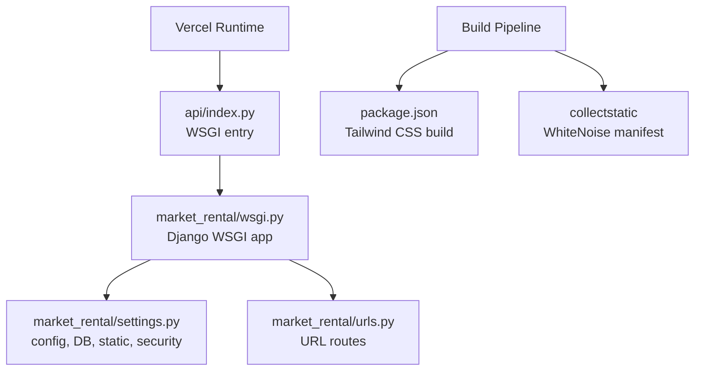
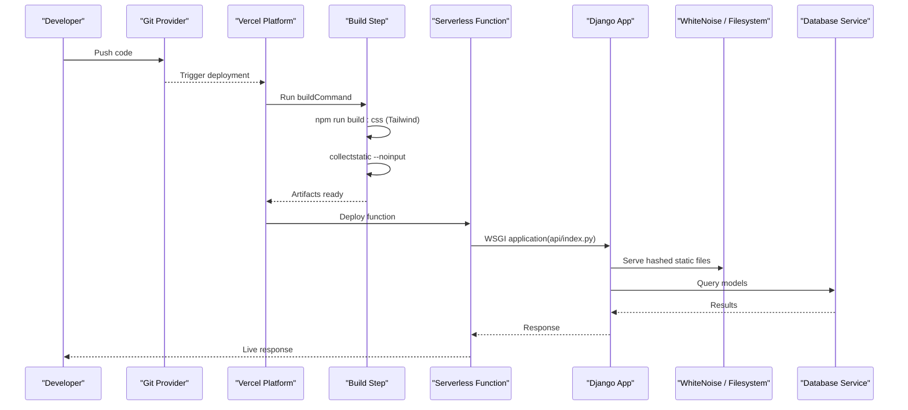
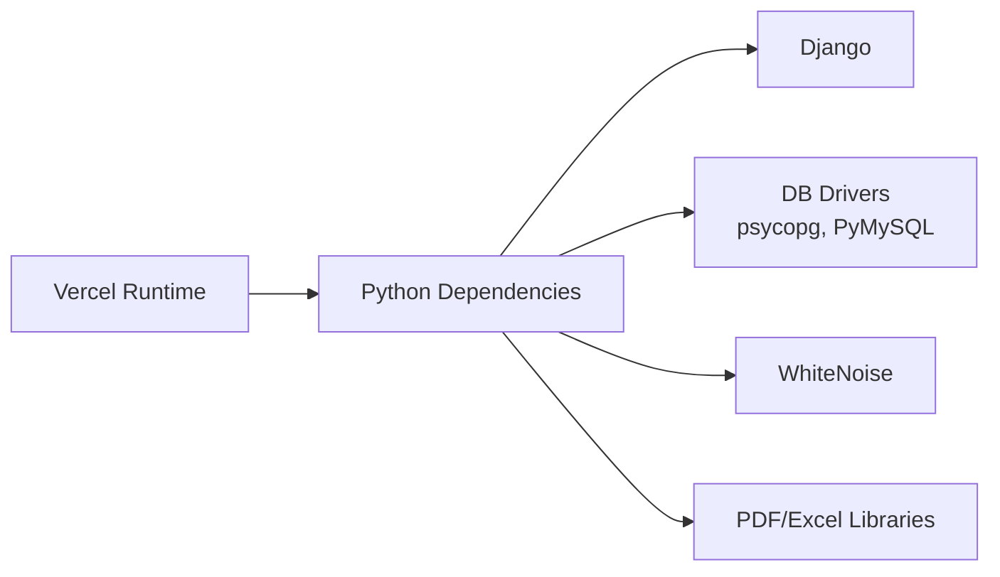

# Vercel Deployment

<cite>
**Referenced Files in This Document**   
- [vercel.json](file://vercel.json)
- [package.json](file://package.json)
- [requirements.txt](file://requirements.txt)
- [market_rental/settings.py](file://market_rental/settings.py)
- [api/index.py](file://api/index.py)
- [market_rental/wsgi.py](file://market_rental/wsgi.py)
- [market_rental/urls.py](file://market_rental/urls.py)
</cite>

## Table of Contents
1. [Introduction](#introduction)
2. [Project Structure](#project-structure)
3. [Core Components](#core-components)
4. [Architecture Overview](#architecture-overview)
5. [Detailed Component Analysis](#detailed-component-analysis)
6. [Dependency Analysis](#dependency-analysis)
7. [Performance Considerations](#performance-considerations)
8. [Troubleshooting Guide](#troubleshooting-guide)
9. [Conclusion](#conclusion)

## Introduction
This document explains how the Market Rental System deploys to Vercel as a serverless Django application. It covers the Vercel configuration, build pipeline, environment variables, static asset handling with WhiteNoise and manifest generation, preview deployments, custom domains, and performance optimizations for serverless patterns. The guidance is grounded in the repository’s actual configuration and code paths.

## Project Structure
The deployment surface is small and focused:
- A Vercel configuration file defines the build command and request routing.
- A Node script builds CSS using Tailwind.
- A Python entry point exposes the Django WSGI application.
- Django settings configure database connections, security, and static files.
- URL routing maps admin, core features, login, and logout.

**Diagram sources**
- [vercel.json:1-10](file://vercel.json#L1-L10)
- [package.json:5-12](file://package.json#L5-L12)
- [api/index.py:1-5](file://api/index.py#L1-L5)
- [market_rental/wsgi.py:10-16](file://market_rental/wsgi.py#L10-L16)
- [market_rental/settings.py:40-49](file://market_rental/settings.py#L40-L49)
- [market_rental/urls.py:7-16](file://market_rental/urls.py#L7-L16)

**Section sources**
- [vercel.json:1-10](file://vercel.json#L1-L10)
- [package.json:5-12](file://package.json#L5-L12)
- [api/index.py:1-5](file://api/index.py#L1-L5)
- [market_rental/wsgi.py:10-16](file://market_rental/wsgi.py#L10-L16)
- [market_rental/settings.py:40-49](file://market_rental/settings.py#L40-L49)
- [market_rental/urls.py:7-16](file://market_rental/urls.py#L7-L16)

## Core Components
- Vercel configuration: build commands, rewrites, and schema reference.
- CSS build: Tailwind CLI invoked via npm scripts.
- Python dependencies: Django, database adapters, WhiteNoise, PDF tools.
- WSGI entry: Vercel calls into Django through api/index.py.
- Django settings: database selection, security headers, WhiteNoise storage, CSRF trusted origins.
- URL routing: admin, core feature routes, login/logout.

Key responsibilities:
- vercel.json orchestrates the build and routes all requests to the API handler.
- package.json provides the CSS build step used during deployment.
- requirements.txt pins runtime dependencies including WhiteNoise.
- api/index.py exposes the Django WSGI application to Vercel.
- market_rental/settings.py configures production behavior, including static assets and secure cookies.
- market_rental/urls.py wires application routes.

**Section sources**
- [vercel.json:1-10](file://vercel.json#L1-L10)
- [package.json:5-12](file://package.json#L5-L12)
- [requirements.txt:1-10](file://requirements.txt#L1-L10)
- [api/index.py:1-5](file://api/index.py#L1-L5)
- [market_rental/settings.py:15-26](file://market_rental/settings.py#L15-L26)
- [market_rental/settings.py:166-190](file://market_rental/settings.py#L166-L190)
- [market_rental/urls.py:7-16](file://market_rental/urls.py#L7-L16)

## Architecture Overview
At deploy time, Vercel runs the configured build command, then serves the resulting artifacts. At runtime, every incoming HTTP request is rewritten to the Python API handler, which delegates to Django’s WSGI application. Static assets are served by WhiteNoise after being collected and hashed.

**Diagram sources**
- [vercel.json:3-9](file://vercel.json#L3-L9)
- [package.json:5-7](file://package.json#L5-L7)
- [api/index.py:1-5](file://api/index.py#L1-L5)
- [market_rental/wsgi.py:10-16](file://market_rental/wsgi.py#L10-L16)
- [market_rental/settings.py:174-190](file://market_rental/settings.py#L174-L190)

## Detailed Component Analysis

### Vercel Configuration
- Build command: compiles Tailwind CSS and collects static files without prompting.
- Rewrites: all routes are forwarded to the Python API handler so Django can process them.
- Schema: references the official Vercel JSON schema for validation.

Operational implications:
- Every request goes through the serverless function; there is no separate web server.
- Static assets must be prebuilt and collected before serving.

**Section sources**
- [vercel.json:1-10](file://vercel.json#L1-L10)

### Build Pipeline
- CSS build: Tailwind CLI reads input.css and writes minified output.css.
- Static collection: Django’s collectstatic gathers static files into STATIC_ROOT and generates a manifest when running in non-debug mode.

Best practices:
- Keep Tailwind inputs minimal to reduce build time.
- Ensure collectstatic completes successfully; failures will block deployment.

**Section sources**
- [package.json:5-12](file://package.json#L5-L12)
- [market_rental/settings.py:166-180](file://market_rental/settings.py#L166-L180)

### Serverless Function Entry Point
- api/index.py imports and exposes the Django WSGI application.
- Vercel invokes this module as the serverless function handler.

Notes:
- No additional middleware or logic is added here; all routing and processing occur inside Django.

**Section sources**
- [api/index.py:1-5](file://api/index.py#L1-L5)
- [market_rental/wsgi.py:10-16](file://market_rental/wsgi.py#L10-L16)

### Django Settings and Security
- Secret key and debug flag are read from environment variables.
- Allowed hosts include Vercel domains and localhost; custom domains can be added via DJANGO_ALLOWED_HOSTS.
- Database configuration prioritizes DATABASE_URL for managed services; otherwise falls back to local MySQL or SQLite.
- Production settings enable WhiteNoise compressed manifest storage, SSL redirect, secure cookies, and CSRF trusted origins for *.vercel.app and custom origins.

Environment-driven behaviors:
- DEBUG controls template caching, static hashing, and security posture.
- ALLOWED_HOSTS must include your custom domain(s).
- CSRF_TRUSTED_ORIGINS should include HTTPS custom domains if needed.

**Section sources**
- [market_rental/settings.py:15-26](file://market_rental/settings.py#L15-L26)
- [market_rental/settings.py:73-152](file://market_rental/settings.py#L73-L152)
- [market_rental/settings.py:174-190](file://market_rental/settings.py#L174-L190)

### URL Routing
- Admin interface at /admin/.
- Core application routes under root via included URLs.
- Login and logout endpoints explicitly defined.
- In development, media and static files are served directly; in production, WhiteNoise handles static files.

**Section sources**
- [market_rental/urls.py:7-16](file://market_rental/urls.py#L7-L16)

## Dependency Analysis
External dependencies relevant to deployment:
- Django and related packages for web framework and ORM.
- Database drivers for PostgreSQL/MySQL and SQLite fallback.
- WhiteNoise for efficient static file serving and compression.
- PDF and Excel libraries for report generation.

**Diagram sources**
- [requirements.txt:1-10](file://requirements.txt#L1-L10)

**Section sources**
- [requirements.txt:1-10](file://requirements.txt#L1-L10)

## Performance Considerations
- Use WhiteNoise CompressedManifestStaticFilesStorage to serve prehashed, compressed static assets. This reduces bandwidth and improves cacheability.
- Ensure collectstatic runs on every deploy so manifests reflect updated assets.
- Avoid heavy per-request work in serverless functions; prefer background tasks or external services where possible.
- Keep database connection pooling reasonable; the settings use connection max age and health checks for managed databases.
- Minimize Cold Start Impact:
  - Reduce unnecessary imports at module level.
  - Keep the WSGI entry lightweight (already done).
  - Prebuild all assets and avoid runtime compilation.

[No sources needed since this section provides general guidance]

## Troubleshooting Guide

### Build Failures
Symptoms:
- Deployment fails during npm or collectstatic steps.

Checks:
- Verify Tailwind input/output paths exist and are readable.
- Confirm collectstatic completes without errors.
- Ensure required Node and Python dependencies are installed.

Relevant configuration:
- Build command includes both Tailwind and collectstatic.

**Section sources**
- [vercel.json:3](file://vercel.json#L3)
- [package.json:5-7](file://package.json#L5-L7)

### Database Connection Issues
Symptoms:
- Application cannot connect to the database at runtime.

Checks:
- Ensure DATABASE_URL is set correctly in Vercel environment variables.
- For local MySQL, confirm host, port, user, password, and database name.
- Validate SSL requirements for managed databases in production.

Relevant configuration:
- DATABASE_URL takes precedence over DB_ENGINE.
- Connection options include max age and health checks.

**Section sources**
- [market_rental/settings.py:73-152](file://market_rental/settings.py#L73-L152)

### File Permissions and Static Assets
Symptoms:
- 404 for static files or missing hashed assets.

Checks:
- Confirm collectstatic ran and produced the manifest.
- Ensure WhiteNoise middleware is active and STORAGES is configured for production.
- Verify that STATIC_ROOT exists and is writable during build.

Relevant configuration:
- WhiteNoise middleware and storage backend are enabled when DEBUG is false.

**Section sources**
- [market_rental/settings.py:40-49](file://market_rental/settings.py#L40-L49)
- [market_rental/settings.py:174-180](file://market_rental/settings.py#L174-L180)

### Hostname and CSRF Errors
Symptoms:
- “Invalid HTTP_HOST header” or CSRF verification failed.

Checks:
- Add your custom domain to DJANGO_ALLOWED_HOSTS.
- Include HTTPS custom origins in DJANGO_CSRF_TRUSTED_ORIGINS.
- Confirm SECURE_SSL_REDIRECT and cookie security flags are appropriate for production.

Relevant configuration:
- ALLOWED_HOSTS defaults include Vercel domains and localhost.
- CSRF_TRUSTED_ORIGINS includes *.vercel.app and custom origins.

**Section sources**
- [market_rental/settings.py:21-26](file://market_rental/settings.py#L21-L26)
- [market_rental/settings.py:182-190](file://market_rental/settings.py#L182-L190)

### Preview Deployments
- Each branch creates a preview deployment automatically.
- Preview URLs use the Vercel subdomain pattern; ensure ALLOWED_HOSTS and CSRF trusted origins cover preview domains.
- Environment variables can be scoped per project or branch.

Configuration notes:
- Settings extend ALLOWED_HOSTS with .vercel.app for non-debug environments.

**Section sources**
- [market_rental/settings.py:21-26](file://market_rental/settings.py#L21-L26)

### Custom Domains
- Configure custom domains in the Vercel dashboard.
- Update DJANGO_ALLOWED_HOSTS to include your domain(s).
- If using HTTPS, add the domain to CSRF_TRUSTED_ORIGINS.

Security considerations:
- Enable SSL redirect and secure cookies in production.

**Section sources**
- [market_rental/settings.py:182-190](file://market_rental/settings.py#L182-L190)

## Conclusion
The repository is structured for a clean Vercel deployment: a minimal serverless entry point, explicit build steps for CSS and static assets, and environment-driven configuration for databases and security. By ensuring correct environment variables, verifying build outputs, and following the troubleshooting steps, you can reliably deploy, preview, and scale the application on Vercel while maintaining strong performance and security characteristics.