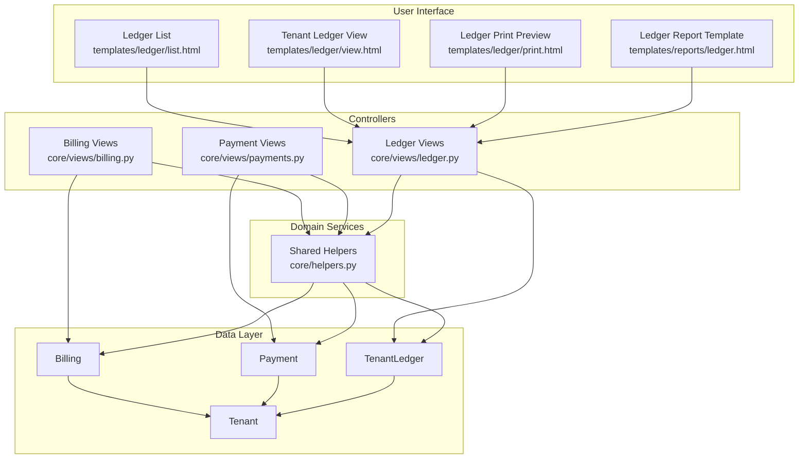
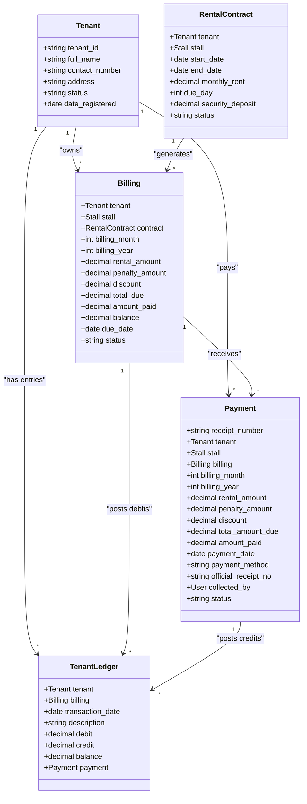
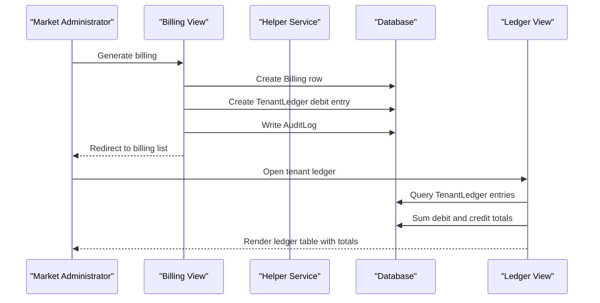
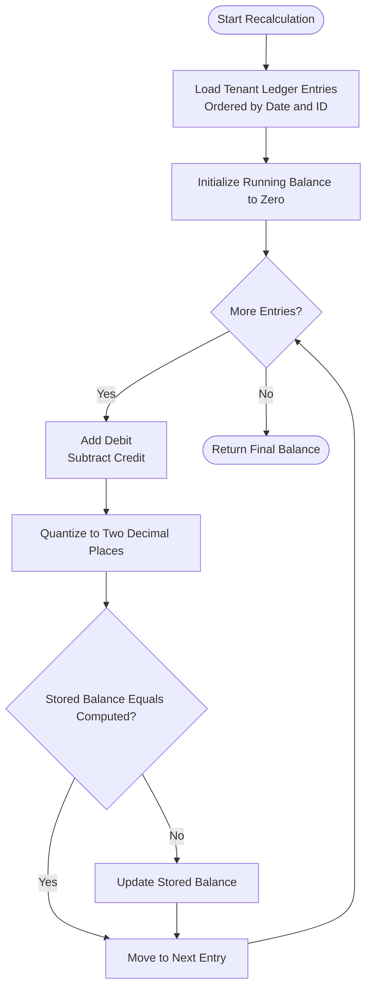
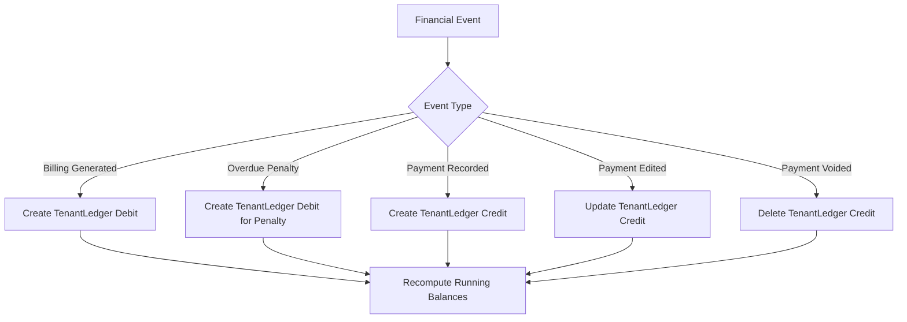
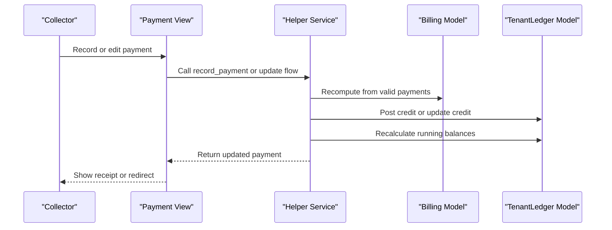
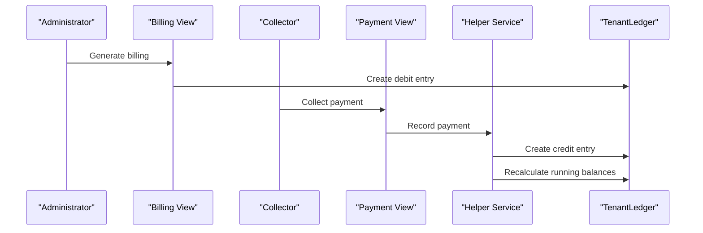
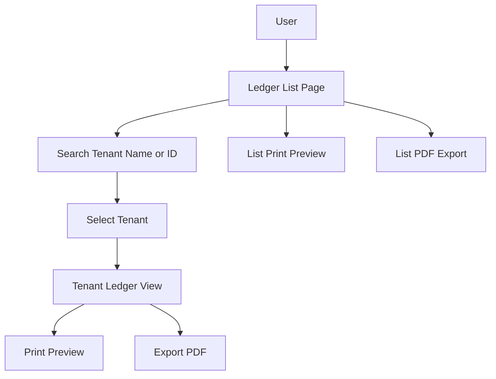
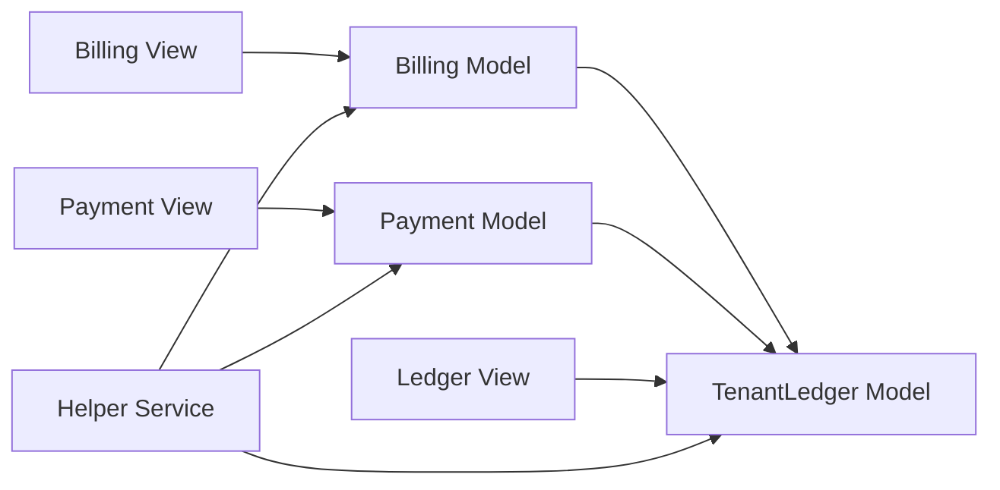

# Financial Ledger

<cite>
**Referenced Files in This Document**
- [core/models.py](file://core/models.py)
- [core/helpers.py](file://core/helpers.py)
- [core/views/ledger.py](file://core/views/ledger.py)
- [core/views/billing.py](file://core/views/billing.py)
- [core/views/payments.py](file://core/views/payments.py)
- [templates/ledger/list.html](file://templates/ledger/list.html)
- [templates/ledger/_table.html](file://templates/ledger/_table.html)
- [templates/ledger/view.html](file://templates/ledger/view.html)
- [templates/ledger/print.html](file://templates/ledger/print.html)
- [templates/reports/ledger.html](file://templates/reports/ledger.html)
</cite>

## Table of Contents
1. [Introduction](#introduction)
2. [Project Structure](#project-structure)
3. [Core Components](#core-components)
4. [Architecture Overview](#architecture-overview)
5. [Detailed Component Analysis](#detailed-component-analysis)
6. [Dependency Analysis](#dependency-analysis)
7. [Performance Considerations](#performance-considerations)
8. [Troubleshooting Guide](#troubleshooting-guide)
9. [Conclusion](#conclusion)
10. [Appendices](#appendices)

## Introduction
The Financial Ledger module records every financial event for a tenant as a chronological sequence of debit and credit entries. It is the reconciliation backbone between billing generation, payment collection, penalties, and reporting. The system applies double-entry accounting principles by posting:
- Debits when charges are created or increased (for example, rental billing and overdue penalties).
- Credits when payments are recorded or applied to outstanding balances.

Each `TenantLedger` row stores the transaction date, description, debit amount, credit amount, and running balance. Running balances are recomputed chronologically so that edits, voids, partial payments, and penalty accruals remain consistent across the entire ledger chain.

## Project Structure
The ledger functionality spans models, helper services, view controllers, and templates:
- Models define tenants, billings, payments, and ledger rows.
- Helper functions provide idempotent billing creation, payment recording, billing reconciliation, penalty application, and ledger recalculation.
- Ledger views render tenant selection, per-tenant ledger lists, print previews, and PDF exports.
- Billing and payment views create debits and credits through shared service logic.
- Templates present interactive web pages and printable reports.

**Diagram sources**
- [core/views/ledger.py:16-182](file://core/views/ledger.py#L16-L182)
- [core/views/billing.py:174-489](file://core/views/billing.py#L174-L489)
- [core/views/payments.py:250-518](file://core/views/payments.py#L250-L518)
- [core/helpers.py:155-205](file://core/helpers.py#L155-L205)
- [core/helpers.py:351-420](file://core/helpers.py#L351-L420)
- [core/models.py:190-278](file://core/models.py#L190-L278)

**Section sources**
- [core/views/ledger.py:16-182](file://core/views/ledger.py#L16-L182)
- [core/views/billing.py:174-489](file://core/views/billing.py#L174-L489)
- [core/views/payments.py:250-518](file://core/views/payments.py#L250-L518)
- [core/helpers.py:155-205](file://core/helpers.py#L155-L205)
- [core/helpers.py:351-420](file://core/helpers.py#L351-L420)
- [core/models.py:190-278](file://core/models.py#L190-L278)

## Core Components
The ledger domain centers on four entities:
- `Tenant`: the account holder whose financial history is tracked.
- `Billing`: a monthly charge with rental amount, penalty, discount, total due, amount paid, and balance.
- `Payment`: an official collection linked to a billing, receipt number, payment method, and collector.
- `TenantLedger`: the immutable-style chronological record of debits and credits with a computed running balance.

**Diagram sources**
- [core/models.py:117-278](file://core/models.py#L117-L278)

**Section sources**
- [core/models.py:117-278](file://core/models.py#L117-L278)

## Architecture Overview
The ledger architecture follows a clear separation of concerns:
- Billing flows create debits.
- Payment flows create credits.
- Shared helpers ensure consistency between billing totals, payment records, and ledger balances.
- Ledger views provide tenant-scoped reading, printing, and export.
- Audit logs capture who performed each action.

**Diagram sources**
- [core/views/billing.py:174-246](file://core/views/billing.py#L174-L246)
- [core/views/ledger.py:51-82](file://core/views/ledger.py#L51-L82)
- [core/helpers.py:155-205](file://core/helpers.py#L155-L205)

## Detailed Component Analysis

### Running Balance Calculation Methodology
The running balance is calculated chronologically by tenant. For each ledger entry in order of transaction date and primary key, the system adds debits and subtracts credits, then updates the stored balance if it differs from the computed value. This ensures that historical corrections, partial payments, and penalty adjustments propagate correctly through subsequent rows.

Key behaviors:
- Chronological ordering uses `transaction_date` and `id`.
- All monetary arithmetic uses `Decimal` to avoid floating-point drift.
- Balances are recomputed after billing edits, payment edits, payment voids, and penalty accruals.
- The current ledger view computes summary totals and a simple running balance for display purposes; the authoritative chain is maintained by the helper function.

**Diagram sources**
- [core/helpers.py:260-273](file://core/helpers.py#L260-L273)

**Section sources**
- [core/helpers.py:260-273](file://core/helpers.py#L260-L273)

### Debit and Credit Entry Tracking
Debits represent amounts owed by the tenant; credits represent payments applied to those obligations.

Debit entries are created when:
- A rental billing is generated.
- An overdue penalty is accrued.
- A billing is edited and its debit amount changes.

Credit entries are created when:
- A payment is recorded.
- A payment is edited and its credit amount changes.
- A payment is voided and its associated ledger credit is removed before recalculating the chain.

**Diagram sources**
- [core/views/billing.py:200-224](file://core/views/billing.py#L200-L224)
- [core/helpers.py:423-500](file://core/helpers.py#L423-L500)
- [core/views/payments.py:473-491](file://core/views/payments.py#L473-L491)
- [core/views/payments.py:521-540](file://core/views/payments.py#L521-L540)

**Section sources**
- [core/views/billing.py:200-224](file://core/views/billing.py#L200-L224)
- [core/helpers.py:423-500](file://core/helpers.py#L423-L500)
- [core/views/payments.py:473-491](file://core/views/payments.py#L473-L491)
- [core/views/payments.py:521-540](file://core/views/payments.py#L521-L540)

### Chronological Transaction History
The ledger presents transactions in reverse chronological order for screen readability while preserving chronological ordering for balance computation. Each row includes:
- Transaction date.
- Billing period.
- Stall number.
- Description.
- Rental and penalty breakdown where applicable.
- Debit and credit amounts.
- Running balance.
- Receipt or official receipt number.
- Associated billing or payment status.

Tenants can only view their own ledger; management roles can view all active tenants with active contracts.

**Section sources**
- [core/views/ledger.py:51-82](file://core/views/ledger.py#L51-L82)
- [templates/ledger/view.html:71-160](file://templates/ledger/view.html#L71-L160)

### Double-Entry Accounting Principles
Although the system does not use a traditional multi-account chart of accounts, it applies double-entry principles at the tenant level:
- Every charge increases the tenant’s debit side.
- Every payment increases the tenant’s credit side.
- The net result is the tenant’s outstanding balance.
- Billing totals and payment totals are reconciled authoritatively from valid payments.
- Ledger balances are recomputed to maintain consistency after any change.

This approach ensures that:
- Partial payments do not over-settle a billing.
- Overpayments are clamped to the outstanding balance for ledger application.
- Voided payments remove their credit effect and restore prior balances.
- Penalties increase debits without duplicating charges.

**Section sources**
- [core/helpers.py:321-348](file://core/helpers.py#L321-L348)
- [core/helpers.py:351-420](file://core/helpers.py#L351-L420)
- [core/helpers.py:423-500](file://core/helpers.py#L423-L500)

### Reconciliation Process
Reconciliation occurs at multiple levels:
1. **Billing reconciliation**: The system recomputes `amount_paid`, `balance`, and `status` from valid payments using a locked billing row.
2. **Ledger reconciliation**: The system recomputes the running balance for all entries of a tenant in chronological order.
3. **Penalty reconciliation**: Overdue penalties are applied once per billing and trigger ledger debits and balance recalculation.
4. **Edit and void reconciliation**: Editing or voiding a payment triggers billing recomputation, ledger updates, and full tenant ledger recalculation.

**Diagram sources**
- [core/views/payments.py:250-294](file://core/views/payments.py#L250-L294)
- [core/views/payments.py:460-518](file://core/views/payments.py#L460-L518)
- [core/helpers.py:321-348](file://core/helpers.py#L321-L348)
- [core/helpers.py:351-420](file://core/helpers.py#L351-L420)

**Section sources**
- [core/views/payments.py:250-294](file://core/views/payments.py#L250-L294)
- [core/views/payments.py:460-518](file://core/views/payments.py#L460-L518)
- [core/helpers.py:321-348](file://core/helpers.py#L321-L348)
- [core/helpers.py:351-420](file://core/helpers.py#L351-L420)

### Integration with Billing and Payment Systems
Billing and payment modules are the primary writers to the ledger:
- Billing generation creates a debit entry tied to the billing row.
- Payment recording creates a credit entry tied to the payment row.
- Batch collections create multiple payments and corresponding ledger credits under a consolidated official receipt.
- Billing edits update the related debit and trigger full ledger recalculation.
- Payment edits update the related credit and trigger full ledger recalculation.
- Payment voids delete the related credit and trigger full ledger recalculation.

**Diagram sources**
- [core/views/billing.py:174-246](file://core/views/billing.py#L174-L246)
- [core/views/billing.py:415-489](file://core/views/billing.py#L415-L489)
- [core/views/payments.py:250-294](file://core/views/payments.py#L250-L294)
- [core/helpers.py:351-420](file://core/helpers.py#L351-L420)

**Section sources**
- [core/views/billing.py:174-246](file://core/views/billing.py#L174-L246)
- [core/views/billing.py:415-489](file://core/views/billing.py#L415-L489)
- [core/views/payments.py:250-294](file://core/views/payments.py#L250-L294)
- [core/helpers.py:351-420](file://core/helpers.py#L351-L420)

### Ledger Viewing, Printing, and Export
The ledger provides three main user experiences:
1. **Tenant list view**: Searchable paginated list of tenants with active contracts. Tenants are redirected to their own ledger if logged in as a tenant.
2. **Per-tenant ledger view**: Shows total debits, total credits, outstanding balance, and detailed entries with pagination.
3. **Print and export**:
   - Print preview renders a formatted ledger page.
   - PDF export generates a downloadable ledger file.
   - Tenant list print and PDF export support bulk overview.

**Diagram sources**
- [core/views/ledger.py:16-48](file://core/views/ledger.py#L16-L48)
- [core/views/ledger.py:51-133](file://core/views/ledger.py#L51-L133)
- [core/views/ledger.py:137-182](file://core/views/ledger.py#L137-L182)
- [templates/ledger/list.html:22-30](file://templates/ledger/list.html#L22-L30)
- [templates/ledger/view.html:24-30](file://templates/ledger/view.html#L24-L30)
- [templates/ledger/print.html:14-17](file://templates/ledger/print.html#L14-L17)

**Section sources**
- [core/views/ledger.py:16-48](file://core/views/ledger.py#L16-L48)
- [core/views/ledger.py:51-133](file://core/views/ledger.py#L51-L133)
- [core/views/ledger.py:137-182](file://core/views/ledger.py#L137-L182)
- [templates/ledger/list.html:22-30](file://templates/ledger/list.html#L22-L30)
- [templates/ledger/view.html:24-30](file://templates/ledger/view.html#L24-L30)
- [templates/ledger/print.html:14-17](file://templates/ledger/print.html#L14-L17)

### Ledger Search, Filtering, and Date Range Queries
Current capabilities:
- **Tenant search**: The ledger list supports searching by tenant name or tenant ID.
- **Date range queries**: The report template exposes date-from and date-to inputs, but the ledger view and print endpoints currently query all entries for the selected tenant without applying date filters.
- **Tenant-specific views**: Tenants are restricted to their own ledger; management users can view all active tenants with active contracts.

Recommendation: Extend ledger view and print endpoints to accept `date_from` and `date_to` parameters and apply them to `transaction_date` filtering, mirroring the report template’s filter controls.

**Section sources**
- [core/views/ledger.py:31-48](file://core/views/ledger.py#L31-L48)
- [core/views/ledger.py:51-82](file://core/views/ledger.py#L51-L82)
- [templates/reports/ledger.html:9-30](file://templates/reports/ledger.html#L9-L30)

### Audit Compliance Features
Every significant financial action is captured in audit logs:
- Billing generation and batch generation.
- Payment creation and editing.
- Payment voiding.
- Automatic penalty application.

Audit entries include:
- Performing user.
- Action type.
- Module name.
- Human-readable description.
- IP address where available.
- Creation timestamp.

This provides traceability for collectors, supervisors, treasurers, and auditors reviewing financial activity.

**Section sources**
- [core/views/billing.py:226-232](file://core/views/billing.py#L226-L232)
- [core/views/billing.py:299-305](file://core/views/billing.py#L299-L305)
- [core/views/billing.py:350-356](file://core/views/billing.py#L350-L356)
- [core/views/billing.py:460-466](file://core/views/billing.py#L460-L466)
- [core/views/payments.py:269-275](file://core/views/payments.py#L269-L275)
- [core/views/payments.py:437-443](file://core/views/payments.py#L437-L443)
- [core/views/payments.py:498-504](file://core/views/payments.py#L498-L504)
- [core/views/payments.py:541-547](file://core/views/payments.py#L541-L547)
- [core/helpers.py:480-485](file://core/helpers.py#L480-L485)

## Dependency Analysis
The ledger depends on billing and payment data, while also being updated by shared helper functions. The following diagram shows the primary dependency relationships relevant to financial accuracy.

**Diagram sources**
- [core/models.py:190-278](file://core/models.py#L190-L278)
- [core/views/billing.py:174-489](file://core/views/billing.py#L174-L489)
- [core/views/payments.py:250-518](file://core/views/payments.py#L250-L518)
- [core/views/ledger.py:51-133](file://core/views/ledger.py#L51-L133)
- [core/helpers.py:155-205](file://core/helpers.py#L155-L205)
- [core/helpers.py:351-420](file://core/helpers.py#L351-L420)

**Section sources**
- [core/models.py:190-278](file://core/models.py#L190-L278)
- [core/views/billing.py:174-489](file://core/views/billing.py#L174-L489)
- [core/views/payments.py:250-518](file://core/views/payments.py#L250-L518)
- [core/views/ledger.py:51-133](file://core/views/ledger.py#L51-L133)
- [core/helpers.py:155-205](file://core/helpers.py#L155-L205)
- [core/helpers.py:351-420](file://core/helpers.py#L351-L420)

## Performance Considerations
- **Query optimization**: Ledger views use `select_related` for `billing` and `payment` to reduce N+1 queries when rendering entry details.
- **Pagination**: Both tenant list and ledger entries are paginated to keep large datasets manageable.
- **Decimal arithmetic**: Financial calculations use `Decimal` to prevent rounding errors.
- **Concurrent safety**: Payment recording locks the billing row and retries receipt number generation to handle collisions safely.
- **Batch operations**: Batch collections generate multiple payments and receipts efficiently while maintaining a single official receipt reference.

[No sources needed since this section provides general guidance]

## Troubleshooting Guide
Common issues and resolutions:
- **Missing ledger entries**: Ensure billings have been generated and payments recorded. Ledger rows are created during billing generation and payment recording.
- **Incorrect running balance**: Use the helper function to recalculate tenant ledger balances after manual edits or data corrections.
- **Duplicate billings**: The system prevents duplicate billings per tenant, stall, month, and year. If a billing already exists, the generator redirects with a warning.
- **Overpayment handling**: The system clamps the ledger credit to the outstanding balance; the payment still records the full received amount.
- **PDF export failures**: The PDF renderer tries WeasyPrint first, falls back to xhtml2pdf, and finally returns an HTML preview with a browser Print option.

**Section sources**
- [core/views/billing.py:186-192](file://core/views/billing.py#L186-L192)
- [core/helpers.py:260-273](file://core/helpers.py#L260-L273)
- [core/helpers.py:351-420](file://core/helpers.py#L351-L420)
- [core/helpers.py:522-594](file://core/helpers.py#L522-L594)

## Conclusion
The Financial Ledger module provides a reliable, auditable, and reconcilable record of tenant finances. By separating billing debits and payment credits into chronological ledger entries and recomputing running balances consistently, the system maintains accurate financial records even under partial payments, edits, voids, and penalty accruals. The integration with billing and payment workflows, combined with tenant-scoped access, print/export capabilities, and audit logging, makes the ledger suitable for operational finance, reporting, and compliance review.

[No sources needed since this section summarizes without analyzing specific files]

## Appendices

### Example: Viewing a Tenant Ledger
A manager opens the ledger list, searches for a tenant, and clicks View Ledger. The system loads all ledger entries for that tenant, calculates total debits, total credits, and outstanding balance, and displays them in a paginated table. From there, the manager can print or export the ledger.

**Section sources**
- [core/views/ledger.py:16-48](file://core/views/ledger.py#L16-L48)
- [core/views/ledger.py:51-82](file://core/views/ledger.py#L51-L82)
- [templates/ledger/view.html:35-69](file://templates/ledger/view.html#L35-L69)

### Example: Creating a Debit Through Billing Generation
When a billing is generated, the system creates a billing row and posts a corresponding debit to the tenant ledger. The description identifies the billing period and stall, and the debit equals the total due including any applicable penalty.

**Section sources**
- [core/views/billing.py:200-224](file://core/views/billing.py#L200-L224)
- [core/helpers.py:155-205](file://core/helpers.py#L155-L205)

### Example: Creating a Credit Through Payment Collection
When a collector collects a payment, the system creates a payment row, updates the billing totals, posts a credit to the ledger, and recomputes the running balance. The credit reflects the amount actually applied to the billing.

**Section sources**
- [core/views/billing.py:415-489](file://core/views/billing.py#L415-L489)
- [core/views/payments.py:250-294](file://core/views/payments.py#L250-L294)
- [core/helpers.py:351-420](file://core/helpers.py#L351-L420)