# Frontend Architecture

<cite>
**Referenced Files in This Document**   
- [base.html](file://templates/base.html)
- [input.css](file://static/css/input.css)
- [package.json](file://package.json)
- [DESIGN_SYSTEM.md](file://docs/DESIGN_SYSTEM.md)
- [pagination.html](file://templates/includes/pagination.html)
- [status_badge.html](file://templates/includes/status_badge.html)
- [billing_modal_form.html](file://templates/billing/_modal_form.html)
- [contracts_modal_form.html](file://templates/contracts/_modal_form.html)
- [payments_modal_form.html](file://templates/payments/_modal_form.html)
- [audit_list.html](file://templates/audit/list.html)
- [billing_list.html](file://templates/billing/list.html)
- [dashboard.html](file://templates/dashboard.html)
</cite>

## Table of Contents
1. [Introduction](#introduction)
2. [Project Structure](#project-structure)
3. [Core Components](#core-components)
4. [Architecture Overview](#architecture-overview)
5. [Detailed Component Analysis](#detailed-component-analysis)
6. [Dependency Analysis](#dependency-analysis)
7. [Performance Considerations](#performance-considerations)
8. [Accessibility and Browser Compatibility](#accessibility-and-browser-compatibility)
9. [Troubleshooting Guide](#troubleshooting-guide)
10. [Conclusion](#conclusion)

## Introduction
This document explains the frontend architecture of the Market Rental System. The application is a Django server-rendered interface enhanced with:

- **HTMX** for dynamic, partial page updates without full reloads.
- **Alpine.js** for lightweight reactive UI behavior such as sidebar toggling, dropdown menus, and transitions.
- **Tailwind CSS 4** compiled from `static/css/input.css` into `static/css/output.css`.
- A custom **“Emerald Glass” design system** providing reusable components for panels, buttons, forms, tables, badges, alerts, navigation, and print-ready documents.

The goal is to make the system feel like a modern single-page application while keeping templates simple, maintainable, and accessible.

## Project Structure
The frontend assets are organized around three main areas:

| Area | Purpose | Key Files |
|---|---|---|
| Templates | Server-rendered HTML with HTMX and Alpine directives | `templates/base.html`, feature folders (`billing`, `contracts`, `payments`, `audit`, etc.) |
| Static Assets | Compiled CSS and third-party scripts | `static/css/output.css`, `static/js/htmx.min.js`, `static/js/alpine.min.js` |
| Build Configuration | Tailwind CLI build commands | `package.json` |

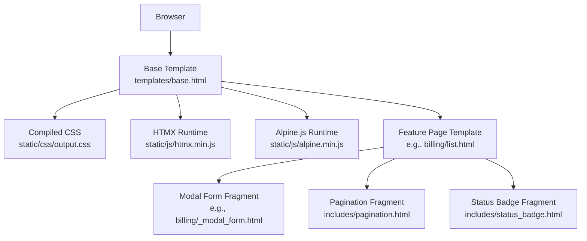

**Diagram sources**
- [base.html:1-18](file://templates/base.html#L1-L18)
- [billing_list.html:1-97](file://templates/billing/list.html#L1-L97)
- [billing_modal_form.html:1-142](file://templates/billing/_modal_form.html#L1-L142)
- [pagination.html:1-47](file://templates/includes/pagination.html#L1-L47)
- [status_badge.html:1-7](file://templates/includes/status_badge.html#L1-L7)

**Section sources**
- [base.html:1-18](file://templates/base.html#L1-L18)
- [package.json:1-14](file://package.json#L1-L14)

## Core Components
The frontend core consists of:

1. **Base layout template** — global HTML shell, theme setup, script loading, sidebar, header, content area, modals, toasts, and shared JavaScript helpers.
2. **Design system CSS** — Tailwind 4 configuration, semantic tokens, component classes, and print styles.
3. **Reusable fragments** — pagination, status badges, modal forms, and table includes.
4. **HTMX-driven pages** — search, filters, and list views that update DOM regions without reloading.
5. **Alpine.js interactions** — sidebar state, dropdowns, collapsible menu groups, and responsive behavior.

Key responsibilities:

| Component | Responsibility |
|---|---|
| `base.html` | Global layout, CSRF headers for HTMX, Alpine initialization, modal/toast infrastructure |
| `input.css` | Design tokens, glass/neumorphic surfaces, form/table/badge/button components |
| `pagination.html` | Page navigation with optional HTMX swap |
| `status_badge.html` | Semantic status rendering using badge variants |
| Feature modal forms | Add/edit flows submitted via HTMX into the shared modal container |

**Section sources**
- [base.html:1-312](file://templates/base.html#L1-L312)
- [input.css:1-833](file://static/css/input.css#L1-L833)
- [pagination.html:1-47](file://templates/includes/pagination.html#L1-L47)
- [status_badge.html:1-7](file://templates/includes/status_badge.html#L1-L7)

## Architecture Overview
The frontend follows a layered, template-centric architecture:

- **Django renders base templates** with context variables such as user, permissions, and system settings.
- **HTMX handles client-side requests** triggered by input events, replacing target elements with server-rendered fragments.
- **Alpine.js manages local UI state** inside the same template without requiring a separate frontend framework.
- **Tailwind CSS 4 compiles utility and component classes** into a single production stylesheet.

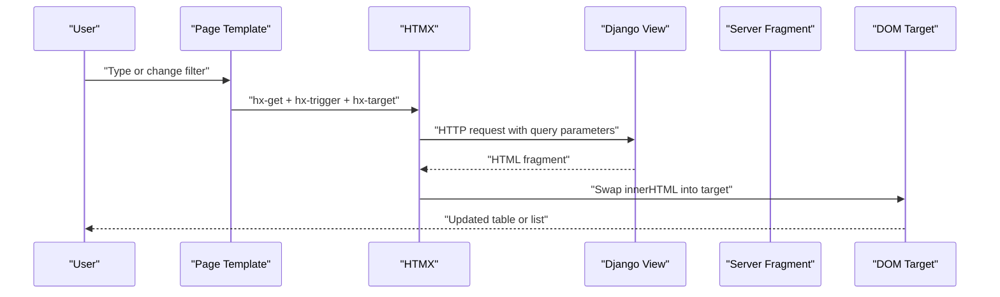

**Diagram sources**
- [audit_list.html:21-39](file://templates/audit/list.html#L21-L39)
- [billing_list.html:60-94](file://templates/billing/list.html#L60-L94)
- [base.html:19-19](file://templates/base.html#L19-L19)

**Section sources**
- [audit_list.html:1-42](file://templates/audit/list.html#L1-L42)
- [billing_list.html:1-97](file://templates/billing/list.html#L1-L97)
- [base.html:19-19](file://templates/base.html#L19-L19)

## Detailed Component Analysis

### Base Layout and Shared Infrastructure
The base template provides:

- Global meta tags, fonts, and compiled CSS.
- HTMX and Alpine.js loaded from static files.
- CSRF token injected into HTMX headers so all HTMX requests include authentication security.
- Alpine-controlled sidebar state that adapts to screen width.
- Header with page title blocks and user menu.
- Main content block for page-specific markup.
- Shared modal and confirmation dialog containers.
- Toast notification helper and error handling for failed HTMX responses.

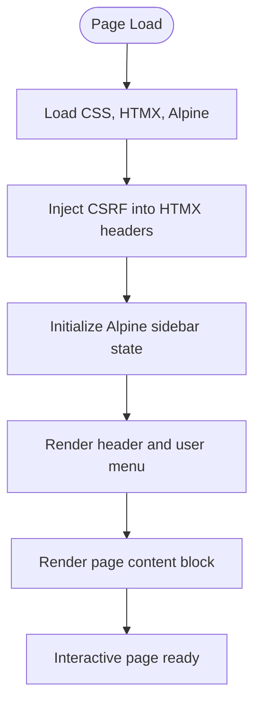

**Diagram sources**
- [base.html:1-18](file://templates/base.html#L1-L18)
- [base.html:19-30](file://templates/base.html#L19-L30)
- [base.html:202-266](file://templates/base.html#L202-L266)
- [base.html:270-311](file://templates/base.html#L270-L311)

**Section sources**
- [base.html:1-312](file://templates/base.html#L1-L312)

### HTMX Integration Patterns
HTMX is used primarily for:

- **Live search**: typing into a search field triggers an asynchronous GET request and replaces the table wrapper.
- **Filtering**: changing month, year, status, action, module, or date range triggers filtered results.
- **Modal forms**: submitting add/edit forms posts data and swaps the response back into the modal container.
- **Pagination**: links can optionally use HTMX to swap only the table region instead of reloading the page.

Common attribute patterns observed:

| Pattern | Meaning | Example Usage |
|---|---|---|
| `hx-get="..."` | Sends a GET request to a URL | Search and filter inputs |
| `hx-post="..."` | Sends a POST request to a URL | Modal forms |
| `hx-target="#..."` | Replaces content of a target element | Table wrappers, modal content |
| `hx-trigger="keyup changed delay:400ms"` | Debounces rapid keystrokes | Search fields |
| `hx-include="[name='...']"` | Includes additional form fields in the request | Filter combinations |
| `hx-push-url="true"` | Updates browser history | Search and filter navigation |
| `hx-swap="innerHTML"` | Replaces inner HTML of target | Pagination and table updates |

Examples:

- Audit log search and filters use HTMX to update `#audit-table-wrapper`.
- Billing list uses HTMX to update `#billing-table-wrapper`.
- Modal forms post to backend endpoints and replace `#modal-content`.

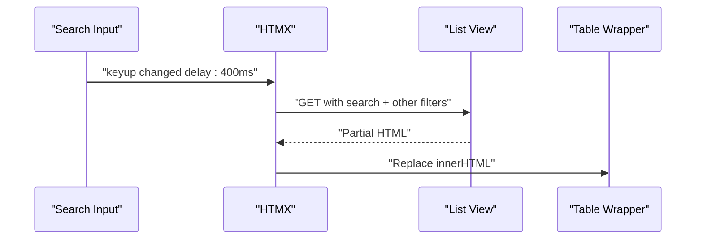

**Diagram sources**
- [audit_list.html:21-39](file://templates/audit/list.html#L21-L39)
- [billing_list.html:60-94](file://templates/billing/list.html#L60-L94)

**Section sources**
- [audit_list.html:21-39](file://templates/audit/list.html#L21-L39)
- [billing_list.html:60-94](file://templates/billing/list.html#L60-L94)
- [billing_modal_form.html:16-33](file://templates/billing/_modal_form.html#L16-L33)
- [contracts_modal_form.html:18-33](file://templates/contracts/_modal_form.html#L18-L33)
- [payments_modal_form.html:13-27](file://templates/payments/_modal_form.html#L13-L27)
- [pagination.html:10-40](file://templates/includes/pagination.html#L10-L40)

### Alpine.js Reactive UI Interactions
Alpine.js is used for lightweight interactivity without a full frontend framework:

- Sidebar open/close state bound to window width.
- Mobile scrim overlay that closes when tapped.
- Collapsible navigation groups for Tenants, Stalls, Contracts, Billing, and Reports.
- Dropdown menus in the header.
- Message dismissal controls.
- Utility functions for toasts, modals, and confirm dialogs.

Key directives and behaviors:

| Directive / Behavior | Purpose |
|---|---|
| `x-data="{ ... }"` | Defines reactive state |
| `x-show="..."` | Conditionally shows/hides elements |
| `x-cloak` | Prevents flash of unstyled Alpine content |
| `@click="..."` | Handles click events |
| `@resize.window="..."` | Reacts to viewport changes |
| `x-transition` | Adds enter/leave animations |
| `onclick="openModal(...)"` | Integrates with shared modal helper |

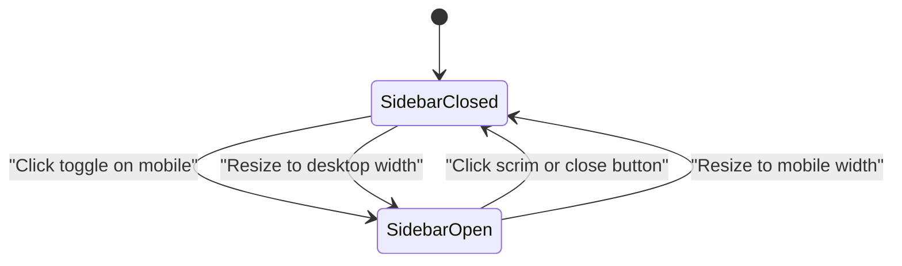

**Diagram sources**
- [base.html:20-29](file://templates/base.html#L20-L29)
- [base.html:87-124](file://templates/base.html#L87-L124)
- [base.html:224-241](file://templates/base.html#L224-L241)
- [base.html:292-308](file://templates/base.html#L292-L308)

**Section sources**
- [base.html:20-30](file://templates/base.html#L20-L30)
- [base.html:87-124](file://templates/base.html#L87-L124)
- [base.html:224-241](file://templates/base.html#L224-L241)
- [base.html:292-308](file://templates/base.html#L292-L308)

### Tailwind CSS 4 Styling System and Responsive Design
The styling system is built on Tailwind CSS 4 with a custom design language called “Emerald Glass.”

Highlights:

- **Theme tokens**: emerald palette, gold accent, ivory canvas, ink text, semantic colors, typography, radii, and shadows.
- **Base layer**: body background, scrollbars, focus states, native form control styling, and typography defaults.
- **Component layer**: glass surfaces, neumorphism, panels, buttons, forms, filter bars, tables, stat cards, badges, chips, alerts, navigation, page furniture, progress indicators, empty states, and print/document styles.
- **Responsive patterns**: mobile-first layouts using Tailwind breakpoints, grid columns, flex direction changes, and hidden/show utilities.
- **Print styles**: hide interactive chrome and render official documents in black-on-white format.

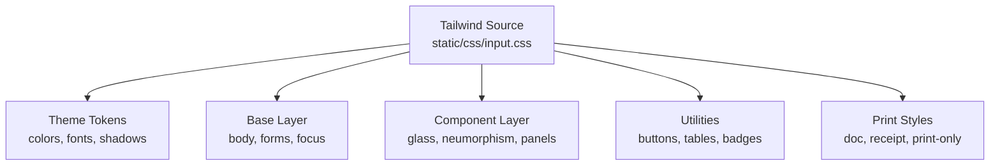

**Diagram sources**
- [input.css:1-84](file://static/css/input.css#L1-L84)
- [input.css:89-197](file://static/css/input.css#L89-L197)
- [input.css:202-833](file://static/css/input.css#L202-L833)

**Section sources**
- [input.css:1-833](file://static/css/input.css#L1-L833)
- [DESIGN_SYSTEM.md:1-190](file://docs/DESIGN_SYSTEM.md#L1-L190)

### Component Library

#### Pagination
The pagination component supports both normal navigation and HTMX-powered swapping. It:

- Shows current page range and total count.
- Renders first, previous, next, last, and visible page numbers.
- Preserves existing query parameters except `page`.
- Optionally adds HTMX attributes when `pagination_target` is provided.

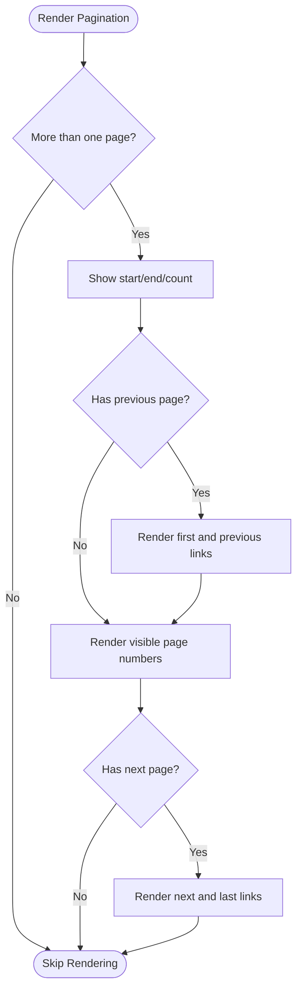

**Diagram sources**
- [pagination.html:1-47](file://templates/includes/pagination.html#L1-L47)

**Section sources**
- [pagination.html:1-47](file://templates/includes/pagination.html#L1-L47)

#### Status Badges
The status badge component maps business statuses to semantic badge classes:

- Success: Active, Paid, Occupied.
- Muted: Inactive, Vacant, Cancelled.
- Warning: Suspended, Reserved, Partial, Expired, Maintenance.
- Danger: Terminated, Void, Overdue, Unpaid.
- Info: Pending.
- Fallback: muted.

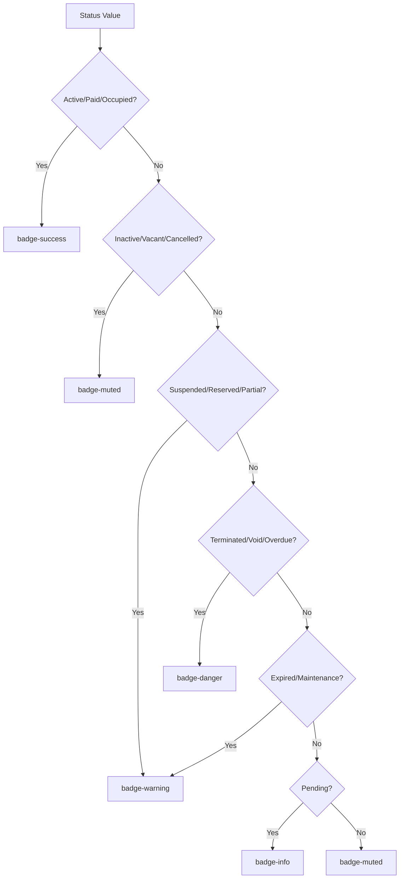

**Diagram sources**
- [status_badge.html:1-7](file://templates/includes/status_badge.html#L1-L7)

**Section sources**
- [status_badge.html:1-7](file://templates/includes/status_badge.html#L1-L7)

#### Modals and Forms
Modal forms follow a consistent pattern:

- Opened through shared `openModal(url)` helper.
- Loaded into `#modal-content` via HTMX.
- Submitted via `hx-post` with `hx-target="#modal-content"`.
- Close via shared `closeModal()` helper.
- Use panel-based layout with labels, hints, and error messages.

Examples:

- Billing add/edit modal form.
- Contract add/edit modal form.
- Payment add/edit modal form.

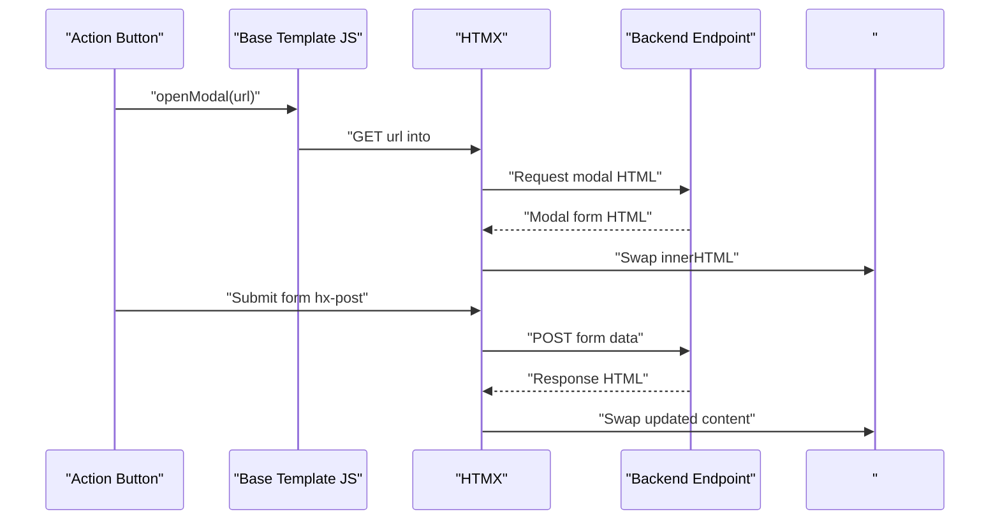

**Diagram sources**
- [base.html:302-305](file://templates/base.html#L302-L305)
- [billing_modal_form.html:16-33](file://templates/billing/_modal_form.html#L16-L33)
- [contracts_modal_form.html:18-33](file://templates/contracts/_modal_form.html#L18-L33)
- [payments_modal_form.html:13-27](file://templates/payments/_modal_form.html#L13-L27)

**Section sources**
- [billing_modal_form.html:1-142](file://templates/billing/_modal_form.html#L1-L142)
- [contracts_modal_form.html:1-96](file://templates/contracts/_modal_form.html#L1-L96)
- [payments_modal_form.html:1-118](file://templates/payments/_modal_form.html#L1-L118)
- [base.html:302-305](file://templates/base.html#L302-L305)

### Template Inheritance Patterns
Templates use Django template inheritance:

- `base.html` defines common structure and blocks: `title`, `page_title`, `page_subtitle`, `content`, `extra_head`, `extra_scripts`.
- Feature templates extend `base.html` and override blocks.
- Reusable fragments are included with ``.

Example inheritance chain:

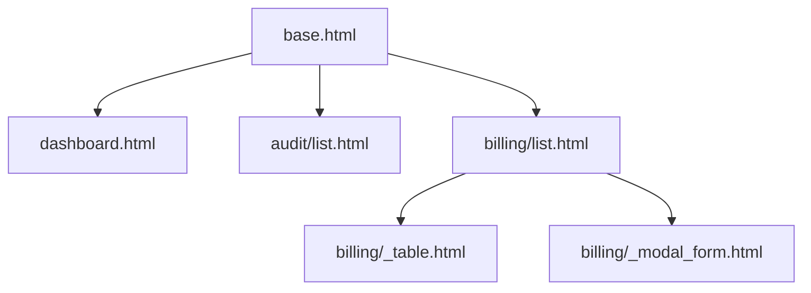

**Diagram sources**
- [dashboard.html:1-6](file://templates/dashboard.html#L1-L6)
- [audit_list.html:1-5](file://templates/audit/list.html#L1-L5)
- [billing_list.html:1-5](file://templates/billing/list.html#L1-L5)

**Section sources**
- [dashboard.html:1-6](file://templates/dashboard.html#L1-L6)
- [audit_list.html:1-5](file://templates/audit/list.html#L1-L5)
- [billing_list.html:1-5](file://templates/billing/list.html#L1-L5)

## Dependency Analysis
Frontend dependencies and their roles:

| Dependency | Role | Loading Location |
|---|---|---|
| Tailwind CSS 4 | Utility and component CSS compiler | `package.json` |
| Compiled CSS | Production stylesheet | `base.html` |
| HTMX | Dynamic DOM updates without reloads | `base.html` |
| Alpine.js | Lightweight reactive UI state | `base.html` |
| Google Fonts | Inter and Outfit typefaces | `base.html` |

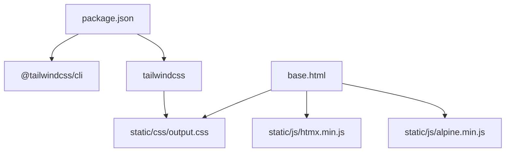

**Diagram sources**
- [package.json:1-14](file://package.json#L1-L14)
- [base.html:10-12](file://templates/base.html#L10-L12)

**Section sources**
- [package.json:1-14](file://package.json#L1-L14)
- [base.html:10-12](file://templates/base.html#L10-L12)

## Performance Considerations
Recommended performance practices based on the current implementation:

1. **Use compiled CSS** — always reference `output.css`; do not load raw Tailwind source in production.
2. **Keep HTMX payloads small** — return only the fragment needed for the target element.
3. **Debounce search inputs** — already implemented with `delay:400ms` to reduce network chatter.
4. **Avoid heavy animations on low-end devices** — backdrop blur and glass effects are visually rich but can be expensive; consider reducing complexity on constrained hardware.
5. **Reuse fragments** — keep shared components in `includes` and feature-specific fragments under their domain folders.
6. **Minimize inline scripts** — prefer shared helpers in `base.html` and avoid duplicating toast/modal logic across templates.
7. **Use print-only styles for reports** — avoid applying glass/neumorphic effects to printable documents.

[No sources needed since this section provides general guidance]

## Accessibility and Browser Compatibility
Accessibility considerations present in the codebase:

- Semantic HTML structure with headings, paragraphs, and navigation.
- `aria-label` used for pagination navigation.
- Focus-visible outline styles defined in the base CSS layer.
- Color contrast rules documented in the design system.
- Print styles hide non-printable chrome and render official documents clearly.

Browser compatibility considerations:

- Backdrop blur and glass effects rely on modern CSS features.
- HTMX requires JavaScript enabled.
- Alpine.js requires JavaScript enabled.
- Print templates should remain simple and readable without glass effects.

Best practices:

- Ensure all interactive elements have keyboard support.
- Provide meaningful labels and titles for icons and buttons.
- Test color contrast for new tokens against light and dark surfaces.
- Verify print output does not depend on visual effects.

**Section sources**
- [input.css:151-155](file://static/css/input.css#L151-L155)
- [DESIGN_SYSTEM.md:22-26](file://docs/DESIGN_SYSTEM.md#L22-L26)
- [DESIGN_SYSTEM.md:160-189](file://docs/DESIGN_SYSTEM.md#L160-L189)
- [pagination.html:2-2](file://templates/includes/pagination.html#L2-L2)

## Troubleshooting Guide
Common issues and resolutions:

| Issue | Symptom | Likely Cause | Resolution |
|---|---|---|---|
| HTMX requests fail with CSRF errors | Network error or toast showing CSRF-related message | Missing CSRF token in HTMX headers | Ensure `hx-headers` includes CSRF token in base template |
| Modal does not open | Clicking action does nothing | Missing `openModal` call or wrong target | Use `openModal(url)` and ensure `#modal-content` exists |
| Modal content does not update after submit | Form submits but page stays unchanged | Wrong `hx-target` or missing modal container | Set `hx-target="#modal-content"` and verify endpoint returns HTML |
| Search does not debounce | Excessive requests on fast typing | Missing `delay` in trigger | Add `hx-trigger="keyup changed delay:400ms"` |
| Filters do not preserve state | Query parameters disappear | Missing `hx-push-url="true"` | Enable URL push for search/filter inputs |
| Alpine UI flashes before loading | Elements appear then disappear | Missing `x-cloak` | Add `[x-cloak]{display:none!important}` and `x-cloak` attribute |
| Toasts not visible | No feedback after errors | Container missing or JS not loaded | Ensure `toast-container` exists and base script runs |
| CSS not applied | Styles look broken | Wrong CSS path or not compiled | Compile with `npm run build:css` and reference `output.css` |

Relevant implementation references:

- CSRF header injection and error toast handling live in the base template script.
- Modal helpers manage visibility and HTMX swapping.
- Alpine cloak prevents initial UI flicker.

**Section sources**
- [base.html:19-19](file://templates/base.html#L19-L19)
- [base.html:14-14](file://templates/base.html#L14-L14)
- [base.html:270-308](file://templates/base.html#L270-L308)

## Conclusion
The frontend architecture combines server-rendered Django templates with lightweight client-side enhancements:

- HTMX delivers dynamic updates without full page reloads.
- Alpine.js provides reactive UI behavior with minimal overhead.
- Tailwind CSS 4 and the Emerald Glass design system enforce a consistent, accessible, and responsive visual language.
- Reusable fragments for pagination, status badges, modals, and forms promote consistency and reduce duplication.
- The build process is straightforward: compile Tailwind CSS into a production stylesheet and serve static assets alongside rendered templates.

For future improvements, consider:

- Centralizing HTMX event handlers where possible.
- Adding explicit accessibility attributes for complex widgets.
- Evaluating progressive enhancement strategies for environments with limited JavaScript support.
- Monitoring performance of backdrop blur and glass effects on mobile devices.

[No sources needed since this section summarizes without analyzing specific files]