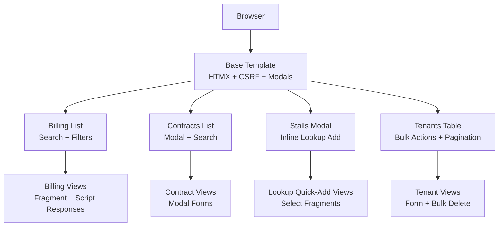
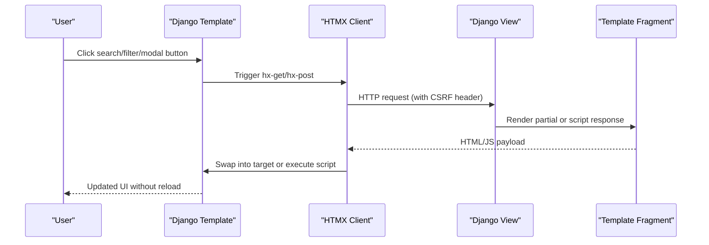
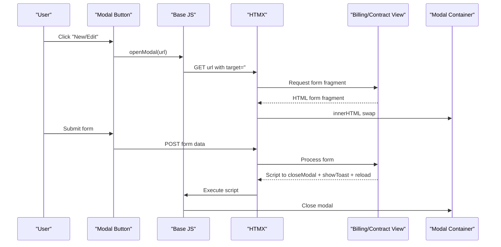
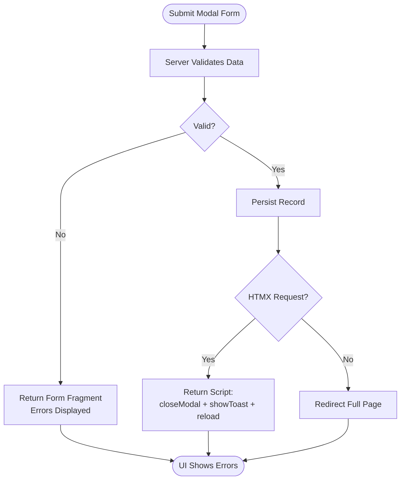
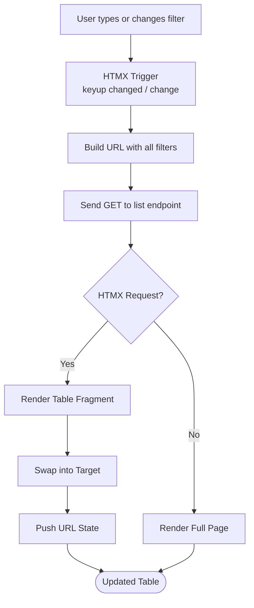
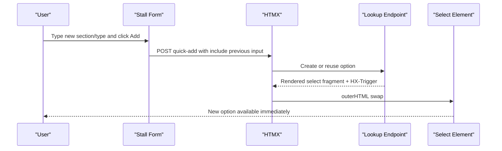
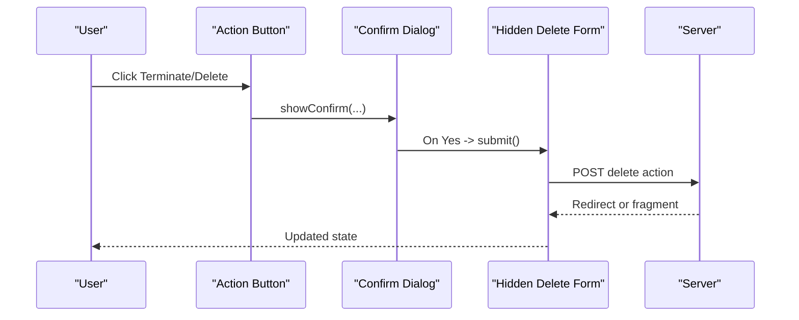
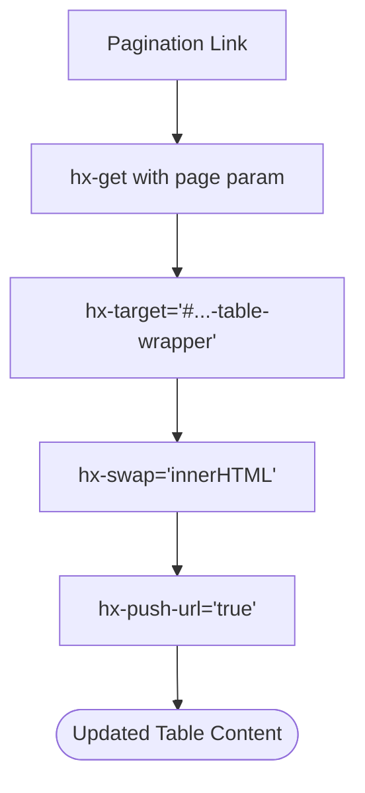
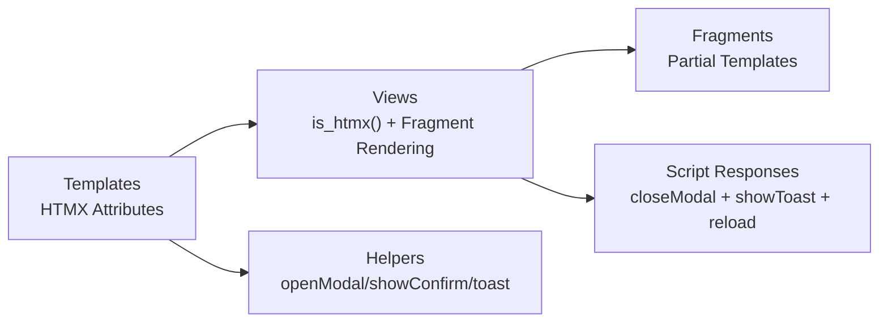

# HTMX Integration Patterns

<cite>
**Referenced Files in This Document**
- [base.html](file://templates/base.html)
- [pagination.html](file://templates/includes/pagination.html)
- [billing_list.html](file://templates/billing/list.html)
- [_collect_modal.html](file://templates/billing/_collect_modal.html)
- [_modal_form.html](file://templates/billing/_modal_form.html)
- [contracts_list.html](file://templates/contracts/list.html)
- [contracts_modal_form.html](file://templates/contracts/_modal_form.html)
- [stalls_modal_form.html](file://templates/stalls/_modal_form.html)
- [tenants_table.html](file://templates/tenants/_table.html)
- [lookups.py](file://core/views/lookups.py)
- [billing.py](file://core/views/billing.py)
- [stalls.py](file://core/views/stalls.py)
</cite>

## Table of Contents
1. [Introduction](#introduction)
2. [Project Structure](#project-structure)
3. [Core Components](#core-components)
4. [Architecture Overview](#architecture-overview)
5. [Detailed Component Analysis](#detailed-component-analysis)
6. [Dependency Analysis](#dependency-analysis)
7. [Performance Considerations](#performance-considerations)
8. [Troubleshooting Guide](#troubleshooting-guide)
9. [Conclusion](#conclusion)

## Introduction
This document explains how the application uses HTMX to deliver dynamic, reload-free interactions across Django templates and views. It focuses on:
- Dynamic content updates using `hx-get`, `hx-post`, `hx-target`, and `hx-swap`.
- Modal interactions for forms and collection workflows.
- Search and filter behavior with URL synchronization.
- Real-time dropdown enrichment through lookup endpoints.
- CSRF token handling, error response processing, and loading-state considerations.
- Practical examples from billing, contracts, stalls, tenants, pagination, and confirmation dialogs.

The goal is to help developers understand the integration patterns, extend them safely, and maintain performance and reliability.

## Project Structure
HTMX usage spans shared base templates, feature-specific templates, and view endpoints that return either full pages or small fragments. The most important pieces are:
- Base template: loads HTMX, configures global CSRF headers, provides modal containers, toast notifications, and a global error handler.
- Feature templates: use HTMX attributes to trigger requests and swap responses into targeted regions.
- Views: detect HTMX requests and return fragment HTML or script-driven UX improvements.

**Diagram sources**
- [base.html:10-19](file://templates/base.html#L10-L19)
- [billing_list.html:60-94](file://templates/billing/list.html#L60-L94)
- [contracts_list.html:33-44](file://templates/contracts/list.html#L33-L44)
- [stalls_modal_form.html:54-98](file://templates/stalls/_modal_form.html#L54-L98)
- [tenants_table.html:129-233](file://templates/tenants/_table.html#L129-L233)
- [billing.py:25-26](file://core/views/billing.py#L25-L26)
- [lookups.py:114-140](file://core/views/lookups.py#L114-L140)

**Section sources**
- [base.html:10-19](file://templates/base.html#L10-L19)
- [billing_list.html:60-94](file://templates/billing/list.html#L60-L94)
- [contracts_list.html:33-44](file://templates/contracts/list.html#L33-L44)
- [stalls_modal_form.html:54-98](file://templates/stalls/_modal_form.html#L54-L98)
- [tenants_table.html:129-233](file://templates/tenants/_table.html#L129-L233)
- [billing.py:25-26](file://core/views/billing.py#L25-L26)
- [lookups.py:114-140](file://core/views/lookups.py#L114-L140)

## Core Components
- Global HTMX configuration and CSRF:
  - HTMX library is loaded globally.
  - CSRF token is attached to every HTMX request via a global header.
  - A global error listener shows toast notifications on failed requests.
- Modal system:
  - Shared modal container and helper functions open/close modals.
  - Buttons trigger HTMX GETs to load form fragments into the modal.
- Search and filters:
  - Input fields and selects use `hx-get` to refresh table fragments.
  - `hx-push-url="true"` keeps URLs in sync for shareable states.
- Pagination:
  - Reusable pagination component supports HTMX swapping when a target ID is provided.
- Lookup quick-add:
  - Inline add buttons POST to lookup endpoints and replace select options without leaving the form.

**Section sources**
- [base.html:10-19](file://templates/base.html#L10-L19)
- [base.html:270-308](file://templates/base.html#L270-L308)
- [billing_list.html:60-94](file://templates/billing/list.html#L60-L94)
- [pagination.html:1-46](file://templates/includes/pagination.html#L1-L46)
- [stalls_modal_form.html:54-98](file://templates/stalls/_modal_form.html#L54-L98)

## Architecture Overview
The application follows a simple pattern:
- Templates declare HTMX interactions declaratively.
- Views detect HTMX requests and render fragments or script-enhanced responses.
- JavaScript helpers manage modals, toasts, and confirmations.

**Diagram sources**
- [base.html:10-19](file://templates/base.html#L10-L19)
- [base.html:270-308](file://templates/base.html#L270-L308)
- [billing.py:25-26](file://core/views/billing.py#L25-L26)
- [billing.py:335-370](file://core/views/billing.py#L335-L370)
- [billing.py:415-489](file://core/views/billing.py#L415-L489)

## Detailed Component Analysis

### HTMX Attributes and Patterns
- `hx-get`: Used by search inputs, filters, and modal triggers to fetch fragments.
- `hx-post`: Used by forms to submit data back to the server.
- `hx-target`: Points to the DOM element where the response should be inserted.
- `hx-swap`: Controls how the response is inserted; commonly `innerHTML` for fragments.
- `hx-trigger`: Defines event-based triggers such as `keyup changed delay:400ms` for debounced search.
- `hx-include`: Sends additional fields alongside the current input’s value.
- `hx-push-url`: Updates browser history for shareable filter states.

Practical examples:
- Billing list search and filters update the table fragment while preserving query parameters.
- Contract list search and status filter update the contract table fragment.
- Modal buttons fetch form fragments into the shared modal container.

**Section sources**
- [billing_list.html:60-94](file://templates/billing/list.html#L60-L94)
- [contracts_list.html:40-48](file://templates/contracts/list.html#L40-L48)
- [contracts_list.html:33-36](file://templates/contracts/list.html#L33-L36)

### Modal Interactions
Modals are driven by shared HTML and JavaScript:
- A hidden modal container holds dynamically loaded content.
- Helper functions open/close modals and show toasts.
- Buttons call `openModal(url)` and use HTMX to load the form fragment.

Examples:
- Billing add/edit modals use `hx-post` to submit forms and receive script responses that close the modal, show a success toast, and reload the page.
- Billing collect modal posts payment data and returns a script that closes the modal and redirects to the receipt print page.
- Contract add/edit modals follow the same pattern.

**Diagram sources**
- [base.html:270-308](file://templates/base.html#L270-L308)
- [_modal_form.html:16-33](file://templates/billing/_modal_form.html#L16-L33)
- [_collect_modal.html:41-41](file://templates/billing/_collect_modal.html#L41-L41)
- [billing.py:335-370](file://core/views/billing.py#L335-L370)
- [billing.py:415-489](file://core/views/billing.py#L415-L489)

**Section sources**
- [base.html:270-308](file://templates/base.html#L270-L308)
- [_modal_form.html:16-33](file://templates/billing/_modal_form.html#L16-L33)
- [_collect_modal.html:41-41](file://templates/billing/_collect_modal.html#L41-L41)
- [billing.py:335-370](file://core/views/billing.py#L335-L370)
- [billing.py:415-489](file://core/views/billing.py#L415-L489)

### Form Submissions and Success Handling
Forms inside modals use HTMX to post data and receive either:
- A re-rendered form fragment on validation errors.
- A script response that closes the modal, shows a toast, and reloads the page.

Key behaviors:
- Billing add/edit modal forms post to dedicated endpoints and return script responses for HTMX flows.
- Stall add/edit modal forms follow the same pattern.
- Tenant forms support file uploads using `hx-encoding="multipart/form-data"`.

**Diagram sources**
- [_modal_form.html:16-33](file://templates/billing/_modal_form.html#L16-L33)
- [stalls_modal_form.html:10-31](file://templates/stalls/_modal_form.html#L10-L31)
- [tenants_table.html:12-39](file://templates/tenants/_modal_form.html#L12-L39)
- [billing.py:335-370](file://core/views/billing.py#L335-L370)
- [billing.py:373-412](file://core/views/billing.py#L373-L412)
- [stalls.py:128-184](file://core/views/stalls.py#L128-L184)

**Section sources**
- [_modal_form.html:16-33](file://templates/billing/_modal_form.html#L16-L33)
- [stalls_modal_form.html:10-31](file://templates/stalls/_modal_form.html#L10-L31)
- [tenants_table.html:12-39](file://templates/tenants/_modal_form.html#L12-L39)
- [billing.py:335-370](file://core/views/billing.py#L335-L370)
- [billing.py:373-412](file://core/views/billing.py#L373-L412)
- [stalls.py:128-184](file://core/views/stalls.py#L128-L184)

### Search Functionality and URL Synchronization
Search inputs and filters use HTMX to update table fragments without reloading:
- Debounced search reduces request volume.
- `hx-include` ensures related filters are sent together.
- `hx-push-url="true"` updates the URL so filters are bookmarkable and shareable.

Examples:
- Billing list search and month/year/status filters update the billing table fragment.
- Contract list search and status filter update the contract table fragment.
- Audit log list demonstrates multi-field filtering with debounced search.

**Diagram sources**
- [billing_list.html:60-94](file://templates/billing/list.html#L60-L94)
- [contracts_list.html:40-48](file://templates/contracts/list.html#L40-L48)
- [billing.py:62-171](file://core/views/billing.py#L62-L171)

**Section sources**
- [billing_list.html:60-94](file://templates/billing/list.html#L60-L94)
- [contracts_list.html:40-48](file://templates/contracts/list.html#L40-L48)
- [billing.py:62-171](file://core/views/billing.py#L62-L171)

### Real-Time Dropdown Enrichment (Lookup Fields)
The stall form includes inline “quick add” for sections and stall types:
- Users can type a new name and click “Add”.
- HTMX posts to lookup endpoints and replaces the select element with updated options.
- The server sets an `HX-Trigger` header to notify the client of successful creation.

**Diagram sources**
- [stalls_modal_form.html:54-98](file://templates/stalls/_modal_form.html#L54-L98)
- [lookups.py:114-140](file://core/views/lookups.py#L114-L140)
- [lookups.py:222-240](file://core/views/lookups.py#L222-L240)

**Section sources**
- [stalls_modal_form.html:54-98](file://templates/stalls/_modal_form.html#L54-L98)
- [lookups.py:114-140](file://core/views/lookups.py#L114-L140)
- [lookups.py:222-240](file://core/views/lookups.py#L222-L240)

### Confirmation Dialogs
Confirmation dialogs are implemented in the base template:
- `showConfirm(title, message, callback)` displays a modal asking for confirmation.
- Actions like terminating a tenant or bulk deleting tenants use this dialog before submitting hidden forms.

Example:
- Tenant row actions trigger a confirmation dialog before submitting a delete form.
- Bulk delete flow integrates with the confirmation dialog and HTMX swaps.

**Diagram sources**
- [base.html:278-308](file://templates/base.html#L278-L308)
- [tenants_table.html:102-109](file://templates/tenants/_table.html#L102-L109)
- [tenants_table.html:199-221](file://templates/tenants/_table.html#L199-L221)

**Section sources**
- [base.html:278-308](file://templates/base.html#L278-L308)
- [tenants_table.html:102-109](file://templates/tenants/_table.html#L102-L109)
- [tenants_table.html:199-221](file://templates/tenants/_table.html#L199-L221)

### Pagination Updates
Pagination is handled by a reusable component that conditionally enables HTMX when a target ID is provided:
- Each page link includes HTMX attributes to swap the table fragment.
- `hx-push-url="true"` keeps pagination state in the URL.

**Diagram sources**
- [pagination.html:1-46](file://templates/includes/pagination.html#L1-L46)

**Section sources**
- [pagination.html:1-46](file://templates/includes/pagination.html#L1-L46)

### Error Response Processing and Loading States
- Global error handling:
  - A body-level listener catches `htmx:responseError` and shows a toast with the error text.
- Validation errors:
  - Modal forms return the form fragment with field errors when validation fails.
- Success feedback:
  - Successful operations return scripts that close modals, show toasts, and optionally reload the page.

Best practices observed:
- Use `hx-swap="innerHTML"` for fragments.
- Keep server responses minimal and focused on the target region.
- Provide user feedback via toasts and clear messages.

**Section sources**
- [base.html:306-307](file://templates/base.html#L306-L307)
- [_modal_form.html:16-33](file://templates/billing/_modal_form.html#L16-L33)
- [billing.py:335-370](file://core/views/billing.py#L335-L370)
- [billing.py:415-489](file://core/views/billing.py#L415-L489)

## Dependency Analysis
HTMX interactions connect templates to views and fragments:
- Templates declare interactions and targets.
- Views detect HTMX requests and return appropriate payloads.
- JavaScript helpers provide consistent UX for modals, toasts, and confirmations.

**Diagram sources**
- [base.html:10-19](file://templates/base.html#L10-L19)
- [base.html:270-308](file://templates/base.html#L270-L308)
- [billing.py:25-26](file://core/views/billing.py#L25-L26)
- [billing.py:335-370](file://core/views/billing.py#L335-L370)
- [billing.py:415-489](file://core/views/billing.py#L415-L489)

**Section sources**
- [base.html:10-19](file://templates/base.html#L10-L19)
- [base.html:270-308](file://templates/base.html#L270-L308)
- [billing.py:25-26](file://core/views/billing.py#L25-L26)
- [billing.py:335-370](file://core/views/billing.py#L335-L370)
- [billing.py:415-489](file://core/views/billing.py#L415-L489)

## Performance Considerations
- Debounce search inputs to reduce network load.
- Use `hx-include` to bundle related filters and avoid multiple requests.
- Prefer fragment rendering over full-page renders for HTMX requests.
- Keep modal responses minimal; avoid heavy assets in fragments.
- Use `hx-push-url="true"` judiciously to keep URLs meaningful without excessive navigation events.
- Avoid unnecessary DOM manipulation after swaps; rely on HTMX’s swap mechanisms.
- For large tables, ensure server-side pagination and efficient queries.

[No sources needed since this section provides general guidance]

## Troubleshooting Guide
Common issues and resolutions:
- CSRF errors:
  - Ensure the base template attaches the CSRF token to HTMX requests via global headers.
- Empty or incorrect target:
  - Verify `hx-target` matches an existing element ID.
- Missing fragment:
  - Confirm the view returns the correct fragment template for HTMX requests.
- Validation errors not showing:
  - Ensure the form fragment includes error rendering and is returned on invalid submissions.
- Modal not closing:
  - Check that successful responses include script to close the modal and show a toast.
- Pagination not updating:
  - Ensure the pagination component receives a valid `pagination_target` and HTMX attributes are present.

**Section sources**
- [base.html:19-19](file://templates/base.html#L19-L19)
- [base.html:306-307](file://templates/base.html#L306-L307)
- [_modal_form.html:16-33](file://templates/billing/_modal_form.html#L16-L33)
- [billing.py:335-370](file://core/views/billing.py#L335-L370)
- [pagination.html:1-46](file://templates/includes/pagination.html#L1-L46)

## Conclusion
The application leverages HTMX to create responsive, reload-free experiences:
- Declarative attributes drive dynamic updates.
- Shared modal infrastructure simplifies form workflows.
- Search and filters integrate seamlessly with URL state.
- Lookup endpoints enrich dropdowns inline.
- Robust error handling and feedback improve usability.

By following these patterns—fragment rendering, targeted swapping, debounced searches, and consistent UX helpers—developers can extend the system with reliable, performant HTMX interactions.