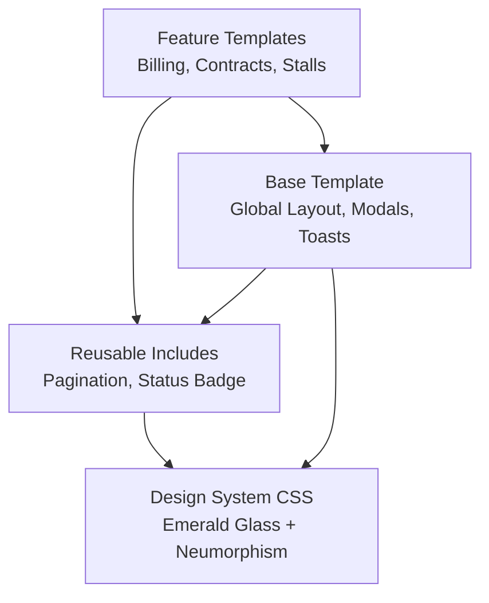
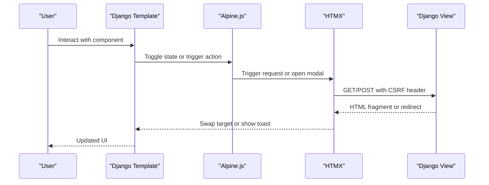
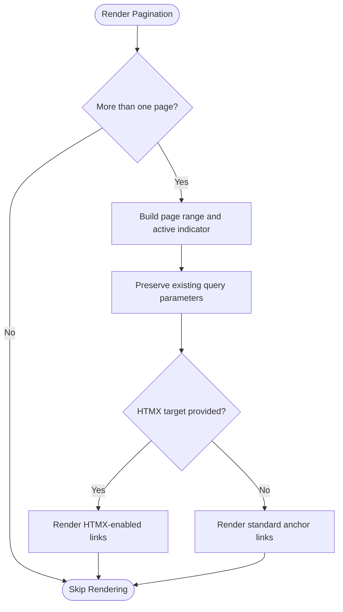
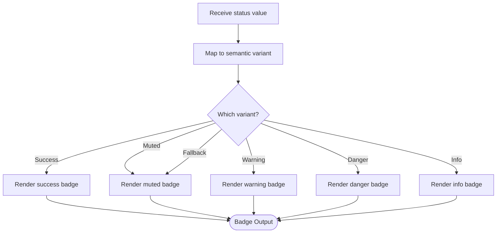
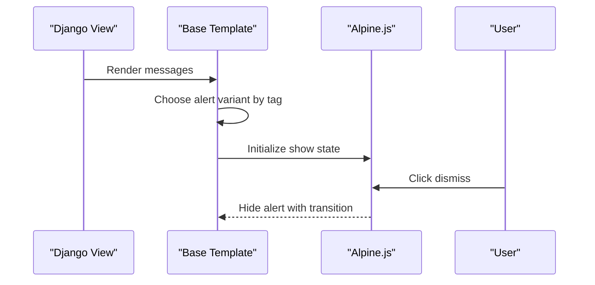
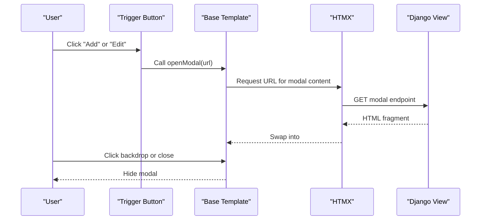
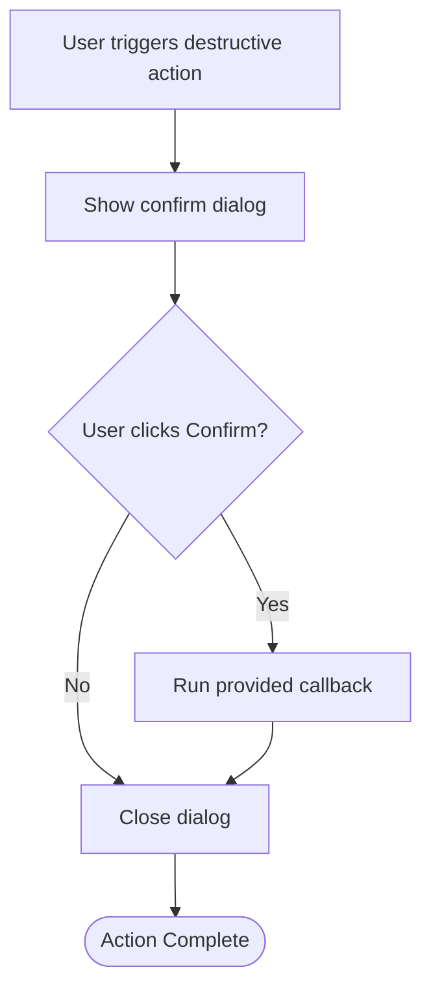
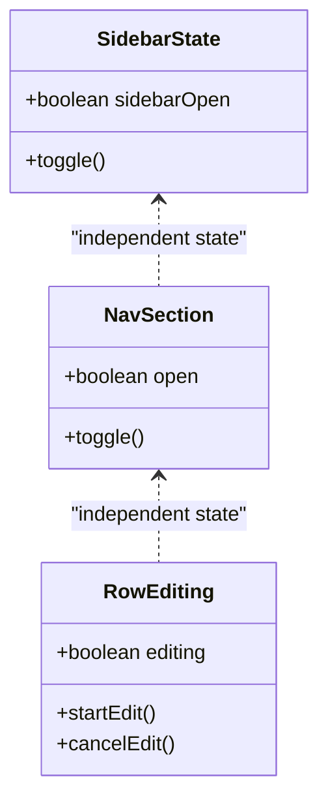
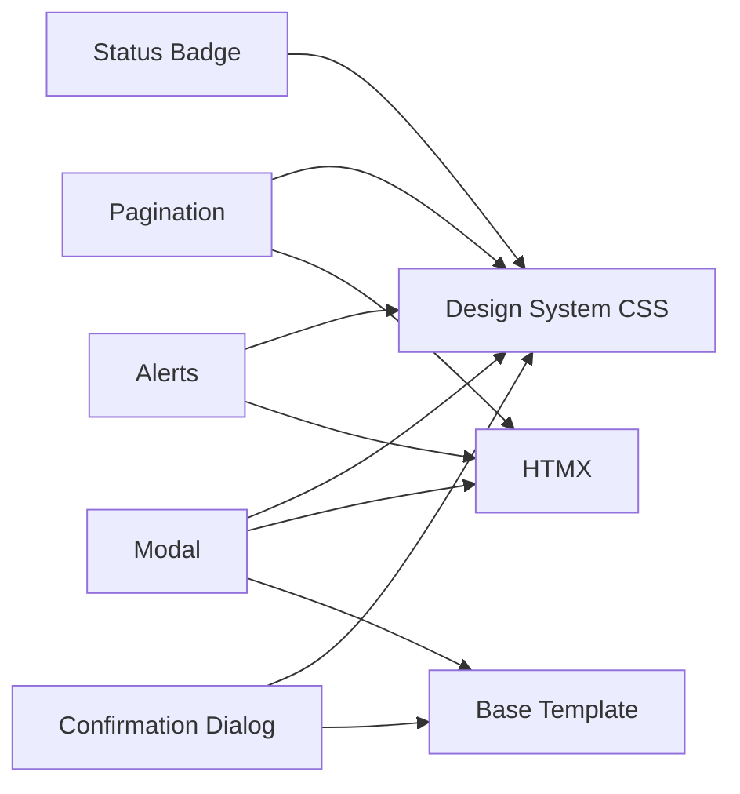

# Reusable UI Components

<cite>
**Referenced Files in This Document**
- [pagination.html](file://templates/includes/pagination.html)
- [status_badge.html](file://templates/includes/status_badge.html)
- [base.html](file://templates/base.html)
- [input.css](file://static/css/input.css)
- [billing_list.html](file://templates/billing/list.html)
- [billing_view.html](file://templates/billing/view.html)
- [billing__modal_form.html](file://templates/billing/_modal_form.html)
- [billing__collect_modal.html](file://templates/billing/_collect_modal.html)
- [contracts__modal_form.html](file://templates/contracts/_modal_form.html)
- [stalls_sections.html](file://templates/stalls/sections.html)
- [stalls_stall_types.html](file://templates/stalls/stall_types.html)
</cite>

## Table of Contents
1. [Introduction](#introduction)
2. [Project Structure](#project-structure)
3. [Core Components](#core-components)
4. [Architecture Overview](#architecture-overview)
5. [Detailed Component Analysis](#detailed-component-analysis)
6. [Dependency Analysis](#dependency-analysis)
7. [Performance Considerations](#performance-considerations)
8. [Troubleshooting Guide](#troubleshooting-guide)
9. [Conclusion](#conclusion)

## Introduction
This document describes the reusable user interface components used across the application. It focuses on:
- Pagination controls
- Status badges
- Alert messages
- Modals
- Confirmation dialogs

It explains how these components are composed using Django template inclusion, parameter passing, and slot-like patterns. It also documents the interactive behavior powered by Alpine.js for state management and transitions, and the dynamic server updates driven by HTMX. Usage examples, customization options, accessibility considerations, styling consistency, and integration patterns are included for each component.

## Project Structure
The reusable UI components live primarily under `templates/includes` and are consumed by feature templates. Shared layout, global modals, toasts, and JavaScript helpers live in the base template. The design system is defined in the CSS file.

**Diagram sources**
- [base.html:1-312](file://templates/base.html#L1-L312)
- [pagination.html:1-47](file://templates/includes/pagination.html#L1-L47)
- [status_badge.html:1-7](file://templates/includes/status_badge.html#L1-L7)
- [input.css:1-800](file://static/css/input.css#L1-L800)

**Section sources**
- [base.html:1-312](file://templates/base.html#L1-L312)
- [input.css:1-800](file://static/css/input.css#L1-L800)

## Core Components
The core reusable components are:
- Pagination control: a responsive page navigator with optional HTMX-driven partial updates.
- Status badge: a semantic label that maps business states to visual variants.
- Alerts: globally rendered success, error, warning, and neutral notifications.
- Modal: a shared overlay container loaded via HTMX.
- Confirmation dialog: a shared destructive-action confirmation overlay.

These components share a consistent visual language based on the Emerald Glass and neumorphic design tokens.

**Section sources**
- [pagination.html:1-47](file://templates/includes/pagination.html#L1-L47)
- [status_badge.html:1-7](file://templates/includes/status_badge.html#L1-L7)
- [base.html:247-308](file://templates/base.html#L247-L308)
- [input.css:565-616](file://static/css/input.css#L565-L616)

## Architecture Overview
The component architecture combines three layers:
- Server-rendered structure: Django templates provide the skeleton and data binding.
- Client-side interactivity: Alpine.js manages local UI state (open/close, toggles, inline editing).
- Dynamic updates: HTMX performs lightweight requests and swaps content without full page reloads.

**Diagram sources**
- [base.html:11-12](file://templates/base.html#L11-L12)
- [base.html:19](file://templates/base.html#L19)
- [base.html:302-306](file://templates/base.html#L302-L306)

## Detailed Component Analysis

### Pagination Control
The pagination component renders page navigation links and preserves existing query parameters. It supports two modes:
- Standard navigation: plain anchor links.
- HTMX navigation: when a target ID is provided, links become HTMX requests that swap the target region.

Key behaviors:
- Displays current range and total count.
- Renders first, previous, numbered pages, next, and last links.
- Preserves other query parameters while changing the page.
- Highlights the active page.
- Uses accessible titles for navigation buttons.

Usage example:
- Include the component where a paginated table is rendered.
- Pass the Django page object.
- Optionally pass a target ID to enable HTMX swapping.

Customization options:
- Enable HTMX mode by providing a target element ID.
- Style through the shared button and numeric classes.

Accessibility:
- Uses an aria-label on the nav element.
- Provides descriptive titles for navigation buttons.
- Maintains keyboard focusable links.

Integration with HTMX:
- When a target is provided, each link sends an HTMX request to the same path with the updated page number and replaces the target region.

**Diagram sources**
- [pagination.html:1-47](file://templates/includes/pagination.html#L1-L47)

**Section sources**
- [pagination.html:1-47](file://templates/includes/pagination.html#L1-L47)

### Status Badge
The status badge maps business values to semantic color variants. It accepts a single parameter:
- status: a string representing the current state.

Supported mappings include:
- Success: Active, Paid, Occupied
- Muted: Inactive, Vacant, Cancelled
- Warning: Suspended, Reserved, Partial, Expired, Maintenance
- Danger: Terminated, Void, Overdue, Unpaid
- Info: Pending
- Fallback: Muted

Usage example:
- Include the badge in tables or detail views.
- Pass the model’s status field.

Customization options:
- Extend the mapping by adding new status strings to the template logic.
- Adjust colors through the design system classes.

Accessibility:
- Use meaningful status text so screen readers can announce it.
- Avoid relying solely on color; the dot and text together convey meaning.

Styling:
- Uses shared badge classes for background, border, and dot indicators.

**Diagram sources**
- [status_badge.html:1-7](file://templates/includes/status_badge.html#L1-L7)

**Section sources**
- [status_badge.html:1-7](file://templates/includes/status_badge.html#L1-L7)
- [input.css:565-584](file://static/css/input.css#L565-L584)

### Alert Messages
Alerts are rendered globally from Django messages. Each message is wrapped in an alert card with:
- A semantic tag-based style: success, error, warning, or neutral.
- An icon indicating the type.
- A dismiss button.
- Alpine.js state to toggle visibility with a transition.

Usage example:
- No direct usage is required; alerts appear automatically when Django messages are present.

Customization options:
- Add new message tags and extend the conditional class selection.
- Customize icons and colors through the design system.

Accessibility:
- Alerts use semantic roles implicitly through their structure.
- Dismiss buttons are keyboard-accessible.
- Content remains readable after dismissal because the DOM node persists until removed.

Integration with HTMX:
- Global HTMX error handling shows a toast notification instead of breaking the UI.

**Diagram sources**
- [base.html:247-260](file://templates/base.html#L247-L260)

**Section sources**
- [base.html:247-260](file://templates/base.html#L247-L260)
- [input.css:601-616](file://static/css/input.css#L601-L616)

### Modal
The modal is a shared overlay container that loads content dynamically via HTMX. It includes:
- A backdrop that closes the modal when clicked.
- A glass-styled content area.
- A global function to open the modal and load a URL into the content area.
- A global function to close the modal.

Usage example:
- Trigger opening by calling the global function with a URL.
- Alternatively, attach an HTMX attribute to a button and call the function.

Common patterns:
- Forms inside modals post back to the same modal target, allowing server validation feedback within the modal.
- Lists can open add/edit forms in the modal.

Accessibility:
- The modal uses a backdrop and a focused content area.
- Ensure form fields inside modals have labels and descriptions.

Integration with HTMX:
- The modal content is swapped via HTMX AJAX calls.
- CSRF headers are attached globally.

**Diagram sources**
- [base.html:270-306](file://templates/base.html#L270-L306)
- [billing_list.html:40-40](file://templates/billing/list.html#L40-L40)
- [billing_view.html:26-26](file://templates/billing/view.html#L26-L26)

**Section sources**
- [base.html:270-306](file://templates/base.html#L270-L306)
- [billing_list.html:40-40](file://templates/billing/list.html#L40-L40)
- [billing_view.html:26-26](file://templates/billing/view.html#L26-L26)

### Confirmation Dialog
The confirmation dialog provides a safe way to perform destructive actions. It includes:
- A title and message area.
- Cancel and Confirm buttons.
- A callback mechanism to execute an action after confirmation.

Usage example:
- Open the dialog with a title, message, and callback.
- On confirm, close the dialog and run the callback.

Accessibility:
- Buttons are clearly labeled.
- Backdrop click cancels the action.

Integration with HTMX:
- Callbacks can trigger HTMX requests or navigate to endpoints.

**Diagram sources**
- [base.html:278-305](file://templates/base.html#L278-L305)

**Section sources**
- [base.html:278-305](file://templates/base.html#L278-L305)

### Interactive Patterns Powered by Alpine.js
Alpine.js is used for lightweight client-side state:
- Sidebar toggle and mobile scrim.
- Navigation section expansion.
- Dropdown menus.
- Inline row editing in some list views.

Examples:
- Sidebar state is bound to window width and toggled by a button.
- Navigation sections expand/collapse based on the current URL.
- Row-level editing toggles between view and edit modes.

Accessibility:
- Focus management should be considered when toggling large regions.
- Use aria-expanded for collapsible navigation where appropriate.

**Diagram sources**
- [base.html:20-29](file://templates/base.html#L20-L29)
- [base.html:87-155](file://templates/base.html#L87-L155)
- [stalls_sections.html:73-108](file://templates/stalls/sections.html#L73-L108)
- [stalls_stall_types.html:73-73](file://templates/stalls/stall_types.html#L73-L73)

**Section sources**
- [base.html:20-29](file://templates/base.html#L20-L29)
- [base.html:87-155](file://templates/base.html#L87-L155)
- [stalls_sections.html:73-108](file://templates/stalls/sections.html#L73-L108)
- [stalls_stall_types.html:73-73](file://templates/stalls/stall_types.html#L73-L73)

### Component Composition Patterns
- Django template inclusion:
  - Reusable fragments are placed under `templates/includes`.
  - Pages include them with context variables such as the page object or status string.
- Parameter passing:
  - Components accept simple parameters like `page_obj`, `pagination_target`, and `status`.
- Slot-like patterns:
  - While Django does not have slots, the modal pattern acts like a slot: the base template provides the container, and feature templates supply the content via HTMX.
- Styling consistency:
  - All components use shared Tailwind utility classes and design tokens from the CSS file.

**Section sources**
- [pagination.html:1-47](file://templates/includes/pagination.html#L1-L47)
- [status_badge.html:1-7](file://templates/includes/status_badge.html#L1-L7)
- [base.html:270-306](file://templates/base.html#L270-L306)
- [input.css:1-800](file://static/css/input.css#L1-L800)

## Dependency Analysis
The components depend on:
- Django template engine for rendering.
- Alpine.js for local state and transitions.
- HTMX for asynchronous requests and content swapping.
- The design system CSS for consistent visuals.

**Diagram sources**
- [pagination.html:1-47](file://templates/includes/pagination.html#L1-L47)
- [status_badge.html:1-7](file://templates/includes/status_badge.html#L1-L7)
- [base.html:11-12](file://templates/base.html#L11-L12)
- [base.html:270-306](file://templates/base.html#L270-L306)
- [input.css:1-800](file://static/css/input.css#L1-L800)

**Section sources**
- [base.html:11-12](file://templates/base.html#L11-L12)
- [base.html:270-306](file://templates/base.html#L270-L306)
- [input.css:1-800](file://static/css/input.css#L1-L800)

## Performance Considerations
- Prefer HTMX partial swaps over full page reloads for lists and modals.
- Keep Alpine state minimal and localized to avoid unnecessary re-renders.
- Use the shared design system classes to reduce custom CSS and improve caching.
- Limit the number of concurrent HTMX requests by debouncing inputs where needed.
- Ensure modal content is small enough to render quickly; split complex forms into steps if necessary.

[No sources needed since this section provides general guidance]

## Troubleshooting Guide
Common issues and resolutions:
- Modal does not open:
  - Verify the global `openModal` function exists in the base template.
  - Ensure the target URL returns valid HTML.
  - Check that the CSRF token is included in HTMX headers.
- HTMX requests fail:
  - Inspect network errors and toast messages.
  - Confirm the view returns proper responses and handles CSRF.
- Alerts do not display:
  - Ensure Django messages are set in the view and the base template iterates over messages.
- Pagination links do not update content:
  - If using HTMX mode, verify the target ID matches the container being swapped.
  - Confirm the view responds with the expected fragment.

**Section sources**
- [base.html:302-306](file://templates/base.html#L302-L306)
- [billing_list.html:40-40](file://templates/billing/list.html#L40-L40)
- [billing_view.html:26-26](file://templates/billing/view.html#L26-L26)

## Conclusion
The reusable UI components in this project follow a clear separation of concerns:
- Django templates define structure and pass parameters.
- Alpine.js manages lightweight interactions and transitions.
- HTMX enables fast, incremental updates.
- The design system ensures visual consistency.

By composing these components thoughtfully, developers can build consistent, accessible, and performant interfaces for pagination, status indication, messaging, modals, and confirmations.

[No sources needed since this section summarizes without analyzing specific files]