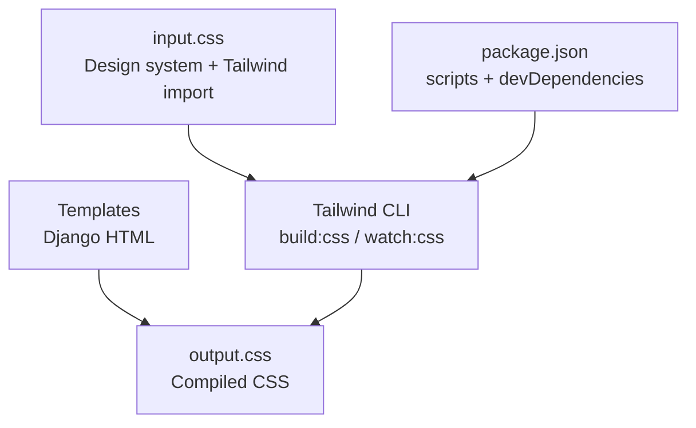
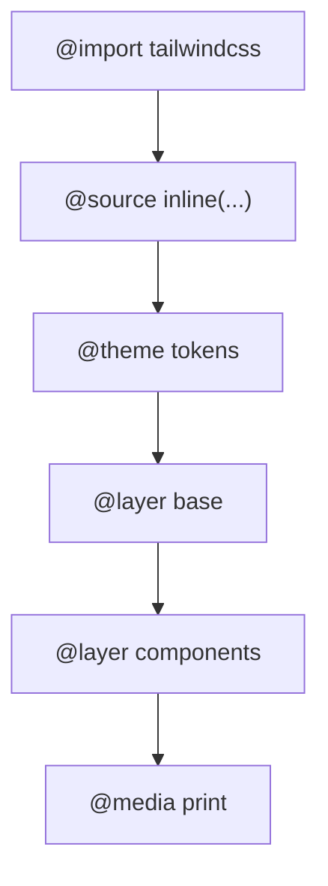
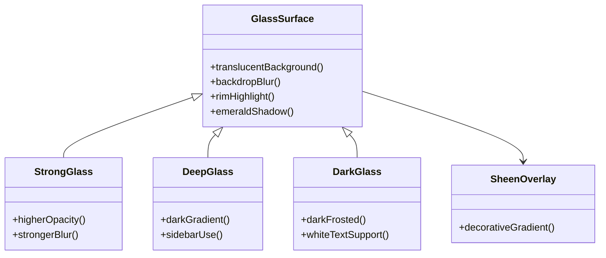
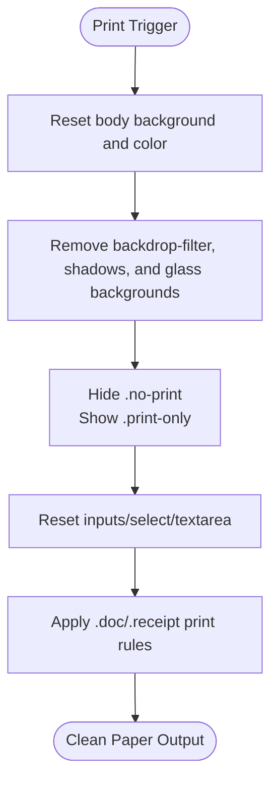
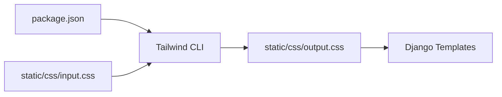

# Styling System & Design Tokens

<cite>
**Referenced Files in This Document**   
- [input.css](file://static/css/input.css)
- [DESIGN_SYSTEM.md](file://docs/DESIGN_SYSTEM.md)
- [package.json](file://package.json)
</cite>

## Table of Contents
1. [Introduction](#introduction)
2. [Project Structure](#project-structure)
3. [Core Components](#core-components)
4. [Architecture Overview](#architecture-overview)
5. [Detailed Component Analysis](#detailed-component-analysis)
6. [Dependency Analysis](#dependency-analysis)
7. [Performance Considerations](#performance-considerations)
8. [Troubleshooting Guide](#troubleshooting-guide)
9. [Conclusion](#conclusion)

## Introduction
This document explains the styling system and design tokens used across the application. The project uses Tailwind CSS 4 with a custom “Emerald Glass” visual language: translucent, blurred glass surfaces layered over a warm ivory canvas, accented with municipal emerald and Philippine gold. It also documents the color palette, typography, spacing-related utilities, glass morphism effects, backdrop blur utilities, custom component classes, responsive patterns, print styles for receipts and reports, and the build process for static assets.

The design system is implemented as a single CSS entry point that imports Tailwind and defines a `@theme` block with custom design tokens, followed by base styles, component classes, document/receipt styles, and print overrides. A companion design-system guide describes how to use the tokens and components consistently.

## Project Structure
The styling system lives under `static/css/input.css`. Tailwind CSS 4 is imported directly from this file using the new `@import "tailwindcss"` syntax. There is no separate `tailwind.config.js`; instead, all configuration is expressed through the `@theme` block inside the CSS file.

**Diagram sources**
- [input.css:1-5](file://static/css/input.css#L1-L5)
- [package.json:5-12](file://package.json#L5-L12)

**Section sources**
- [input.css:1-5](file://static/css/input.css#L1-L5)
- [package.json:5-12](file://package.json#L5-L12)

## Core Components
The core of the system is the design-token layer and the component layer:

- **Design tokens**: Custom colors (emerald, gold, ivory, ink), semantic colors, fonts, radii, shadows, and glass/neumorphic variables are defined in the `@theme` block and `:root` variables.
- **Base layer**: Global canvas background, typography defaults, focus states, native form control styling, and scroll behavior.
- **Component layer**: Reusable UI primitives such as glass surfaces, neumorphic panels, buttons, forms, tables, stat cards, badges, chips, alerts, navigation links, page headers, avatars, progress bars, KPI strips, and official document/receipt layouts.
- **Print layer**: Overrides that remove glass/neumorphism for paper output and enforce black-on-white document styles.

Key responsibilities:
- `@theme`: Centralizes brand colors, typography, radii, and reusable shadow values.
- `@layer base`: Establishes consistent defaults for body text, headings, inputs, selects, and accessibility-focused focus rings.
- `@layer components`: Defines every reusable class referenced by templates and runtime-injected markup.
- Print media query: Ensures receipts, reports, and official documents print cleanly without blur or neumorphic shadows.

**Section sources**
- [input.css:19-84](file://static/css/input.css#L19-L84)
- [input.css:89-197](file://static/css/input.css#L89-L197)
- [input.css:202-807](file://static/css/input.css#L202-L807)
- [input.css:812-833](file://static/css/input.css#L812-L833)

## Architecture Overview
The styling architecture follows a layered approach:

1. **Tailwind import**: `@import "tailwindcss"` brings in Tailwind’s default styles and utilities.
2. **Runtime class discovery**: An inline `@source` list ensures that classes injected at runtime (for example, via HTMX, Alpine, or dynamic modals) still generate CSS even if they do not appear statically in templates.
3. **Theme definition**: `@theme` declares the Emerald/Gold/Ivory palette, typography, radii, and reusable shadows.
4. **Base styles**: Global canvas, typography, focus, and native form controls.
5. **Components**: Glass morphism, neumorphism, panels, buttons, forms, tables, stat cards, badges, chips, alerts, navigation, page furniture, and document/receipt styles.
6. **Print styles**: Remove glass/neumorphism, force white backgrounds, and apply clean document/receipt rules.

**Diagram sources**
- [input.css:1-5](file://static/css/input.css#L1-L5)
- [input.css:19-84](file://static/css/input.css#L19-L84)
- [input.css:89-197](file://static/css/input.css#L89-L197)
- [input.css:202-807](file://static/css/input.css#L202-L807)
- [input.css:812-833](file://static/css/input.css#L812-L833)

## Detailed Component Analysis

### Tailwind CSS 4 Configuration and Token Model
Tailwind CSS 4 is configured entirely through CSS rather than a JavaScript config file. The project uses:

- `@import "tailwindcss"` to load Tailwind.
- `@theme` to define custom design tokens.
- `@layer base` and `@layer components` to organize global defaults and reusable UI primitives.
- `@source inline(...)` to register component class names so Tailwind generates their styles even when they are injected dynamically.

Important token groups:
- **Color palette**:
  - Emerald shades (`emerald-50` through `emerald-950`) as the primary brand color.
  - Gold shades (`gold-50` through `gold-900`) as the accent color.
  - Ivory shades (`ivory-50` through `ivory-400`) for the canvas.
  - Ink tokens (`ink`, `ink-soft`, `ink-muted`) for text hierarchy.
  - Semantic tokens (`success`, `warning`, `danger`, `info`).
- **Typography**:
  - Sans font stack centered on Inter and system sans-serif fonts.
  - Display font stack centered on Outfit and Inter for headings and large numbers.
- **Radii**:
  - Extended rounded values (`radius-xl2`, `radius-xl3`) for larger card corners.
- **Shadows**:
  - Glass shadows (`shadow-glass`, `shadow-glass-lg`).
  - Neumorphic shadows (`shadow-neu`, `shadow-neu-sm`, `shadow-neu-lg`).

These tokens are documented in the design-system guide and should be preferred over arbitrary Tailwind color utilities.

**Section sources**
- [input.css:1-5](file://static/css/input.css#L1-L5)
- [input.css:19-84](file://static/css/input.css#L19-L84)
- [DESIGN_SYSTEM.md:12-27](file://docs/DESIGN_SYSTEM.md#L12-L27)

### Color Palette and Emerald Theme
The palette is intentionally institutional:

- **Municipal emerald** is the primary color, used for brand emphasis, active navigation, primary buttons, and status indicators.
- **Philippine gold** is the accent, used for highlights, totals, and strong calls to action on dark surfaces.
- **Ivory** provides a warm, readable canvas behind glass and neumorphic surfaces.
- **Ink** provides accessible text contrast against light surfaces.
- **Semantic colors** provide meaning-driven styling for success, warning, danger, and informational messages.

The design-system guide explicitly discourages using neutral gray/slate utilities in favor of these tokens.

**Section sources**
- [input.css:20-68](file://static/css/input.css#L20-L68)
- [DESIGN_SYSTEM.md:12-27](file://docs/DESIGN_SYSTEM.md#L12-L27)

### Typography System
Typography is split into two stacks:

- **Sans stack**: Used for body text and general UI elements.
- **Display stack**: Used for headings, page titles, stat values, and KPI values.

Headings and display-type elements receive tighter letter-spacing for a modern look. Monospace numerals are available through a dedicated utility for IDs and tabular data.

Accessibility guidance emphasizes using the ink tokens for text and reserving emerald/gold for brand emphasis and accents.

**Section sources**
- [input.css:70-73](file://static/css/input.css#L70-L73)
- [input.css:146-155](file://static/css/input.css#L146-L155)
- [input.css:737-742](file://static/css/input.css#L737-L742)
- [DESIGN_SYSTEM.md:12-27](file://docs/DESIGN_SYSTEM.md#L12-L27)

### Spacing and Layout Utilities
Spacing is primarily handled through Tailwind’s built-in spacing utilities combined with the design system’s layout-oriented components:

- Forms use a grid container with a consistent gap.
- Panels, filter bars, tables, stat cards, and KPI strips use padding and gaps to create consistent rhythm.
- Page heads switch from stacked to horizontal layout at a small breakpoint.
- KPI strips switch from two columns to four columns at a larger breakpoint.

The design-system guide recommends wrapping content in `.panel` containers rather than restyling individual children, which keeps spacing and surface treatment consistent.

**Section sources**
- [input.css:435-448](file://static/css/input.css#L435-L448)
- [input.css:667-681](file://static/css/input.css#L667-L681)
- [input.css:723-736](file://static/css/input.css#L723-L736)
- [DESIGN_SYSTEM.md:76-89](file://docs/DESIGN_SYSTEM.md#L76-L89)
- [DESIGN_SYSTEM.md:172-189](file://docs/DESIGN_SYSTEM.md#L172-L189)

### Glass Morphism Effects and Backdrop Blur Utilities
Glass morphism is central to the interface. The system provides several glass variants:

- **Light glass**: Translucent white background with blur, rim highlight, and soft emerald drop shadow.
- **Strong glass**: Higher opacity and stronger blur for more prominent surfaces.
- **Deep glass**: Dark emerald gradient with subtle blur, used for sidebar-like surfaces.
- **Dark glass variants**: Frosted dark surfaces intended for photography or dark imagery where white type must remain legible.
- **Sheen overlay**: A decorative gradient overlay applied through a pseudo-element.

Backdrop blur is controlled through CSS variables, allowing consistent blur intensity across components. The same variable pattern applies to neumorphic shadows and inset shadows.

**Diagram sources**
- [input.css:90-120](file://static/css/input.css#L90-L120)
- [input.css:204-248](file://static/css/input.css#L204-L248)

**Section sources**
- [input.css:90-120](file://static/css/input.css#L90-L120)
- [input.css:204-248](file://static/css/input.css#L204-L248)
- [DESIGN_SYSTEM.md:30-51](file://docs/DESIGN_SYSTEM.md#L30-L51)

### Custom CSS Classes and Component Library
The component library includes:

- **Panels**: Glass and flat panel containers with header/body/title/subtitle helpers.
- **Buttons**: Primary, gold, ghost, outline, danger, size modifiers, icon buttons, and dark-surface buttons.
- **Forms**: Inset neumorphic inputs, labels, hints, errors, form grids, and section dividers.
- **Tables**: Glass-wrapped tables with styled headers, hover rows, and gold-tinted totals.
- **Stat cards**: Hover-lift tiles with icons and numeric displays.
- **Badges and chips**: Status pills and neumorphic chips with semantic variants.
- **Alerts**: Success, error, warning, info, and neutral alert boxes.
- **Navigation**: Sidebar links with active and muted-active states, sub-links, and section labels.
- **Page furniture**: Page head/title/sub, filter bar, avatar, progress bars, empty state, KPI strip, monospace helper, and text color utilities.
- **Documents and receipts**: Black-on-white layouts for official documents and receipt previews.

The design-system guide catalogs these classes and explains usage rules, including contrast constraints and recommended composition patterns.

**Section sources**
- [input.css:282-807](file://static/css/input.css#L282-L807)
- [DESIGN_SYSTEM.md:55-168](file://docs/DESIGN_SYSTEM.md#L55-L168)

### Responsive Design and Mobile-First Patterns
Responsive behavior is achieved through Tailwind utilities and a few component-level media queries:

- Page heads switch from vertical stacking to horizontal layout at a small breakpoint.
- KPI strips switch from two-column to four-column layout at a larger breakpoint.
- Tables are wrapped in scrollable containers to support mobile screens.
- The design-system guide encourages using `.table-wrap` and responsive width utilities rather than hardcoding table widths.

No explicit mobile-first breakpoints are defined in the theme; the system relies on Tailwind’s default responsive utilities and minimal component-specific media queries.

**Section sources**
- [input.css:672-674](file://static/css/input.css#L672-L674)
- [input.css:732](file://static/css/input.css#L732)
- [DESIGN_SYSTEM.md:101-119](file://docs/DESIGN_SYSTEM.md#L101-L119)

### Print Styles for Receipts and Reports
Print styles ensure that printed outputs are clean and readable:

- Body background becomes white.
- Glass, neumorphic, and panel classes lose blur, shadows, and colored backgrounds.
- Hidden-only screen elements are hidden, while `.print-only` elements become visible.
- Document and receipt containers lose rounded corners.
- Form controls become plain white inputs with borders.
- Official document styles use emerald headings, gold rules, and high-contrast tables.

The design-system guide explicitly requires print templates to stay black-on-white and avoid glass or neumorphism.

**Diagram sources**
- [input.css:812-833](file://static/css/input.css#L812-L833)
- [input.css:749-807](file://static/css/input.css#L749-L807)

**Section sources**
- [input.css:749-807](file://static/css/input.css#L749-L807)
- [input.css:812-833](file://static/css/input.css#L812-L833)
- [DESIGN_SYSTEM.md:160-189](file://docs/DESIGN_SYSTEM.md#L160-L189)

### Examples of Custom Components
Below are conceptual examples showing how the custom classes compose together. These are usage patterns rather than code snippets:

- **Alerts**: Use an alert container with a semantic variant class such as success, error, warning, info, or neutral. Combine with body text and optional iconography.
- **Badges**: Use a badge container with a semantic variant such as success, muted, warning, danger, info, or gold. Add a dot indicator when needed.
- **Buttons**: Combine the base button class with a variant such as primary, gold, ghost, outline, or danger. Add size modifiers or icon variants as appropriate.
- **Cards**: Wrap content in a panel or stat-card container. Use panel-header and panel-body for structured cards, or stat-card for metric displays.

These patterns follow the design-system guide’s rules about contrast, rounded corners, and avoiding raw gray utilities.

**Section sources**
- [input.css:329-415](file://static/css/input.css#L329-L415)
- [input.css:505-617](file://static/css/input.css#L505-L617)
- [DESIGN_SYSTEM.md:55-135](file://docs/DESIGN_SYSTEM.md#L55-L135)

## Dependency Analysis
The styling pipeline has a simple dependency chain:

- `package.json` defines scripts to compile CSS and lists Tailwind CSS 4 as a development dependency.
- `input.css` imports Tailwind and defines the design system.
- The Tailwind CLI reads `input.css` and writes minified output to `output.css`.
- Templates consume the compiled CSS.

There is no PostCSS plugin chain or external Tailwind configuration file. All customization is contained in the CSS entry point.

**Diagram sources**
- [package.json:5-12](file://package.json#L5-L12)
- [input.css:1-5](file://static/css/input.css#L1-L5)

**Section sources**
- [package.json:5-12](file://package.json#L5-L12)
- [input.css:1-5](file://static/css/input.css#L1-L5)

## Performance Considerations
Several aspects of the styling system affect performance:

- **Backdrop blur and saturation**: Glass surfaces use `backdrop-filter` with blur and saturation. This can be expensive on low-end devices or when many glass layers overlap.
- **Neumorphic shadows**: Dual box-shadows increase paint cost, especially on large surfaces.
- **Minification**: The build script minifies the output CSS, reducing payload size.
- **Runtime class discovery**: The inline `@source` list ensures Tailwind generates CSS for dynamically injected classes, but it also means those classes are always included in the compiled output.
- **Print overrides**: Print styles reset heavy visual effects, improving print performance and ensuring predictable paper output.

Recommendations:
- Avoid stacking multiple glass layers unnecessarily.
- Prefer `.panel-flat` or lighter surfaces where heavy shadows are not required.
- Keep the `@source` list focused on actually used component classes.
- Monitor bundle size after adding new component classes.

[No sources needed since this section provides general guidance]

## Troubleshooting Guide
Common issues and resolutions:

- **Missing styles for dynamically injected classes**: Ensure the class name exists in the inline `@source` list so Tailwind generates its CSS.
- **Glass effects not appearing**: Verify that the parent element supports backdrop filtering and that the browser supports `backdrop-filter`.
- **Print output looks like screen preview**: Confirm that print templates use `.doc`, `.receipt`, and related print-safe classes, and that glass/neumorphic classes are not overriding print rules.
- **Contrast problems**: Follow the design-system rule that white or light text should only sit on deep glass, dark glass, or solid emerald gradients—not on light panels.
- **Unexpected gray/slate colors**: Replace generic Tailwind neutral utilities with the project’s emerald/gold/ivory/ink tokens.
- **Form controls look inconsistent**: Use the `.field` class and rely on the base layer’s neumorphic input defaults.

**Section sources**
- [input.css:3-5](file://static/css/input.css#L3-L5)
- [input.css:157-194](file://static/css/input.css#L157-L194)
- [input.css:812-833](file://static/css/input.css#L812-L833)
- [DESIGN_SYSTEM.md:20-27](file://docs/DESIGN_SYSTEM.md#L20-L27)
- [DESIGN_SYSTEM.md:45-51](file://docs/DESIGN_SYSTEM.md#L45-L51)

## Conclusion
The styling system centers on a cohesive Emerald Glass design language powered by Tailwind CSS 4. Instead of a traditional JavaScript configuration, the project defines all tokens and visual rules in a single CSS entry point. This approach makes the palette, typography, glass morphism, neumorphism, component classes, and print styles easy to audit and maintain. For production, the Tailwind CLI compiles and minifies the CSS, while print styles ensure receipts and reports render cleanly on paper. Following the design-system guide helps keep templates consistent, accessible, and visually aligned with the intended brand identity.

[No sources needed since this section summarizes without analyzing specific files]