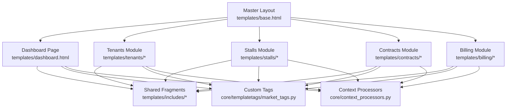
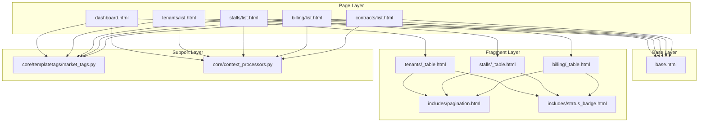
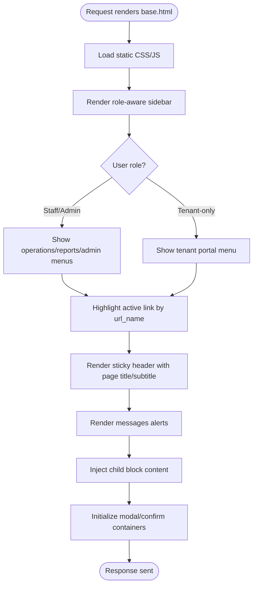
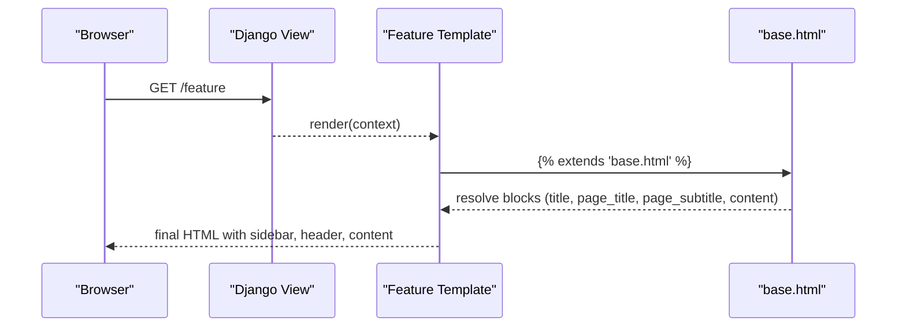
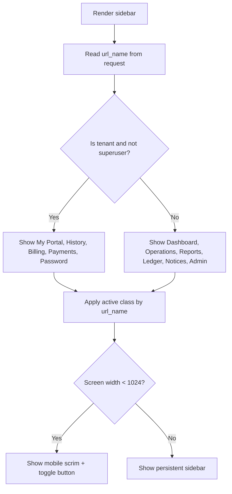
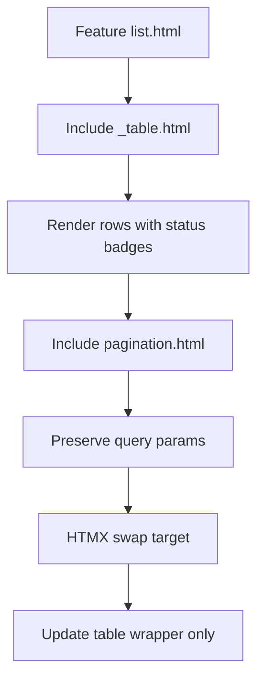
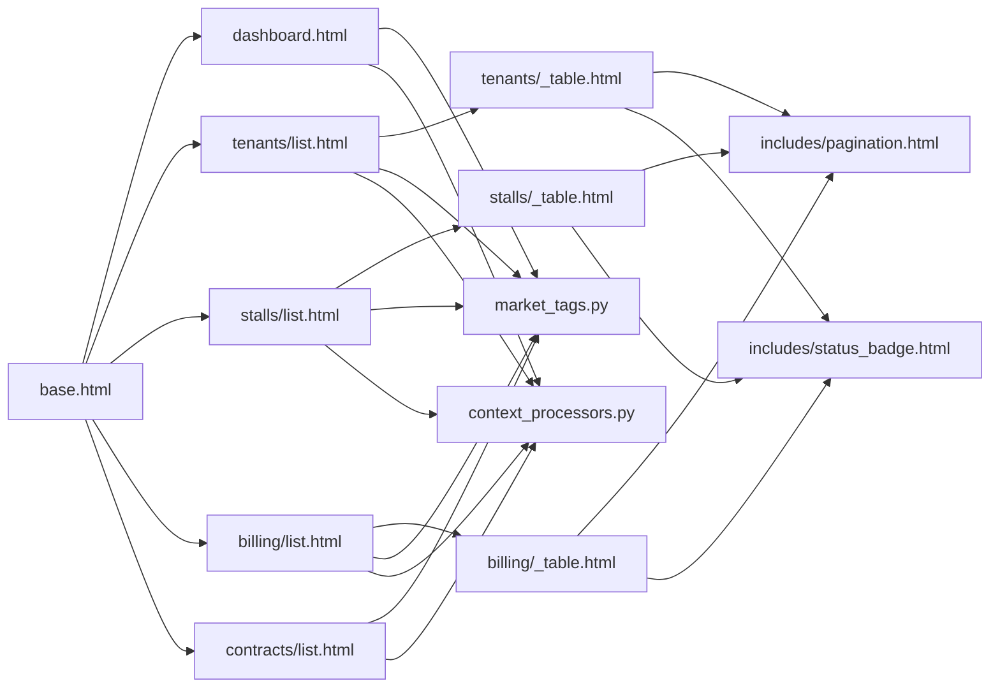

# Template Organization & Structure

<cite>
**Referenced Files in This Document**   
- [base.html](file://templates/base.html)
- [dashboard.html](file://templates/dashboard.html)
- [tenants_list.html](file://templates/tenants/list.html)
- [stalls_list.html](file://templates/stalls/list.html)
- [billing_list.html](file://templates/billing/list.html)
- [contracts_list.html](file://templates/contracts/list.html)
- [tenants_table.html](file://templates/tenants/_table.html)
- [stalls_table.html](file://templates/stalls/_table.html)
- [billing_table.html](file://templates/billing/_table.html)
- [pagination.html](file://templates/includes/pagination.html)
- [status_badge.html](file://templates/includes/status_badge.html)
- [market_tags.py](file://core/templatetags/market_tags.py)
- [context_processors.py](file://core/context_processors.py)
</cite>

## Table of Contents
1. [Introduction](#introduction)
2. [Project Structure](#project-structure)
3. [Core Components](#core-components)
4. [Architecture Overview](#architecture-overview)
5. [Detailed Component Analysis](#detailed-component-analysis)
6. [Dependency Analysis](#dependency-analysis)
7. [Performance Considerations](#performance-considerations)
8. [Troubleshooting Guide](#troubleshooting-guide)
9. [Conclusion](#conclusion)

## Introduction
This document explains how the application organizes its Django templates, focusing on inheritance from a master layout, feature-based directory structure, reusable components, and consistent UI patterns. It also documents the role-aware sidebar navigation, active state management, responsive behavior, template tags, and context processors that power shared presentation logic.

## Project Structure
The templates are organized by feature modules under the `templates` directory:
- Feature folders: `tenants`, `stalls`, `contracts`, `billing`, `payments`, `ledger`, `notices`, `reports`, `settings`, `users`, `tenant_portal`, `audit`.
- Shared fragments live under `includes`: pagination, status badges, and other small reusable pieces.
- The root contains the master layout `base.html` and top-level pages such as `dashboard.html` and `landing.html`.

**Diagram sources**
- [base.html:1-312](file://templates/base.html#L1-L312)
- [dashboard.html:1-331](file://templates/dashboard.html#L1-L331)
- [tenants_list.html:1-64](file://templates/tenants/list.html#L1-L64)
- [stalls_list.html:1-61](file://templates/stalls/list.html#L1-L61)
- [billing_list.html:1-97](file://templates/billing/list.html#L1-L97)
- [contracts_list.html:1-65](file://templates/contracts/list.html#L1-L65)
- [pagination.html:1-47](file://templates/includes/pagination.html#L1-L47)
- [status_badge.html:1-7](file://templates/includes/status_badge.html#L1-L7)
- [market_tags.py:1-97](file://core/templatetags/market_tags.py#L1-L97)
- [context_processors.py:1-45](file://core/context_processors.py#L1-L45)

**Section sources**
- [base.html:1-312](file://templates/base.html#L1-L312)
- [dashboard.html:1-331](file://templates/dashboard.html#L1-L331)
- [tenants_list.html:1-64](file://templates/tenants/list.html#L1-L64)
- [stalls_list.html:1-61](file://templates/stalls/list.html#L1-L61)
- [billing_list.html:1-97](file://templates/billing/list.html#L1-L97)
- [contracts_list.html:1-65](file://templates/contracts/list.html#L1-L65)
- [pagination.html:1-47](file://templates/includes/pagination.html#L1-L47)
- [status_badge.html:1-7](file://templates/includes/status_badge.html#L1-L7)
- [market_tags.py:1-97](file://core/templatetags/market_tags.py#L1-L97)
- [context_processors.py:1-45](file://core/context_processors.py#L1-L45)

## Core Components
- Master layout (`base.html`) defines global HTML shell, static assets, Alpine.js state for the sidebar, header, messages, modals, and content blocks.
- Feature pages extend the master layout and override title, page title/subtitle, and content blocks.
- Reusable table fragments encapsulate list rendering, filters, actions, and pagination.
- Custom template tags provide math helpers, currency formatting, string utilities, and badge class mapping.
- Context processors inject system settings, user roles, collector flags, and static asset versioning into every template.

Key responsibilities:
- Inheritance: Pages use `` and define blocks.
- Composition: Lists include `_table.html` fragments and `includes/pagination.html`.
- Presentation: Status badges and custom filters keep styling consistent.
- Navigation: Sidebar is role-aware and uses URL name matching for active states.

**Section sources**
- [base.html:1-312](file://templates/base.html#L1-L312)
- [dashboard.html:1-331](file://templates/dashboard.html#L1-L331)
- [tenants_table.html:1-234](file://templates/tenants/_table.html#L1-L234)
- [stalls_table.html:1-73](file://templates/stalls/_table.html#L1-L73)
- [billing_table.html:1-173](file://templates/billing/_table.html#L1-L173)
- [pagination.html:1-47](file://templates/includes/pagination.html#L1-L47)
- [status_badge.html:1-7](file://templates/includes/status_badge.html#L1-L7)
- [market_tags.py:1-97](file://core/templatetags/market_tags.py#L1-L97)
- [context_processors.py:1-45](file://core/context_processors.py#L1-L45)

## Architecture Overview
The template architecture follows a layered pattern:
- Base layer: `base.html` provides layout, scripts, and global blocks.
- Page layer: Feature-specific list/detail pages extend the base and fill blocks.
- Fragment layer: `_table.html` and `includes/*` provide reusable UI building blocks.
- Support layer: Template tags and context processors supply shared logic and data.

**Diagram sources**
- [base.html:1-312](file://templates/base.html#L1-L312)
- [dashboard.html:1-331](file://templates/dashboard.html#L1-L331)
- [tenants_list.html:1-64](file://templates/tenants/list.html#L1-L64)
- [stalls_list.html:1-61](file://templates/stalls/list.html#L1-L61)
- [billing_list.html:1-97](file://templates/billing/list.html#L1-L97)
- [contracts_list.html:1-65](file://templates/contracts/list.html#L1-L65)
- [tenants_table.html:1-234](file://templates/tenants/_table.html#L1-L234)
- [stalls_table.html:1-73](file://templates/stalls/_table.html#L1-L73)
- [billing_table.html:1-173](file://templates/billing/_table.html#L1-L173)
- [pagination.html:1-47](file://templates/includes/pagination.html#L1-L47)
- [status_badge.html:1-7](file://templates/includes/status_badge.html#L1-L7)
- [market_tags.py:1-97](file://core/templatetags/market_tags.py#L1-L97)
- [context_processors.py:1-45](file://core/context_processors.py#L1-L45)

## Detailed Component Analysis

### Master Template: base.html
- Defines blocks: `title`, `extra_head`, `page_title`, `page_subtitle`, `content`, `extra_scripts`.
- Loads static assets via ``, including Tailwind output CSS, HTMX, and Alpine.js.
- Provides a responsive sidebar with Alpine state (`sidebarOpen`) and mobile scrim overlay.
- Renders messages with type-based alert classes and integrates modal/confirm dialog containers.
- Uses context variables from processors: `system_settings`, `user`, `is_collector`, `can_manage_records`.

**Diagram sources**
- [base.html:1-312](file://templates/base.html#L1-L312)

**Section sources**
- [base.html:1-312](file://templates/base.html#L1-L312)

### Template Inheritance Pattern
- Pages extend `base.html` and override blocks to customize title, page heading, and main content.
- Example pages:
  - Dashboard: overrides title, page title/subtitle, and content with role-specific views.
  - Tenants/Stalls/Billing/Contracts: follow the same pattern with consistent page heads, filters, and included tables.

**Diagram sources**
- [dashboard.html:1-331](file://templates/dashboard.html#L1-L331)
- [tenants_list.html:1-64](file://templates/tenants/list.html#L1-L64)
- [stalls_list.html:1-61](file://templates/stalls/list.html#L1-L61)
- [billing_list.html:1-97](file://templates/billing/list.html#L1-L97)
- [contracts_list.html:1-65](file://templates/contracts/list.html#L1-L65)
- [base.html:1-312](file://templates/base.html#L1-L312)

**Section sources**
- [dashboard.html:1-331](file://templates/dashboard.html#L1-L331)
- [tenants_list.html:1-64](file://templates/tenants/list.html#L1-L64)
- [stalls_list.html:1-61](file://templates/stalls/list.html#L1-L61)
- [billing_list.html:1-97](file://templates/billing/list.html#L1-L97)
- [contracts_list.html:1-65](file://templates/contracts/list.html#L1-L65)

### Directory Structure and Naming Conventions
- Feature directories mirror domain areas: `tenants`, `stalls`, `contracts`, `billing`, `payments`, `ledger`, `notices`, `reports`, `settings`, `users`, `tenant_portal`, `audit`.
- Each feature typically includes:
  - A list view file named `list.html`.
  - A detail or form view file named `form.html` or `view.html`.
  - A fragment `_table.html` for table rendering.
  - Optional print/export variants like `print_list.html`, `print_view.html`.
- Shared UI elements are placed under `includes/`:
  - `pagination.html` for paginated lists.
  - `status_badge.html` for consistent status chips.

Examples:
- Tenants: `tenants/list.html` includes `tenants/_table.html` and `includes/pagination.html`.
- Stalls: `stalls/list.html` includes `stalls/_table.html` and `includes/pagination.html`.
- Billing: `billing/list.html` includes `billing/_table.html` and `includes/pagination.html`.

**Section sources**
- [tenants_list.html:1-64](file://templates/tenants/list.html#L1-L64)
- [stalls_list.html:1-61](file://templates/stalls/list.html#L1-L61)
- [billing_list.html:1-97](file://templates/billing/list.html#L1-L97)
- [contracts_list.html:1-65](file://templates/contracts/list.html#L1-L65)
- [tenants_table.html:1-234](file://templates/tenants/_table.html#L1-L234)
- [stalls_table.html:1-73](file://templates/stalls/_table.html#L1-L73)
- [billing_table.html:1-173](file://templates/billing/_table.html#L1-L173)
- [pagination.html:1-47](file://templates/includes/pagination.html#L1-L47)
- [status_badge.html:1-7](file://templates/includes/status_badge.html#L1-L7)

### Sidebar Navigation System
- Role-based visibility:
  - Tenant-only section appears when the user’s role is tenant and not superuser.
  - Operations, Reports, Ledger, Notices, and Administration sections appear based on roles and permissions.
- Active state management:
  - Uses `request.resolver_match.url_name` to compare against current route names.
  - Applies `is-active` or `is-muted-active` classes depending on exact match or substring match.
- Responsive behavior:
  - Alpine.js toggles `sidebarOpen` on resize and click events.
  - Mobile scrim overlays the content when the sidebar is open on small screens.
  - Header includes a toggle button for mobile users.

**Diagram sources**
- [base.html:20-200](file://templates/base.html#L20-L200)

**Section sources**
- [base.html:20-200](file://templates/base.html#L20-L200)

### Template Tags Usage
- Arithmetic simple tags: `multiply`, `subtract`, `add`, `divide` with safe fallbacks.
- Formatting filters:
  - `currency`: formats numbers as Philippine Peso with two decimals.
  - `percentage`: formats numbers as percentages.
  - `split`: splits strings by delimiter.
  - `textlines`: splits multi-line text into non-empty lines.
  - `badge`: maps status strings to badge CSS classes.

Usage examples across templates:
- Billing list loads `market_tags` and uses `split` to generate month/year options.
- Status badges are rendered consistently via `includes/status_badge.html`.

**Section sources**
- [market_tags.py:1-97](file://core/templatetags/market_tags.py#L1-L97)
- [billing_list.html:1-97](file://templates/billing/list.html#L1-L97)
- [status_badge.html:1-7](file://templates/includes/status_badge.html#L1-L7)

### Context Processors
- `system_settings(request)`: Injects system-wide settings (e.g., municipality and market names).
- `user_roles(request)`: Exposes:
  - `user_role`: normalized role string.
  - `is_collector`: true for collectors excluding superusers.
  - `can_manage_records`: true for admin/cashier/supervisor/treasurer or superusers.
- `static_version(request)`: Provides cache-busting version for built static assets.

These variables drive:
- Sidebar visibility and labels.
- Collector vs staff dashboard layouts.
- Print/export action availability.
- Static asset URLs with cache busting.

**Section sources**
- [context_processors.py:1-45](file://core/context_processors.py#L1-L45)
- [base.html:32-44](file://templates/base.html#L32-L44)
- [dashboard.html:9-33](file://templates/dashboard.html#L9-L33)
- [billing_list.html:23-45](file://templates/billing/list.html#L23-L45)

### Extending Base Templates and Creating Feature-Specific Layouts
- Extend base:
  - Use `` at the top of each page.
  - Override `title`, `page_title`, `page_subtitle`, and `content`.
- Include reusable fragments:
  - Tables: ``.
  - Pagination: ``.
- Consistent UI patterns:
  - Page head with icon, title, subtitle, and action buttons.
  - Filter bar with search input and dropdowns using HTMX for live updates.
  - Empty states and badges for status display.

Examples:
- Tenants list: page head, filter bar, includes table and pagination.
- Stalls list: similar structure with section/status filters.
- Billing list: grouped collector workflow with summary cards and per-month actions.

**Section sources**
- [tenants_list.html:1-64](file://templates/tenants/list.html#L1-L64)
- [stalls_list.html:1-61](file://templates/stalls/list.html#L1-L61)
- [billing_list.html:1-97](file://templates/billing/list.html#L1-L97)
- [tenants_table.html:1-234](file://templates/tenants/_table.html#L1-L234)
- [stalls_table.html:1-73](file://templates/stalls/_table.html#L1-L73)
- [billing_table.html:1-173](file://templates/billing/_table.html#L1-L173)
- [pagination.html:1-47](file://templates/includes/pagination.html#L1-L47)

### Component Reuse Patterns
- Table fragments:
  - Encapsulate column definitions, row rendering, empty states, and actions.
  - Integrate with HTMX for filtering and pagination without full reloads.
- Pagination component:
  - Preserves query parameters while switching pages.
  - Supports HTMX target swapping for partial updates.
- Status badge component:
  - Centralizes status-to-class mapping for consistent visual semantics.

**Diagram sources**
- [tenants_list.html:1-64](file://templates/tenants/list.html#L1-L64)
- [tenants_table.html:1-234](file://templates/tenants/_table.html#L1-L234)
- [pagination.html:1-47](file://templates/includes/pagination.html#L1-L47)
- [status_badge.html:1-7](file://templates/includes/status_badge.html#L1-L7)

**Section sources**
- [tenants_table.html:1-234](file://templates/tenants/_table.html#L1-L234)
- [stalls_table.html:1-73](file://templates/stalls/_table.html#L1-L73)
- [billing_table.html:1-173](file://templates/billing/_table.html#L1-L173)
- [pagination.html:1-47](file://templates/includes/pagination.html#L1-L47)
- [status_badge.html:1-7](file://templates/includes/status_badge.html#L1-L7)

## Dependency Analysis
Templates depend on:
- Base layout for global structure and scripts.
- Context processors for system settings and role flags.
- Template tags for formatting and badge classes.
- Shared fragments for consistent table and pagination behavior.

**Diagram sources**
- [base.html:1-312](file://templates/base.html#L1-L312)
- [dashboard.html:1-331](file://templates/dashboard.html#L1-L331)
- [tenants_list.html:1-64](file://templates/tenants/list.html#L1-L64)
- [stalls_list.html:1-61](file://templates/stalls/list.html#L1-L61)
- [billing_list.html:1-97](file://templates/billing/list.html#L1-L97)
- [contracts_list.html:1-65](file://templates/contracts/list.html#L1-L65)
- [tenants_table.html:1-234](file://templates/tenants/_table.html#L1-L234)
- [stalls_table.html:1-73](file://templates/stalls/_table.html#L1-L73)
- [billing_table.html:1-173](file://templates/billing/_table.html#L1-L173)
- [pagination.html:1-47](file://templates/includes/pagination.html#L1-L47)
- [status_badge.html:1-7](file://templates/includes/status_badge.html#L1-L7)
- [market_tags.py:1-97](file://core/templatetags/market_tags.py#L1-L97)
- [context_processors.py:1-45](file://core/context_processors.py#L1-L45)

**Section sources**
- [base.html:1-312](file://templates/base.html#L1-L312)
- [dashboard.html:1-331](file://templates/dashboard.html#L1-L331)
- [tenants_list.html:1-64](file://templates/tenants/list.html#L1-L64)
- [stalls_list.html:1-61](file://templates/stalls/list.html#L1-L61)
- [billing_list.html:1-97](file://templates/billing/list.html#L1-L97)
- [contracts_list.html:1-65](file://templates/contracts/list.html#L1-L65)
- [tenants_table.html:1-234](file://templates/tenants/_table.html#L1-L234)
- [stalls_table.html:1-73](file://templates/stalls/_table.html#L1-L73)
- [billing_table.html:1-173](file://templates/billing/_table.html#L1-L173)
- [pagination.html:1-47](file://templates/includes/pagination.html#L1-L47)
- [status_badge.html:1-7](file://templates/includes/status_badge.html#L1-L7)
- [market_tags.py:1-97](file://core/templatetags/market_tags.py#L1-L97)
- [context_processors.py:1-45](file://core/context_processors.py#L1-L45)

## Performance Considerations
- Static asset cache busting:
  - `STATIC_VERSION` ensures browsers fetch updated CSS/JS after builds.
- HTMX partial updates:
  - Filters and pagination update only table wrappers, reducing full-page reloads.
- Alpine.js lightweight interactivity:
  - Sidebar toggle and dropdowns are client-side and minimal overhead.
- Avoid heavy computations in templates:
  - Use context processors and template tags with safe fallbacks to prevent errors.

[No sources needed since this section provides general guidance]

## Troubleshooting Guide
Common issues and resolutions:
- Unrendered template syntax visible on screen:
  - Ensure pages extend `base.html` and are rendered through Django views rather than streamed raw files.
- Sidebar not highlighting correctly:
  - Verify URL names used in sidebar links match `request.resolver_match.url_name`.
- Missing role-based menu items:
  - Confirm context processors are enabled and user roles are set correctly; check `is_collector` and `can_manage_records`.
- Static assets not updating:
  - Rebuild Tailwind CSS and verify `STATIC_VERSION` reflects new mtime.
- Pagination not preserving filters:
  - Ensure `pagination_target` matches the wrapper ID used by HTMX swaps.

**Section sources**
- [base.html:20-200](file://templates/base.html#L20-L200)
- [context_processors.py:1-45](file://core/context_processors.py#L1-L45)
- [pagination.html:1-47](file://templates/includes/pagination.html#L1-L47)

## Conclusion
The template organization emphasizes clarity, reuse, and consistency:
- A single master layout centralizes global structure and scripts.
- Feature modules follow predictable naming and composition patterns.
- Shared fragments and template tags enforce consistent UI and reduce duplication.
- Context processors and role-aware navigation deliver secure, personalized experiences.
Adhering to these patterns ensures maintainable templates, predictable behavior, and a cohesive user interface across the application.