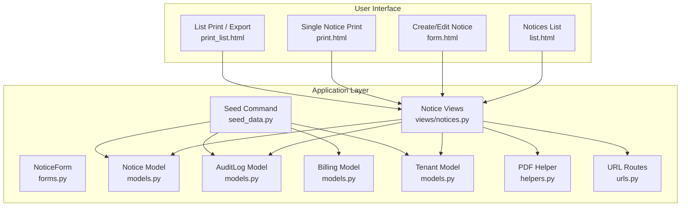
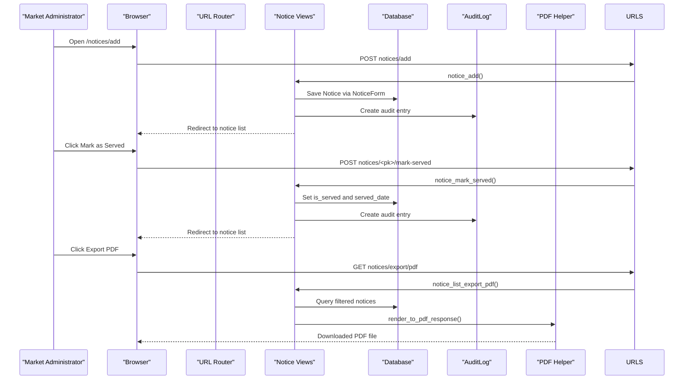
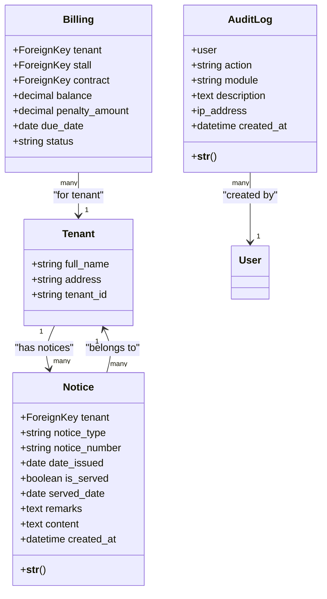
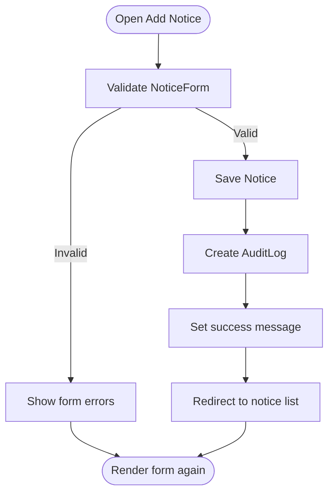
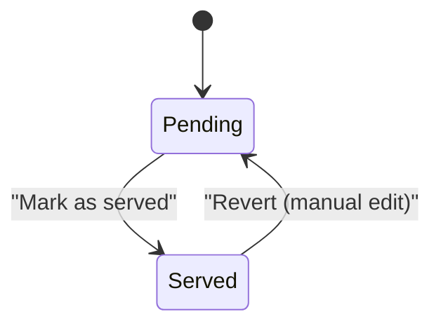
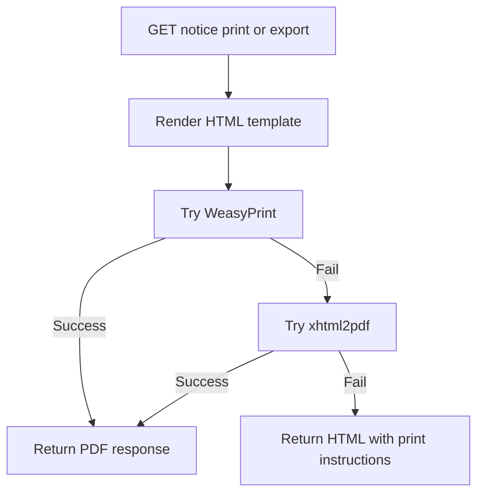
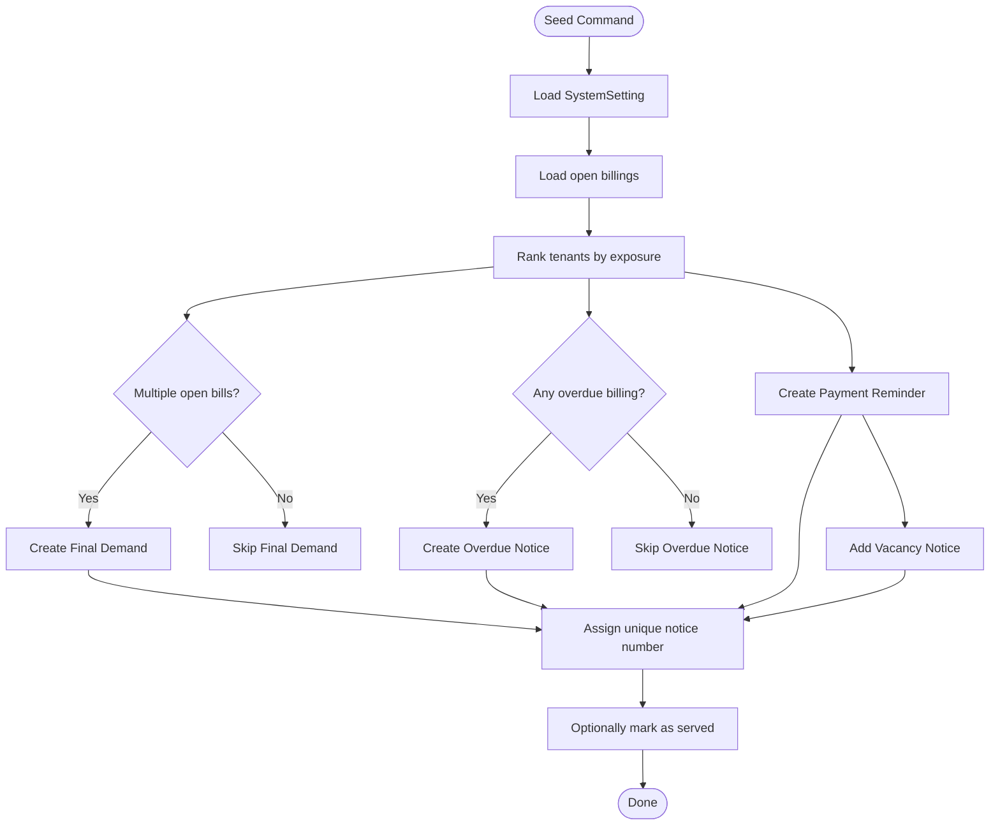
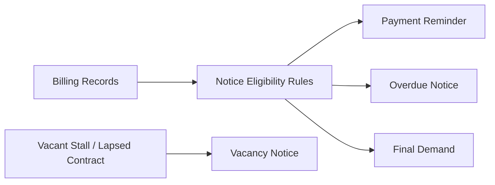
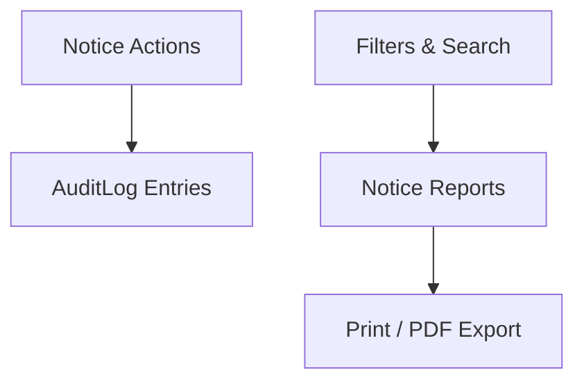
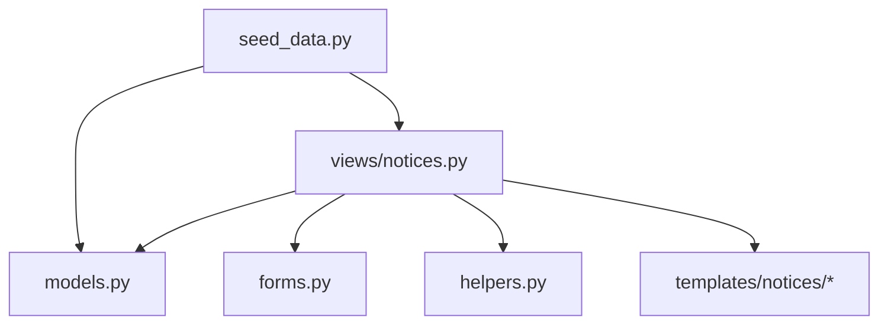

# Notice System

<cite>
**Referenced Files in This Document**   
- [models.py](file://core/models.py)
- [notices.py](file://core/views/notices.py)
- [forms.py](file://core/forms.py)
- [seed_data.py](file://core/management/commands/seed_data.py)
- [helpers.py](file://core/helpers.py)
- [urls.py](file://core/urls.py)
- [list.html](file://templates/notices/list.html)
- [_table.html](file://templates/notices/_table.html)
- [form.html](file://templates/notices/form.html)
- [print.html](file://templates/notices/print.html)
- [print_list.html](file://templates/notices/print_list.html)
</cite>

## Table of Contents
1. [Introduction](#introduction)
2. [Project Structure](#project-structure)
3. [Core Components](#core-components)
4. [Architecture Overview](#architecture-overview)
5. [Detailed Component Analysis](#detailed-component-analysis)
6. [Dependency Analysis](#dependency-analysis)
7. [Performance Considerations](#performance-considerations)
8. [Troubleshooting Guide](#troubleshooting-guide)
9. [Conclusion](#conclusion)

## Introduction
The Notice System module manages official notices issued to tenants for payment reminders, overdue accounts, final demands, and vacancy declarations. It provides:
- Manual notice creation and editing through a form-backed interface.
- Serving tracking with status indicators such as Pending and Served.
- Print and PDF export for individual notices and notice lists.
- Audit logging for administrative actions.
- Seed-driven example notice generation that demonstrates escalation logic based on billing exposure.

The system currently does not implement fully automated scheduling or an Acknowledged status; those are extension points where the existing models and views can be expanded.

## Project Structure
The Notice System is implemented across Django models, views, forms, templates, URL routes, and seed data:
- Data model: `Notice` and related entities live in the core application models.
- User interface: list, add, print, mark served, and PDF export endpoints are defined in the notices view module.
- Forms: `NoticeForm` binds the UI fields to the `Notice` model.
- Templates: list, table fragment, form, single-print, and list-print templates render the user-facing pages.
- URLs: notice routes are registered under `/notices/`.
- Automation examples: seed data creates sample notices and audit logs.

**Diagram sources**
- [notices.py:22-205](file://core/views/notices.py#L22-L205)
- [models.py:280-316](file://core/models.py#L280-L316)
- [forms.py:524-537](file://core/forms.py#L524-L537)
- [helpers.py:522-594](file://core/helpers.py#L522-L594)
- [urls.py:177-184](file://core/urls.py#L177-L184)
- [seed_data.py:431-527](file://core/management/commands/seed_data.py#L431-L527)

**Section sources**
- [notices.py:22-205](file://core/views/notices.py#L22-L205)
- [models.py:280-316](file://core/models.py#L280-L316)
- [urls.py:177-184](file://core/urls.py#L177-L184)

## Core Components
- Notice model: stores tenant linkage, notice type, unique notice number, issue date, serving status, served date, remarks, content, and creation timestamp.
- NoticeForm: renders all notice fields including serving controls and remarks.
- Notice views: provide listing, filtering, adding, printing, marking served, and PDF export.
- AuditLog model: records administrative actions such as notice creation and serving.
- Billing model: used by automation seeds to determine which notices should be generated.
- PDF helper: renders HTML templates into downloadable PDFs with fallback behavior.

Key responsibilities:
- Notice lifecycle: create → serve → print/export.
- Status management: Pending (not served) vs Served.
- Compliance support: audit logging and printable records.

**Section sources**
- [models.py:280-316](file://core/models.py#L280-L316)
- [forms.py:524-537](file://core/forms.py#L524-L537)
- [notices.py:22-205](file://core/views/notices.py#L22-L205)
- [helpers.py:522-594](file://core/helpers.py#L522-L594)

## Architecture Overview
The Notice System follows a standard Django request-response pattern:
- Users interact with list, add, print, and mark-served pages.
- Views validate permissions, load data, update state, and log actions.
- Templates render tables, forms, and printable layouts.
- PDF export uses a helper that tries WeasyPrint first, then xhtml2pdf, then falls back to browser-based print.

**Diagram sources**
- [notices.py:70-118](file://core/views/notices.py#L70-L118)
- [notices.py:157-205](file://core/views/notices.py#L157-L205)
- [helpers.py:522-594](file://core/helpers.py#L522-L594)
- [urls.py:177-184](file://core/urls.py#L177-L184)

## Detailed Component Analysis

### Notice Data Model
The `Notice` model defines the core entity for notices:
- Fields include tenant reference, notice type, unique notice number, issue date, serving flags, served date, remarks, content, and creation time.
- Notice types include Payment Reminder, Overdue Notice, Final Demand, and Vacancy Notice.
- Ordering defaults to most recent issue dates.

**Diagram sources**
- [models.py:117-154](file://core/models.py#L117-L154)
- [models.py:190-218](file://core/models.py#L190-L218)
- [models.py:280-316](file://core/models.py#L280-L316)

**Section sources**
- [models.py:280-316](file://core/models.py#L280-L316)

### Notice Creation and Customization
Notice creation is handled by `notice_add`, which validates `NoticeForm` and persists the record. On success, it creates an audit log entry and redirects to the notice list. The form exposes:
- Tenant selection
- Notice type selection
- Unique notice number
- Issue date
- Content body
- Serving checkbox and served date
- Remarks

Customization options:
- Notice content supports free-form text rendered with line breaks.
- Remarks allow additional context for compliance or internal notes.
- Notice numbers are unique and typically follow a prefix convention.

**Diagram sources**
- [notices.py:70-88](file://core/views/notices.py#L70-L88)
- [forms.py:524-537](file://core/forms.py#L524-L537)
- [form.html:18-85](file://templates/notices/form.html#L18-L85)

**Section sources**
- [notices.py:70-88](file://core/views/notices.py#L70-L88)
- [forms.py:524-537](file://core/forms.py#L524-L537)
- [form.html:18-85](file://templates/notices/form.html#L18-L85)

### Serving Tracking and Status Management
Status management is represented by:
- `is_served`: boolean flag indicating whether the notice has been served.
- `served_date`: optional date when service occurred.
- UI badges: Pending when not served, Served when marked.

Marking a notice as served updates the model and logs the action. Tenants can only view their own notices; administrators have broader access.

**Diagram sources**
- [notices.py:104-118](file://core/views/notices.py#L104-L118)
- [_table.html:23-30](file://templates/notices/_table.html#L23-L30)
- [models.py:291-292](file://core/models.py#L291-L292)

**Section sources**
- [notices.py:104-118](file://core/views/notices.py#L104-L118)
- [_table.html:23-30](file://templates/notices/_table.html#L23-L30)
- [models.py:291-292](file://core/models.py#L291-L292)

### Printing and PDF Export
Printing and export functionality includes:
- Single notice print page with letterhead, notice details, tenant address, content, signature block, and remarks.
- List print page for batch printing.
- PDF export for both single notices and lists using `render_to_pdf_response`.

The PDF helper attempts WeasyPrint first, then xhtml2pdf, and finally returns an HTML preview with a browser print option if neither library works.

**Diagram sources**
- [notices.py:92-100](file://core/views/notices.py#L92-L100)
- [notices.py:193-205](file://core/views/notices.py#L193-L205)
- [helpers.py:522-594](file://core/helpers.py#L522-L594)
- [print.html:1-70](file://templates/notices/print.html#L1-L70)

**Section sources**
- [notices.py:92-100](file://core/views/notices.py#L92-L100)
- [notices.py:193-205](file://core/views/notices.py#L193-L205)
- [helpers.py:522-594](file://core/helpers.py#L522-L594)
- [print.html:1-70](file://templates/notices/print.html#L1-L70)

### Automated Notice Generation Examples
The seed command demonstrates how notices can be generated automatically based on billing conditions:
- Ranks tenants by total outstanding exposure.
- Generates Final Demand notices for tenants with multiple open billings.
- Generates Overdue Notice for tenants with at least one overdue billing.
- Generates Payment Reminder for any tenant with open balances.
- Adds a Vacancy Notice for a specific tenant and stall.
- Creates unique notice numbers and optionally marks some notices as served during seeding.

This shows escalation logic from reminder to overdue to final demand, and how vacancy notices can be produced alongside collection notices.

**Diagram sources**
- [seed_data.py:431-527](file://core/management/commands/seed_data.py#L431-L527)
- [models.py:190-218](file://core/models.py#L190-L218)
- [models.py:280-316](file://core/models.py#L280-L316)

**Section sources**
- [seed_data.py:431-527](file://core/management/commands/seed_data.py#L431-L527)

### Integration with Billing and Payment Systems
Integration points:
- Notice generation seeds use `Billing` records to decide notice types and compose content referencing tenant, stall, billing month/year, due date, balance, and penalties.
- Billing status transitions (Unpaid, Partial, Paid, Overdue) influence which notices are appropriate.
- Payments update billing totals and status through helpers, indirectly affecting future notice decisions.

Important note:
- There is no direct automatic trigger from payment completion to notice creation in the current codebase.
- To automate notices based on account status, you would extend the billing/payment flow to call a notice-generation function after status changes.

**Diagram sources**
- [seed_data.py:431-527](file://core/management/commands/seed_data.py#L431-L527)
- [models.py:190-218](file://core/models.py#L190-L218)
- [models.py:280-316](file://core/models.py#L280-L316)

**Section sources**
- [seed_data.py:431-527](file://core/management/commands/seed_data.py#L431-L527)
- [models.py:190-218](file://core/models.py#L190-L218)

### Notice History, Audit Logging, and Reporting
History and compliance:
- Every notice creation and serving action writes an `AuditLog` entry with user, action, module, description, and IP address.
- The notice list supports filtering by type, tenant, date range, and search terms, enabling historical review.
- Print and PDF exports provide printable records suitable for regulatory documentation.

Reporting capabilities:
- List print and PDF export allow generating reports for notices within selected filters.
- Audit logs can be reviewed separately to trace administrative actions.

**Diagram sources**
- [notices.py:22-66](file://core/views/notices.py#L22-L66)
- [notices.py:122-153](file://core/views/notices.py#L122-L153)
- [notices.py:157-205](file://core/views/notices.py#L157-L205)
- [notices.py:75-81](file://core/views/notices.py#L75-L81)
- [notices.py:110-116](file://core/views/notices.py#L110-L116)

**Section sources**
- [notices.py:22-66](file://core/views/notices.py#L22-L66)
- [notices.py:122-153](file://core/views/notices.py#L122-L153)
- [notices.py:157-205](file://core/views/notices.py#L157-L205)
- [notices.py:75-81](file://core/views/notices.py#L75-L81)
- [notices.py:110-116](file://core/views/notices.py#L110-L116)

## Dependency Analysis
Notice-related dependencies:
- Views depend on models (`Notice`, `Tenant`, `AuditLog`, `SystemSetting`) and helpers (`render_to_pdf_response`).
- Forms bind directly to the `Notice` model.
- Templates depend on view-provided context and static assets.
- Seed data depends on `Billing`, `Tenant`, `SystemSetting`, and `Notice`.

**Diagram sources**
- [notices.py:1-14](file://core/views/notices.py#L1-L14)
- [models.py:280-316](file://core/models.py#L280-L316)
- [forms.py:524-537](file://core/forms.py#L524-L537)
- [helpers.py:522-594](file://core/helpers.py#L522-L594)
- [seed_data.py:431-527](file://core/management/commands/seed_data.py#L431-L527)

**Section sources**
- [notices.py:1-14](file://core/views/notices.py#L1-L14)
- [models.py:280-316](file://core/models.py#L280-L316)
- [forms.py:524-537](file://core/forms.py#L524-L537)
- [helpers.py:522-594](file://core/helpers.py#L522-L594)
- [seed_data.py:431-527](file://core/management/commands/seed_data.py#L431-L527)

## Performance Considerations
- Notice list queries use `select_related('tenant')` to reduce N+1 queries.
- Pagination limits results to 10 per page.
- Filtering and searching apply database-side constraints before pagination.
- PDF export renders templates and may invoke external libraries; consider caching heavy computations if notice volumes grow.

[No sources needed since this section provides general guidance]

## Troubleshooting Guide
Common issues and resolutions:
- Cannot mark notice as served: ensure the user has management privileges and the notice exists.
- PDF export fails: check system libraries for WeasyPrint or xhtml2pdf; the helper will fall back to browser print instructions.
- Notice not appearing in list: verify filters, tenant isolation for tenant users, and search terms.
- Duplicate notice numbers: ensure unique notice numbers are assigned; seed logic checks existence before creating.

Operational tips:
- Use the list filters to isolate notices by type, tenant, and date range.
- Review audit logs to confirm who created or served notices.
- For compliance, export PDFs of notices and retain them with your records.

**Section sources**
- [notices.py:22-66](file://core/views/notices.py#L22-L66)
- [notices.py:104-118](file://core/views/notices.py#L104-L118)
- [helpers.py:522-594](file://core/helpers.py#L522-L594)

## Conclusion
The Notice System provides a solid foundation for managing tenant notices with manual creation, serving tracking, print/PDF export, and audit logging. Automation examples in seed data demonstrate escalation logic from reminders to overdue notices and final demands, as well as vacancy notices. While fully automated scheduling and an Acknowledged status are not yet implemented, the existing architecture allows straightforward extensions to integrate notice triggers with billing and payment workflows and to expand status handling for compliance reporting.

[No sources needed since this section summarizes without analyzing specific files]