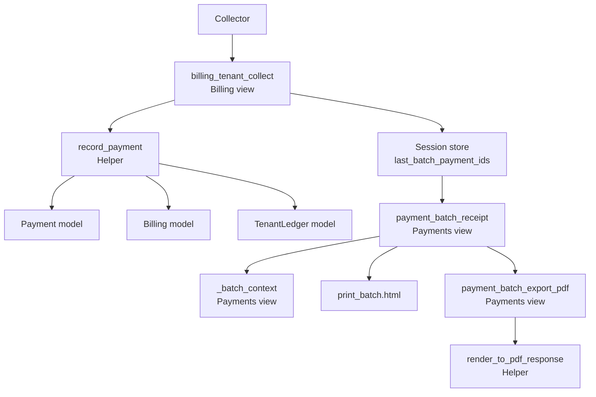
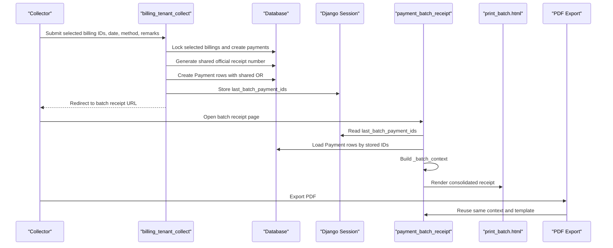
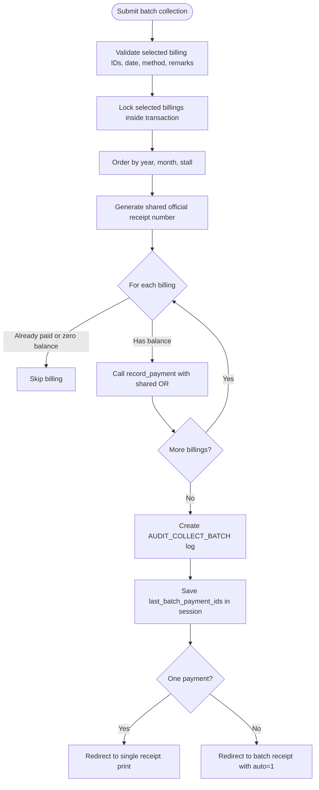
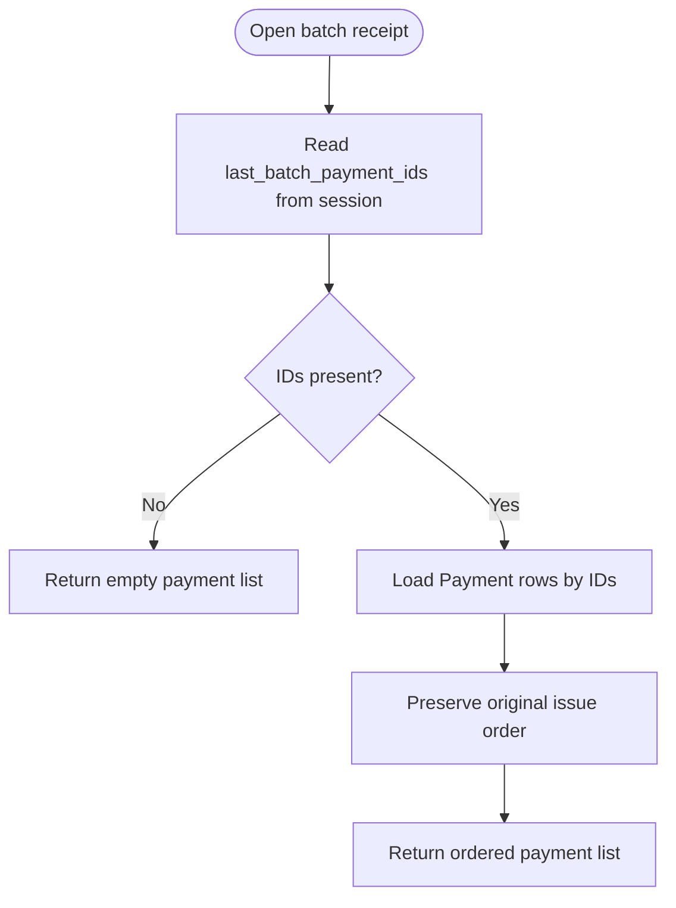
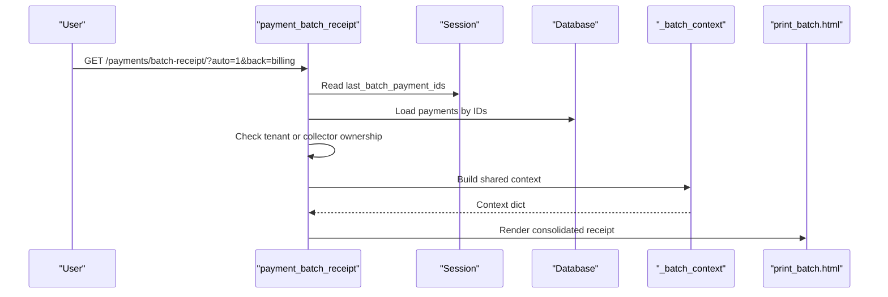
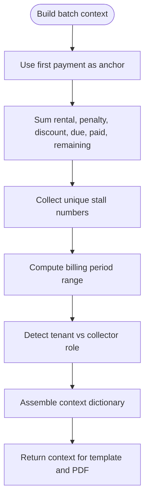
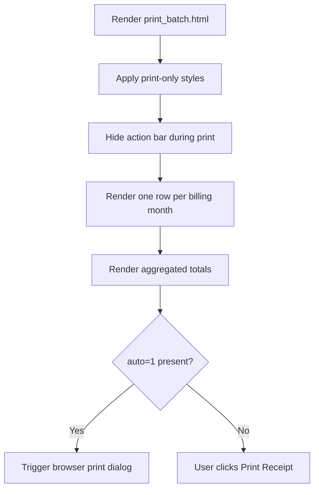
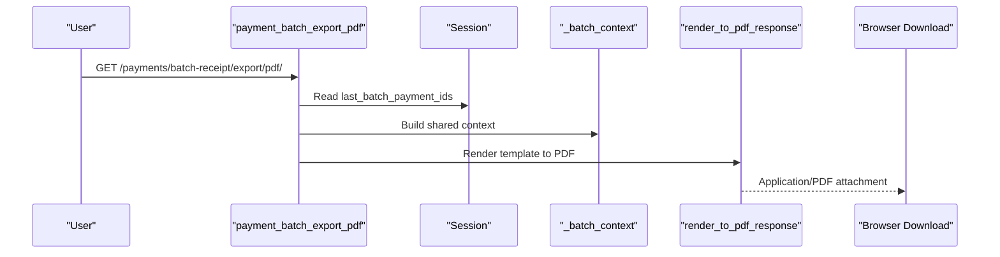
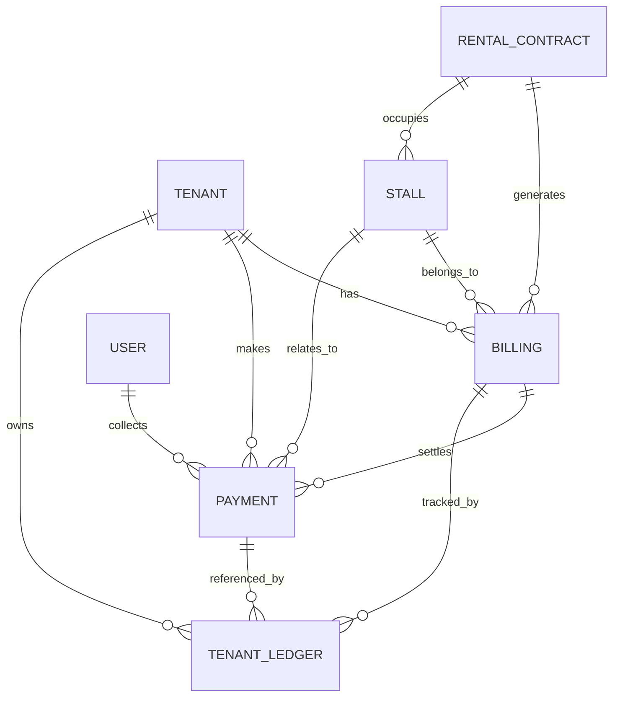
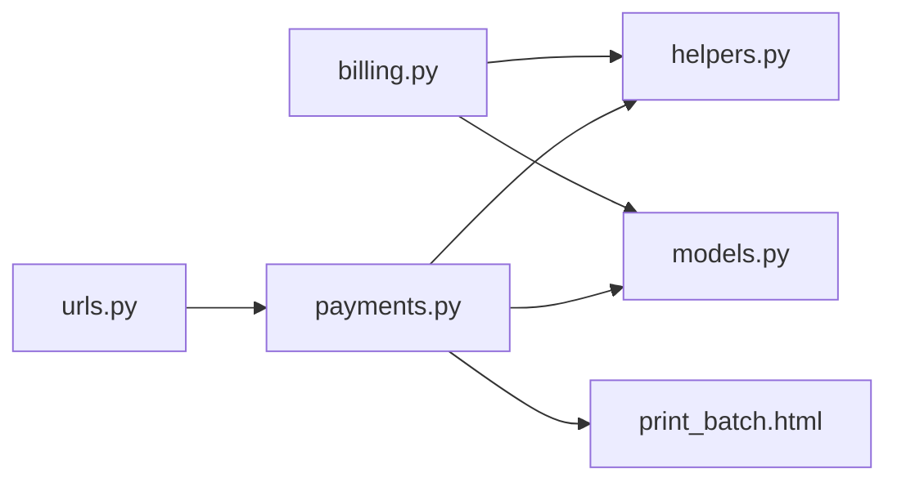

# Batch Payment Operations

<cite>
**Referenced Files in This Document**
- [payments.py](file://core/views/payments.py)
- [billing.py](file://core/views/billing.py)
- [helpers.py](file://core/helpers.py)
- [models.py](file://core/models.py)
- [print_batch.html](file://templates/payments/print_batch.html)
- [urls.py](file://core/urls.py)
</cite>

## Table of Contents
1. [Introduction](#introduction)
2. [Project Structure](#project-structure)
3. [Core Components](#core-components)
4. [Architecture Overview](#architecture-overview)
5. [Detailed Component Analysis](#detailed-component-analysis)
6. [Dependency Analysis](#dependency-analysis)
7. [Performance Considerations](#performance-considerations)
8. [Troubleshooting Guide](#troubleshooting-guide)
9. [Conclusion](#conclusion)

## Introduction
Batch payment operations allow a collector to settle multiple billing periods for one tenant in a single workflow. Instead of collecting each month individually, the collector selects outstanding months and submits them together. The system then:

- Creates one `Payment` row per selected billing period.
- Assigns a shared official receipt number across all payments so they form one consolidated receipt.
- Stores the created payment IDs in the user session.
- Renders a single printable document listing every collected month as a line item.
- Supports PDF export and automatic printing.
- Enforces role-based access control and records audit trail entries.

This document explains the end-to-end batch collection flow, session storage, consolidated receipt generation, `_batch_context()`, printing and PDF export behavior, security, permissions, and audit requirements.

## Project Structure
The batch payment feature spans views, helpers, templates, URLs, and models:

| Area | Responsibility |
| --- | --- |
| Billing view | Presents grouped billings and processes batch collection requests. |
| Payments view | Reads the session-stored batch, builds context, renders the consolidated receipt, and exports PDF. |
| Helpers | Centralizes payment recording, receipt numbering, ledger updates, and PDF rendering. |
| Models | Defines billing, payment, tenant, stall, ledger, and audit entities. |
| Template | Renders the consolidated official receipt with totals, remarks, signatures, and print controls. |
| URLs | Exposes endpoints for viewing and exporting batch receipts. |

**Diagram sources**
- [billing.py:511-624](file://core/views/billing.py#L511-L624)
- [payments.py:20-39](file://core/views/payments.py#L20-L39)
- [payments.py:40-99](file://core/views/payments.py#L40-L99)
- [payments.py:351-396](file://core/views/payments.py#L351-L396)
- [helpers.py:351-420](file://core/helpers.py#L351-L420)
- [helpers.py:522-594](file://core/helpers.py#L522-L594)
- [models.py:190-258](file://core/models.py#L190-L258)

**Section sources**
- [billing.py:511-634](file://core/views/billing.py#L511-L634)
- [payments.py:20-39](file://core/views/payments.py#L20-L39)
- [payments.py:351-396](file://core/views/payments.py#L351-L396)
- [helpers.py:351-420](file://core/helpers.py#L351-L420)
- [helpers.py:522-594](file://core/helpers.py#L522-L594)
- [models.py:190-258](file://core/models.py#L190-L258)

## Core Components
The batch payment system is built around five core components:

| Component | Purpose | Key Behavior |
| --- | --- | --- |
| Grouped billing collection | Lets collectors select multiple billing periods for one tenant. | Validates selections, locks rows, generates one shared OR, creates payments, audits, redirects to batch receipt. |
| Session storage | Remembers which payments belong to the latest batch. | Stores ordered payment PKs under a fixed session key. |
| Batch receipt view | Renders the consolidated receipt. | Loads payments from session, enforces access, builds shared context, renders template. |
| `_batch_context()` | Builds shared data for HTML and PDF. | Aggregates totals, periods, stalls, amount-in-words, settings, and print flags. |
| PDF export | Produces a downloadable consolidated receipt. | Reuses the same template and context; names file by OR and tenant ID. |

**Section sources**
- [billing.py:511-624](file://core/views/billing.py#L511-L624)
- [payments.py:20-39](file://core/views/payments.py#L20-L39)
- [payments.py:40-99](file://core/views/payments.py#L40-L99)
- [payments.py:351-396](file://core/views/payments.py#L351-L396)
- [helpers.py:351-420](file://core/helpers.py#L351-L420)

## Architecture Overview
The batch workflow connects the billing interface to the consolidated receipt through a short-lived session bridge.

**Diagram sources**
- [billing.py:539-624](file://core/views/billing.py#L539-L624)
- [payments.py:26-37](file://core/views/payments.py#L26-L37)
- [payments.py:351-396](file://core/views/payments.py#L351-L396)
- [helpers.py:351-420](file://core/helpers.py#L351-L420)

## Detailed Component Analysis

### Batch Collection Entry Point
The grouped collection endpoint is the main entry point for batch operations. It:

- Loads all billings for the tenant, including past months.
- Filters outstanding billings that still carry a balance.
- Accepts selected billing IDs, payment date, payment method, and remarks.
- Re-queries selected billings with row-level locking to prevent concurrent double settlement.
- Orders billings oldest first so partial payments align with contract history.
- Generates one shared official receipt number for the entire batch.
- Calls the central payment helper for each selected billing.
- Records an audit log describing the number of months, periods, total collected, and shared OR.
- Stores the created payment IDs in the session.
- Redirects to either the single-receipt flow or the batch receipt flow depending on how many payments were created.

**Diagram sources**
- [billing.py:539-624](file://core/views/billing.py#L539-L624)
- [helpers.py:351-420](file://core/helpers.py#L351-L420)

**Section sources**
- [billing.py:511-634](file://core/views/billing.py#L511-L634)

### Session-Based Storage of Batch Payment IDs
After batch collection, the system stores the primary keys of the created payments in the session using a fixed key. This allows the batch receipt page to reconstruct the exact set of payments without requiring the collector to resubmit data.

Key behaviors:

| Aspect | Implementation Detail |
| --- | --- |
| Session key | A constant defines the session key used for the most recent batch. |
| Stored value | Ordered list of payment primary keys. |
| Retrieval function | Loads payments by stored IDs while preserving order. |
| Related data | Uses related loading for tenant, stall, section, billing, and collector. |
| Missing session | Returns an empty list when no batch exists. |

**Diagram sources**
- [payments.py:20-37](file://core/views/payments.py#L20-L37)

**Section sources**
- [payments.py:20-37](file://core/views/payments.py#L20-L37)

### Consolidated Receipt Generation
The consolidated receipt is rendered by the batch receipt view. It loads payments from the session, validates user access, and passes the result to `_batch_context()`.

Important details:

- Tenants can only view their own receipts.
- Collectors can only view receipts for payments they recorded.
- Superusers bypass collector ownership checks.
- If no batch exists, the user is redirected with an informational message.
- For a single payment, the classic single-receipt flow is preferred; otherwise, the consolidated batch receipt is shown.

**Diagram sources**
- [payments.py:351-373](file://core/views/payments.py#L351-L373)
- [payments.py:40-99](file://core/views/payments.py#L40-L99)

**Section sources**
- [payments.py:351-373](file://core/views/payments.py#L351-L373)

### The `_batch_context()` Function
`_batch_context()` builds the shared data structure used by both the HTML batch receipt and the PDF export. It ensures consistency between screen output and printed output.

Responsibilities:

| Responsibility | Explanation |
| --- | --- |
| Aggregate totals | Sums rental, penalty, discount, due, paid, and remaining amounts across all payments. |
| Identify periods | Computes unique billing year-month pairs and formats a readable range. |
| Identify stalls | Collects unique stall numbers covered by the batch. |
| Determine receipt identity | Uses the shared official receipt number when available, falling back to the first payment’s internal receipt number. |
| Prepare display fields | Includes tenant, payment date, issued time, payment method, collector, remarks, and status indicators. |
| Prepare print behavior | Sets auto-print flag based on query parameters. |
| Prepare navigation | Provides a safe back URL unless the current user is a tenant. |
| Include system branding | Loads system settings for letterhead and configuration. |

**Diagram sources**
- [payments.py:40-99](file://core/views/payments.py#L40-L99)

**Section sources**
- [payments.py:40-99](file://core/views/payments.py#L40-L99)

### Batch Receipt Printing and Page Break Handling
The consolidated receipt template renders one official receipt document containing multiple billing periods. It includes:

- Action buttons for printing, exporting PDF, navigating back, and closing.
- Letterhead information from system settings.
- Official receipt number, issuance date, period range, tenant, tenant ID, stalls, and payment method.
- A table with one row per collected month.
- Totals for rental, penalty, discount, due, paid, and remaining balance.
- An amount-in-words field generated by helper logic.
- Remarks, status badge, signature lines, and footer text.
- Automatic printing when the request includes the auto flag.

Page break handling is designed for multi-receipt documents:

- CSS rules hide non-print controls during printing.
- Table rows are marked to avoid awkward page breaks inside rows.
- The template declares print margins and uses a consolidated layout.
- When multiple months are settled, each month appears as a line item in one document rather than separate receipts.

**Diagram sources**
- [print_batch.html:1-221](file://templates/payments/print_batch.html#L1-L221)

**Section sources**
- [print_batch.html:1-221](file://templates/payments/print_batch.html#L1-L221)

### Batch Receipt PDF Export
The batch PDF export reuses the same template and context as the HTML receipt. It:

- Loads the same session-stored payments.
- Applies the same tenant and collector access checks.
- Disables automatic printing because the response is a file download.
- Names the file using the official receipt number and tenant identifier.
- Delegates PDF generation to the shared PDF helper.

**Diagram sources**
- [payments.py:376-396](file://core/views/payments.py#L376-L396)
- [helpers.py:522-594](file://core/helpers.py#L522-L594)

**Section sources**
- [payments.py:376-396](file://core/views/payments.py#L376-L396)
- [helpers.py:522-594](file://core/helpers.py#L522-L594)

### Batch Processing Scenarios
Common scenarios include:

| Scenario | Expected Behavior |
| --- | --- |
| Collecting overdue payments for multiple periods | The collector selects several unpaid or partially paid months; the system settles each outstanding balance and produces one consolidated receipt. |
| Settling one month | The system behaves like the single-payment flow but still uses the same payment recording helper. |
| Selecting already-paid months | Those months are skipped; if nothing remains payable, the user receives an informational message. |
| Multi-stall tenant | The receipt lists unique stall numbers and treats each billing period as a separate line item. |
| Partial settlement across months | Each selected billing is settled up to its balance; the consolidated receipt shows remaining balance after aggregation. |

These scenarios are supported by:

- Outstanding billing filtering.
- Balance checks before creating payments.
- Shared official receipt numbering.
- Consolidated totals and remaining balance calculation.
- Audit logging of batch actions.

**Section sources**
- [billing.py:539-624](file://core/views/billing.py#L539-L624)
- [payments.py:40-99](file://core/views/payments.py#L40-L99)

### Data Model Relationships Relevant to Batch Payments
The batch flow interacts primarily with billing, payment, tenant, stall, ledger, and audit models.

**Diagram sources**
- [models.py:157-258](file://core/models.py#L157-L258)
- [models.py:261-316](file://core/models.py#L261-L316)

**Section sources**
- [models.py:157-258](file://core/models.py#L157-L258)
- [models.py:261-316](file://core/models.py#L261-L316)

## Dependency Analysis
The batch payment feature depends on several modules:

| Dependency | Role |
| --- | --- |
| `core.views.billing` | Entry point for selecting and submitting batch collections. |
| `core.views.payments` | Reads session state, enforces access, renders consolidated receipt, exports PDF. |
| `core.helpers` | Centralizes payment creation, receipt numbering, ledger recomputation, and PDF rendering. |
| `core.models` | Defines billing, payment, tenant, stall, ledger, and audit structures. |
| `templates.payments.print_batch` | Renders the consolidated receipt UI and print behavior. |
| `core.urls` | Maps batch receipt and PDF export URLs. |

**Diagram sources**
- [billing.py:511-634](file://core/views/billing.py#L511-L634)
- [payments.py:20-39](file://core/views/payments.py#L20-L39)
- [payments.py:351-396](file://core/views/payments.py#L351-L396)
- [helpers.py:351-420](file://core/helpers.py#L351-L420)
- [urls.py:34](file://core/urls.py#L34)
- [urls.py:146-147](file://core/urls.py#L146-L147)

**Section sources**
- [billing.py:511-634](file://core/views/billing.py#L511-L634)
- [payments.py:20-39](file://core/views/payments.py#L20-L39)
- [payments.py:351-396](file://core/views/payments.py#L351-L396)
- [helpers.py:351-420](file://core/helpers.py#L351-L420)
- [urls.py:34](file://core/urls.py#L34)
- [urls.py:146-147](file://core/urls.py#L146-L147)

## Performance Considerations
Batch operations should be evaluated for concurrency, database load, and rendering cost:

| Concern | Current Behavior | Recommendation |
| --- | --- | --- |
| Concurrent collection | Selected billings are locked with row-level locking inside a transaction. | Keep transactions small and ensure indexes exist on tenant, billing month/year, and stall. |
| Payment creation loop | One `record_payment` call per selected billing. | Monitor large batches; consider background jobs if batches become very large. |
| Session size | Only payment IDs are stored. | Safe for typical batch sizes; avoid storing full objects in session. |
| PDF rendering | Uses WeasyPrint with fallbacks. | Prefer Linux environments for native WeasyPrint support; keep templates lightweight. |
| Ledger recalculation | Tenant ledger balances are recomputed after payment recording. | Ensure ledger queries are indexed by tenant and transaction date. |
| Query optimization | Related fields are prefetched where possible. | Continue using selective `select_related` for heavy reports. |

[No sources needed since this section provides general guidance]

## Troubleshooting Guide

### No Batch Receipts Available
**Symptoms:** Redirect to billing list with an informational message.  
**Likely causes:**
- Batch collection was not performed in the current session.
- Session expired.
- All selected billings were already paid.

**Resolution:**
- Perform a new batch collection.
- Verify session persistence.
- Confirm that at least one selected billing has a positive balance.

**Section sources**
- [payments.py:351-363](file://core/views/payments.py#L351-L363)

### Collector Cannot View Another Collector’s Batch
**Symptoms:** Error message and redirect to payment list.  
**Cause:** The current collector did not record the payments in the batch.  
**Resolution:** Log in as the collector who recorded the payments, or use a superuser account for administrative review.

**Section sources**
- [payments.py:364-373](file://core/views/payments.py#L364-L373)

### Tenant Cannot View Someone Else’s Receipts
**Symptoms:** Error message and redirect to dashboard.  
**Cause:** The tenant tried to access receipts belonging to another tenant.  
**Resolution:** Use the tenant’s own account or navigate through the tenant portal.

**Section sources**
- [payments.py:364-368](file://core/views/payments.py#L364-L368)

### PDF Export Fails or Shows Warning
**Symptoms:** HTML preview with warning instead of a clean PDF.  
**Likely causes:**
- WeasyPrint system libraries missing.
- xhtml2pdf unavailable or failed.
- Environment limitations such as Windows without GTK.

**Resolution:**
- Install required system libraries for WeasyPrint.
- Use browser Print → Save as PDF as a fallback.
- Run production on Linux where WeasyPrint works natively.

**Section sources**
- [helpers.py:522-594](file://core/helpers.py#L522-L594)

### Batch Amounts Do Not Match Expectations
**Symptoms:** Consolidated totals differ from manual calculations.  
**Likely causes:**
- Some selected billings were already paid and skipped.
- Penalties or discounts changed between billing generation and collection.
- Remaining balance reflects aggregated unpaid amounts.

**Resolution:**
- Review individual billing balances before selection.
- Check audit logs for penalty application.
- Inspect the consolidated receipt’s remaining balance field.

**Section sources**
- [billing.py:539-624](file://core/views/billing.py#L539-L624)
- [payments.py:40-99](file://core/views/payments.py#L40-L99)

## Conclusion
Batch payment operations provide a secure, auditable, and user-friendly way for collectors to settle multiple billing periods in one workflow. The system separates concerns clearly:

- Billing views handle selection, validation, locking, and payment creation.
- Sessions bridge the collection step to the receipt step.
- Payments views render and export a single consolidated receipt.
- Helpers centralize financial integrity, receipt numbering, and PDF generation.
- Templates present a professional, printable official receipt covering multiple months or stalls.

For reliable operation, maintain proper session usage, enforce role-based access, preserve audit trails, and monitor performance for large batches. The design intentionally favors one consolidated official receipt per batch while keeping internal receipt numbers unique per payment row for database constraints.

[No sources needed since this section summarizes without analyzing specific files]