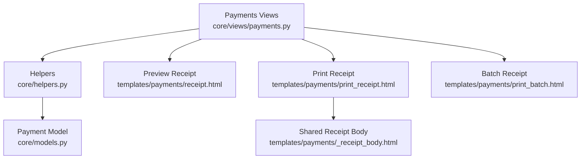
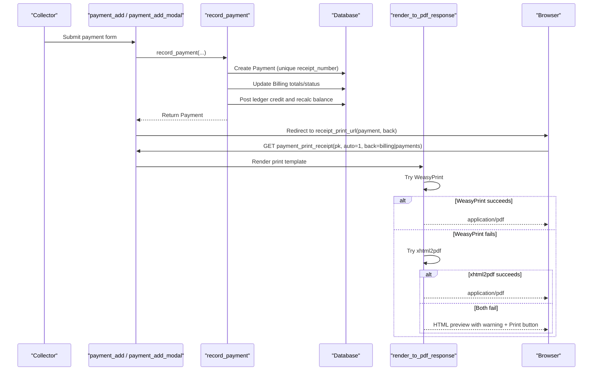
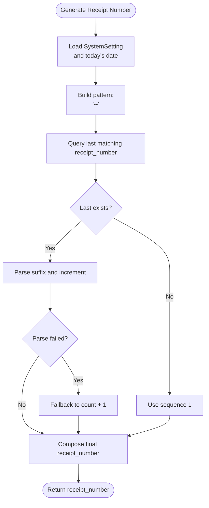
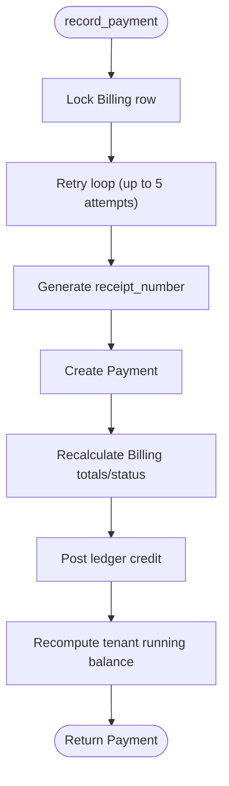
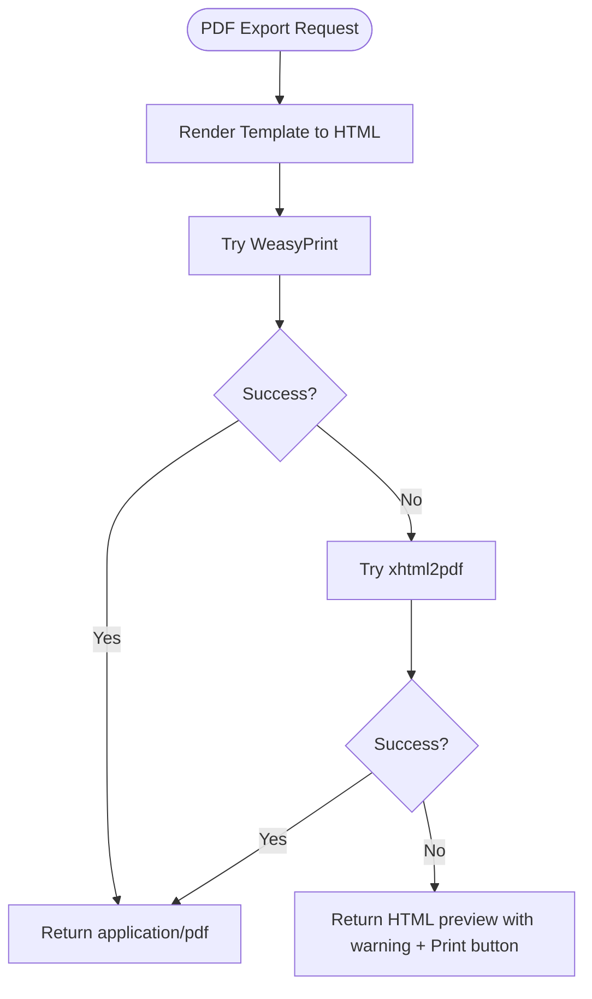
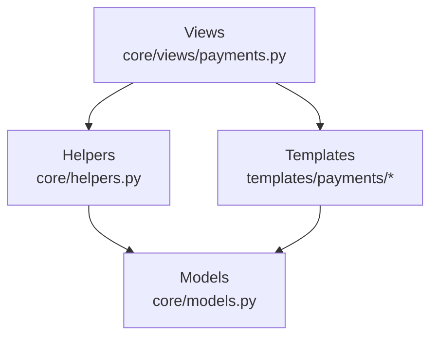

# Official Receipt Generation

<cite>
**Referenced Files in This Document**
- [core/models.py](file://core/models.py)
- [core/helpers.py](file://core/helpers.py)
- [core/views/payments.py](file://core/views/payments.py)
- [templates/payments/receipt.html](file://templates/payments/receipt.html)
- [templates/payments/print_receipt.html](file://templates/payments/print_receipt.html)
- [templates/payments/_receipt_body.html](file://templates/payments/_receipt_body.html)
- [templates/payments/print_batch.html](file://templates/payments/print_batch.html)
- [core/test_payment_receipt.py](file://core/test_payment_receipt.py)
- [core/test_collector_rbac.py](file://core/test_collector_rbac.py)
</cite>

## Table of Contents
1. [Introduction](#introduction)
2. [Project Structure](#project-structure)
3. [Core Components](#core-components)
4. [Architecture Overview](#architecture-overview)
5. [Detailed Component Analysis](#detailed-component-analysis)
6. [Dependency Analysis](#dependency-analysis)
7. [Performance Considerations](#performance-considerations)
8. [Troubleshooting Guide](#troubleshooting-guide)
9. [Conclusion](#conclusion)

## Introduction
This document explains the Official Receipt Generation system for the Market Rental and Collection Management System. It covers how receipt numbers are generated, how unique identifiers are assigned, how official receipts are rendered as HTML previews, print-optimized layouts, and PDF exports, and how the system handles multi-fallback PDF generation using WeasyPrint and xhtml2pdf. It also documents template structure, data binding, branding integration, digital signature placement, access controls, printing workflows, URL generation, back navigation handling, and tenant-specific restrictions.

## Project Structure
Receipt-related functionality is implemented across models, helpers, views, and templates:

- Data model: `Payment` stores receipt identifiers, billing linkage, amounts, dates, methods, collector, status, remarks, and both system-generated and official receipt numbers.
- Numbering and rendering helpers: `generate_receipt_number`, `record_payment`, `receipt_print_url`, `receipt_back_url`, and `render_to_pdf_response`.
- Views: payment listing, viewing, printing, batch receipt display, and PDF export endpoints with role-based access control.
- Templates: a styled preview receipt, a print-optimized single-receipt layout, a shared receipt body fragment, and a consolidated batch receipt layout.

**Diagram sources**
- [core/models.py:221-258](file://core/models.py#L221-L258)
- [core/helpers.py:276-318](file://core/helpers.py#L276-L318)
- [core/helpers.py:522-594](file://core/helpers.py#L522-L594)
- [core/views/payments.py:314-416](file://core/views/payments.py#L314-L416)
- [templates/payments/receipt.html:1-229](file://templates/payments/receipt.html#L1-L229)
- [templates/payments/print_receipt.html:1-56](file://templates/payments/print_receipt.html#L1-L56)
- [templates/payments/_receipt_body.html:1-175](file://templates/payments/_receipt_body.html#L1-L175)
- [templates/payments/print_batch.html:1-76](file://templates/payments/print_batch.html#L1-L76)

**Section sources**
- [core/models.py:221-258](file://core/models.py#L221-L258)
- [core/helpers.py:276-318](file://core/helpers.py#L276-L318)
- [core/views/payments.py:314-416](file://core/views/payments.py#L314-L416)
- [templates/payments/receipt.html:1-229](file://templates/payments/receipt.html#L1-L229)
- [templates/payments/print_receipt.html:1-56](file://templates/payments/print_receipt.html#L1-L56)
- [templates/payments/_receipt_body.html:1-175](file://templates/payments/_receipt_body.html#L1-L175)
- [templates/payments/print_batch.html:1-76](file://templates/payments/print_batch.html#L1-L76)

## Core Components
The receipt system revolves around these core components:

- Payment model: Stores the system receipt number, optional official receipt number, billing linkage, tenant/stall context, amounts, payment date/method, collector, status, and remarks. The receipt number is globally unique.
- Receipt numbering helper: Generates sequential monthly receipt numbers based on a configurable prefix and current month.
- Payment recording helper: Creates payments atomically, assigns receipt numbers, updates billing totals/status, posts ledger entries, and recomputes running balances.
- Rendering helpers: Build printable URLs, resolve safe back links, and render HTML to PDF with fallbacks.
- Views: Provide secure access to receipts, handle collection flows, support batch receipts, and export PDFs.
- Templates: Provide a branded preview receipt, a print-optimized layout, a reusable receipt body fragment, and a consolidated batch receipt.

Key responsibilities:
- Unique identifier assignment: `Payment.receipt_number` is unique and generated per payment.
- Official receipt number support: `Payment.official_receipt_no` can be set manually or defaults to the system receipt number.
- Branding and letterhead: Logo, municipality name, market name, office name, and theme colors come from `SystemSetting`.
- Signature placement: Printed signature lines for collector/cashier and tenant.
- Access control: Tenants see only their own receipts; collectors see only receipts they recorded; management roles see all.

**Section sources**
- [core/models.py:42-68](file://core/models.py#L42-L68)
- [core/models.py:221-258](file://core/models.py#L221-L258)
- [core/helpers.py:276-300](file://core/helpers.py#L276-L300)
- [core/helpers.py:351-420](file://core/helpers.py#L351-L420)
- [core/helpers.py:308-318](file://core/helpers.py#L308-L318)
- [core/views/payments.py:157-183](file://core/views/payments.py#L157-L183)
- [templates/payments/_receipt_body.html:1-175](file://templates/payments/_receipt_body.html#L1-L175)

## Architecture Overview
The receipt generation pipeline connects user actions to data persistence and multiple output formats.

**Diagram sources**
- [core/views/payments.py:250-294](file://core/views/payments.py#L250-L294)
- [core/views/payments.py:419-457](file://core/views/payments.py#L419-L457)
- [core/helpers.py:351-420](file://core/helpers.py#L351-L420)
- [core/helpers.py:308-318](file://core/helpers.py#L308-L318)
- [core/helpers.py:522-594](file://core/helpers.py#L522-L594)

## Detailed Component Analysis

### Receipt Number Generation and Unique Identifier Assignment
Receipt numbers follow a structured scheme:
- Format: `<prefix>-<YYYYMM>-<000001>` where the prefix comes from `SystemSetting.receipt_prefix` and defaults to `RCP`.
- Monthly sequence: The suffix is derived from existing receipts sharing the same prefix and month, ensuring lexicographic order equals numeric order.
- Collision resilience: If an integrity error occurs during creation, the helper retries up to five times.

**Diagram sources**
- [core/helpers.py:276-300](file://core/helpers.py#L276-L300)

**Section sources**
- [core/helpers.py:276-300](file://core/helpers.py#L276-L300)
- [core/models.py:234-247](file://core/models.py#L234-L247)

### Payment Recording and Billing Updates
Recording a payment is the single source of truth for creating receipts and updating financial state:
- Atomic transaction: Ensures consistent creation of Payment, Billing updates, and ledger entries.
- Receipt number assignment: Uses `generate_receipt_number()` inside the transaction.
- Official receipt number: Defaults to the system receipt number if not provided.
- Billing recomputation: Authoritatively recalculates paid amount, balance, and status from valid payments.
- Ledger posting: Posts a credit entry and recomputes the tenant’s running balance.

**Diagram sources**
- [core/helpers.py:351-420](file://core/helpers.py#L351-L420)

**Section sources**
- [core/helpers.py:351-420](file://core/helpers.py#L351-L420)
- [core/models.py:190-218](file://core/models.py#L190-L218)
- [core/models.py:261-277](file://core/models.py#L261-L277)

### Receipt Rendering Pipeline
The system supports three output modes:

- HTML preview: A branded, interactive receipt view suitable for screen reading and manual printing.
- Print-optimized layout: A minimal, print-friendly layout with action buttons hidden via CSS and optional auto-print behavior.
- PDF export: Attempts WeasyPrint first, then xhtml2pdf, and finally returns an HTML preview with instructions when both engines fail.

**Diagram sources**
- [core/helpers.py:522-594](file://core/helpers.py#L522-L594)

**Section sources**
- [core/helpers.py:522-594](file://core/helpers.py#L522-L594)
- [templates/payments/print_receipt.html:1-56](file://templates/payments/print_receipt.html#L1-L56)
- [templates/payments/receipt.html:1-229](file://templates/payments/receipt.html#L1-L229)

### Receipt Template Structure, Data Binding, and Formatting Options
Templates bind payment data and system settings to produce consistent receipts:

- Shared receipt body (`_receipt_body.html`): Contains the official receipt layout including letterhead, receipt info, tenant details, billing period, charges table, totals, official/system receipt numbers, remarks, signature lines, status badge, and footer.
- Print receipt (`print_receipt.html`): Wraps the shared body with print-only styles, action bar (Print, Export PDF, Back to list, Close), and optional auto-print script triggered by `auto=1`.
- Preview receipt (`receipt.html`): Provides a visually rich preview with header band, logo, receipt number, date/time, payee information, billing details, charges, totals, official/system receipt numbers, remarks, signature lines, and status.
- Batch receipt (`print_batch.html`): Consolidates multiple payments into one document with aggregated totals, period range, stall list, and unified official receipt number.

Data binding highlights:
- `payment.receipt_number`: System-generated unique receipt number.
- `payment.official_receipt_no`: Optional external receipt number; falls back to system number.
- `settings.logo`, `settings.municipality_name`, `settings.market_name`, `settings.office_name`: Branding fields from `SystemSetting`.
- `payment.tenant`, `payment.stall`, `payment.billing_month`, `payment.billing_year`, `payment.payment_method`, `payment.amount_paid`, `payment.total_amount_due`, `payment.billing.balance`, `payment.collected_by`, `payment.status`, `payment.remarks`.

Formatting options:
- Print media queries hide non-print elements and adjust margins.
- Gold rule and emerald headings provide consistent visual identity.
- Amounts are formatted with currency symbols and thousand separators.
- Status badges reflect Paid, Partial, or other statuses.

**Section sources**
- [templates/payments/_receipt_body.html:1-175](file://templates/payments/_receipt_body.html#L1-L175)
- [templates/payments/print_receipt.html:1-56](file://templates/payments/print_receipt.html#L1-L56)
- [templates/payments/receipt.html:1-229](file://templates/payments/receipt.html#L1-L229)
- [templates/payments/print_batch.html:1-76](file://templates/payments/print_batch.html#L1-L76)
- [core/models.py:42-68](file://core/models.py#L42-L68)

### Multi-Fallback PDF Generation Strategy
The PDF renderer implements a robust fallback strategy:

1. WeasyPrint: Preferred engine for best HTML/CSS fidelity. Requires system libraries (GTK/Pango).
2. xhtml2pdf: Pure Python fallback that works on Windows without GTK dependencies.
3. HTML preview fallback: If both engines fail, returns an HTML page with a warning message and a Print button, allowing users to use browser Print → Save as PDF.

Error handling includes capturing and displaying WeasyPrint and xhtml2pdf errors to aid debugging while keeping the page usable.

**Section sources**
- [core/helpers.py:522-594](file://core/helpers.py#L522-L594)

### Receipt Customization, Branding Integration, and Digital Signature Placement
Customization points:
- Letterhead branding: Logo, municipality name, market name, and office name are pulled from `SystemSetting`.
- Theme color: Configurable via `SystemSetting.theme_color`.
- Terms and conditions: Stored in `SystemSetting.terms_and_conditions` and used elsewhere in contracts; receipts include a footer indicating system generation and validity upon signature.

Digital signature placement:
- Signature lines for collector/cashier and tenant are included in both the preview and print templates.
- The printed receipt displays placeholder names and labels for signatures.

**Section sources**
- [core/models.py:42-68](file://core/models.py#L42-L68)
- [templates/payments/_receipt_body.html:145-175](file://templates/payments/_receipt_body.html#L145-L175)
- [templates/payments/receipt.html:178-203](file://templates/payments/receipt.html#L178-L203)

### Receipt Access Controls, Viewing Permissions, and Security Considerations
Access control rules:
- Superusers: Full access to all receipts.
- Tenants: Can view only receipts belonging to their own tenant account.
- Collectors: Can view only receipts they personally recorded.
- Management roles: See all receipts.

Implementation:
- `_payment_access_denied` enforces role-based restrictions and redirects with messages.
- `_apply_payment_scope` limits querysets by tenant or collector.
- Batch receipt endpoints validate ownership and collector attribution before rendering or exporting.

Security considerations:
- Receipt URLs require authentication.
- Back navigation targets are whitelisted to prevent open redirect vulnerabilities.
- Tenant-specific restrictions ensure privacy and compliance.

**Section sources**
- [core/views/payments.py:157-183](file://core/views/payments.py#L157-L183)
- [core/views/payments.py:314-348](file://core/views/payments.py#L314-L348)
- [core/views/payments.py:351-396](file://core/views/payments.py#L351-L396)
- [core/helpers.py:303-318](file://core/helpers.py#L303-L318)
- [core/test_collector_rbac.py:102-167](file://core/test_collector_rbac.py#L102-L167)

### Receipt Printing Workflows, Auto-Print Functionality, and Browser Compatibility
Printing workflow:
- After recording a payment, the collector is redirected to the print receipt URL with `auto=1` and a safe `back` parameter.
- The print template conditionally triggers `window.print()` on load when `auto=1` is present.
- Non-auto requests show the action bar with Print, Export PDF, Back to list, and Close buttons.

Browser compatibility:
- Print styles hide non-print elements and set appropriate margins.
- When PDF engines fail, the HTML fallback provides a Print button for universal browser support.

Validation:
- Tests assert that auto-print only appears when requested, back links point to allowed destinations, and unknown back targets do not render a link.

**Section sources**
- [core/views/payments.py:250-294](file://core/views/payments.py#L250-L294)
- [core/views/payments.py:331-348](file://core/views/payments.py#L331-L348)
- [templates/payments/print_receipt.html:19-52](file://templates/payments/print_receipt.html#L19-L52)
- [core/test_payment_receipt.py:64-91](file://core/test_payment_receipt.py#L64-L91)

### Receipt URL Generation, Back Navigation Handling, and Tenant-Specific Restrictions
URL generation:
- `receipt_print_url` builds the printable receipt URL with `auto=1` and a whitelisted `back` parameter (`billing` or `payments`).
- `receipt_back_url` resolves the safe back URL name to an actual path.

Back navigation:
- Only whitlisted keys are reversed; unknown keys result in no back link.
- For tenants, the back link is omitted entirely.

Tenant-specific restrictions:
- Tenants cannot see receipts for other tenants.
- Collectors cannot see receipts they did not record.
- Batch receipts enforce the same ownership rules.

**Section sources**
- [core/helpers.py:303-318](file://core/helpers.py#L303-L318)
- [core/views/payments.py:314-348](file://core/views/payments.py#L314-L348)
- [core/views/payments.py:351-396](file://core/views/payments.py#L351-L396)
- [core/test_payment_receipt.py:78-91](file://core/test_payment_receipt.py#L78-L91)

## Dependency Analysis
The receipt system has clear boundaries and cohesive responsibilities:

- Models define entities and relationships.
- Helpers encapsulate business logic for numbering, recording, and rendering.
- Views orchestrate request handling, access control, and template rendering.
- Templates focus on presentation and formatting.

**Diagram sources**
- [core/models.py:221-258](file://core/models.py#L221-L258)
- [core/helpers.py:276-318](file://core/helpers.py#L276-L318)
- [core/views/payments.py:314-416](file://core/views/payments.py#L314-L416)
- [templates/payments/receipt.html:1-229](file://templates/payments/receipt.html#L1-L229)
- [templates/payments/print_receipt.html:1-56](file://templates/payments/print_receipt.html#L1-L56)

**Section sources**
- [core/models.py:221-258](file://core/models.py#L221-L258)
- [core/helpers.py:276-318](file://core/helpers.py#L276-L318)
- [core/views/payments.py:314-416](file://core/views/payments.py#L314-L416)

## Performance Considerations
- Decimal arithmetic: Financial calculations use `Decimal` throughout to avoid floating-point drift.
- Database locking: `select_for_update` ensures consistency when updating billing totals and preventing race conditions during concurrent collections.
- Pagination and filtering: Payment lists apply filters and pagination to reduce payload size.
- PDF rendering: WeasyPrint is preferred for performance and quality; xhtml2pdf is a fallback; HTML preview avoids heavy processing when engines are unavailable.

[No sources needed since this section provides general guidance]

## Troubleshooting Guide
Common issues and resolutions:

- PDF export fails on Windows:
  - Cause: Missing GTK/libgobject dependencies for WeasyPrint.
  - Resolution: Install GTK runtime or rely on browser Print → Save as PDF fallback.
- xhtml2pdf also fails:
  - Cause: Environment limitations or unsupported CSS features.
  - Resolution: Use HTML preview and browser printing; review CSS compatibility.
- Auto-print does not trigger:
  - Cause: Missing `?auto=1` parameter.
  - Resolution: Ensure collect flow redirects with `auto=1`.
- Back link missing or incorrect:
  - Cause: Unknown `back` key or tenant role.
  - Resolution: Use whitelisted keys (`billing`, `payments`) and verify role-based behavior.
- Unauthorized receipt access:
  - Cause: Tenant or collector role restrictions.
  - Resolution: Confirm user role and ownership; superusers bypass restrictions.

**Section sources**
- [core/helpers.py:522-594](file://core/helpers.py#L522-L594)
- [core/test_payment_receipt.py:64-91](file://core/test_payment_receipt.py#L64-L91)
- [core/test_collector_rbac.py:102-167](file://core/test_collector_rbac.py#L102-L167)

## Conclusion
The Official Receipt Generation system provides a robust, secure, and flexible solution for generating, printing, and exporting official receipts. It enforces unique receipt numbering, supports official receipt numbers, renders multiple formats, and handles PDF generation with resilient fallbacks. Role-based access controls protect sensitive financial data, while templates offer customization and branding opportunities. The design emphasizes clarity, reliability, and usability across different environments and browsers.

[No sources needed since this section summarizes without analyzing specific files]