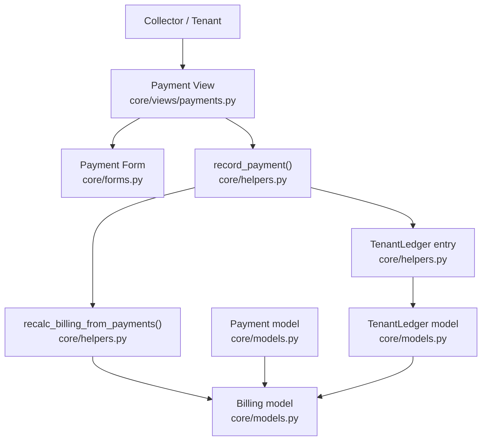
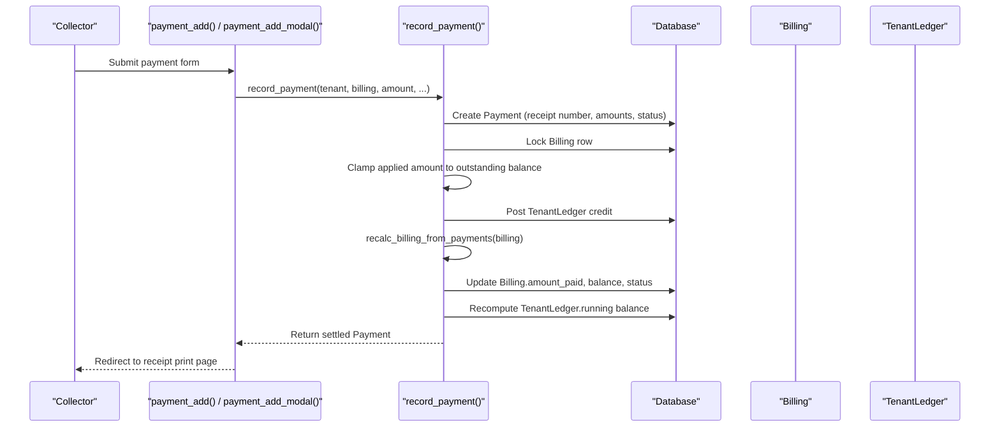
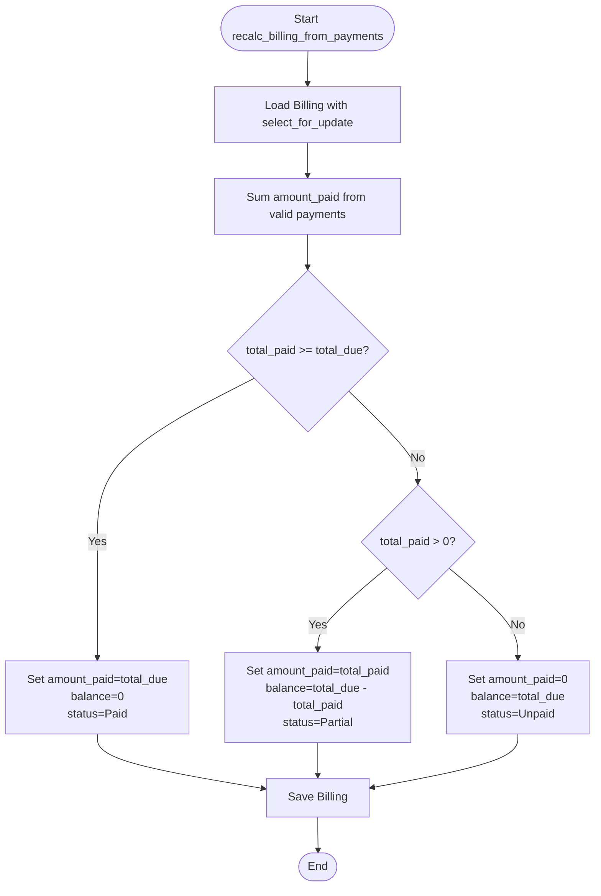
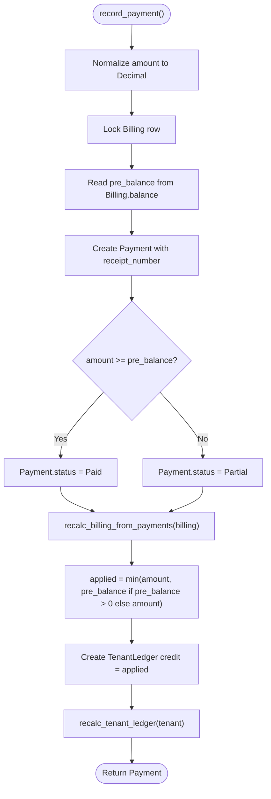
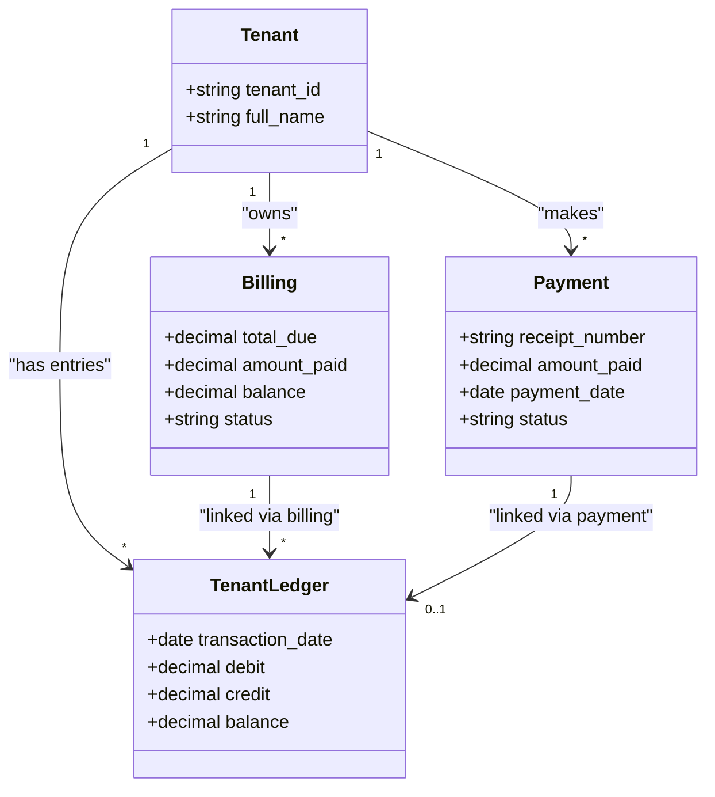
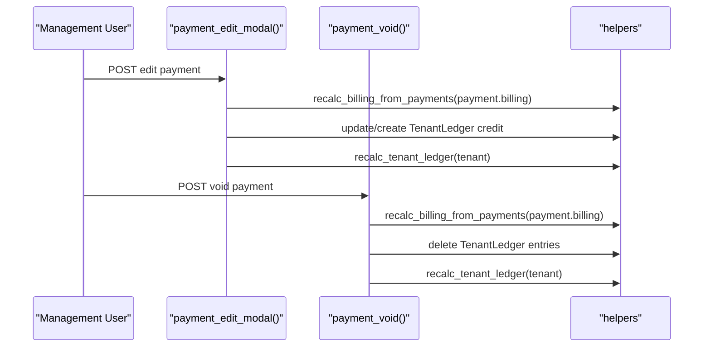
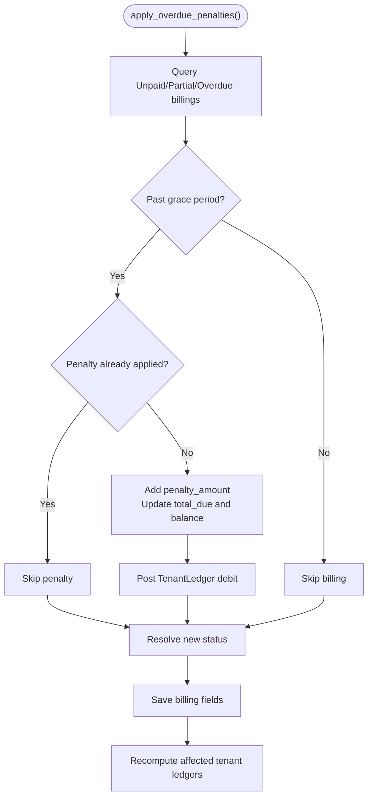
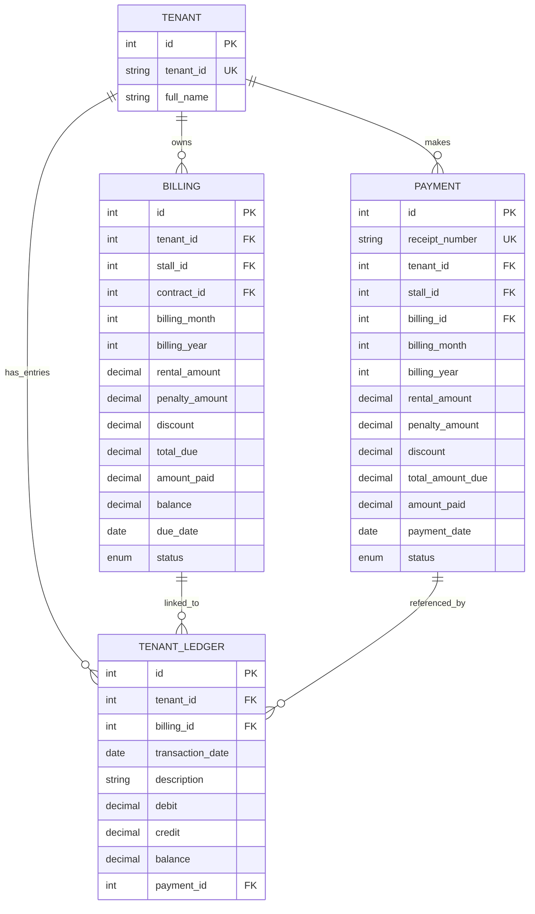
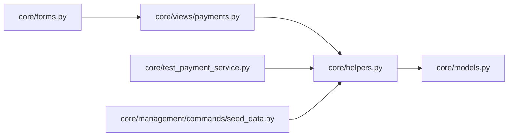

# Partial Payments & Balance Management

<cite>
**Referenced Files in This Document**   
- [core/models.py](file://core/models.py)
- [core/helpers.py](file://core/helpers.py)
- [core/views/payments.py](file://core/views/payments.py)
- [core/forms.py](file://core/forms.py)
- [core/test_payment_service.py](file://core/test_payment_service.py)
- [core/management/commands/seed_data.py](file://core/management/commands/seed_data.py)
</cite>

## Table of Contents
1. [Introduction](#introduction)
2. [Project Structure](#project-structure)
3. [Core Components](#core-components)
4. [Architecture Overview](#architecture-overview)
5. [Detailed Component Analysis](#detailed-component-analysis)
6. [Dependency Analysis](#dependency-analysis)
7. [Performance Considerations](#performance-considerations)
8. [Troubleshooting Guide](#troubleshooting-guide)
9. [Conclusion](#conclusion)

## Introduction
This document explains how the system handles partial payments and balance management for market stall rentals. It focuses on:
- How a tenant paying less than the full due amount is recorded as a partial payment.
- How `recalc_billing_from_payments()` recomputes billing totals, outstanding balances, and settlement status.
- How `TenantLedger` tracks running debit/credit balances per tenant.
- The relationship between `Billing`, `Payment`, and ledger entries.
- Edge cases such as overpayments, payment voids, edits, and multi-payment settlements.

The implementation uses precise decimal arithmetic, database locking, and a single authoritative recalculation function to keep financial records consistent.

## Project Structure
Partial payment and balance logic spans models, helper functions, views, forms, tests, and seed data:
- Models define `Billing`, `Payment`, and `TenantLedger`.
- Helpers implement the authoritative payment posting and billing recalculation.
- Views provide collection, editing, and voiding workflows.
- Forms validate user input and prevent manual tampering with computed fields.
- Tests assert correct behavior for full, partial, and overpayment scenarios.
- Seed data demonstrates realistic partial payment patterns.

**Diagram sources**
- [core/views/payments.py:250-294](file://core/views/payments.py#L250-L294)
- [core/views/payments.py:419-457](file://core/views/payments.py#L419-L457)
- [core/forms.py:465-521](file://core/forms.py#L465-L521)
- [core/helpers.py:321-420](file://core/helpers.py#L321-L420)
- [core/models.py:190-277](file://core/models.py#L190-L277)

**Section sources**
- [core/models.py:190-277](file://core/models.py#L190-L277)
- [core/helpers.py:321-420](file://core/helpers.py#L321-L420)
- [core/views/payments.py:250-294](file://core/views/payments.py#L250-L294)
- [core/forms.py:465-521](file://core/forms.py#L465-L521)

## Core Components
The partial payment workflow revolves around three core entities and two key helper functions:

| Component | Responsibility | Key Fields / Behavior |
|---|---|---|
| `Billing` | Represents one rental period’s obligation. | `total_due`, `amount_paid`, `balance`, `status` (`Unpaid`, `Paid`, `Partial`, `Overdue`). |
| `Payment` | Records each collection attempt against a billing. | `receipt_number`, `amount_paid`, `payment_date`, `payment_method`, `status` (`Paid`, `Partial`, `Void`, `Cancelled`). |
| `TenantLedger` | Tracks chronological debit/credit entries per tenant. | `debit`, `credit`, `balance`, linked to `billing` and optionally `payment`. |
| `record_payment()` | Single source of truth for posting a payment. | Creates `Payment`, clamps applied amount, posts ledger credit, recomputes billing, recomputes ledger balance. |
| `recalc_billing_from_payments()` | Authoritative billing recomputation. | Sums valid payments, sets `amount_paid`, `balance`, and `status`. |

**Section sources**
- [core/models.py:190-277](file://core/models.py#L190-L277)
- [core/helpers.py:321-420](file://core/helpers.py#L321-L420)

## Architecture Overview
The end-to-end flow for a partial payment is:

**Diagram sources**
- [core/views/payments.py:250-294](file://core/views/payments.py#L250-L294)
- [core/views/payments.py:419-457](file://core/views/payments.py#L419-L457)
- [core/helpers.py:351-420](file://core/helpers.py#L351-L420)

## Detailed Component Analysis

### Billing Status Transitions
`Billing.status` reflects the current settlement state:
- `Unpaid`: No valid payments applied yet.
- `Partial`: Some but not all of `total_due` has been paid.
- `Paid`: Valid payments cover at least `total_due`; balance is zero.
- `Overdue`: Past due date after grace period; may coexist with partial or unpaid money states.

The authoritative transition logic lives in `recalc_billing_from_payments()`:
- If total paid from valid payments is greater than or equal to `total_due`, set `amount_paid = total_due`, `balance = 0`, `status = Paid`.
- If total paid is greater than zero but less than `total_due`, set `amount_paid`, `balance = total_due - total_paid`, `status = Partial`.
- Otherwise, reset to `Unpaid`.

**Diagram sources**
- [core/helpers.py:321-348](file://core/helpers.py#L321-L348)

**Section sources**
- [core/models.py:190-218](file://core/models.py#L190-L218)
- [core/helpers.py:321-348](file://core/helpers.py#L321-L348)

### Payment Posting and Partial Payment Handling
`record_payment()` is the central operation for recording collections:
- Normalizes and quantizes the submitted amount.
- Locks the target `Billing` row to prevent concurrent race conditions.
- Reads the pre-payment outstanding balance.
- Creates a `Payment` with an auto-generated receipt number.
- Sets the initial payment status based on whether the submitted amount covers the outstanding balance.
- Calls `recalc_billing_from_payments()` to authoritatively recompute billing totals and status.
- Posts a `TenantLedger` credit entry using the amount actually applied to the bill (clamped to outstanding balance).
- Recomputes the tenant’s running ledger balance.

**Diagram sources**
- [core/helpers.py:351-420](file://core/helpers.py#L351-L420)

**Section sources**
- [core/helpers.py:351-420](file://core/helpers.py#L351-L420)
- [core/views/payments.py:250-294](file://core/views/payments.py#L250-L294)
- [core/views/payments.py:419-457](file://core/views/payments.py#L419-L457)

### TenantLedger Integration
`TenantLedger` provides a chronological audit trail of tenant obligations and payments:
- Billing creation posts a debit entry representing the total due.
- Payment posting posts a credit entry representing the amount actually applied.
- `recalc_tenant_ledger()` recomputes the running balance by iterating entries chronologically and applying `debit - credit`.
- The final running balance should match the sum of outstanding balances across the tenant’s billings.

**Diagram sources**
- [core/models.py:190-277](file://core/models.py#L190-L277)

**Section sources**
- [core/models.py:261-277](file://core/models.py#L261-L277)
- [core/helpers.py:260-273](file://core/helpers.py#L260-L273)
- [core/helpers.py:195-205](file://core/helpers.py#L195-L205)
- [core/helpers.py:407-420](file://core/helpers.py#L407-L420)

### Payment Editing and Voiding
Editing a payment updates the related billing and ledger entries:
- The view saves the edited payment.
- It recomputes the affected billing(s) through `recalc_billing_from_payments()`.
- It updates or creates the corresponding `TenantLedger` credit entry.
- It recalculates the tenant ledger chain.

Voiding a payment removes its financial effect:
- Marks the payment as `Void`.
- Recomputes the billing from remaining valid payments.
- Deletes the associated ledger entries.
- Recomputes the tenant ledger chain.

**Diagram sources**
- [core/views/payments.py:460-518](file://core/views/payments.py#L460-L518)
- [core/views/payments.py:521-550](file://core/views/payments.py#L521-L550)
- [core/helpers.py:321-420](file://core/helpers.py#L321-L420)

**Section sources**
- [core/views/payments.py:460-518](file://core/views/payments.py#L460-L518)
- [core/views/payments.py:521-550](file://core/views/payments.py#L521-L550)

### Overdue Penalties and Status Interaction
Overdue penalties are separate from partial payment application but interact with billing status:
- `apply_overdue_penalties()` marks past-due billings as `Overdue` and accrues a one-time penalty when applicable.
- It updates `penalty_amount`, `total_due`, and `balance`, then posts a debit to `TenantLedger`.
- After penalty changes, it recomputes the tenant ledger chain.
- Billing status resolution considers both money owed and time-based rules.

**Diagram sources**
- [core/helpers.py:423-500](file://core/helpers.py#L423-L500)

**Section sources**
- [core/helpers.py:423-500](file://core/helpers.py#L423-L500)

### Examples of Partial Payment Scenarios

#### Scenario A: First Partial Payment
- Billing total due: 100.00
- Outstanding balance before payment: 100.00
- Payment amount: 40.00
- Result:
  - Payment status: `Partial`
  - Billing status: `Partial`
  - Billing balance: 60.00
  - Ledger credit: 40.00

#### Scenario B: Second Partial Payment Settles the Bill
- Billing total due: 100.00
- Previous partial: 40.00
- New payment amount: 60.00
- Result:
  - Payment status: `Paid`
  - Billing status: `Paid`
  - Billing balance: 0.00
  - Total ledger credits: 100.00

#### Scenario C: Overpayment
- Billing total due: 100.00
- Outstanding balance before payment: 100.00
- Payment amount: 150.00
- Result:
  - Payment status: `Paid`
  - Billing status: `Paid`
  - Billing balance: 0.00
  - Payment `amount_paid`: 150.00 (full received amount preserved)
  - Ledger credit: 100.00 (clamped to outstanding balance)
  - Final tenant ledger balance: 0.00 (no negative balance)

These behaviors are validated by the test suite.

**Section sources**
- [core/test_payment_service.py:58-93](file://core/test_payment_service.py#L58-L93)
- [core/helpers.py:351-420](file://core/helpers.py#L351-L420)

### Relationship Between Payments, Billings, and Ledger Entries
- Each `Payment` belongs to one `Billing` and one `Stall`, and records the full amount received.
- `Billing` aggregates valid payments to compute `amount_paid`, `balance`, and `status`.
- Each payment creates a `TenantLedger` credit entry linking back to the payment and billing.
- Billing creation also creates a `TenantLedger` debit entry representing the obligation.
- Running ledger balances must reconcile with outstanding billing balances.

**Diagram sources**
- [core/models.py:190-277](file://core/models.py#L190-L277)

**Section sources**
- [core/models.py:190-277](file://core/models.py#L190-L277)
- [core/helpers.py:195-205](file://core/helpers.py#L195-L205)
- [core/helpers.py:407-420](file://core/helpers.py#L407-L420)

## Dependency Analysis
Key dependencies and coupling:
- `core.views.payments` depends on `core.helpers.record_payment` and `recalc_billing_from_payments`.
- `core.helpers` depends on `core.models.Billing`, `core.models.Payment`, and `core.models.TenantLedger`.
- `core.forms.PaymentForm` validates user input and prevents overpayment beyond outstanding balance.
- `core.test_payment_service` asserts correctness of partial, full, and overpayment flows.
- `core.management.commands.seed_data` demonstrates realistic partial payment seeding.

**Diagram sources**
- [core/views/payments.py:1-18](file://core/views/payments.py#L1-L18)
- [core/helpers.py:1-15](file://core/helpers.py#L1-L15)
- [core/forms.py:465-521](file://core/forms.py#L465-L521)
- [core/test_payment_service.py:1-16](file://core/test_payment_service.py#L1-L16)
- [core/management/commands/seed_data.py:398-429](file://core/management/commands/seed_data.py#L398-L429)

**Section sources**
- [core/views/payments.py:1-18](file://core/views/payments.py#L1-L18)
- [core/helpers.py:1-15](file://core/helpers.py#L1-L15)
- [core/forms.py:465-521](file://core/forms.py#L465-L521)
- [core/test_payment_service.py:1-16](file://core/test_payment_service.py#L1-L16)
- [core/management/commands/seed_data.py:398-429](file://core/management/commands/seed_data.py#L398-L429)

## Performance Considerations
- Financial calculations use `Decimal` throughout to avoid floating-point drift.
- `select_for_update()` locks billing rows during payment posting and recalculation to prevent race conditions.
- `recalc_tenant_ledger()` recomputes running balances in chronological order, updating only changed rows.
- Receipt numbering is derived from existing monthly sequences to maintain stable ordering.
- Batch receipts and PDF rendering are separated from core financial logic to avoid blocking collection workflows.

[No sources needed since this section provides general guidance]

## Troubleshooting Guide
Common issues and diagnostics:

| Issue | Symptom | Resolution |
|---|---|---|
| Billing remains `Partial` after multiple payments | `amount_paid` does not reach `total_due` | Verify all payments have status `Paid` or `Partial`; check that no payments were voided or cancelled. |
| Ledger balance drift | Final ledger balance differs from sum of billing balances | Run `recalc_tenant_ledger(tenant)` to rebuild running balances. |
| Overpayment shows negative balance | Ledger balance goes below zero | Ensure applied amount is clamped to outstanding balance; verify `record_payment()` clamping logic. |
| Payment edit does not reflect in billing | Billing totals unchanged after edit | Confirm `recalc_billing_from_payments()` is called after saving edited payment. |
| Voided payment still affects totals | Billing or ledger still includes voided payment | Ensure payment status is `Void` and ledger entries are deleted; rerun recalculation. |
| Duplicate receipt numbers | Integrity error during payment creation | The helper retries receipt generation; check database constraints and concurrency. |

**Section sources**
- [core/helpers.py:321-420](file://core/helpers.py#L321-L420)
- [core/views/payments.py:460-550](file://core/views/payments.py#L460-L550)
- [core/test_payment_service.py:82-93](file://core/test_payment_service.py#L82-L93)

## Conclusion
Partial payments are handled deterministically:
- Submitted amounts are recorded as `Payment` entries.
- `record_payment()` clamps applied amounts to outstanding balances and posts accurate ledger credits.
- `recalc_billing_from_payments()` is the single authority for billing settlement state.
- `TenantLedger` maintains a chronological, reconcilable running balance.
- Editing and voiding operations preserve consistency by recomputing billings and ledgers.
- Tests and seed data demonstrate expected behavior for partial, full, and overpayment scenarios.

For financial accuracy, always rely on `record_payment()` and `recalc_billing_from_payments()` rather than manually adjusting billing or ledger fields.

[No sources needed since this section summarizes without analyzing specific files]