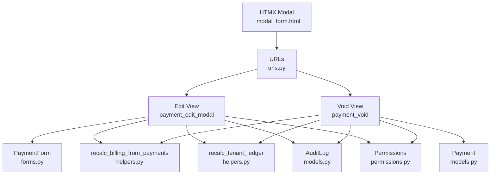
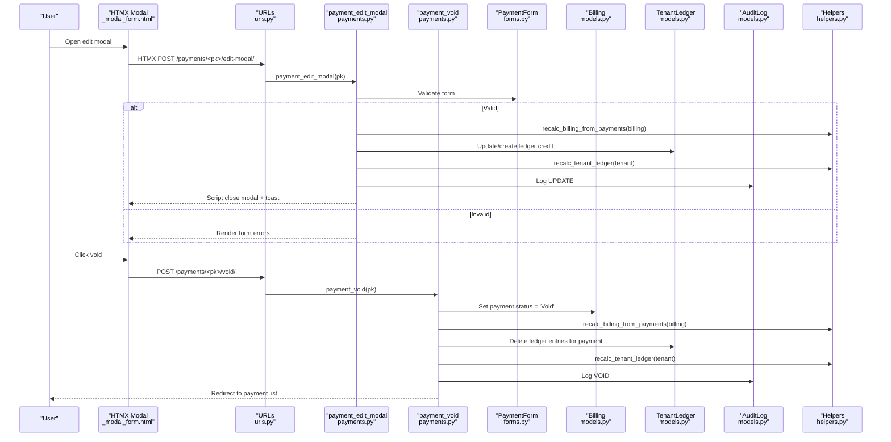
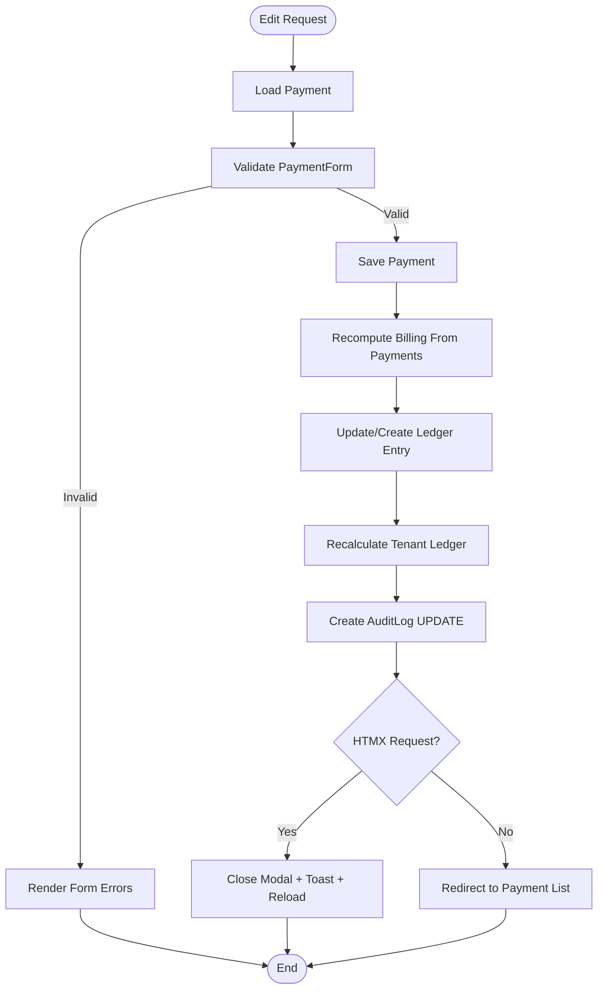
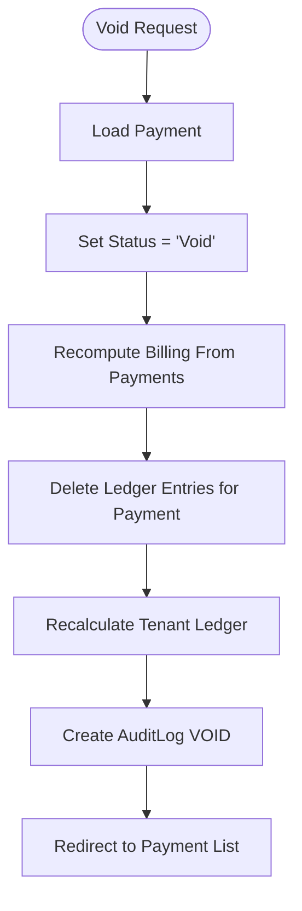
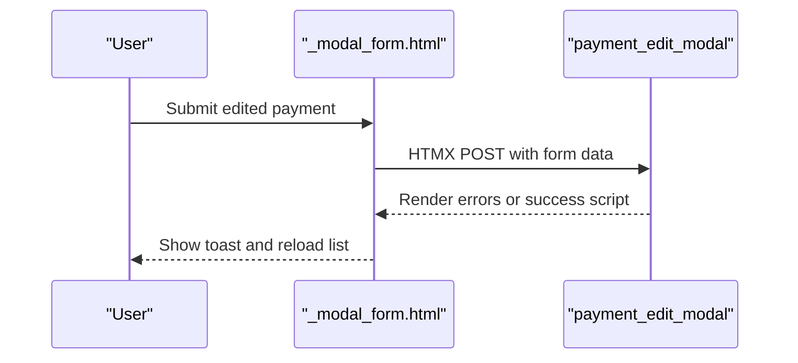
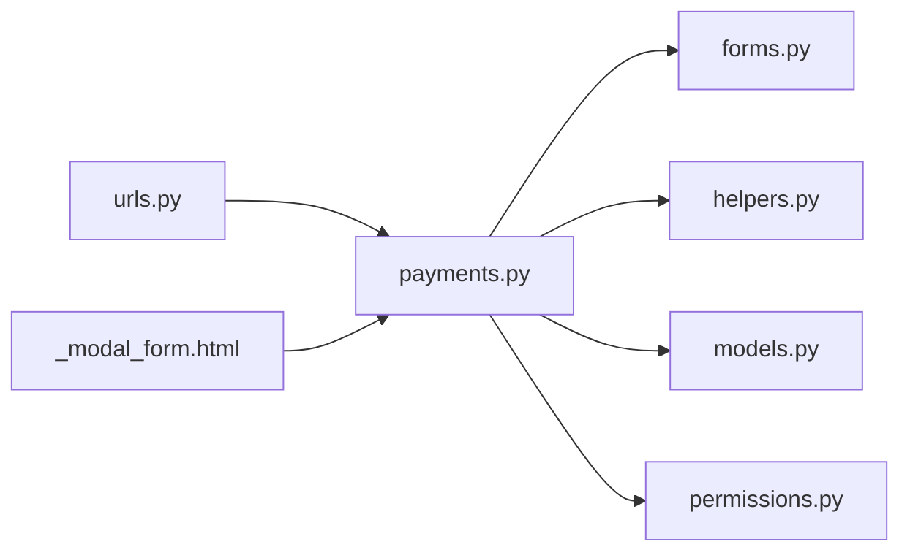

# Payment Editing & Voiding

<cite>
**Referenced Files in This Document**   
- [payments.py](file://core/views/payments.py)
- [_modal_form.html](file://templates/payments/_modal_form.html)
- [models.py](file://core/models.py)
- [forms.py](file://core/forms.py)
- [helpers.py](file://core/helpers.py)
- [permissions.py](file://core/permissions.py)
- [urls.py](file://core/urls.py)
</cite>

## Table of Contents
1. [Introduction](#introduction)
2. [Project Structure](#project-structure)
3. [Core Components](#core-components)
4. [Architecture Overview](#architecture-overview)
5. [Detailed Component Analysis](#detailed-component-analysis)
6. [Dependency Analysis](#dependency-analysis)
7. [Performance Considerations](#performance-considerations)
8. [Troubleshooting Guide](#troubleshooting-guide)
9. [Conclusion](#conclusion)

## Introduction
This document explains how the system handles payment editing and payment voiding, focusing on:
- The HTMX-powered modal workflow for seamless payment modification without full page reloads.
- Form validation and data integrity checks during edits.
- The voiding process that marks payments as `Void`, recalculates billing and ledger state, and preserves audit trails.
- Cascading effects on billing records, tenant ledger entries, and tenant balances.
- Permission requirements, audit logging, and compliance considerations for financial modifications.

The implementation is centered around Django views, a shared payment form, HTMX-driven templates, helper functions for authoritative recalculation, and role-based access control.

## Project Structure
Payment editing and voiding span several layers:
- URL routing exposes edit and void endpoints.
- Views enforce permissions, validate forms, update records, and trigger financial recomputation.
- A shared template renders both add and edit forms inside an HTMX modal.
- Forms enforce business rules such as billing consistency and overpayment guards.
- Helpers provide authoritative recalculation of billing totals and tenant ledger balances.
- Models define the core entities: Payment, Billing, TenantLedger, and AuditLog.
- Permissions restrict editing and voiding to management roles.

**Diagram sources**
- [urls.py:148-150](file://core/urls.py#L148-L150)
- [payments.py:460-550](file://core/views/payments.py#L460-L550)
- [_modal_form.html:13-28](file://templates/payments/_modal_form.html#L13-L28)
- [forms.py:465-521](file://core/forms.py#L465-L521)
- [helpers.py:321-420](file://core/helpers.py#L321-L420)
- [models.py:221-316](file://core/models.py#L221-L316)
- [permissions.py:55-86](file://core/permissions.py#L55-L86)

**Section sources**
- [urls.py:137-150](file://core/urls.py#L137-L150)
- [payments.py:460-550](file://core/views/payments.py#L460-L550)
- [_modal_form.html:1-118](file://templates/payments/_modal_form.html#L1-L118)
- [forms.py:465-521](file://core/forms.py#L465-L521)
- [helpers.py:321-420](file://core/helpers.py#L321-L420)
- [models.py:221-316](file://core/models.py#L221-L316)
- [permissions.py:55-86](file://core/permissions.py#L55-L86)

## Core Components
- **Payment editing view**: Loads a payment, validates the form, updates fields, recomputes billing and ledger entries, and logs the change.
- **Payment voiding view**: Marks a payment as `Void`, recomputes billing from remaining valid payments, removes associated ledger entries, recalculates tenant ledger balances, and logs the void action.
- **HTMX modal form**: Renders add/edit forms with inline error feedback; posts via HTMX to avoid full-page reloads.
- **Payment form validation**: Ensures billing belongs to selected tenant/stall, auto-fills total due, and prevents overpayment beyond outstanding balance.
- **Financial helpers**: Authoritatively recompute billing totals and tenant ledger running balances using Decimal arithmetic.
- **Permission layer**: Restricts editing and voiding to management roles.

**Section sources**
- [payments.py:460-550](file://core/views/payments.py#L460-L550)
- [_modal_form.html:13-28](file://templates/payments/_modal_form.html#L13-L28)
- [forms.py:498-521](file://core/forms.py#L498-L521)
- [helpers.py:321-420](file://core/helpers.py#L321-L420)
- [permissions.py:55-86](file://core/permissions.py#L55-L86)

## Architecture Overview
The payment editing and voiding workflows follow a consistent pattern:
1. User opens an HTMX modal to edit or void a payment.
2. The request is routed to the appropriate view based on the URL.
3. The view enforces role-based permissions.
4. For editing, the form is validated and saved; for voiding, the status is set to `Void`.
5. Financial recomputation runs to ensure billing and ledger consistency.
6. An audit log entry is created.
7. The response either returns updated modal content (HTMX) or redirects after success.

**Diagram sources**
- [_modal_form.html:13-28](file://templates/payments/_modal_form.html#L13-L28)
- [urls.py:148-150](file://core/urls.py#L148-L150)
- [payments.py:460-550](file://core/views/payments.py#L460-L550)
- [forms.py:498-521](file://core/forms.py#L498-L521)
- [helpers.py:321-420](file://core/helpers.py#L321-L420)
- [models.py:221-316](file://core/models.py#L221-L316)

## Detailed Component Analysis

### Payment Editing Workflow
The edit workflow allows authorized users to modify payment details through an HTMX modal. It ensures data integrity by validating the form and recomputing financial records authoritatively.

Key behaviors:
- Loads the target payment and captures the original billing reference.
- Validates the submitted form against business rules.
- Saves the payment and recomputes the affected billing(s).
- Updates or creates the corresponding ledger entry.
- Recalculates tenant ledger balances for both old and new tenants if changed.
- Logs the update with user context and IP address.
- Returns HTMX script to close the modal, show a success toast, and reload the list.

**Diagram sources**
- [payments.py:460-518](file://core/views/payments.py#L460-L518)
- [forms.py:498-521](file://core/forms.py#L498-L521)
- [helpers.py:321-420](file://core/helpers.py#L321-L420)

**Section sources**
- [payments.py:460-518](file://core/views/payments.py#L460-L518)
- [_modal_form.html:16-28](file://templates/payments/_modal_form.html#L16-L28)
- [forms.py:498-521](file://core/forms.py#L498-L521)
- [helpers.py:321-420](file://core/helpers.py#L321-L420)

#### Data Integrity Checks During Edits
- **Billing consistency**: The selected billing must belong to the selected tenant and stall.
- **Total amount due**: Auto-filled from the billing record when present.
- **Overpayment guard**: Prevents amount paid from exceeding the outstanding balance, including adjustment for existing valid payments during edits.
- **Decimal precision**: Financial calculations use Decimal to avoid float drift.

**Section sources**
- [forms.py:498-521](file://core/forms.py#L498-L521)
- [helpers.py:321-348](file://core/helpers.py#L321-L348)

### Payment Voiding Workflow
The void workflow marks a payment as `Void` while preserving historical records and ensuring financial accuracy.

Key behaviors:
- Sets the payment status to `Void`.
- Recomputes the billing totals from remaining valid payments.
- Deletes ledger entries tied to the voided payment.
- Recalculates the tenant ledger chain to fix subsequent balances.
- Creates an audit log entry capturing the previous status and receipt number.
- Redirects to the payment list with a success message.

**Diagram sources**
- [payments.py:521-550](file://core/views/payments.py#L521-L550)
- [helpers.py:321-420](file://core/helpers.py#L321-L420)
- [models.py:304-316](file://core/models.py#L304-L316)

**Section sources**
- [payments.py:521-550](file://core/views/payments.py#L521-L550)
- [helpers.py:321-420](file://core/helpers.py#L321-L420)
- [models.py:304-316](file://core/models.py#L304-L316)

### HTMX Modal Interface
The modal interface provides a seamless editing experience:
- Uses HTMX to post form submissions to the edit endpoint.
- Replaces modal content with server-rendered form or success scripts.
- Displays field-level errors directly within the modal.
- Supports both add and edit modes through a single template.

**Diagram sources**
- [_modal_form.html:13-28](file://templates/payments/_modal_form.html#L13-L28)
- [payments.py:460-518](file://core/views/payments.py#L460-L518)

**Section sources**
- [_modal_form.html:1-118](file://templates/payments/_modal_form.html#L1-L118)
- [payments.py:460-518](file://core/views/payments.py#L460-L518)

### Permission Requirements
Editing and voiding are restricted to management roles:
- Management roles include admin, cashier, supervisor, and treasurer.
- Superusers bypass role checks.
- Collector roles cannot edit or void payments.

**Section sources**
- [permissions.py:55-86](file://core/permissions.py#L55-L86)
- [payments.py:460-462](file://core/views/payments.py#L460-L462)
- [payments.py:521-523](file://core/views/payments.py#L521-L523)

### Audit Logging and Compliance
Every edit and void operation is logged:
- Edit operations create an `UPDATE` audit log entry.
- Void operations create a `VOID` audit log entry.
- Logs capture user, action, module, description, and IP address.
- Historical payment records remain intact; voiding does not delete the payment row.

**Section sources**
- [payments.py:498-504](file://core/views/payments.py#L498-L504)
- [payments.py:541-547](file://core/views/payments.py#L541-L547)
- [models.py:304-316](file://core/models.py#L304-L316)

## Dependency Analysis
The following diagram shows how components depend on each other during payment editing and voiding:

**Diagram sources**
- [urls.py:148-150](file://core/urls.py#L148-L150)
- [payments.py:460-550](file://core/views/payments.py#L460-L550)
- [forms.py:465-521](file://core/forms.py#L465-L521)
- [helpers.py:321-420](file://core/helpers.py#L321-L420)
- [models.py:221-316](file://core/models.py#L221-L316)
- [permissions.py:55-86](file://core/permissions.py#L55-L86)
- [_modal_form.html:13-28](file://templates/payments/_modal_form.html#L13-L28)

**Section sources**
- [urls.py:148-150](file://core/urls.py#L148-L150)
- [payments.py:460-550](file://core/views/payments.py#L460-L550)
- [forms.py:465-521](file://core/forms.py#L465-L521)
- [helpers.py:321-420](file://core/helpers.py#L321-L420)
- [models.py:221-316](file://core/models.py#L221-L316)
- [permissions.py:55-86](file://core/permissions.py#L55-L86)
- [_modal_form.html:13-28](file://templates/payments/_modal_form.html#L13-L28)

## Performance Considerations
- **Authoritative recomputation**: Billing totals are recomputed from valid payments rather than trusting cached fields, ensuring consistency at the cost of additional queries.
- **Transaction safety**: Both edit and void operations run inside atomic transactions to prevent partial updates.
- **Decimal arithmetic**: All financial calculations use Decimal to avoid floating-point inaccuracies.
- **Selective ledger updates**: Ledger entries are updated only for the affected payment, minimizing unnecessary writes.
- **HTMX efficiency**: Modal responses return lightweight HTML or scripts, reducing bandwidth and improving UX.

[No sources needed since this section provides general guidance]

## Troubleshooting Guide
Common issues and resolutions:
- **Form validation errors**: Ensure the selected billing matches the tenant and stall; verify amount paid does not exceed outstanding balance.
- **Incorrect billing totals**: Confirm that `recalc_billing_from_payments` was called after edits or voids.
- **Ledger imbalance**: Verify that `recalc_tenant_ledger` ran for the affected tenant(s).
- **Permission denied**: Check that the user has a management role; collectors cannot edit or void payments.
- **Missing audit logs**: Ensure audit logging is enabled and the user context is available.

**Section sources**
- [forms.py:498-521](file://core/forms.py#L498-L521)
- [payments.py:460-550](file://core/views/payments.py#L460-L550)
- [permissions.py:55-86](file://core/permissions.py#L55-L86)

## Conclusion
Payment editing and voiding in this system are designed for accuracy, auditability, and user experience:
- HTMX modals enable seamless editing without page reloads.
- Form validation protects against invalid or inconsistent data.
- Authoritative recomputation ensures billing and ledger integrity.
- Voiding preserves historical records while restoring accurate financial states.
- Role-based permissions and audit logging support compliance and accountability.

For operators, always review validation messages, confirm billing references, and rely on the automatic recalculation processes to maintain financial correctness.

[No sources needed since this section summarizes without analyzing specific files]