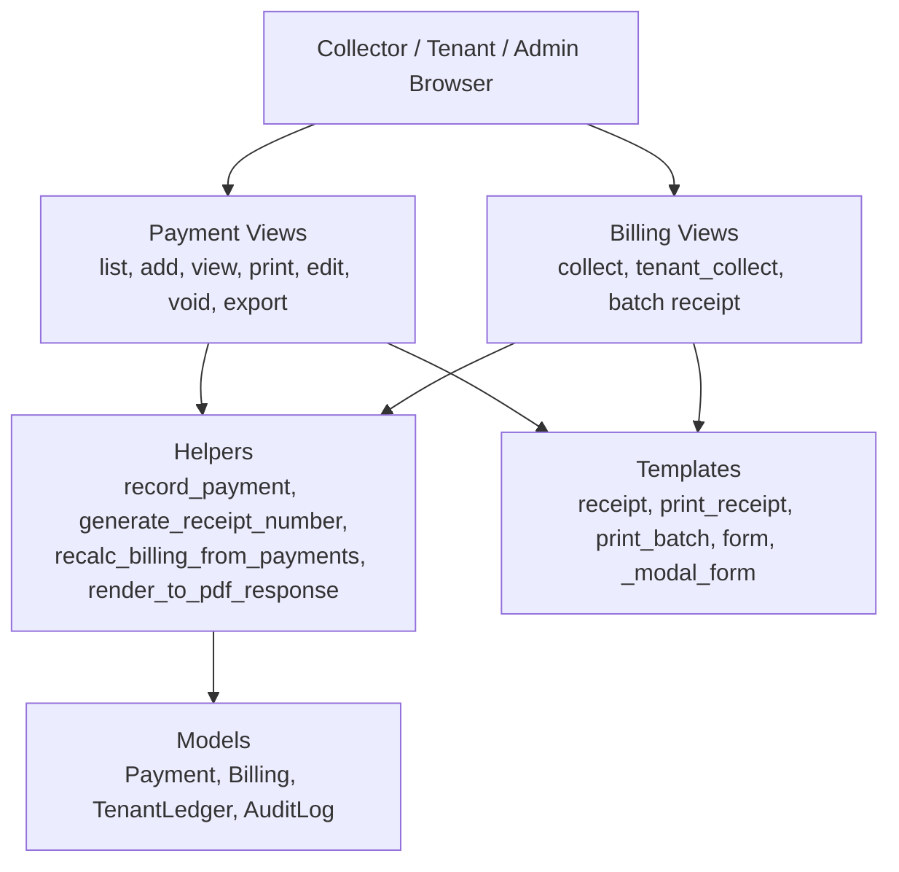
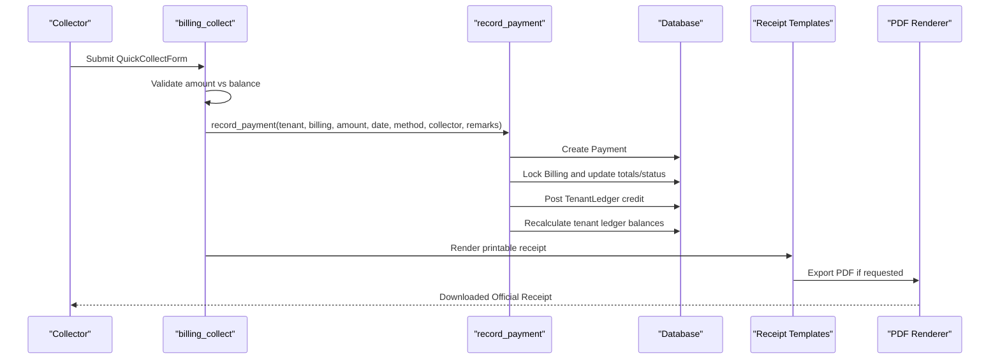
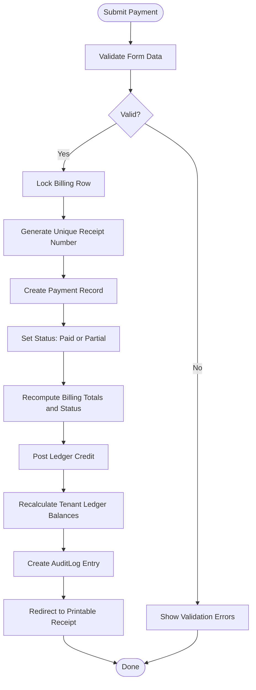
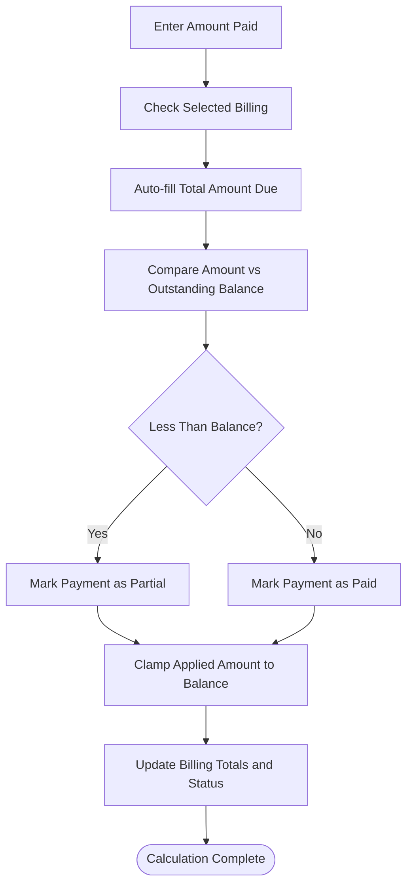
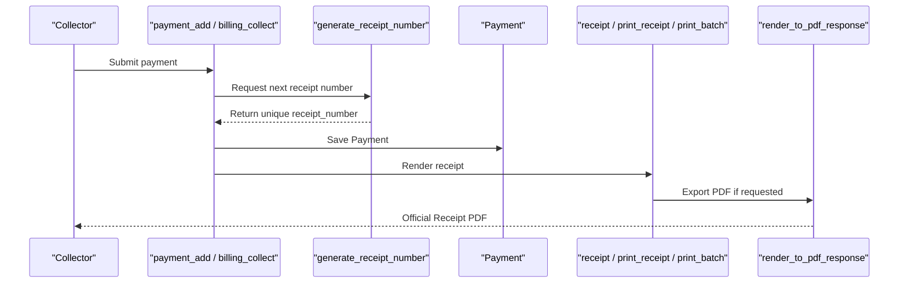
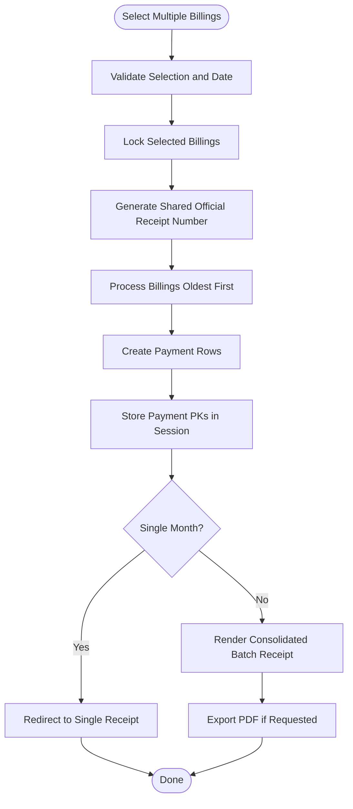
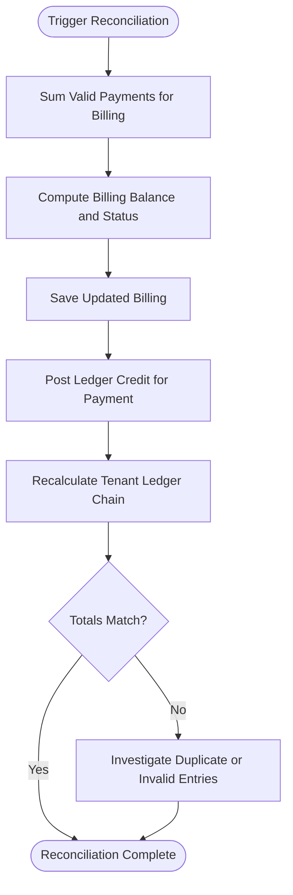
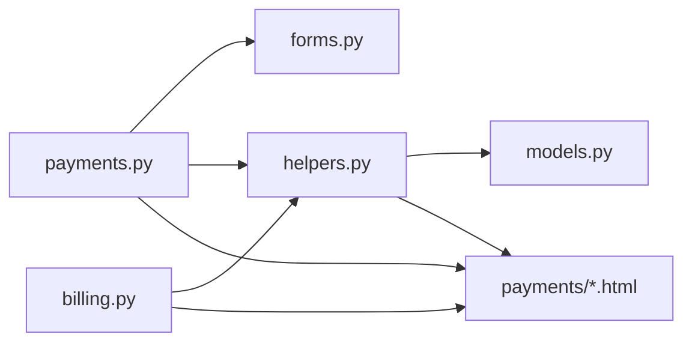

# Payment Processing

<cite>
**Referenced Files in This Document**
- [payments.py](file://core/views/payments.py)
- [billing.py](file://core/views/billing.py)
- [models.py](file://core/models.py)
- [forms.py](file://core/forms.py)
- [helpers.py](file://core/helpers.py)
- [receipt.html](file://templates/payments/receipt.html)
- [print_receipt.html](file://templates/payments/print_receipt.html)
- [_receipt_body.html](file://templates/payments/_receipt_body.html)
- [print_batch.html](file://templates/payments/print_batch.html)
- [_modal_form.html](file://templates/payments/_modal_form.html)
- [form.html](file://templates/payments/form.html)
</cite>

## Table of Contents
1. [Introduction](#introduction)
2. [Project Structure](#project-structure)
3. [Core Components](#core-components)
4. [Architecture Overview](#architecture-overview)
5. [Detailed Component Analysis](#detailed-component-analysis)
6. [Dependency Analysis](#dependency-analysis)
7. [Performance Considerations](#performance-considerations)
8. [Troubleshooting Guide](#troubleshooting-guide)
9. [Conclusion](#conclusion)

## Introduction
This document explains the Payment Processing module for the Market Rental and Collection Management System. It covers how payments are recorded, validated, reconciled with billing records, and printed as official receipts. It also documents partial payment handling, balance updates, status management, batch collections, void/cancellation procedures, audit trails, search and filtering, collector attribution, daily collection summaries, reconciliation logic, and error handling for duplicate or invalid payments.

The system supports four payment methods: Cash, GCash, Bank Transfer, and Check. Payments are tied to Billing records, which track rental charges, penalties, discounts, total due, amount paid, remaining balance, due date, and settlement status.

## Project Structure
Payment processing spans views, forms, models, helpers, and templates:

- Views handle listing, recording, viewing, printing, editing, voiding, and exporting payments.
- Forms validate payment inputs and enforce business rules such as overpayment guards and billing consistency.
- Models define Payment, Billing, TenantLedger, AuditLog, and related entities.
- Helpers provide receipt numbering, payment posting, billing recomputation, ledger recalculation, PDF rendering, and overdue penalty automation.
- Templates render web receipts, printable receipts, consolidated batch receipts, and modal/full-page payment forms.

**Diagram sources**
- [payments.py:186-653](file://core/views/payments.py#L186-L653)
- [billing.py:415-634](file://core/views/billing.py#L415-L634)
- [helpers.py:276-420](file://core/helpers.py#L276-L420)
- [models.py:190-316](file://core/models.py#L190-L316)
- [receipt.html:1-230](file://templates/payments/receipt.html#L1-L230)
- [print_receipt.html:1-56](file://templates/payments/print_receipt.html#L1-L56)
- [print_batch.html:1-221](file://templates/payments/print_batch.html#L1-L221)

**Section sources**
- [payments.py:186-653](file://core/views/payments.py#L186-L653)
- [billing.py:415-634](file://core/views/billing.py#L415-L634)
- [models.py:190-316](file://core/models.py#L190-L316)
- [forms.py:465-521](file://core/forms.py#L465-L521)
- [helpers.py:276-420](file://core/helpers.py#L276-L420)

## Core Components
The core components are:

- **Payment model**: Stores receipt number, tenant, stall, billing reference, amounts, payment date, method, official receipt number, collector, status, remarks, and timestamps.
- **Billing model**: Tracks per-month billing totals, penalties, discounts, amount paid, balance, due date, and status (Unpaid, Partial, Paid, Overdue).
- **TenantLedger model**: Maintains a running debit/credit ledger per tenant with transaction dates and balances.
- **AuditLog model**: Records user actions, modules, descriptions, IP addresses, and timestamps.
- **SystemSetting model**: Holds municipality/market branding, receipt prefix, due day defaults, penalty configuration, logo, theme color, and contract terms.
- **PaymentForm**: Validates payment fields, ensures billing consistency, auto-fills total due, and prevents overpayment beyond outstanding balance.
- **QuickCollectForm**: Simplified collector form where amount alone determines whether the bill is fully settled or partially paid.
- **Helper functions**: Receipt numbering, payment recording, billing recomputation, ledger recalculation, PDF rendering, and overdue penalty automation.

Key responsibilities:
- Payment recording creates a Payment row, updates Billing totals/status, posts a ledger credit, recalculates running balances, and logs an audit entry.
- Batch collection generates one consolidated official receipt number while keeping internal receipt numbers unique per payment.
- Voiding marks a payment as Void, recomputes billing from valid payments, removes associated ledger entries, and recalculates tenant ledgers.
- Search and filtering support date ranges, tenants, stalls, collectors, statuses, payment methods, and free-text queries.

**Section sources**
- [models.py:190-316](file://core/models.py#L190-L316)
- [forms.py:465-521](file://core/forms.py#L465-L521)
- [forms.py:728-774](file://core/forms.py#L728-L774)
- [helpers.py:276-420](file://core/helpers.py#L276-L420)

## Architecture Overview
The payment workflow follows a clear separation between UI, validation, service logic, persistence, and reporting.

**Diagram sources**
- [billing.py:415-489](file://core/views/billing.py#L415-L489)
- [helpers.py:351-420](file://core/helpers.py#L351-L420)
- [print_receipt.html:1-56](file://templates/payments/print_receipt.html#L1-L56)
- [helpers.py:522-595](file://core/helpers.py#L522-L595)

## Detailed Component Analysis

### Payment Recording Workflow
Payment recording is centralized through `record_payment`, ensuring consistent behavior across single-payment and batch-collection flows.

- Input comes from either `PaymentForm` or `QuickCollectForm`.
- The helper locks the target Billing row, generates a unique receipt number, creates the Payment, sets status based on amount versus pre-payment balance, recomputes Billing totals, posts a ledger credit, and recalculates tenant ledger balances.
- A rare receipt-number collision is retried up to five times.
- The view then logs an audit entry and redirects to the printable receipt page.

**Diagram sources**
- [helpers.py:351-420](file://core/helpers.py#L351-L420)
- [payments.py:250-294](file://core/views/payments.py#L250-L294)
- [billing.py:415-489](file://core/views/billing.py#L415-L489)

**Section sources**
- [helpers.py:351-420](file://core/helpers.py#L351-L420)
- [payments.py:250-294](file://core/views/payments.py#L250-L294)
- [billing.py:415-489](file://core/views/billing.py#L415-L489)

### Payment Methods and Amount Calculations
Supported payment methods are defined in the Payment model:

- Cash
- GCash
- Bank Transfer
- Check

Amount calculations are enforced at multiple layers:

- BillingForm computes total_due as rental_amount plus penalty_amount minus discount, and balance as total_due minus amount_paid, clamping negative balances to zero and auto-setting status.
- PaymentForm validates that the selected billing belongs to the selected tenant and stall, auto-fills total_amount_due when a billing is present, and prevents overpayment beyond the outstanding balance.
- QuickCollectForm defaults amount to the outstanding balance and rejects amounts greater than the balance plus a small tolerance; it treats any amount less than the balance as a partial payment.

**Diagram sources**
- [forms.py:402-462](file://core/forms.py#L402-L462)
- [forms.py:465-521](file://core/forms.py#L465-L521)
- [forms.py:728-774](file://core/forms.py#L728-L774)
- [helpers.py:321-348](file://core/helpers.py#L321-L348)

**Section sources**
- [models.py:221-258](file://core/models.py#L221-L258)
- [forms.py:402-462](file://core/forms.py#L402-L462)
- [forms.py:465-521](file://core/forms.py#L465-L521)
- [forms.py:728-774](file://core/forms.py#L728-L774)
- [helpers.py:321-348](file://core/helpers.py#L321-L348)

### Partial Payment Handling and Balance Updates
Partial payments occur when the collected amount is less than the outstanding balance. The system:

- Sets the Payment status to Partial.
- Updates Billing.amount_paid to the sum of valid payments.
- Computes Billing.balance as total_due minus total_paid.
- Marks Billing.status as Partial unless fully paid or unpaid.
- Posts a ledger credit equal to the applied amount.
- Recalculates the tenant’s running ledger balance.

When a payment is edited or voided, the system recomputes Billing totals authoritatively from all valid payments and adjusts ledger entries accordingly.

**Section sources**
- [helpers.py:321-348](file://core/helpers.py#L321-L348)
- [helpers.py:351-420](file://core/helpers.py#L351-L420)
- [payments.py:460-518](file://core/views/payments.py#L460-L518)
- [payments.py:521-550](file://core/views/payments.py#L521-L550)

### Payment Status Management
Payment statuses include:

- Paid
- Partial
- Void
- Cancelled

Billing statuses include:

- Unpaid
- Partial
- Paid
- Overdue

Status transitions are driven by amounts and dates:

- Payment status is set to Paid if amount equals or exceeds the pre-payment balance; otherwise Partial.
- Billing status is recomputed from valid payments: Paid if total_paid equals or exceeds total_due, Partial if some payment exists but not enough, Unpaid if no valid payments.
- Overdue status is applied automatically when today exceeds the due date plus grace period, and a penalty has not yet been accrued.

**Section sources**
- [models.py:190-258](file://core/models.py#L190-L258)
- [helpers.py:321-348](file://core/helpers.py#L321-L348)
- [helpers.py:423-500](file://core/helpers.py#L423-L500)

### Official Receipt Generation
Official receipts are generated for every payment and batch collection.

- Each Payment receives a unique internal receipt_number following the pattern `<prefix>-YYYYMM-NNNNNN`, derived from the highest existing suffix for the current month.
- An optional official_receipt_no can be provided; if blank, the system receipt number is used.
- Single-payment receipts are rendered via `receipt.html` and `print_receipt.html`, including letterhead, tenant/stall details, billing period, payment method, charge breakdown, amount paid, remaining balance, signature lines, and status badge.
- Batch receipts use `print_batch.html`, producing one consolidated official receipt covering multiple billing months with line items, totals, amount-in-words, and signature lines.
- PDF export uses `render_to_pdf_response`, attempting WeasyPrint first, then xhtml2pdf fallback, and finally returning an HTML preview with browser print instructions.

**Diagram sources**
- [helpers.py:276-300](file://core/helpers.py#L276-L300)
- [payments.py:250-294](file://core/views/payments.py#L250-L294)
- [billing.py:415-489](file://core/views/billing.py#L415-L489)
- [receipt.html:1-230](file://templates/payments/receipt.html#L1-L230)
- [print_receipt.html:1-56](file://templates/payments/print_receipt.html#L1-L56)
- [print_batch.html:1-221](file://templates/payments/print_batch.html#L1-L221)
- [helpers.py:522-595](file://core/helpers.py#L522-L595)

**Section sources**
- [helpers.py:276-300](file://core/helpers.py#L276-L300)
- [helpers.py:522-595](file://core/helpers.py#L522-L595)
- [receipt.html:1-230](file://templates/payments/receipt.html#L1-L230)
- [print_receipt.html:1-56](file://templates/payments/print_receipt.html#L1-L56)
- [print_batch.html:1-221](file://templates/payments/print_batch.html#L1-L221)

### Batch Payment Operations
Batch collection allows a collector to settle multiple billing months for one tenant in a single operation.

- The collector selects one or more billing IDs.
- The system re-queries selected billings with `select_for_update` inside a transaction to prevent concurrent double-settlement.
- Billings are processed oldest-first.
- One shared official receipt number is generated for the entire batch.
- Each selected billing produces its own Payment row with the same official_receipt_no.
- The session stores the created Payment PKs so the consolidated receipt page can render all months under one OR.
- If only one month is selected, the classic single-receipt flow is used; otherwise, the consolidated batch receipt is shown and optionally exported as PDF.

**Diagram sources**
- [billing.py:511-634](file://core/views/billing.py#L511-L634)
- [payments.py:26-99](file://core/views/payments.py#L26-L99)
- [payments.py:351-396](file://core/views/payments.py#L351-L396)

**Section sources**
- [billing.py:511-634](file://core/views/billing.py#L511-L634)
- [payments.py:26-99](file://core/views/payments.py#L26-L99)
- [payments.py:351-396](file://core/views/payments.py#L351-L396)

### Payment Void and Cancellation Procedures
Voiding is available to management users.

- The payment status is set to Void.
- Billing totals are recomputed from valid payments, excluding the voided payment.
- Associated TenantLedger entries are deleted.
- Tenant ledger balances are recalculated.
- An audit log entry records the void action, original status, receipt number, and IP address.

There is no explicit cancellation view in the analyzed code; however, the Payment model includes a Cancelled status choice. Any future cancellation flow should follow the same pattern: mark status, recompute billing, adjust ledger entries, and log the action.

**Section sources**
- [payments.py:521-550](file://core/views/payments.py#L521-L550)
- [models.py:221-258](file://core/models.py#L221-L258)

### Audit Trail Requirements
Every significant payment action is logged:

- CREATE: Manual payment recording.
- UPDATE: Editing a payment.
- VOID: Voiding a payment.
- COLLECT: Single billing collection.
- COLLECT_BATCH: Batch collection.
- AUTO_PENALTY: Automatic overdue penalty accrual.

Each AuditLog entry includes the user, action, module, description, IP address, and timestamp. Descriptions capture receipt numbers, amounts, tenant names, billing periods, and outcomes.

**Section sources**
- [payments.py:269-275](file://core/views/payments.py#L269-L275)
- [payments.py:437-443](file://core/views/payments.py#L437-L443)
- [payments.py:498-504](file://core/views/payments.py#L498-L504)
- [payments.py:541-547](file://core/views/payments.py#L541-L547)
- [billing.py:460-466](file://core/views/billing.py#L460-L466)
- [billing.py:599-610](file://core/views/billing.py#L599-L610)
- [helpers.py:480-485](file://core/helpers.py#L480-L485)

### Payment Search and Filtering
The payment list supports comprehensive filtering:

- Date range filters: date_from and date_to.
- Tenant filter: tenant_id.
- Stall filter: stall_id.
- Collector filter: collected_by_id.
- Status filter: payment status.
- Payment method filter: Cash, GCash, Bank Transfer, Check.
- Free-text search across tenant name, tenant ID, stall number, receipt_number, official_receipt_no, collector name, and username.
- Pagination with 10 results per page.
- HTMX support for dynamic table updates.

A separate print/export view applies the same filters and renders a printable list or PDF.

**Section sources**
- [payments.py:186-247](file://core/views/payments.py#L186-L247)
- [payments.py:553-653](file://core/views/payments.py#L553-L653)

### Collector Attribution
Collector attribution is enforced at both data and access-control levels:

- Every Payment stores collected_by as a User reference.
- Access checks restrict tenants to their own payments and collectors to payments they personally recorded.
- Management roles see all payments.
- Receipt pages and batch receipt pages enforce the same role-based visibility.

**Section sources**
- [models.py:221-258](file://core/models.py#L221-L258)
- [payments.py:157-183](file://core/views/payments.py#L157-L183)
- [payments.py:314-348](file://core/views/payments.py#L314-L348)
- [payments.py:351-396](file://core/views/payments.py#L351-L396)

### Daily Collection Summaries
Daily collection summaries are supported through:

- Payment list aggregation computing total_amount_paid across filtered results.
- Billing list aggregation computing total_due, total_paid, and total_balance grouped by tenant.
- Report templates under reports/daily.html and related PDF templates for daily, weekly, monthly, and collector summaries.
- Audit logs capturing collection events with timestamps and amounts.

While detailed report rendering is outside the payment-specific views, the underlying data structures and aggregated sums provide the foundation for daily summaries.

**Section sources**
- [payments.py:231-247](file://core/views/payments.py#L231-L247)
- [billing.py:110-171](file://core/views/billing.py#L110-L171)
- [billing.py:637-727](file://core/views/billing.py#L637-L727)

### Payment Reconciliation Processes
Reconciliation is performed authoritatively from valid payments:

- `recalc_billing_from_payments` locks the Billing row, sums valid payments, and sets Billing.amount_paid, balance, and status consistently.
- `record_payment` calls this function after creating each Payment to ensure Billing reflects reality.
- `recalc_tenant_ledger` recalculates running balances for all TenantLedger entries chronologically, correcting drift after edits, voids, or penalties.
- Editing a payment recomputes affected Billing rows and updates or creates corresponding ledger entries.
- Voiding deletes ledger entries for the voided payment and recalculates the tenant ledger chain.

**Diagram sources**
- [helpers.py:321-348](file://core/helpers.py#L321-L348)
- [helpers.py:260-273](file://core/helpers.py#L260-L273)
- [helpers.py:351-420](file://core/helpers.py#L351-L420)
- [payments.py:460-518](file://core/views/payments.py#L460-L518)
- [payments.py:521-550](file://core/views/payments.py#L521-L550)

**Section sources**
- [helpers.py:260-273](file://core/helpers.py#L260-L273)
- [helpers.py:321-348](file://core/helpers.py#L321-L348)
- [helpers.py:351-420](file://core/helpers.py#L351-L420)
- [payments.py:460-518](file://core/views/payments.py#L460-L518)
- [payments.py:521-550](file://core/views/payments.py#L521-L550)

### Error Handling for Duplicate or Invalid Payments
Error handling includes:

- Form validation rejects mismatched tenant/billing/stall combinations.
- Overpayment guards prevent amount_paid from exceeding the outstanding balance beyond a small tolerance.
- Receipt-number generation retries on IntegrityError to handle rare collisions.
- Concurrent collection protection uses `select_for_update` on Billing rows during batch settlement.
- Access control prevents tenants and collectors from viewing unrelated receipts.
- PDF rendering falls back gracefully when WeasyPrint or xhtml2pdf fails, providing browser print instructions.

**Section sources**
- [forms.py:498-521](file://core/forms.py#L498-L521)
- [forms.py:765-774](file://core/forms.py#L765-L774)
- [helpers.py:373-400](file://core/helpers.py#L373-L400)
- [billing.py:557-564](file://core/views/billing.py#L557-L564)
- [payments.py:157-183](file://core/views/payments.py#L157-L183)
- [helpers.py:522-595](file://core/helpers.py#L522-L595)

## Dependency Analysis
The payment module depends on several interconnected components:

- Views depend on forms for validation and helpers for service logic.
- Helpers depend on models for persistence and Django utilities for transactions and queries.
- Templates depend on models and settings for rendering receipts and lists.
- Billing views integrate with payment helpers for collection workflows.
- Audit logging integrates across views and helpers for compliance.

**Diagram sources**
- [payments.py:1-18](file://core/views/payments.py#L1-L18)
- [billing.py:1-22](file://core/views/billing.py#L1-L22)
- [helpers.py:1-15](file://core/helpers.py#L1-L15)
- [models.py:1-15](file://core/models.py#L1-L15)

**Section sources**
- [payments.py:1-18](file://core/views/payments.py#L1-L18)
- [billing.py:1-22](file://core/views/billing.py#L1-L22)
- [helpers.py:1-15](file://core/helpers.py#L1-L15)
- [models.py:1-15](file://core/models.py#L1-L15)

## Performance Considerations
- Use `select_related` in payment and billing views to reduce N+1 queries.
- Avoid unnecessary recomputation; rely on `recalc_billing_from_payments` and `recalc_tenant_ledger` only when data changes.
- Batch operations should process billings in deterministic order and lock rows to prevent race conditions.
- PDF generation may fall back to HTML if system libraries are missing; prefer Linux environments for native WeasyPrint support.
- Pagination limits result sets to improve list performance.
- Decimal arithmetic is used throughout to avoid floating-point drift in financial calculations.

[No sources needed since this section provides general guidance]

## Troubleshooting Guide
Common issues and resolutions:

- **Duplicate tenant creation**: The TenantForm prevents duplicates by comparing normalized full names. Edit existing records instead of creating new ones.
- **Invalid billing selection**: PaymentForm raises an error if the selected billing does not match the selected tenant or stall.
- **Overpayment errors**: PaymentForm and QuickCollectForm reject amounts exceeding the outstanding balance. Adjust the amount to match the balance or record a partial payment first.
- **Missing market sections or stall types**: StallForm explicitly checks lookup availability and surfaces helpful errors.
- **PDF generation failures**: The renderer tries WeasyPrint, then xhtml2pdf, then returns an HTML preview with print instructions. Install required system libraries or use browser print-to-PDF.
- **Concurrent collection conflicts**: Batch collection locks selected billings; if two collectors attempt the same billing simultaneously, only one will succeed. Refresh and retry.
- **Access denied on receipts**: Tenants can only view their own payments; collectors can only view receipts they recorded. Verify user role and ownership.

**Section sources**
- [forms.py:156-198](file://core/forms.py#L156-L198)
- [forms.py:251-258](file://core/forms.py#L251-L258)
- [forms.py:498-521](file://core/forms.py#L498-L521)
- [forms.py:765-774](file://core/forms.py#L765-L774)
- [helpers.py:522-595](file://core/helpers.py#L522-L595)
- [billing.py:557-564](file://core/views/billing.py#L557-L564)
- [payments.py:157-183](file://core/views/payments.py#L157-L183)

## Conclusion
The Payment Processing module provides a robust, auditable, and reconcilable system for recording rental payments across multiple methods. It enforces strict validation, maintains accurate billing and ledger states, supports batch collections with consolidated receipts, and offers comprehensive search, filtering, and reporting capabilities. The design centralizes critical logic in helper functions, protects against concurrency and duplicate errors, and ensures compliance through detailed audit trails. For best results, operators should use the quick collect workflow for speed, batch collection for efficiency, and the receipt export features for documentation and reconciliation.

[No sources needed since this section summarizes without analyzing specific files]