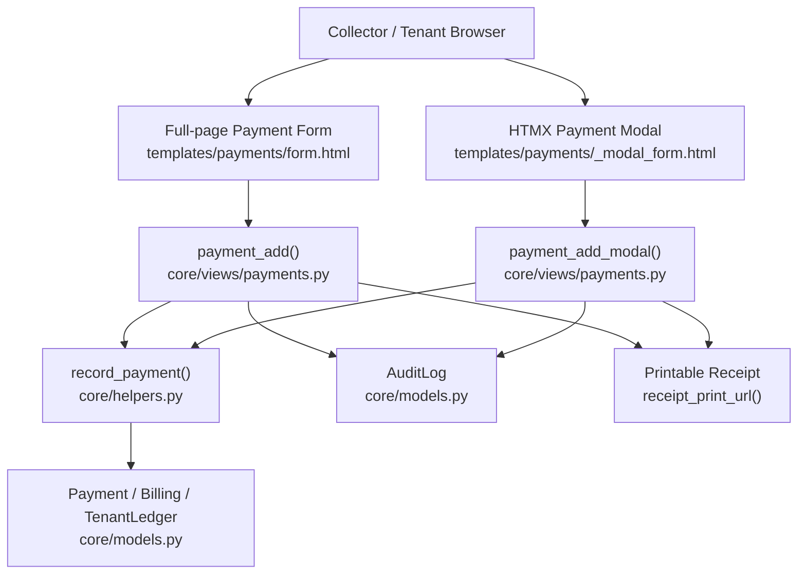
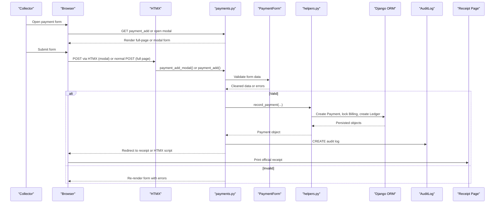
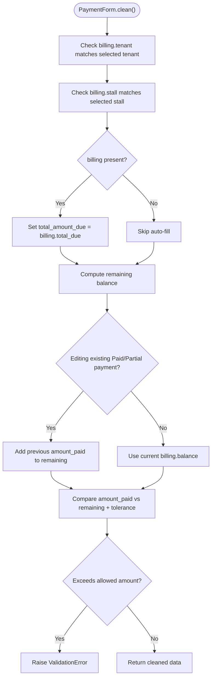
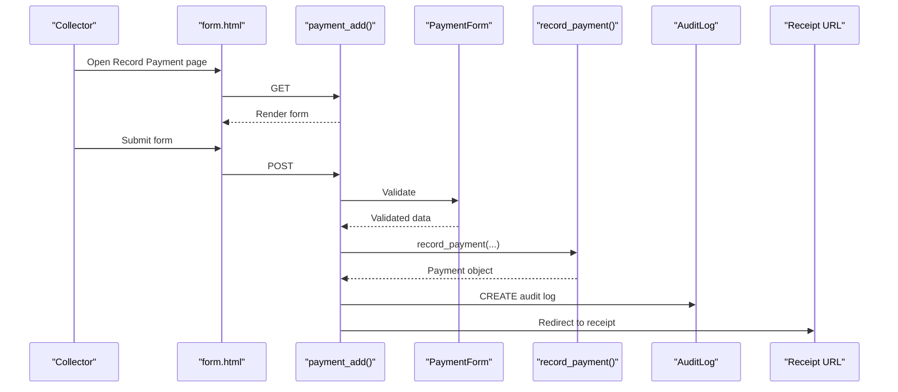
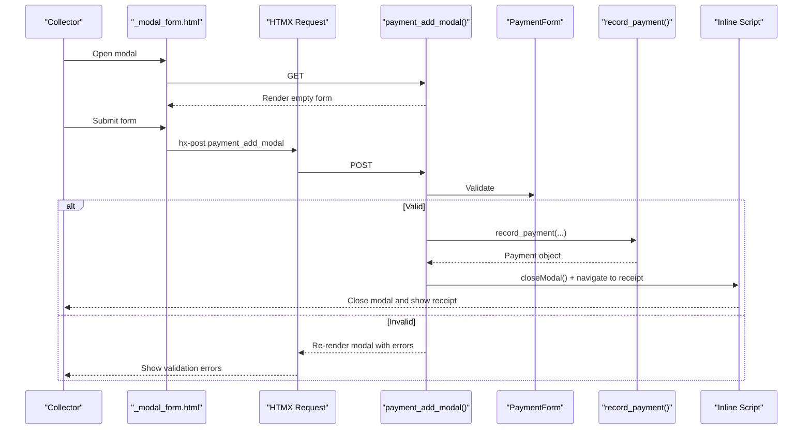
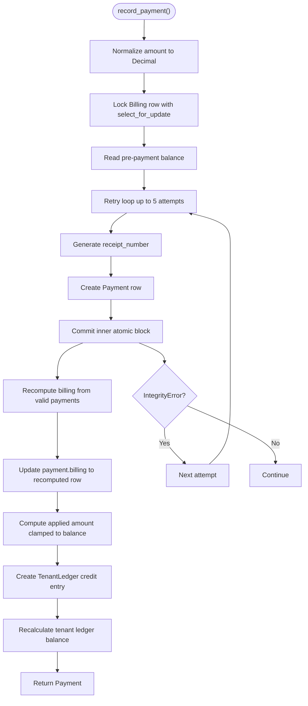
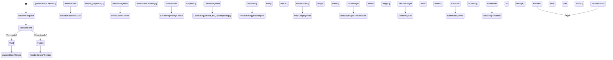
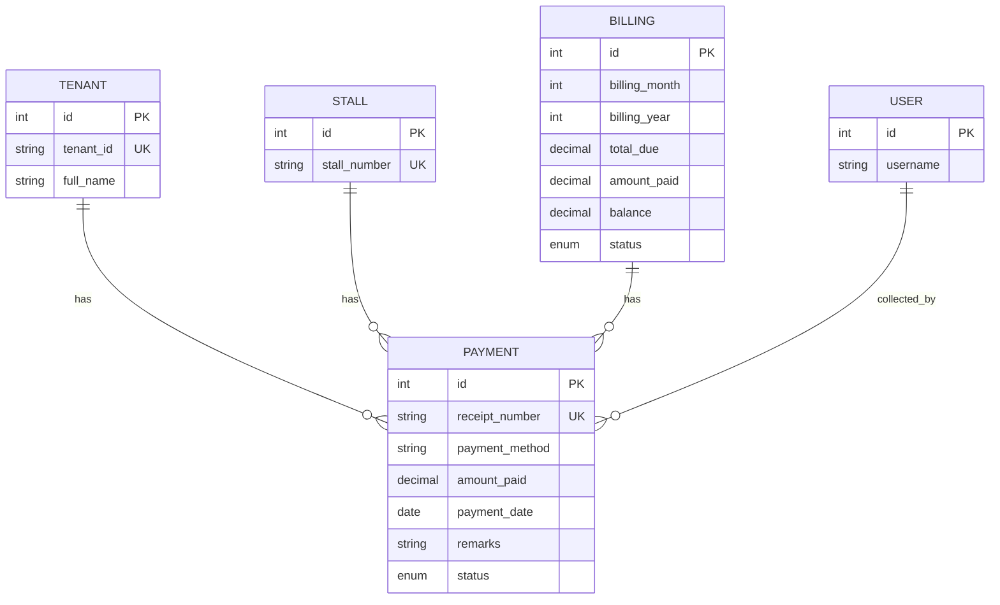
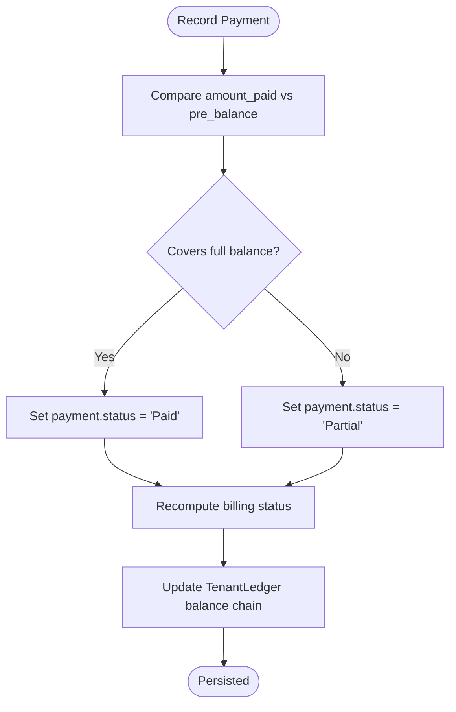
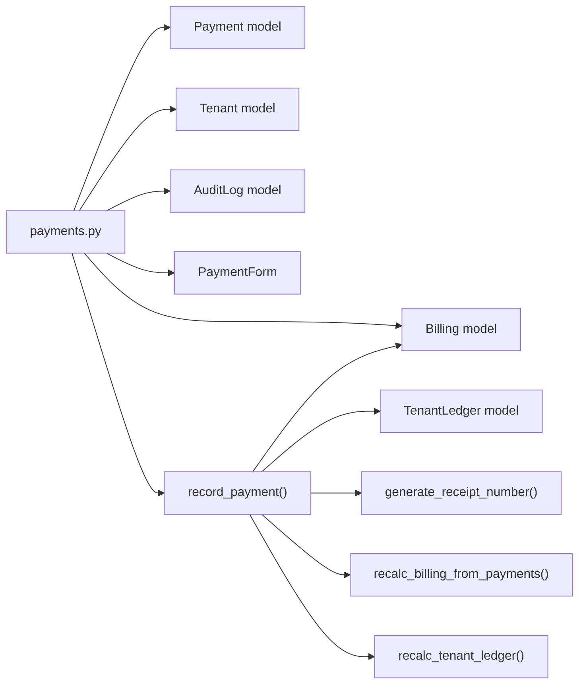

# Payment Recording & Validation

<cite>
**Referenced Files in This Document**
- [payments.py](file://core/views/payments.py)
- [helpers.py](file://core/helpers.py)
- [models.py](file://core/models.py)
- [forms.py](file://core/forms.py)
- [form.html](file://templates/payments/form.html)
- [_modal_form.html](file://templates/payments/_modal_form.html)
</cite>

## Table of Contents
1. [Introduction](#introduction)
2. [Project Structure](#project-structure)
3. [Core Components](#core-components)
4. [Architecture Overview](#architecture-overview)
5. [Detailed Component Analysis](#detailed-component-analysis)
6. [Dependency Analysis](#dependency-analysis)
7. [Performance Considerations](#performance-considerations)
8. [Troubleshooting Guide](#troubleshooting-guide)
9. [Conclusion](#conclusion)

## Introduction
This document explains the Payment Recording and Validation subsystem for the market rental system. It covers how payments are created through full-page forms and HTMX modal interfaces, how `PaymentForm` validates input, how the central `record_payment()` helper records transactions atomically, and how billing status, tenant ledger balances, collector attribution, date handling, remarks, official receipt numbers, and audit logging are managed.

The subsystem is designed around a single authoritative payment recording path: views validate user input, delegate to `record_payment()`, and then redirect or return an HTMX response that leads to the printable official receipt.

## Project Structure
The payment recording workflow spans four layers:

- **Views**: HTTP entry points for listing, creating, editing, voiding, viewing, printing, and exporting payments.
- **Forms**: Business validation rules for payment creation and editing.
- **Models**: Database schema for tenants, stalls, contracts, billings, payments, ledgers, and audit logs.
- **Helpers**: Shared financial logic including receipt numbering, billing recomputation, ledger balancing, and the atomic `record_payment()` function.

**Diagram sources**
- [payments.py:250-294](file://core/views/payments.py#L250-L294)
- [payments.py:419-457](file://core/views/payments.py#L419-L457)
- [helpers.py:351-420](file://core/helpers.py#L351-L420)
- [models.py:221-258](file://core/models.py#L221-L258)
- [form.html:18-105](file://templates/payments/form.html#L18-L105)
- [_modal_form.html:13-115](file://templates/payments/_modal_form.html#L13-L115)

**Section sources**
- [payments.py:1-19](file://core/views/payments.py#L1-L19)
- [helpers.py:15-15](file://core/helpers.py#L15-L15)
- [models.py:221-258](file://core/models.py#L221-L258)
- [forms.py:465-521](file://core/forms.py#L465-L521)
- [form.html:1-110](file://templates/payments/form.html#L1-L110)
- [_modal_form.html:1-118](file://templates/payments/_modal_form.html#L1-L118)

## Core Components
The subsystem has five core responsibilities:

| Component | Responsibility | Key Behavior |
|---|---|---|
| `PaymentForm` | Input validation and business rule enforcement | Validates billing consistency, auto-fills total due, prevents overpayment beyond outstanding balance, supports edit-mode adjustments. |
| `payment_add()` | Full-page payment creation | Renders form, validates, calls `record_payment()`, writes audit log, redirects to receipt. |
| `payment_add_modal()` | HTMX modal payment creation | Same logic as full-page but returns HTML/JS for modal flow. |
| `record_payment()` | Central transactional payment recorder | Creates payment, locks billing, generates receipt number, updates billing status, posts ledger credit, recalculates running balance. |
| `recalc_billing_from_payments()` | Authoritative billing state recomputation | Recomputes paid amount, balance, and status from valid payments under row lock. |

**Section sources**
- [forms.py:465-521](file://core/forms.py#L465-L521)
- [payments.py:250-294](file://core/views/payments.py#L250-L294)
- [payments.py:419-457](file://core/views/payments.py#L419-L457)
- [helpers.py:321-348](file://core/helpers.py#L321-L348)
- [helpers.py:351-420](file://core/helpers.py#L351-L420)

## Architecture Overview
The payment recording architecture follows a layered request-response pattern with strict separation between UI, validation, persistence, and reporting.

**Diagram sources**
- [payments.py:250-294](file://core/views/payments.py#L250-L294)
- [payments.py:419-457](file://core/views/payments.py#L419-L457)
- [helpers.py:351-420](file://core/helpers.py#L351-L420)
- [models.py:304-316](file://core/models.py#L304-L316)

## Detailed Component Analysis

### PaymentForm Validation Rules and Business Logic
`PaymentForm` is the primary gatekeeper for payment data integrity. It enforces:

- **Billing-Tenant Consistency**: The selected billing must belong to the selected tenant.
- **Billing-Stall Consistency**: The selected billing must belong to the selected stall.
- **Total Amount Due Auto-fill**: If a billing is present, `total_amount_due` defaults to `billing.total_due`.
- **Overpayment Guard**: `amount_paid` cannot exceed the outstanding balance by more than a small tolerance. In edit mode, the previous payment amount is added back to the remaining balance before checking.

These rules prevent invalid cross-references and protect against accidental or intentional overpayment.

**Diagram sources**
- [forms.py:498-521](file://core/forms.py#L498-L521)

**Section sources**
- [forms.py:465-521](file://core/forms.py#L465-L521)

### Full-Page Payment Creation Workflow
The full-page payment creation flow is used when a collector opens the dedicated payment form.

Key steps:

1. The view renders `templates/payments/form.html`.
2. On POST, `PaymentForm` validates the submission.
3. If valid, the view creates a draft instance and calls `record_payment()`.
4. An audit log entry is written with action `CREATE`.
5. A success message is set.
6. The user is redirected to the printable receipt URL.

**Diagram sources**
- [payments.py:250-294](file://core/views/payments.py#L250-L294)
- [form.html:18-105](file://templates/payments/form.html#L18-L105)

**Section sources**
- [payments.py:250-294](file://core/views/payments.py#L250-L294)
- [form.html:1-110](file://templates/payments/form.html#L1-L110)

### HTMX Modal Payment Creation Workflow
The modal workflow is optimized for quick collection inside billing or collection pages. It uses HTMX to submit the form without a full page reload.

Key differences from the full-page flow:

- The form uses `hx-post` to target `payment_add_modal()`.
- On successful submission, the view returns a small JavaScript response that closes the modal and navigates to the receipt page.
- On validation failure, the modal re-renders with error messages.

**Diagram sources**
- [payments.py:419-457](file://core/views/payments.py#L419-L457)
- [_modal_form.html:13-115](file://templates/payments/_modal_form.html#L13-L115)

**Section sources**
- [payments.py:419-457](file://core/views/payments.py#L419-L457)
- [_modal_form.html:1-118](file://templates/payments/_modal_form.html#L1-L118)

### Central Payment Recording with `record_payment()`
`record_payment()` is the single source of truth for posting a rental payment. It encapsulates all database mutations required to keep payments, billings, and tenant ledgers consistent.

Responsibilities:

- Normalize and quantize the payment amount.
- Lock the target billing row using `select_for_update()` to prevent concurrent race conditions.
- Generate a unique receipt number.
- Create the `Payment` row with tenant, stall, billing reference, amounts, payment date, method, official receipt number, collector, status, and remarks.
- Recompute billing totals and status authoritatively.
- Post a ledger credit entry.
- Recalculate the tenant’s running ledger balance.
- Retry receipt number generation on rare integrity errors.

**Diagram sources**
- [helpers.py:351-420](file://core/helpers.py#L351-L420)

**Section sources**
- [helpers.py:351-420](file://core/helpers.py#L351-L420)

### Transactional Nature of Payment Recording
Payment recording is transactional at two levels:

1. **View-level atomicity**: Both `payment_add()` and `payment_add_modal()` are decorated with `@transaction.atomic`.
2. **Helper-level atomicity**: `record_payment()` wraps payment creation in its own `transaction.atomic()` block and retries on `IntegrityError`.

Additionally, billing recomputation uses `select_for_update()` to lock the billing row during concurrent access. This ensures that two collectors collecting against the same billing cannot both mark it fully paid or overwrite each other’s totals.

**Diagram sources**
- [payments.py:250-294](file://core/views/payments.py#L250-L294)
- [payments.py:419-457](file://core/views/payments.py#L419-L457)
- [helpers.py:351-420](file://core/helpers.py#L351-L420)

**Section sources**
- [payments.py:250-294](file://core/views/payments.py#L250-L294)
- [payments.py:419-457](file://core/views/payments.py#L419-L457)
- [helpers.py:351-420](file://core/helpers.py#L351-L420)

### Tenant Selection, Billing Association, and Stall Context
Payments are associated with three key entities:

- **Tenant**: The person or entity owing rent.
- **Stall**: The physical stall being rented.
- **Billing**: The specific month/year billing record being settled.

The model relationships ensure that every payment carries enough context for receipts, reports, and ledger reconciliation.

**Diagram sources**
- [models.py:117-154](file://core/models.py#L117-L154)
- [models.py:93-114](file://core/models.py#L93-L114)
- [models.py:190-218](file://core/models.py#L190-L218)
- [models.py:221-258](file://core/models.py#L221-L258)

**Section sources**
- [models.py:117-154](file://core/models.py#L117-L154)
- [models.py:93-114](file://core/models.py#L93-L114)
- [models.py:190-218](file://core/models.py#L190-L218)
- [models.py:221-258](file://core/models.py#L221-L258)

### Payment Method Handling
Supported payment methods are defined in the `Payment` model:

| Payment Method | Meaning |
|---|---|
| Cash | Physical cash payment |
| GCash | Digital wallet payment |
| Bank Transfer | Electronic bank transfer |
| Check | Check-based payment |

The default payment method is `Cash`. The form presents these choices through a select widget, and the recorded method is included in the ledger description and receipt output.

**Section sources**
- [models.py:221-258](file://core/models.py#L221-L258)
- [forms.py:474-496](file://core/forms.py#L474-L496)
- [helpers.py:407-418](file://core/helpers.py#L407-L418)

### Collector Attribution
Every payment records who collected it through the `collected_by` field. In the creation views, this is set to the authenticated user (`request.user`). This enables:

- Collector-specific receipt visibility.
- Collection attribution in reports.
- Audit trail linkage.

**Section sources**
- [payments.py:258-267](file://core/views/payments.py#L258-L267)
- [payments.py:426-435](file://core/views/payments.py#L426-L435)
- [models.py:248-248](file://core/models.py#L248-L248)

### Date Handling and Remarks Capture
- **Payment Date**: The form includes a date input. When rendering a new payment, the initial value is set to today’s date.
- **Remarks**: Optional text captured on the form and stored on the payment. Remarks can include notes such as external official receipt numbers or collection notes.

**Section sources**
- [payments.py:286-286](file://core/views/payments.py#L286-L286)
- [payments.py:456-456](file://core/views/payments.py#L456-L456)
- [forms.py:490-496](file://core/forms.py#L490-L496)
- [models.py:245-250](file://core/models.py#L245-L250)

### Official Receipt Number Generation
Receipt numbers are generated by `generate_receipt_number()` and follow a structured format:

- Prefix from system settings, defaulting to `RCP`.
- Current year-month segment.
- Zero-padded sequential suffix derived from existing receipts for the same period.

If an integrity error occurs during payment creation, the helper retries receipt generation up to five times.

**Section sources**
- [helpers.py:276-300](file://core/helpers.py#L276-L300)
- [helpers.py:373-399](file://core/helpers.py#L373-L399)

### Payment Status Management
Payment status is modeled separately from billing status:

- **Payment statuses**: `Paid`, `Partial`, `Void`, `Cancelled`.
- **Billing statuses**: `Unpaid`, `Partial`, `Paid`, `Overdue`.

When a payment is recorded:

- If the payment amount covers the full outstanding balance, the payment status becomes `Paid`.
- Otherwise, it becomes `Partial`.
- The billing status is recomputed by `recalc_billing_from_payments()` based on all valid payments.

Voiding a payment removes its ledger entries and recomputes billing and tenant ledger balances.

**Diagram sources**
- [helpers.py:393-393](file://core/helpers.py#L393-L393)
- [helpers.py:321-348](file://core/helpers.py#L321-L348)
- [helpers.py:260-273](file://core/helpers.py#L260-L273)

**Section sources**
- [models.py:228-250](file://core/models.py#L228-L250)
- [models.py:191-210](file://core/models.py#L191-L210)
- [helpers.py:321-348](file://core/helpers.py#L321-L348)
- [helpers.py:393-393](file://core/helpers.py#L393-L393)

### Initial Balance Updates and Ledger Accounting
After recording a payment:

1. The applied amount is clamped to the outstanding balance so the ledger never over-settles a bill.
2. A `TenantLedger` credit entry is created with the payment reference.
3. `recalc_tenant_ledger()` recalculates the running balance across all ledger entries for the tenant.

This keeps the tenant’s historical ledger consistent even after edits, voids, or multiple partial payments.

**Section sources**
- [helpers.py:407-420](file://core/helpers.py#L407-L420)
- [helpers.py:260-273](file://core/helpers.py#L260-L273)
- [models.py:261-277](file://core/models.py#L261-L277)

### Error Handling
Error handling occurs at multiple layers:

- **Form validation errors**: Displayed inline on the form.
- **HTMX validation failures**: Re-render the modal with errors.
- **Access control errors**: Tenants and collectors are restricted from viewing unrelated payments; messages guide them back to appropriate pages.
- **Concurrency protection**: Receipt number collisions are retried; billing rows are locked during recomputation.
- **Audit logging**: Successful payment creation and modification write audit entries with user, action, module, description, and IP address.

**Section sources**
- [payments.py:157-183](file://core/views/payments.py#L157-L183)
- [payments.py:283-284](file://core/views/payments.py#L283-L284)
- [payments.py:453-454](file://core/views/payments.py#L453-L454)
- [payments.py:269-275](file://core/views/payments.py#L269-L275)
- [payments.py:437-443](file://core/views/payments.py#L437-L443)
- [helpers.py:373-399](file://core/helpers.py#L373-L399)

## Dependency Analysis
The payment subsystem depends on several models and helpers:

**Diagram sources**
- [payments.py:10-18](file://core/views/payments.py#L10-L18)
- [helpers.py:351-420](file://core/helpers.py#L351-L420)
- [models.py:190-277](file://core/models.py#L190-L277)

**Section sources**
- [payments.py:10-18](file://core/views/payments.py#L10-L18)
- [helpers.py:351-420](file://core/helpers.py#L351-L420)
- [models.py:190-277](file://core/models.py#L190-L277)

## Performance Considerations
- **Decimal arithmetic**: Financial calculations use `Decimal` throughout to avoid floating-point drift.
- **Row locking**: `select_for_update()` protects billing rows during concurrent collections.
- **Query optimization**: Views use `select_related` to reduce N+1 queries when rendering payment lists and receipts.
- **Pagination**: Payment lists are paginated to limit large dataset rendering.
- **Receipt retry loop**: Rare integrity errors are retried rather than failing immediately, improving resilience under concurrency.

[No sources needed since this section provides general guidance]

## Troubleshooting Guide
Common issues and their likely causes:

| Symptom | Likely Cause | Resolution |
|---|---|---|
| Payment form rejects amount | Overpayment guard triggered | Reduce `amount_paid` to match outstanding balance. |
| Billing and tenant mismatch error | Selected billing does not belong to selected tenant | Choose a billing belonging to the correct tenant. |
| Billing and stall mismatch error | Selected billing does not belong to selected stall | Choose a billing belonging to the correct stall. |
| Modal shows validation errors | HTMX received invalid form data | Correct fields and resubmit. |
| Receipt not found | Access denied or invalid ID | Verify role permissions and payment ownership. |
| Billing still shows wrong balance after payment | Billing recomputation did not run or ledger was not recalculated | Ensure payment was recorded through `record_payment()` and ledger recalculation ran. |
| Duplicate receipt number error | Concurrent payment creation | System retries automatically; if persistent, check database constraints and concurrency. |

**Section sources**
- [forms.py:498-521](file://core/forms.py#L498-L521)
- [payments.py:157-183](file://core/views/payments.py#L157-L183)
- [helpers.py:373-399](file://core/helpers.py#L373-L399)

## Conclusion
The Payment Recording and Validation subsystem centers on a clear separation of concerns: forms enforce business rules, views coordinate user interaction, and `record_payment()` guarantees consistent, transactional persistence. The design supports both full-page and HTMX modal workflows, handles multiple payment methods, attributes payments to collectors, captures remarks and dates, manages payment and billing status, and integrates audit logging. Its reliance on atomic transactions, row locking, and authoritative recomputation makes it robust against common financial data integrity risks.

[No sources needed since this section summarizes without analyzing specific files]