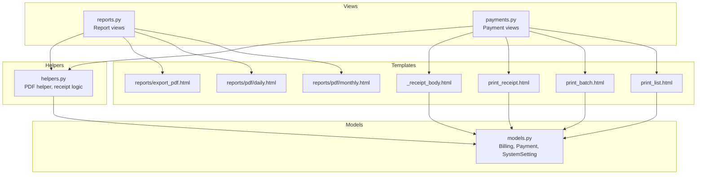
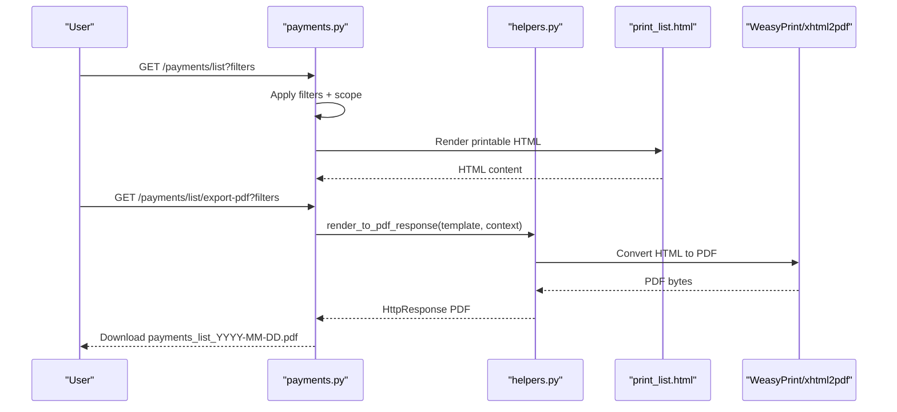
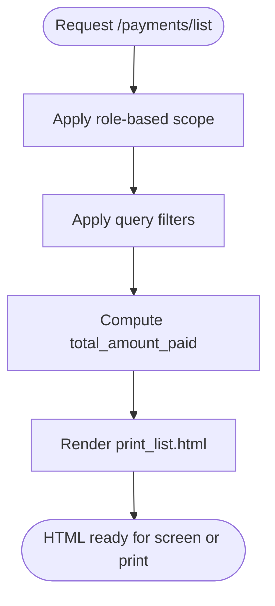
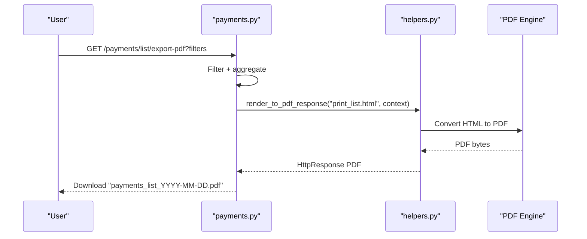
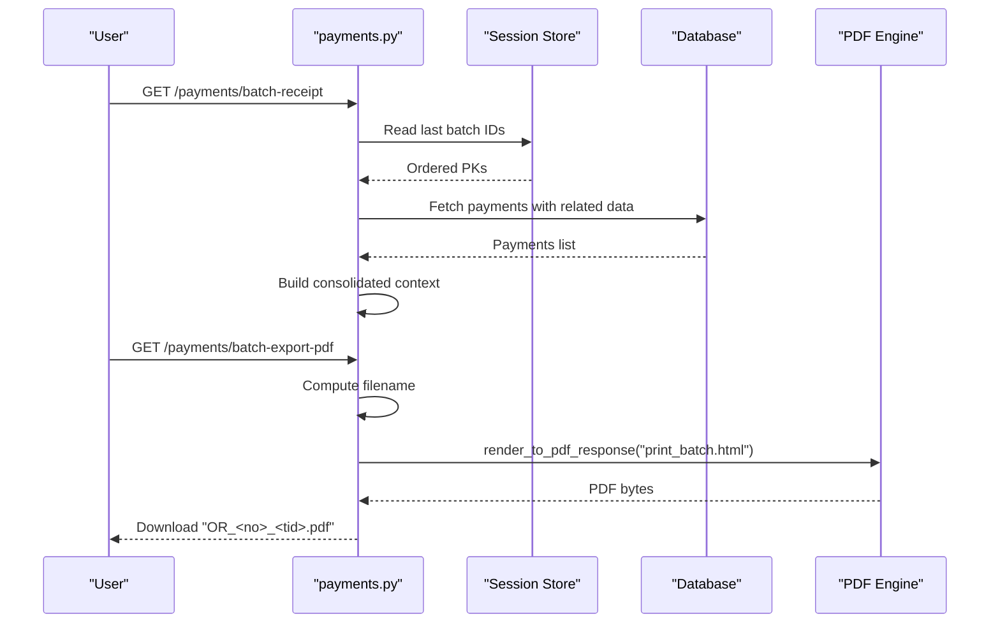
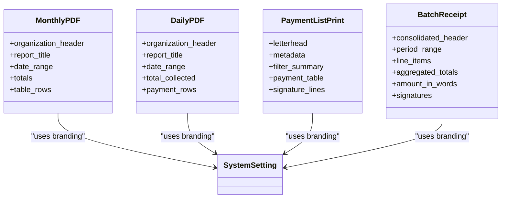
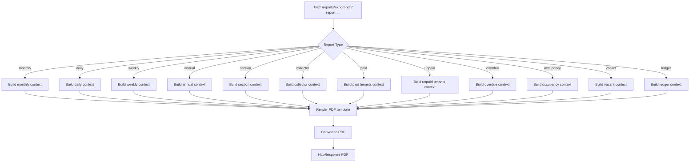
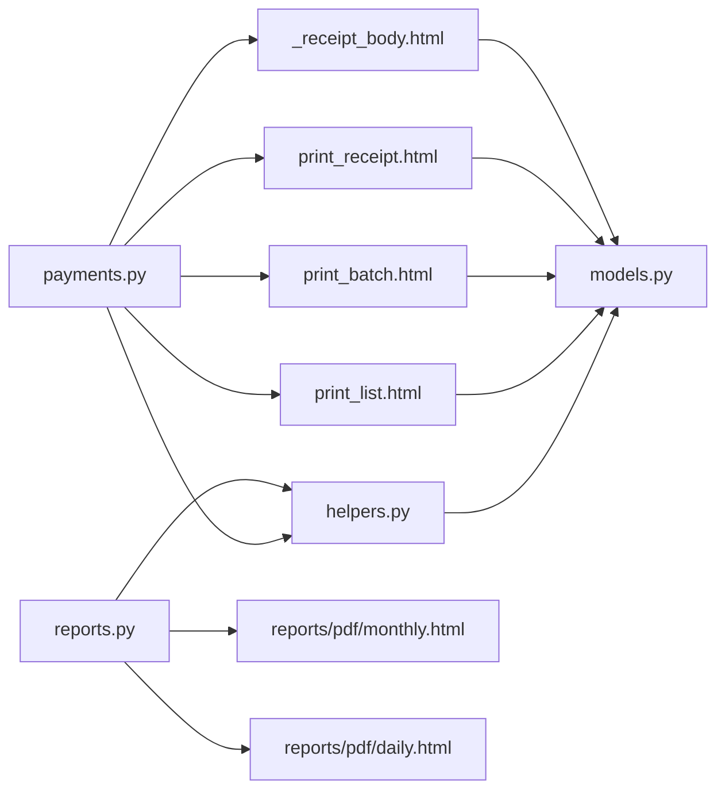

# Payment Reporting & Export

<cite>
**Referenced Files in This Document**
- [reports.py](file://core/views/reports.py)
- [payments.py](file://core/views/payments.py)
- [helpers.py](file://core/helpers.py)
- [models.py](file://core/models.py)
- [print_list.html](file://templates/payments/print_list.html)
- [print_batch.html](file://templates/payments/print_batch.html)
- [print_receipt.html](file://templates/payments/print_receipt.html)
- [_receipt_body.html](file://templates/payments/_receipt_body.html)
- [export_pdf.html](file://templates/reports/export_pdf.html)
- [monthly.html](file://templates/reports/pdf/monthly.html)
- [daily.html](file://templates/reports/pdf/daily.html)
</cite>

## Table of Contents
1. [Introduction](#introduction)
2. [Project Structure](#project-structure)
3. [Core Components](#core-components)
4. [Architecture Overview](#architecture-overview)
5. [Detailed Component Analysis](#detailed-component-analysis)
6. [Dependency Analysis](#dependency-analysis)
7. [Performance Considerations](#performance-considerations)
8. [Troubleshooting Guide](#troubleshooting-guide)
9. [Conclusion](#conclusion)

## Introduction
This document explains the Payment Reporting and Export functionality for the market rental system. It covers:

- Printable payment list generation with comprehensive filtering and summary statistics.
- PDF export capabilities for payment records, including formatted tables, totals calculation, and professional layout design.
- Batch receipt PDF generation for consolidated multi-payment documentation.
- Report templates, data formatting, and styling options for different output formats.
- Custom report generation, export file naming conventions, and download workflows.
- Integration with SystemSetting for branded reports and municipality information.
- Report accessibility, print optimization, and cross-browser compatibility for generated documents.

The system supports both browser-based printing and server-side PDF generation through WeasyPrint, with fallbacks to ensure reliable output across environments.

## Project Structure
Payment reporting and export spans views, helpers, models, and templates:

- Views provide filtering, aggregation, and export endpoints.
- Helpers centralize PDF rendering, receipt numbering, and financial recomputation.
- Models define billing, payment, tenant, stall, and system settings.
- Templates render printable HTML layouts optimized for screen and paper.

**Diagram sources**
- [reports.py:452-563](file://core/views/reports.py#L452-L563)
- [payments.py:554-652](file://core/views/payments.py#L554-L652)
- [helpers.py:522-594](file://core/helpers.py#L522-L594)
- [models.py:42-68](file://core/models.py#L42-L68)
- [print_list.html:1-67](file://templates/payments/print_list.html#L1-L67)
- [print_batch.html:1-221](file://templates/payments/print_batch.html#L1-L221)
- [print_receipt.html:1-56](file://templates/payments/print_receipt.html#L1-L56)
- [_receipt_body.html:1-175](file://templates/payments/_receipt_body.html#L1-L175)
- [monthly.html:1-51](file://templates/reports/pdf/monthly.html#L1-L51)
- [daily.html:1-47](file://templates/reports/pdf/daily.html#L1-L47)
- [export_pdf.html:1-34](file://templates/reports/export_pdf.html#L1-L34)

**Section sources**
- [reports.py:452-563](file://core/views/reports.py#L452-L563)
- [payments.py:554-652](file://core/views/payments.py#L554-L652)
- [helpers.py:522-594](file://core/helpers.py#L522-L594)
- [models.py:42-68](file://core/models.py#L42-L68)
- [print_list.html:1-67](file://templates/payments/print_list.html#L1-L67)
- [print_batch.html:1-221](file://templates/payments/print_batch.html#L1-L221)
- [print_receipt.html:1-56](file://templates/payments/print_receipt.html#L1-L56)
- [_receipt_body.html:1-175](file://templates/payments/_receipt_body.html#L1-L175)
- [monthly.html:1-51](file://templates/reports/pdf/monthly.html#L1-L51)
- [daily.html:1-47](file://templates/reports/pdf/daily.html#L1-L47)
- [export_pdf.html:1-34](file://templates/reports/export_pdf.html#L1-L34)

## Core Components
- Payment list view and printable list:
  - Applies role-based scoping and multiple filters (date range, tenant, stall, collector, status, method, search).
  - Computes total collected amount over filtered set.
  - Renders a print-optimized table with letterhead, metadata, and signature lines.

- Batch receipt consolidation:
  - Retrieves payments from session-stored IDs.
  - Builds a single consolidated receipt covering multiple billing periods.
  - Calculates aggregated totals, period ranges, unique stalls, and amount-in-words.

- Report PDF export:
  - Routes request parameters to dataset-specific contexts.
  - Renders HTML via template and converts to PDF using WeasyPrint.
  - Provides error page when WeasyPrint is unavailable.

- Excel export:
  - Generates styled spreadsheets per report type with headers, columns, and auto-width.

- PDF helper:
  - Attempts WeasyPrint first, then xhtml2pdf fallback, then returns an HTML preview with Print button.

**Section sources**
- [payments.py:186-247](file://core/views/payments.py#L186-L247)
- [payments.py:351-396](file://core/views/payments.py#L351-L396)
- [payments.py:606-652](file://core/views/payments.py#L606-L652)
- [reports.py:452-563](file://core/views/reports.py#L452-L563)
- [reports.py:567-774](file://core/views/reports.py#L567-L774)
- [helpers.py:522-594](file://core/helpers.py#L522-L594)

## Architecture Overview
The following sequence shows how a user generates a printable payment list and exports it as PDF.

**Diagram sources**
- [payments.py:554-652](file://core/views/payments.py#L554-L652)
- [helpers.py:522-594](file://core/helpers.py#L522-L594)
- [print_list.html:1-67](file://templates/payments/print_list.html#L1-L67)

## Detailed Component Analysis

### Printable Payment List Generation
- Filtering:
  - Date range, tenant, stall, collector, status, payment method, and free-text search across tenant name/ID, stall number, receipt numbers, and collector fields.
- Summary:
  - Aggregates total collected amount over the filtered set.
- Output:
  - Renders a clean table with receipt number, tenant, stall, amount, method, date, collector, and status.
  - Includes letterhead from SystemSetting and metadata such as generation time and active filters.
  - Provides Print and Export PDF buttons; hides UI controls during print.

**Diagram sources**
- [payments.py:186-247](file://core/views/payments.py#L186-L247)
- [print_list.html:1-67](file://templates/payments/print_list.html#L1-L67)

**Section sources**
- [payments.py:186-247](file://core/views/payments.py#L186-L247)
- [print_list.html:1-67](file://templates/payments/print_list.html#L1-L67)

### PDF Export for Payment Records
- Endpoint:
  - Reuses the same filter pipeline as the list view.
  - Passes context to print_list.html and calls the PDF helper.
- File naming:
  - Uses a consistent pattern: `payments_list_YYYY-MM-DD.pdf`.
- Rendering:
  - The helper attempts WeasyPrint first, then xhtml2pdf, then falls back to HTML with a Print button.

**Diagram sources**
- [payments.py:606-652](file://core/views/payments.py#L606-L652)
- [helpers.py:522-594](file://core/helpers.py#L522-L594)

**Section sources**
- [payments.py:606-652](file://core/views/payments.py#L606-L652)
- [helpers.py:522-594](file://core/helpers.py#L522-L594)

### Batch Receipt PDF Generation
- Session-backed batch retrieval:
  - Loads ordered payment IDs from session and fetches related data efficiently.
- Consolidation:
  - Produces one official receipt covering multiple billing months.
  - Computes totals for rental, penalty, discount, due, paid, and remaining balance.
  - Formats period range and lists unique stalls.
- Amount in words:
  - Converts total paid to English words for auditability.
- Access control:
  - Tenants can only view their own receipts; collectors can only view receipts they recorded.
- Export filename:
  - Uses OR number and tenant ID: `OR_<official_receipt_no>_<tenant_id>.pdf`.

**Diagram sources**
- [payments.py:26-37](file://core/views/payments.py#L26-L37)
- [payments.py:40-100](file://core/views/payments.py#L40-L100)
- [payments.py:351-396](file://core/views/payments.py#L351-L396)
- [print_batch.html:1-221](file://templates/payments/print_batch.html#L1-L221)

**Section sources**
- [payments.py:26-37](file://core/views/payments.py#L26-L37)
- [payments.py:40-100](file://core/views/payments.py#L40-L100)
- [payments.py:351-396](file://core/views/payments.py#L351-L396)
- [print_batch.html:1-221](file://templates/payments/print_batch.html#L1-L221)

### Report Templates, Data Formatting, and Styling
- Report PDF templates:
  - Monthly and daily report templates use minimal inline CSS suitable for PDF engines.
  - Include organization header, report title, date range, totals, and tabular data.
  - Use A4 portrait orientation and consistent spacing.
- Payment list print template:
  - Uses Tailwind classes and print media queries to hide UI and optimize layout.
  - Displays letterhead, metadata, and a compact table with currency formatting.
- Receipt templates:
  - Single receipt and batch receipt templates include structured sections for tenant info, billing details, totals, remarks, signatures, and footer.
  - Support auto-printing after load for streamlined collection flows.

**Diagram sources**
- [monthly.html:1-51](file://templates/reports/pdf/monthly.html#L1-L51)
- [daily.html:1-47](file://templates/reports/pdf/daily.html#L1-L47)
- [print_list.html:1-67](file://templates/payments/print_list.html#L1-L67)
- [print_batch.html:1-221](file://templates/payments/print_batch.html#L1-L221)
- [models.py:42-68](file://core/models.py#L42-L68)

**Section sources**
- [monthly.html:1-51](file://templates/reports/pdf/monthly.html#L1-L51)
- [daily.html:1-47](file://templates/reports/pdf/daily.html#L1-L47)
- [print_list.html:1-67](file://templates/payments/print_list.html#L1-L67)
- [print_batch.html:1-221](file://templates/payments/print_batch.html#L1-L221)
- [print_receipt.html:1-56](file://templates/payments/print_receipt.html#L1-L56)
- [_receipt_body.html:1-175](file://templates/payments/_receipt_body.html#L1-L175)

### Custom Report Generation and Export Workflows
- Report dashboard and specific reports:
  - Provide monthly, daily, weekly, annual, section, collector, paid/unpaid tenants, overdue, occupancy, vacant, and ledger reports.
- PDF export routing:
  - Accepts report type parameter and builds appropriate context and template selection.
  - Computes totals and aggregates per report type.
- Excel export:
  - Creates styled spreadsheets with headers, column widths, and numeric formatting.
- Error handling:
  - When WeasyPrint is missing, renders an informative page directing users to install dependencies or use Print-to-PDF.

**Diagram sources**
- [reports.py:452-563](file://core/views/reports.py#L452-L563)

**Section sources**
- [reports.py:452-563](file://core/views/reports.py#L452-L563)
- [reports.py:567-774](file://core/views/reports.py#L567-L774)
- [export_pdf.html:1-34](file://templates/reports/export_pdf.html#L1-L34)

### Integration with SystemSetting
- Branding:
  - Municipality name, market name, office name, logo, theme color, and terms are available to templates.
- Receipt numbering:
  - Receipt prefix comes from SystemSetting; defaults to a safe value if not configured.
- Reports:
  - Organization headers on PDF reports reflect configured branding.
- Context processors:
  - SystemSetting is made available globally where needed.

**Section sources**
- [models.py:42-68](file://core/models.py#L42-L68)
- [helpers.py:276-300](file://core/helpers.py#L276-L300)
- [monthly.html:1-51](file://templates/reports/pdf/monthly.html#L1-L51)
- [daily.html:1-47](file://templates/reports/pdf/daily.html#L1-L47)
- [print_list.html:1-67](file://templates/payments/print_list.html#L1-L67)
- [print_batch.html:1-221](file://templates/payments/print_batch.html#L1-L221)

### Accessibility, Print Optimization, and Cross-Browser Compatibility
- Print optimization:
  - Media queries hide non-print elements, set A4 page size, and adjust margins.
  - Tables use border-collapse and explicit header/footer grouping for reliable pagination.
- Accessibility:
  - Semantic headings, clear labels, and readable fonts improve screen reader and print outcomes.
- Cross-browser compatibility:
  - Fallback chain ensures usable output even when WeasyPrint is unavailable.
  - Browser Print-to-PDF remains supported via HTML preview with a prominent Print button.

**Section sources**
- [print_list.html:1-67](file://templates/payments/print_list.html#L1-L67)
- [print_batch.html:1-221](file://templates/payments/print_batch.html#L1-L221)
- [print_receipt.html:1-56](file://templates/payments/print_receipt.html#L1-L56)
- [helpers.py:522-594](file://core/helpers.py#L522-L594)

## Dependency Analysis
Key relationships between components:

**Diagram sources**
- [payments.py:554-652](file://core/views/payments.py#L554-L652)
- [reports.py:452-563](file://core/views/reports.py#L452-L563)
- [helpers.py:522-594](file://core/helpers.py#L522-L594)
- [models.py:42-68](file://core/models.py#L42-L68)
- [print_list.html:1-67](file://templates/payments/print_list.html#L1-L67)
- [print_batch.html:1-221](file://templates/payments/print_batch.html#L1-L221)
- [print_receipt.html:1-56](file://templates/payments/print_receipt.html#L1-L56)
- [_receipt_body.html:1-175](file://templates/payments/_receipt_body.html#L1-L175)
- [monthly.html:1-51](file://templates/reports/pdf/monthly.html#L1-L51)
- [daily.html:1-47](file://templates/reports/pdf/daily.html#L1-L47)

**Section sources**
- [payments.py:554-652](file://core/views/payments.py#L554-L652)
- [reports.py:452-563](file://core/views/reports.py#L452-L563)
- [helpers.py:522-594](file://core/helpers.py#L522-L594)
- [models.py:42-68](file://core/models.py#L42-L68)
- [print_list.html:1-67](file://templates/payments/print_list.html#L1-L67)
- [print_batch.html:1-221](file://templates/payments/print_batch.html#L1-L221)
- [print_receipt.html:1-56](file://templates/payments/print_receipt.html#L1-L56)
- [_receipt_body.html:1-175](file://templates/payments/_receipt_body.html#L1-L175)
- [monthly.html:1-51](file://templates/reports/pdf/monthly.html#L1-L51)
- [daily.html:1-47](file://templates/reports/pdf/daily.html#L1-L47)

## Performance Considerations
- Query efficiency:
  - Use select_related to reduce N+1 queries for tenant, stall, section, and collector data.
- Aggregation:
  - Sum and Count operations are performed on filtered sets to minimize overhead.
- Pagination:
  - Large lists are paginated to avoid heavy DOM rendering and database loads.
- PDF generation:
  - Prefer WeasyPrint for best CSS fidelity; fallbacks prevent blocking requests.
- Decimal arithmetic:
  - Financial calculations consistently use Decimal to avoid float drift.

[No sources needed since this section provides general guidance]

## Troubleshooting Guide
- PDF export unavailable:
  - If WeasyPrint is missing, the system renders an error page instructing installation or suggesting Print-to-PDF.
- Windows environment issues:
  - The helper tries xhtml2pdf as a fallback; if that fails, it returns an HTML preview with a Print button.
- Missing SystemSetting:
  - Templates fall back to default values for municipality, market, and office names.
- Batch receipt not found:
  - If no batch IDs exist in session, users are redirected to the billing list with an informational message.

**Section sources**
- [export_pdf.html:1-34](file://templates/reports/export_pdf.html#L1-L34)
- [helpers.py:522-594](file://core/helpers.py#L522-L594)
- [payments.py:351-396](file://core/views/payments.py#L351-L396)

## Conclusion
The Payment Reporting and Export subsystem delivers robust, accessible, and brand-consistent outputs for payment lists, receipts, and reports. It combines flexible filtering, precise financial aggregation, and resilient PDF generation to support collectors, administrators, and tenants across diverse environments. With clear naming conventions, professional templates, and thoughtful fallbacks, the system ensures reliable documentation for every transaction and reporting need.

[No sources needed since this section summarizes without analyzing specific files]