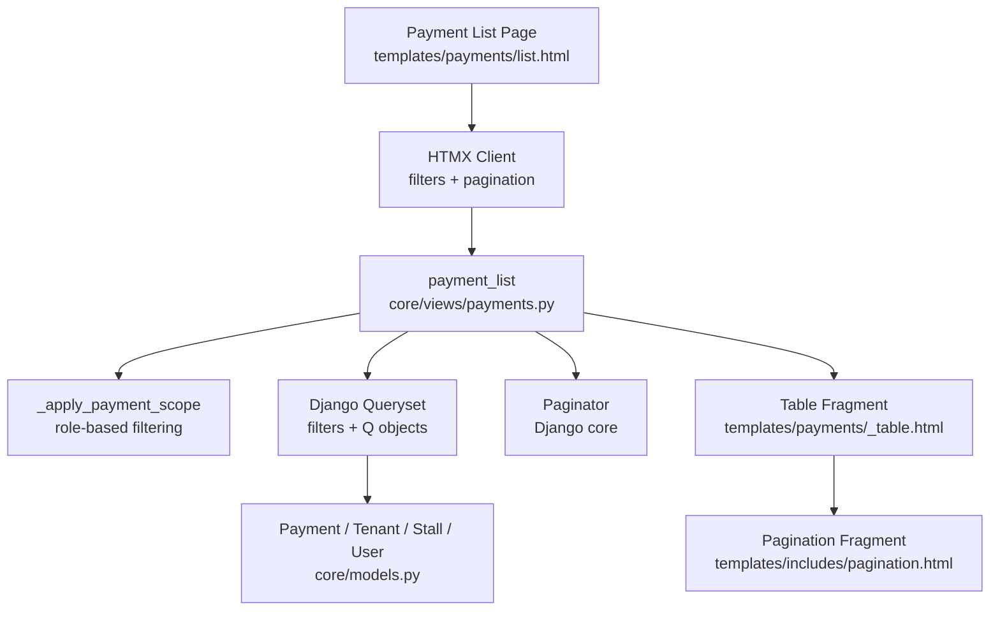
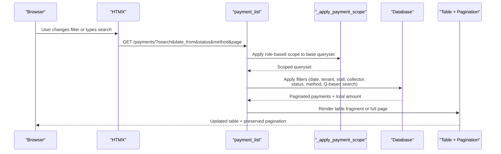
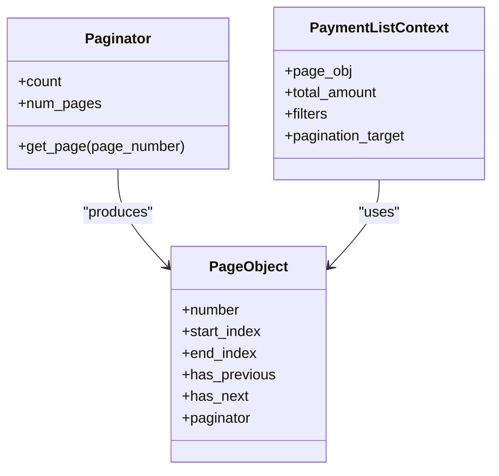
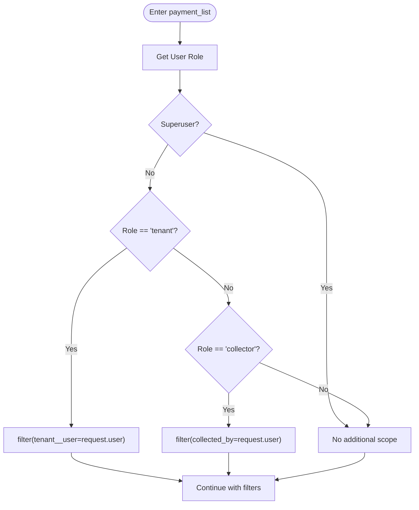
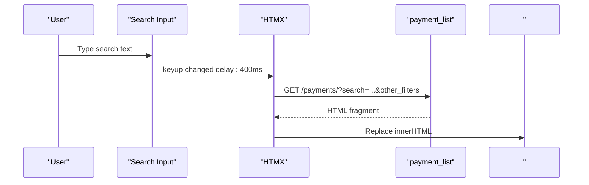
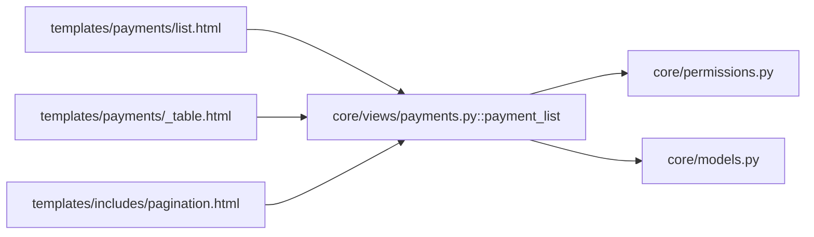

# Payment Search & Filtering

<cite>
**Referenced Files in This Document**
- [payments.py](file://core/views/payments.py)
- [models.py](file://core/models.py)
- [permissions.py](file://core/permissions.py)
- [list.html](file://templates/payments/list.html)
- [_table.html](file://templates/payments/_table.html)
- [pagination.html](file://templates/includes/pagination.html)
</cite>

## Table of Contents
1. [Introduction](#introduction)
2. [Project Structure](#project-structure)
3. [Core Components](#core-components)
4. [Architecture Overview](#architecture-overview)
5. [Detailed Component Analysis](#detailed-component-analysis)
6. [Dependency Analysis](#dependency-analysis)
7. [Performance Considerations](#performance-considerations)
8. [Troubleshooting Guide](#troubleshooting-guide)
9. [Conclusion](#conclusion)

## Introduction
This document explains the Payment Search and Filtering capabilities in the Market Rental System. It covers the search interface, filter criteria, query construction using Django’s `Q` objects, pagination behavior, role-based data isolation, HTMX-driven dynamic updates, and performance considerations for large payment datasets.

The payment list is a read-only history view that lets users:
- Filter by date range, tenant, stall, collector, status, and payment method.
- Perform free-text searches across tenants, stalls, receipts, and collectors.
- Navigate paginated results while preserving all active filters.
- View only records authorized by their role.

## Project Structure
The payment search feature spans views, models, permissions, and templates:

**Diagram sources**
- [payments.py:186-247](file://core/views/payments.py#L186-L247)
- [list.html:38-69](file://templates/payments/list.html#L38-L69)
- [_table.html:1-88](file://templates/payments/_table.html#L1-L88)
- [pagination.html:1-47](file://templates/includes/pagination.html#L1-L47)
- [models.py:221-258](file://core/models.py#L221-L258)

**Section sources**
- [payments.py:186-247](file://core/views/payments.py#L186-L247)
- [list.html:38-69](file://templates/payments/list.html#L38-L69)
- [_table.html:1-88](file://templates/payments/_table.html#L1-L88)
- [pagination.html:1-47](file://templates/includes/pagination.html#L1-L47)
- [models.py:221-258](file://core/models.py#L221-L258)

## Core Components
- **View**: `payment_list` builds the filtered, scoped, and paginated payment queryset.
- **Models**: `Payment`, `Tenant`, `Stall`, and `User` provide the searchable fields.
- **Permissions**: Role helpers enforce data isolation so tenants see only their own payments and collectors see only their collected payments.
- **Templates**: The list page renders filters; the table fragment renders rows and totals; the pagination fragment preserves query parameters.

Key responsibilities:
- Extracting and validating filter parameters from the request.
- Applying role-based scoping before any search filters.
- Building complex search conditions with `Q`.
- Paginating results and computing filtered totals.
- Rendering either a full page or an HTMX table fragment.

**Section sources**
- [payments.py:186-247](file://core/views/payments.py#L186-L247)
- [permissions.py:32-59](file://core/permissions.py#L32-L59)
- [models.py:221-258](file://core/models.py#L221-L258)

## Architecture Overview
The search flow integrates client-side HTMX interactions with server-side Django logic:

**Diagram sources**
- [payments.py:186-247](file://core/views/payments.py#L186-L247)
- [list.html:43-65](file://templates/payments/list.html#L43-L65)
- [_table.html:46-86](file://templates/payments/_table.html#L46-L86)
- [pagination.html:9-40](file://templates/includes/pagination.html#L9-L40)

## Detailed Component Analysis

### Search Interface and Filters
The payment list provides:
- Free-text search input supporting delayed HTMX requests.
- Date range inputs (`date_from`, `date_to`).
- Dropdowns for status and payment method.
- Optional hidden filters for tenant, stall, and collector when used via other flows.

Behavior:
- Each filter triggers an HTMX request to the same endpoint.
- All active filters are included in subsequent requests.
- URLs are pushed into the browser history for bookmarkability and back-button support.
- A “Clear” link resets filters.

Supported filter parameters:
- `search` or `q`: Free-text across multiple fields.
- `date_from`, `date_to`: Inclusive date range on `payment_date`.
- `tenant`: Tenant ID.
- `stall`: Stall ID.
- `collector`: Collector user ID.
- `status`: Payment status.
- `payment_method`: Cash, GCash, Bank Transfer, Check.

**Section sources**
- [list.html:38-69](file://templates/payments/list.html#L38-L69)
- [payments.py:192-225](file://core/views/payments.py#L192-L225)

### Query Construction with Django Q Objects
The view constructs a base queryset, applies role-based scoping, then layers filters:

- Exact filters:
  - Date range: `payment_date__gte`, `payment_date__lte`.
  - Tenant: `tenant_id`.
  - Stall: `stall_id`.
  - Collector: `collected_by_id`.
  - Status: `status`.
  - Payment method: `payment_method`.

- Complex search:
  - Uses `Q` objects combined with OR to match substrings across:
    - Tenant full name.
    - Tenant ID.
    - Stall number.
    - Receipt number.
    - Official receipt number.
    - Collector first name, last name, and username.

This approach allows combining exact filters with free-text search without conflicts.

```mermaid
flowchart TD
Start(["Request Received"]) --> Base["Base Payment Queryset"]
Base --> Scope["Apply Role-Based Scope"]
Scope --> DateFrom{"date_from?"}
DateFrom --> |Yes| DateFromFilter["filter(payment_date__gte)"]
DateFrom --> |No| DateToCheck{"date_to?"}
DateFromFilter --> DateToCheck
DateToCheck --> |Yes| DateToFilter["filter(payment_date__lte)"]
DateToCheck --> |No| TenantCheck{"tenant?"}
DateToFilter --> TenantCheck
TenantCheck --> |Yes| TenantFilter["filter(tenant_id)"]
TenantCheck --> |No| StallCheck{"stall?"}
TenantFilter --> StallCheck
StallCheck --> |Yes| StallFilter["filter(stall_id)"]
StallCheck --> |No| CollectorCheck{"collector?"}
StallFilter --> CollectorCheck
CollectorCheck --> |Yes| CollectorFilter["filter(collected_by_id)"]
CollectorCheck --> |No| StatusCheck{"status?"}
CollectorFilter --> StatusCheck
StatusCheck --> |Yes| StatusFilter["filter(status)"]
StatusCheck --> |No| MethodCheck{"payment_method?"}
StatusFilter --> MethodCheck
MethodCheck --> |Yes| MethodFilter["filter(payment_method)"]
MethodCheck --> |No| SearchCheck{"search?"}
MethodFilter --> SearchCheck
SearchCheck --> |Yes| QSearch["Q(...) OR across tenant/stall/receipt/collector"]
SearchCheck --> |No| Paginate["Paginator(10)"]
QSearch --> Paginate
Paginate --> Render["Render Table + Pagination"]
```

**Diagram sources**
- [payments.py:186-247](file://core/views/payments.py#L186-L247)

**Section sources**
- [payments.py:192-225](file://core/views/payments.py#L192-L225)

### Pagination Implementation
- Results are paginated at 10 items per page.
- The paginator computes:
  - Current page object.
  - Total count of matching records.
  - Summed `amount_paid` over the filtered set.
- Pagination links preserve all current query parameters except `page`.
- When HTMX is active, pagination uses HTMX attributes to update the table fragment without a full reload.

**Diagram sources**
- [payments.py:227-247](file://core/views/payments.py#L227-L247)
- [pagination.html:1-47](file://templates/includes/pagination.html#L1-L47)

**Section sources**
- [payments.py:227-247](file://core/views/payments.py#L227-L247)
- [pagination.html:1-47](file://templates/includes/pagination.html#L1-L47)

### Role-Based Data Isolation
Data visibility is enforced before applying search filters:

- Superusers: See all payments.
- Tenants: See only payments linked to their own tenant record.
- Collectors: See only payments they personally recorded.
- Management roles: See all payments.

This isolation is applied through a helper that modifies the base queryset based on the current user’s role.

**Diagram sources**
- [payments.py:176-183](file://core/views/payments.py#L176-L183)
- [permissions.py:32-59](file://core/permissions.py#L32-L59)

**Section sources**
- [payments.py:176-183](file://core/views/payments.py#L176-L183)
- [permissions.py:32-59](file://core/permissions.py#L32-L59)

### HTMX Integration and Search Persistence
- The search input uses HTMX to send delayed requests after typing.
- Other filters trigger immediate HTMX requests on change.
- All filters are included in subsequent requests via `hx-include`.
- `hx-push-url="true"` keeps the URL synchronized with active filters.
- The table target is `#payment-table-wrapper`, ensuring partial updates.
- Pagination links also use HTMX when rendering the table fragment, preserving filters.

**Diagram sources**
- [list.html:43-65](file://templates/payments/list.html#L43-L65)
- [_table.html:1-88](file://templates/payments/_table.html#L1-L88)
- [pagination.html:9-40](file://templates/includes/pagination.html#L9-L40)

**Section sources**
- [list.html:43-65](file://templates/payments/list.html#L43-L65)
- [_table.html:1-88](file://templates/payments/_table.html#L1-L88)
- [pagination.html:9-40](file://templates/includes/pagination.html#L9-L40)

### Common Search Patterns
Examples of typical usage patterns:

- Recent paid cash payments:
  - Set `date_from` to today or recent date.
  - Set `status` to Paid.
  - Set `payment_method` to Cash.

- Payments for a specific tenant:
  - Use the tenant dropdown if available or include `tenant` parameter.
  - Optionally add a date range.

- Payments for a specific stall:
  - Use the stall dropdown if available or include `stall` parameter.

- Collector attribution:
  - Use the collector dropdown if available or include `collector` parameter.

- Free-text search:
  - Search by tenant name, tenant ID, stall number, receipt number, official receipt number, or collector name/username.

- Advanced combinations:
  - Combine date range, status, payment method, and free-text search.
  - Combine tenant and stall filters with status and payment method.

Note: The visible UI currently exposes date range, status, payment method, and free-text search. Tenant, stall, and collector filters are supported by the view and can be used programmatically or via print/export endpoints.

**Section sources**
- [payments.py:192-225](file://core/views/payments.py#L192-L225)
- [list.html:43-65](file://templates/payments/list.html#L43-L65)

### Search Result Interpretation
The table displays:
- Receipt number.
- Tenant name.
- Stall number.
- Amount paid.
- Payment method.
- Payment date.
- Collector name or username.
- Status badge.
- Actions such as viewing or printing receipts and voiding (when permitted).

A summary card shows:
- Total amount for the filtered result set.
- Number of payments in the current view.

**Section sources**
- [_table.html:4-16](file://templates/payments/_table.html#L4-L16)
- [_table.html:46-86](file://templates/payments/_table.html#L46-L86)

## Dependency Analysis
The payment search depends on several components:

**Diagram sources**
- [payments.py:186-247](file://core/views/payments.py#L186-L247)
- [list.html:38-69](file://templates/payments/list.html#L38-L69)
- [_table.html:1-88](file://templates/payments/_table.html#L1-L88)
- [pagination.html:1-47](file://templates/includes/pagination.html#L1-L47)
- [permissions.py:32-59](file://core/permissions.py#L32-L59)
- [models.py:221-258](file://core/models.py#L221-L258)

**Section sources**
- [payments.py:186-247](file://core/views/payments.py#L186-L247)
- [permissions.py:32-59](file://core/permissions.py#L32-L59)
- [models.py:221-258](file://core/models.py#L221-L258)

## Performance Considerations
Current implementation characteristics:
- Uses `select_related` to reduce N+1 queries for tenant, stall, and collector relationships.
- Applies role-based scoping early to limit the dataset before additional filters.
- Uses Django’s `Paginator` to avoid loading entire result sets.
- Computes filtered totals with `Sum` aggregation on the filtered queryset.

Optimization recommendations for large datasets:
- Database indexing:
  - Add indexes on frequently filtered columns:
    - `Payment.payment_date`
    - `Payment.status`
    - `Payment.payment_method`
    - `Payment.tenant_id`
    - `Payment.stall_id`
    - `Payment.collected_by_id`
    - `Payment.receipt_number`
    - `Payment.official_receipt_no`
  - Consider composite indexes for common filter combinations, such as `(payment_date, status)` or `(tenant_id, payment_date)`.

- Query optimization:
  - Prefer exact filters over `icontains` where possible.
  - Limit free-text search to indexed fields or consider full-text search for very large tables.
  - Avoid unnecessary joins by selecting only needed related fields.

- Caching:
  - Cache aggregated totals for short-lived periods if the dataset changes infrequently.
  - Cache lookup options for dropdowns (e.g., tenants, stalls, collectors) if used elsewhere.

- Pagination tuning:
  - Adjust page size based on user experience and database load.
  - Consider cursor-based pagination for extremely large datasets.

- HTMX efficiency:
  - Keep table fragments minimal.
  - Debounce search input (already implemented with delay).
  - Ensure pagination links preserve filters to avoid recomputation.

[No sources needed since this section provides general guidance]

## Troubleshooting Guide
Common issues and resolutions:

- Empty results after search:
  - Verify that filters are not too restrictive.
  - Clear filters using the “Clear” link.
  - Confirm that the user has permission to see the expected records.

- Missing tenant or stall filters in UI:
  - The main list UI does not expose tenant, stall, and collector dropdowns by default.
  - These filters are still supported by the view and can be used via print/export endpoints or programmatic URLs.

- Pagination losing filters:
  - Ensure HTMX pagination is enabled by including `pagination_target` in context.
  - Confirm that pagination links preserve query parameters.

- Slow search performance:
  - Review database indexes on filtered fields.
  - Reduce reliance on `icontains` across many fields.
  - Narrow date ranges to improve query speed.

- Incorrect data visibility:
  - Confirm user role and profile configuration.
  - Tenants should only see their own payments.
  - Collectors should only see payments they recorded.

**Section sources**
- [payments.py:176-183](file://core/views/payments.py#L176-L183)
- [payments.py:186-247](file://core/views/payments.py#L186-L247)
- [list.html:38-69](file://templates/payments/list.html#L38-L69)
- [pagination.html:9-40](file://templates/includes/pagination.html#L9-L40)

## Conclusion
The Payment Search and Filtering feature provides a robust, role-aware, and HTMX-enhanced interface for exploring payment records. It supports multiple filter criteria, complex search conditions using `Q` objects, and efficient pagination. With proper indexing and query tuning, it scales well to large payment datasets while maintaining clear data isolation and a responsive user experience.

[No sources needed since this section summarizes without analyzing specific files]