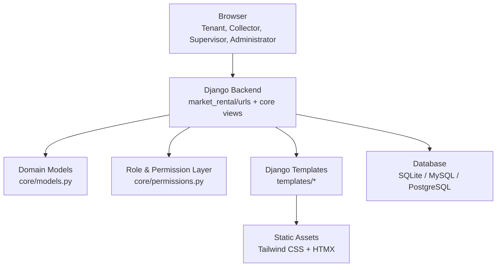
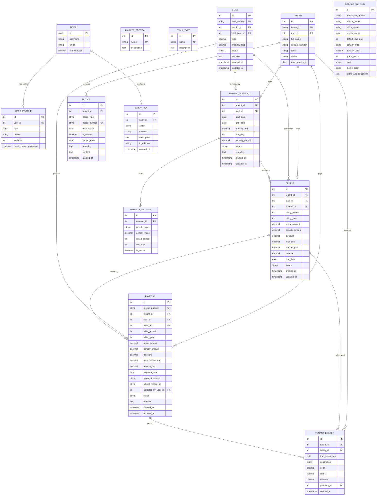
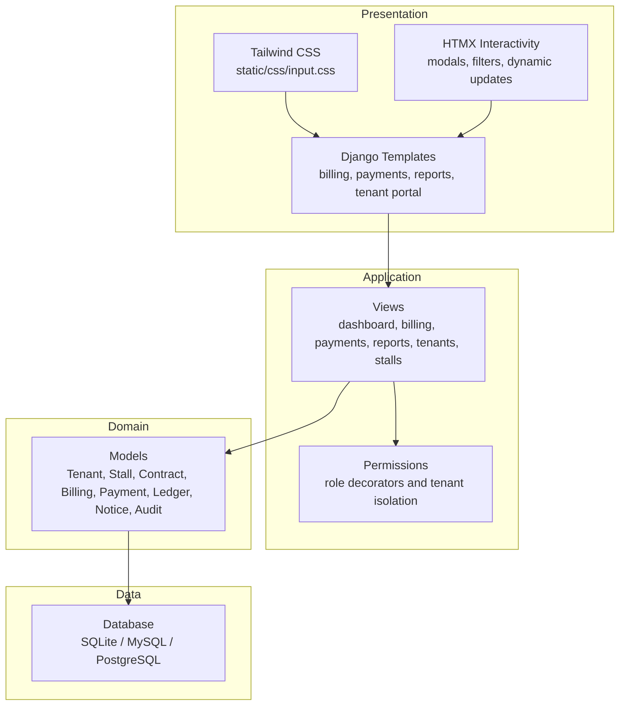
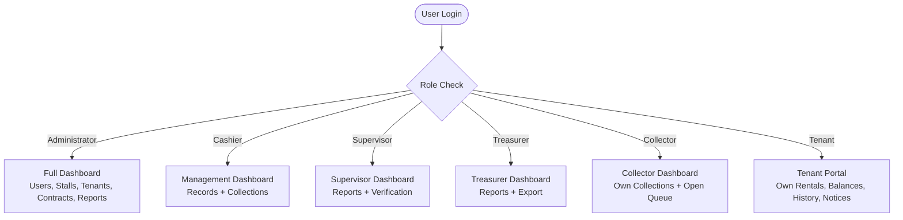
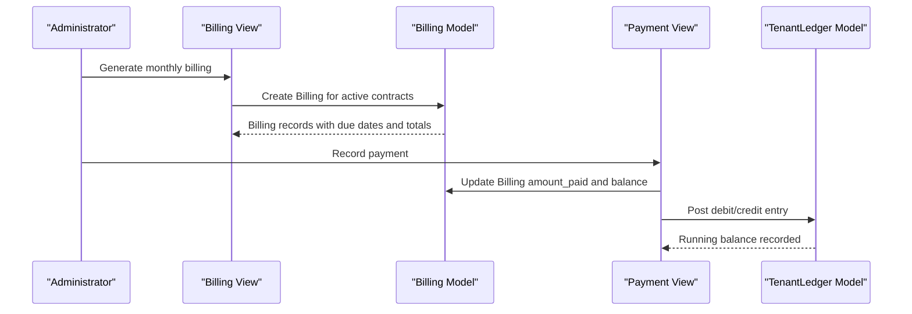
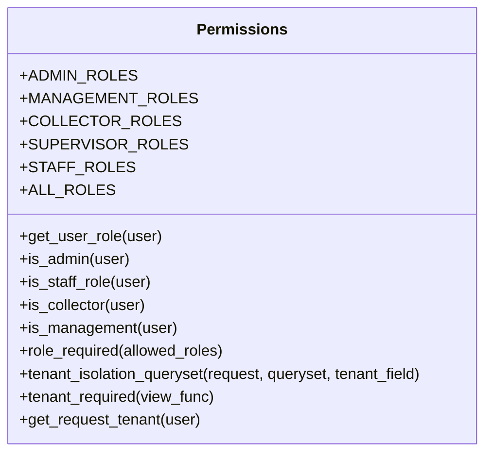
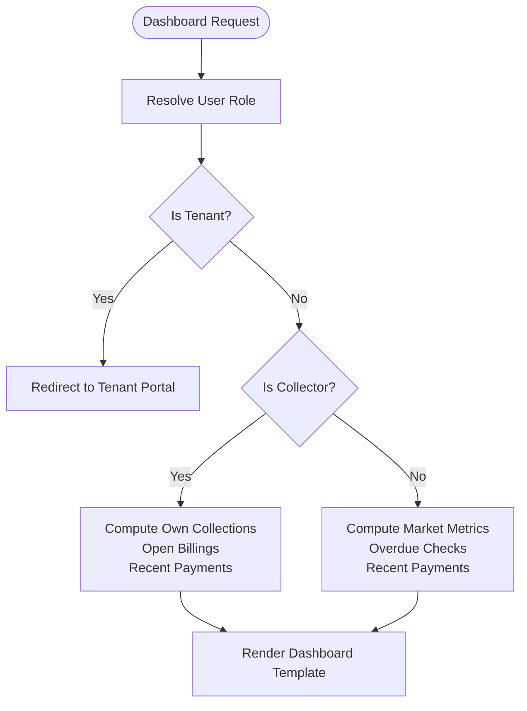
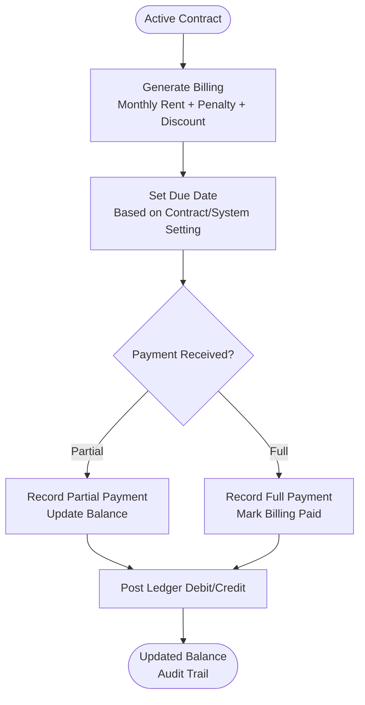
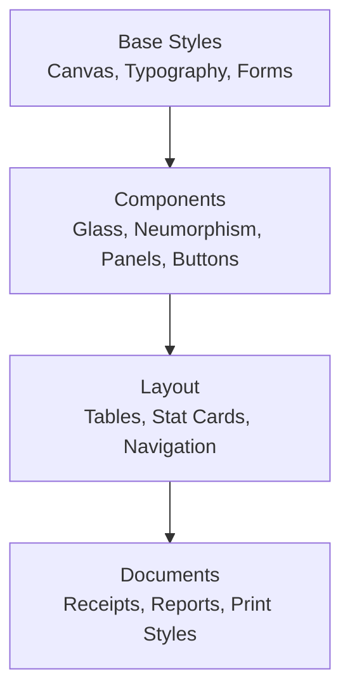
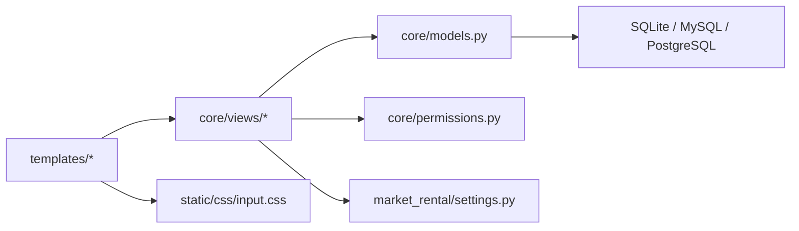

# Project Overview

<cite>
**Referenced Files in This Document**
- [README.MD](file://README.MD)
- [settings.py](file://market_rental/settings.py)
- [models.py](file://core/models.py)
- [permissions.py](file://core/permissions.py)
- [dashboard.py](file://core/views/dashboard.py)
- [input.css](file://static/css/input.css)
</cite>

## Table of Contents
1. [Introduction](#introduction)
2. [Project Structure](#project-structure)
3. [Core Components](#core-components)
4. [Architecture Overview](#architecture-overview)
5. [Detailed Component Analysis](#detailed-component-analysis)
6. [Dependency Analysis](#dependency-analysis)
7. [Performance Considerations](#performance-considerations)
8. [Troubleshooting Guide](#troubleshooting-guide)
9. [Conclusion](#conclusion)

## Introduction
The Market Rental System is a municipal public market rental and collection management solution. It centralizes stall assignments, tenant records, billing, payments, penalties, notices, reports, user roles, and audit trails into one Django-based web application. Its purpose is to digitize market operations, improve transparency, reduce manual collection work, and provide administrators, collectors, supervisors, and tenants with clear, role-appropriate access to market data.

Key objectives include:
- Digitizing market stall rentals and tenant administration.
- Automating monthly billing and penalty computation.
- Streamlining payment recording, receipt generation, and balance updates.
- Providing transparent dashboards, reports, and audit logs for accountability.
- Supporting both development convenience and production-grade deployment.

Target audience:
- Administrators: full system control, user and settings management, reporting, and oversight.
- Market Collectors: focused workspace for recording collections and viewing assigned or open accounts.
- Supervisors and Treasurers: monitoring unpaid rentals, verifying payments, and exporting reports.
- Tenants: self-service portal to view rental information, balances, due dates, notices, and payment history.

Why this system was built:
Municipal markets traditionally rely on paper-based processes that are slow, error-prone, and difficult to audit. This system replaces those workflows with a structured digital process that enforces business rules such as one active tenant per stall, automatic overdue marking, penalty computation, and immutable audit trails. The result is faster collections, clearer visibility into revenue, and stronger compliance.

**Section sources**
- [README.MD:1-21](file://README.MMD#L1-L21)
- [README.MD:23-59](file://README.MD#L23-L59)
- [README.MD:411-422](file://README.MD#L411-L422)

## Project Structure
At a high level, the project follows a standard Django layout:
- `market_rental/` contains Django project configuration, including settings, URLs, and WSGI/ASGI entry points.
- `core/` holds the main application models, permissions, views, forms, templates, management commands, and tests.
- `accounts/` provides additional account-related functionality.
- `templates/` organizes UI templates by feature area such as billing, contracts, payments, reports, stalls, tenants, users, notices, ledger, and tenant portal.
- `static/` contains local CSS and JavaScript assets, including Tailwind CSS input styles.
- `api/`, `backups/`, and documentation files support integration, maintenance, and design guidance.

**Diagram sources**
- [settings.py:28-51](file://market_rental/settings.py#L28-L51)
- [models.py:7-336](file://core/models.py#L7-L336)
- [permissions.py:1-125](file://core/permissions.py#L1-L125)
- [input.css:1-10](file://static/css/input.css#L1-L10)

**Section sources**
- [settings.py:28-51](file://market_rental/settings.py#L28-L51)
- [README.MD:478-515](file://README.MD#L478-L515)

## Core Components
The system’s core revolves around domain entities that represent real-world market objects and their relationships:

- User and Profile:
  - `UserProfile` extends Django’s `User` with role metadata such as admin, collector, cashier, supervisor, treasurer, and tenant.
  - Roles drive access control and dashboard routing.

- Market Infrastructure:
  - `MarketSection` and `StallType` classify market areas and stall categories.
  - `Stall` tracks stall number, section, type, size, monthly rate, status, and remarks.

- Tenant and Contract Lifecycle:
  - `Tenant` stores personal, contact, identification, business, and status details.
  - `RentalContract` links a tenant to a stall with start/end dates, monthly rent, due day, security deposit, and contract status.
  - A database constraint ensures only one active contract per stall.

- Billing and Payments:
  - `Billing` represents monthly collectibles derived from active contracts, including rental amount, penalty, discount, total due, amount paid, balance, due date, and status.
  - `Payment` records actual collections with receipt numbers, payment method, official receipt number, collector, and status.
  - `TenantLedger` maintains running debit/credit entries tied to billings and payments.

- Notices, Settings, Penalties, and Audit:
  - `Notice` supports payment reminders, overdue notices, final demands, and vacancy notices.
  - `SystemSetting` centralizes municipality/market branding, receipt prefix, default due day, penalty configuration, logo, theme color, and contract terms.
  - `PenaltySetting` allows per-contract penalty type, value, grace period, due day, and activation state.
  - `AuditLog` records user actions, modules, descriptions, timestamps, and optional IP addresses.

This model set directly implements the documented requirements for tenants, stalls, contracts, billing, payments, ledgers, notices, settings, penalties, and audit trails.

**Diagram sources**
- [models.py:7-336](file://core/models.py#L7-L336)

**Section sources**
- [models.py:7-336](file://core/models.py#L7-L336)
- [README.MD:378-393](file://README.MD#L378-L393)

## Architecture Overview
The Market Rental System uses a layered architecture:
- Presentation layer: Django templates styled with Tailwind CSS and enhanced with HTMX interactivity.
- Application layer: Django views and helpers implement business logic for dashboards, billing, payments, reports, and tenant portals.
- Domain layer: Django models define market entities and enforce constraints such as unique active contracts per stall and unique billing per tenant-stall-month-year.
- Data layer: SQLite for development, with MySQL or PostgreSQL supported through environment-driven configuration.

**Diagram sources**
- [settings.py:28-69](file://market_rental/settings.py#L28-L69)
- [input.css:1-10](file://static/css/input.css#L1-L10)
- [permissions.py:61-87](file://core/permissions.py#L61-L87)
- [models.py:157-277](file://core/models.py#L157-L277)

### User Role Hierarchy
Roles determine what users can see and do:
- Administrator: full access across all modules.
- Cashier: administrative staff capable of managing records and collecting payments.
- Supervisor/Treasurer: supervisory access to reports, verification, and export functions.
- Market Collector: limited to recording collections and viewing relevant queues; excluded from billing generation and broader administration.
- Tenant: self-service portal scoped to their own tenant record.

**Diagram sources**
- [permissions.py:6-30](file://core/permissions.py#L6-L30)
- [permissions.py:41-87](file://core/permissions.py#L41-L87)
- [dashboard.py:41-60](file://core/views/dashboard.py#L41-L60)

**Section sources**
- [permissions.py:6-30](file://core/permissions.py#L6-L30)
- [permissions.py:41-87](file://core/permissions.py#L41-L87)
- [dashboard.py:41-60](file://core/views/dashboard.py#L41-L60)

### Key Business Workflows
- Monthly Billing Generation:
  - Active contracts produce billings for each billing month/year.
  - Billing includes rental amount, penalty, discount, total due, and computed balance.
  - Unique constraints prevent duplicate billing for the same tenant, stall, month, and year.

- Payment Recording:
  - Payments reference a billing, tenant, stall, and collector.
  - Full payment marks billing as Paid; partial payment updates balance.
  - Receipt numbers and official receipt numbers ensure traceability.

- Overdue and Penalty Handling:
  - Overdue status is applied after due dates based on settings.
  - Penalty settings allow fixed or percentage-based penalties with grace periods.
  - Dashboard and collector views may trigger overdue penalty checks.

- Tenant Isolation:
  - Tenant users see only their own data via permission helpers.
  - Collector users see only their own collections and open queues.

**Diagram sources**
- [models.py:190-277](file://core/models.py#L190-L277)
- [dashboard.py:96-101](file://core/views/dashboard.py#L96-L101)

**Section sources**
- [models.py:157-277](file://core/models.py#L157-L277)
- [dashboard.py:96-101](file://core/views/dashboard.py#L96-L101)

## Detailed Component Analysis

### Technology Stack
- Backend: Django with function/class-based views, authentication, middleware, and context processors.
- Frontend: Django templates with Tailwind CSS 4 and HTMX for dynamic interactions.
- Styling: Local Tailwind build with an “Emerald Glass” design system, neumorphic components, and print-ready receipts/reports.
- Database: SQLite by default for zero-config development; MySQL via XAMPP or managed services; PostgreSQL supported through `DATABASE_URL`.
- Deployment: Environment-driven secrets, static file compression, CSRF and session security, and Vercel-friendly host configuration.

**Section sources**
- [settings.py:1-20](file://market_rental/settings.py#L1-L20)
- [settings.py:28-69](file://market_rental/settings.py#L28-L69)
- [settings.py:109-152](file://market_rental/settings.py#L109-L152)
- [settings.py:166-199](file://market_rental/settings.py#L166-L199)
- [input.css:1-10](file://static/css/input.css#L1-L10)
- [input.css:19-84](file://static/css/input.css#L19-L84)

### Role-Based Access Control
The permission layer defines canonical role groups and decorators:
- `ADMIN_ROLES`, `MANAGEMENT_ROLES`, `COLLECTOR_ROLES`, `SUPERVISOR_ROLES`, `STAFF_ROLES`, `ALL_ROLES`.
- Helper functions like `is_admin`, `is_staff_role`, `is_collector`, `is_management`.
- Decorators such as `admin_required`, `management_required`, `staff_required`, `collector_required`, `supervisor_required`.
- Tenant isolation utilities restrict non-admin users to their own tenant data.

**Diagram sources**
- [permissions.py:6-30](file://core/permissions.py#L6-L30)
- [permissions.py:32-87](file://core/permissions.py#L32-L87)
- [permissions.py:89-125](file://core/permissions.py#L89-L125)

**Section sources**
- [permissions.py:6-30](file://core/permissions.py#L6-L30)
- [permissions.py:32-87](file://core/permissions.py#L32-L87)
- [permissions.py:89-125](file://core/permissions.py#L89-L125)

### Dashboard and Collector Workspace
The dashboard routes users based on role:
- Tenants are redirected to the tenant portal unless they are superusers.
- Collectors receive a focused dashboard showing their own collections, today’s and monthly totals, receipts issued, open billings, and recent payments.
- Staff dashboards compute market-wide metrics such as stalls, tenants, collectibles, collected amounts, unpaid balances, overdue accounts, and collection percentages.
- Overdue penalty application is attempted best-effort during dashboard rendering.

**Diagram sources**
- [dashboard.py:12-38](file://core/views/dashboard.py#L12-L38)
- [dashboard.py:41-60](file://core/views/dashboard.py#L41-L60)
- [dashboard.py:96-164](file://core/views/dashboard.py#L96-L164)

**Section sources**
- [dashboard.py:12-38](file://core/views/dashboard.py#L12-L38)
- [dashboard.py:41-60](file://core/views/dashboard.py#L41-L60)
- [dashboard.py:96-164](file://core/views/dashboard.py#L96-L164)

### Billing, Payments, and Ledgers
- Billing:
  - Represents monthly obligations for active contracts.
  - Enforces uniqueness per tenant, stall, billing month, and billing year.
  - Tracks rental amount, penalty, discount, total due, amount paid, balance, due date, and status.

- Payments:
  - Records actual collections with receipt numbers, payment methods, official receipt numbers, and collectors.
  - Supports statuses such as Paid, Partial, Void, Cancelled.

- Ledgers:
  - Maintain running balances per tenant, linking transactions to billings and payments.

**Diagram sources**
- [models.py:157-187](file://core/models.py#L157-L187)
- [models.py:190-277](file://core/models.py#L190-L277)

**Section sources**
- [models.py:157-187](file://core/models.py#L157-L187)
- [models.py:190-277](file://core/models.py#L190-L277)

### Design System and UI
The frontend uses Tailwind CSS 4 with a custom “Emerald Glass” design system:
- Color palette: municipal emerald primary, Philippine gold accent, warm ivory canvas, deep ink text.
- Visual language: liquid glass surfaces, neumorphic shadows, panels, stat cards, badges, chips, alerts, navigation, tables, and printable documents.
- Print-ready receipts and reports with structured headers, tables, totals, and signature lines.

**Diagram sources**
- [input.css:19-84](file://static/css/input.css#L19-L84)
- [input.css:86-197](file://static/css/input.css#L86-L197)
- [input.css:202-747](file://static/css/input.css#L202-L747)
- [input.css:749-800](file://static/css/input.css#L749-L800)

**Section sources**
- [input.css:19-84](file://static/css/input.css#L19-L84)
- [input.css:86-197](file://static/css/input.css#L86-L197)
- [input.css:202-747](file://static/css/input.css#L202-L747)
- [input.css:749-800](file://static/css/input.css#L749-L800)

## Dependency Analysis
High-level dependencies:
- Views depend on models for data access and on permissions for authorization.
- Dashboard logic aggregates stalls, tenants, contracts, billings, and payments.
- Settings configure database engines, static files, middleware, and security.
- Templates consume context variables provided by views and use Tailwind classes defined in the CSS input file.

**Diagram sources**
- [dashboard.py:1-10](file://core/views/dashboard.py#L1-L10)
- [settings.py:28-69](file://market_rental/settings.py#L28-L69)
- [input.css:1-10](file://static/css/input.css#L1-L10)

**Section sources**
- [dashboard.py:1-10](file://core/views/dashboard.py#L1-L10)
- [settings.py:28-69](file://market_rental/settings.py#L28-L69)
- [input.css:1-10](file://static/css/input.css#L1-L10)

## Performance Considerations
- Use efficient queries with `select_related` and aggregation where possible, as seen in dashboard calculations.
- Avoid heavy computations on every request; apply overdue penalties best-effort and consider background tasks for large datasets.
- Leverage database indexes on frequently filtered fields such as billing month/year, payment date, and status.
- Compress and cache static assets in production using WhiteNoise and manifest storage.
- Keep tenant-scoped queries narrow to minimize overhead for tenant portal users.

[No sources needed since this section provides general guidance]

## Troubleshooting Guide
Common issues and resolutions:
- Database connection errors:
  - Verify `DATABASE_URL` for hosted databases or `.env` variables for local MySQL/MariaDB.
  - Ensure the database exists when using MySQL locally; the settings attempt to create it if missing.

- Static files not loading:
  - Run `collectstatic` in production to generate hashed filenames.
  - Confirm `STATIC_URL` and `STATIC_ROOT` paths and WhiteNoise middleware.

- Permission denied errors:
  - Check user role and decorator usage in views.
  - Ensure tenant isolation helpers are applied where tenant-only data is accessed.

- Overdue penalties not applying:
  - Review `maybe_apply_overdue_penalties` invocation and exception handling in dashboard views.
  - Validate penalty settings and due dates in contracts and system settings.

**Section sources**
- [settings.py:73-152](file://market_rental/settings.py#L73-L152)
- [settings.py:166-199](file://market_rental/settings.py#L166-L199)
- [dashboard.py:55-60](file://core/views/dashboard.py#L55-L60)
- [dashboard.py:96-101](file://core/views/dashboard.py#L96-L101)

## Conclusion
The Market Rental System provides a comprehensive, role-aware platform for municipal public market administration. By digitizing stall assignments, tenant records, billing, payments, penalties, notices, reports, and audit trails, it improves transparency, streamlines collections, and strengthens accountability. The Django backend, Tailwind CSS styling, HTMX interactivity, and flexible database options make it suitable for both development and production environments. With clear business rules, robust permissions, and a consistent design system, the system serves administrators, collectors, supervisors, treasurers, and tenants effectively.

[No sources needed since this section summarizes without analyzing specific files]