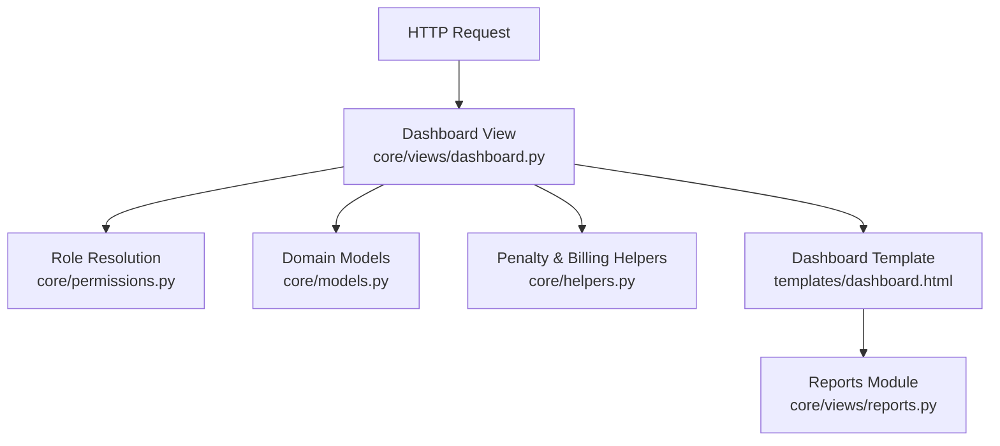
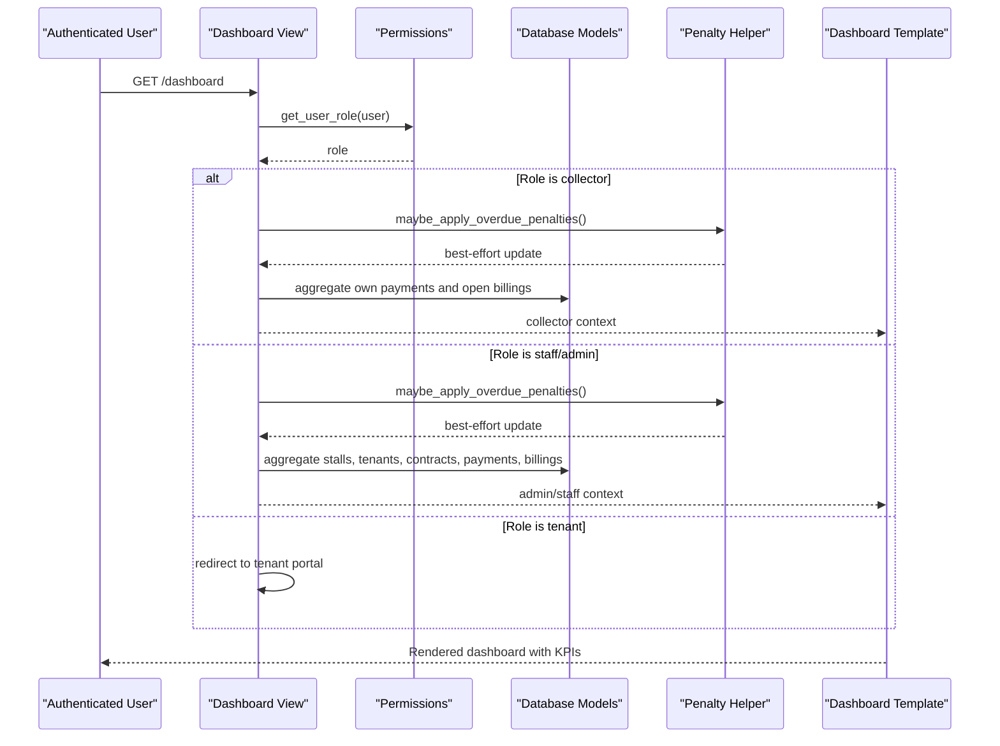
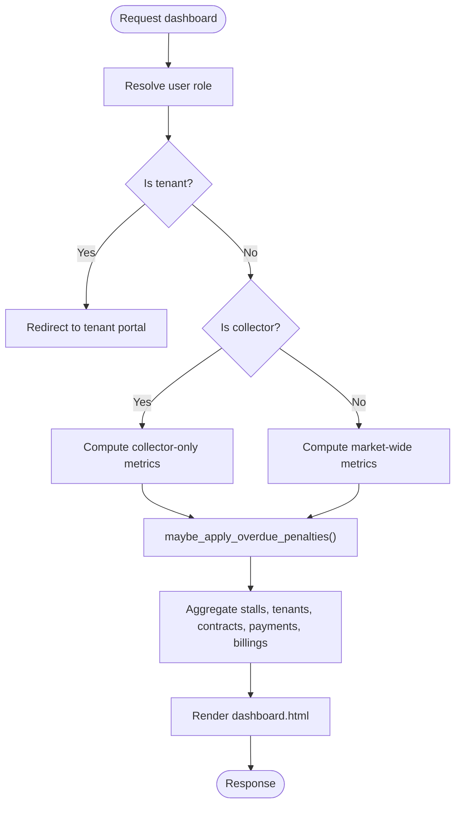
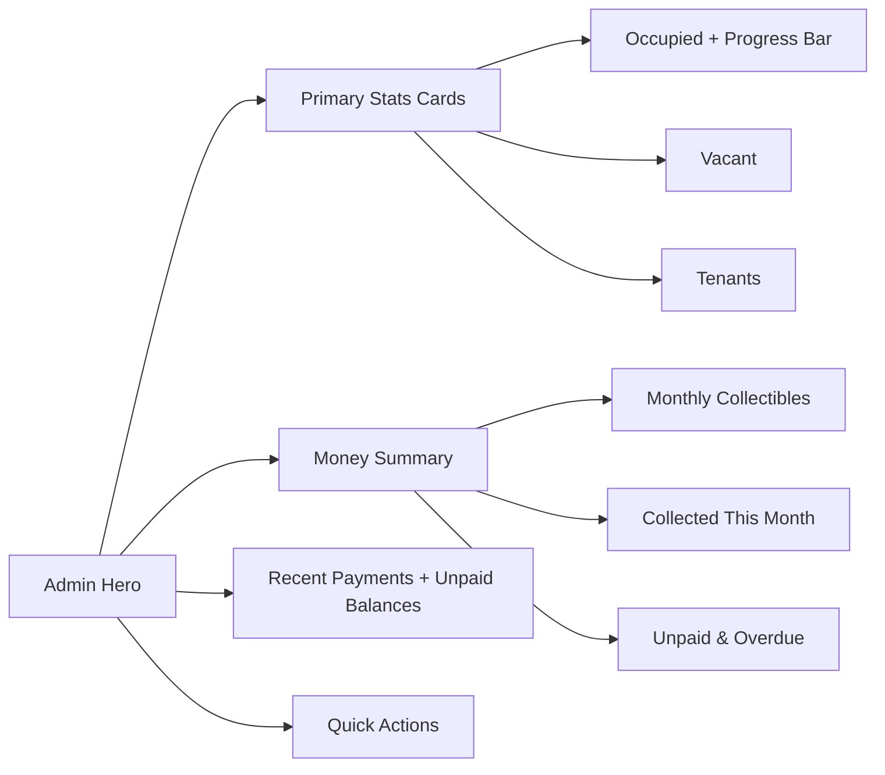
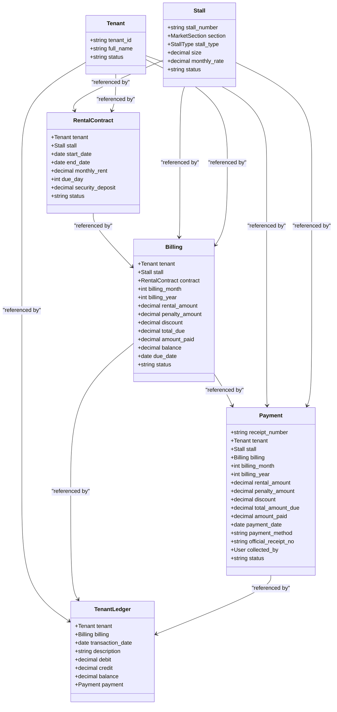
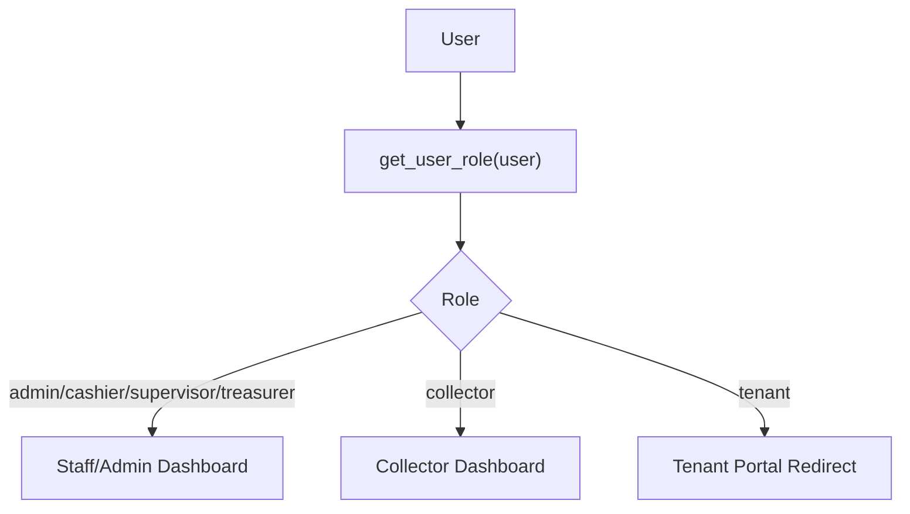
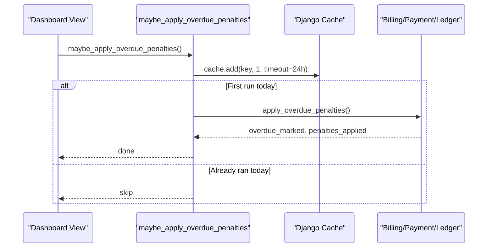
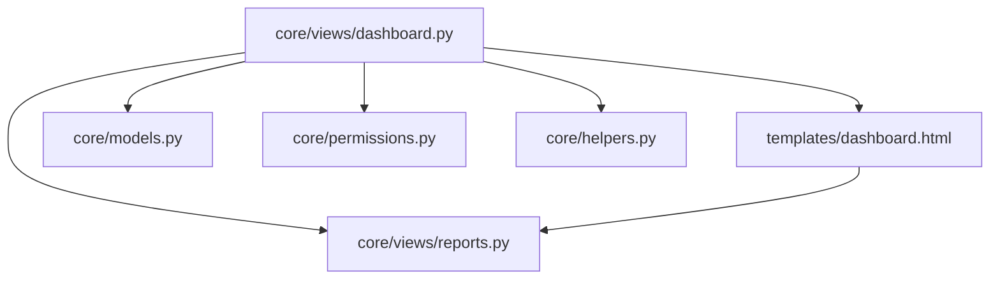

# Dashboard Analytics

<cite>
**Referenced Files in This Document**   
- [dashboard.py](file://core/views/dashboard.py)
- [dashboard.html](file://templates/dashboard.html)
- [models.py](file://core/models.py)
- [permissions.py](file://core/permissions.py)
- [helpers.py](file://core/helpers.py)
- [reports.py](file://core/views/reports.py)
</cite>

## Table of Contents
1. [Introduction](#introduction)
2. [Project Structure](#project-structure)
3. [Core Components](#core-components)
4. [Architecture Overview](#architecture-overview)
5. [Detailed Component Analysis](#detailed-component-analysis)
6. [Dependency Analysis](#dependency-analysis)
7. [Performance Considerations](#performance-considerations)
8. [Troubleshooting Guide](#troubleshooting-guide)
9. [Conclusion](#conclusion)

## Introduction
This document explains the dashboard analytics system that provides real-time operational visibility for a public market rental and collection workflow. It covers:

- Key performance indicators (KPIs): total stalls, occupancy rates, collection metrics, billing statistics, and collection rate calculations.
- Data aggregation logic for summary metrics.
- Real-time update behavior through request-time penalty accrual.
- Role-based dashboard views for administrators/staff, collectors, and tenants.
- Integration with billing, payments, ledger, reports, and tenant portal modules.
- Examples of custom metric calculations and time-period filtering.

The dashboard is not a live WebSocket stream; it renders current data on each request by aggregating database records at render time.

## Project Structure
The dashboard analytics feature spans view logic, templates, domain models, permissions, shared helpers, and related reporting views.

**Diagram sources**
- [dashboard.py:41-164](file://core/views/dashboard.py#L41-L164)
- [permissions.py:32-39](file://core/permissions.py#L32-L39)
- [models.py:93-258](file://core/models.py#L93-L258)
- [helpers.py:423-519](file://core/helpers.py#L423-L519)
- [dashboard.html:145-220](file://templates/dashboard.html#L145-L220)
- [reports.py:40-77](file://core/views/reports.py#L40-L77)

**Section sources**
- [dashboard.py:1-165](file://core/views/dashboard.py#L1-L165)
- [dashboard.html:1-331](file://templates/dashboard.html#L1-L331)
- [models.py:1-336](file://core/models.py#L1-L336)
- [permissions.py:1-125](file://core/permissions.py#L1-L125)
- [helpers.py:1-595](file://core/helpers.py#L1-L595)
- [reports.py:1-775](file://core/views/reports.py#L1-L775)

## Core Components
The dashboard analytics system is built around these core components:

- **Dashboard view**: Computes role-scoped KPIs and passes them to the template.
- **Template**: Renders KPI cards, progress bars, recent payments, unpaid balances, and quick actions.
- **Models**: Define stalls, tenants, contracts, billings, payments, and ledgers used for aggregation.
- **Permissions**: Resolve user roles and enforce access control.
- **Helpers**: Apply overdue penalties, create billings, record payments, and maintain ledger consistency.
- **Reports module**: Provides deeper analytical views and export capabilities that complement the dashboard.

Key KPIs displayed:

| KPI | Meaning | Calculation / Source |
|---|---|---|
| Total Stalls | Number of stall records | Count of `Stall` objects |
| Occupied Stalls | Stalls marked occupied | Count where `status='Occupied'` |
| Vacant Stalls | Stalls marked vacant | Count where `status='Vacant'` |
| Occupancy Rate | Percentage of occupied stalls | `(occupied_stalls / total_stalls) * 100`, shown via template width ratio |
| Total Tenants | Active tenant count | Count of `Tenant` with `status='Active'` |
| Monthly Collectibles | Sum of active contract monthly rents | Sum of `RentalContract.monthly_rent` for active contracts |
| Collected This Month | Sum of paid/partial payments this month | Sum of `Payment.amount_paid` filtered by current month/year |
| Collection Percentage | Share of collectibles collected | `(total_collected / total_monthly_collectibles) * 100` |
| Unpaid & Overdue Balance | Outstanding balance across unpaid/partial/overdue bills | Sum of `Billing.balance` for non-paid statuses |
| Overdue Accounts | Distinct tenants with overdue status | Distinct count of `Billing.tenant` where `status='Overdue'` |
| Recent Payments | Latest paid/partial payments | Ordered list limited to top entries |
| Tenants With Unpaid Balances | Top tenants by outstanding amount | Aggregated unpaid balances grouped by tenant |

**Section sources**
- [dashboard.py:102-163](file://core/views/dashboard.py#L102-L163)
- [dashboard.html:145-220](file://templates/dashboard.html#L145-L220)
- [models.py:93-258](file://core/models.py#L93-L258)

## Architecture Overview
The dashboard follows a request-driven architecture:

1. The authenticated user requests the dashboard.
2. The view resolves the user role.
3. Depending on the role, the view computes scoped metrics:
   - Staff/administrator: full market-wide metrics.
   - Collector: personal collections and open queue.
   - Tenant: redirected to tenant portal or isolated tenant view.
4. The view may trigger best-effort overdue penalty accrual to keep billing statuses current.
5. The template renders KPIs, tables, and links to related modules.

**Diagram sources**
- [dashboard.py:41-164](file://core/views/dashboard.py#L41-L164)
- [permissions.py:32-39](file://core/permissions.py#L32-L39)
- [helpers.py:503-519](file://core/helpers.py#L503-L519)

## Detailed Component Analysis

### Dashboard View Logic
The dashboard view centralizes KPI computation and role-based scoping.

- Role resolution uses `get_user_role`.
- Non-superuser tenants are redirected to the tenant portal.
- Collectors see only their own collections and open billings.
- Staff/admin users see market-wide metrics.
- Overdue penalties are applied best-effort before computing metrics.
- Metrics include stalls, tenants, collectibles, collected amounts, unpaid balances, overdue accounts, collection percentage, recent payments, and top unpaid tenants.

**Diagram sources**
- [dashboard.py:41-164](file://core/views/dashboard.py#L41-L164)
- [helpers.py:503-519](file://core/helpers.py#L503-L519)

**Section sources**
- [dashboard.py:12-60](file://core/views/dashboard.py#L12-L60)
- [dashboard.py:62-164](file://core/views/dashboard.py#L62-L164)

### Template Rendering and KPI Presentation
The template displays:

- Hero section with role badge and date.
- Primary stat cards:
  - Total Stalls with occupied/vacant breakdown.
  - Occupied with occupancy progress bar and percentage.
  - Vacant available for lease.
  - Tenants active count.
- Money summary:
  - Monthly Collectibles from active contracts.
  - Collected This Month with collection percentage and progress bar.
  - Unpaid & Overdue with overdue account count.
- Tables:
  - Recent Payments.
  - Unpaid Balances with top tenants by outstanding amount.
- Quick Actions linking to tenant, stall, billing generation, and reports.

For collectors, the template shows:

- Collector hero with collection queue and record payment actions.
- My collection figures: collected today, collected this month, receipts issued, open billings.
- My recent collections table.

**Diagram sources**
- [dashboard.html:117-220](file://templates/dashboard.html#L117-L220)
- [dashboard.html:222-327](file://templates/dashboard.html#L222-L327)

**Section sources**
- [dashboard.html:117-220](file://templates/dashboard.html#L117-L220)
- [dashboard.html:222-327](file://templates/dashboard.html#L222-L327)

### Data Models Used by the Dashboard
The dashboard aggregates data from several models:

- `Stall`: stall number, section, type, size, monthly rate, status.
- `Tenant`: tenant identity and status.
- `RentalContract`: active contracts and monthly rent.
- `Billing`: billing periods, due dates, amounts, balances, statuses.
- `Payment`: payments, amounts, methods, collectors, dates.
- `TenantLedger`: transaction history and running balances.

**Diagram sources**
- [models.py:93-258](file://core/models.py#L93-L258)

**Section sources**
- [models.py:93-258](file://core/models.py#L93-L258)

### Role-Based Access and Views
Roles determine what the dashboard shows:

- **Administrator/Cashier/Supervisor/Treasurer**: Full market-wide dashboard with all KPIs and quick actions.
- **Collector**: Limited workspace showing personal collections, receipts issued, open billings, and recent collections.
- **Tenant**: Redirected to tenant portal; if linked to a tenant, the dashboard can show isolated tenant metrics but typically redirects.

Access control utilities:

- `get_user_role`: returns profile role or fallback for superusers.
- `is_collector`, `is_management`, `role_required`: decorators and helpers for enforcing access.

**Diagram sources**
- [permissions.py:32-39](file://core/permissions.py#L32-L39)
- [permissions.py:49-59](file://core/permissions.py#L49-L59)
- [dashboard.py:47-60](file://core/views/dashboard.py#L47-L60)

**Section sources**
- [permissions.py:1-125](file://core/permissions.py#L1-L125)
- [dashboard.py:47-60](file://core/views/dashboard.py#L47-L60)

### Real-Time Updates and Penalty Accrual
Real-time updates are implemented as request-time best-effort operations:

- `maybe_apply_overdue_penalties` runs once per day per cache instance.
- It marks past-due billings as `Overdue` and applies one-time late penalties based on contract or system settings.
- It updates billing totals, balances, and tenant ledger entries.
- The dashboard calls this helper before rendering to ensure statuses reflect current conditions.

**Diagram sources**
- [helpers.py:503-519](file://core/helpers.py#L503-L519)
- [helpers.py:423-500](file://core/helpers.py#L423-L500)
- [dashboard.py:97-101](file://core/views/dashboard.py#L97-L101)

**Section sources**
- [helpers.py:423-519](file://core/helpers.py#L423-L519)
- [dashboard.py:97-101](file://core/views/dashboard.py#L97-L101)

### Custom Metric Calculations and Filtering Examples

#### Collection Rate Calculation
- Dashboard view calculates `collection_percentage` as `(total_collected / total_monthly_collectibles) * 100`.
- If collectibles are zero, percentage defaults to zero.
- Reports module also computes `collection_rate` as `(total_collected / total_billed) * 100` for monthly report dashboards.

Example paths:
- Dashboard calculation: [dashboard.py:132-137](file://core/views/dashboard.py#L132-L137)
- Report calculation: [reports.py:59](file://core/views/reports.py#L59)

#### Time Period Filtering
- Dashboard filters payments by current month and year using `payment_date__month` and `payment_date__year`.
- Reports provide flexible date range filtering via `date_from` and `date_to` query parameters.
- Daily/weekly/monthly/annual reports use consistent helpers to parse and validate date inputs.

Example paths:
- Dashboard monthly filter: [dashboard.py:112-119](file://core/views/dashboard.py#L112-L119)
- Report date helpers: [reports.py:18-37](file://core/views/reports.py#L18-L37)
- Daily report filter: [reports.py:81-103](file://core/views/reports.py#L81-L103)

#### Role-Based Scoping Examples
- Collector dashboard aggregates only payments collected by the current user.
- Staff dashboard aggregates market-wide payments and billings.
- Tenant portal isolates data to the logged-in tenant.

Example paths:
- Collector own payments: [dashboard.py:19-26](file://core/views/dashboard.py#L19-L26)
- Staff payments aggregation: [dashboard.py:112-119](file://core/views/dashboard.py#L112-L119)
- Tenant isolation helper: [permissions.py:89-99](file://core/permissions.py#L89-L99)

**Section sources**
- [dashboard.py:112-137](file://core/views/dashboard.py#L112-L137)
- [reports.py:18-37](file://core/views/reports.py#L18-L37)
- [reports.py:81-103](file://core/views/reports.py#L81-L103)
- [permissions.py:89-99](file://core/permissions.py#L89-L99)

## Dependency Analysis
The dashboard depends on multiple modules:

- **Views**: `dashboard.py` orchestrates KPI computation and rendering.
- **Templates**: `dashboard.html` presents KPIs and links to other modules.
- **Models**: `models.py` defines entities used for aggregation.
- **Permissions**: `permissions.py` enforces role-based access.
- **Helpers**: `helpers.py` provides billing and penalty logic.
- **Reports**: `reports.py` offers complementary analytics and exports.

**Diagram sources**
- [dashboard.py:1-165](file://core/views/dashboard.py#L1-L165)
- [dashboard.html:1-331](file://templates/dashboard.html#L1-L331)
- [models.py:1-336](file://core/models.py#L1-L336)
- [permissions.py:1-125](file://core/permissions.py#L1-L125)
- [helpers.py:1-595](file://core/helpers.py#L1-L595)
- [reports.py:1-775](file://core/views/reports.py#L1-L775)

**Section sources**
- [dashboard.py:1-165](file://core/views/dashboard.py#L1-L165)
- [dashboard.html:1-331](file://templates/dashboard.html#L1-L331)
- [models.py:1-336](file://core/models.py#L1-L336)
- [permissions.py:1-125](file://core/permissions.py#L1-L125)
- [helpers.py:1-595](file://core/helpers.py#L1-L595)
- [reports.py:1-775](file://core/views/reports.py#L1-L775)

## Performance Considerations
- Aggregation queries use Django ORM `Sum`, `Count`, and `select_related` to minimize N+1 queries.
- Overdue penalty application is throttled to once per day per cache instance to avoid repeated heavy computations.
- Recent lists are limited to small fixed sizes (e.g., top 5 or 8 items).
- Financial calculations use `Decimal` to prevent floating-point drift.
- For large datasets, consider adding database indexes on frequently filtered fields such as `payment_date`, `billing_month`, `billing_year`, `status`, and `collected_by`.

[No sources needed since this section provides general guidance]

## Troubleshooting Guide
Common issues and resolutions:

- **Incorrect collection percentage**: Ensure `total_monthly_collectibles` is computed from active contracts and `total_collected` filters by current month/year.
- **Missing overdue accounts**: Verify `maybe_apply_overdue_penalties` runs successfully and cache key is not stale.
- **Collector sees market-wide data**: Confirm role resolution returns `collector` and that the collector path does not compute market-wide metrics.
- **Tenant redirected unexpectedly**: Check tenant role and whether the user has a linked `Tenant` record.
- **PDF export unavailable**: Install required dependencies (e.g., WeasyPrint or xhtml2pdf) or use browser Print-to-PDF fallback.

**Section sources**
- [dashboard.py:47-60](file://core/views/dashboard.py#L47-L60)
- [helpers.py:503-519](file://core/helpers.py#L503-L519)
- [helpers.py:522-594](file://core/helpers.py#L522-L594)

## Conclusion
The dashboard analytics system delivers actionable, real-time insights into market operations by aggregating stalls, tenants, contracts, billings, and payments at request time. It supports role-based views for administrators, collectors, and tenants, integrates with billing and reporting modules, and maintains financial accuracy through careful Decimal arithmetic and ledger reconciliation. Operators can rely on the displayed KPIs—total stalls, occupancy rates, collection metrics, billing statistics, and collection rates—to monitor performance, identify overdue accounts, and drive operational decisions.

[No sources needed since this section summarizes without analyzing specific files]