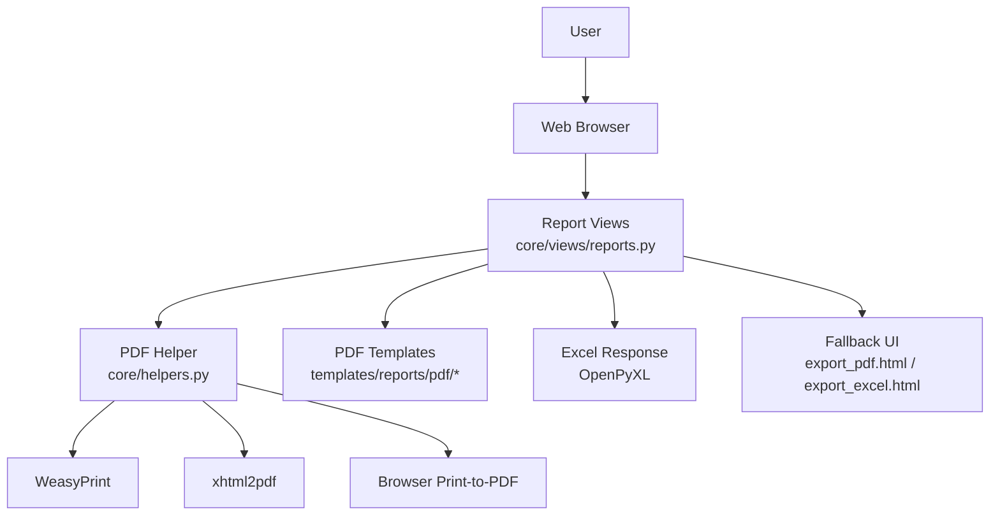
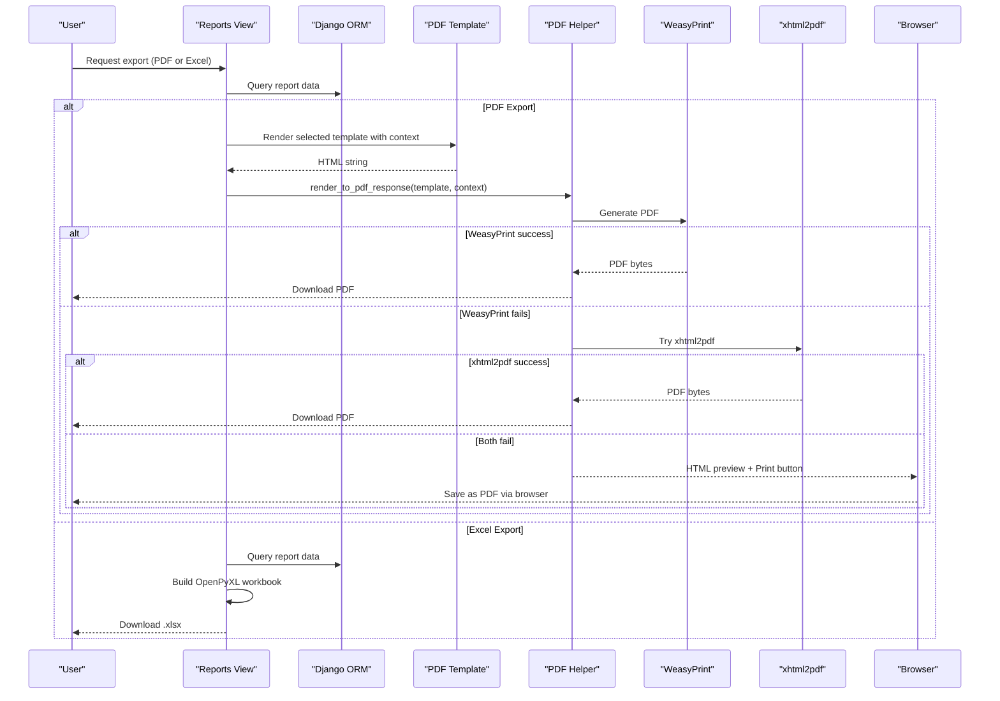
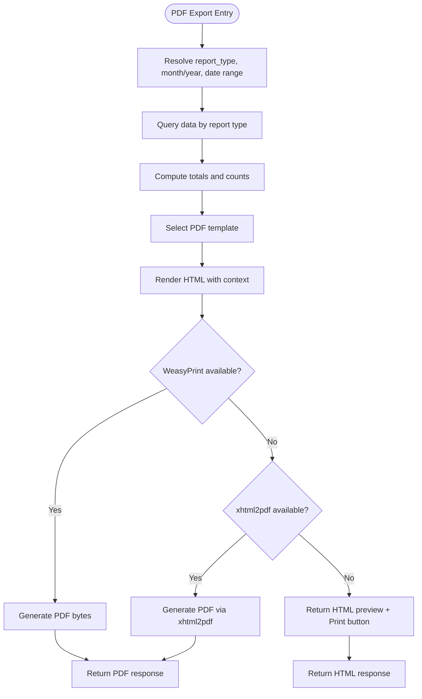
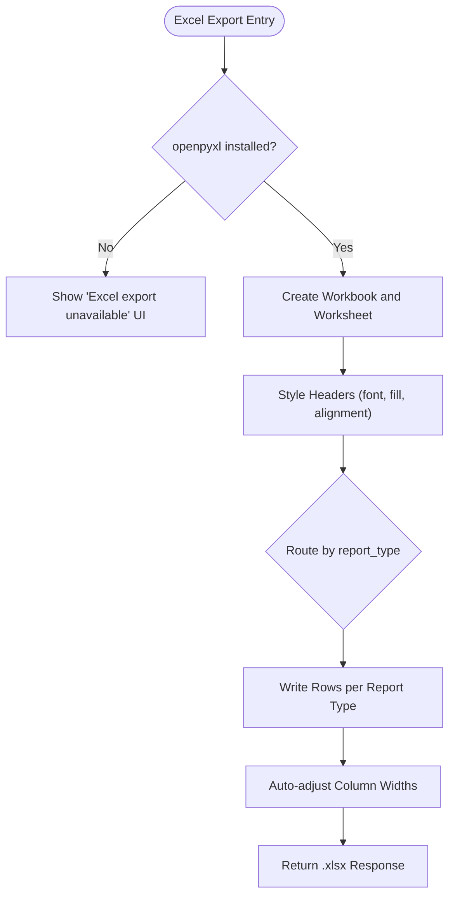
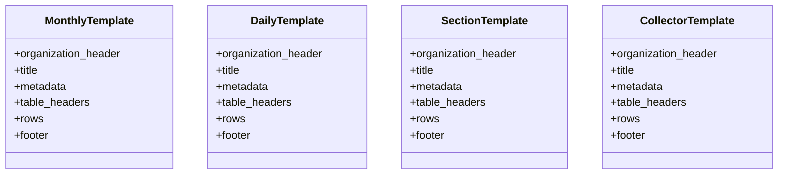
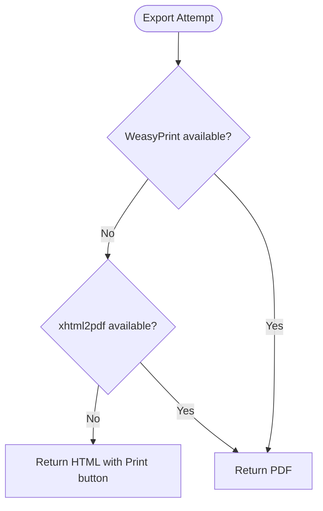
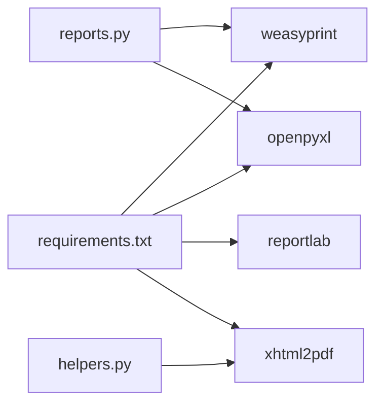

# Export Formats & Distribution

<cite>
**Referenced Files in This Document**   
- [core/views/reports.py](file://core/views/reports.py)
- [core/helpers.py](file://core/helpers.py)
- [templates/reports/export_pdf.html](file://templates/reports/export_pdf.html)
- [templates/reports/export_excel.html](file://templates/reports/export_excel.html)
- [templates/reports/pdf/monthly.html](file://templates/reports/pdf/monthly.html)
- [templates/reports/pdf/daily.html](file://templates/reports/pdf/daily.html)
- [templates/reports/pdf/section.html](file://templates/reports/pdf/section.html)
- [templates/reports/pdf/collector.html](file://templates/reports/pdf/collector.html)
- [requirements.txt](file://requirements.txt)
</cite>

## Table of Contents
1. [Introduction](#introduction)
2. [Project Structure](#project-structure)
3. [Core Components](#core-components)
4. [Architecture Overview](#architecture-overview)
5. [Detailed Component Analysis](#detailed-component-analysis)
6. [Dependency Analysis](#dependency-analysis)
7. [Performance Considerations](#performance-considerations)
8. [Troubleshooting Guide](#troubleshooting-guide)
9. [Conclusion](#conclusion)

## Introduction
This document explains the export and distribution capabilities for reports in the market rental system. It covers:
- PDF generation using WeasyPrint with fallbacks to xhtml2pdf and browser print-to-PDF.
- Excel spreadsheet creation using OpenPyXL.
- Print-friendly layouts for professional-looking output.
- The template system used for PDF rendering.
- Data structuring across report types.
- Fallback mechanisms when dependencies are unavailable.
- Troubleshooting guidance and performance considerations for large datasets.

The export functionality is primarily implemented in the reports view layer, with a shared helper for robust PDF rendering and dedicated HTML templates for each report type.

## Project Structure
Export-related code is organized around:
- Report views that compute data and route to format-specific exporters.
- A shared PDF helper that encapsulates WeasyPrint and fallback logic.
- Dedicated PDF templates under `templates/reports/pdf`.
- Fallback UI templates for missing dependencies.
- Spreadsheet export logic directly in the report views.

**Diagram sources**
- [core/views/reports.py:452-563](file://core/views/reports.py#L452-L563)
- [core/helpers.py:522-594](file://core/helpers.py#L522-L594)
- [templates/reports/export_pdf.html:1-34](file://templates/reports/export_pdf.html#L1-L34)
- [templates/reports/export_excel.html:1-34](file://templates/reports/export_excel.html#L1-L34)

**Section sources**
- [core/views/reports.py:452-774](file://core/views/reports.py#L452-L774)
- [core/helpers.py:522-594](file://core/helpers.py#L522-L594)
- [templates/reports/export_pdf.html:1-34](file://templates/reports/export_pdf.html#L1-L34)
- [templates/reports/export_excel.html:1-34](file://templates/reports/export_excel.html#L1-L34)

## Core Components
- Report export endpoints:
  - PDF export endpoint routes requests by report type, renders a PDF template, and returns a downloadable PDF.
  - Excel export endpoint builds an OpenPyXL workbook, styles headers, writes rows per report type, auto-adjusts column widths, and returns an `.xlsx` file.
- Shared PDF helper:
  - Renders a template to HTML string.
  - Attempts WeasyPrint first; falls back to xhtml2pdf if available; finally returns an HTML preview with a print button.
- PDF templates:
  - Professional layout with consistent typography, color accents, table styling, and page settings.
  - Each report type has a focused template (monthly, daily, section, collector).
- Fallback UI:
  - Clear messages guiding users to install dependencies or use browser printing.

Key responsibilities:
- Data preparation: Query models like Billing, Payment, TenantLedger, Stall, MarketSection, UserProfile.
- Template selection: Choose the correct PDF template based on report type.
- Output formatting: Apply CSS for PDFs and OpenPyXL styles for spreadsheets.
- Error handling: Provide user-friendly fallbacks when libraries are missing.

**Section sources**
- [core/views/reports.py:452-774](file://core/views/reports.py#L452-L774)
- [core/helpers.py:522-594](file://core/helpers.py#L522-L594)
- [templates/reports/pdf/monthly.html:1-51](file://templates/reports/pdf/monthly.html#L1-L51)
- [templates/reports/pdf/daily.html:1-47](file://templates/reports/pdf/daily.html#L1-L47)
- [templates/reports/pdf/section.html:1-47](file://templates/reports/pdf/section.html#L1-L47)
- [templates/reports/pdf/collector.html:1-44](file://templates/reports/pdf/collector.html#L1-L44)

## Architecture Overview
The export pipeline follows a clear sequence:
1. User triggers export from a report page.
2. View resolves parameters (report type, date range, month/year).
3. View queries data from the database using Django ORM.
4. For PDF:
   - View selects the appropriate PDF template and context.
   - View renders HTML and passes it to WeasyPrint.
   - If WeasyPrint fails, helper tries xhtml2pdf.
   - If both fail, helper returns HTML with a print prompt.
5. For Excel:
   - View creates a workbook, sets headers, writes rows, adjusts columns, and returns the file.

**Diagram sources**
- [core/views/reports.py:452-563](file://core/views/reports.py#L452-L563)
- [core/views/reports.py:567-774](file://core/views/reports.py#L567-L774)
- [core/helpers.py:522-594](file://core/helpers.py#L522-L594)

## Detailed Component Analysis

### PDF Export Pipeline
The PDF export endpoint supports multiple report types:
- Monthly collection
- Daily/weekly/annual collections
- Section summary
- Collector summary
- Paid/unpaid/overdue tenants
- Occupancy/vacant stalls
- Ledger entries

For each type, the view:
- Resolves filters (month/year, date range, tenant).
- Queries related models efficiently with select_related.
- Computes aggregates (totals, counts).
- Selects the corresponding PDF template.
- Renders HTML and generates PDF via WeasyPrint.

**Diagram sources**
- [core/views/reports.py:452-563](file://core/views/reports.py#L452-L563)
- [core/helpers.py:522-594](file://core/helpers.py#L522-L594)

**Section sources**
- [core/views/reports.py:452-563](file://core/views/reports.py#L452-L563)
- [core/helpers.py:522-594](file://core/helpers.py#L522-L594)

### Excel Export Pipeline
The Excel export endpoint uses OpenPyXL to build spreadsheets:
- Creates a workbook and active worksheet.
- Styles headers with bold font, background fill, and centered alignment.
- Writes rows per report type with appropriate fields.
- Auto-adjusts column widths based on content length.
- Returns an `.xlsx` file with a descriptive filename.

Supported report types include monthly, daily/weekly, annual, section, collector, paid/unpaid/overdue, occupancy/vacant, and ledger.

**Diagram sources**
- [core/views/reports.py:567-774](file://core/views/reports.py#L567-L774)

**Section sources**
- [core/views/reports.py:567-774](file://core/views/reports.py#L567-L774)

### PDF Template System and Styling
PDF templates provide a consistent, professional look:
- Organization header using system settings.
- Title and metadata line with generated timestamp.
- Styled tables with colored headers and borders.
- Right-aligned numeric columns.
- Footer with system branding.
- Page size and margins configured for A4 portrait or landscape.

Examples:
- Monthly template includes billing details and totals.
- Daily template shows receipts, amounts, and collectors.
- Section template summarizes stalls, occupancy, and financials.
- Collector template lists transactions and percentages.

**Diagram sources**
- [templates/reports/pdf/monthly.html:1-51](file://templates/reports/pdf/monthly.html#L1-L51)
- [templates/reports/pdf/daily.html:1-47](file://templates/reports/pdf/daily.html#L1-L47)
- [templates/reports/pdf/section.html:1-47](file://templates/reports/pdf/section.html#L1-L47)
- [templates/reports/pdf/collector.html:1-44](file://templates/reports/pdf/collector.html#L1-L44)

**Section sources**
- [templates/reports/pdf/monthly.html:1-51](file://templates/reports/pdf/monthly.html#L1-L51)
- [templates/reports/pdf/daily.html:1-47](file://templates/reports/pdf/daily.html#L1-L47)
- [templates/reports/pdf/section.html:1-47](file://templates/reports/pdf/section.html#L1-L47)
- [templates/reports/pdf/collector.html:1-44](file://templates/reports/pdf/collector.html#L1-L44)

### Fallback Mechanisms
When dependencies are unavailable:
- PDF export:
  - If WeasyPrint is missing or fails, helper attempts xhtml2pdf.
  - If both fail, returns HTML with a warning and a print button.
- Excel export:
  - If openpyxl is missing, shows a user-friendly message directing installation.

Fallback UI templates guide users to install dependencies or use browser printing.

**Diagram sources**
- [core/helpers.py:522-594](file://core/helpers.py#L522-L594)
- [templates/reports/export_pdf.html:1-34](file://templates/reports/export_pdf.html#L1-L34)
- [templates/reports/export_excel.html:1-34](file://templates/reports/export_excel.html#L1-L34)

**Section sources**
- [core/helpers.py:522-594](file://core/helpers.py#L522-L594)
- [templates/reports/export_pdf.html:1-34](file://templates/reports/export_pdf.html#L1-L34)
- [templates/reports/export_excel.html:1-34](file://templates/reports/export_excel.html#L1-L34)

## Dependency Analysis
External dependencies:
- weasyprint: Preferred PDF renderer with best CSS fidelity.
- xhtml2pdf: Fallback PDF renderer for environments without GTK.
- openpyxl: Excel workbook creation and styling.
- reportlab and xhtml2pdf also listed in requirements but not actively used in current export paths.

**Diagram sources**
- [requirements.txt:1-9](file://requirements.txt#L1-L9)
- [core/views/reports.py:452-774](file://core/views/reports.py#L452-L774)
- [core/helpers.py:522-594](file://core/helpers.py#L522-L594)

**Section sources**
- [requirements.txt:1-9](file://requirements.txt#L1-L9)
- [core/views/reports.py:452-774](file://core/views/reports.py#L452-L774)
- [core/helpers.py:522-594](file://core/helpers.py#L522-L594)

## Performance Considerations
- Database queries:
  - Use select_related to reduce N+1 queries when exporting large datasets.
  - Avoid unnecessary annotations inside loops; precompute aggregates where possible.
- Rendering:
  - PDF generation can be CPU-intensive; consider caching rendered HTML for repeated exports.
  - Excel generation benefits from minimizing style operations; apply styles once per header row.
- Memory usage:
  - For very large reports, stream responses or paginate data before export.
  - Avoid loading entire result sets into memory; process in chunks if needed.
- Fallback overhead:
  - Fallback checks add minimal overhead but should be avoided in tight loops.

[No sources needed since this section provides general guidance]

## Troubleshooting Guide
Common issues and resolutions:
- PDF export unavailable:
  - Cause: Missing WeasyPrint system libraries (GTK/Pango).
  - Resolution: Install WeasyPrint and required system dependencies or switch to Linux.
  - Fallback: Use browser Print-to-PDF or install xhtml2pdf.
- Excel export unavailable:
  - Cause: Missing openpyxl library.
  - Resolution: Install openpyxl via pip.
- Blank or malformed PDFs:
  - Cause: Invalid HTML/CSS or unsupported features in WeasyPrint/xhtml2pdf.
  - Resolution: Simplify CSS, avoid external assets, test templates locally.
- Slow exports:
  - Cause: Large datasets or excessive styling.
  - Resolution: Optimize queries, reduce styles, paginate data.

Actionable steps:
- Verify dependency installation:
  - Ensure weasyprint and openpyxl are installed.
- Check environment:
  - On Windows, consider installing GTK runtime for WeasyPrint.
- Use fallback UI:
  - When dependencies are missing, follow instructions in fallback templates to print via browser.

**Section sources**
- [core/helpers.py:522-594](file://core/helpers.py#L522-L594)
- [templates/reports/export_pdf.html:1-34](file://templates/reports/export_pdf.html#L1-L34)
- [templates/reports/export_excel.html:1-34](file://templates/reports/export_excel.html#L1-L34)

## Conclusion
The export system provides robust PDF and Excel generation with clear fallbacks and professional templates. By leveraging WeasyPrint for high-fidelity PDFs and OpenPyXL for spreadsheets, the application ensures reliable distribution of reports. The helper-based approach centralizes error handling and fallback logic, while templates maintain consistent styling across formats. For optimal performance, optimize database queries and minimize rendering overhead, especially for large datasets.

[No sources needed since this section summarizes without analyzing specific files]