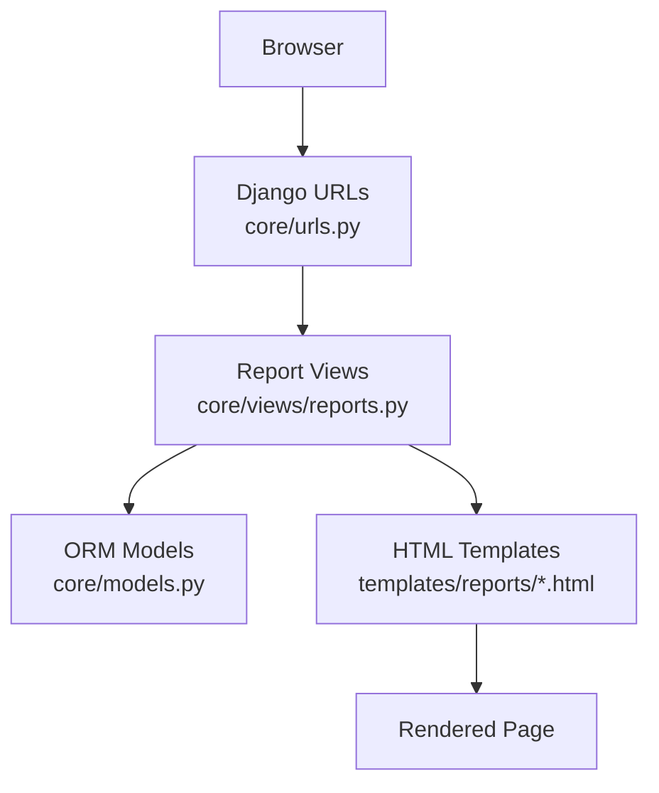
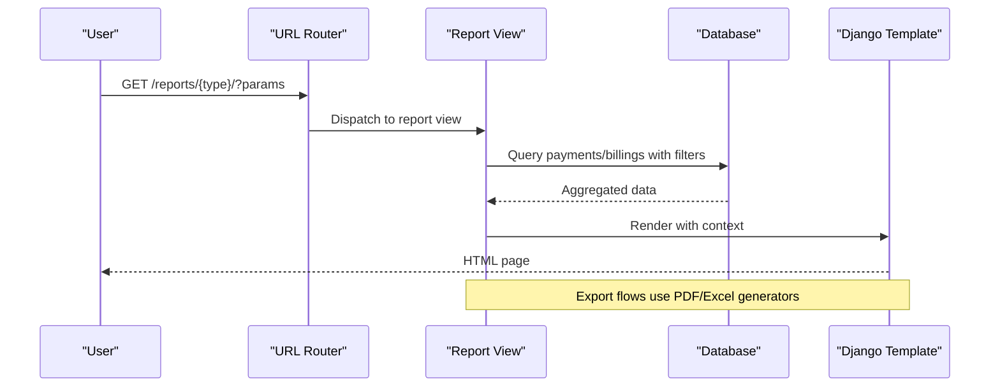
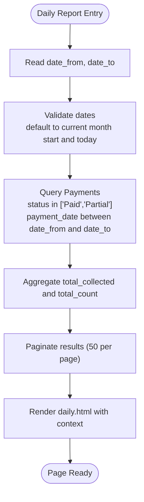
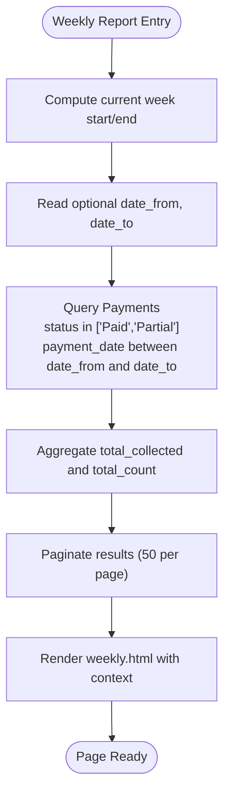
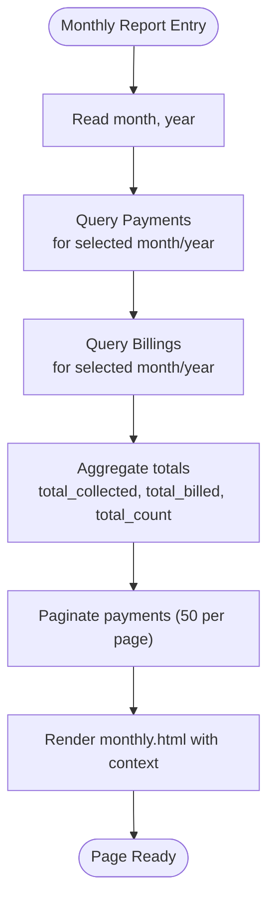
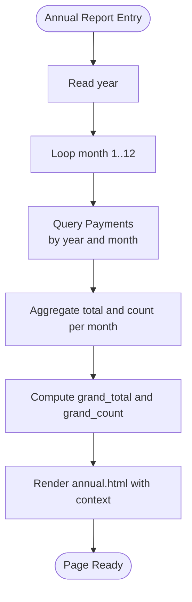
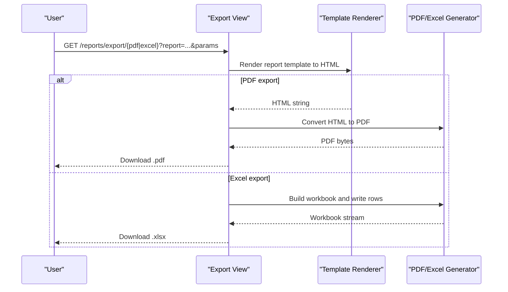
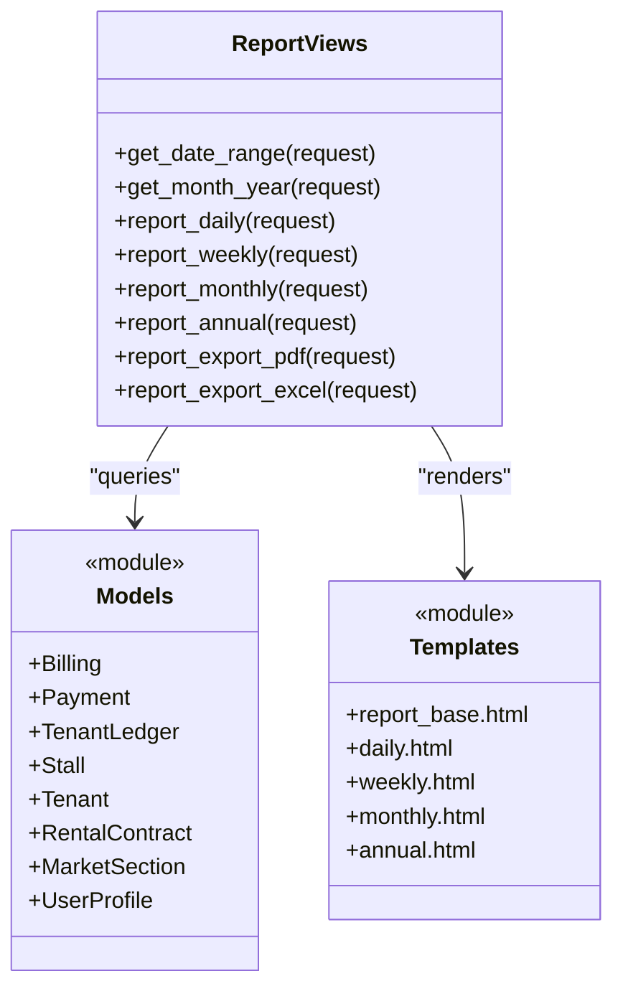

# Report Types & Generation

<cite>
**Referenced Files in This Document**
- [reports.py](file://core/views/reports.py)
- [urls.py](file://core/urls.py)
- [models.py](file://core/models.py)
- [report_base.html](file://templates/reports/report_base.html)
- [daily.html](file://templates/reports/daily.html)
- [weekly.html](file://templates/reports/weekly.html)
- [monthly.html](file://templates/reports/monthly.html)
- [annual.html](file://templates/reports/annual.html)
</cite>

## Table of Contents
1. [Introduction](#introduction)
2. [Project Structure](#project-structure)
3. [Core Components](#core-components)
4. [Architecture Overview](#architecture-overview)
5. [Detailed Component Analysis](#detailed-component-analysis)
6. [Dependency Analysis](#dependency-analysis)
7. [Performance Considerations](#performance-considerations)
8. [Troubleshooting Guide](#troubleshooting-guide)
9. [Conclusion](#conclusion)

## Introduction
This document explains the report types and generation system for the market rental application. It covers daily collection reports, weekly summaries, monthly financial reports, annual overviews, and related export workflows. It documents how data is aggregated from billing and payment records, how date-range and month/year parameters are validated, how Django templates render the results, and how pagination handles large datasets.

## Project Structure
The reporting feature is implemented as a set of Django views under the core application, with corresponding URL routes and HTML templates:

- Views: `core/views/reports.py`
- URLs: `core/urls.py`
- Data models: `core/models.py`
- Templates: `templates/reports/*.html`

**Diagram sources**
- [urls.py:152-167](file://core/urls.py#L152-L167)
- [reports.py:18-208](file://core/views/reports.py#L18-L208)
- [models.py:190-278](file://core/models.py#L190-L278)
- [report_base.html:1-208](file://templates/reports/report_base.html#L1-L208)

**Section sources**
- [urls.py:152-167](file://core/urls.py#L152-L167)
- [reports.py:18-208](file://core/views/reports.py#L18-L208)
- [models.py:190-278](file://core/models.py#L190-L278)
- [report_base.html:1-208](file://templates/reports/report_base.html#L1-L208)

## Core Components
The reporting system centers on these components:

- Parameter helpers:
  - Date range helper returns `date_from` and `date_to`, defaulting to the first day of the current month and today when not provided.
  - Month/year helper parses `month` and `year` query parameters, falling back to the current month and year if invalid.

- Report views:
  - Daily collection report: filters payments by date range.
  - Weekly summary report: defaults to the current week but accepts custom date ranges.
  - Monthly financial report: aggregates billings and payments for a selected month and year.
  - Annual overview: aggregates monthly totals across a selected year.

- Export endpoints:
  - PDF export: renders a report-specific template into HTML and converts it to PDF using an external library.
  - Excel export: builds an OpenPyXL workbook with styled headers and rows.

- Template layer:
  - Base report template provides consistent header, footer, print styles, and action controls.
  - Per-report templates define filters, KPI cards, tables, and pagination.

**Section sources**
- [reports.py:18-37](file://core/views/reports.py#L18-L37)
- [reports.py:80-208](file://core/views/reports.py#L80-L208)
- [reports.py:452-775](file://core/views/reports.py#L452-L775)
- [report_base.html:1-208](file://templates/reports/report_base.html#L1-L208)

## Architecture Overview
The request flow for generating a report is:

1. The user navigates to a report URL (e.g., `/reports/daily/`).
2. Django resolves the route and calls the corresponding view function.
3. The view reads query parameters (`date_from`, `date_to`, `month`, `year`) and validates them.
4. The view queries the database through ORM models to aggregate financial data.
5. The view passes context variables to a Django template.
6. The template renders the page with KPIs, tables, filters, and pagination.
7. For exports, the view renders a specialized template to HTML and converts it to PDF or writes an Excel file.

**Diagram sources**
- [urls.py:152-167](file://core/urls.py#L152-L167)
- [reports.py:80-208](file://core/views/reports.py#L80-L208)
- [reports.py:452-775](file://core/views/reports.py#L452-L775)

## Detailed Component Analysis

### Report Parameters and Validation
- Date range parameters:
  - `date_from`: Start date for filtering; defaults to the first day of the current month if missing.
  - `date_to`: End date for filtering; defaults to today if missing.
- Month/year parameters:
  - `month`: Integer 1–12; defaults to current month if missing or invalid.
  - `year`: Integer year; defaults to current year if missing or invalid.

Validation behavior:
- Date range helper returns ISO-formatted strings suitable for ORM date filters.
- Month/year helper casts inputs to integers and falls back to current values on conversion errors.

Example parameter usage:
- Daily and weekly reports accept `date_from` and `date_to`.
- Monthly and annual reports accept `month` and `year`.

**Section sources**
- [reports.py:18-37](file://core/views/reports.py#L18-L37)

### Daily Collection Report
Purpose:
- Show all collected receipts within a selected date range.

Data aggregation:
- Filters `Payment` records where status is Paid or Partial and `payment_date` is between `date_from` and `date_to`.
- Uses `select_related` to reduce N+1 queries for tenant, stall, and collector.
- Computes total collected amount and transaction count.

Filtering capabilities:
- Users can adjust `date_from` and `date_to` via the form.

Rendering:
- Template displays KPIs (total collected, transaction count, average per transaction), a table of receipts, and pagination.

Pagination:
- Results are paginated at 50 items per page.

Export options:
- PDF and Excel exports are available for the same dataset.

**Diagram sources**
- [reports.py:80-103](file://core/views/reports.py#L80-L103)
- [daily.html:1-108](file://templates/reports/daily.html#L1-L108)

**Section sources**
- [reports.py:80-103](file://core/views/reports.py#L80-L103)
- [daily.html:1-108](file://templates/reports/daily.html#L1-L108)

### Weekly Summary Report
Purpose:
- Summarize collections for a selected week, defaulting to the current week.

Data aggregation:
- Defaults `date_from` to the start of the current week and `date_to` to the end of the current week.
- Accepts custom `date_from` and `date_to` overrides.
- Filters `Payment` records similarly to the daily report.

Filtering capabilities:
- Users can override the default week by providing new date ranges.

Rendering:
- Template shows KPIs (total collected, transaction count, week period), a receipt table, and pagination.

Export options:
- PDF and Excel exports include the selected week’s data.

**Diagram sources**
- [reports.py:106-136](file://core/views/reports.py#L106-L136)
- [weekly.html:1-109](file://templates/reports/weekly.html#L1-L109)

**Section sources**
- [reports.py:106-136](file://core/views/reports.py#L106-L136)
- [weekly.html:1-109](file://templates/reports/weekly.html#L1-L109)

### Monthly Financial Report
Purpose:
- Provide a monthly financial overview combining billed amounts and actual collections.

Data aggregation:
- Payment aggregation:
  - Filters `Payment` records for the selected month and year.
  - Computes total collected and transaction count.
- Billing aggregation:
  - Filters `Billing` records for the selected month and year.
  - Computes total billed amount.

Filtering capabilities:
- Users select `month` and `year` via dropdown and number input.

Rendering:
- Template displays KPIs (total billed, total collected, transactions), a collection ledger table, and pagination.

Integration with billing and payments:
- Uses both `Billing` and `Payment` models to present billed vs. collected figures.

**Diagram sources**
- [reports.py:139-171](file://core/views/reports.py#L139-L171)
- [monthly.html:1-122](file://templates/reports/monthly.html#L1-L122)

**Section sources**
- [reports.py:139-171](file://core/views/reports.py#L139-L171)
- [monthly.html:1-122](file://templates/reports/monthly.html#L1-L122)

### Annual Overview
Purpose:
- Present yearly collection performance broken down by month.

Data aggregation:
- Iterates months 1–12 for the selected year.
- For each month, filters `Payment` records and aggregates total collected and transaction count.
- Computes grand totals across all months.

Filtering capabilities:
- Users select `year`; defaults to current year if missing or invalid.

Rendering:
- Template shows yearly title, subtitle, and monthly breakdown.

**Diagram sources**
- [reports.py:174-208](file://core/views/reports.py#L174-L208)
- [annual.html:1-22](file://templates/reports/annual.html#L1-L22)

**Section sources**
- [reports.py:174-208](file://core/views/reports.py#L174-L208)
- [annual.html:1-22](file://templates/reports/annual.html#L1-L22)

### Export Workflows (PDF and Excel)
PDF export:
- Routes to a report-specific template based on the `report` query parameter.
- Renders HTML and converts it to PDF using an external library.
- Returns a downloadable PDF attachment.

Excel export:
- Builds an OpenPyXL workbook with styled headers.
- Writes rows based on the selected report type.
- Returns a downloadable `.xlsx` attachment.

Supported report types for export:
- Monthly, daily, weekly, annual, section, collector, paid tenants, unpaid tenants, overdue, occupancy, vacant, ledger.

Error handling:
- If required libraries are missing, the views return error pages indicating unavailability.

**Diagram sources**
- [reports.py:452-563](file://core/views/reports.py#L452-L563)
- [reports.py:567-775](file://core/views/reports.py#L567-L775)

**Section sources**
- [reports.py:452-563](file://core/views/reports.py#L452-L563)
- [reports.py:567-775](file://core/views/reports.py#L567-L775)

### Pagination Handling
All list-based reports use Django’s paginator with a fixed page size:

- Page size: 50 records per page.
- Context variable: `page_obj` passed to templates.
- Template includes a shared pagination component.

Benefits:
- Prevents rendering extremely long pages.
- Improves performance for large datasets.

**Section sources**
- [reports.py:89-90](file://core/views/reports.py#L89-L90)
- [reports.py:122-123](file://core/views/reports.py#L122-L123)
- [reports.py:152-153](file://core/views/reports.py#L152-L153)
- [daily.html:106-107](file://templates/reports/daily.html#L106-L107)
- [weekly.html:107-108](file://templates/reports/weekly.html#L107-L108)
- [monthly.html:120-121](file://templates/reports/monthly.html#L120-L121)

### Integration with Billing and Payment Systems
- Billing model:
  - Represents monthly charges per tenant/stall/contract.
  - Tracks rental amount, penalty, discount, total due, amount paid, balance, due date, and status.
- Payment model:
  - Records actual collections linked to a billing record.
  - Tracks receipt number, payment method, collector, and status.
- Ledger model:
  - Maintains running debit/credit balances per tenant.

Reports integrate these models to:
- Sum billed amounts for financial visibility.
- Sum collected amounts for cash flow tracking.
- Count transactions for operational metrics.
- Filter by status (Paid, Partial, Unpaid, Overdue) for targeted analysis.

**Section sources**
- [models.py:190-278](file://core/models.py#L190-L278)
- [reports.py:139-171](file://core/views/reports.py#L139-L171)
- [reports.py:452-563](file://core/views/reports.py#L452-L563)
- [reports.py:567-775](file://core/views/reports.py#L567-L775)

## Dependency Analysis
Key dependencies and relationships:

- Views depend on:
  - Django utilities: `Paginator`, `Sum`, `Count`, `Q`, `messages`.
  - Models: `Stall`, `Tenant`, `RentalContract`, `Billing`, `Payment`, `TenantLedger`, `MarketSection`, `UserProfile`.
- Templates depend on:
  - Shared base template for layout and print styles.
  - Per-report templates for content blocks.
- Export functionality depends on:
  - External libraries: WeasyPrint (PDF) and OpenPyXL (Excel).

**Diagram sources**
- [reports.py:1-15](file://core/views/reports.py#L1-L15)
- [models.py:190-278](file://core/models.py#L190-L278)
- [report_base.html:1-208](file://templates/reports/report_base.html#L1-L208)

**Section sources**
- [reports.py:1-15](file://core/views/reports.py#L1-L15)
- [models.py:190-278](file://core/models.py#L190-L278)
- [report_base.html:1-208](file://templates/reports/report_base.html#L1-L208)

## Performance Considerations
- Use of `select_related`:
  - Reduces N+1 queries by eagerly loading related objects (tenant, stall, collector).
- Aggregations:
  - Database-level sums and counts minimize memory overhead.
- Pagination:
  - Limits rendered rows to improve response time and client-side performance.
- Export considerations:
  - PDF generation requires external dependencies; ensure they are installed.
  - Excel generation builds entire workbooks in memory; consider limits for very large datasets.

[No sources needed since this section provides general guidance]

## Troubleshooting Guide
Common issues and resolutions:

- PDF export unavailable:
  - Cause: Missing WeasyPrint system dependencies.
  - Resolution: Install required system packages or use Excel/print alternatives.
- Excel export unavailable:
  - Cause: Missing OpenPyXL package.
  - Resolution: Install OpenPyXL dependency.
- Invalid month/year:
  - Behavior: Falls back to current month/year.
  - Resolution: Ensure numeric inputs are valid.
- Empty reports:
  - Cause: No matching records for selected filters.
  - Resolution: Adjust date ranges or month/year selections.

**Section sources**
- [reports.py:457-461](file://core/views/reports.py#L457-L461)
- [reports.py:572-577](file://core/views/reports.py#L572-L577)
- [reports.py:28-37](file://core/views/reports.py#L28-L37)

## Conclusion
The reporting system provides robust daily, weekly, monthly, and annual views with clear parameter validation, efficient data aggregation, and consistent template rendering. Exports to PDF and Excel extend usability for offline analysis. Pagination ensures scalability for large datasets, while integration with billing and payment models delivers accurate financial insights. Proper installation of external libraries and careful filter selection are key to reliable operation.