# Reporting & Analytics

<cite>
**Referenced Files in This Document**   
- [reports.py](file://core/views/reports.py)
- [report_base.html](file://templates/reports/report_base.html)
- [dashboard.html](file://templates/reports/dashboard.html)
- [daily.html](file://templates/reports/daily.html)
- [weekly.html](file://templates/reports/weekly.html)
- [monthly.html](file://templates/reports/monthly.html)
- [annual.html](file://templates/reports/annual.html)
- [occupancy.html](file://templates/reports/occupancy.html)
- [collector.html](file://templates/reports/collector.html)
- [export_pdf.html](file://templates/reports/export_pdf.html)
- [export_excel.html](file://templates/reports/export_excel.html)
- [models.py](file://core/models.py)
</cite>

## Table of Contents
1. [Introduction](#introduction)
2. [Project Structure](#project-structure)
3. [Core Components](#core-components)
4. [Architecture Overview](#architecture-overview)
5. [Detailed Component Analysis](#detailed-component-analysis)
6. [Dependency Analysis](#dependency-analysis)
7. [Performance Considerations](#performance-considerations)
8. [Troubleshooting Guide](#troubleshooting-guide)
9. [Conclusion](#conclusion)

## Introduction
The Reporting & Analytics module provides a comprehensive system for generating, viewing, and exporting market rental reports. It covers daily, weekly, monthly, and annual collection summaries; specialized analytics such as stall occupancy, collector performance, paid/unpaid tenant lists, overdue accounts, and ledger statements. The module also includes a dashboard with real-time insights into market operations, collection performance, and financial metrics. Reports can be printed directly from the browser or exported to PDF and Excel formats.

## Project Structure
The reporting feature is implemented primarily through:
- A central view module that computes data, applies filters, and renders report pages.
- Report templates that present KPIs, tables, and export actions.
- Shared base template for consistent print styling and layout.
- Data models for stalls, tenants, contracts, billings, payments, and ledgers.

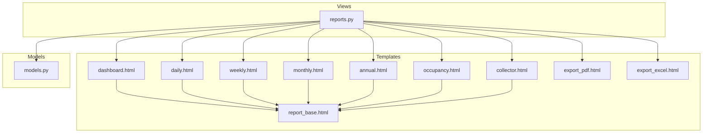

**Diagram sources**
- [reports.py:40-775](file://core/views/reports.py#L40-L775)
- [report_base.html:1-208](file://templates/reports/report_base.html#L1-L208)
- [dashboard.html:1-258](file://templates/reports/dashboard.html#L1-L258)
- [daily.html:1-108](file://templates/reports/daily.html#L1-L108)
- [weekly.html:1-109](file://templates/reports/weekly.html#L1-L109)
- [monthly.html:1-122](file://templates/reports/monthly.html#L1-L122)
- [annual.html:1-104](file://templates/reports/annual.html#L1-L104)
- [occupancy.html:1-125](file://templates/reports/occupancy.html#L1-L125)
- [collector.html:1-108](file://templates/reports/collector.html#L1-L108)
- [export_pdf.html:1-34](file://templates/reports/export_pdf.html#L1-L34)
- [export_excel.html:1-34](file://templates/reports/export_excel.html#L1-L34)
- [models.py:71-336](file://core/models.py#L71-L336)

**Section sources**
- [reports.py:40-775](file://core/views/reports.py#L40-L775)
- [report_base.html:1-208](file://templates/reports/report_base.html#L1-L208)
- [models.py:71-336](file://core/models.py#L71-L336)

## Core Components
- Dashboard analytics: Aggregates stall occupancy, billed amounts, collected amounts, outstanding balance, billing status counts, and collection rate for a selected month/year.
- Collection reports: Daily, weekly, monthly, and annual views that aggregate payments by date ranges or calendar periods.
- Specialized reports: Section-wise collections, collector performance, paid/unpaid tenants, overdue accounts, stall occupancy, vacant stalls, and tenant ledger.
- Export engine: PDF generation via WeasyPrint and Excel generation via openpyxl, with graceful fallbacks when dependencies are missing.
- Print support: Browser-based printing with dedicated print CSS for clean paper output.

Key responsibilities:
- Data aggregation uses Django ORM aggregations (Sum, Count) and filtering on Payment, Billing, Stall, TenantLedger, MarketSection, and UserProfile.
- Filtering supports date ranges, month/year selection, section/status filters, and tenant-specific ledger queries.
- Export endpoints route to appropriate datasets and templates based on a report type parameter.

**Section sources**
- [reports.py:40-775](file://core/views/reports.py#L40-L775)
- [dashboard.html:1-258](file://templates/reports/dashboard.html#L1-L258)
- [report_base.html:1-208](file://templates/reports/report_base.html#L1-L208)

## Architecture Overview
The reporting flow starts at the view layer, which reads request parameters, aggregates data from the database, and passes context to templates. Templates render KPIs and tables and provide actions for printing and exporting. Export endpoints generate downloadable files using external libraries.

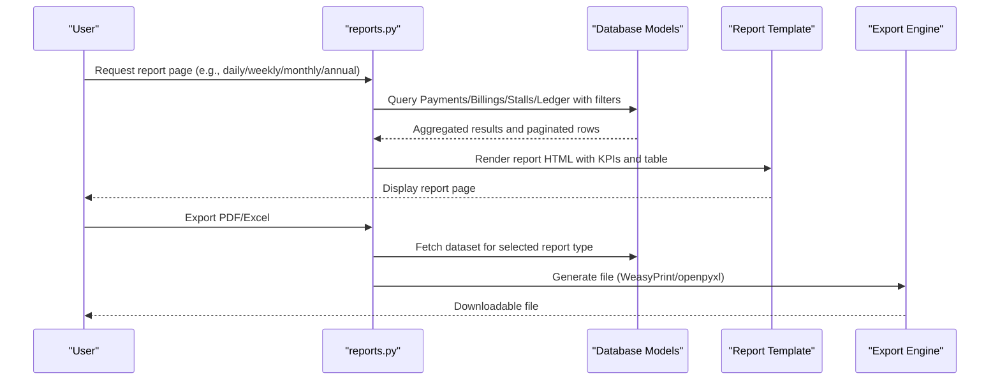

**Diagram sources**
- [reports.py:40-775](file://core/views/reports.py#L40-L775)
- [models.py:190-336](file://core/models.py#L190-L336)

## Detailed Component Analysis

### Dashboard Analytics
The dashboard aggregates:
- Stall occupancy totals and rates.
- Monthly billed, collected, and outstanding balances.
- Billing status breakdown (Paid, Unpaid, Overdue).
- Collection rate percentage.

It exposes quick links to all available reports and export buttons for the selected month/year.

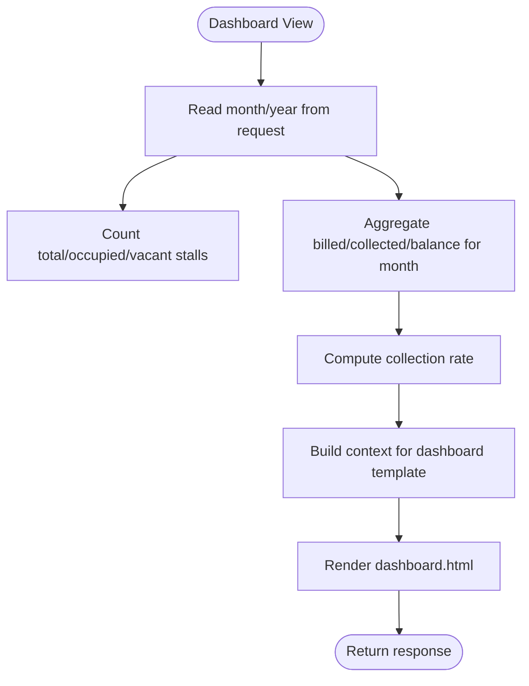

**Diagram sources**
- [reports.py:40-77](file://core/views/reports.py#L40-L77)
- [dashboard.html:1-258](file://templates/reports/dashboard.html#L1-L258)

**Section sources**
- [reports.py:40-77](file://core/views/reports.py#L40-L77)
- [dashboard.html:1-258](file://templates/reports/dashboard.html#L1-L258)

### Daily Collection Report
- Filters payments within a user-specified date range.
- Displays transaction count, total collected, and average per transaction.
- Provides filter controls and print action.

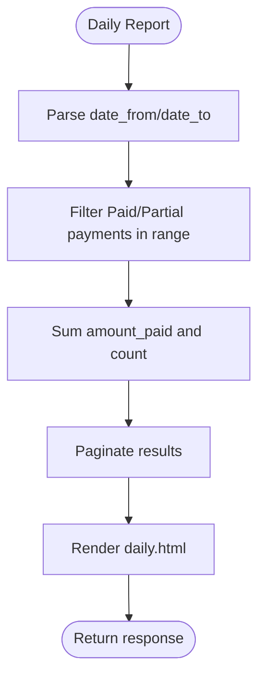

**Diagram sources**
- [reports.py:80-103](file://core/views/reports.py#L80-L103)
- [daily.html:1-108](file://templates/reports/daily.html#L1-L108)

**Section sources**
- [reports.py:80-103](file://core/views/reports.py#L80-L103)
- [daily.html:1-108](file://templates/reports/daily.html#L1-L108)

### Weekly Collection Report
- Defaults to current week but allows custom date range.
- Shows same KPIs as daily report plus coverage window.
- Includes Excel and PDF export links.

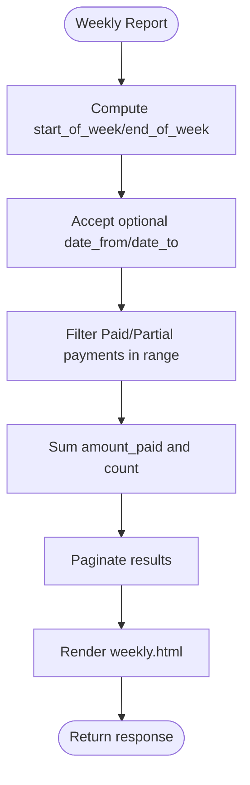

**Diagram sources**
- [reports.py:106-136](file://core/views/reports.py#L106-L136)
- [weekly.html:1-109](file://templates/reports/weekly.html#L1-L109)

**Section sources**
- [reports.py:106-136](file://core/views/reports.py#L106-L136)
- [weekly.html:1-109](file://templates/reports/weekly.html#L1-L109)

### Monthly Collection Report
- Filters by selected month and year.
- Shows total billed, total collected, transaction count, and progress bar indicating collection rate relative to billed amount.

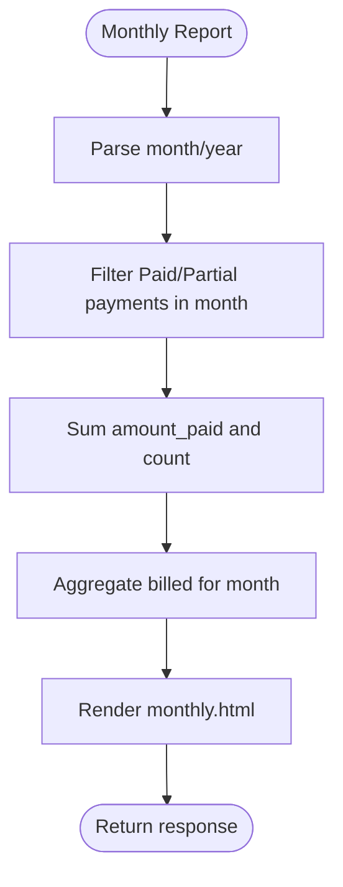

**Diagram sources**
- [reports.py:139-171](file://core/views/reports.py#L139-L171)
- [monthly.html:1-122](file://templates/reports/monthly.html#L1-L122)

**Section sources**
- [reports.py:139-171](file://core/views/reports.py#L139-L171)
- [monthly.html:1-122](file://templates/reports/monthly.html#L1-L122)

### Annual Collection Report
- Iterates months to compute per-month totals and counts.
- Presents grand totals and percentage contribution per month.

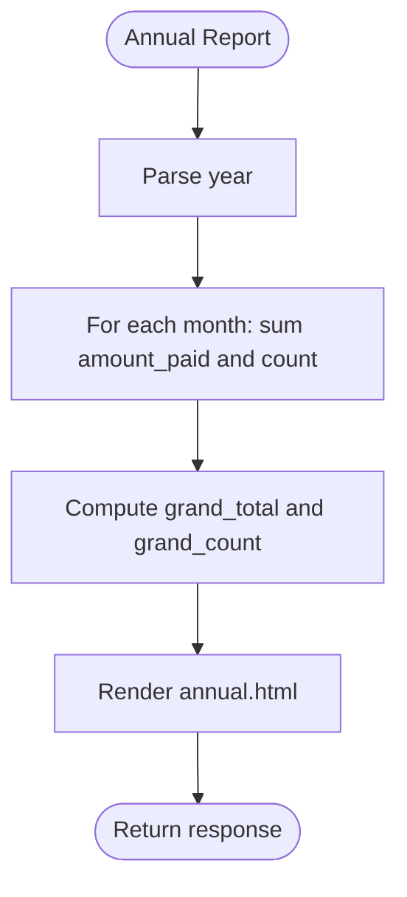

**Diagram sources**
- [reports.py:174-208](file://core/views/reports.py#L174-L208)
- [annual.html:1-104](file://templates/reports/annual.html#L1-L104)

**Section sources**
- [reports.py:174-208](file://core/views/reports.py#L174-L208)
- [annual.html:1-104](file://templates/reports/annual.html#L1-L104)

### Section-Wise Collections
- Computes per-section stall counts (occupied/vacant), billed, collected, and balance for a selected month/year.

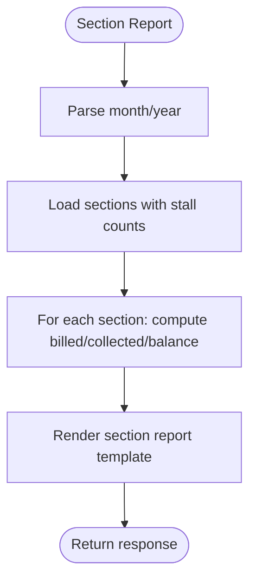

**Diagram sources**
- [reports.py:211-250](file://core/views/reports.py#L211-L250)

**Section sources**
- [reports.py:211-250](file://core/views/reports.py#L211-L250)

### Collector Performance Report
- Aggregates payments by collector over a date range.
- Shows per-collector transaction counts, totals, and percentage of grand total.

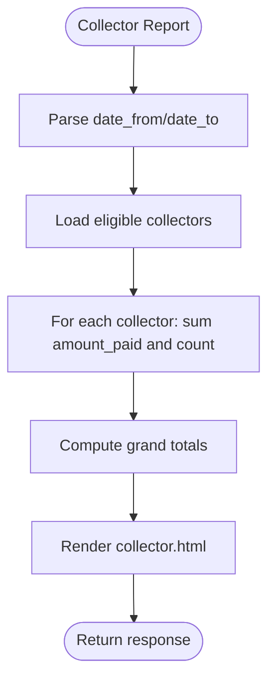

**Diagram sources**
- [reports.py:253-287](file://core/views/reports.py#L253-L287)
- [collector.html:1-108](file://templates/reports/collector.html#L1-L108)

**Section sources**
- [reports.py:253-287](file://core/views/reports.py#L253-L287)
- [collector.html:1-108](file://templates/reports/collector.html#L1-L108)

### Paid Tenants, Unpaid Tenants, and Overdue Accounts
- Paid Tenants: Lists billings marked Paid for a month/year.
- Unpaid Tenants: Lists billings with Unpaid/Partial/Overdue statuses for a month/year.
- Overdue Accounts: Lists all Overdue billings regardless of month.

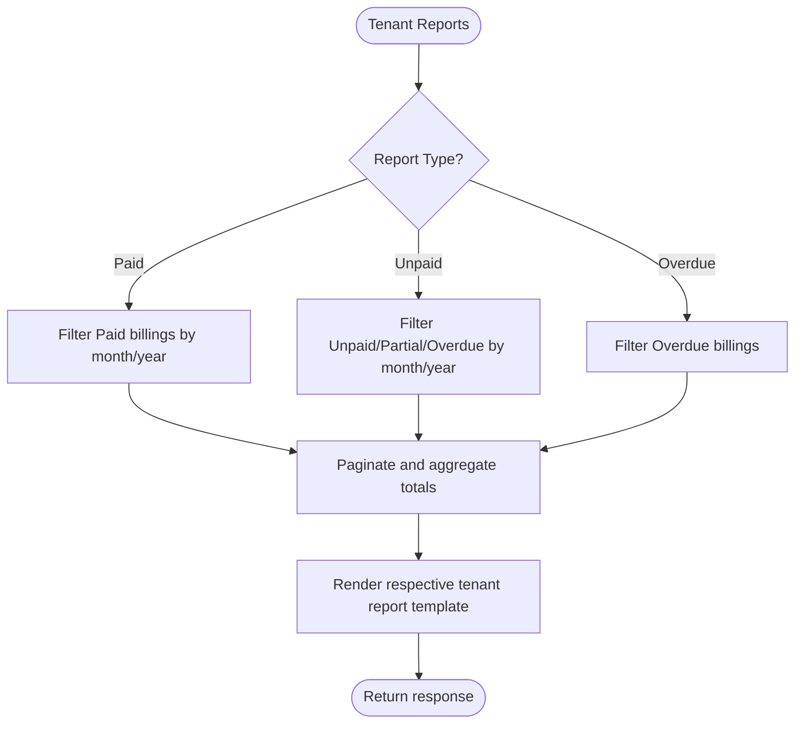

**Diagram sources**
- [reports.py:290-363](file://core/views/reports.py#L290-L363)

**Section sources**
- [reports.py:290-363](file://core/views/reports.py#L290-L363)

### Stall Occupancy and Vacant Stalls
- Occupancy: Lists all stalls with section/type/rate/status and active tenant info; supports section and status filters.
- Vacant: Lists only Vacant stalls with optional section filter.

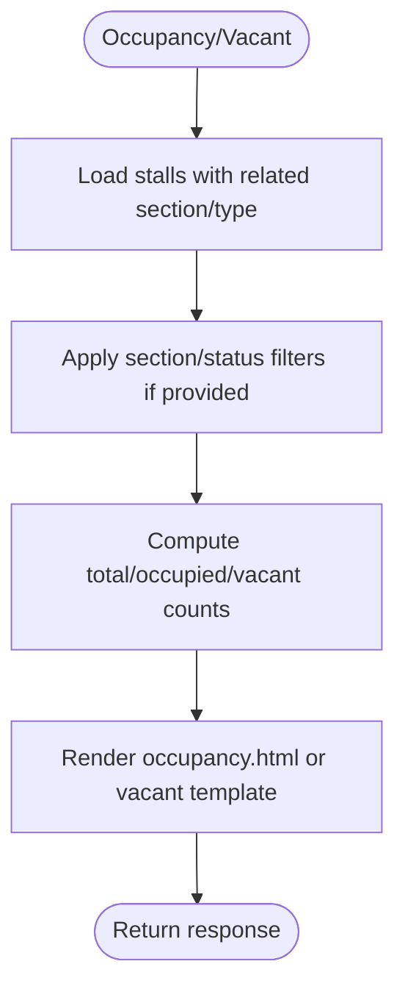

**Diagram sources**
- [reports.py:397-448](file://core/views/reports.py#L397-L448)
- [occupancy.html:1-125](file://templates/reports/occupancy.html#L1-L125)

**Section sources**
- [reports.py:397-448](file://core/views/reports.py#L397-L448)
- [occupancy.html:1-125](file://templates/reports/occupancy.html#L1-L125)

### Tenant Ledger Report
- Lists ledger entries with optional tenant and date range filters.
- Shows debit/credit totals and running balances.

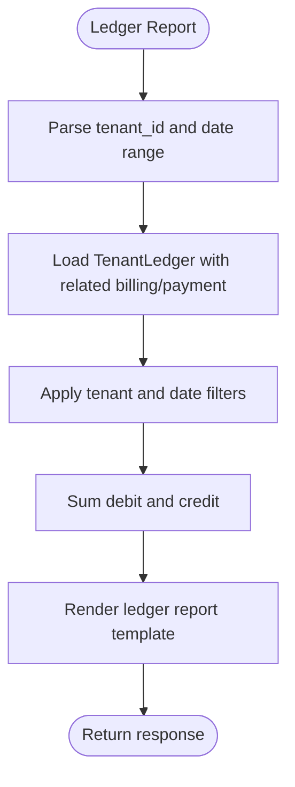

**Diagram sources**
- [reports.py:366-394](file://core/views/reports.py#L366-L394)

**Section sources**
- [reports.py:366-394](file://core/views/reports.py#L366-L394)

### Export to PDF
- Uses WeasyPrint to convert rendered HTML to PDF.
- Routes to correct dataset/template based on report type.
- Returns a downloadable PDF file with a descriptive filename.
- If WeasyPrint is unavailable, shows an error page instructing installation.

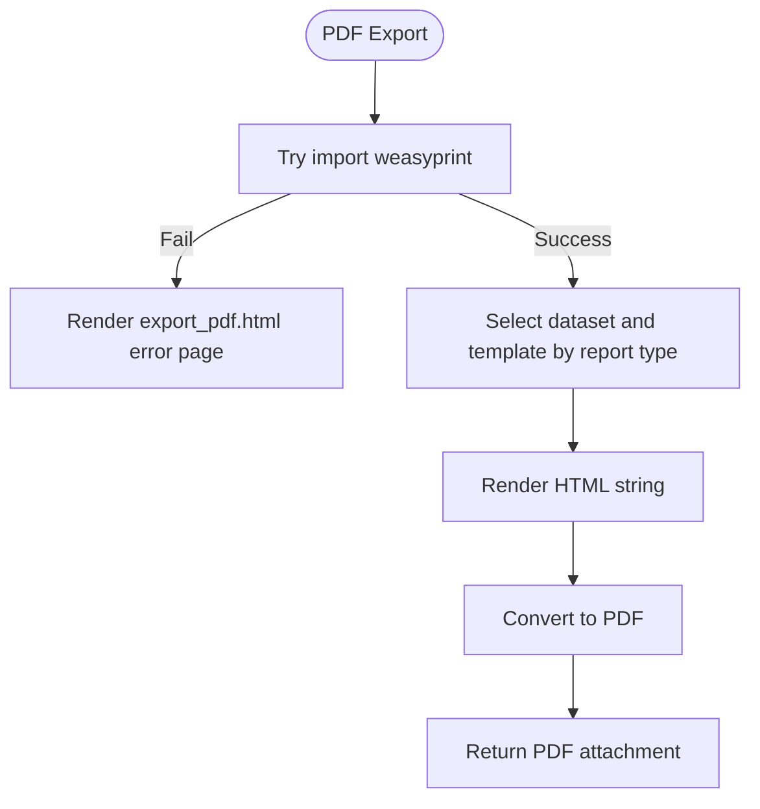

**Diagram sources**
- [reports.py:451-563](file://core/views/reports.py#L451-L563)
- [export_pdf.html:1-34](file://templates/reports/export_pdf.html#L1-L34)

**Section sources**
- [reports.py:451-563](file://core/views/reports.py#L451-L563)
- [export_pdf.html:1-34](file://templates/reports/export_pdf.html#L1-L34)

### Export to Excel
- Uses openpyxl to build styled spreadsheets.
- Supports multiple report types with tailored headers and columns.
- Auto-adjusts column widths and returns a downloadable .xlsx file.
- If openpyxl is missing, shows an error page instructing installation.

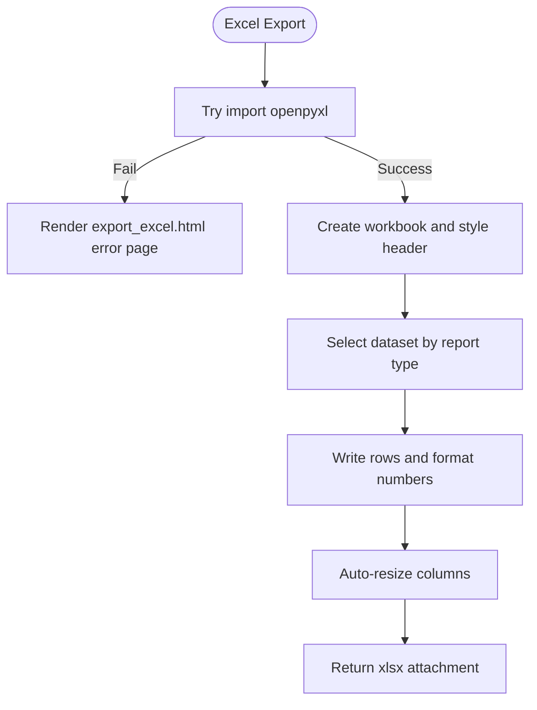

**Diagram sources**
- [reports.py:566-774](file://core/views/reports.py#L566-L774)
- [export_excel.html:1-34](file://templates/reports/export_excel.html#L1-L34)

**Section sources**
- [reports.py:566-774](file://core/views/reports.py#L566-L774)
- [export_excel.html:1-34](file://templates/reports/export_excel.html#L1-L34)

### Print Support
- The shared base template defines print-only styles that hide UI chrome, reset layouts, and ensure readable tables and footers on paper.
- Each report template includes a Print button that triggers the browser’s print dialog.

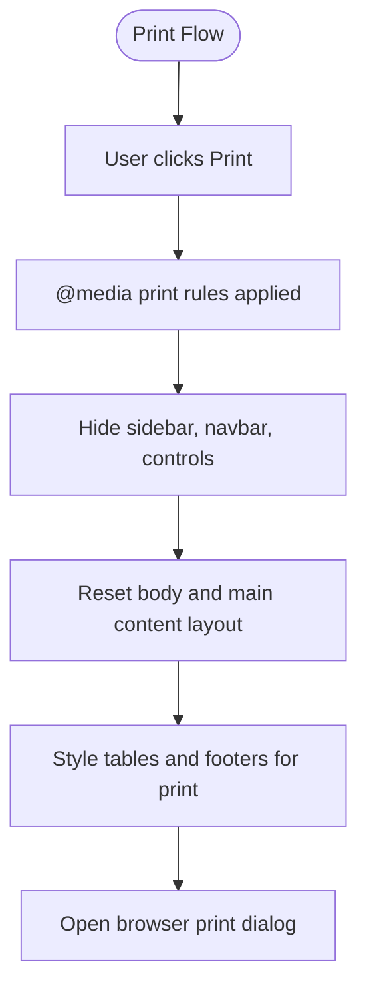

**Diagram sources**
- [report_base.html:7-154](file://templates/reports/report_base.html#L7-L154)

**Section sources**
- [report_base.html:7-154](file://templates/reports/report_base.html#L7-L154)

## Dependency Analysis
The reporting module depends on core domain models:
- Stall, MarketSection, StallType: For occupancy and section analysis.
- Tenant, RentalContract: For tenant and contract context in reports.
- Billing: For billed amounts, due dates, and status tracking.
- Payment: For collection records and collector attribution.
- TenantLedger: For detailed transaction history.
- UserProfile: For collector performance grouping.

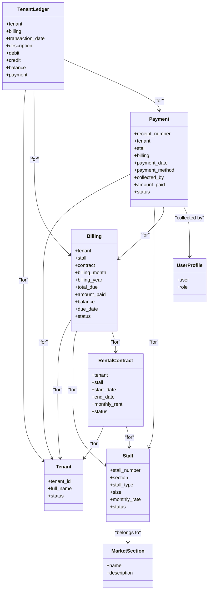

**Diagram sources**
- [models.py:71-336](file://core/models.py#L71-L336)

**Section sources**
- [models.py:71-336](file://core/models.py#L71-L336)

## Performance Considerations
- Use select_related to reduce N+1 queries when rendering payment and billing details.
- Prefer aggregated queries (Sum, Count) for KPIs instead of iterating large result sets.
- Paginate large lists to avoid heavy DOM rendering.
- Avoid unnecessary joins; filter early in the query chain.
- For PDF generation, prefer minimal HTML and avoid heavy assets to speed up conversion.
- For Excel exports, write only required columns and use efficient cell writes.

[No sources needed since this section provides general guidance]

## Troubleshooting Guide
- PDF export unavailable:
  - Symptom: Error page indicates WeasyPrint is not installed.
  - Resolution: Install WeasyPrint and its system dependencies, then restart the application.
  - Reference: [export_pdf.html:1-34](file://templates/reports/export_pdf.html#L1-L34)
- Excel export unavailable:
  - Symptom: Error page indicates openpyxl is not installed.
  - Resolution: Install openpyxl via pip and restart the application.
  - Reference: [export_excel.html:1-34](file://templates/reports/export_excel.html#L1-L34)
- Empty reports:
  - Ensure date ranges or month/year selections match recorded transactions.
  - Verify filters (section/status/tenant) are not overly restrictive.
- Slow loading:
  - Check for missing indexes on frequently filtered fields like payment_date, billing_month, billing_year, and status.
  - Confirm select_related usage in views.

**Section sources**
- [export_pdf.html:1-34](file://templates/reports/export_pdf.html#L1-L34)
- [export_excel.html:1-34](file://templates/reports/export_excel.html#L1-L34)
- [reports.py:451-774](file://core/views/reports.py#L451-L774)

## Conclusion
The Reporting & Analytics module delivers a robust set of operational and financial reports for market rental management. It combines flexible filtering, clear KPIs, and multiple export options to support both day-to-day operations and compliance needs. While scheduling and automated distribution are not implemented in the current codebase, the existing architecture makes it straightforward to integrate scheduled tasks and email delivery in the future.

[No sources needed since this section summarizes without analyzing specific files]