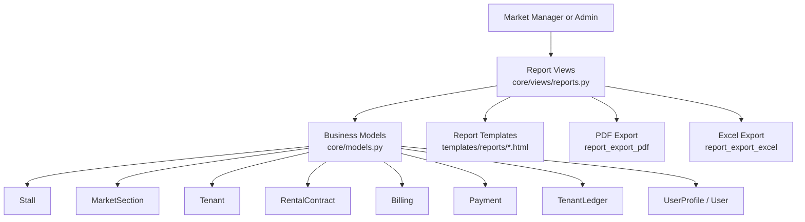
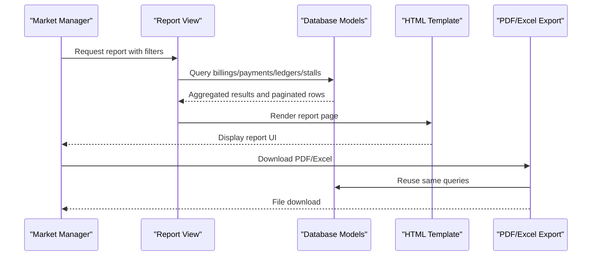
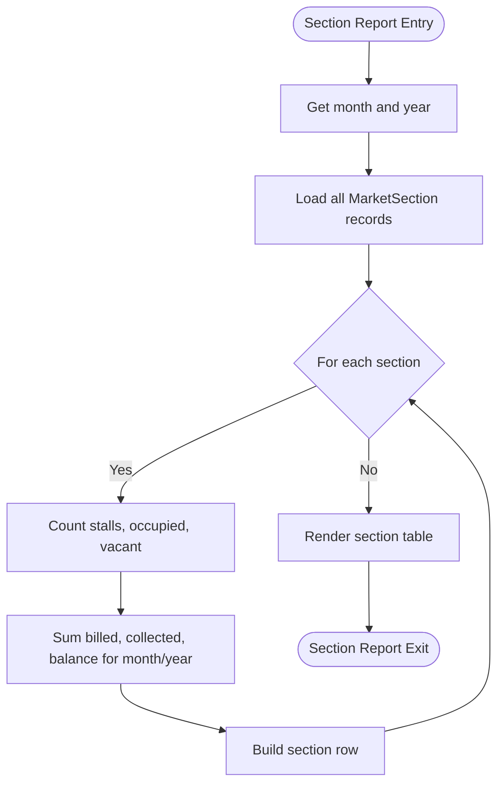
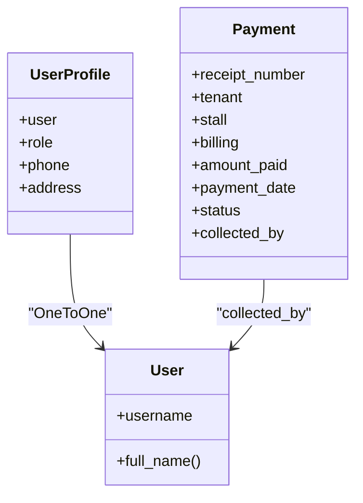
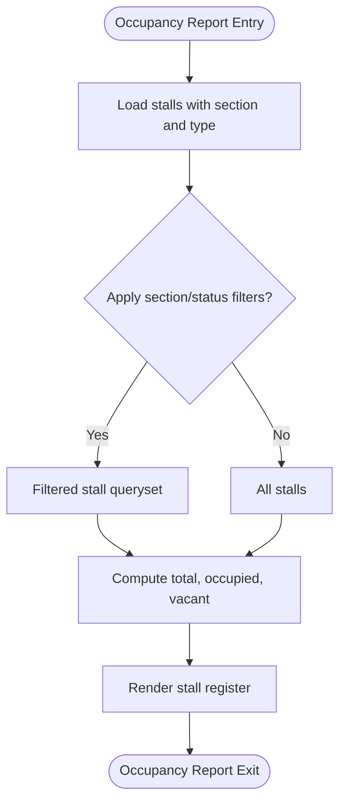
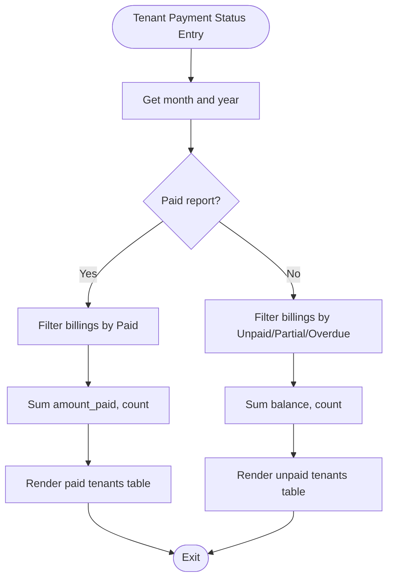
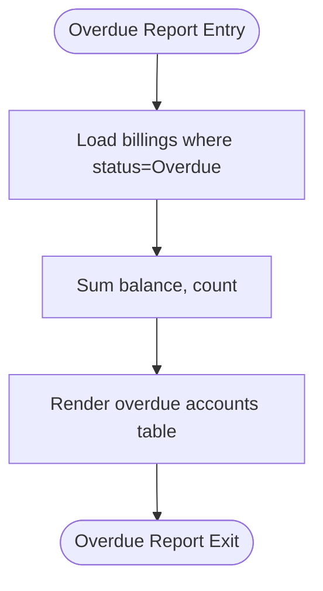
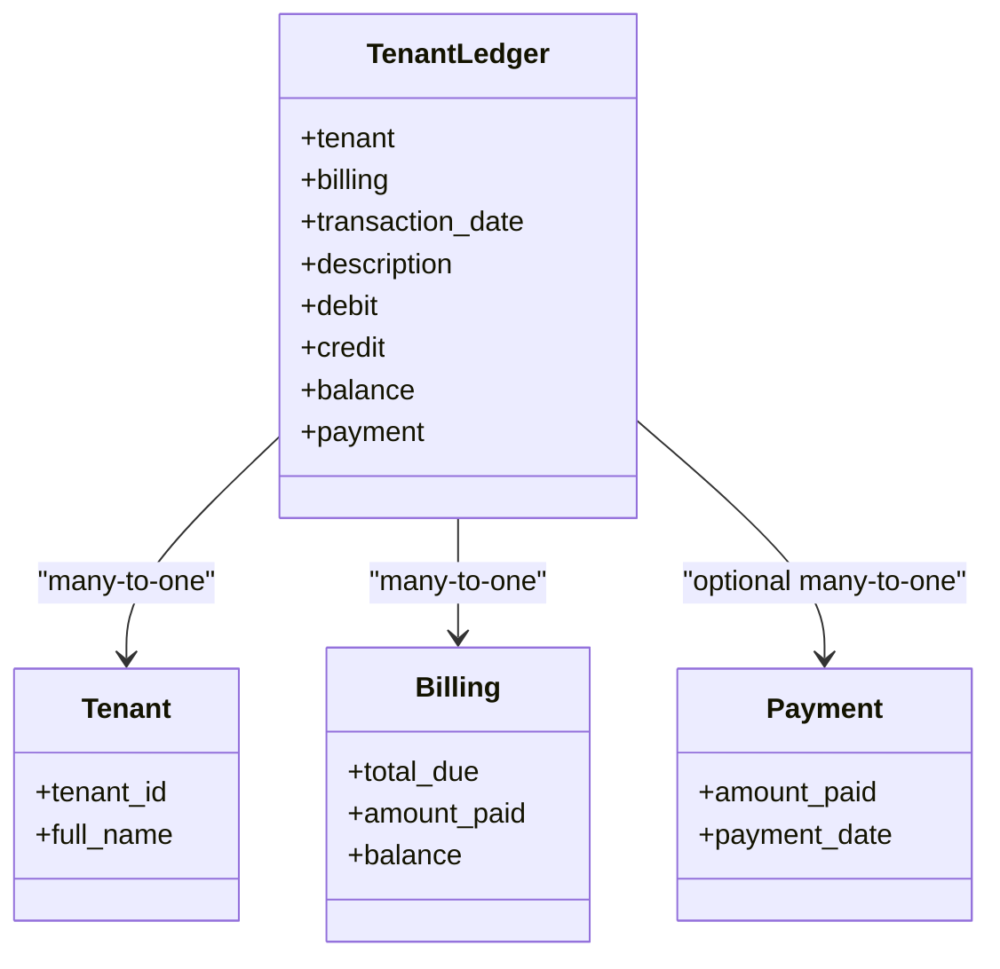
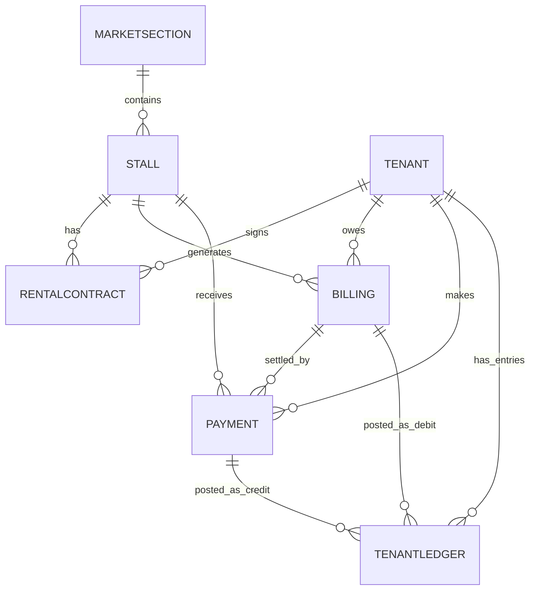

# Specialized Reports

<cite>
**Referenced Files in This Document**
- [reports.py](file://core/views/reports.py)
- [models.py](file://core/models.py)
- [section.html](file://templates/reports/section.html)
- [collector.html](file://templates/reports/collector.html)
- [occupancy.html](file://templates/reports/occupancy.html)
- [paid_tenants.html](file://templates/reports/paid_tenants.html)
- [unpaid_tenants.html](file://templates/reports/unpaid_tenants.html)
- [overdue.html](file://templates/reports/overdue.html)
- [ledger.html](file://templates/reports/ledger.html)
</cite>

## Table of Contents
1. [Introduction](#introduction)
2. [Project Structure](#project-structure)
3. [Core Components](#core-components)
4. [Architecture Overview](#architecture-overview)
5. [Detailed Component Analysis](#detailed-component-analysis)
6. [Dependency Analysis](#dependency-analysis)
7. [Performance Considerations](#performance-considerations)
8. [Troubleshooting Guide](#troubleshooting-guide)
9. [Conclusion](#conclusion)

## Introduction
This document explains the specialized analytical reports available in the market rental system. It focuses on:
- Section-based collection analysis
- Collector performance metrics
- Stall occupancy tracking
- Tenant payment status reports (paid and unpaid)
- Overdue account monitoring
- Comprehensive tenant ledger reporting

For each report, this guide documents the underlying data model relationships, filtering options, aggregation logic, and how the resulting insights support market management decisions such as revenue planning, collector accountability, stall utilization strategy, and collections follow-up.

## Project Structure
The specialized reports are implemented as Django views that query core business models and render HTML templates. PDF and Excel export endpoints reuse the same data queries to generate downloadable files.

**Diagram sources**
- [reports.py:12-15](file://core/views/reports.py#L12-L15)
- [models.py:71-115](file://core/models.py#L71-L115)
- [models.py:117-155](file://core/models.py#L117-L155)
- [models.py:157-188](file://core/models.py#L157-L188)
- [models.py:190-219](file://core/models.py#L190-L219)
- [models.py:221-259](file://core/models.py#L221-L259)
- [models.py:261-278](file://core/models.py#L261-L278)

**Section sources**
- [reports.py:18-37](file://core/views/reports.py#L18-L37)
- [reports.py:45-77](file://core/views/reports.py#L45-L77)

## Core Components
The specialized reports share common helpers and patterns:
- Date range helper: extracts `date_from` and `date_to`, defaulting to the current month start and today when not provided.
- Month/year helper: parses `month` and `year` from request parameters with safe defaults.
- Aggregations: use `Sum`, `Count`, and `Q` for totals, counts, and complex filters.
- Pagination: uses Django’s paginator for large result sets.
- Filtering: supports section, status, date range, tenant ID, and month/year inputs.

Key reusable helpers:
- `get_date_range`: returns normalized date strings for filtering payments and ledgers.
- `get_month_year`: returns validated month and year integers for billing and monthly reports.

These helpers ensure consistent filtering behavior across daily, weekly, monthly, annual, section, collector, occupancy, paid/unpaid tenants, overdue, and ledger reports.

**Section sources**
- [reports.py:18-37](file://core/views/reports.py#L18-L37)
- [reports.py:81-103](file://core/views/reports.py#L81-L103)
- [reports.py:106-136](file://core/views/reports.py#L106-L136)
- [reports.py:139-171](file://core/views/reports.py#L139-L171)

## Architecture Overview
The report architecture follows a clear separation between data access, presentation, and export:

**Diagram sources**
- [reports.py:452-563](file://core/views/reports.py#L452-L563)
- [reports.py:567-774](file://core/views/reports.py#L567-L774)

## Detailed Component Analysis

### Section-Based Collection Analysis
Purpose:
- Show per-section stall occupancy and monthly collection performance.
- Help managers identify high-performing sections and underperforming areas.

Data relationships:
- MarketSection → Stall → Billing
- Billing aggregates total_due, amount_paid, balance per section and month.

Filtering:
- Month and year selectors control which billing period is analyzed.

Aggregation logic:
- For each section:
  - Count stalls, occupied stalls, vacant stalls.
  - Sum billed, collected, and balance amounts for the selected month/year.

Actionable insights:
- Compare collection rates by section.
- Prioritize outreach in sections with high vacancy or low collection.
- Plan marketing or rate adjustments based on occupancy and revenue trends.

**Diagram sources**
- [reports.py:211-250](file://core/views/reports.py#L211-L250)

**Section sources**
- [reports.py:211-250](file://core/views/reports.py#L211-L250)
- [section.html:9-31](file://templates/reports/section.html#L9-L31)
- [section.html:44-93](file://templates/reports/section.html#L44-L93)
- [models.py:71-79](file://core/models.py#L71-L79)
- [models.py:93-115](file://core/models.py#L93-L115)
- [models.py:190-219](file://core/models.py#L190-L219)

### Collector Performance Metrics
Purpose:
- Measure collection activity by staff member over a date range.
- Support performance reviews and workload balancing.

Data relationships:
- UserProfile/User → Payment (collected_by)
- Payment includes amount_paid, payment_date, status.

Filtering:
- Date range input controls the period for collector performance.

Aggregation logic:
- For each eligible collector role:
  - Filter payments by collector user, status Paid or Partial, and date range.
  - Sum total collected and count transactions.
  - Compute grand totals across collectors.

Actionable insights:
- Identify top performers and underperformers.
- Detect anomalies in transaction volume versus monetary totals.
- Adjust staffing or training based on collector efficiency.

**Diagram sources**
- [models.py:7-24](file://core/models.py#L7-L24)
- [models.py:221-259](file://core/models.py#L221-L259)

**Section sources**
- [reports.py:253-287](file://core/views/reports.py#L253-L287)
- [collector.html:9-27](file://templates/reports/collector.html#L9-L27)
- [collector.html:30-107](file://templates/reports/collector.html#L30-L107)
- [models.py:7-24](file://core/models.py#L7-L24)
- [models.py:221-259](file://core/models.py#L221-L259)

### Stall Occupancy Tracking
Purpose:
- Provide a comprehensive register of stalls with occupancy status and active tenant information.
- Enable targeted vacancy management and rate optimization.

Data relationships:
- Stall → MarketSection, StallType
- Stall → RentalContract (active contract shows current tenant)

Filtering:
- Section filter narrows to a specific area.
- Status filter selects Vacant, Occupied, Reserved, or Maintenance.

Aggregation logic:
- Count total stalls, occupied stalls, and vacant stalls after applying filters.
- Display occupancy percentage and detailed stall rows.

Actionable insights:
- Track vacancy trends by section.
- Align marketing efforts with sections having higher vacancy.
- Monitor maintenance backlog through status distribution.

**Diagram sources**
- [reports.py:397-428](file://core/views/reports.py#L397-L428)

**Section sources**
- [reports.py:397-428](file://core/views/reports.py#L397-L428)
- [occupancy.html:9-38](file://templates/reports/occupancy.html#L9-L38)
- [occupancy.html:41-124](file://templates/reports/occupancy.html#L41-L124)
- [models.py:71-79](file://core/models.py#L71-L79)
- [models.py:82-90](file://core/models.py#L82-L90)
- [models.py:93-115](file://core/models.py#L93-L115)
- [models.py:157-188](file://core/models.py#L157-L188)

### Tenant Payment Status Reports
Purpose:
- List tenants who have fully paid their bills for a given month/year.
- List tenants with unpaid, partial, or overdue balances for a given month/year.

Data relationships:
- Billing → Tenant, Stall
- Billing.status indicates Unpaid, Partial, Overdue, or Paid.

Filtering:
- Month and year selectors define the billing period.
- Paid report filters by status = Paid.
- Unpaid report filters by Unpaid, Partial, or Overdue.

Aggregation logic:
- Paid report: sum amount_paid and count paid billings.
- Unpaid report: sum balance and count non-paid billings; sort by highest balance first.

Actionable insights:
- Focus collections follow-up on unpaid and overdue accounts.
- Recognize compliant tenants for incentives or recognition.
- Analyze collection effectiveness by comparing paid vs unpaid totals.

**Diagram sources**
- [reports.py:290-342](file://core/views/reports.py#L290-L342)

**Section sources**
- [reports.py:290-342](file://core/views/reports.py#L290-L342)
- [paid_tenants.html:1-2](file://templates/reports/paid_tenants.html#L1-L2)
- [unpaid_tenants.html:1-2](file://templates/reports/unpaid_tenants.html#L1-L2)
- [models.py:117-155](file://core/models.py#L117-L155)
- [models.py:190-219](file://core/models.py#L190-L219)

### Overdue Account Monitoring
Purpose:
- Surface all overdue billings regardless of month/year.
- Provide totals and details for immediate collections action.

Data relationships:
- Billing → Tenant, Stall
- Billing.status = Overdue identifies past-due accounts.

Filtering:
- No date range filter; displays all overdue billings.

Aggregation logic:
- Sum balance across overdue billings.
- Count overdue accounts.
- Sort by descending balance to prioritize largest debts.

Actionable insights:
- Prioritize high-balance overdue accounts for urgent follow-up.
- Evaluate penalty effectiveness and due-date compliance.
- Coordinate with collectors to resolve backlogs.

**Diagram sources**
- [reports.py:345-363](file://core/views/reports.py#L345-L363)

**Section sources**
- [reports.py:345-363](file://core/views/reports.py#L345-L363)
- [overdue.html:9-16](file://templates/reports/overdue.html#L9-L16)
- [overdue.html:19-101](file://templates/reports/overdue.html#L19-L101)
- [models.py:190-219](file://core/models.py#L190-L219)

### Comprehensive Ledger Reports
Purpose:
- Provide a chronological accounting view of charges and payments per tenant.
- Allow reconciliation of debits (billings) and credits (payments).

Data relationships:
- TenantLedger → Tenant, Billing, Payment
- TenantLedger tracks transaction_date, description, debit, credit, running balance.

Filtering:
- Optional tenant ID filter.
- Date range filter using transaction_date.

Aggregation logic:
- Sum total_debit and total_credit across filtered entries.
- Display outstanding balance as debit minus credit.

Actionable insights:
- Reconcile discrepancies between billing and payments.
- Audit tenant history for disputes or corrections.
- Generate statements for tenants or auditors.

**Diagram sources**
- [models.py:261-278](file://core/models.py#L261-L278)

**Section sources**
- [reports.py:366-394](file://core/views/reports.py#L366-L394)
- [ledger.html:9-30](file://templates/reports/ledger.html#L9-L30)
- [ledger.html:33-102](file://templates/reports/ledger.html#L33-L102)
- [models.py:261-278](file://core/models.py#L261-L278)

## Dependency Analysis
The specialized reports depend on these core entities:

**Diagram sources**
- [models.py:71-115](file://core/models.py#L71-L115)
- [models.py:117-155](file://core/models.py#L117-L155)
- [models.py:157-188](file://core/models.py#L157-L188)
- [models.py:190-219](file://core/models.py#L190-L219)
- [models.py:221-259](file://core/models.py#L221-L259)
- [models.py:261-278](file://core/models.py#L261-L278)

**Section sources**
- [models.py:71-115](file://core/models.py#L71-L115)
- [models.py:117-155](file://core/models.py#L117-L155)
- [models.py:157-188](file://core/models.py#L157-L188)
- [models.py:190-219](file://core/models.py#L190-L219)
- [models.py:221-259](file://core/models.py#L221-L259)
- [models.py:261-278](file://core/models.py#L261-L278)

## Performance Considerations
- Use select_related to reduce N+1 queries when rendering related fields like tenant, stall, section, and collector.
- Prefer database-level aggregations (Sum, Count) rather than Python loops for totals.
- Paginate large datasets to avoid memory spikes and slow page loads.
- Keep date filters explicit to leverage indexes on payment_date and transaction_date.
- Avoid unnecessary joins in PDF/Excel exports; reuse the same optimized queries used by web views.

[No sources needed since this section provides general guidance]

## Troubleshooting Guide
Common issues and resolutions:
- Missing PDF export dependencies: The PDF export endpoint checks for weasyprint availability and returns an error message if unavailable. Install system dependencies or switch to Excel/print.
- Missing Excel export dependencies: The Excel export endpoint checks for openpyxl and returns an error message if unavailable. Install openpyxl to enable Excel export.
- Empty report results: Verify filters (month/year, date range, section, status, tenant ID) and ensure data exists for the selected criteria.
- Incorrect totals: Confirm that aggregations use the correct fields (e.g., amount_paid vs total_due) and that status filters match expected values.

Operational references:
- PDF export dependency handling and fallback messaging.
- Excel export dependency handling and fallback messaging.

**Section sources**
- [reports.py:452-461](file://core/views/reports.py#L452-L461)
- [reports.py:567-577](file://core/views/reports.py#L567-L577)

## Conclusion
The specialized reports provide actionable insights into market operations:
- Section-based analysis reveals revenue concentration and occupancy gaps.
- Collector performance metrics support accountability and workload optimization.
- Stall occupancy tracking enables strategic vacancy management.
- Tenant payment status reports focus collections efforts on unpaid and overdue accounts.
- Overdue monitoring prioritizes high-risk accounts for immediate follow-up.
- Ledger reports offer full transparency for reconciliation and auditing.

By leveraging consistent filtering, robust aggregations, and clear entity relationships, these reports empower market managers to make informed decisions about pricing, staffing, collections, and stall utilization.

[No sources needed since this section summarizes without analyzing specific files]