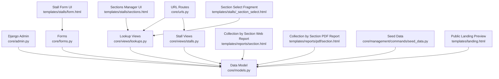
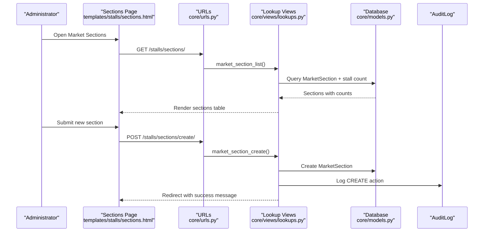
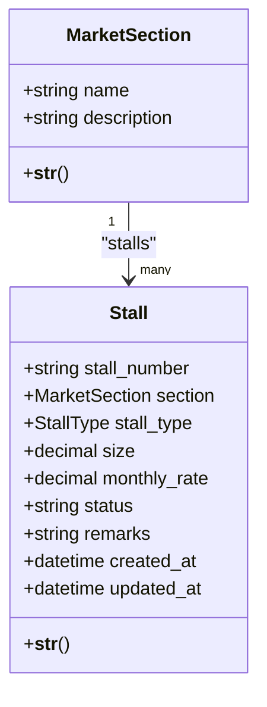
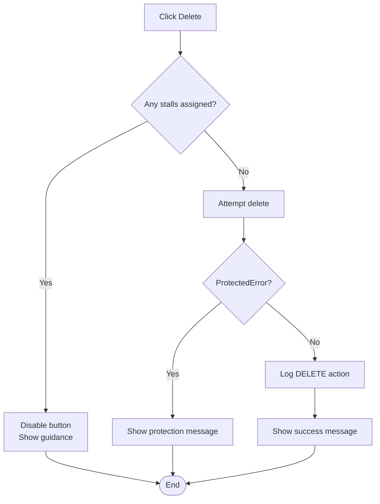
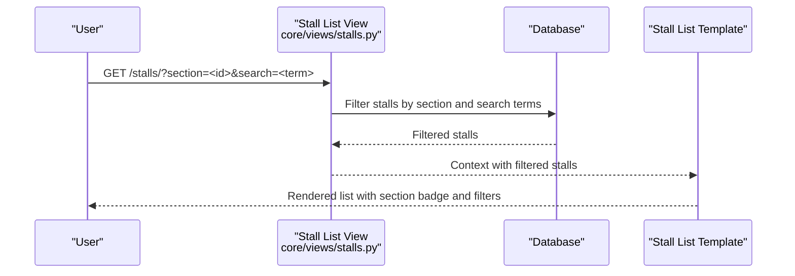
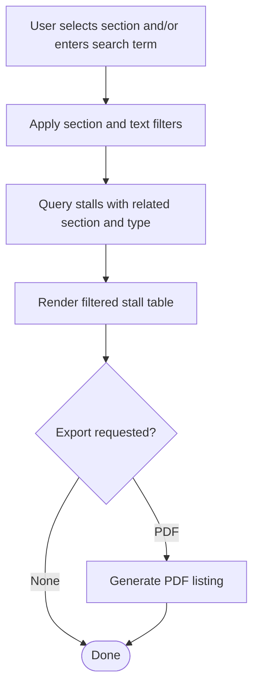
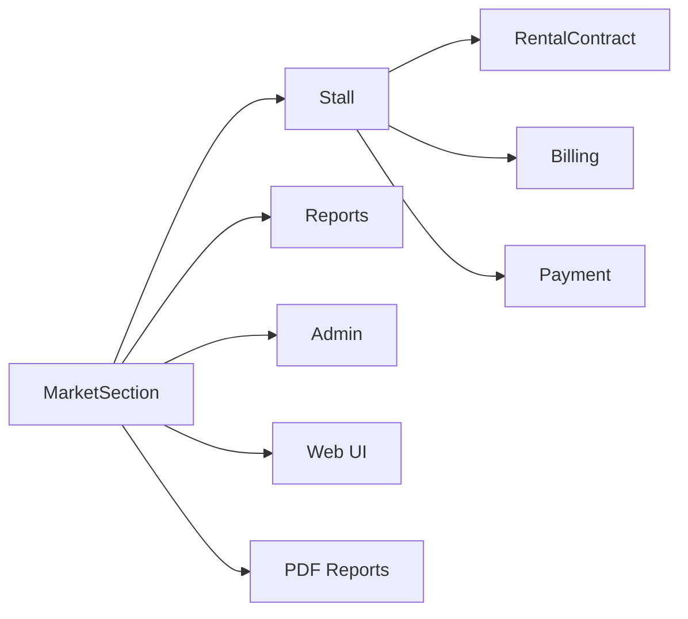

# Market Sections Management

<cite>
**Referenced Files in This Document**
- [core/models.py](file://core/models.py)
- [core/forms.py](file://core/forms.py)
- [core/views/lookups.py](file://core/views/lookups.py)
- [core/views/stalls.py](file://core/views/stalls.py)
- [core/urls.py](file://core/urls.py)
- [templates/stalls/sections.html](file://templates/stalls/sections.html)
- [templates/stalls/form.html](file://templates/stalls/form.html)
- [templates/stalls/_section_select.html](file://templates/stalls/_section_select.html)
- [templates/reports/section.html](file://templates/reports/section.html)
- [templates/reports/pdf/section.html](file://templates/reports/pdf/section.html)
- [core/admin.py](file://core/admin.py)
- [core/management/commands/seed_data.py](file://core/management/commands/seed_data.py)
- [templates/landing.html](file://templates/landing.html)
</cite>

## Table of Contents
1. [Introduction](#introduction)
2. [Project Structure](#project-structure)
3. [Core Components](#core-components)
4. [Architecture Overview](#architecture-overview)
5. [Detailed Component Analysis](#detailed-component-analysis)
6. [Dependency Analysis](#dependency-analysis)
7. [Performance Considerations](#performance-considerations)
8. [Troubleshooting Guide](#troubleshooting-guide)
9. [Conclusion](#conclusion)

## Introduction
Market sections are the top-level categories that organize stalls inside the public market. Each stall belongs to exactly one section, and sections provide a natural grouping for layout, reporting, filtering, and administration. The system includes predefined sample sections such as dry goods, fish, meat, vegetables, fruits, eatery, grocery, and rice and grains. Administrators can create custom sections, edit existing ones, and delete unused sections. Sections also power search and reporting features across the application.

## Project Structure
The market section feature spans models, forms, views, URLs, templates, admin configuration, seed data, and reports:

**Diagram sources**
- [core/admin.py:24-28](file://core/admin.py#L24-L28)
- [core/models.py:71-114](file://core/models.py#L71-L114)
- [core/forms.py:201-268](file://core/forms.py#L201-L268)
- [core/views/lookups.py:31-140](file://core/views/lookups.py#L31-L140)
- [core/views/stalls.py:17-52](file://core/views/stalls.py#L17-L52)
- [core/urls.py:93-98](file://core/urls.py#L93-L98)
- [templates/stalls/sections.html:1-132](file://templates/stalls/sections.html#L1-L132)
- [templates/stalls/form.html:33-63](file://templates/stalls/form.html#L33-L63)
- [templates/stalls/_section_select.html:1-10](file://templates/stalls/_section_select.html#L1-L10)
- [templates/reports/section.html:1-94](file://templates/reports/section.html#L1-L94)
- [templates/reports/pdf/section.html:1-47](file://templates/reports/pdf/section.html#L1-L47)
- [core/management/commands/seed_data.py:47-87](file://core/management/commands/seed_data.py#L47-L87)
- [templates/landing.html:167-184](file://templates/landing.html#L167-L184)

**Section sources**
- [core/models.py:71-114](file://core/models.py#L71-L114)
- [core/forms.py:201-268](file://core/forms.py#L201-L268)
- [core/views/lookups.py:31-140](file://core/views/lookups.py#L31-L140)
- [core/views/stalls.py:17-52](file://core/views/stalls.py#L17-L52)
- [core/urls.py:93-98](file://core/urls.py#L93-L98)
- [templates/stalls/sections.html:1-132](file://templates/stalls/sections.html#L1-L132)
- [templates/stalls/form.html:33-63](file://templates/stalls/form.html#L33-L63)
- [templates/stalls/_section_select.html:1-10](file://templates/stalls/_section_select.html#L1-L10)
- [templates/reports/section.html:1-94](file://templates/reports/section.html#L1-L94)
- [templates/reports/pdf/section.html:1-47](file://templates/reports/pdf/section.html#L1-L47)
- [core/management/commands/seed_data.py:47-87](file://core/management/commands/seed_data.py#L47-L87)
- [templates/landing.html:167-184](file://templates/landing.html#L167-L184)

## Core Components
- MarketSection model defines the category name and optional description. It is ordered alphabetically and has a unique name constraint.
- Stall model links each stall to exactly one MarketSection through a foreign key with cascade deletion.
- StallForm exposes a required Section dropdown populated from MarketSection. If no sections exist, it raises a clear validation error guiding users to configure sections first.
- Lookup views implement full CRUD for MarketSection plus an HTMX-powered quick-add endpoint used directly from the stall form.
- URL routes expose list, create, update, delete, and quick-add endpoints under stalls/sections.
- Templates render the sections manager page, inline add/edit/delete controls, and the stall form’s section field with inline creation support.
- Reports include a “Collection by Section” web and PDF report showing occupancy and financial totals per section.
- Seed data creates default sections and stalls so the system works out of the box.
- Django admin registers MarketSection for administrative browsing and searching.

**Section sources**
- [core/models.py:71-114](file://core/models.py#L71-L114)
- [core/forms.py:201-268](file://core/forms.py#L201-L268)
- [core/views/lookups.py:31-140](file://core/views/lookups.py#L31-L140)
- [core/urls.py:93-98](file://core/urls.py#L93-L98)
- [templates/stalls/sections.html:1-132](file://templates/stalls/sections.html#L1-L132)
- [templates/stalls/form.html:33-63](file://templates/stalls/form.html#L33-L63)
- [templates/reports/section.html:1-94](file://templates/reports/section.html#L1-L94)
- [templates/reports/pdf/section.html:1-47](file://templates/reports/pdf/section.html#L1-L47)
- [core/management/commands/seed_data.py:47-87](file://core/management/commands/seed_data.py#L47-L87)
- [core/admin.py:24-28](file://core/admin.py#L24-L28)

## Architecture Overview
Market sections act as the primary organizational dimension for stalls. Stalls inherit their business grouping from their assigned section. The lookup management interface allows administrators to maintain the section catalog, while stall operations rely on the section dropdown. Reports aggregate metrics by section.

**Diagram sources**
- [templates/stalls/sections.html:20-47](file://templates/stalls/sections.html#L20-L47)
- [core/urls.py:93-98](file://core/urls.py#L93-L98)
- [core/views/lookups.py:31-66](file://core/views/lookups.py#L31-L66)
- [core/models.py:71-79](file://core/models.py#L71-L79)

## Detailed Component Analysis

### Data Model and Relationships
MarketSection and Stall define the core relationship:
- MarketSection stores unique names and descriptions.
- Stall references MarketSection via a foreign key; deleting a section cascades to stalls unless protected elsewhere.
- StallType is separate and optional; it does not affect section organization.

**Diagram sources**
- [core/models.py:71-114](file://core/models.py#L71-L114)

**Section sources**
- [core/models.py:71-114](file://core/models.py#L71-L114)

### Section Creation Workflow
Administrators can create sections in two ways:

1. Full-page manager:
   - Navigate to Market Sections.
   - Enter a unique section name and optional description.
   - Submit to persist the section and log the action.

2. Inline quick-add from the stall form:
   - While adding or editing a stall, use the inline “Add” control next to the Section field.
   - Type a section name and submit via HTMX.
   - The system creates or reuses the section and refreshes the dropdown with the new option pre-selected.

```mermaid
flowchart TD
Start(["Start"]) --> ChoosePath{"Create path?"}
ChoosePath --> |Full page| OpenManager["Open Market Sections page"]
OpenManager --> FillForm["Enter name and description"]
FillForm --> ValidateName{"Unique name?"}
ValidateName --> |Yes| PersistCreate["Persist section"]
ValidateName --> |No| ShowError["Show duplicate error"]
PersistCreate --> LogCreate["Log CREATE audit entry"]
LogCreate --> SuccessMsg["Show success message"]
ChoosePath --> |Inline stall form| InlineAdd["Use inline Add control"]
InlineAdd --> HtmxPost["HTMX POST to quick-add"]
HtmxPost --> GetOrCreate["get_or_create section"]
GetOrCreate --> RefreshSelect["Return refreshed <select>"]
RefreshSelect --> SelectedOption["New option selected"]
SelectedOption --> ContinueStall["Continue filling stall form"]
ShowError --> End(["End"])
SuccessMsg --> End
ContinueStall --> End
```

**Diagram sources**
- [templates/stalls/sections.html:20-47](file://templates/stalls/sections.html#L20-L47)
- [templates/stalls/form.html:43-63](file://templates/stalls/form.html#L43-L63)
- [core/views/lookups.py:52-66](file://core/views/lookups.py#L52-L66)
- [core/views/lookups.py:114-140](file://core/views/lookups.py#L114-L140)

**Section sources**
- [templates/stalls/sections.html:20-47](file://templates/stalls/sections.html#L20-L47)
- [templates/stalls/form.html:43-63](file://templates/stalls/form.html#L43-L63)
- [core/views/lookups.py:52-66](file://core/views/lookups.py#L52-L66)
- [core/views/lookups.py:114-140](file://core/views/lookups.py#L114-L140)

### Editing Existing Sections
- On the sections manager page, click Edit for any section.
- Update the name or description.
- Save to persist changes and log the UPDATE action.
- Duplicate names are rejected with an error message.

**Section sources**
- [templates/stalls/sections.html:98-113](file://templates/stalls/sections.html#L98-L113)
- [core/views/lookups.py:69-84](file://core/views/lookups.py#L69-L84)

### Deletion Process
- Delete is available only when no stalls reference the section.
- If stalls are assigned, the Delete button is disabled and a helpful message explains the need to reassign stalls first.
- Successful deletion logs a DELETE action.
- Protected errors are caught and surfaced to the user.

**Diagram sources**
- [templates/stalls/sections.html:82-96](file://templates/stalls/sections.html#L82-L96)
- [core/views/lookups.py:87-111](file://core/views/lookups.py#L87-L111)

**Section sources**
- [templates/stalls/sections.html:82-96](file://templates/stalls/sections.html#L82-L96)
- [core/views/lookups.py:87-111](file://core/views/lookups.py#L87-L111)

### How Sections Organize Stalls
- Every stall must be assigned to a section.
- The stall form enforces this requirement and warns if no sections exist.
- The stall list supports filtering by section and searching by section name.
- Printing and exporting stall lists honor the active section filter.

**Diagram sources**
- [core/views/stalls.py:17-52](file://core/views/stalls.py#L17-L52)

**Section sources**
- [core/forms.py:201-258](file://core/forms.py#L201-L258)
- [core/views/stalls.py:17-52](file://core/views/stalls.py#L17-L52)

### Predefined Market Section Categories
The seed command creates standard sections commonly used in public markets:
- Dry Goods Section
- Fish Section
- Meat Section
- Vegetable Section
- Fruit Section
- Eatery/Carenderia Section
- Grocery Section
- Rice and Grains Section

These entries populate the stall dropdown and appear in reports and landing previews.

**Section sources**
- [core/management/commands/seed_data.py:47-87](file://core/management/commands/seed_data.py#L47-L87)
- [templates/landing.html:167-184](file://templates/landing.html#L167-L184)

### Section-Based Filtering and Reporting
- Stall list filtering:
  - Filter by section ID.
  - Search by stall number, section name, stall type, or remarks.
- Collection by Section report:
  - Shows total stalls, occupied, vacant, billed, collected, and balance per section.
  - Supports month/year filtering and export to Excel or PDF.

**Diagram sources**
- [core/views/stalls.py:17-52](file://core/views/stalls.py#L17-L52)
- [templates/reports/section.html:9-31](file://templates/reports/section.html#L9-L31)

**Section sources**
- [core/views/stalls.py:17-52](file://core/views/stalls.py#L17-L52)
- [templates/reports/section.html:9-31](file://templates/reports/section.html#L9-L31)
- [templates/reports/pdf/section.html:24-42](file://templates/reports/pdf/section.html#L24-L42)

### Relationship Between Sections and Stalls
- A stall cannot exist without a section.
- Deleting a section is blocked when stalls are still assigned.
- Changing a section’s name updates its display everywhere because stall records reference the section object.
- The stall view and print/export flows include section information for context.

**Section sources**
- [core/models.py:93-114](file://core/models.py#L93-L114)
- [core/views/lookups.py:87-111](file://core/views/lookups.py#L87-L111)
- [core/views/stalls.py:117-125](file://core/views/stalls.py#L117-L125)

### Search and Filtering by Section Name
- The stall list supports case-insensitive search across stall number, section name, stall type, and remarks.
- The Django admin stall list supports searching by section name and filtering by section.

**Section sources**
- [core/views/stalls.py:28-34](file://core/views/stalls.py#L28-L34)
- [core/admin.py:36-40](file://core/admin.py#L36-L40)

## Dependency Analysis
Market sections depend on and influence multiple parts of the system:

**Diagram sources**
- [core/models.py:71-114](file://core/models.py#L71-L114)
- [core/admin.py:24-40](file://core/admin.py#L24-L40)
- [templates/reports/section.html:34-94](file://templates/reports/section.html#L34-L94)
- [templates/reports/pdf/section.html:24-42](file://templates/reports/pdf/section.html#L24-L42)

**Section sources**
- [core/models.py:71-114](file://core/models.py#L71-L114)
- [core/admin.py:24-40](file://core/admin.py#L24-L40)
- [templates/reports/section.html:34-94](file://templates/reports/section.html#L34-L94)
- [templates/reports/pdf/section.html:24-42](file://templates/reports/pdf/section.html#L24-L42)

## Performance Considerations
- Use select_related when loading stalls with sections to reduce queries in list and view pages.
- Annotate sections with stall counts for efficient UI feedback on the sections manager.
- Keep section names concise and descriptive to improve search performance and readability.
- Avoid excessive custom sections; group logically to keep filtering meaningful.

[No sources needed since this section provides general guidance]

## Troubleshooting Guide
- Cannot create a stall without selecting a section:
  - Ensure at least one market section exists.
  - Use the sections manager or inline add control to create a section.
- Duplicate section name error:
  - Choose a unique name or rename the existing section.
- Cannot delete a section:
  - Reassign or remove stalls assigned to the section before deleting.
- Section not appearing in stall form:
  - Confirm the section was created successfully and the page was refreshed.
  - Verify HTMX quick-add succeeded and returned a refreshed select element.
- Section-based filters not working:
  - Confirm the section filter parameter is present in the URL.
  - Check that the stall list view applies the section filter correctly.

**Section sources**
- [core/forms.py:251-258](file://core/forms.py#L251-L258)
- [core/views/lookups.py:87-111](file://core/views/lookups.py#L87-L111)
- [core/views/stalls.py:24-34](file://core/views/stalls.py#L24-L34)

## Conclusion
Market sections provide a simple yet powerful way to organize stalls, guide stall categorization, and enable effective filtering and reporting. Administrators can manage sections through a dedicated interface or inline from the stall form. The system protects data integrity by preventing deletion of sections still in use and ensures consistent behavior across web and PDF reports. Properly configured sections make the market easier to navigate, analyze, and operate.