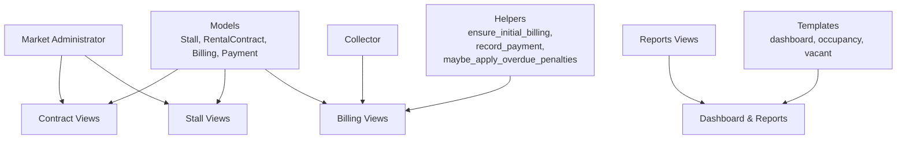
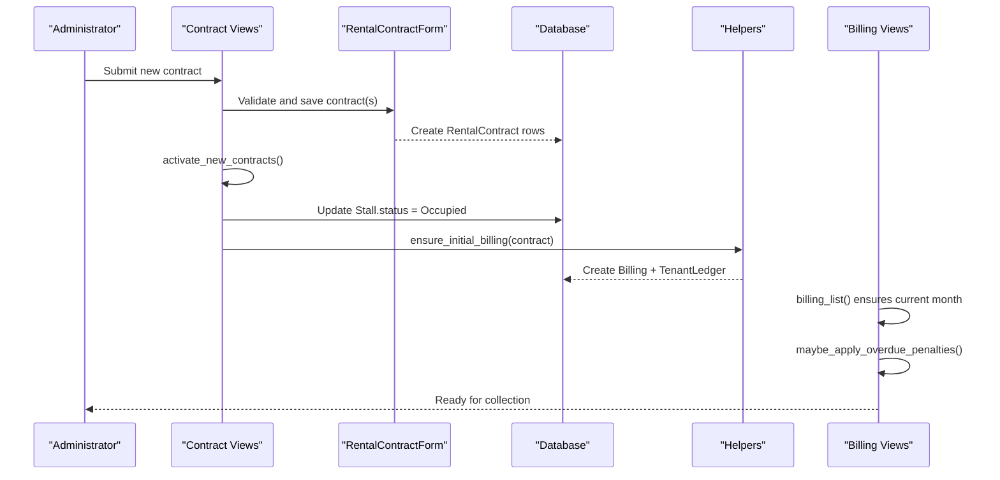
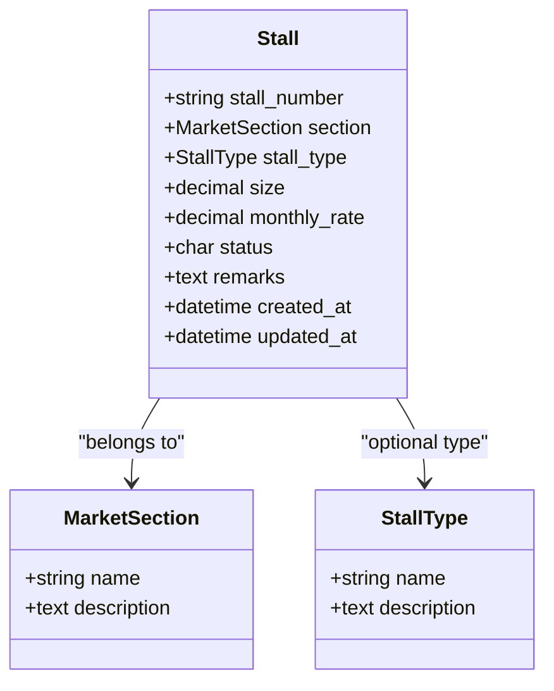
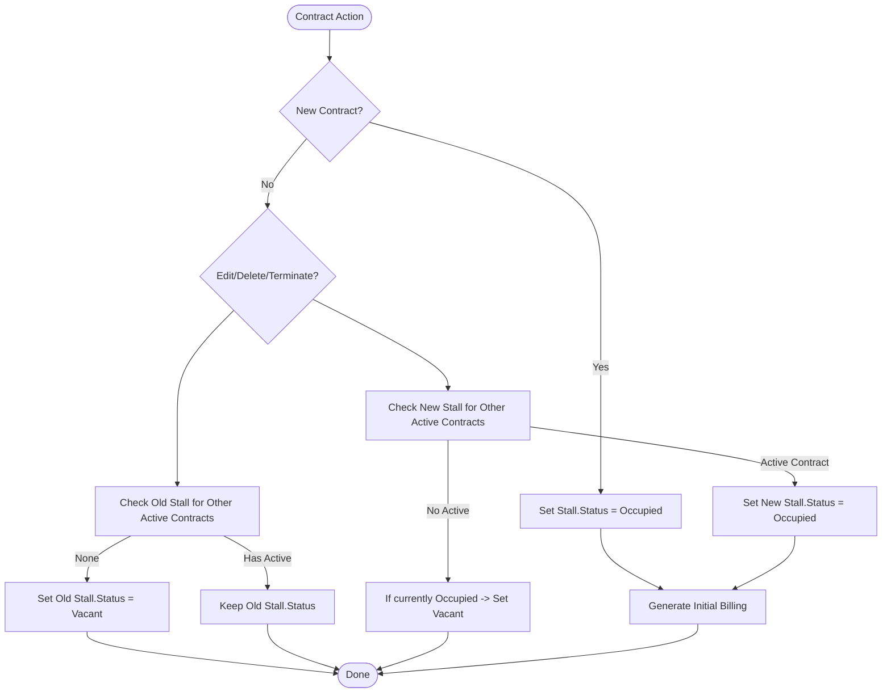
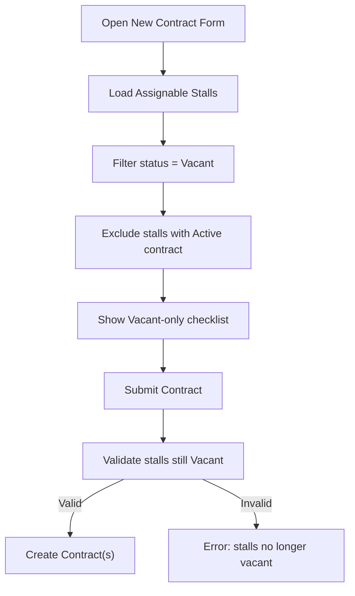
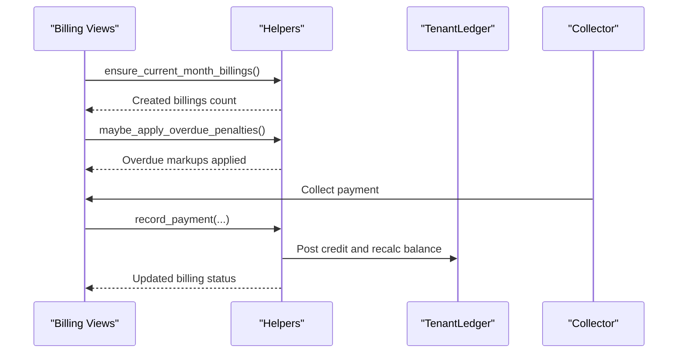
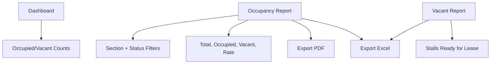
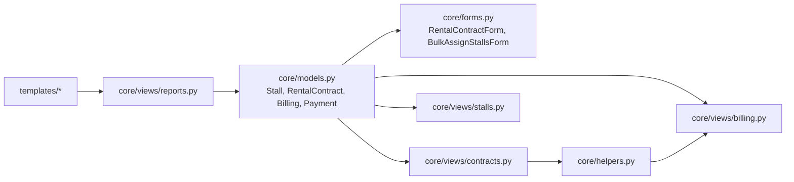

# Occupancy Status Tracking

<cite>
**Referenced Files in This Document**
- [core/models.py](file://core/models.py)
- [core/forms.py](file://core/forms.py)
- [core/views/contracts.py](file://core/views/contracts.py)
- [core/views/stalls.py](file://core/views/stalls.py)
- [core/views/billing.py](file://core/views/billing.py)
- [core/helpers.py](file://core/helpers.py)
- [core/views/reports.py](file://core/views/reports.py)
- [templates/dashboard.html](file://templates/dashboard.html)
- [templates/reports/occupancy.html](file://templates/reports/occupancy.html)
- [templates/reports/vacant.html](file://templates/reports/vacant.html)
</cite>

## Table of Contents
1. [Introduction](#introduction)
2. [Project Structure](#project-structure)
3. [Core Components](#core-components)
4. [Architecture Overview](#architecture-overview)
5. [Detailed Component Analysis](#detailed-component-analysis)
6. [Dependency Analysis](#dependency-analysis)
7. [Performance Considerations](#performance-considerations)
8. [Troubleshooting Guide](#troubleshooting-guide)
9. [Conclusion](#conclusion)

## Introduction
This document explains how occupancy status tracking works in the market rental system. It covers the four stall status states, when each should be used, how occupancy affects new contracts and tenant assignments, automatic updates during contract lifecycle, manual override procedures, business implications, integration with billing and payment collection, and reporting capabilities for occupancy statistics and vacancy analysis.

The system treats stall occupancy as a physical availability signal that is primarily synchronized by active rental contracts, while still allowing administrators to manually manage stall status for operational needs such as reservations or maintenance.

## Project Structure
Occupancy tracking spans data models, forms, views, helpers, and reports:

- Data model: Stall status is defined on the Stall model.
- Assignment logic: Contract creation and editing update stall status automatically.
- Availability filtering: Forms restrict new contracts to vacant stalls.
- Billing integration: Active contracts trigger billing generation; payments do not change stall occupancy.
- Reporting: Occupancy and vacancy reports summarize stall utilization.

**Diagram sources**
- [core/models.py:93-108](file://core/models.py#L93-L108)
- [core/views/contracts.py:20-36](file://core/views/contracts.py#L20-L36)
- [core/views/stalls.py:17-52](file://core/views/stalls.py#L17-L52)
- [core/views/billing.py:62-70](file://core/views/billing.py#L62-L70)
- [core/helpers.py:208-257](file://core/helpers.py#L208-L257)
- [templates/dashboard.html:159-182](file://templates/dashboard.html#L159-L182)
- [templates/reports/occupancy.html:1-38](file://templates/reports/occupancy.html#L1-L38)
- [templates/reports/vacant.html:1-27](file://templates/reports/vacant.html#L1-L27)

**Section sources**
- [core/models.py:93-108](file://core/models.py#L93-L108)
- [core/views/contracts.py:20-36](file://core/views/contracts.py#L20-L36)
- [core/views/stalls.py:17-52](file://core/views/stalls.py#L17-L52)
- [core/views/billing.py:62-70](file://core/views/billing.py#L62-L70)
- [core/helpers.py:208-257](file://core/helpers.py#L208-L257)
- [templates/dashboard.html:159-182](file://templates/dashboard.html#L159-L182)
- [templates/reports/occupancy.html:1-38](file://templates/reports/occupancy.html#L1-L38)
- [templates/reports/vacant.html:1-27](file://templates/reports/vacant.html#L1-L27)

## Core Components
- Stall: Holds the occupancy status and basic stall metadata.
- RentalContract: Links a tenant to a stall and defines contract lifecycle state.
- Billing: Represents monthly charges for an active contract.
- Payment: Records collections against billings.
- Forms: Restrict assignment to vacant stalls and enforce one active contract per stall.
- Helpers: Generate initial billings, apply overdue penalties, and record payments safely.
- Reports: Provide occupancy and vacancy summaries.

Key implementation anchors:
- Stall status choices include Vacant, Occupied, Reserved, and Maintenance.
- Contract activation sets stall to Occupied and generates initial billing.
- Contract edit/delete/terminate can revert stall to Vacant when no active contract remains.
- Forms expose only vacant stalls for new contracts.
- Billing list auto-generates current-month billings and applies overdue penalties.
- Occupancy report filters by section and status and shows occupancy rate.

**Section sources**
- [core/models.py:93-108](file://core/models.py#L93-L108)
- [core/models.py:157-184](file://core/models.py#L157-L184)
- [core/models.py:190-218](file://core/models.py#L190-L218)
- [core/models.py:221-258](file://core/models.py#L221-L258)
- [core/forms.py:281-400](file://core/forms.py#L281-L400)
- [core/forms.py:652-725](file://core/forms.py#L652-L725)
- [core/helpers.py:208-257](file://core/helpers.py#L208-L257)
- [core/helpers.py:351-420](file://core/helpers.py#L351-L420)
- [core/helpers.py:423-520](file://core/helpers.py#L423-L520)
- [core/views/reports.py:397-448](file://core/views/reports.py#L397-L448)

## Architecture Overview
The occupancy workflow connects contract operations to stall availability and billing generation. Payments affect financial records but not stall occupancy. Manual stall edits are supported through stall management views.

**Diagram sources**
- [core/views/contracts.py:20-36](file://core/views/contracts.py#L20-L36)
- [core/views/contracts.py:88-135](file://core/views/contracts.py#L88-L135)
- [core/forms.py:335-363](file://core/forms.py#L335-L363)
- [core/helpers.py:208-257](file://core/helpers.py#L208-L257)
- [core/views/billing.py:62-70](file://core/views/billing.py#L62-L70)

## Detailed Component Analysis

### Stall Status Model and Choices
The Stall model defines four occupancy statuses:
- Vacant: No active tenant; available for lease.
- Occupied: An active contract exists; tenant operates from the stall.
- Reserved: Stall is held for a prospective tenant or internal process; not offered to new contracts.
- Maintenance: Stall is temporarily unavailable due to repairs or cleaning; not offered to new contracts.

These choices are enforced at the model level and surfaced in forms and reports.

**Diagram sources**
- [core/models.py:71-79](file://core/models.py#L71-L79)
- [core/models.py:82-89](file://core/models.py#L82-L89)
- [core/models.py:93-108](file://core/models.py#L93-L108)

**Section sources**
- [core/models.py:93-108](file://core/models.py#L93-L108)

### Automatic Status Updates During Contract Lifecycle
When a new contract is created:
- The system marks the assigned stall as Occupied if it is not already occupied.
- Initial billing is generated for the contract’s start month up to the current month.

When a contract is edited:
- If the old stall loses its last active contract, it becomes Vacant.
- If the new stall receives an active contract, it becomes Occupied.
- If the contract is no longer active, the new stall may become Vacant if no other active contract exists.

When a contract is deleted or terminated:
- If no other active contract exists for the stall, it becomes Vacant.

**Diagram sources**
- [core/views/contracts.py:20-36](file://core/views/contracts.py#L20-L36)
- [core/views/contracts.py:138-183](file://core/views/contracts.py#L138-L183)
- [core/views/contracts.py:186-208](file://core/views/contracts.py#L186-L208)
- [core/views/contracts.py:225-246](file://core/views/contracts.py#L225-L246)

**Section sources**
- [core/views/contracts.py:20-36](file://core/views/contracts.py#L20-L36)
- [core/views/contracts.py:138-183](file://core/views/contracts.py#L138-L183)
- [core/views/contracts.py:186-208](file://core/views/contracts.py#L186-L208)
- [core/views/contracts.py:225-246](file://core/views/contracts.py#L225-L246)

### How Occupancy Affects Stall Availability for New Contracts
New contracts can only be assigned to vacant stalls. The form explicitly excludes stalls that are not Vacant and also excludes stalls that already have an active contract. Bulk assignment validates that selected stalls remain Vacant at submission time.

Business implication:
- Only Vacant stalls appear as assignable options.
- Reserved and Maintenance stalls are intentionally hidden from new contract workflows.
- Even if a stall’s status column drifts out of sync, the presence of an active contract prevents double assignment.

**Diagram sources**
- [core/forms.py:281-329](file://core/forms.py#L281-L329)
- [core/forms.py:335-363](file://core/forms.py#L335-L363)
- [core/forms.py:389-399](file://core/forms.py#L389-L399)
- [core/forms.py:652-725](file://core/forms.py#L652-L725)

**Section sources**
- [core/forms.py:281-329](file://core/forms.py#L281-L329)
- [core/forms.py:335-363](file://core/forms.py#L335-L363)
- [core/forms.py:389-399](file://core/forms.py#L389-L399)
- [core/forms.py:652-725](file://core/forms.py#L652-L725)

### Manual Status Override Procedures
Administrators can manually set stall status through stall management views and forms. The StallForm exposes the status field, and stall list/edit endpoints allow updating stall details including status.

Use cases:
- Mark a stall Reserved when a prospective tenant has been tentatively allocated.
- Mark a stall Maintenance when repairs or cleaning are underway.
- Correct status drift after administrative changes.

Important note:
- Manual overrides do not create or remove contracts. They only reflect operational availability.
- If a manual status conflicts with an active contract, contract lifecycle logic will reconcile the status when contracts are edited, deleted, or terminated.

**Section sources**
- [core/forms.py:201-258](file://core/forms.py#L201-L258)
- [core/views/stalls.py:55-97](file://core/views/stalls.py#L55-L97)
- [core/views/stalls.py:117-125](file://core/views/stalls.py#L117-L125)

### Examples of Status Transitions and Business Implications
- New contract creation:
  - Transition: Vacant → Occupied.
  - Implication: Stall is no longer available for new contracts; first billing is generated.
- Contract termination or deletion without another active contract:
  - Transition: Occupied → Vacant.
  - Implication: Stall becomes available for lease again.
- Administrative reservation:
  - Transition: Vacant → Reserved.
  - Implication: Stall is withheld from new contracts until released back to Vacant.
- Maintenance work:
  - Transition: Occupied or Vacant → Maintenance.
  - Implication: Stall is temporarily unavailable; if occupied, coordinate with tenant before marking Maintenance.

These transitions are either automatic (contract lifecycle) or manual (stall management).

**Section sources**
- [core/views/contracts.py:20-36](file://core/views/contracts.py#L20-L36)
- [core/views/contracts.py:138-183](file://core/views/contracts.py#L138-L183)
- [core/views/contracts.py:186-208](file://core/views/contracts.py#L186-L208)
- [core/views/contracts.py:225-246](file://core/views/contracts.py#L225-L246)
- [core/forms.py:201-258](file://core/forms.py#L201-L258)

### Integration With Billing Generation and Payment Collection
- Contract activation triggers initial billing generation for all applicable months.
- Billing list ensures current-month billings exist for active contracts and applies overdue penalties.
- Payments update billing totals and ledger balances but do not change stall occupancy.
- Overdue penalties are applied based on grace period and penalty configuration.

**Diagram sources**
- [core/helpers.py:208-257](file://core/helpers.py#L208-L257)
- [core/helpers.py:351-420](file://core/helpers.py#L351-L420)
- [core/helpers.py:423-520](file://core/helpers.py#L423-L520)
- [core/views/billing.py:62-70](file://core/views/billing.py#L62-L70)
- [core/views/billing.py:415-489](file://core/views/billing.py#L415-L489)

**Section sources**
- [core/helpers.py:208-257](file://core/helpers.py#L208-L257)
- [core/helpers.py:351-420](file://core/helpers.py#L351-L420)
- [core/helpers.py:423-520](file://core/helpers.py#L423-L520)
- [core/views/billing.py:62-70](file://core/views/billing.py#L62-L70)
- [core/views/billing.py:415-489](file://core/views/billing.py#L415-L489)

### Reporting Capabilities for Occupancy Statistics and Vacancy Analysis
- Dashboard displays total stalls, occupied stalls, and vacant stalls.
- Occupancy report lists stalls with filters for section and status, showing occupancy rate.
- Vacant report lists stalls ready for lease with optional section filter.
- Export options include Excel and PDF for occupancy and vacancy reports.

**Diagram sources**
- [templates/dashboard.html:159-182](file://templates/dashboard.html#L159-L182)
- [core/views/reports.py:397-448](file://core/views/reports.py#L397-L448)
- [templates/reports/occupancy.html:1-38](file://templates/reports/occupancy.html#L1-L38)
- [templates/reports/vacant.html:1-27](file://templates/reports/vacant.html#L1-L27)

**Section sources**
- [templates/dashboard.html:159-182](file://templates/dashboard.html#L159-L182)
- [core/views/reports.py:397-448](file://core/views/reports.py#L397-L448)
- [templates/reports/occupancy.html:1-38](file://templates/reports/occupancy.html#L1-L38)
- [templates/reports/vacant.html:1-27](file://templates/reports/vacant.html#L1-L27)

## Dependency Analysis
The following diagram maps key dependencies among models, forms, views, and helpers related to occupancy tracking.

**Diagram sources**
- [core/models.py:93-108](file://core/models.py#L93-L108)
- [core/forms.py:281-400](file://core/forms.py#L281-L400)
- [core/views/contracts.py:20-36](file://core/views/contracts.py#L20-L36)
- [core/views/stalls.py:17-52](file://core/views/stalls.py#L17-L52)
- [core/views/billing.py:62-70](file://core/views/billing.py#L62-L70)
- [core/helpers.py:208-257](file://core/helpers.py#L208-L257)
- [core/views/reports.py:397-448](file://core/views/reports.py#L397-L448)

**Section sources**
- [core/models.py:93-108](file://core/models.py#L93-L108)
- [core/forms.py:281-400](file://core/forms.py#L281-L400)
- [core/views/contracts.py:20-36](file://core/views/contracts.py#L20-L36)
- [core/views/stalls.py:17-52](file://core/views/stalls.py#L17-L52)
- [core/views/billing.py:62-70](file://core/views/billing.py#L62-L70)
- [core/helpers.py:208-257](file://core/helpers.py#L208-L257)
- [core/views/reports.py:397-448](file://core/views/reports.py#L397-L448)

## Performance Considerations
- Contract activation performs stall status updates and billing generation per contract; bulk assignment batches contract creation and then generates billings outside the lock to keep critical sections small.
- Billing list ensures current-month billings and applies overdue penalties once per request group using a throttled helper.
- Payment recording locks the billing row and recomputes totals authoritatively to avoid race conditions.
- Reports use pagination and selective filtering to limit dataset size.

Recommendations:
- Prefer bulk assignment for multiple stalls to reduce repeated UI round-trips.
- Use filters in reports to narrow results by section and status.
- Avoid frequent manual status overrides unless operationally necessary to prevent reconciliation overhead.

[No sources needed since this section provides general guidance]

## Troubleshooting Guide
Common issues and resolutions:
- New contract cannot find assignable stalls:
  - Cause: All desired stalls are not Vacant or already have an active contract.
  - Resolution: Release stalls to Vacant or terminate existing contracts where appropriate.
- Stall status appears inconsistent with contract state:
  - Cause: Manual override or legacy data drift.
  - Resolution: Edit or delete the relevant contract to reconcile status, or manually correct stall status after confirming contract state.
- Billing not generated for a new contract:
  - Cause: Initial billing generation failed or was skipped.
  - Resolution: Revisit billing generation or ensure the contract is Active and within the expected date range.
- Overdue penalties not appearing:
  - Cause: Grace period not exceeded or penalty settings not configured.
  - Resolution: Verify SystemSetting and PenaltySetting values; billing list triggers overdue accrual automatically.

Operational checks:
- Confirm stall status matches intended availability.
- Confirm no active contract exists on a stall marked Vacant.
- Confirm billing exists for the current month for active contracts.
- Confirm payments are recorded and billing status reflects partial or full settlement.

**Section sources**
- [core/forms.py:389-399](file://core/forms.py#L389-L399)
- [core/forms.py:652-725](file://core/forms.py#L652-L725)
- [core/views/contracts.py:20-36](file://core/views/contracts.py#L20-L36)
- [core/views/billing.py:62-70](file://core/views/billing.py#L62-L70)
- [core/helpers.py:423-520](file://core/helpers.py#L423-L520)

## Conclusion
Occupancy status tracking in this system is centered on the Stall model’s four statuses: Vacant, Occupied, Reserved, and Maintenance. Automatic synchronization occurs during contract creation, editing, deletion, and termination, ensuring that active contracts drive occupancy. Forms protect availability by restricting new contracts to vacant stalls. Billing generation and payment collection integrate tightly with active contracts but do not alter occupancy. Reporting tools provide clear visibility into occupancy rates and vacancy opportunities, supporting informed leasing decisions and operational planning.

[No sources needed since this section summarizes without analyzing specific files]