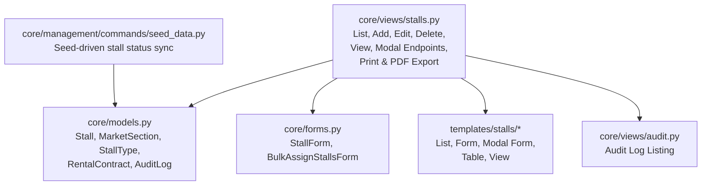
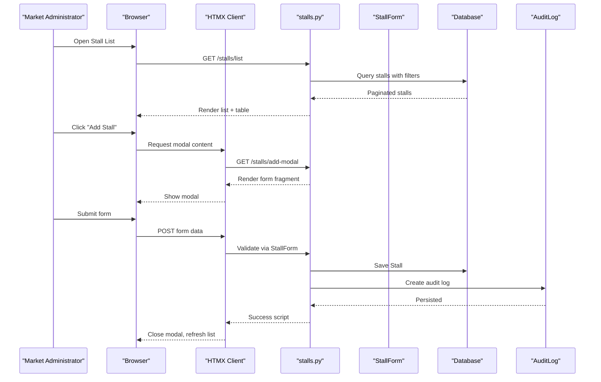
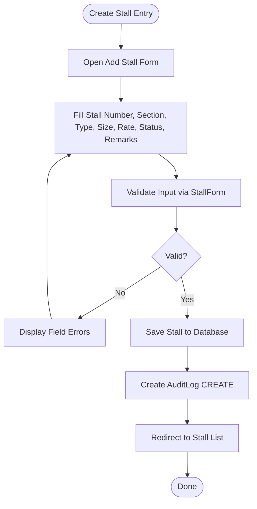
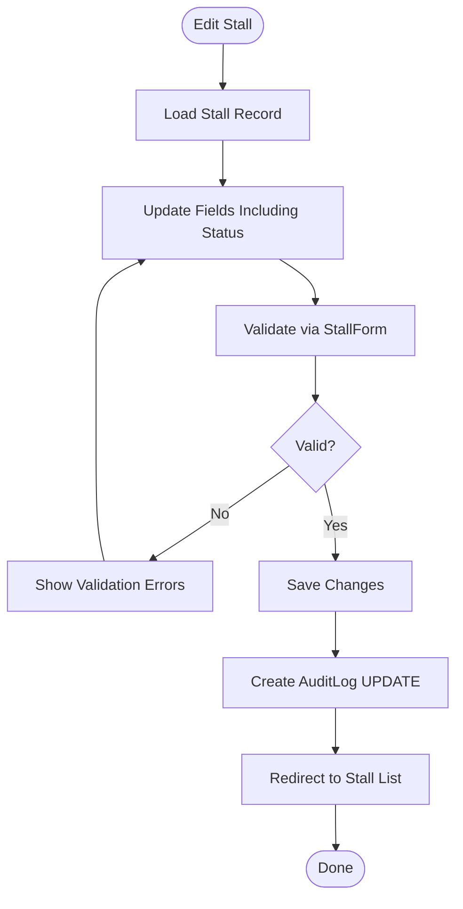
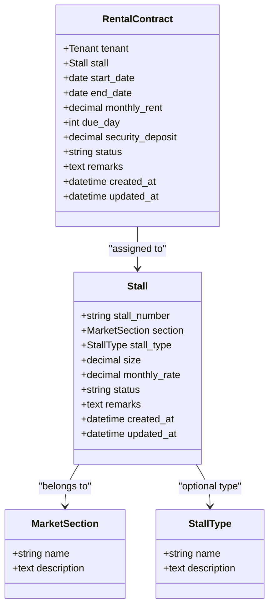
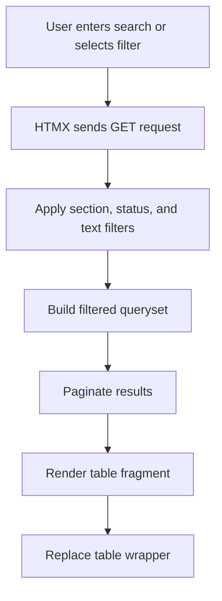
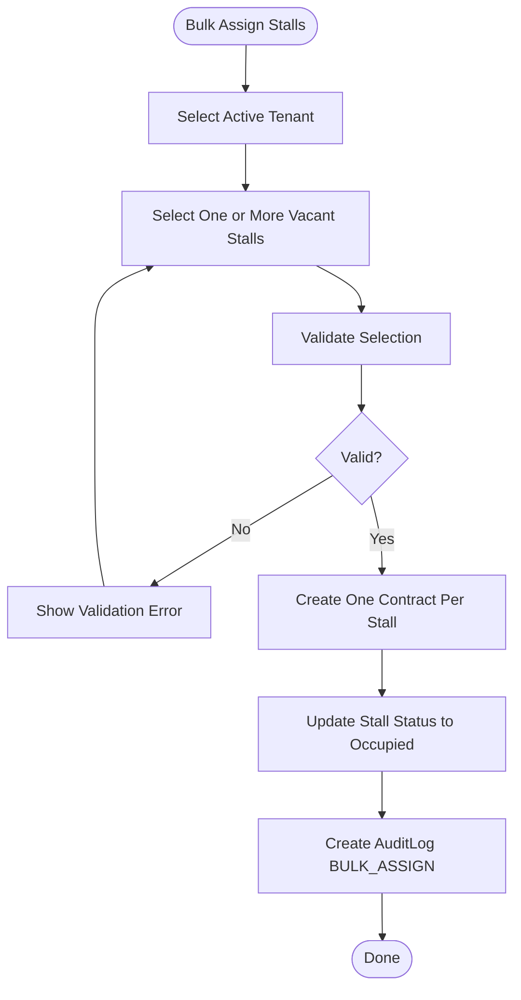
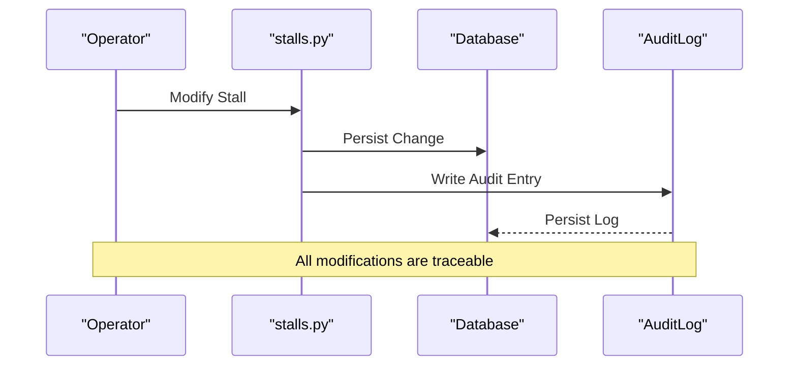
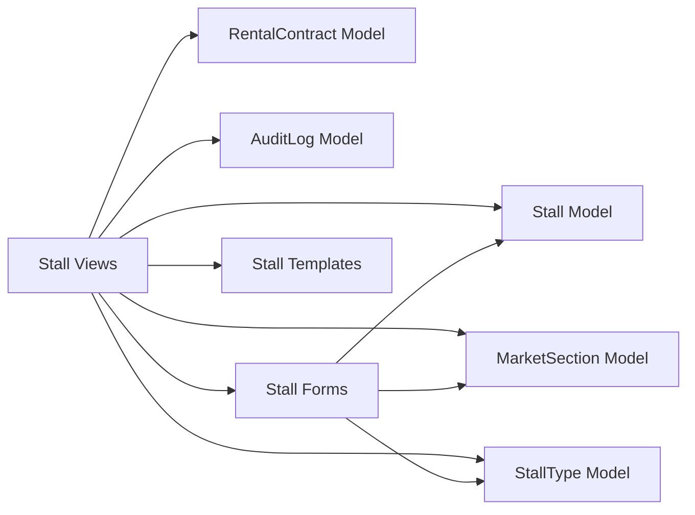

# Physical Stall Inventory

<cite>
**Referenced Files in This Document**
- [models.py](file://core/models.py)
- [stalls.py](file://core/views/stalls.py)
- [forms.py](file://core/forms.py)
- [_modal_form.html](file://templates/stalls/_modal_form.html)
- [form.html](file://templates/stalls/form.html)
- [list.html](file://templates/stalls/list.html)
- [_table.html](file://templates/stalls/_table.html)
- [view.html](file://templates/stalls/view.html)
- [audit.py](file://core/views/audit.py)
- [seed_data.py](file://core/management/commands/seed_data.py)
</cite>

## Table of Contents
1. [Introduction](#introduction)
2. [Project Structure](#project-structure)
3. [Core Components](#core-components)
4. [Architecture Overview](#architecture-overview)
5. [Detailed Component Analysis](#detailed-component-analysis)
6. [Dependency Analysis](#dependency-analysis)
7. [Performance Considerations](#performance-considerations)
8. [Troubleshooting Guide](#troubleshooting-guide)
9. [Conclusion](#conclusion)

## Introduction
This document explains the Physical Stall Inventory feature of the Market Rental System. It covers how stalls are created, edited, viewed, searched, and audited, including stall numbering conventions, location assignment through market sections, basic stall information entry, status management, remarks handling, occupancy display, historical contract viewing, validation rules, bulk operations, and audit logging integration.

The system models a physical market as collections of stalls grouped by sections and optionally classified by stall types. Each stall carries identity, pricing, availability, and notes. Contracts link tenants to stalls and drive occupancy state.

## Project Structure
Stall inventory functionality spans data models, views, forms, templates, and audit utilities:

**Diagram sources**
- [models.py:71-114](file://core/models.py#L71-L114)
- [stalls.py:17-274](file://core/views/stalls.py#L17-L274)
- [forms.py:201-258](file://core/forms.py#L201-L258)
- [list.html:1-61](file://templates/stalls/list.html#L1-L61)
- [view.html:1-192](file://templates/stalls/view.html#L1-L192)
- [audit.py:13-60](file://core/views/audit.py#L13-L60)
- [seed_data.py:342-370](file://core/management/commands/seed_data.py#L342-L370)

**Section sources**
- [models.py:71-114](file://core/models.py#L71-L114)
- [stalls.py:17-274](file://core/views/stalls.py#L17-L274)
- [forms.py:201-258](file://core/forms.py#L201-L258)
- [list.html:1-61](file://templates/stalls/list.html#L1-L61)
- [view.html:1-192](file://templates/stalls/view.html#L1-L192)
- [audit.py:13-60](file://core/views/audit.py#L13-L60)
- [seed_data.py:342-370](file://core/management/commands/seed_data.py#L342-L370)

## Core Components
- **Stall**: Represents a physical rental space with a unique stall number, assigned section, optional type, size, monthly rate, status, remarks, and timestamps.
- **MarketSection**: Groups stalls into logical areas such as “Dry Goods” or “Fish and Seafood.”
- **StallType**: Optional classification for stall categories.
- **RentalContract**: Links a tenant to a stall, defines term dates, rent, due day, deposit, status, and remarks.
- **AuditLog**: Records user actions, module, description, IP address, and timestamp.

Key relationships:
- A stall belongs to one section and may have one stall type.
- A stall can have many contracts; only one active contract is allowed per stall.
- Status values include Vacant, Occupied, Reserved, and Maintenance.

**Section sources**
- [models.py:71-114](file://core/models.py#L71-L114)
- [models.py:157-187](file://core/models.py#L157-L187)
- [models.py:304-316](file://core/models.py#L304-L316)

## Architecture Overview
The stall inventory workflow follows a standard Django request-response pattern enhanced with HTMX for modal interactions and live filtering.

**Diagram sources**
- [stalls.py:17-52](file://core/views/stalls.py#L17-L52)
- [stalls.py:55-74](file://core/views/stalls.py#L55-L74)
- [stalls.py:128-154](file://core/views/stalls.py#L128-L154)
- [forms.py:201-258](file://core/forms.py#L201-L258)
- [models.py:304-316](file://core/models.py#L304-L316)

## Detailed Component Analysis

### Stall Data Model and Numbering Conventions
- **Stall Number**: Unique identifier for each stall. The model enforces uniqueness at the database level, preventing duplicate stall numbers.
- **Location Assignment**: Every stall must be assigned to a `MarketSection`. The form requires a valid section and warns if no sections exist.
- **Optional Type**: `StallType` is optional but recommended for categorization.
- **Basic Information**: Size (square meters), monthly rate, status, and remarks are part of the stall record.
- **Timestamps**: Creation and update times are automatically tracked.

Numbering convention guidance:
- Use clear, readable identifiers such as section-based codes (for example, “A-101”).
- Keep stall numbers stable once assigned because they appear in contracts, billing, and reports.
- Avoid reusing numbers after deletion since the field is unique.

Validation rules enforced by the model and form:
- Stall number uniqueness is enforced by the database constraint.
- Section selection is required and validated against existing sections.
- Monthly rate is numeric and stored as a decimal value.
- Size is optional and numeric.
- Status defaults to Vacant unless explicitly set.
- Remarks are optional text.

**Section sources**
- [models.py:93-114](file://core/models.py#L93-L114)
- [forms.py:201-258](file://core/forms.py#L201-L258)

### Stall Creation Workflow
Creation occurs through two interfaces:
- Full-page form: `/stalls/add`
- Modal form: `/stalls/add-modal`

Both use `StallForm`, which validates inputs, ensures sections exist, and persists the stall. On success, an audit log entry is created with action “CREATE,” module “Stall,” and a description containing the stall number.

**Diagram sources**
- [stalls.py:55-74](file://core/views/stalls.py#L55-L74)
- [forms.py:201-258](file://core/forms.py#L201-L258)
- [models.py:304-316](file://core/models.py#L304-L316)

**Section sources**
- [stalls.py:55-74](file://core/views/stalls.py#L55-L74)
- [forms.py:201-258](file://core/forms.py#L201-L258)
- [model_audit_integration:304-316](file://core/models.py#L304-L316)

### Stall Editing Operations and Status Updates
Editing supports both full-page and modal workflows:
- Full-page edit: `/stalls/edit/<pk>`
- Modal edit: `/stalls/edit-modal/<pk>`

On successful save, an audit log entry is created with action “UPDATE,” module “Stall,” and a description referencing the stall number.

Status updates:
- The status field allows Vacant, Occupied, Reserved, and Maintenance.
- In normal stall editing, operators can change status directly.
- Contract lifecycle also influences status:
  - Active contracts mark a stall as Occupied.
  - Pending contracts mark a stall as Reserved.
  - Seed logic resets all stalls to Vacant before applying derived statuses from contracts.

**Diagram sources**
- [stalls.py:77-97](file://core/views/stalls.py#L77-L97)
- [stalls.py:157-184](file://core/views/stalls.py#L157-L184)
- [seed_data.py:342-370](file://core/management/commands/seed_data.py#L342-L370)

**Section sources**
- [stalls.py:77-97](file://core/views/stalls.py#L77-L97)
- [stalls.py:157-184](file://core/views/stalls.py#L157-L184)
- [seed_data.py:342-370](file://core/management/commands/seed_data.py#L342-L370)

### Remarks Management
Remarks are free-form notes attached to a stall. They are:
- Optional during creation and editing.
- Displayed on the stall detail view when present.
- Searchable across the stall list using the global search query.

Best practices:
- Use remarks for maintenance notes, special conditions, or operational instructions.
- Keep remarks concise and actionable.
- Treat remarks as supplementary context rather than a substitute for structured fields like status or type.

**Section sources**
- [models.py:93-114](file://core/models.py#L93-L114)
- [view.html:177-189](file://templates/stalls/view.html#L177-L189)
- [stalls.py:28-34](file://core/views/stalls.py#L28-L34)

### Stall View Interface
The stall detail page shows:
- Stall identity: number, section, type.
- Rental information: size, monthly rate, status.
- Timestamps: created and last updated.
- Contract history: list of contracts linked to the stall, including tenant name, start/end dates, monthly rent, and contract status.
- Remarks block: displayed only when remarks exist.

Current occupancy:
- The list table shows the active tenant for each stall when available.
- If no active contract exists, the row indicates vacancy.

Historical contracts:
- The view queries contracts for the selected stall, ordered by most recent first.
- Each contract links to its tenant for quick navigation.

**Diagram sources**
- [models.py:71-114](file://core/models.py#L71-L114)
- [models.py:157-187](file://core/models.py#L157-L187)

**Section sources**
- [view.html:1-192](file://templates/stalls/view.html#L1-L192)
- [stalls.py:117-125](file://core/views/stalls.py#L117-L125)

### Search and Filtering Capabilities
The stall list supports:
- Text search across stall number, section name, stall type name, and remarks.
- Filter by section.
- Filter by status.
- Pagination with 10 items per page.
- HTMX-powered live filtering that updates the table without full page reloads.

Search behavior:
- The search input triggers an asynchronous GET request to the list endpoint.
- Filters combine logically: section and status filters narrow results, while the text search applies substring matching across multiple fields.
- The print and PDF export endpoints support section, status, and text search, though they do not include remarks in their search scope.

**Diagram sources**
- [stalls.py:17-52](file://core/views/stalls.py#L17-L52)
- [list.html:30-55](file://templates/stalls/list.html#L30-L55)

**Section sources**
- [stalls.py:17-52](file://core/views/stalls.py#L17-L52)
- [list.html:30-55](file://templates/stalls/list.html#L30-L55)
- [stalls.py:187-213](file://core/views/stalls.py#L187-L213)
- [stalls.py:216-243](file://core/views/stalls.py#L216-L243)

### Examples of Stall Data Entry
Typical data entry patterns:
- New stall:
  - Enter a unique stall number.
  - Select an existing section.
  - Optionally select a stall type.
  - Enter size in square meters.
  - Enter monthly rental rate.
  - Set initial status, commonly Vacant.
  - Add remarks if needed.
- Existing stall:
  - Update any field except stall number uniqueness constraints.
  - Adjust status based on operational needs.
  - Update remarks to reflect changes.

Example scenarios:
- Registering a new dry goods stall in section “Dry Goods Section” with a monthly rate and Vacant status.
- Marking a stall as Maintenance while it undergoes repairs.
- Adding remarks about electrical upgrades or signage restrictions.

Note: These examples describe usage patterns; actual implementation details are found in the referenced files.

**Section sources**
- [forms.py:201-258](file://core/forms.py#L201-L258)
- [form.html:21-113](file://templates/stalls/form.html#L21-L113)
- [_modal_form.html:45-119](file://templates/stalls/_modal_form.html#L45-L119)

### Bulk Operations
Bulk operations primarily apply to assigning stalls to tenants rather than creating stalls in bulk. The system provides:
- Multi-stall contract creation through the contract form’s checklist interface.
- A dedicated `BulkAssignStallsForm` that lets administrators assign one tenant to multiple vacant stalls in a single submission.

Bulk assignment rules:
- Only stalls that are Vacant and do not already have an active contract are offered.
- At least one stall must be selected.
- Each selected stall receives its own contract using its own monthly rate.
- The form re-validates vacancy at submission time to prevent race conditions.
- Successful bulk assignments create audit logs and update stall statuses to Occupied where appropriate.

**Diagram sources**
- [forms.py:652-725](file://core/forms.py#L652-L725)
- [test_bulk_assign.py:16-129](file://core/test_bulk_assign.py#L16-L129)

**Section sources**
- [forms.py:652-725](file://core/forms.py#L652-L725)
- [test_bulk_assign.py:16-129](file://core/test_bulk_assign.py#L16-L129)

### Validation Rules Summary
- **Stall Number**: Must be unique.
- **Section**: Required; must exist; form raises a helpful error if no sections are configured.
- **Stall Type**: Optional; must exist if provided.
- **Size**: Optional numeric value.
- **Monthly Rate**: Required numeric value.
- **Status**: Must be one of the defined choices.
- **Remarks**: Optional text.
- **Active Contract Constraint**: Only one active contract per stall is allowed.
- **Bulk Assignment**: Only offers stalls that are Vacant and lack an active contract; re-checks at submission time.

**Section sources**
- [models.py:93-114](file://core/models.py#L93-L114)
- [models.py:157-187](file://core/models.py#L157-L187)
- [forms.py:201-258](file://core/forms.py#L201-L258)
- [forms.py:652-725](file://core/forms.py#L652-L725)

### Integration with Audit Logging
Every stall modification is recorded in the audit log:
- Creation: action “CREATE,” module “Stall,” description includes stall number.
- Update: action “UPDATE,” module “Stall,” description includes stall number.
- Deletion: action “DELETE,” module “Stall,” description includes stall number.

Audit entries capture:
- User who performed the action.
- Action type.
- Module name.
- Human-readable description.
- IP address.
- Timestamp.

Administrators can browse and filter audit logs by user, action, module, date range, and free-text search.

**Diagram sources**
- [stalls.py:55-74](file://core/views/stalls.py#L55-L74)
- [stalls.py:77-97](file://core/views/stalls.py#L77-L97)
- [stalls.py:100-114](file://core/views/stalls.py#L100-L114)
- [audit.py:13-60](file://core/views/audit.py#L13-L60)

**Section sources**
- [stalls.py:55-74](file://core/views/stalls.py#L55-L74)
- [stalls.py:77-97](file://core/views/stalls.py#L77-L97)
- [stalls.py:100-114](file://core/views/stalls.py#L100-L114)
- [audit.py:13-60](file://core/views/audit.py#L13-L60)

## Dependency Analysis
The stall inventory depends on several core components:

**Diagram sources**
- [models.py:71-114](file://core/models.py#L71-L114)
- [models.py:157-187](file://core/models.py#L157-L187)
- [models.py:304-316](file://core/models.py#L304-L316)
- [stalls.py:1-10](file://core/views/stalls.py#L1-L10)
- [forms.py:201-258](file://core/forms.py#L201-L258)

**Section sources**
- [models.py:71-114](file://core/models.py#L71-L114)
- [models.py:157-187](file://core/models.py#L157-L187)
- [models.py:304-316](file://core/models.py#L304-L316)
- [stalls.py:1-10](file://core/views/stalls.py#L1-L10)
- [forms.py:201-258](file://core/forms.py#L201-L258)

## Performance Considerations
- **Query Optimization**: Stall list and view endpoints use `select_related` to reduce N+1 queries for section, stall type, and related contracts.
- **Pagination**: The stall list paginates results to keep rendering efficient.
- **HTMX Filtering**: Live filtering updates only the table fragment, reducing bandwidth and improving responsiveness.
- **Indexing Recommendations**: For large inventories, consider database indexes on frequently filtered columns such as `stall_number`, `section_id`, `status`, and `created_at`.
- **Audit Log Growth**: Audit logs accumulate over time; periodic archival or retention policies may be necessary for high-volume environments.

[No sources needed since this section provides general guidance]

## Troubleshooting Guide
Common issues and resolutions:
- **Cannot create a stall**: Ensure at least one market section exists. The form explicitly rejects submissions when no sections are configured.
- **Duplicate stall number error**: The database enforces uniqueness; choose a different stall number.
- **Invalid section or stall type**: Re-select from the dropdowns; these fields validate against existing records.
- **Status mismatch with contracts**: Contract lifecycle drives status. Active contracts make stalls Occupied; pending contracts make them Reserved. Seed logic resets stalls to Vacant before applying derived statuses.
- **Search returns no results**: Verify filters and spelling; the search matches substrings across stall number, section, type, and remarks.
- **Audit log missing**: Confirm that the operation went through a view that writes audit logs; creation, update, and delete endpoints for stalls write logs.

**Section sources**
- [forms.py:251-258](file://core/forms.py#L251-L258)
- [models.py:93-114](file://core/models.py#L93-L114)
- [seed_data.py:342-370](file://core/management/commands/seed_data.py#L342-L370)
- [stalls.py:17-52](file://core/views/stalls.py#L17-L52)
- [stalls.py:55-114](file://core/views/stalls.py#L55-L114)

## Conclusion
Physical Stall Inventory provides a robust foundation for managing market stalls. It enforces data integrity through unique stall numbers, required section assignment, and controlled status values. Operators can create, edit, view, search, and audit stalls efficiently, while contracts drive occupancy and historical tracking. Bulk assignment capabilities streamline multi-stall operations, and audit logging ensures accountability for every modification.

[No sources needed since this section summarizes without analyzing specific files]