# Stall Management Module

<cite>
**Referenced Files in This Document**
- [core/models.py](file://core/models.py)
- [core/forms.py](file://core/forms.py)
- [core/views/stalls.py](file://core/views/stalls.py)
- [templates/stalls/list.html](file://templates/stalls/list.html)
- [templates/stalls/_table.html](file://templates/stalls/_table.html)
- [templates/stalls/form.html](file://templates/stalls/form.html)
- [templates/stalls/sections.html](file://templates/stalls/sections.html)
- [templates/stalls/stall_types.html](file://templates/stalls/stall_types.html)
- [templates/stalls/print_list.html](file://templates/stalls/print_list.html)
- [templates/stalls/print_view.html](file://templates/stalls/print_view.html)
- [templates/contracts/bulk_assign.html](file://templates/contracts/bulk_assign.html)
- [templates/contracts/_stall_picker.html](file://templates/contracts/_stall_picker.html)
- [core/test_bulk_assign.py](file://core/test_bulk_assign.py)
</cite>

## Table of Contents
1. [Introduction](#introduction)
2. [Project Structure](#project-structure)
3. [Core Components](#core-components)
4. [Architecture Overview](#architecture-overview)
5. [Detailed Component Analysis](#detailed-component-analysis)
6. [Dependency Analysis](#dependency-analysis)
7. [Performance Considerations](#performance-considerations)
8. [Troubleshooting Guide](#troubleshooting-guide)
9. [Conclusion](#conclusion)

## Introduction
This document explains the Stall Management module that governs market sections, stall types, physical stalls, occupancy status, and the assignment workflow into rental contracts. It covers:

- Market section administration for predefined categories such as dry goods, fish, meat, vegetables, fruits, eatery, grocery, rice and grains, plus custom sections.
- Stall type definitions and optional classification of stalls.
- Physical stall inventory management including number, size, monthly rate, remarks, and status.
- Occupancy status tracking with Vacant, Occupied, Reserved, and Under Maintenance.
- The stall assignment workflow ensuring one active tenant per stall.
- Examples of stall creation, editing, transfer operations, and bulk management.
- Integration with rental contracts and how stall availability affects contract creation.
- Search and filtering by section, status, and search terms.
- Print functionality for stall inventories and individual stall reports.

## Project Structure
The stall management feature spans models, forms, views, and templates:

- Data model: `MarketSection`, `StallType`, `Stall`, and `RentalContract`.
- Forms: `StallForm`, `MarketSectionForm`, `StallTypeForm`, `RentalContractForm`, and `BulkAssignStallsForm`.
- Views: stall list, add/edit/delete, print/export, and view details.
- Templates: stall list, form, sections management, stall types management, print layouts, and contract assignment UI.

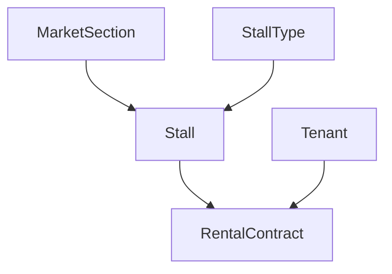

**Diagram sources**
- [core/models.py:71-114](file://core/models.py#L71-L114)
- [core/models.py:157-187](file://core/models.py#L157-L187)

**Section sources**
- [core/models.py:71-114](file://core/models.py#L71-L114)
- [core/models.py:157-187](file://core/models.py#L157-L187)

## Core Components
- Market sections are named, unique categories used to group stalls. They can represent standard market sections or custom administrative zones.
- Stall types are optional classifications describing the business category or layout characteristics of a stall.
- Stalls are physical units identified by a unique stall number, linked to a section and optionally a stall type, with size, monthly rate, status, and remarks.
- Rental contracts bind an active tenant to a stall for a defined period and enforce one active contract per stall.

Key responsibilities:
- Sections and types are reference data managed through dedicated pages.
- Stalls are created, edited, viewed, deleted, filtered, searched, and printed.
- Contracts are created from vacant stalls; the system enforces one active tenant per stall.

**Section sources**
- [core/models.py:71-114](file://core/models.py#L71-L114)
- [core/models.py:157-187](file://core/models.py#L157-L187)

## Architecture Overview
The stall management flow connects user interfaces to Django views and models:

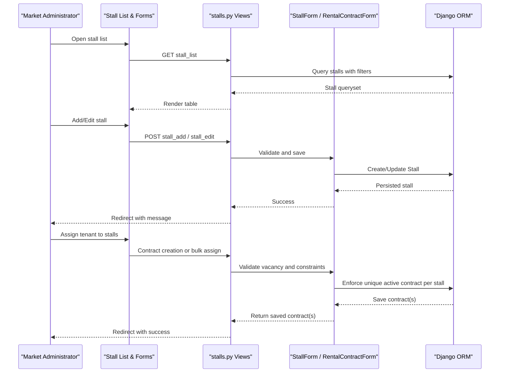

**Diagram sources**
- [core/views/stalls.py:17-52](file://core/views/stalls.py#L17-L52)
- [core/views/stalls.py:55-97](file://core/views/stalls.py#L55-L97)
- [core/forms.py:201-258](file://core/forms.py#L201-L258)
- [core/forms.py:281-399](file://core/forms.py#L281-L399)
- [core/models.py:157-187](file://core/models.py#L157-L187)

## Detailed Component Analysis

### Market Sections Administration
Market sections define the grouping of stalls. Administrators can:

- Add new sections with name and description.
- Edit existing sections inline.
- Delete sections only when no stalls reference them.
- See how many stalls belong to each section.

Predefined categories like dry goods, fish, meat, vegetables, fruits, eatery, grocery, and rice and grains are typically represented as sections. Custom sections can be added at any time.

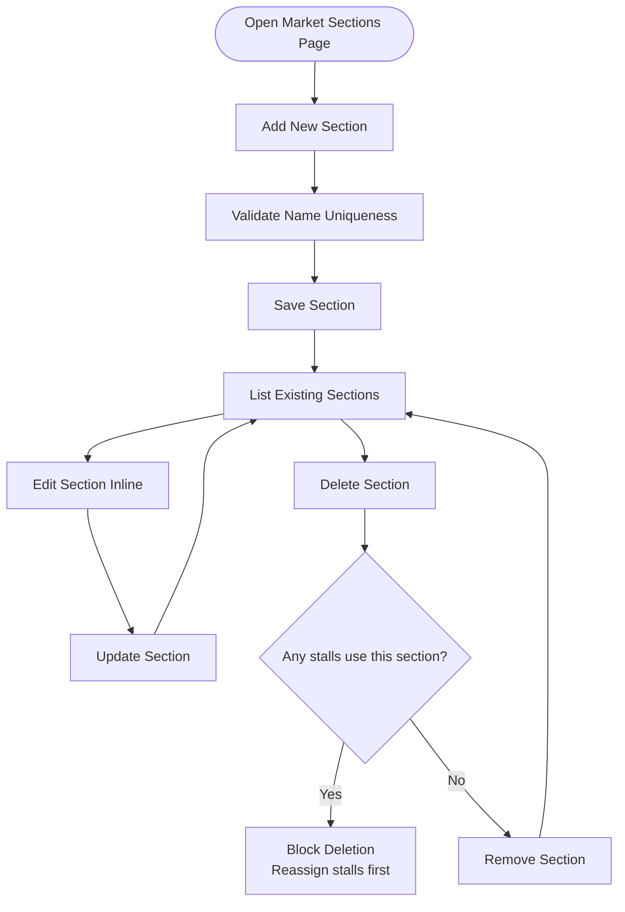

**Diagram sources**
- [templates/stalls/sections.html:20-47](file://templates/stalls/sections.html#L20-L47)
- [templates/stalls/sections.html:49-127](file://templates/stalls/sections.html#L49-L127)
- [core/models.py:71-79](file://core/models.py#L71-L79)

**Section sources**
- [templates/stalls/sections.html:20-47](file://templates/stalls/sections.html#L20-L47)
- [templates/stalls/sections.html:49-127](file://templates/stalls/sections.html#L49-L127)
- [core/models.py:71-79](file://core/models.py#L71-L79)

### Stall Types Definitions
Stall types are optional labels that describe the nature of a stall’s business or layout. Administrators can:

- Add new stall types with name and description.
- Edit existing stall types inline.
- Delete stall types; associated stalls will have their type cleared rather than being deleted.

Common examples include Dry Goods, Fish and Seafood, Meat and Poultry, Vegetables, Fruits, Eatery/Carenderia, Grocery/Sari-sari Store, Rice and Grains, Clothing/Apparel, Electronics/Appliances, Services, and Others.

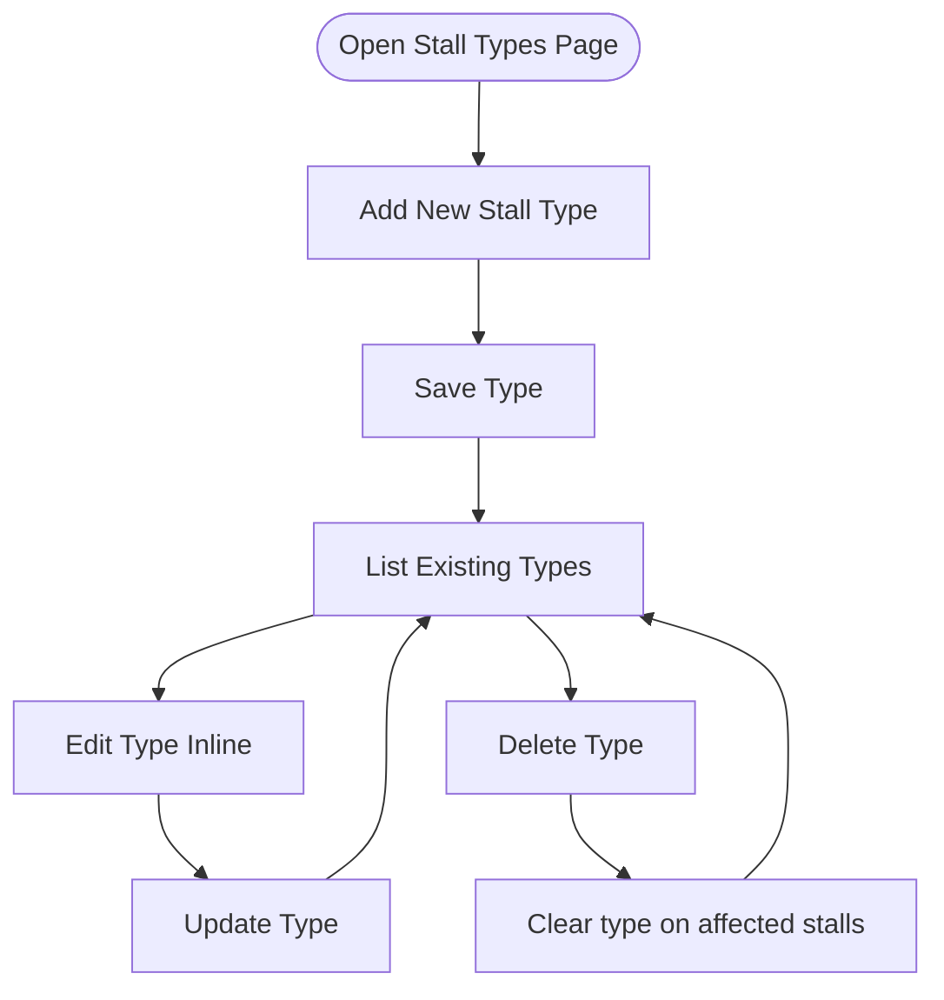

**Diagram sources**
- [templates/stalls/stall_types.html:20-47](file://templates/stalls/stall_types.html#L20-L47)
- [templates/stalls/stall_types.html:49-120](file://templates/stalls/stall_types.html#L49-L120)
- [core/models.py:82-90](file://core/models.py#L82-L90)

**Section sources**
- [templates/stalls/stall_types.html:20-47](file://templates/stalls/stall_types.html#L20-L47)
- [templates/stalls/stall_types.html:49-120](file://templates/stalls/stall_types.html#L49-L120)
- [core/models.py:82-90](file://core/models.py#L82-L90)

### Physical Stall Inventory Management
A stall represents a physical space in the market. Its attributes include:

- Unique stall number.
- Section association.
- Optional stall type.
- Size in square meters.
- Monthly rental rate.
- Status: Vacant, Occupied, Reserved, or Under Maintenance.
- Remarks.

Administrators can create stalls, edit them, delete them, and view detailed information including current and historical contracts.

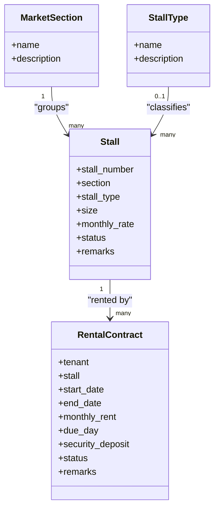

**Diagram sources**
- [core/models.py:71-114](file://core/models.py#L71-L114)
- [core/models.py:157-187](file://core/models.py#L157-L187)

**Section sources**
- [core/models.py:93-114](file://core/models.py#L93-L114)
- [core/views/stalls.py:55-97](file://core/views/stalls.py#L55-L97)
- [core/views/stalls.py:117-125](file://core/views/stalls.py#L117-L125)

### Occupancy Status Tracking
Stall statuses:

- Vacant: Available for assignment.
- Occupied: Currently rented by an active tenant.
- Reserved: Temporarily held but not yet assigned.
- Under Maintenance: Not available due to maintenance work.

The stall list displays status badges and shows the active tenant when present. Filtering supports all four statuses.

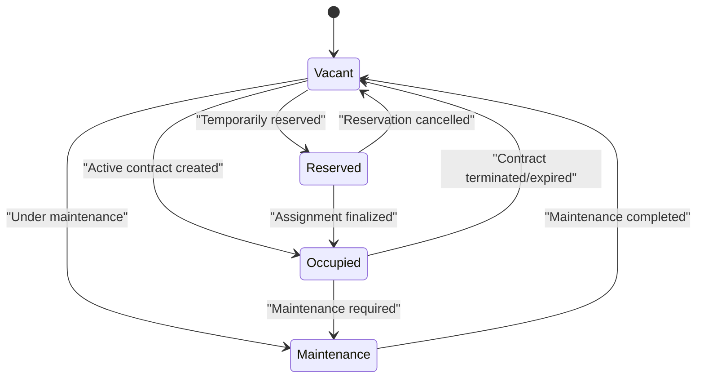

**Diagram sources**
- [core/models.py:93-105](file://core/models.py#L93-L105)
- [templates/stalls/list.html:43-49](file://templates/stalls/list.html#L43-L49)

**Section sources**
- [core/models.py:93-105](file://core/models.py#L93-L105)
- [templates/stalls/list.html:43-49](file://templates/stalls/list.html#L43-L49)

### Stall Assignment Workflow and One Active Tenant Constraint
The system ensures that a stall has at most one active tenant:

- Database constraint: A unique constraint prevents more than one active contract per stall.
- Form validation: Creating or editing a contract checks for existing active contracts on the selected stall.
- Availability: Only vacant stalls without active contracts appear in assignment lists.
- Bulk assignment: Multiple stalls can be assigned to one tenant in a single operation, creating one contract per stall.

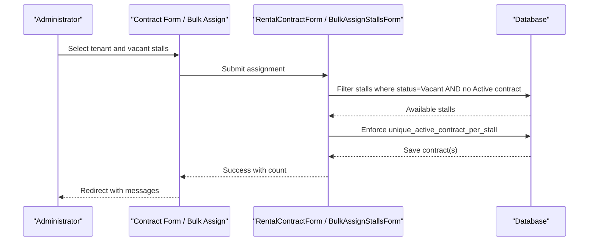

**Diagram sources**
- [core/models.py:176-184](file://core/models.py#L176-L184)
- [core/forms.py:297-399](file://core/forms.py#L297-L399)
- [core/forms.py:652-725](file://core/forms.py#L652-L725)

**Section sources**
- [core/models.py:176-184](file://core/models.py#L176-L184)
- [core/forms.py:297-399](file://core/forms.py#L297-L399)
- [core/forms.py:652-725](file://core/forms.py#L652-L725)

### Examples of Stall Creation, Editing, Transfer, and Bulk Management

#### Stall Creation
- Navigate to the stall list and open the add modal or full form.
- Provide stall number, select a section, optionally choose a stall type, set size and monthly rate, choose status, and add remarks.
- On successful save, an audit log entry is created and the user is redirected to the stall list.

**Section sources**
- [core/views/stalls.py:55-74](file://core/views/stalls.py#L55-L74)
- [templates/stalls/form.html:21-113](file://templates/stalls/form.html#L21-L113)
- [core/forms.py:201-258](file://core/forms.py#L201-L258)

#### Stall Editing
- From the stall list, open the edit modal or full form.
- Update fields such as section, stall type, size, monthly rate, status, and remarks.
- On successful save, an audit log entry is created and the user is redirected to the stall list.

**Section sources**
- [core/views/stalls.py:77-97](file://core/views/stalls.py#L77-L97)
- [templates/stalls/form.html:21-113](file://templates/stalls/form.html#L21-L113)
- [core/forms.py:201-258](file://core/forms.py#L201-L258)

#### Stall Transfer (Occupancy Change)
Transferring a stall means changing its occupancy state:

- If assigning a new tenant, create a rental contract for a vacant stall. The system validates vacancy and enforces one active tenant per stall.
- If releasing a tenant, terminate or expire the active contract so the stall becomes vacant again.
- If temporarily holding a stall, set its status to Reserved.
- If performing maintenance, set its status to Under Maintenance.

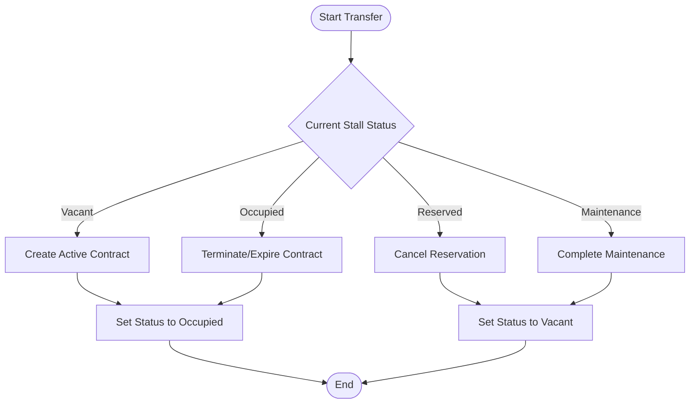

**Diagram sources**
- [core/forms.py:297-399](file://core/forms.py#L297-L399)
- [core/models.py:93-105](file://core/models.py#L93-L105)

#### Bulk Management
- Use the bulk assignment interface to assign one tenant to multiple vacant stalls in a single operation.
- Each selected stall receives its own contract using its own monthly rate.
- Validation ensures only truly vacant stalls without active contracts are accepted.
- Tests verify behavior for multiple stalls, rejection of occupied stalls, and rollback when stalls become unavailable between validation and persistence.

**Section sources**
- [templates/contracts/bulk_assign.html:1-102](file://templates/contracts/bulk_assign.html#L1-L102)
- [templates/contracts/_stall_picker.html:1-70](file://templates/contracts/_stall_picker.html#L1-L70)
- [core/forms.py:652-725](file://core/forms.py#L652-L725)
- [core/test_bulk_assign.py:16-153](file://core/test_bulk_assign.py#L16-L153)

### Search and Filtering
The stall list supports:

- Section filter: Narrow results to a specific market section.
- Status filter: Narrow results to Vacant, Occupied, Reserved, or Under Maintenance.
- Text search: Search across stall number, section name, stall type name, and remarks.
- Pagination: Paginated results with HTMX-driven table updates.

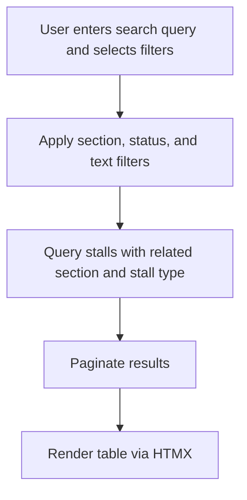

**Diagram sources**
- [core/views/stalls.py:17-52](file://core/views/stalls.py#L17-L52)
- [templates/stalls/list.html:30-55](file://templates/stalls/list.html#L30-L55)

**Section sources**
- [core/views/stalls.py:17-52](file://core/views/stalls.py#L17-L52)
- [templates/stalls/list.html:30-55](file://templates/stalls/list.html#L30-L55)

### Print Functionality
The module provides print and PDF export capabilities:

- Stall list print preview: Renders a printable table of stalls with applied filters and system settings.
- Stall list PDF export: Generates a PDF file named with the current date.
- Individual stall print preview: Shows stall details and contract history.
- Individual stall PDF export: Generates a PDF file named with the stall number and current date.

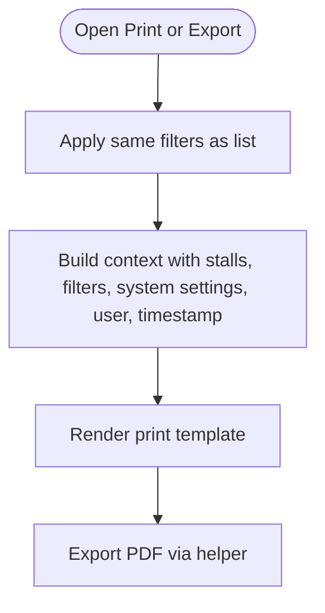

**Diagram sources**
- [core/views/stalls.py:187-243](file://core/views/stalls.py#L187-L243)
- [core/views/stalls.py:246-274](file://core/views/stalls.py#L246-L274)
- [templates/stalls/print_list.html:1-55](file://templates/stalls/print_list.html#L1-L55)
- [templates/stalls/print_view.html:1-46](file://templates/stalls/print_view.html#L1-L46)

**Section sources**
- [core/views/stalls.py:187-243](file://core/views/stalls.py#L187-L243)
- [core/views/stalls.py:246-274](file://core/views/stalls.py#L246-L274)
- [templates/stalls/print_list.html:1-55](file://templates/stalls/print_list.html#L1-L55)
- [templates/stalls/print_view.html:1-46](file://templates/stalls/print_view.html#L1-L46)

## Dependency Analysis
The stall management module depends on:

- Models: `MarketSection`, `StallType`, `Stall`, `RentalContract`, `Tenant`.
- Forms: `StallForm`, `RentalContractForm`, `BulkAssignStallsForm`.
- Views: stall CRUD and print/export endpoints.
- Templates: list, form, sections, stall types, print layouts, and contract assignment UI.

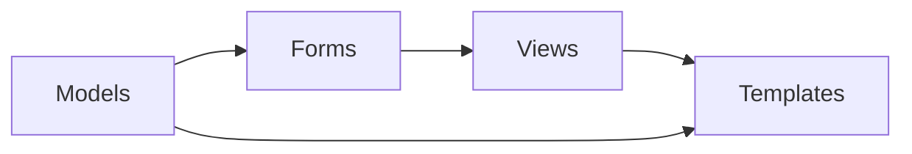

**Diagram sources**
- [core/models.py:71-114](file://core/models.py#L71-L114)
- [core/forms.py:201-258](file://core/forms.py#L201-L258)
- [core/views/stalls.py:17-52](file://core/views/stalls.py#L17-L52)
- [templates/stalls/list.html:1-61](file://templates/stalls/list.html#L1-L61)

**Section sources**
- [core/models.py:71-114](file://core/models.py#L71-L114)
- [core/forms.py:201-258](file://core/forms.py#L201-L258)
- [core/views/stalls.py:17-52](file://core/views/stalls.py#L17-L52)
- [templates/stalls/list.html:1-61](file://templates/stalls/list.html#L1-L61)

## Performance Considerations
- Use select_related for section and stall_type when listing stalls to reduce database queries.
- Keep filters selective to avoid large result sets.
- Prefer HTMX partial updates for the stall table to minimize page reloads.
- For bulk assignments, rely on form-level validation and database constraints to prevent race conditions.

[No sources needed since this section provides general guidance]

## Troubleshooting Guide
Common issues and resolutions:

- No sections configured:
  - Symptom: Stall form cannot be submitted because no sections exist.
  - Resolution: Add at least one market section before creating stalls.

- Duplicate tenant names:
  - Symptom: Tenant form rejects duplicate names after normalization.
  - Resolution: Edit the existing tenant record instead of creating a duplicate.

- Stall already has an active contract:
  - Symptom: Contract creation fails with a validation error indicating the stall already has an active tenant.
  - Resolution: Terminate or expire the existing active contract before assigning a new one.

- Selected stalls are no longer vacant:
  - Symptom: Bulk assignment fails because stalls changed status between selection and submission.
  - Resolution: Refresh the page and reselect available stalls.

- Cannot delete a section:
  - Symptom: Delete button is disabled for a section with stalls.
  - Resolution: Reassign stalls to another section before deleting.

**Section sources**
- [core/forms.py:251-258](file://core/forms.py#L251-L258)
- [core/forms.py:156-198](file://core/forms.py#L156-L198)
- [core/forms.py:389-399](file://core/forms.py#L389-L399)
- [core/forms.py:709-717](file://core/forms.py#L709-L717)
- [templates/stalls/sections.html:85-94](file://templates/stalls/sections.html#L85-L94)

## Conclusion
The Stall Management module provides robust administration of market sections, stall types, and physical stalls, along with clear occupancy tracking and a secure assignment workflow. It integrates tightly with rental contracts to ensure one active tenant per stall, supports efficient search and filtering, and offers comprehensive print and PDF export capabilities for operational reporting.

[No sources needed since this section summarizes without analyzing specific files]