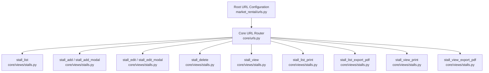
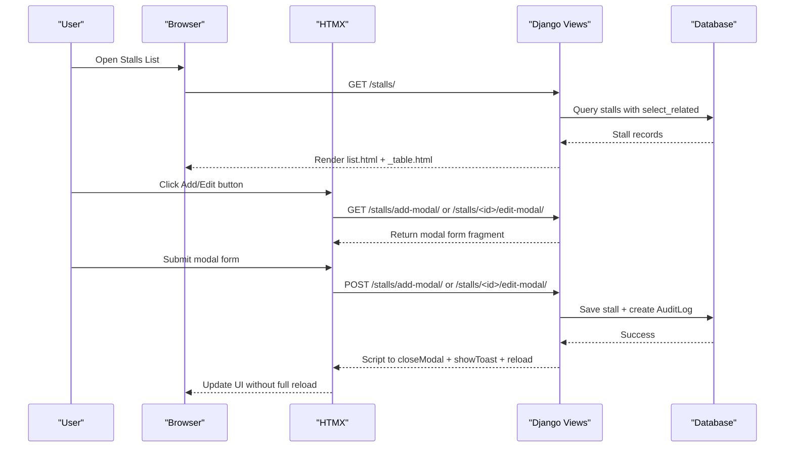
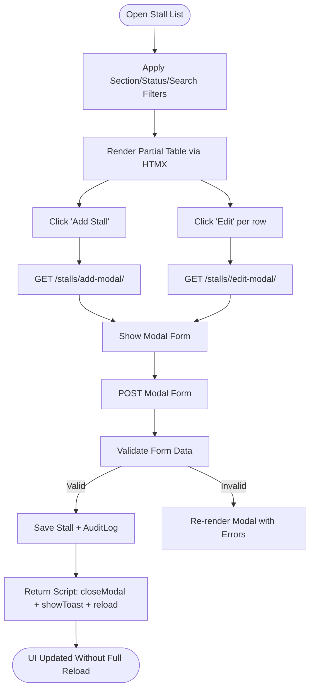
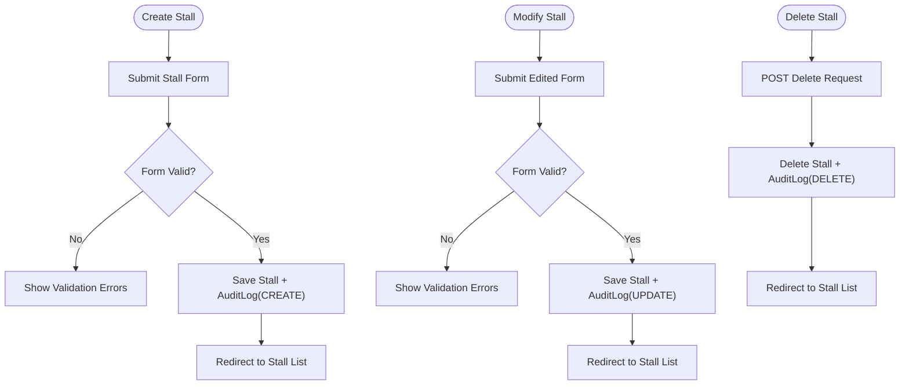
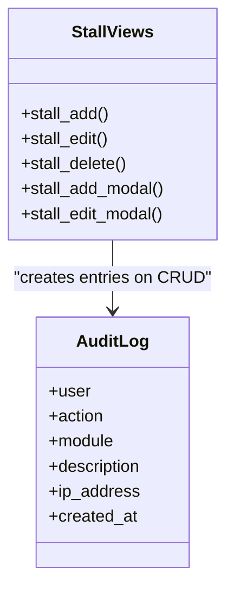
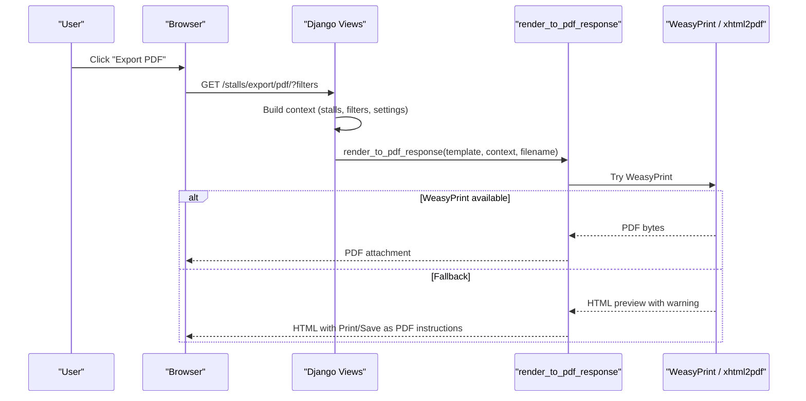
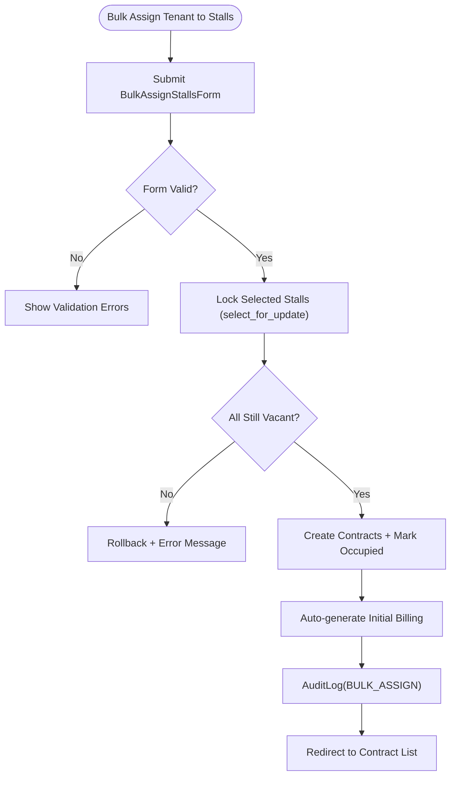
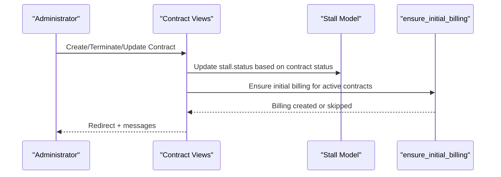
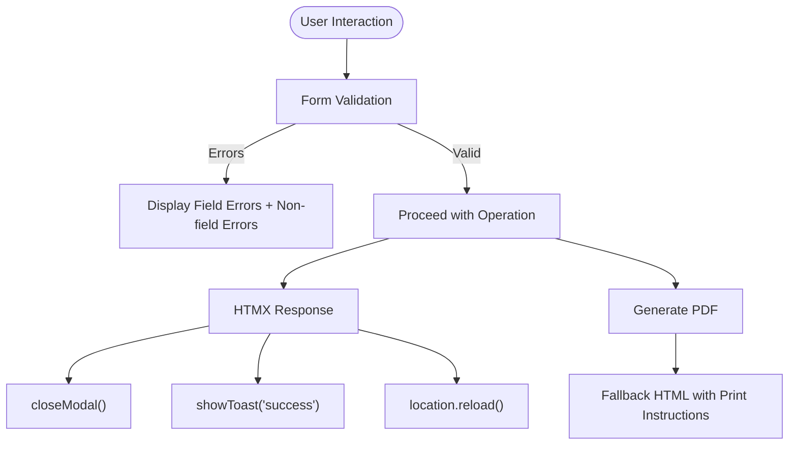
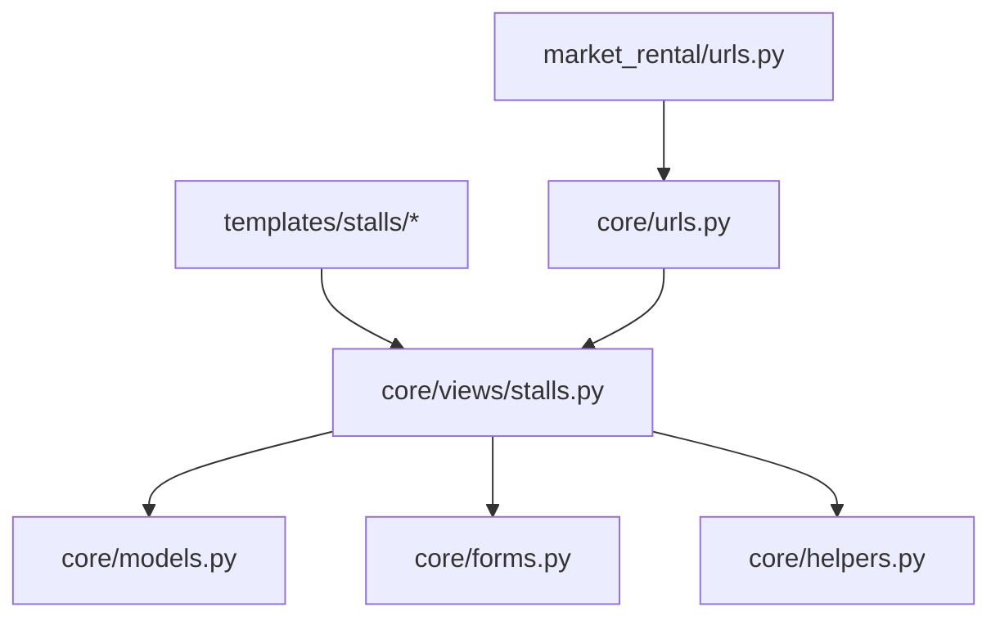

# Stall Operations & Workflows

<cite>
**Referenced Files in This Document**
- [stalls.py](file://core/views/stalls.py)
- [_modal_form.html](file://templates/stalls/_modal_form.html)
- [_table.html](file://templates/stalls/_table.html)
- [list.html](file://templates/stalls/list.html)
- [print_list.html](file://templates/stalls/print_list.html)
- [print_view.html](file://templates/stalls/print_view.html)
- [view.html](file://templates/stalls/view.html)
- [form.html](file://templates/stalls/form.html)
- [models.py](file://core/models.py)
- [forms.py](file://core/forms.py)
- [urls.py](file://core/urls.py)
- [market_urls.py](file://market_rental/urls.py)
- [helpers.py](file://core/helpers.py)
- [contracts.py](file://core/views/contracts.py)
- [bulk_assign.html](file://templates/contracts/bulk_assign.html)
- [test_bulk_assign.py](file://core/test_bulk_assign.py)
</cite>

## Table of Contents
1. [Introduction](#introduction)
2. [Project Structure](#project-structure)
3. [Core Components](#core-components)
4. [Architecture Overview](#architecture-overview)
5. [Detailed Component Analysis](#detailed-component-analysis)
6. [Dependency Analysis](#dependency-analysis)
7. [Performance Considerations](#performance-considerations)
8. [Troubleshooting Guide](#troubleshooting-guide)
9. [Conclusion](#conclusion)

## Introduction
This document explains stall operations and workflows for the market rental system, focusing on modal-based stall management powered by HTMX, the complete stall lifecycle from creation through modification to deletion, audit trail maintenance, print and PDF export functionality, batch operations, bulk stall management, integration with the contract system, error handling, validation feedback, user experience considerations, and performance optimization for large stall inventories.

The stall feature is implemented as a Django application with:
- Views that serve both full-page and HTMX partial responses.
- Templates that use HTMX attributes for dynamic interactions without page reloads.
- Forms that validate input and surface actionable errors.
- Models that define stalls, sections, types, contracts, and audit logs.
- Helpers that provide shared utilities such as PDF rendering.

## Project Structure
Stall-related code lives under `core` (views, forms, models) and `templates/stalls`. The URL configuration routes stall endpoints, while the root project URL includes the core URLs.

**Diagram sources**
- [market_urls.py:7-12](file://market_rental/urls.py#L7-L12)
- [urls.py:80-91](file://core/urls.py#L80-L91)
- [stalls.py:17-274](file://core/views/stalls.py#L17-L274)

**Section sources**
- [market_urls.py:7-12](file://market_rental/urls.py#L7-L12)
- [urls.py:80-91](file://core/urls.py#L80-L91)

## Core Components
- Views: Handle listing, filtering, search, pagination, add/edit/delete, view details, print preview, and PDF export. Modal endpoints return HTML fragments or JavaScript for HTMX-driven UX.
- Forms: Validate stall data, ensure required lookups exist, and expose options availability flags for templates.
- Models: Define stalls, sections, types, contracts, billings, payments, notices, audit logs, and settings.
- Templates: Provide interactive list/table, modal form, detail view, and print/PDF layouts.
- Helpers: Provide shared utilities including PDF rendering via WeasyPrint with fallbacks.

Key responsibilities:
- Dynamic stall list with filters and search using HTMX.
- Modal-based create and edit flows with inline validation feedback.
- Audit logging for create, update, delete actions.
- Print preview and PDF export for stall lists and individual stall reports.
- Integration with contracts for occupancy and billing.

**Section sources**
- [stalls.py:17-274](file://core/views/stalls.py#L17-L274)
- [forms.py:201-258](file://core/forms.py#L201-L258)
- [models.py:71-115](file://core/models.py#L71-L115)
- [models.py:157-187](file://core/models.py#L157-L187)
- [models.py:304-316](file://core/models.py#L304-L316)
- [helpers.py:522-594](file://core/helpers.py#L522-L594)

## Architecture Overview
The stall workflow combines server-side Django views with client-side HTMX interactions. Users interact with the stall list, open modals for add/edit, submit forms via HTMX, and receive partial updates or scripts that close modals and refresh the table.

**Diagram sources**
- [stalls.py:129-184](file://core/views/stalls.py#L129-L184)
- [_modal_form.html:10-31](file://templates/stalls/_modal_form.html#L10-L31)
- [list.html:24-26](file://templates/stalls/list.html#L24-L26)

## Detailed Component Analysis

### Modal-Based Stall Management with HTMX
- The stall list page uses HTMX attributes to trigger asynchronous requests for adding and editing stalls.
- The modal form template posts to dedicated modal endpoints and targets the modal content area.
- On success, modal endpoints return small scripts that close the modal, show a toast notification, and reload the page after a short delay.

**Diagram sources**
- [list.html:31-58](file://templates/stalls/list.html#L31-L58)
- [_modal_form.html:10-31](file://templates/stalls/_modal_form.html#L10-L31)
- [stalls.py:129-184](file://core/views/stalls.py#L129-L184)

**Section sources**
- [list.html:24-58](file://templates/stalls/list.html#L24-L58)
- [_modal_form.html:10-127](file://templates/stalls/_modal_form.html#L10-L127)
- [stalls.py:129-184](file://core/views/stalls.py#L129-L184)

### Complete Stall Lifecycle: Create, Modify, Delete
- Creation:
  - Full-page add endpoint validates the form, saves the stall, creates an audit log entry, and redirects to the stall list.
  - Modal add endpoint returns a script to close the modal and refresh the list.
- Modification:
  - Full-page edit endpoint validates and updates the stall, logs the change, and redirects.
  - Modal edit endpoint returns a script to close the modal and refresh the list.
- Deletion:
  - Delete endpoint removes the stall and logs the action, then redirects to the list.

**Diagram sources**
- [stalls.py:55-114](file://core/views/stalls.py#L55-L114)

**Section sources**
- [stalls.py:55-114](file://core/views/stalls.py#L55-L114)

### Audit Trail Maintenance
Every stall create, update, and delete operation writes an audit log entry with:
- User performing the action.
- Action type (CREATE, UPDATE, DELETE).
- Module name ("Stall").
- Description including stall number and context (e.g., modal vs full-page).
- IP address captured from the request.

**Diagram sources**
- [models.py:304-316](file://core/models.py#L304-L316)
- [stalls.py:55-114](file://core/views/stalls.py#L55-L114)

**Section sources**
- [models.py:304-316](file://core/models.py#L304-L316)
- [stalls.py:55-114](file://core/views/stalls.py#L55-L114)

### Print and PDF Export Functionality
- Stall list print preview renders a printable layout with filters and totals.
- Stall list PDF export generates a downloadable PDF using the helper function.
- Individual stall print preview shows stall details and contract history.
- Individual stall PDF export generates a downloadable report for a specific stall.

**Diagram sources**
- [stalls.py:216-243](file://core/views/stalls.py#L216-L243)
- [stalls.py:261-274](file://core/views/stalls.py#L261-L274)
- [helpers.py:522-594](file://core/helpers.py#L522-L594)

**Section sources**
- [stalls.py:187-243](file://core/views/stalls.py#L187-L243)
- [stalls.py:246-274](file://core/views/stalls.py#L246-L274)
- [print_list.html:1-55](file://templates/stalls/print_list.html#L1-L55)
- [print_view.html:1-46](file://templates/stalls/print_view.html#L1-L46)
- [helpers.py:522-594](file://core/helpers.py#L522-L594)

### Batch Operations and Bulk Stall Management
- Bulk assignment allows assigning one tenant to multiple vacant stalls in a single operation.
- The bulk assign form validates selections, checks vacancy at submission time, and creates one active contract per selected stall.
- Each contract inherits the stall’s monthly rate; initial billing is auto-generated.
- Audit logs record bulk assignments with tenant name and stall numbers.

**Diagram sources**
- [contracts.py:431-529](file://core/views/contracts.py#L431-L529)
- [forms.py:652-725](file://core/forms.py#L652-L725)
- [bulk_assign.html:30-96](file://templates/contracts/bulk_assign.html#L30-L96)

**Section sources**
- [contracts.py:431-529](file://core/views/contracts.py#L431-L529)
- [forms.py:652-725](file://core/forms.py#L652-L725)
- [bulk_assign.html:1-102](file://templates/contracts/bulk_assign.html#L1-L102)
- [test_bulk_assign.py:16-129](file://core/test_bulk_assign.py#L16-L129)

### Integration with the Contract System
- Stall status reflects contract state:
  - Active contracts mark stalls as occupied.
  - Termination or deletion of the last active contract marks stalls vacant.
- Contract creation triggers initial billing generation for relevant periods.
- Stall view displays contract history linked to tenants.

**Diagram sources**
- [contracts.py:20-36](file://core/views/contracts.py#L20-L36)
- [contracts.py:138-183](file://core/views/contracts.py#L138-L183)
- [contracts.py:225-246](file://core/views/contracts.py#L225-L246)
- [stalls.py:117-125](file://core/views/stalls.py#L117-L125)

**Section sources**
- [contracts.py:20-36](file://core/views/contracts.py#L20-L36)
- [contracts.py:138-183](file://core/views/contracts.py#L138-L183)
- [contracts.py:225-246](file://core/views/contracts.py#L225-L246)
- [stalls.py:117-125](file://core/views/stalls.py#L117-L125)

### Error Handling, Validation Feedback, and User Experience
- Form validation errors are surfaced inline in both full-page and modal forms.
- Non-field errors are displayed prominently at the top of forms.
- Missing lookup data (sections/types) triggers helpful warnings and links to manage lookups.
- HTMX modal success responses include scripts to close modals, show toast notifications, and reload the page.
- PDF export falls back gracefully when WeasyPrint is unavailable, providing browser print instructions.

**Diagram sources**
- [_modal_form.html:12-43](file://templates/stalls/_modal_form.html#L12-L43)
- [form.html:23-32](file://templates/stalls/form.html#L23-L32)
- [stalls.py:141-151](file://core/views/stalls.py#L141-L151)
- [helpers.py:522-594](file://core/helpers.py#L522-L594)

**Section sources**
- [_modal_form.html:12-43](file://templates/stalls/_modal_form.html#L12-L43)
- [form.html:23-32](file://templates/stalls/form.html#L23-L32)
- [stalls.py:141-151](file://core/views/stalls.py#L141-L151)
- [helpers.py:522-594](file://core/helpers.py#L522-L594)

## Dependency Analysis
Stall operations depend on several components:
- Views depend on models for data access and audit logging.
- Forms depend on models for field definitions and validation logic.
- Templates depend on views for context and on static assets for styling.
- URL routing connects endpoints to views.
- Helpers provide shared utilities like PDF rendering.

**Diagram sources**
- [stalls.py:1-10](file://core/views/stalls.py#L1-L10)
- [models.py:71-115](file://core/models.py#L71-L115)
- [forms.py:201-258](file://core/forms.py#L201-L258)
- [helpers.py:522-594](file://core/helpers.py#L522-L594)
- [urls.py:80-91](file://core/urls.py#L80-L91)
- [market_urls.py:7-12](file://market_rental/urls.py#L7-L12)

**Section sources**
- [stalls.py:1-10](file://core/views/stalls.py#L1-L10)
- [models.py:71-115](file://core/models.py#L71-L115)
- [forms.py:201-258](file://core/forms.py#L201-L258)
- [helpers.py:522-594](file://core/helpers.py#L522-L594)
- [urls.py:80-91](file://core/urls.py#L80-L91)
- [market_urls.py:7-12](file://market_rental/urls.py#L7-L12)

## Performance Considerations
- Use select_related to reduce N+1 queries when loading stalls with sections and types.
- Apply filters early in querysets to limit dataset size before pagination.
- Paginate stall listings to avoid rendering large tables in memory.
- Prefer HTMX partial updates to minimize payload sizes and avoid full page reloads.
- For PDF exports, rely on WeasyPrint when available; otherwise, fall back to browser print to avoid heavy processing overhead.
- In bulk operations, lock rows with select_for_update to prevent race conditions and reduce retries.

[No sources needed since this section provides general guidance]

## Troubleshooting Guide
Common issues and resolutions:
- Missing market sections or stall types:
  - The form surfaces warnings and links to manage lookups.
  - Ensure at least one section exists before creating stalls.
- HTMX modal not closing:
  - Verify modal endpoints return the expected script on success.
  - Check browser console for JS errors.
- PDF export fails:
  - If WeasyPrint is unavailable, the helper returns HTML with print instructions.
  - Install required system libraries or switch to Linux production environment.
- Bulk assignment conflicts:
  - If stalls become occupied between render and submission, the form re-validates and rejects non-vacant stalls.
  - Refresh the page and retry selection.

**Section sources**
- [forms.py:240-258](file://core/forms.py#L240-L258)
- [stalls.py:141-151](file://core/views/stalls.py#L141-L151)
- [helpers.py:522-594](file://core/helpers.py#L522-L594)
- [contracts.py:450-510](file://core/views/contracts.py#L450-L510)

## Conclusion
Stall operations combine robust server-side validation and auditing with a responsive HTMX-driven interface. The system supports full lifecycle management, print and PDF export, and integrates tightly with contracts and billing. Bulk operations provide efficient multi-stall assignment with strong consistency guarantees. Proper error handling and clear validation feedback improve user experience, while selective querying and pagination optimize performance for large inventories.

[No sources needed since this section summarizes without analyzing specific files]