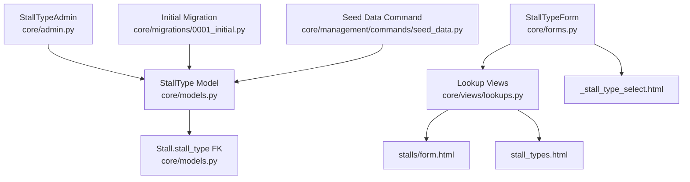
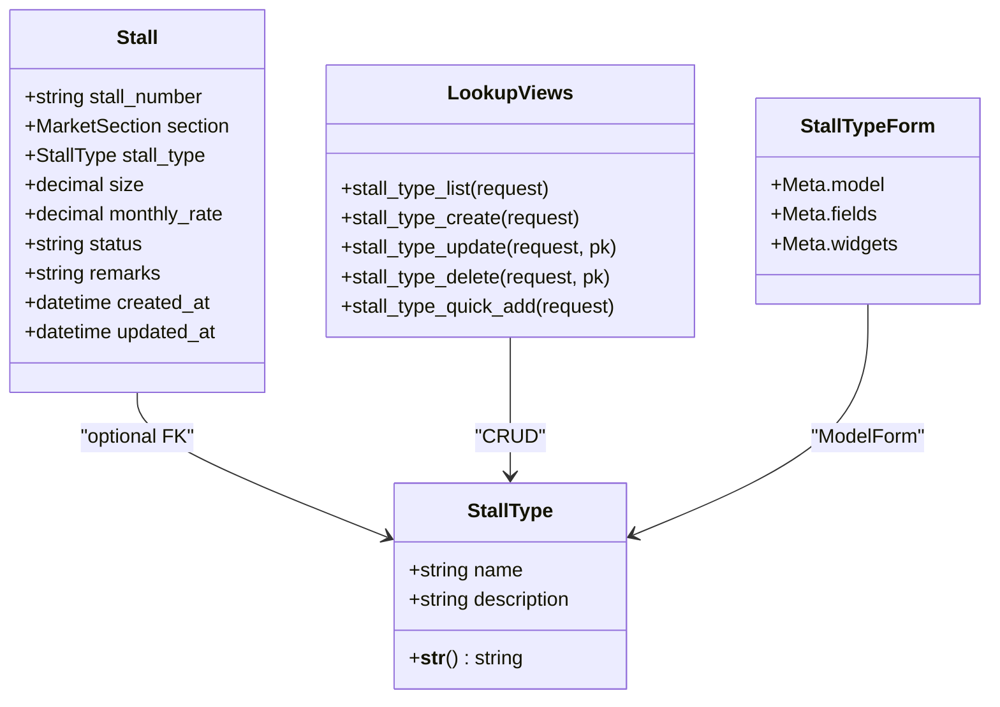
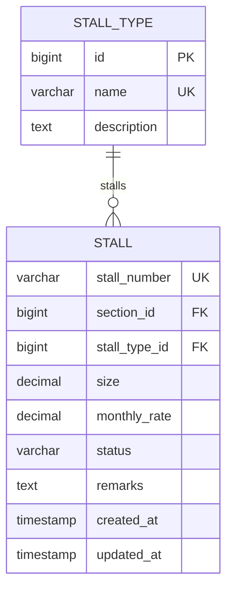
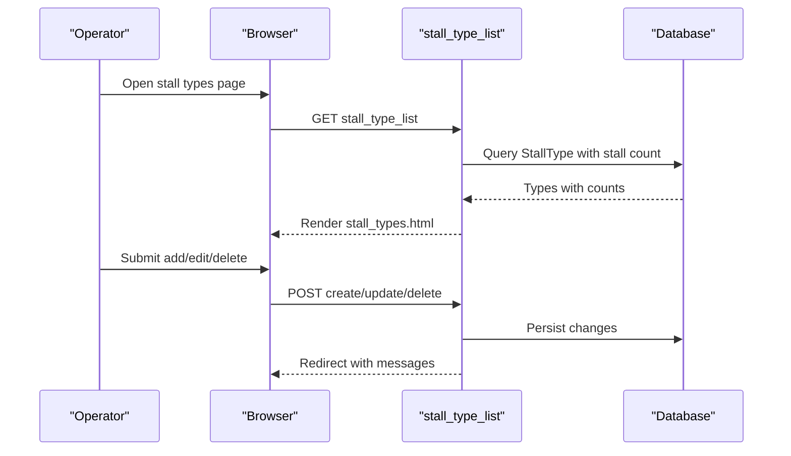
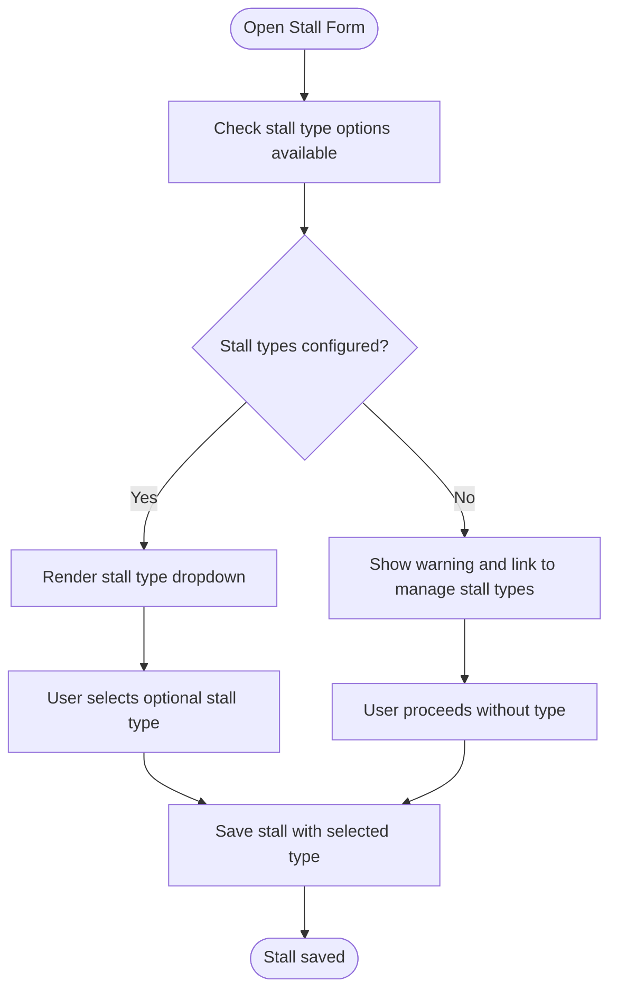
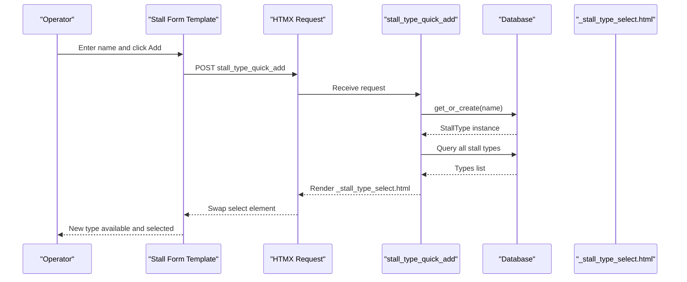
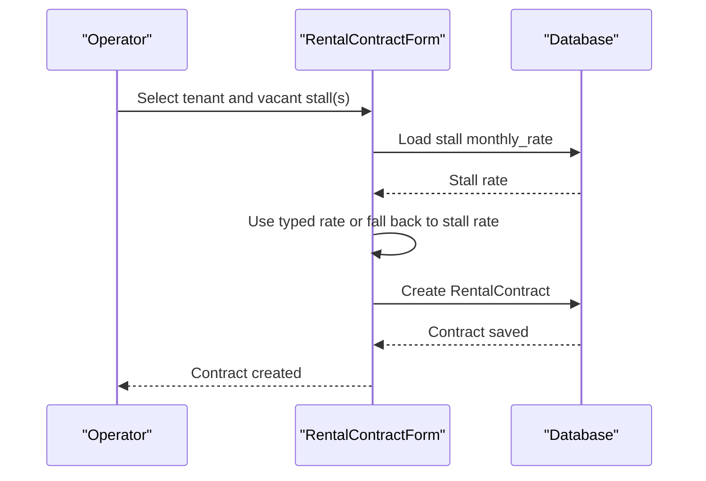
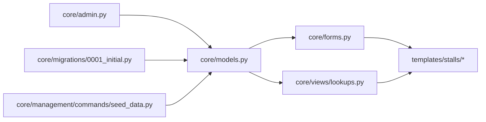

# Stall Types Configuration

<cite>
**Referenced Files in This Document**
- [models.py](file://core/models.py)
- [forms.py](file://core/forms.py)
- [lookups.py](file://core/views/lookups.py)
- [stall_types.html](file://templates/stalls/stall_types.html)
- [_stall_type_select.html](file://templates/stalls/_stall_type_select.html)
- [form.html](file://templates/stalls/form.html)
- [admin.py](file://core/admin.py)
- [seed_data.py](file://core/management/commands/seed_data.py)
- [0001_initial.py](file://core/migrations/0001_initial.py)
</cite>

## Table of Contents
1. [Introduction](#introduction)
2. [Project Structure](#project-structure)
3. [Core Components](#core-components)
4. [Architecture Overview](#architecture-overview)
5. [Detailed Component Analysis](#detailed-component-analysis)
6. [Dependency Analysis](#dependency-analysis)
7. [Performance Considerations](#performance-considerations)
8. [Troubleshooting Guide](#troubleshooting-guide)
9. [Conclusion](#conclusion)

## Introduction
Stall types are classification labels used to describe categories of market stalls, such as standard stalls, premium locations, corner units, or specialized vendor spaces. In this system, a stall type is an optional attribute attached to a stall record. It helps operators organize and identify stalls but does not currently enforce automatic pricing, availability rules, or tenant assignment restrictions.

The configuration surface includes:
- A database model for stall type definitions.
- A management page for creating, editing, and deleting stall types.
- An inline quick-add feature on the stall creation form.
- A dropdown selector that appears when creating or editing stalls.

This document explains how stall types are defined, managed, displayed, and consumed by other parts of the rental system.

## Project Structure
Stall type functionality spans models, forms, views, templates, admin configuration, migrations, and seed data. The most relevant files are:

**Diagram sources**
- [models.py:82-102](file://core/models.py#L82-L102)
- [forms.py:271-278](file://core/forms.py#L271-L278)
- [lookups.py:145-240](file://core/views/lookups.py#L145-L240)
- [stall_types.html:1-124](file://templates/stalls/stall_types.html#L1-L124)
- [_stall_type_select.html:1-9](file://templates/stalls/_stall_type_select.html#L1-L9)
- [form.html:70-87](file://templates/stalls/form.html#L70-L87)
- [admin.py:30-33](file://core/admin.py#L30-L33)
- [0001_initial.py:78-95](file://core/migrations/0001_initial.py#L78-L95)
- [seed_data.py:295-303](file://core/management/commands/seed_data.py#L295-L303)

**Section sources**
- [models.py:82-102](file://core/models.py#L82-L102)
- [forms.py:218-249](file://core/forms.py#L218-L249)
- [lookups.py:145-240](file://core/views/lookups.py#L145-L240)
- [stall_types.html:1-124](file://templates/stalls/stall_types.html#L1-L124)
- [_stall_type_select.html:1-9](file://templates/stalls/_stall_type_select.html#L1-L9)
- [form.html:70-87](file://templates/stalls/form.html#L70-L87)
- [admin.py:30-33](file://core/admin.py#L30-L33)
- [0001_initial.py:78-95](file://core/migrations/0001_initial.py#L78-L95)
- [seed_data.py:295-303](file://core/management/commands/seed_data.py#L295-L303)

## Core Components
The stall type feature is built around these core components:

| Component | Responsibility | Key Behavior |
|---|---|---|
| `StallType` model | Stores stall type definitions | Unique name, optional description, alphabetical ordering |
| `Stall.stall_type` foreign key | Links a stall to a type | Optional; set to null if the type is deleted |
| `StallTypeForm` | Validates stall type input | Requires unique name; allows optional description |
| Lookup views | Manage stall type CRUD and quick-add | List, create, update, delete, and HTMX quick-create |
| Stall type list template | Renders management UI | Add form, table with edit/delete, usage count |
| Stall type select fragment | Renders dropdown options | Used by stall form and quick-add response |
| Admin registration | Enables Django admin management | Displays name and description |
| Seed command | Creates initial stall types during setup | Uses predefined names and descriptions |

**Section sources**
- [models.py:82-102](file://core/models.py#L82-L102)
- [forms.py:218-278](file://core/forms.py#L218-L278)
- [lookups.py:145-240](file://core/views/lookups.py#L145-L240)
- [stall_types.html:1-124](file://templates/stalls/stall_types.html#L1-L124)
- [_stall_type_select.html:1-9](file://templates/stalls/_stall_type_select.html#L1-L9)
- [admin.py:30-33](file://core/admin.py#L30-L33)
- [seed_data.py:295-303](file://core/management/commands/seed_data.py#L295-L303)

## Architecture Overview
At a high level, stall types are reference data. They do not directly control business logic such as pricing or contract generation. Instead, they provide categorization metadata that can be shown in reports, filters, and future enhancements.

**Diagram sources**
- [models.py:82-102](file://core/models.py#L82-L102)
- [forms.py:271-278](file://core/forms.py#L271-L278)
- [lookups.py:145-240](file://core/views/lookups.py#L145-L240)

## Detailed Component Analysis

### Stall Type Data Model
The `StallType` model defines the canonical stall type records. Each type has:
- A unique name.
- An optional description.
- Alphabetical ordering by name.

The `Stall` model references `StallType` through an optional foreign key. When a stall type is deleted, existing stall records keep their data but lose the type reference because the relationship uses `SET_NULL`.

**Diagram sources**
- [models.py:82-102](file://core/models.py#L82-L102)
- [0001_initial.py:78-95](file://core/migrations/0001_initial.py#L78-L95)

**Section sources**
- [models.py:82-102](file://core/models.py#L82-L102)
- [0001_initial.py:78-95](file://core/migrations/0001_initial.py#L78-L95)

### Stall Type Management Interface
The stall type management page provides:
- A form to add new stall types.
- A table showing existing types, their descriptions, and how many stalls use them.
- Inline editing of name and description.
- Delete actions with confirmation and safety messaging.

The view annotates each stall type with a stall count so the interface can warn operators about affected stalls before deletion.

**Diagram sources**
- [lookups.py:145-219](file://core/views/lookups.py#L145-L219)
- [stall_types.html:20-119](file://templates/stalls/stall_types.html#L20-L119)

**Section sources**
- [lookups.py:145-219](file://core/views/lookups.py#L145-L219)
- [stall_types.html:1-124](file://templates/stalls/stall_types.html#L1-L124)

### Stall Form Integration
When creating or editing a stall, the stall form includes a stall type dropdown. The field is optional, and its choices come from the current stall type records. If no stall types exist, the template shows a warning and links to the stall type management page.

The form also exposes whether stall type options are available so the UI can guide users to configure lookup data first.

**Diagram sources**
- [forms.py:218-249](file://core/forms.py#L218-L249)
- [form.html:70-87](file://templates/stalls/form.html#L70-L87)

**Section sources**
- [forms.py:218-249](file://core/forms.py#L218-L249)
- [form.html:70-87](file://templates/stalls/form.html#L70-L87)

### Quick Add Stall Type
The stall form supports inline creation of a stall type. When an operator enters a name and clicks Add, the browser posts to a quick-add endpoint. The endpoint creates or reuses the stall type and returns a fresh dropdown fragment with the new option pre-selected.

**Diagram sources**
- [form.html:70-87](file://templates/stalls/form.html#L70-L87)
- [lookups.py:222-240](file://core/views/lookups.py#L222-L240)
- [_stall_type_select.html:1-9](file://templates/stalls/_stall_type_select.html#L1-L9)

**Section sources**
- [form.html:70-87](file://templates/stalls/form.html#L70-L87)
- [lookups.py:222-240](file://core/views/lookups.py#L222-L240)
- [_stall_type_select.html:1-9](file://templates/stalls/_stall_type_select.html#L1-L9)

### Naming Conventions and Descriptions
- **Name**: Required, unique, limited length, alphabetically ordered.
- **Description**: Optional free-text field used to explain the category.
- **Display**: Names appear in dropdowns and the management table; descriptions appear in the management table and can help operators distinguish similar categories.

There is no enforced naming pattern such as prefixes or codes. Operators should choose clear, stable names like “Standard Stall,” “Premium Location,” “Corner Unit,” or “Specialized Vendor Space.”

**Section sources**
- [models.py:82-90](file://core/models.py#L82-L90)
- [forms.py:271-278](file://core/forms.py#L271-L278)
- [stall_types.html:31-46](file://templates/stalls/stall_types.html#L31-L46)

### Influence on Rental Pricing
In the current implementation, stall types do not automatically determine rental pricing. The `Stall` model stores `monthly_rate` directly, and contracts inherit rent from either:
- A manually entered rate on the contract form.
- The stall’s own `monthly_rate` when no explicit contract rate is provided.

Therefore, stall type categorization is separate from pricing. If you want stall types to influence pricing, you would need additional logic that maps types to default rates or applies multipliers. That behavior is not present in the current codebase.

**Section sources**
- [models.py:93-108](file://core/models.py#L93-L108)
- [forms.py:297-363](file://core/forms.py#L297-L363)

### Influence on Availability Rules
Stall availability is controlled by:
- The stall’s `status` field.
- Whether an active contract exists for the stall.

Stall type does not restrict which stalls can be assigned. Any vacant stall can be offered to a tenant regardless of its stall type.

**Section sources**
- [models.py:93-108](file://core/models.py#L93-L108)
- [forms.py:297-328](file://core/forms.py#L297-L328)

### Tenant Assignment Restrictions
Tenant assignment restrictions are based on:
- Tenant status being Active.
- Stall status being Vacant.
- No existing active contract for the same stall.

Stall type is not part of these restrictions. A tenant can be assigned to any vacant stall, independent of its stall type.

**Section sources**
- [forms.py:297-328](file://core/forms.py#L297-L328)
- [forms.py:697-717](file://core/forms.py#L697-L717)

### Relationship Between Stall Types and Contract Generation
Contract generation uses:
- The selected stall.
- The stall’s `monthly_rate`.
- Optionally, a manually entered contract rate.

Stall type is not read during contract creation. Contracts do not store stall type information directly; they store the stall reference, which indirectly carries the type.

**Diagram sources**
- [forms.py:297-363](file://core/forms.py#L297-L363)
- [models.py:157-187](file://core/models.py#L157-L187)

**Section sources**
- [forms.py:297-363](file://core/forms.py#L297-L363)
- [models.py:157-187](file://core/models.py#L157-L187)

### Example Stall Type Configurations
Below are conceptual examples of stall types that operators might define. These are illustrative and not hardcoded defaults in the application logic:

| Stall Type | Purpose | Expected Impact in Current System |
|---|---|---|
| Standard Stall | Regular market space | Categorization only; no automatic pricing or restriction |
| Premium Location | High-traffic or desirable location | Categorization only; pricing must be set on the stall itself |
| Corner Unit | Edge or corner stall with different visibility | Categorization only; availability remains unchanged |
| Specialized Vendor Space | Vendor requiring specific infrastructure | Categorization only; no built-in business rule enforcement |

To make these categories meaningful, operators should:
- Set appropriate stall numbers and sections.
- Assign the correct stall type.
- Set the correct `monthly_rate` per stall.
- Keep descriptions consistent so reports and audits remain clear.

[No sources needed since this section provides conceptual examples]

## Dependency Analysis
The stall type feature has clear boundaries:

**Diagram sources**
- [models.py:82-102](file://core/models.py#L82-L102)
- [forms.py:218-278](file://core/forms.py#L218-L278)
- [lookups.py:145-240](file://core/views/lookups.py#L145-L240)
- [admin.py:30-33](file://core/admin.py#L30-L33)
- [0001_initial.py:78-95](file://core/migrations/0001_initial.py#L78-L95)
- [seed_data.py:295-303](file://core/management/commands/seed_data.py#L295-L303)

Key dependency observations:
- `StallType` is referenced by `Stall`, `StallTypeForm`, lookup views, admin, migrations, and seed data.
- The stall form consumes `StallType` through a model choice field.
- Deletion of a stall type is safe because the foreign key uses `SET_NULL`.
- There is no direct dependency between stall type and contract generation logic.

**Section sources**
- [models.py:82-102](file://core/models.py#L82-L102)
- [forms.py:218-278](file://core/forms.py#L218-L278)
- [lookups.py:145-240](file://core/views/lookups.py#L145-L240)
- [admin.py:30-33](file://core/admin.py#L30-L33)
- [0001_initial.py:78-95](file://core/migrations/0001_initial.py#L78-L95)
- [seed_data.py:295-303](file://core/management/commands/seed_data.py#L295-L303)

## Performance Considerations
- Stall type queries are lightweight because the model has only two main fields.
- The list view annotates stall counts using aggregation, which adds one join/count operation per listing.
- The quick-add endpoint performs a `get_or_create` followed by a query to rebuild the dropdown; this is acceptable for typical administrative workloads.
- Because stall type is optional and not involved in pricing or contract calculations, it does not introduce performance bottlenecks in billing or collection workflows.

[No sources needed since this section provides general guidance]

## Troubleshooting Guide

### Stall Type Dropdown Is Empty
**Symptoms:**
- The stall form shows a warning that no stall types are configured.
- The stall type field is optional but offers no choices.

**Likely causes:**
- No stall type records exist.
- The user is viewing the stall form before configuring stall types.

**Resolution:**
- Navigate to the stall type management page.
- Add at least one stall type.
- Refresh the stall form.

**Section sources**
- [forms.py:240-249](file://core/forms.py#L240-L249)
- [form.html:85-87](file://templates/stalls/form.html#L85-L87)
- [stall_types.html:10-18](file://templates/stalls/stall_types.html#L10-L18)

### Deleting a Stall Type Clears Existing Stalls’ Types
**Symptoms:**
- After deleting a stall type, some stalls no longer have a type.
- A warning message indicates that stall types were cleared.

**Expected behavior:**
- This is intentional. The stall-to-type relationship uses `SET_NULL`, so deletion removes the reference rather than deleting stalls.

**Resolution:**
- Reassign affected stalls to another stall type.
- Review the stall list and update missing types.

**Section sources**
- [lookups.py:196-219](file://core/views/lookups.py#L196-L219)
- [models.py:102](file://core/models.py#L102)

### Duplicate Stall Type Name
**Symptoms:**
- Creating or updating a stall type fails due to uniqueness validation.

**Likely causes:**
- Another stall type already has the same name.

**Resolution:**
- Choose a different name.
- Edit the existing stall type instead of creating a duplicate.

**Section sources**
- [models.py:83](file://core/models.py#L83)
- [lookups.py:178-193](file://core/views/lookups.py#L178-L193)

### Quick Add Does Not Appear in Dropdown Immediately
**Symptoms:**
- After adding a stall type inline, the dropdown does not refresh.

**Likely causes:**
- HTMX swap did not replace the select element.
- The request was not processed as an HTMX request.

**Resolution:**
- Ensure the inline Add button triggers the HTMX post.
- Verify the server returns the `_stall_type_select.html` fragment.
- Reload the page if necessary.

**Section sources**
- [form.html:70-87](file://templates/stalls/form.html#L70-L87)
- [lookups.py:222-240](file://core/views/lookups.py#L222-L240)
- [_stall_type_select.html:1-9](file://templates/stalls/_stall_type_select.html#L1-L9)

## Conclusion
Stall types in this system serve as flexible categorization labels for market stalls. They improve organization and reporting clarity but do not currently drive rental pricing, availability rules, or tenant assignment restrictions. Operators can create, rename, and delete stall types through a dedicated management interface, and they can quickly add types while creating stalls.

If your market requires stall types to influence pricing, availability, or tenant eligibility, those behaviors must be added explicitly. The current architecture makes stall types a clean extension point: you can build rules around `StallType` without changing the core stall, contract, or billing models.

[No sources needed since this section summarizes without analyzing specific files]