# System Architecture

<cite>
**Referenced Files in This Document**   
- [README.MD](file://README.MD)
- [settings.py](file://market_rental/settings.py)
- [urls.py (project root)](file://market_rental/urls.py)
- [urls.py (core app)](file://core/urls.py)
- [models.py](file://core/models.py)
- [permissions.py](file://core/permissions.py)
- [helpers.py](file://core/helpers.py)
- [auth.py](file://core/views/auth.py)
- [dashboard.py](file://core/views/dashboard.py)
- [tenants.py](file://core/views/tenants.py)
- [billing.py](file://core/views/billing.py)
- [payments.py](file://core/views/payments.py)
- [reports.py](file://core/views/reports.py)
</cite>

## Table of Contents
1. [Introduction](#introduction)
2. [Project Structure](#project-structure)
3. [Core Components](#core-components)
4. [Architecture Overview](#architecture-overview)
5. [Detailed Component Analysis](#detailed-component-analysis)
6. [Dependency Analysis](#dependency-analysis)
7. [Performance Considerations](#performance-considerations)
8. [Troubleshooting Guide](#troubleshooting-guide)
9. [Conclusion](#conclusion)

## Introduction
The Market Rental System is a Django-based Public Market Rental and Collection Management System. It centralizes stall management, tenant records, rental contracts, monthly billing, payment collection, penalties, notices, reports, and audit trails for municipal market administration. The system supports multiple user roles: Administrator, Market Collector, Cashier, Supervisor, Treasurer, and Tenant.

Key architectural characteristics include:
- Django MVC-style separation with models, function-based views, templates, forms, helpers, permissions, and URL routing.
- Role-based access control enforced through decorators and helper functions.
- Financial data integrity through `Decimal` arithmetic, database constraints, transactions, and ledger recomputation.
- HTMX-driven dynamic interactions for modals, table filtering, and partial page updates.
- A multi-fallback PDF rendering pipeline supporting WeasyPrint, xhtml2pdf, and browser print fallback.
- Audit trail logging for critical business actions.

**Section sources**
- [README.MD:1-21](file://README.MD#L1-L21)

## Project Structure
The repository follows a conventional Django layout:
- `market_rental/`: project configuration, settings, URLs, WSGI/ASGI entry points.
- `core/`: primary application containing models, views, forms, permissions, helpers, migrations, tests, and URL routing.
- `accounts/`: auxiliary authentication-related module.
- `templates/`: Django templates organized by feature area.
- `static/`: local CSS, JavaScript, and images without CDN dependencies.
- `docs/`, `PENALTY_GUIDE.md`, `credentials.md`: documentation and setup notes.

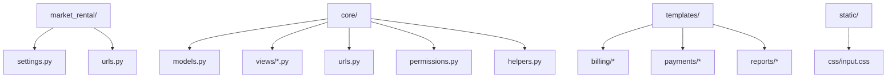

**Diagram sources**
- [settings.py:28-49](file://market_rental/settings.py#L28-L49)
- [urls.py (project root):7-17](file://market_rental/urls.py#L7-L17)
- [urls.py (core app):1-55](file://core/urls.py#L1-L55)

**Section sources**
- [settings.py:28-49](file://market_rental/settings.py#L28-L49)
- [urls.py (project root):7-17](file://market_rental/urls.py#L7-L17)
- [urls.py (core app):1-55](file://core/urls.py#L1-L55)

## Core Components
The system’s core components are:
- **Authentication**: Login/logout handling, session management, and role resolution.
- **Authorization**: Role groups, decorator-based permission checks, and tenant isolation.
- **Domain Models**: Tenant, Stall, MarketSection, StallType, RentalContract, Billing, Payment, TenantLedger, Notice, AuditLog, SystemSetting, UserProfile.
- **Business Logic**: Billing generation, penalty computation, payment recording, ledger recomputation, overdue accrual, receipt numbering.
- **UI Layer**: Django templates with Tailwind CSS, HTMX for dynamic behavior, and printable/PDF outputs.
- **Reporting**: Web pages, Excel export via openpyxl, and PDF export via WeasyPrint/xhtml2pdf/browser fallback.

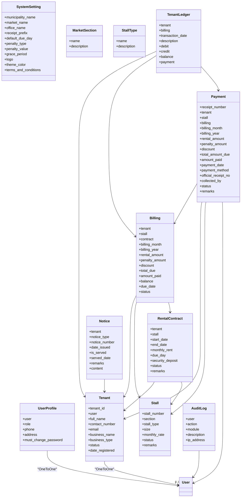

**Diagram sources**
- [models.py:7-24](file://core/models.py#L7-L24)
- [models.py:42-68](file://core/models.py#L42-L68)
- [models.py:71-114](file://core/models.py#L71-L114)
- [models.py:117-154](file://core/models.py#L117-L154)
- [models.py:157-187](file://core/models.py#L157-L187)
- [models.py:190-218](file://core/models.py#L190-L218)
- [models.py:221-258](file://core/models.py#L221-L258)
- [models.py:261-277](file://core/models.py#L261-L277)
- [models.py:280-301](file://core/models.py#L280-L301)
- [models.py:304-316](file://core/models.py#L304-L316)

**Section sources**
- [models.py:7-316](file://core/models.py#L7-L316)

## Architecture Overview
The system uses a layered Django architecture:
- **Request Routing**: Project-level URLs delegate to the core app’s URL patterns.
- **View Layer**: Function-based views handle requests, enforce RBAC, query models, and render templates or return JSON/HTML fragments for HTMX.
- **Model Layer**: Domain entities represent tenants, stalls, contracts, billings, payments, ledgers, notices, audits, and system settings.
- **Template Layer**: Feature-scoped templates provide UI and printable layouts; report PDFs use dedicated PDF templates.
- **Helper Layer**: Shared business logic for billing creation, penalty calculation, payment posting, ledger recomputation, receipt numbering, and PDF rendering.
- **Permission Layer**: Centralized role checks and decorators gate access to views and data.

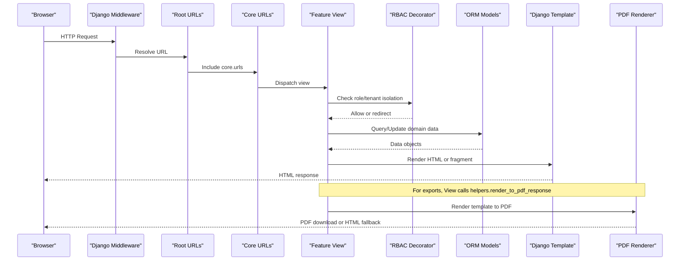

**Diagram sources**
- [urls.py (project root):7-17](file://market_rental/urls.py#L7-L17)
- [urls.py (core app):56-199](file://core/urls.py#L56-L199)
- [permissions.py:61-87](file://core/permissions.py#L61-L87)
- [helpers.py:522-594](file://core/helpers.py#L522-L594)

**Section sources**
- [urls.py (project root):7-17](file://market_rental/urls.py#L7-L17)
- [urls.py (core app):56-199](file://core/urls.py#L56-L199)
- [permissions.py:61-87](file://core/permissions.py#L61-L87)
- [helpers.py:522-594](file://core/helpers.py#L522-L594)

## Detailed Component Analysis

### Authentication and Session Management
Authentication handles login/logout flows, redirects authenticated users to the dashboard, and integrates with Django’s session middleware. The login view renders a login template with system settings and displays messages for success or failure. Logout clears the session and redirects to the login page.

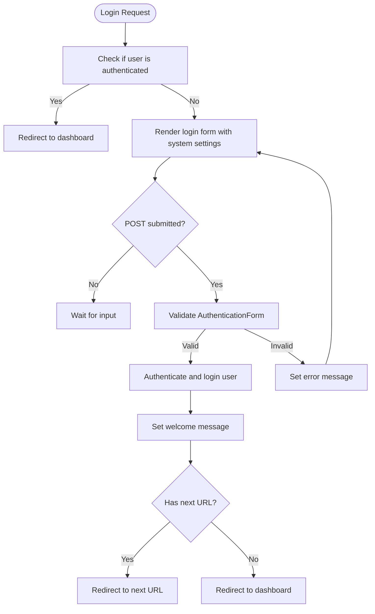

**Diagram sources**
- [auth.py:9-35](file://core/views/auth.py#L9-L35)
- [settings.py:40-49](file://market_rental/settings.py#L40-L49)
- [settings.py:195-197](file://market_rental/settings.py#L195-L197)

**Section sources**
- [auth.py:9-35](file://core/views/auth.py#L9-L35)
- [settings.py:40-49](file://market_rental/settings.py#L40-L49)
- [settings.py:195-197](file://market_rental/settings.py#L195-L197)

### Role-Based Access Control and Tenant Isolation
Permissions define canonical role sets and provide decorators to restrict access:
- Admin-only routes.
- Management roles for administrative operations.
- Collector roles for payment collection.
- Supervisor/treasurer roles for oversight.
- Tenant isolation ensures tenants see only their own data.

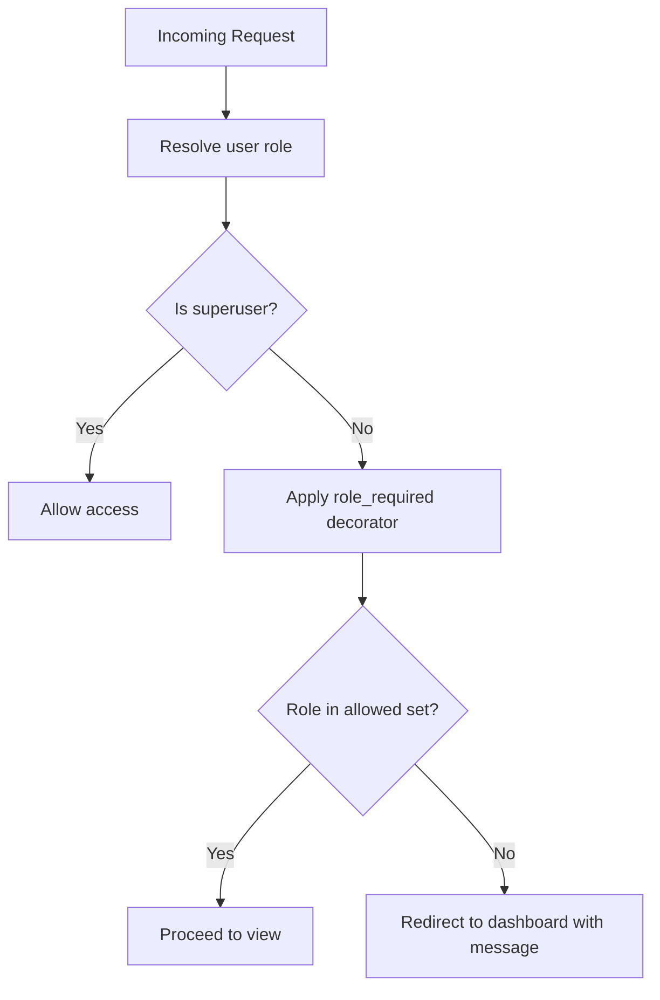

**Diagram sources**
- [permissions.py:6-30](file://core/permissions.py#L6-L30)
- [permissions.py:32-43](file://core/permissions.py#L32-L43)
- [permissions.py:61-87](file://core/permissions.py#L61-L87)
- [permissions.py:89-125](file://core/permissions.py#L89-L125)

**Section sources**
- [permissions.py:6-30](file://core/permissions.py#L6-L30)
- [permissions.py:32-43](file://core/permissions.py#L32-L43)
- [permissions.py:61-87](file://core/permissions.py#L61-L87)
- [permissions.py:89-125](file://core/permissions.py#L89-L125)

### Tenant Management Flow
Tenant management includes listing, adding, editing, viewing, searching, bulk deletion, and printing/exporting. Adding a tenant auto-provisions a portal login and logs the action. Bulk deletion protects financial history and uses safe locking where supported.

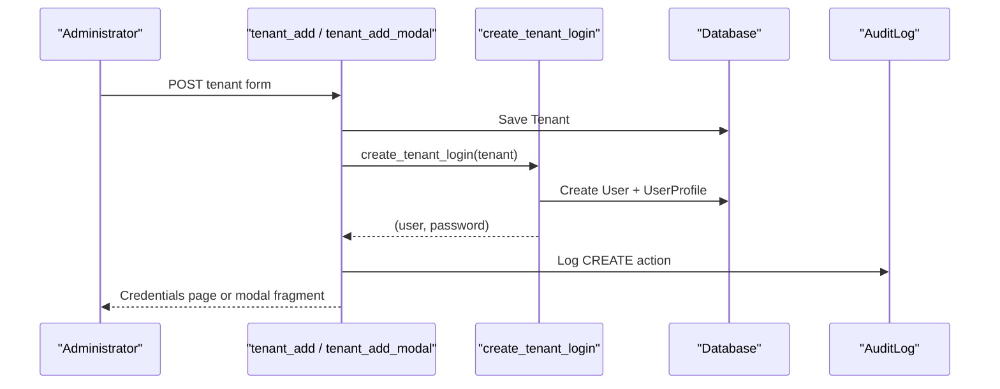

**Diagram sources**
- [tenants.py:54-81](file://core/views/tenants.py#L54-L81)
- [tenants.py:305-333](file://core/views/tenants.py#L305-L333)
- [helpers.py:92-122](file://core/helpers.py#L92-L122)

**Section sources**
- [tenants.py:23-51](file://core/views/tenants.py#L23-L51)
- [tenants.py:54-81](file://core/views/tenants.py#L54-L81)
- [tenants.py:107-124](file://core/views/tenants.py#L107-L124)
- [tenants.py:127-263](file://core/views/tenants.py#L127-L263)
- [tenants.py:266-287](file://core/views/tenants.py#L266-L287)
- [tenants.py:290-302](file://core/views/tenants.py#L290-L302)
- [tenants.py:305-333](file://core/views/tenants.py#L305-L333)
- [tenants.py:336-363](file://core/views/tenants.py#L336-L363)
- [tenants.py:366-467](file://core/views/tenants.py#L366-L467)
- [helpers.py:92-122](file://core/helpers.py#L92-L122)

### Contract Assignment and Billing Generation
Contracts link tenants to stalls with active status constraints. Billing generation computes due dates, rental amounts, and penalties, then creates billing records and ledger entries. Auto-generation ensures current month billings exist for collectors.

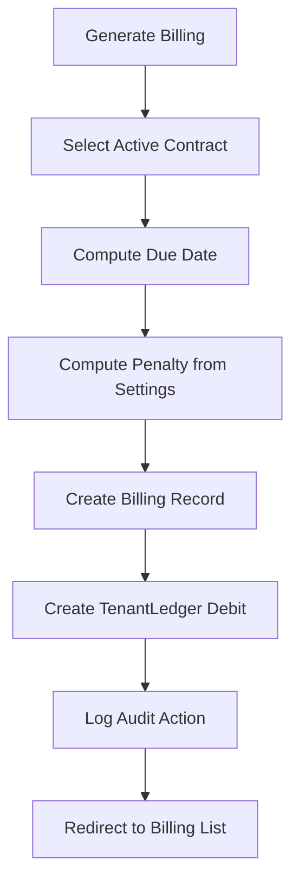

**Diagram sources**
- [billing.py:174-246](file://core/views/billing.py#L174-L246)
- [billing.py:249-315](file://core/views/billing.py#L249-L315)
- [helpers.py:155-205](file://core/helpers.py#L155-L205)
- [helpers.py:208-257](file://core/helpers.py#L208-L257)

**Section sources**
- [models.py:157-187](file://core/models.py#L157-L187)
- [billing.py:29-59](file://core/views/billing.py#L29-L59)
- [billing.py:174-246](file://core/views/billing.py#L174-L246)
- [billing.py:249-315](file://core/views/billing.py#L249-L315)
- [helpers.py:155-205](file://core/helpers.py#L155-L205)
- [helpers.py:208-257](file://core/helpers.py#L208-L257)

### Payment Processing and Ledger Updates
Payment processing is centralized through a helper that creates payments, updates billing totals/status, posts ledger credits, and recomputes running balances. Views support single and batch collections, receipt printing, and PDF export.

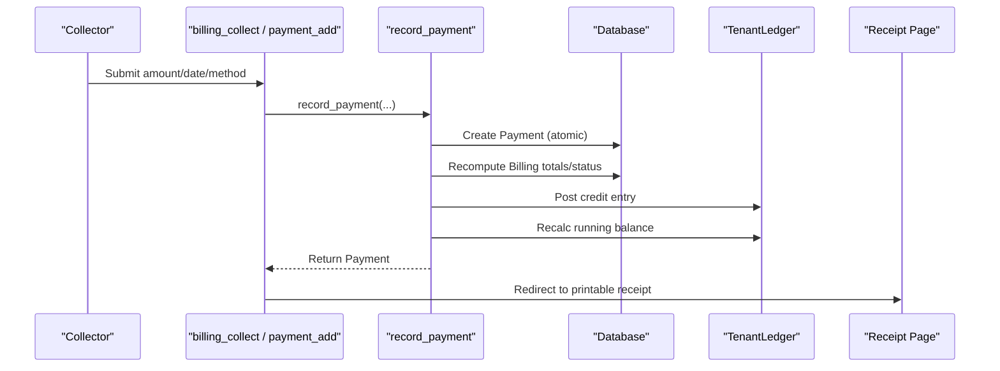

**Diagram sources**
- [billing.py:415-489](file://core/views/billing.py#L415-L489)
- [payments.py:250-294](file://core/views/payments.py#L250-L294)
- [helpers.py:351-420](file://core/helpers.py#L351-L420)

**Section sources**
- [billing.py:415-489](file://core/views/billing.py#L415-L489)
- [billing.py:511-634](file://core/views/billing.py#L511-L634)
- [payments.py:186-247](file://core/views/payments.py#L186-L247)
- [payments.py:250-294](file://core/views/payments.py#L250-L294)
- [payments.py:314-348](file://core/views/payments.py#L314-L348)
- [payments.py:351-396](file://core/views/payments.py#L351-L396)
- [payments.py:419-457](file://core/views/payments.py#L419-L457)
- [payments.py:460-518](file://core/views/payments.py#L460-L518)
- [payments.py:521-550](file://core/views/payments.py#L521-L550)
- [helpers.py:321-348](file://core/helpers.py#L321-L348)
- [helpers.py:351-420](file://core/helpers.py#L351-L420)

### Reporting and Export Pipeline
Reports aggregate payments and billings across daily, weekly, monthly, annual, section, collector, paid/unpaid tenants, overdue accounts, occupancy, vacant stalls, and ledger views. Exports include:
- PDF via WeasyPrint with xhtml2pdf and browser fallback.
- Excel via openpyxl.

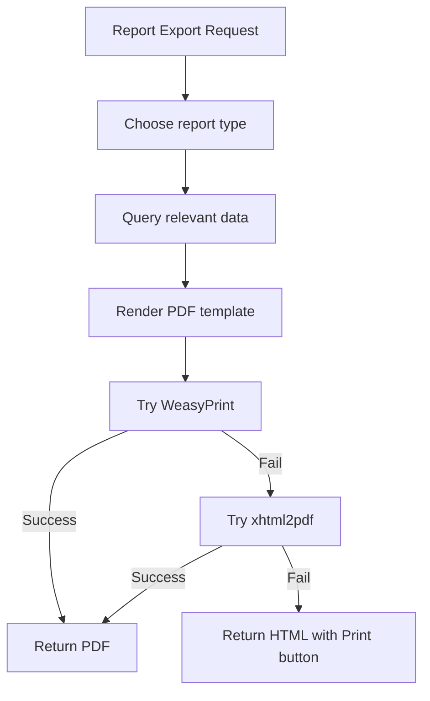

**Diagram sources**
- [reports.py:451-563](file://core/views/reports.py#L451-L563)
- [helpers.py:522-594](file://core/helpers.py#L522-L594)

**Section sources**
- [reports.py:40-77](file://core/views/reports.py#L40-L77)
- [reports.py:80-103](file://core/views/reports.py#L80-L103)
- [reports.py:106-136](file://core/views/reports.py#L106-L136)
- [reports.py:139-171](file://core/views/reports.py#L139-L171)
- [reports.py:174-208](file://core/views/reports.py#L174-L208)
- [reports.py:211-250](file://core/views/reports.py#L211-L250)
- [reports.py:253-287](file://core/views/reports.py#L253-L287)
- [reports.py:290-342](file://core/views/reports.py#L290-L342)
- [reports.py:345-363](file://core/views/reports.py#L345-L363)
- [reports.py:366-394](file://core/views/reports.py#L366-L394)
- [reports.py:397-428](file://core/views/reports.py#L397-L428)
- [reports.py:431-448](file://core/views/reports.py#L431-L448)
- [reports.py:451-563](file://core/views/reports.py#L451-L563)
- [reports.py:566-774](file://core/views/reports.py#L566-L774)
- [helpers.py:522-594](file://core/helpers.py#L522-L594)

### HTMX-Driven Dynamic Interactions
Many views detect HTMX requests and return partial templates or inline scripts to update modals and tables without full page reloads. Examples include tenant list/table fragments, add/edit modals, billing collection modals, and payment modals.

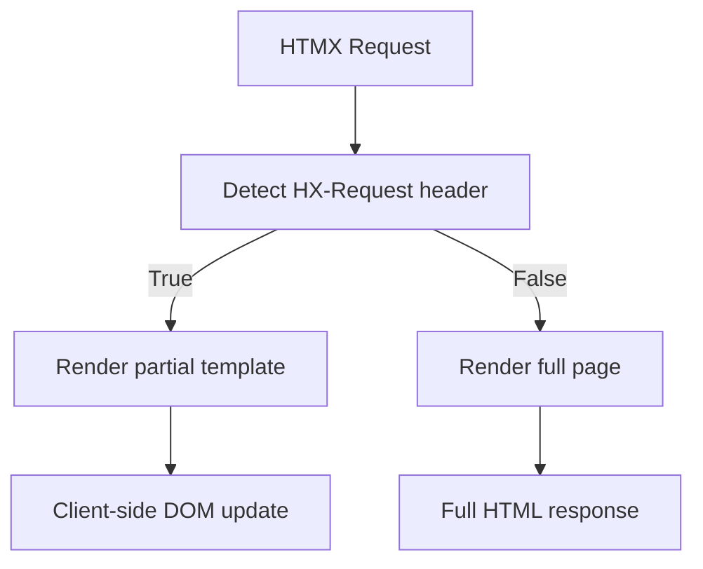

**Diagram sources**
- [tenants.py:19-20](file://core/views/tenants.py#L19-L20)
- [tenants.py:49-51](file://core/views/tenants.py#L49-L51)
- [tenants.py:325-333](file://core/views/tenants.py#L325-L333)
- [billing.py:25-26](file://core/views/billing.py#L25-L26)
- [billing.py:357-370](file://core/views/billing.py#L357-L370)
- [billing.py:470-489](file://core/views/billing.py#L470-L489)
- [payments.py:153-154](file://core/views/payments.py#L153-L154)
- [payments.py:445-457](file://core/views/payments.py#L445-L457)

**Section sources**
- [tenants.py:19-20](file://core/views/tenants.py#L19-L20)
- [tenants.py:49-51](file://core/views/tenants.py#L49-L51)
- [tenants.py:325-333](file://core/views/tenants.py#L325-L333)
- [billing.py:25-26](file://core/views/billing.py#L25-L26)
- [billing.py:357-370](file://core/views/billing.py#L357-L370)
- [billing.py:470-489](file://core/views/billing.py#L470-L489)
- [payments.py:153-154](file://core/views/payments.py#L153-L154)
- [payments.py:445-457](file://core/views/payments.py#L445-L457)

### Multi-Fallback PDF Rendering Pipeline
The PDF renderer attempts WeasyPrint first, then xhtml2pdf, and finally returns an HTML preview with a Print button. This ensures usability even when system libraries are missing.

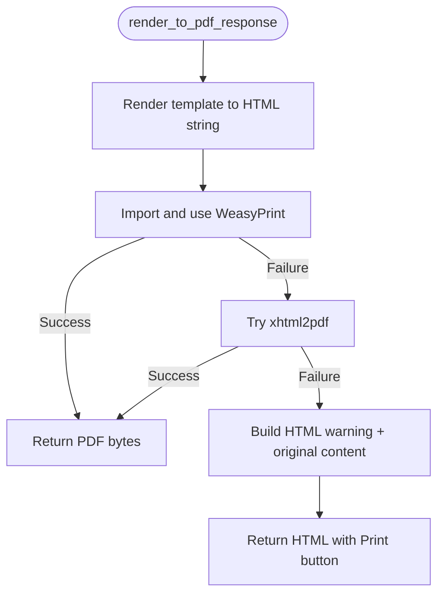

**Diagram sources**
- [helpers.py:522-594](file://core/helpers.py#L522-L594)

**Section sources**
- [helpers.py:522-594](file://core/helpers.py#L522-L594)

## Dependency Analysis
The following diagram shows key dependencies between modules:

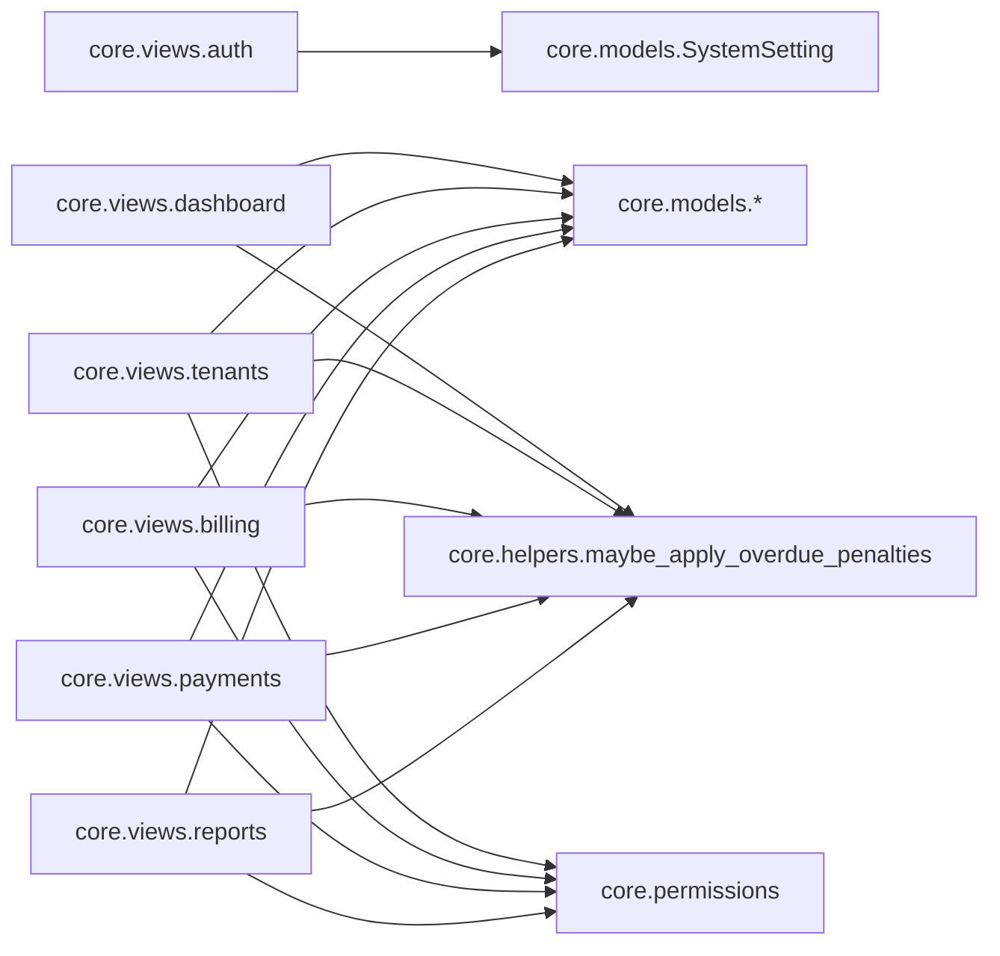

**Diagram sources**
- [auth.py:1-6](file://core/views/auth.py#L1-L6)
- [dashboard.py:1-9](file://core/views/dashboard.py#L1-L9)
- [tenants.py:1-17](file://core/views/tenants.py#L1-L17)
- [billing.py:1-22](file://core/views/billing.py#L1-L22)
- [payments.py:1-18](file://core/views/payments.py#L1-L18)
- [reports.py:1-15](file://core/views/reports.py#L1-L15)

**Section sources**
- [auth.py:1-6](file://core/views/auth.py#L1-L6)
- [dashboard.py:1-9](file://core/views/dashboard.py#L1-L9)
- [tenants.py:1-17](file://core/views/tenants.py#L1-L17)
- [billing.py:1-22](file://core/views/billing.py#L1-L22)
- [payments.py:1-18](file://core/views/payments.py#L1-L18)
- [reports.py:1-15](file://core/views/reports.py#L1-L15)

## Performance Considerations
- Use `select_related` and `prefetch_related` in views to reduce N+1 queries for related models like tenant-stall-contract-billing-payment chains.
- Prefer aggregated sums and counts at the ORM level rather than iterating in Python for large datasets.
- Batch operations such as bulk tenant deletion and batch billing collection minimize round-trips and ensure consistent state.
- Ledger recomputation runs per tenant after edits/voids; consider caching or background tasks for very large tenant bases.
- Overdue penalty accrual is throttled per day using cache keys to avoid repeated heavy computations.
- PDF rendering can be expensive; prefer server-side PDF generation on Linux where WeasyPrint works natively; otherwise, rely on browser print fallback.

[No sources needed since this section provides general guidance]

## Troubleshooting Guide
Common issues and resolutions:
- **PDF export unavailable**: If WeasyPrint system libraries are missing, the renderer falls back to HTML with a Print button. Install GTK runtime or switch to Linux for native WeasyPrint support.
- **Excel export unavailable**: Ensure openpyxl is installed; otherwise, the export endpoint returns an error template.
- **Overdue penalties not applied**: Verify that cache-backed throttling allows one run per day; check for exceptions in `maybe_apply_overdue_penalties`.
- **Duplicate billing rows**: The unique constraint on tenant/still/month/year prevents duplicates; ensure idempotent generation helpers are used.
- **Concurrent payment collisions**: `record_payment` locks the billing row and retries receipt number generation; ensure callers wrap mutations in `transaction.atomic`.
- **Tenant isolation failures**: Confirm that tenant-scoped views use `tenant_isolation_queryset` or explicit filters on `tenant__user`.

**Section sources**
- [helpers.py:522-594](file://core/helpers.py#L522-L594)
- [reports.py:451-563](file://core/views/reports.py#L451-L563)
- [reports.py:566-774](file://core/views/reports.py#L566-L774)
- [helpers.py:351-420](file://core/helpers.py#L351-L420)
- [helpers.py:503-520](file://core/helpers.py#L503-L520)

## Conclusion
The Market Rental System implements a robust Django MVC architecture with clear separation of concerns, strong role-based access control, and comprehensive financial data integrity mechanisms. Its modular design supports tenant management, contract assignment, automated billing, payment processing, reporting, and audit trails. The HTMX-driven UI enhances interactivity, while the multi-fallback PDF pipeline ensures reliable document generation across environments. Extensions can be added by introducing new models, views, templates, and permission decorators while adhering to existing patterns for consistency and maintainability.

[No sources needed since this section summarizes without analyzing specific files]