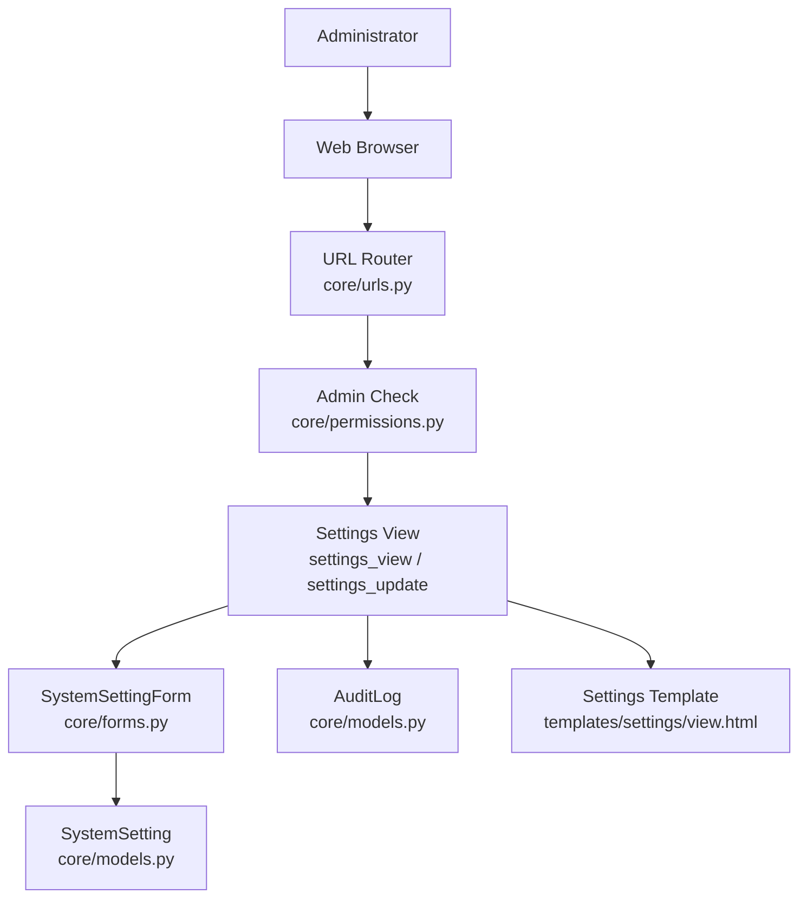
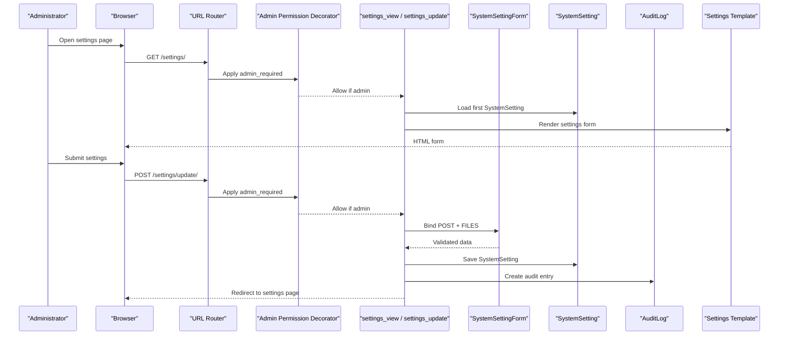
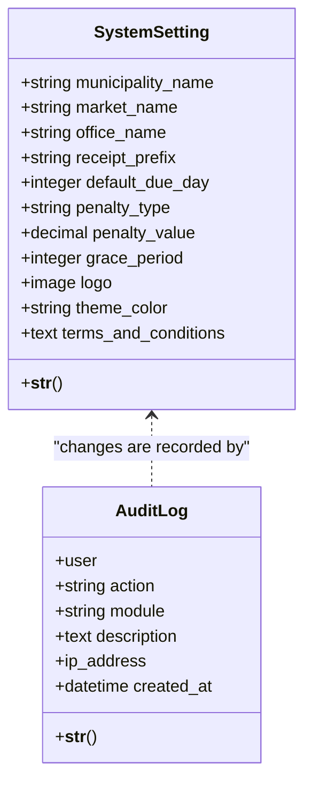
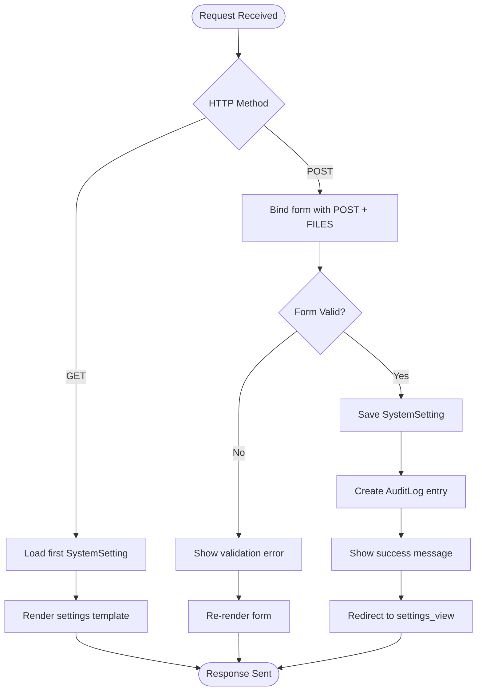
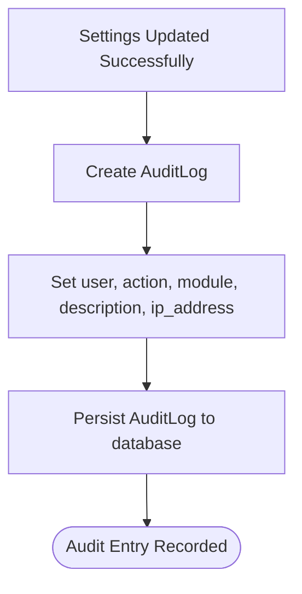
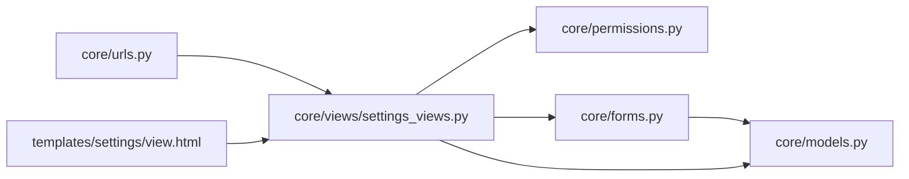

# General Settings Management

<cite>
**Referenced Files in This Document**
- [models.py](file://core/models.py)
- [forms.py](file://core/forms.py)
- [settings_views.py](file://core/views/settings_views.py)
- [permissions.py](file://core/permissions.py)
- [urls.py](file://core/urls.py)
- [view.html](file://templates/settings/view.html)
- [form.html](file://templates/settings/form.html)
</cite>

## Table of Contents
1. [Introduction](#introduction)
2. [Project Structure](#project-structure)
3. [Core Components](#core-components)
4. [Architecture Overview](#architecture-overview)
5. [Detailed Component Analysis](#detailed-component-analysis)
6. [Dependency Analysis](#dependency-analysis)
7. [Performance Considerations](#performance-considerations)
8. [Troubleshooting Guide](#troubleshooting-guide)
9. [Conclusion](#conclusion)

## Introduction
This document explains the general settings management functionality used to configure municipality and market information, billing rules, branding, and contract terms. It covers:

- The `SystemSetting` data model and its fields.
- Validation rules applied through the form layer.
- The settings user interface for editing configuration.
- File upload handling for the official logo.
- Audit logging for every successful settings change.
- Security controls that restrict access to administrators.
- Practical examples for initial setup, updating existing settings, and verifying changes across the application.

The system is designed so that configuration values appear on receipts, contracts, reports, and notices, making accurate and secure settings management essential.

## Project Structure
The settings feature spans models, forms, views, URL routing, templates, and permissions:

| Layer | Responsibility | Relevant Files |
|---|---|---|
| Data Model | Defines system-wide configuration storage | `core/models.py` |
| Form Layer | Binds request data to the model and provides validation | `core/forms.py` |
| Views | Handles GET/POST requests, saves settings, and logs changes | `core/views/settings_views.py` |
| Permissions | Enforces admin-only access | `core/permissions.py` |
| URLs | Maps routes to view functions | `core/urls.py` |
| Templates | Renders the settings form and current logo preview | `templates/settings/view.html`, `templates/settings/form.html` |

**Diagram sources**
- [urls.py:187-188](file://core/urls.py#L187-L188)
- [settings_views.py:9-55](file://core/views/settings_views.py#L9-L55)
- [forms.py:540-560](file://core/forms.py#L540-L560)
- [models.py:42-68](file://core/models.py#L42-L68)
- [models.py:304-316](file://core/models.py#L304-L316)
- [permissions.py:61-79](file://core/permissions.py#L61-L79)
- [view.html:27-27](file://templates/settings/view.html#L27-L27)

**Section sources**
- [urls.py:187-188](file://core/urls.py#L187-L188)
- [settings_views.py:9-55](file://core/views/settings_views.py#L9-L55)
- [forms.py:540-560](file://core/forms.py#L540-L560)
- [models.py:42-68](file://core/models.py#L42-L68)
- [models.py:304-316](file://core/models.py#L304-L316)
- [permissions.py:61-79](file://core/permissions.py#L61-L79)
- [view.html:27-27](file://templates/settings/view.html#L27-L27)

## Core Components
The settings feature is built around four main components:

1. **Data model**: `SystemSetting` stores municipality, market, office, receipt prefix, billing defaults, penalty configuration, branding, and contract terms.
2. **Form**: `SystemSettingForm` binds the UI fields to the model and applies Django’s default field validation.
3. **Views**: `settings_view` renders the settings page; `settings_update` processes POST submissions, creates or updates the single system setting row, and records an audit log entry.
4. **Templates**: `view.html` and `form.html` render the configuration form with sections for municipality/market data, billing rules, contract terms, branding, and logo upload.

Key responsibilities:

- `SystemSetting`: Centralizes global configuration.
- `SystemSettingForm`: Exposes editable fields and widgets.
- `settings_view`: Displays current settings and handles inline POST submission.
- `settings_update`: Accepts form submissions from either template and persists changes.
- `AuditLog`: Records who changed settings, when, and from which IP address.
- `admin_required`: Ensures only administrators can access these endpoints.

**Section sources**
- [models.py:42-68](file://core/models.py#L42-L68)
- [models.py:304-316](file://core/models.py#L304-L316)
- [forms.py:540-560](file://core/forms.py#L540-L560)
- [settings_views.py:9-55](file://core/views/settings_views.py#L9-L55)
- [permissions.py:61-79](file://core/permissions.py#L61-L79)
- [view.html:27-27](file://templates/settings/view.html#L27-L27)

## Architecture Overview
The settings workflow follows a standard Django request-response pattern with explicit admin authorization and audit logging.

**Diagram sources**
- [urls.py:187-188](file://core/urls.py#L187-L188)
- [settings_views.py:9-55](file://core/views/settings_views.py#L9-L55)
- [forms.py:540-560](file://core/forms.py#L540-L560)
- [models.py:42-68](file://core/models.py#L42-L68)
- [models.py:304-316](file://core/models.py#L304-L316)
- [permissions.py:61-79](file://core/permissions.py#L61-L79)

## Detailed Component Analysis

### SystemSetting Model
`SystemSetting` is the single source of truth for system-wide configuration. Its fields include:

| Field | Type | Purpose | Validation Notes |
|---|---|---|---|
| `municipality_name` | CharField (max 200) | Municipality or city name | Required by default; length limited to 200 characters. |
| `market_name` | CharField (max 200) | Public market name | Required by default; length limited to 200 characters. |
| `office_name` | CharField (max 200) | Office name shown on documents | Required by default; length limited to 200 characters. |
| `receipt_prefix` | CharField (max 20) | Prefix used for receipt numbering | Required by default; short string intended for codes such as receipt prefixes. |
| `default_due_day` | PositiveIntegerField | Default day of month for billing due dates | Must be positive; represents a calendar day. |
| `penalty_type` | CharField with choices | Fixed or percentage penalty calculation method | Restricted to predefined choices. |
| `penalty_value` | DecimalField (10,2) | Penalty amount or percentage value | Two decimal places; suitable for currency-like values. |
| `grace_period` | PositiveIntegerField | Number of grace days before penalties apply | Must be positive; used by billing logic. |
| `logo` | ImageField (upload_to `logos/`) | Official logo displayed on receipts and reports | Optional image file; stored under the configured media path. |
| `theme_color` | CharField (max 7, default `#003366`) | Branding color used by the interface | Six-character hex color plus hash; rendered as a color input. |
| `terms_and_conditions` | TextField | Contract terms printed on rental contracts | Large text area; supports multiple clauses. |

The model also defines display behavior and meta labels for administrative interfaces.

**Diagram sources**
- [models.py:42-68](file://core/models.py#L42-L68)
- [models.py:304-316](file://core/models.py#L304-L316)

**Section sources**
- [models.py:42-68](file://core/models.py#L42-L68)

### SystemSettingForm
`SystemSettingForm` is a Django `ModelForm` that exposes the following fields:

- Municipality and market identity: `municipality_name`, `market_name`, `office_name`.
- Receipt identification: `receipt_prefix`.
- Billing defaults: `default_due_day`, `penalty_type`, `penalty_value`, `grace_period`.
- Contract terms: `terms_and_conditions`.
- Branding: `logo`, `theme_color`.

Validation comes from Django’s field-level validators:

- CharFields enforce maximum length.
- PositiveIntegerFields reject zero or negative values.
- DecimalField enforces precision and numeric formatting.
- ChoiceField restricts `penalty_type` to allowed options.
- ImageField validates uploaded files as images when provided.
- Textarea-based fields accept free-form text for contract terms.

The form does not define custom clean methods for `SystemSetting`, so validation is primarily field-level rather than cross-field business logic.

**Section sources**
- [forms.py:540-560](file://core/forms.py#L540-L560)

### Settings Views
There are two related views:

1. **`settings_view`**:
   - Loads the first `SystemSetting` record.
   - On GET, renders the settings template with a bound form.
   - On POST, validates the form, saves changes, creates an audit log entry, shows a success message, and redirects back to the settings page.
   - If validation fails, it shows an error message and re-renders the form.

2. **`settings_update`**:
   - Accepts POST submissions from the settings template.
   - Creates a new `SystemSetting` instance if none exists.
   - Validates and saves the form.
   - Creates an audit log entry on success.
   - Redirects to the settings view after processing.

Both views use `enctype="multipart/form-data"` in the template form, allowing logo uploads.

**Diagram sources**
- [settings_views.py:9-55](file://core/views/settings_views.py#L9-L55)
- [view.html:27-27](file://templates/settings/view.html#L27-L27)

**Section sources**
- [settings_views.py:9-55](file://core/views/settings_views.py#L9-L55)

### Settings Templates
The settings UI is rendered by `templates/settings/view.html`. A similar layout exists in `templates/settings/form.html`. Both templates:

- Extend the base template.
- Display a header indicating that settings affect receipts, reports, and notices.
- Use a form posting to `settings_update`.
- Include CSRF protection.
- Group fields into logical sections:
  - Municipality and market.
  - Billing and penalty rules.
  - Contract terms and guidelines.
  - Branding and appearance.
- Render the current logo preview when available.
- Show field-specific errors.

Important UI behaviors:

- The form uses `enctype="multipart/form-data"` so logo uploads work.
- The logo field is optional; the template conditionally displays the current logo.
- Theme color uses a color input widget.
- Contract terms use a large textarea with guidance about one clause per line.

**Section sources**
- [view.html:1-124](file://templates/settings/view.html#L1-L124)
- [form.html:1-113](file://templates/settings/form.html#L1-L113)

### Audit Logging Mechanism
Every successful settings update creates an `AuditLog` entry containing:

- `user`: The logged-in administrator who made the change.
- `action`: Set to `UPDATE`.
- `module`: Set to `SystemSettings`.
- `description`: Indicates whether the change came from the main settings view or the update endpoint.
- `ip_address`: Extracted from the request metadata.
- `created_at`: Automatically set on creation.

This mechanism provides traceability for configuration changes without storing full diffs of the old and new values.

**Diagram sources**
- [settings_views.py:16-22](file://core/views/settings_views.py#L16-L22)
- [settings_views.py:45-51](file://core/views/settings_views.py#L45-L51)
- [models.py:304-316](file://core/models.py#L304-L316)

**Section sources**
- [settings_views.py:16-22](file://core/views/settings_views.py#L16-L22)
- [settings_views.py:45-51](file://core/views/settings_views.py#L45-L51)
- [models.py:304-316](file://core/models.py#L304-L316)

### Security and Access Control
Access to both settings endpoints is protected by the `admin_required` decorator, which is implemented using a role-based permission helper:

- Only users with the `admin` role are allowed.
- Superusers are also permitted regardless of profile role.
- Non-admin users receive an error message and are redirected to the dashboard.

This ensures that municipality information, billing rules, branding, and contract terms cannot be changed by collectors, cashiers, supervisors, treasurers, or tenants.

**Section sources**
- [settings_views.py:9-9](file://core/views/settings_views.py#L9-L9)
- [settings_views.py:36-36](file://core/views/settings_views.py#L36-L36)
- [permissions.py:61-79](file://core/permissions.py#L61-L79)

## Dependency Analysis
The settings feature has clear dependencies between layers:

**Diagram sources**
- [urls.py:187-188](file://core/urls.py#L187-L188)
- [settings_views.py:1-6](file://core/views/settings_views.py#L1-L6)
- [forms.py:540-560](file://core/forms.py#L540-L560)
- [models.py:42-68](file://core/models.py#L42-L68)
- [view.html:27-27](file://templates/settings/view.html#L27-L27)

Coupling and cohesion observations:

- Views depend on forms, models, permissions, and audit logging.
- Forms depend only on the model definition.
- Templates depend on the view context but not directly on models.
- Permissions are reused across the application through decorators.
- There is no circular dependency among these core files.

Potential risks:

- The settings views always load the first `SystemSetting` record. If multiple rows exist, behavior depends on database ordering rather than explicit uniqueness constraints.
- Audit logging records that a change occurred but does not store what changed.
- Logo uploads rely on Django’s default image handling; additional server-side validation may be needed depending on deployment requirements.

**Section sources**
- [urls.py:187-188](file://core/urls.py#L187-L188)
- [settings_views.py:1-55](file://core/views/settings_views.py#L1-L55)
- [forms.py:540-560](file://core/forms.py#L540-L560)
- [models.py:42-68](file://core/models.py#L42-L68)

## Performance Considerations
- Loading the first `SystemSetting` is inexpensive because there should normally be exactly one configuration row.
- Image uploads add storage and I/O overhead; keep logos reasonably sized.
- Audit log entries grow over time; consider periodic cleanup or archival if audit volume becomes large.
- Avoid unnecessary queries in the settings flow; the current implementation performs minimal database operations.

[No sources needed since this section provides general guidance]

## Troubleshooting Guide

### Cannot Access Settings Page
**Symptoms:**
- Redirected to dashboard.
- Error message indicating insufficient permission.

**Likely Causes:**
- Logged-in user is not an administrator.
- User profile role is not `admin`.
- Superuser check may bypass profile checks, but normal staff roles are blocked.

**Resolution:**
- Confirm the user has the `admin` role.
- Verify the `admin_required` decorator is applied to the settings endpoints.

**Section sources**
- [permissions.py:61-79](file://core/permissions.py#L61-L79)
- [settings_views.py:9-9](file://core/views/settings_views.py#L9-L9)

### Settings Form Shows Validation Errors
**Symptoms:**
- Form re-renders with error messages.
- Changes are not saved.

**Likely Causes:**
- Invalid numeric values for due day, penalty value, or grace period.
- Missing required fields.
- Invalid image file for logo.
- Incorrectly formatted theme color.

**Resolution:**
- Fill all required fields.
- Ensure numeric fields contain valid positive numbers where required.
- Upload a supported image file for the logo.
- Use a valid hex color for theme color.

**Section sources**
- [forms.py:540-560](file://core/forms.py#L540-L560)
- [settings_views.py:12-26](file://core/views/settings_views.py#L12-L26)

### Logo Does Not Appear After Upload
**Symptoms:**
- Settings save successfully.
- Logo preview is missing.

**Likely Causes:**
- Uploaded file is not recognized as an image.
- Media storage is not configured correctly.
- File path or permissions prevent serving uploaded images.

**Resolution:**
- Verify the uploaded file is a valid image.
- Check Django media configuration and storage backend.
- Confirm the `logos/` upload directory is writable and accessible.

**Section sources**
- [models.py:55-55](file://core/models.py#L55-L55)
- [view.html:101-106](file://templates/settings/view.html#L101-L106)

### Audit Log Not Created
**Symptoms:**
- Settings update succeeds.
- No audit entry appears.

**Likely Causes:**
- Database write failure after saving settings.
- Custom middleware or transaction rollback affecting audit creation.
- Misconfigured database connection.

**Resolution:**
- Check application logs for database errors.
- Confirm audit log table exists and is writable.
- Verify that the audit creation code runs after successful form save.

**Section sources**
- [settings_views.py:16-22](file://core/views/settings_views.py#L16-L22)
- [settings_views.py:45-51](file://core/views/settings_views.py#L45-L51)
- [models.py:304-316](file://core/models.py#L304-L316)

## Conclusion
General settings management centralizes municipality, market, billing, branding, and contract configuration in a single, auditable location. The design separates concerns clearly:

- Models define the data structure.
- Forms provide validation and UI binding.
- Views handle request flow, persistence, and auditing.
- Templates present a structured configuration interface.
- Permissions enforce administrator-only access.

For reliable operation, ensure that:

- Only administrators can access settings.
- All required configuration fields are filled during initial setup.
- Logo uploads use valid image files and proper media storage.
- Audit logs are monitored for compliance and troubleshooting.
- Configuration changes are reviewed before being applied to production receipts, contracts, and reports.