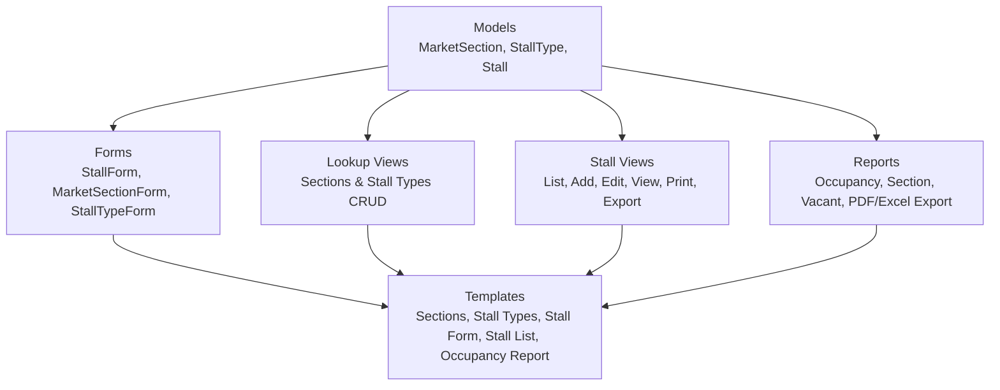
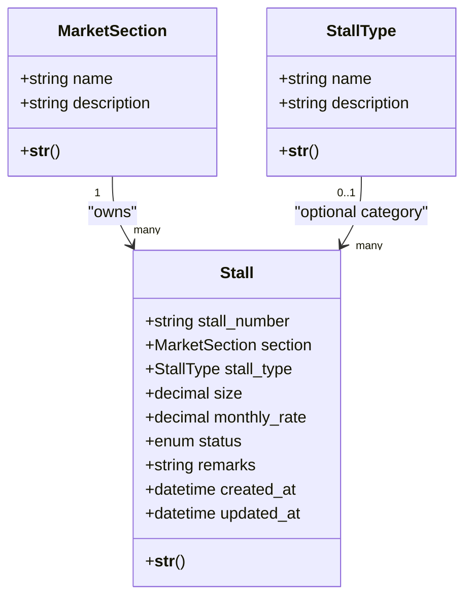
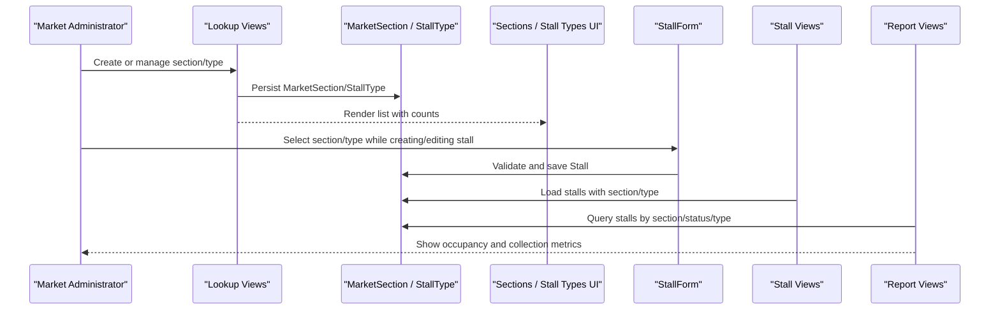
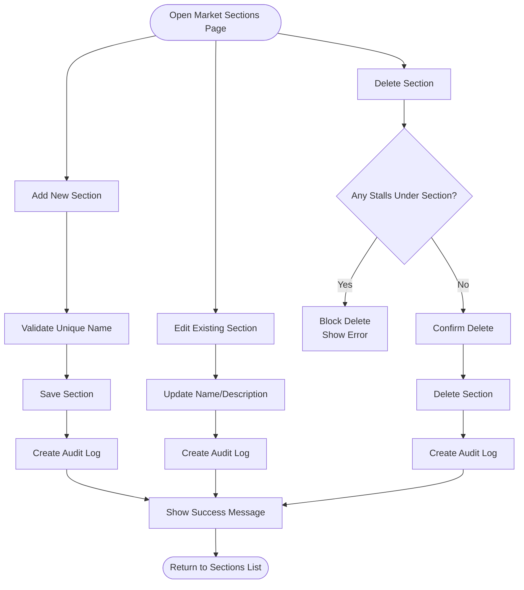
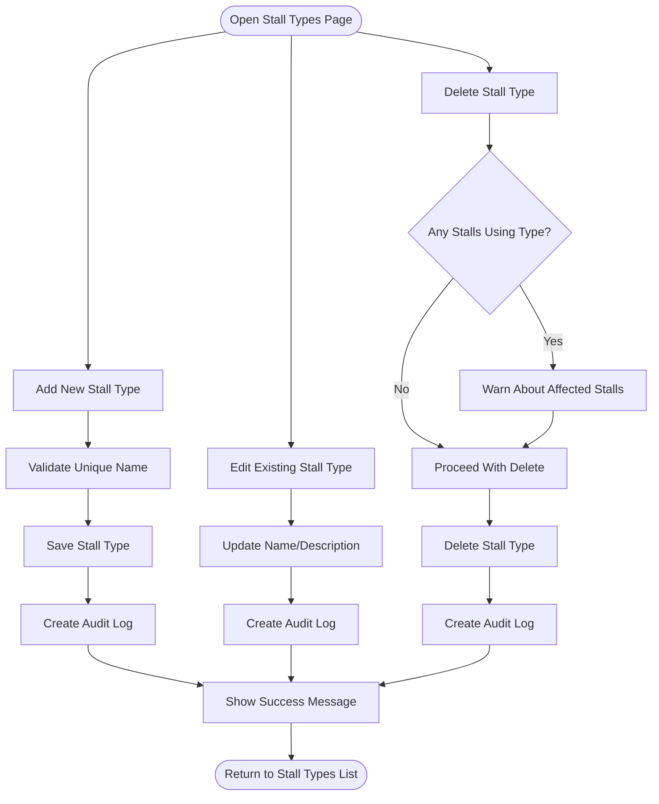
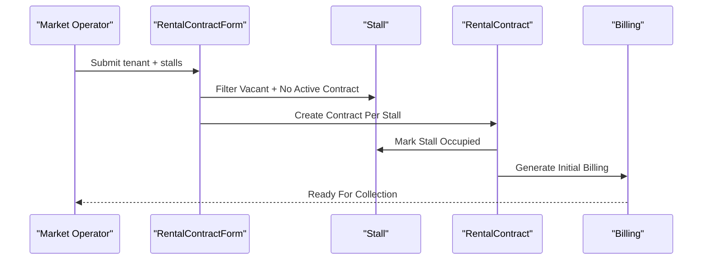
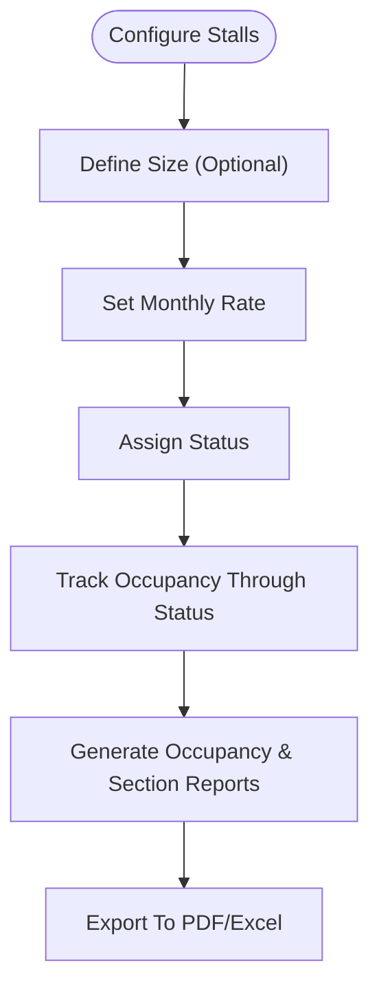
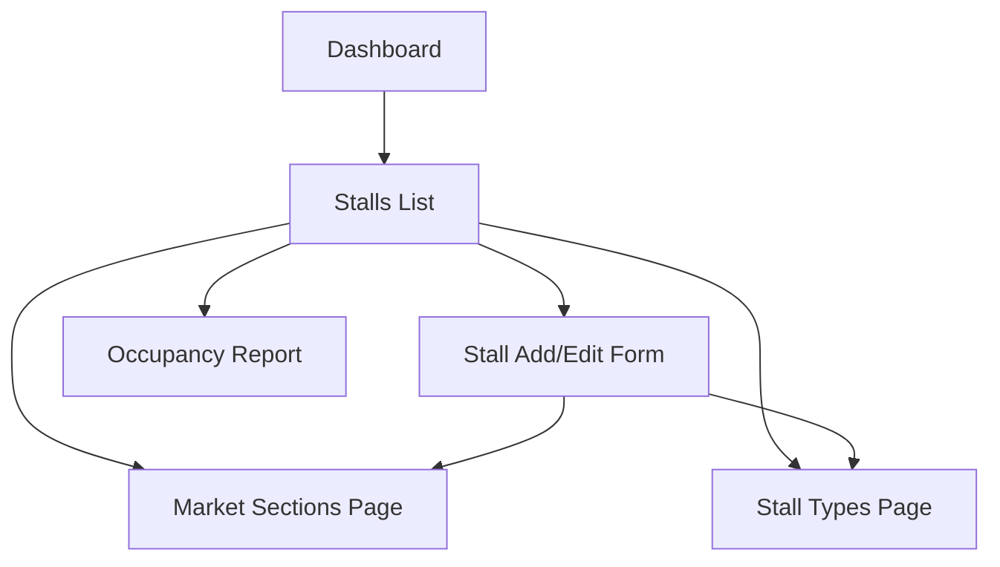
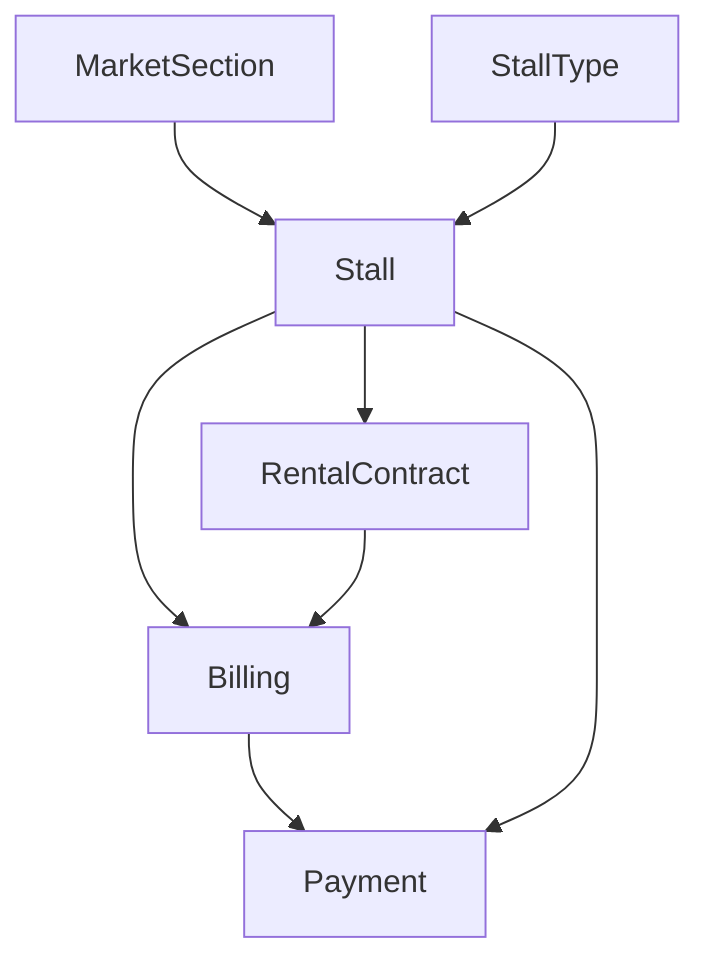

# Market Structure Configuration

<cite>
**Referenced Files in This Document**
- [core/models.py](file://core/models.py)
- [core/forms.py](file://core/forms.py)
- [core/views/lookups.py](file://core/views/lookups.py)
- [core/views/stalls.py](file://core/views/stalls.py)
- [core/views/reports.py](file://core/views/reports.py)
- [templates/stalls/sections.html](file://templates/stalls/sections.html)
- [templates/stalls/stall_types.html](file://templates/stalls/stall_types.html)
- [templates/stalls/_section_select.html](file://templates/stalls/_section_select.html)
- [templates/stalls/_stall_type_select.html](file://templates/stalls/_stall_type_select.html)
- [templates/stalls/form.html](file://templates/stalls/form.html)
- [templates/stalls/list.html](file://templates/stalls/list.html)
- [templates/reports/occupancy.html](file://templates/reports/occupancy.html)
- [core/test_lookups_management.py](file://core/test_lookups_management.py)
- [core/test_stall_form_lookups.py](file://core/test_stall_form_lookups.py)
</cite>

## Table of Contents
1. [Introduction](#introduction)
2. [Project Structure](#project-structure)
3. [Core Components](#core-components)
4. [Architecture Overview](#architecture-overview)
5. [Detailed Component Analysis](#detailed-component-analysis)
6. [Dependency Analysis](#dependency-analysis)
7. [Performance Considerations](#performance-considerations)
8. [Troubleshooting Guide](#troubleshooting-guide)
9. [Conclusion](#conclusion)
10. [Appendices](#appendices)

## Introduction
This document explains how the market structure is configured and used across the system. It focuses on:
- Defining **market sections**, which represent physical areas such as food, clothing, or electronics zones.
- Defining **stall types**, which are categorical labels such as “Food Stall,” “Kiosk,” or “Electronics Counter.”
- Managing **stalls**, including stall numbering, capacity fields, monthly rates, and occupancy status.
- Understanding how section and type configuration affects stall assignment, reporting, billing, and user interface organization.
- Providing practical examples for setting up a new market layout, defining stall categories, and managing section hierarchies.
- Addressing the impact of structural changes on existing contracts and billing records.

The system does not implement nested hierarchical sections; instead, it uses flat `MarketSection` entries that can be named to reflect logical groupings. Stall types are also flat and optional, allowing flexible categorization without forcing every stall into a category.

## Project Structure
Market structure configuration spans models, forms, lookup management views, stall management views, templates, and reports. The most relevant parts are:

**Diagram sources**
- [core/models.py:71-114](file://core/models.py#L71-L114)
- [core/forms.py:201-278](file://core/forms.py#L201-L278)
- [core/views/lookups.py:31-241](file://core/views/lookups.py#L31-L241)
- [core/views/stalls.py:17-275](file://core/views/stalls.py#L17-L275)
- [core/views/reports.py:211-448](file://core/views/reports.py#L211-L448)
- [templates/stalls/sections.html:1-132](file://templates/stalls/sections.html#L1-L132)
- [templates/stalls/stall_types.html:1-124](file://templates/stalls/stall_types.html#L1-L124)
- [templates/stalls/form.html:45-70](file://templates/stalls/form.html#L45-L70)
- [templates/stalls/list.html:1-28](file://templates/stalls/list.html#L1-L28)
- [templates/reports/occupancy.html:1-34](file://templates/reports/occupancy.html#L1-L34)

**Section sources**
- [core/models.py:71-114](file://core/models.py#L71-L114)
- [core/forms.py:201-278](file://core/forms.py#L201-L278)
- [core/views/lookups.py:31-241](file://core/views/lookups.py#L31-L241)
- [core/views/stalls.py:17-275](file://core/views/stalls.py#L17-L275)
- [core/views/reports.py:211-448](file://core/views/reports.py#L211-L448)
- [templates/stalls/sections.html:1-132](file://templates/stalls/sections.html#L1-L132)
- [templates/stalls/stall_types.html:1-124](file://templates/stalls/stall_types.html#L1-L124)
- [templates/stalls/form.html:45-70](file://templates/stalls/form.html#L45-L70)
- [templates/stalls/list.html:1-28](file://templates/stalls/list.html#L1-L28)
- [templates/reports/occupancy.html:1-34](file://templates/reports/occupancy.html#L1-L34)

## Core Components
The market structure is built around three core data entities:

| Entity | Purpose | Key Fields | Relationship Behavior |
|---|---|---|---|
| `MarketSection` | Represents a physical area or zone in the market | Name, Description | One-to-many with stalls |
| `StallType` | Represents a business or operational category for stalls | Name, Description | Optional one-to-many with stalls |
| `Stall` | Represents an individual rental space | Stall Number, Section, Type, Size, Monthly Rate, Status, Remarks | Belongs to one section; optionally belongs to one type |

Important constraints:
- `stall_number` is unique.
- `section` is required and cascades on delete.
- `stall_type` is optional and sets null on delete.
- `status` controls availability for assignment: only vacant stalls can receive active contracts.

**Diagram sources**
- [core/models.py:71-114](file://core/models.py#L71-L114)

**Section sources**
- [core/models.py:71-114](file://core/models.py#L71-L114)

## Architecture Overview
Market structure configuration flows through these layers:

1. **Data Layer**: `MarketSection`, `StallType`, and `Stall` define the structure.
2. **Form Layer**: `StallForm`, `MarketSectionForm`, and `StallTypeForm` validate input and expose lookup options.
3. **View Layer**: Lookup views manage sections and types; stall views manage stalls; report views consume structure for occupancy and collection analytics.
4. **Template Layer**: UI pages render dropdowns, inline add forms, lists, filters, and reports.
5. **Reporting Layer**: Section-based and type-aware reports drive occupancy tracking and financial analysis.

**Diagram sources**
- [core/views/lookups.py:31-241](file://core/views/lookups.py#L31-L241)
- [core/forms.py:201-278](file://core/forms.py#L201-L278)
- [core/views/stalls.py:17-275](file://core/views/stalls.py#L17-L275)
- [core/views/reports.py:211-448](file://core/views/reports.py#L211-L448)
- [core/models.py:71-114](file://core/models.py#L71-L114)

## Detailed Component Analysis

### Market Sections
Market sections are flat physical areas. They are managed through a dedicated page that supports:
- Adding new sections.
- Editing existing sections.
- Deleting sections only when no stalls reference them.
- Inline quick-add from the stall form via HTMX.

Key behaviors:
- Section names must be unique.
- Deletion is blocked if stalls exist under the section.
- The template shows stall count per section and disables delete when in use.
- Quick-add returns a fresh section dropdown fragment so operators can continue filling the stall form without leaving the page.

**Diagram sources**
- [core/views/lookups.py:31-140](file://core/views/lookups.py#L31-L140)
- [templates/stalls/sections.html:20-128](file://templates/stalls/sections.html#L20-L128)

**Section sources**
- [core/views/lookups.py:31-140](file://core/views/lookups.py#L31-L140)
- [templates/stalls/sections.html:1-132](file://templates/stalls/sections.html#L1-L132)
- [core/test_lookups_management.py:1-147](file://core/test_lookups_management.py#L1-L147)

### Stall Types
Stall types are optional categorical labels. They support:
- Creating types like “Food,” “Clothing,” “Electronics,” or “Service.”
- Editing and renaming types.
- Deleting types safely because stall type is nullable.
- Warning operators about how many stalls will lose their type when a type is deleted.
- Inline quick-add from the stall form.

**Diagram sources**
- [core/views/lookups.py:143-241](file://core/views/lookups.py#L143-L241)
- [templates/stalls/stall_types.html:20-120](file://templates/stalls/stall_types.html#L20-L120)

**Section sources**
- [core/views/lookups.py:143-241](file://core/views/lookups.py#L143-L241)
- [templates/stalls/stall_types.html:1-124](file://templates/stalls/stall_types.html#L1-L124)
- [core/test_lookups_management.py:133-147](file://core/test_lookups_management.py#L133-L147)

### Stall Management and Assignment Workflow
Stalls are the central unit of market inventory. Their configuration includes:
- A unique stall number.
- A required section.
- An optional stall type.
- Optional size and mandatory monthly rate.
- Status values: Vacant, Occupied, Reserved, Maintenance.

Assignment workflow highlights:
- Only vacant stalls can be assigned to an active contract.
- The contract form limits tenant selection to active tenants and stall selection to assignable stalls.
- Bulk assignment creates one contract per selected stall and updates stall status accordingly.
- Billing is auto-generated after successful assignment.

**Diagram sources**
- [core/forms.py:281-400](file://core/forms.py#L281-L400)
- [core/views/stalls.py:17-275](file://core/views/stalls.py#L17-L275)
- [core/models.py:157-218](file://core/models.py#L157-L218)

**Section sources**
- [core/forms.py:201-400](file://core/forms.py#L201-L400)
- [core/views/stalls.py:17-275](file://core/views/stalls.py#L17-L275)
- [core/models.py:93-218](file://core/models.py#L93-L218)

### Stall Numbering System
The system stores stall numbers as unique strings rather than enforcing a strict numeric or hierarchical format. This allows flexible naming conventions such as:
- Simple sequences: 1, 2, 3.
- Zone-based codes: A-101, B-202.
- Descriptive identifiers: Food-A1, Clothing-B3.

Recommendations:
- Use consistent prefixes for physical sections (for example, “A” for Food, “B” for Clothing).
- Keep stall numbers readable and sortable.
- Avoid reusing stall numbers after deletion because uniqueness is enforced.

**Section sources**
- [core/models.py:93-114](file://core/models.py#L93-L114)
- [core/forms.py:201-238](file://core/forms.py#L201-L238)

### Capacity Planning and Occupancy Tracking
Capacity planning is supported through:
- `size`: optional decimal field for square meters or other area units.
- `monthly_rate`: base rental value used for contracts and billing.
- `status`: tracks whether a stall is available or occupied.
- Reports: occupancy, vacant stalls, and section-based collection summaries.

Occupancy tracking behavior:
- The occupancy report lists stalls grouped by section and filtered by status.
- The vacant report filters stalls by Vacant status.
- Section reports compute occupied and vacant counts per section.
- Excel export includes stall number, section, type, size, monthly rate, status, and current tenant.

**Diagram sources**
- [core/models.py:93-114](file://core/models.py#L93-L114)
- [core/views/reports.py:397-448](file://core/views/reports.py#L397-L448)
- [core/views/reports.py:530-730](file://core/views/reports.py#L530-L730)
- [templates/reports/occupancy.html:1-34](file://templates/reports/occupancy.html#L1-L34)

**Section sources**
- [core/models.py:93-114](file://core/models.py#L93-L114)
- [core/views/reports.py:397-448](file://core/views/reports.py#L397-L448)
- [core/views/reports.py:530-730](file://core/views/reports.py#L530-L730)
- [templates/reports/occupancy.html:1-34](file://templates/reports/occupancy.html#L1-L34)

### User Interface Organization
The UI organizes market structure configuration into clear entry points:
- **Market Sections**: Dedicated page for adding, editing, and deleting sections.
- **Stall Types**: Dedicated page for managing stall categories.
- **Stalls**: Main marketplace view with filtering by section and status, plus print/export capabilities.
- **Stall Form**: Includes inline quick-add for sections and links to manage stall types.

**Diagram sources**
- [templates/stalls/list.html:1-28](file://templates/stalls/list.html#L1-L28)
- [templates/stalls/sections.html:1-132](file://templates/stalls/sections.html#L1-L132)
- [templates/stalls/stall_types.html:1-124](file://templates/stalls/stall_types.html#L1-L124)
- [templates/stalls/form.html:45-70](file://templates/stalls/form.html#L45-L70)
- [templates/reports/occupancy.html:1-34](file://templates/reports/occupancy.html#L1-L34)

**Section sources**
- [templates/stalls/list.html:1-28](file://templates/stalls/list.html#L1-L28)
- [templates/stalls/sections.html:1-132](file://templates/stalls/sections.html#L1-L132)
- [templates/stalls/stall_types.html:1-124](file://templates/stalls/stall_types.html#L1-L124)
- [templates/stalls/form.html:45-70](file://templates/stalls/form.html#L45-L70)
- [templates/reports/occupancy.html:1-34](file://templates/reports/occupancy.html#L1-L34)

### Examples: Setting Up a New Market Layout
Recommended steps:

1. **Define Physical Sections**
   - Create sections such as “Food Area,” “Clothing Area,” and “Electronics Area.”
   - Use descriptions to clarify boundaries or rules for each area.

2. **Define Stall Categories**
   - Create stall types such as “Food Stall,” “Clothing Stall,” “Electronics Stall,” and “Service Counter.”
   - Leave stall type blank for stalls where categorization is not yet decided.

3. **Create Stalls**
   - Assign each stall a unique number.
   - Link each stall to a section.
   - Optionally assign a stall type.
   - Enter size and monthly rate.
   - Set initial status to Vacant.

4. **Assign Tenants**
   - Use single or bulk assignment.
   - Ensure stalls are vacant before assignment.
   - Verify that contracts are created and billing is generated.

5. **Monitor Occupancy**
   - Use the occupancy report to track utilization by section and status.
   - Use the vacant report to identify available stalls.
   - Export reports for audits or planning.

**Section sources**
- [core/views/lookups.py:31-241](file://core/views/lookups.py#L31-L241)
- [core/forms.py:201-400](file://core/forms.py#L201-L400)
- [core/views/reports.py:397-448](file://core/views/reports.py#L397-L448)

### Impact of Structural Changes on Contracts and Billing
Structural changes have different impacts depending on the entity:

| Change | Effect on Contracts | Effect on Billing | Notes |
|---|---|---|---|
| Rename a market section | Contracts remain valid because they reference stalls, not section names directly | Billing remains valid | Section display may change in reports and UI |
| Reassign a stall to another section | Contract remains valid | Billing remains valid | Historical billing still references the original stall |
| Delete a market section with stalls | Blocked at the UI layer | Not applicable | Prevents accidental loss of live stalls |
| Delete a stall type | Contracts remain valid | Billing remains valid | Stall type becomes null; historical records keep stall identity |
| Change stall monthly rate | Existing contracts are not retroactively changed | Existing billings are not retroactively changed | New contracts use the updated rate |
| Change stall status | Affects future assignment eligibility | Not retroactive | Only vacant stalls can receive active contracts |

**Section sources**
- [core/models.py:71-114](file://core/models.py#L71-L114)
- [core/models.py:157-218](file://core/models.py#L157-L218)
- [core/views/lookups.py:87-111](file://core/views/lookups.py#L87-L111)
- [core/views/lookups.py:196-219](file://core/views/lookups.py#L196-L219)
- [core/forms.py:281-400](file://core/forms.py#L281-L400)

## Dependency Analysis
The market structure has clear dependencies:

- `Stall` depends on `MarketSection` and `StallType`.
- `RentalContract` depends on `Stall`.
- `Billing` depends on `Tenant`, `Stall`, and `RentalContract`.
- `Payment` depends on `Billing`, `Tenant`, and `Stall`.
- Reports depend on `Stall`, `MarketSection`, `Billing`, and `Payment`.

**Diagram sources**
- [core/models.py:71-258](file://core/models.py#L71-L258)

**Section sources**
- [core/models.py:71-258](file://core/models.py#L71-L258)

## Performance Considerations
- Use `select_related` for section and stall type when listing stalls to reduce database queries.
- Annotate section and type counts only when needed, such as on management pages.
- Paginate large stall lists and reports.
- Avoid unnecessary full-table scans by filtering reports by section, status, month, and year.
- Prefer stable stall numbering strategies to avoid expensive string comparisons during sorting.

[No sources needed since this section provides general guidance]

## Troubleshooting Guide
Common issues and resolutions:

| Issue | Cause | Resolution |
|---|---|---|
| Cannot delete a market section | Stalls still reference the section | Reassign stalls to another section first |
| Stall type deletion clears stall categories | Stall type is nullable | Accept the warning; update affected stalls later |
| Stall form shows no section options | No market sections exist | Create at least one section or use inline quick-add |
| Cannot assign a stall to a tenant | Stall is not vacant or already has an active contract | Change stall status or terminate/expired contract first |
| Duplicate tenant creation fails | Tenant name normalization detects duplicates | Edit the existing tenant record instead of creating a duplicate |
| Occupancy report missing expected stalls | Filters applied incorrectly | Clear section or status filters and reload |

**Section sources**
- [core/views/lookups.py:87-111](file://core/views/lookups.py#L87-L111)
- [core/views/lookups.py:196-219](file://core/views/lookups.py#L196-L219)
- [core/forms.py:240-258](file://core/forms.py#L240-L258)
- [core/forms.py:389-399](file://core/forms.py#L389-L399)
- [core/forms.py:156-198](file://core/forms.py#L156-L198)
- [core/views/reports.py:397-448](file://core/views/reports.py#L397-L448)

## Conclusion
Market structure configuration in this system centers on flat but flexible definitions of physical sections and stall categories. Stalls link to sections and optionally to types, enabling clear organization without overcomplicating hierarchy. The design protects live data by blocking unsafe deletions, allows safe removal of optional categories, and ties stall status directly to assignment eligibility. Reporting leverages sections and statuses to provide actionable insights into occupancy and collection performance. When changing structure, administrators should plan carefully around existing contracts and billing records, favoring additions and reassignments over destructive operations.

[No sources needed since this section summarizes without analyzing specific files]

## Appendices

### API and URL Entry Points for Market Structure
- Market sections management page and actions.
- Stall types management page and actions.
- Stall list, add, edit, view, print, and export endpoints.
- Occupancy and section reports.

These are implemented through Django views and templates rather than a separate REST API surface. Operators interact primarily through the web interface.

**Section sources**
- [core/views/lookups.py:31-241](file://core/views/lookups.py#L31-L241)
- [core/views/stalls.py:17-275](file://core/views/stalls.py#L17-L275)
- [core/views/reports.py:211-448](file://core/views/reports.py#L211-L448)

### Best Practices for Market Administrators
- Use descriptive section names that match physical market zones.
- Use stall types consistently to support reporting and categorization.
- Maintain unique and readable stall numbers.
- Keep stall status accurate to ensure correct assignment workflows.
- Review occupancy reports regularly to balance load across sections.
- Plan structural changes during low-activity periods to minimize disruption.

[No sources needed since this section provides general guidance]