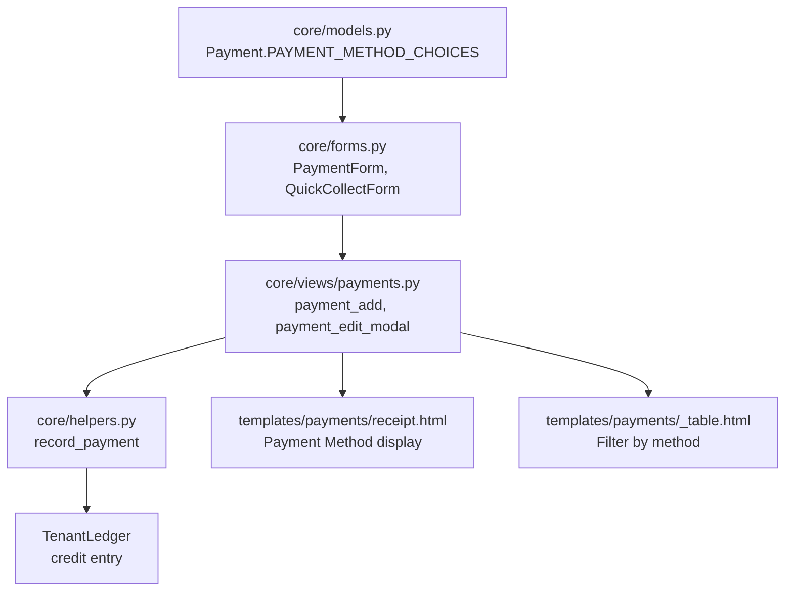
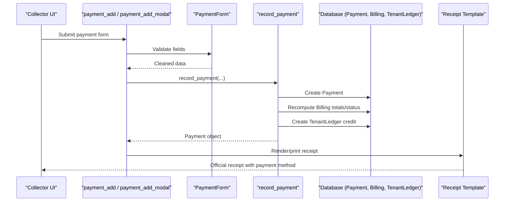
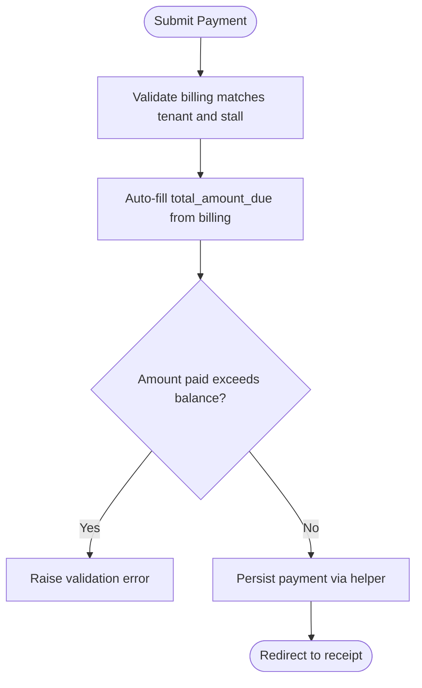
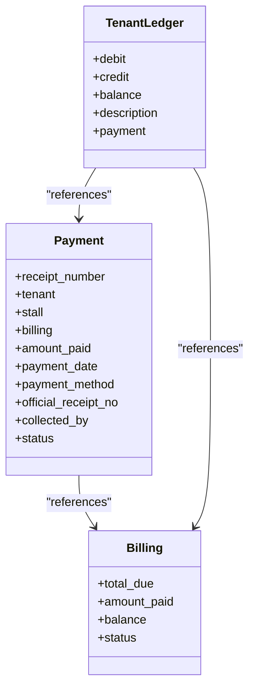
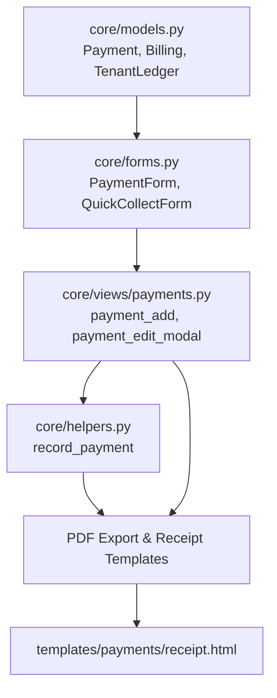

# Payment Methods Configuration

<cite>
**Referenced Files in This Document**
- [core/models.py](file://core/models.py)
- [core/forms.py](file://core/forms.py)
- [core/helpers.py](file://core/helpers.py)
- [core/views/payments.py](file://core/views/payments.py)
- [templates/payments/_modal_form.html](file://templates/payments/_modal_form.html)
- [templates/payments/receipt.html](file://templates/payments/receipt.html)
</cite>

## Table of Contents
1. [Introduction](#introduction)
2. [Project Structure](#project-structure)
3. [Core Components](#core-components)
4. [Architecture Overview](#architecture-overview)
5. [Detailed Component Analysis](#detailed-component-analysis)
6. [Dependency Analysis](#dependency-analysis)
7. [Performance Considerations](#performance-considerations)
8. [Troubleshooting Guide](#troubleshooting-guide)
9. [Conclusion](#conclusion)
10. [Appendices](#appendices)

## Introduction
This document explains how payment methods are configured and managed in the Market Rental and Collection Management System. It covers the built-in payment types, their configuration points, validation rules, integration with receipts, ledger entries, and financial reporting, as well as guidance for adding new payment methods, configuring payment-specific fields, managing availability, addressing security considerations for digital payments, and performing reconciliation procedures.

The system currently supports four payment methods:
- Cash
- GCash
- Bank Transfer
- Check

These options are defined at the data model level and propagated to forms, views, templates, reports, and audit trails.

## Project Structure
Payment method configuration spans several layers:
- Data model: defines available payment methods and stores them on each payment record.
- Forms: expose the choices to collectors and tenants.
- Views: enforce access control, validate input, and persist payments.
- Helpers: centralize payment posting, billing updates, and ledger creation.
- Templates: render payment method values on receipts and lists.

**Diagram sources**
- [core/models.py:221-258](file://core/models.py#L221-L258)
- [core/forms.py:465-521](file://core/forms.py#L465-L521)
- [core/views/payments.py:250-294](file://core/views/payments.py#L250-L294)
- [core/helpers.py:351-420](file://core/helpers.py#L351-L420)
- [templates/payments/receipt.html:83-98](file://templates/payments/receipt.html#L83-L98)

**Section sources**
- [core/models.py:221-258](file://core/models.py#L221-L258)
- [core/forms.py:465-521](file://core/forms.py#L465-L521)
- [core/views/payments.py:250-294](file://core/views/payments.py#L250-L294)
- [core/helpers.py:351-420](file://core/helpers.py#L351-L420)
- [templates/payments/receipt.html:83-98](file://templates/payments/receipt.html#L83-L98)

## Core Components
- Payment model:
  - Defines the allowed payment methods through a choices list.
  - Stores the selected method alongside receipt numbers, amounts, dates, collector, and status.
- Payment form:
  - Renders the payment method dropdown using the model’s choices.
  - Validates billing consistency and prevents overpayments.
- Payment helper:
  - Centralizes payment posting, billing recomputation, and ledger credit creation.
  - Uses the chosen payment method when creating ledger descriptions.
- Views:
  - Enforce role-based access.
  - Persist payments via the helper and redirect to printable receipts.
- Templates:
  - Display the payment method on receipts and allow filtering by method in lists.

Key responsibilities:
- Configuration: Add or remove payment methods in the model choices.
- Validation: Ensure amount paid does not exceed outstanding balance; ensure billing matches tenant and stall.
- Integration: Update Billing totals/status and create TenantLedger credits.
- Reporting: Include payment method in receipts, lists, and PDF exports.

**Section sources**
- [core/models.py:221-258](file://core/models.py#L221-L258)
- [core/forms.py:465-521](file://core/forms.py#L465-L521)
- [core/helpers.py:351-420](file://core/helpers.py#L351-L420)
- [core/views/payments.py:250-294](file://core/views/payments.py#L250-L294)
- [templates/payments/receipt.html:83-98](file://templates/payments/receipt.html#L83-L98)

## Architecture Overview
The payment flow integrates models, forms, views, helpers, and templates to ensure consistent recording, auditing, and reporting of payments across all channels.

**Diagram sources**
- [core/views/payments.py:250-294](file://core/views/payments.py#L250-L294)
- [core/forms.py:465-521](file://core/forms.py#L465-L521)
- [core/helpers.py:351-420](file://core/helpers.py#L351-L420)
- [templates/payments/receipt.html:83-98](file://templates/payments/receipt.html#L83-L98)

## Detailed Component Analysis

### Payment Method Configuration
- Available methods:
  - Cash
  - GCash
  - Bank Transfer
  - Check
- Where they are defined:
  - The Payment model contains a choices list that enumerates these methods.
- How they propagate:
  - Forms use the model choices to render dropdowns.
  - Views pass the selected method into the payment helper.
  - Templates display the method on receipts and lists.

Configuration steps:
- To add a new payment method:
  - Extend the Payment model’s choices list.
  - Optionally update any template filters or dropdowns if they hardcode options.
- To remove a payment method:
  - Remove it from the model choices.
  - Review existing records to avoid invalid foreign-like references (the field is a CharField with choices, so historical values may remain unless cleaned).

Validation rules:
- The selected value must be one of the defined choices.
- Overpayment is prevented by form validation against the billing balance.
- Billing consistency checks ensure the selected billing belongs to the selected tenant and stall.

Security considerations:
- Role-based access controls restrict who can view or edit payments.
- Audit logs capture creation and updates.
- For digital payments (GCash, Bank Transfer), consider requiring additional evidence such as transaction reference numbers in remarks or dedicated fields.

Reconciliation procedures:
- Cash: Reconcile physical cash collected versus recorded payments marked as Cash.
- GCash: Match recorded GCash payments with platform transaction IDs and screenshots stored in remarks or attachments.
- Bank Transfer: Match bank statements with recorded Bank Transfer payments; verify official receipt numbers.
- Check: Track check numbers and clearance status; reconcile cleared checks against recorded Check payments.

**Section sources**
- [core/models.py:221-258](file://core/models.py#L221-L258)
- [core/forms.py:465-521](file://core/forms.py#L465-L521)
- [core/views/payments.py:250-294](file://core/views/payments.py#L250-L294)
- [templates/payments/receipt.html:83-98](file://templates/payments/receipt.html#L83-L98)

### Payment Form and Validation
- Fields exposed:
  - Tenant, Stall, Billing, Billing Month/Year, Rental Amount, Penalty Amount, Discount, Total Amount Due, Amount Paid, Payment Date, Payment Method, Official Receipt No., Collected By, Status, Remarks.
- Validation logic:
  - Ensures billing matches tenant and stall.
  - Auto-fills total_amount_due from billing when present.
  - Prevents overpayment beyond outstanding balance.

**Diagram sources**
- [core/forms.py:465-521](file://core/forms.py#L465-L521)

**Section sources**
- [core/forms.py:465-521](file://core/forms.py#L465-L521)

### Payment Posting and Ledger Integration
- The helper function is the single source of truth for posting payments:
  - Creates a Payment row with the selected payment method.
  - Recomputes Billing totals and status based on valid payments.
  - Posts a TenantLedger credit entry describing the payment method.
  - Recalculates running tenant ledger balances.

**Diagram sources**
- [core/models.py:190-277](file://core/models.py#L190-L277)
- [core/helpers.py:351-420](file://core/helpers.py#L351-L420)

**Section sources**
- [core/helpers.py:351-420](file://core/helpers.py#L351-L420)
- [core/models.py:190-277](file://core/models.py#L190-L277)

### Receipt Generation and Payment Method Display
- Receipt templates include:
  - Tenant details, stall, section, billing period.
  - Payment method label and value.
  - Charges table with rental, penalty, discount, total due, amount paid, remaining balance.
  - Official receipt number and system receipt number.
  - Signatures and status badge.

Integration points:
- Views pass the Payment object and system settings to the receipt template.
- The receipt displays the payment method exactly as recorded.
- PDF export uses the same template to generate printable receipts.

**Section sources**
- [templates/payments/receipt.html:83-98](file://templates/payments/receipt.html#L83-L98)
- [core/views/payments.py:314-348](file://core/views/payments.py#L314-L348)

### Adding New Payment Methods
Steps to add a new payment method:
1. Extend the Payment model’s choices list to include the new method.
2. Verify that forms inherit the choices automatically.
3. If any template or filter hardcodes method options, update them to include the new method.
4. Test collection flows, receipts, lists, and PDF exports.

Example approach:
- Add the new method string to the model choices.
- Confirm that the PaymentForm renders the new option.
- Confirm that the receipt template displays the new method.
- Confirm that list filters include the new method.

**Section sources**
- [core/models.py:221-258](file://core/models.py#L221-L258)
- [core/forms.py:465-521](file://core/forms.py#L465-L521)
- [templates/payments/receipt.html:83-98](file://templates/payments/receipt.html#L83-L98)

### Configuring Payment-Specific Fields
Current implementation:
- There is no dedicated per-method field structure.
- Remarks can store method-specific details such as:
  - GCash transaction ID
  - Bank transfer reference number
  - Check number and clearing status
  - Cash drawer notes

Recommendations:
- Use remarks consistently for method-specific identifiers.
- Consider adding explicit fields (e.g., gcash_reference, bank_reference, check_number) if audit requirements demand structured storage.
- Update forms and templates to render and validate these fields when added.

**Section sources**
- [core/forms.py:465-521](file://core/forms.py#L465-L521)
- [core/models.py:221-258](file://core/models.py#L221-L258)

### Managing Payment Method Availability
Availability is controlled by:
- Model choices: Only listed methods can be selected during payment entry.
- Views: Filter lists by payment method.
- Templates: Dropdowns and filters reflect available methods.

To manage availability:
- Add/remove methods in the model choices.
- Update any hardcoded filters or dropdowns in templates.
- Ensure reports and exports include the updated set.

**Section sources**
- [core/models.py:221-258](file://core/models.py#L221-L258)
- [core/views/payments.py:186-247](file://core/views/payments.py#L186-L247)

### Security Considerations for Digital Payments
- Access control:
  - Tenants can only view their own payments.
  - Collectors can only view receipts for payments they recorded.
  - Management roles see everything.
- Audit trail:
  - Creation and updates are logged with user, action, module, description, and IP address.
- Data integrity:
  - Payments are posted within atomic transactions.
  - Billing recomputation ensures consistent totals and statuses.
  - Ledger recalculations maintain accurate running balances.

For digital payments specifically:
- Require method-specific identifiers in remarks or dedicated fields.
- Attach supporting documents (screenshots, bank slips) where possible.
- Implement approval workflows for high-value digital payments if needed.

**Section sources**
- [core/views/payments.py:157-183](file://core/views/payments.py#L157-L183)
- [core/views/payments.py:250-294](file://core/views/payments.py#L250-L294)
- [core/helpers.py:351-420](file://core/helpers.py#L351-L420)

### Reconciliation Procedures
- Cash:
  - Compare daily cash collections with Cash payments in the system.
  - Verify official receipt numbers and amounts.
- GCash:
  - Match GCash transaction IDs and amounts with recorded payments.
  - Confirm timestamps and collector assignments.
- Bank Transfer:
  - Reconcile bank statement deposits with Bank Transfer payments.
  - Verify official receipt numbers and amounts.
- Check:
  - Track check numbers and clearance status.
  - Reconcile cleared checks with recorded Check payments.

Reporting tools:
- Payment lists support filtering by payment method.
- PDF exports provide printable summaries.
- Receipts show payment method and amounts for verification.

**Section sources**
- [core/views/payments.py:186-247](file://core/views/payments.py#L186-L247)
- [core/views/payments.py:605-652](file://core/views/payments.py#L605-L652)
- [templates/payments/receipt.html:83-98](file://templates/payments/receipt.html#L83-L98)

## Dependency Analysis
The payment method feature depends on multiple components:

**Diagram sources**
- [core/models.py:190-277](file://core/models.py#L190-L277)
- [core/forms.py:465-521](file://core/forms.py#L465-L521)
- [core/views/payments.py:250-294](file://core/views/payments.py#L250-L294)
- [core/helpers.py:351-420](file://core/helpers.py#L351-L420)
- [templates/payments/receipt.html:83-98](file://templates/payments/receipt.html#L83-L98)

**Section sources**
- [core/models.py:190-277](file://core/models.py#L190-L277)
- [core/forms.py:465-521](file://core/forms.py#L465-L521)
- [core/views/payments.py:250-294](file://core/views/payments.py#L250-L294)
- [core/helpers.py:351-420](file://core/helpers.py#L351-L420)
- [templates/payments/receipt.html:83-98](file://templates/payments/receipt.html#L83-L98)

## Performance Considerations
- Decimal arithmetic:
  - Financial calculations use Decimal throughout to avoid float drift.
- Database locking:
  - Billing rows are locked during payment posting to prevent concurrent settlement races.
- Query optimization:
  - Select-related queries reduce N+1 issues in list and receipt views.
- PDF generation:
  - Fallback mechanisms ensure PDF rendering works across environments.

[No sources needed since this section provides general guidance]

## Troubleshooting Guide
Common issues and resolutions:
- Invalid payment method:
  - Ensure the method is included in the model choices.
- Overpayment errors:
  - Verify the billing balance and adjust the amount paid accordingly.
- Missing receipt:
  - Confirm the payment was saved and redirect to the receipt URL.
- Ledger imbalance:
  - Run ledger recalculation after edits or voids.
- PDF not generating:
  - Check WeasyPrint or xhtml2pdf availability; use browser Print → Save as PDF fallback.

**Section sources**
- [core/forms.py:465-521](file://core/forms.py#L465-L521)
- [core/helpers.py:351-420](file://core/helpers.py#L351-L420)
- [core/views/payments.py:419-457](file://core/views/payments.py#L419-L457)

## Conclusion
Payment methods in this system are centrally configured through the Payment model and propagated consistently across forms, views, helpers, and templates. The current set includes Cash, GCash, Bank Transfer, and Check. Validation ensures data integrity, while helpers centralize posting and ledger integration. Receipts and reports reflect the selected payment method, enabling clear reconciliation and auditing. Extending or restricting payment methods requires updating the model choices and ensuring templates and filters remain synchronized.

[No sources needed since this section summarizes without analyzing specific files]

## Appendices

### Example: Adding a New Payment Method
- Step 1: Add the new method to the Payment model’s choices list.
- Step 2: Confirm the PaymentForm renders the new option.
- Step 3: Update any hardcoded filters or dropdowns in templates.
- Step 4: Test payment entry, receipt generation, and list filtering.

**Section sources**
- [core/models.py:221-258](file://core/models.py#L221-L258)
- [core/forms.py:465-521](file://core/forms.py#L465-L521)
- [templates/payments/receipt.html:83-98](file://templates/payments/receipt.html#L83-L98)