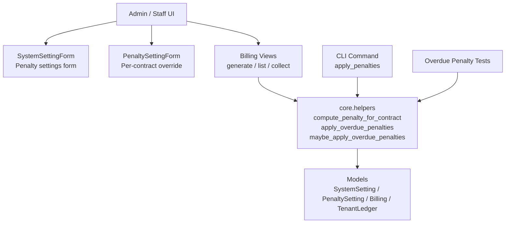
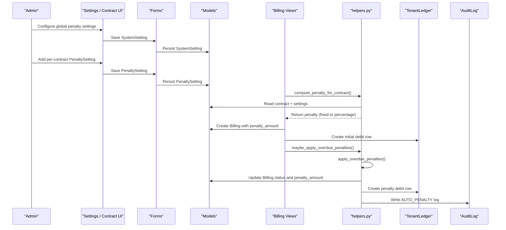
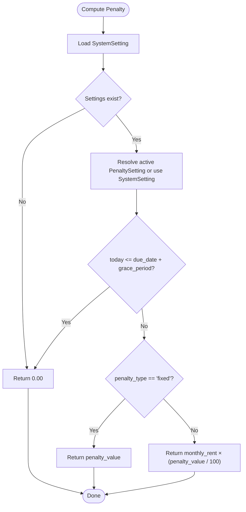
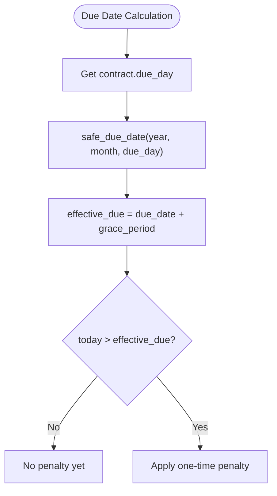
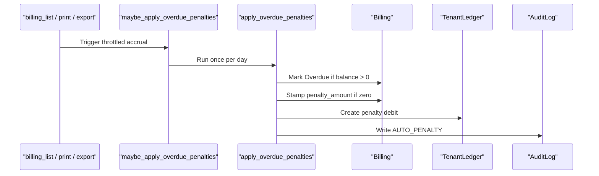
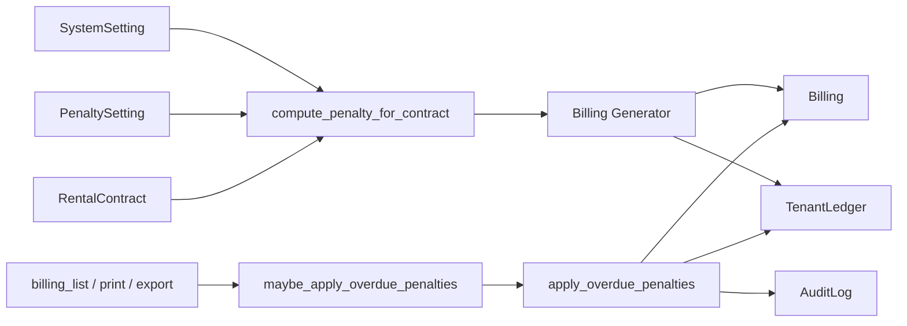

# Penalty Configuration

<cite>
**Referenced Files in This Document**
- [PENALTY_GUIDE.md](file://PENALTY_GUIDE.md)
- [core/models.py](file://core/models.py)
- [core/helpers.py](file://core/helpers.py)
- [core/views/billing.py](file://core/views/billing.py)
- [core/forms.py](file://core/forms.py)
- [core/management/commands/apply_penalties.py](file://core/management/commands/apply_penalties.py)
- [core/test_overdue_penalties.py](file://core/test_overdue_penalties.py)
</cite>

## Table of Contents
1. [Introduction](#introduction)
2. [Project Structure](#project-structure)
3. [Core Components](#core-components)
4. [Architecture Overview](#architecture-overview)
5. [Detailed Component Analysis](#detailed-component-analysis)
6. [Dependency Analysis](#dependency-analysis)
7. [Performance Considerations](#performance-considerations)
8. [Troubleshooting Guide](#troubleshooting-guide)
9. [Conclusion](#conclusion)
10. [Appendices](#appendices)

## Introduction
This document explains how penalty configuration and the penalty calculation engine work in the market rental system. It covers grace periods, fixed amount penalties, percentage-based penalties, due date calculations, billing integration, tenant account effects, waiver considerations, financial reporting implications, and municipal compliance notes.

The system applies a **one-time late penalty** only after a bill’s due date plus a configured grace period. Penalties are either:
- A fixed peso amount, or
- A percentage of the monthly rent.

Penalties do not compound daily or stack across runs; each billing receives at most one penalty charge.

## Project Structure
Penalty configuration spans models, helper logic, forms, views, management commands, tests, and user-facing documentation.

**Diagram sources**
- [core/forms.py:540-574](file://core/forms.py#L540-L574)
- [core/views/billing.py:174-315](file://core/views/billing.py#L174-L315)
- [core/helpers.py:132-152](file://core/helpers.py#L132-L152)
- [core/helpers.py:423-520](file://core/helpers.py#L423-L520)
- [core/models.py:42-68](file://core/models.py#L42-L68)
- [core/models.py:319-336](file://core/models.py#L319-L336)
- [core/management/commands/apply_penalties.py:1-14](file://core/management/commands/apply_penalties.py#L1-L14)
- [core/test_overdue_penalties.py:1-95](file://core/test_overdue_penalties.py#L1-L95)

**Section sources**
- [PENALTY_GUIDE.md:1-221](file://PENALTY_GUIDE.md#L1-L221)
- [core/forms.py:540-574](file://core/forms.py#L540-L574)
- [core/views/billing.py:174-315](file://core/views/billing.py#L174-L315)
- [core/helpers.py:132-152](file://core/helpers.py#L132-L152)
- [core/helpers.py:423-520](file://core/helpers.py#L423-L520)
- [core/models.py:42-68](file://core/models.py#L42-L68)
- [core/models.py:319-336](file://core/models.py#L319-L336)
- [core/management/commands/apply_penalties.py:1-14](file://core/management/commands/apply_penalties.py#L1-L14)
- [core/test_overdue_penalties.py:1-95](file://core/test_overdue_penalties.py#L1-L95)

## Core Components
The penalty engine is built around these core pieces:

| Component | Responsibility | Key Fields / Methods |
|---|---|---|
| `SystemSetting` | Global penalty defaults for the market | `penalty_type`, `penalty_value`, `grace_period`, `default_due_day` |
| `PenaltySetting` | Per-contract penalty overrides | `contract`, `penalty_type`, `penalty_value`, `grace_period`, `due_day`, `is_active` |
| `RentalContract` | Contract-level business data used by penalties | `monthly_rent`, `due_day` |
| `Billing` | Stamped billing with penalty totals | `rental_amount`, `penalty_amount`, `total_due`, `balance`, `due_date`, `status` |
| `TenantLedger` | Audit trail including penalty debits | `debit`, `credit`, `balance`, linked to `Billing` |
| `compute_penalty_for_contract` | Central penalty math resolver | Returns zero inside grace, otherwise fixed or percentage penalty |
| `apply_overdue_penalties` | Sweep service that marks overdue and applies one-time penalty | Updates `Billing`, creates `TenantLedger` debit, writes audit log |
| `maybe_apply_overdue_penalties` | Throttled request-time trigger | Runs sweep once per day using cache key |
| `apply_penalties` CLI command | Manual unthrottled sweep entry point | Calls `apply_overdue_penalties` |

**Section sources**
- [core/models.py:42-68](file://core/models.py#L42-L68)
- [core/models.py:157-188](file://core/models.py#L157-L188)
- [core/models.py:190-218](file://core/models.py#L190-L218)
- [core/models.py:261-277](file://core/models.py#L261-L277)
- [core/models.py:319-336](file://core/models.py#L319-L336)
- [core/helpers.py:132-152](file://core/helpers.py#L132-L152)
- [core/helpers.py:423-520](file://core/helpers.py#L423-L520)
- [core/management/commands/apply_penalties.py:1-14](file://core/management/commands/apply_penalties.py#L1-L14)

## Architecture Overview
The penalty flow connects configuration, billing generation, automatic accrual, and ledger recording.

**Diagram sources**
- [core/forms.py:540-574](file://core/forms.py#L540-L574)
- [core/models.py:42-68](file://core/models.py#L42-L68)
- [core/models.py:319-336](file://core/models.py#L319-L336)
- [core/views/billing.py:174-315](file://core/views/billing.py#L174-L315)
- [core/helpers.py:132-152](file://core/helpers.py#L132-L152)
- [core/helpers.py:423-520](file://core/helpers.py#L423-L520)

## Detailed Component Analysis

### Penalty Calculation Engine
The central calculation function resolves whether a penalty should be applied and how much it should be.

Key behaviors:
- If no `SystemSetting` exists, penalty is zero.
- If an active `PenaltySetting` exists on the contract, it overrides global defaults.
- If today is within the grace period (`due_date + grace_period`), penalty is zero.
- For `fixed` type, penalty equals `penalty_value`.
- For `percentage` type, penalty equals `monthly_rent × (penalty_value ÷ 100)`, quantized to two decimals.

**Diagram sources**
- [core/helpers.py:132-152](file://core/helpers.py#L132-L152)

**Section sources**
- [core/helpers.py:132-152](file://core/helpers.py#L132-L152)

### Grace Periods and Due Date Calculations
Grace periods delay penalty application until after the due date plus configured days. Due dates are computed safely so months with fewer than 31 days still produce valid dates.

Important rules:
- `safe_due_date` clamps the due day to the last day of the month when needed.
- Effective due date for penalty purposes is `due_date + grace_period`.
- The billing generator uses the contract’s `due_day`; helpers also compute safe due dates during auto-billing.

**Diagram sources**
- [core/helpers.py:125-129](file://core/helpers.py#L125-L129)
- [core/helpers.py:132-152](file://core/helpers.py#L132-L152)
- [core/views/billing.py:54-59](file://core/views/billing.py#L54-L59)

**Section sources**
- [core/helpers.py:125-129](file://core/helpers.py#L125-L129)
- [core/helpers.py:132-152](file://core/helpers.py#L132-L152)
- [core/views/billing.py:54-59](file://core/views/billing.py#L54-L59)

### Fixed Amount Penalties
Fixed penalties charge the same amount regardless of rent size.

Configuration:
- Set `penalty_type` to `fixed`.
- Set `penalty_value` to the desired peso amount.

Effect:
- `compute_penalty_for_contract` returns `penalty_value` directly.
- Billing total becomes `rental_amount + penalty_amount - discount`.

Practical example reference:
- See the fixed penalty explanation and comparison with percentage mode in the penalty guide.

**Section sources**
- [core/helpers.py:148-151](file://core/helpers.py#L148-L151)
- [PENALTY_GUIDE.md:108-127](file://PENALTY_GUIDE.md#L108-L127)

### Percentage-Based Penalties
Percentage penalties scale with rent.

Configuration:
- Set `penalty_type` to `percentage`.
- Set `penalty_value` to the percentage number (for example, `2` means 2%).

Effect:
- Penalty equals `monthly_rent × (penalty_value ÷ 100)`, rounded to two decimals.
- Higher-rent tenants pay higher penalties under percentage mode.

Practical example reference:
- See the percentage penalty worked example in the penalty guide.

**Section sources**
- [core/helpers.py:150-151](file://core/helpers.py#L150-L151)
- [PENALTY_GUIDE.md:67-105](file://PENALTY_GUIDE.md#L67-L105)

### Configuring Penalty Rates
Global defaults are managed through `SystemSetting`:
- `penalty_type`: `fixed` or `percentage`.
- `penalty_value`: numeric value depending on type.
- `grace_period`: extra days after due date before penalty applies.
- `default_due_day`: default day-of-month for billing due dates.

Per-contract overrides are managed through `PenaltySetting`:
- Tied to a specific `RentalContract`.
- Can set its own `penalty_type`, `penalty_value`, `grace_period`, and `due_day`.
- Only the first active rule per contract is used.

User interface:
- `SystemSettingForm` exposes global penalty fields.
- `PenaltySettingForm` exposes per-contract penalty fields.

**Section sources**
- [core/models.py:42-68](file://core/models.py#L42-L68)
- [core/models.py:319-336](file://core/models.py#L319-L336)
- [core/forms.py:540-574](file://core/forms.py#L540-L574)
- [PENALTY_GUIDE.md:181-198](file://PENALTY_GUIDE.md#L181-L198)

### Waiver Procedures for Special Cases
The current implementation does not include a dedicated waiver workflow. There is no explicit field or process to waive or reverse an already applied penalty.

Operational implications:
- Penalties are stamped automatically and recorded in `TenantLedger`.
- The billing generator and sweep service do not provide a built-in “waive penalty” action.
- Any manual adjustment would require careful handling of `Billing.penalty_amount`, `Billing.total_due`, `Billing.balance`, and corresponding `TenantLedger` entries to keep financial records consistent.

Recommended approach for special cases:
- Use remarks and audit logs to document why a penalty was adjusted.
- Avoid direct database edits unless necessary; prefer controlled administrative processes.
- If waivers become policy, extend the model and helper layer to support a reversible penalty adjustment while preserving auditability.

**Section sources**
- [core/models.py:190-218](file://core/models.py#L190-L218)
- [core/models.py:261-277](file://core/models.py#L261-L277)
- [core/helpers.py:423-500](file://core/helpers.py#L423-L500)

### Integration with Billing Generation
Penalties affect billing generation in two main ways:

1. **Initial billing creation**:
   - When generating a billing, the system computes the penalty based on current date, contract settings, and grace period.
   - The billing record stores `penalty_amount`, `total_due`, and `balance`.
   - An initial ledger debit is created for the total due amount.

2. **Automatic overdue accrual**:
   - On staff-facing pages like billing list, print, export, and dashboard, the system triggers `maybe_apply_overdue_penalties`.
   - The sweep marks past-due billings as `Overdue` and applies a one-time penalty if none has been applied yet.
   - A `TenantLedger` debit row is created for the penalty, and an `AuditLog` entry records the automatic action.

**Diagram sources**
- [core/views/billing.py:63-70](file://core/views/billing.py#L63-L70)
- [core/views/billing.py:637-689](file://core/views/billing.py#L637-L689)
- [core/helpers.py:503-520](file://core/helpers.py#L503-L520)
- [core/helpers.py:423-500](file://core/helpers.py#L423-L500)

**Section sources**
- [core/views/billing.py:174-315](file://core/views/billing.py#L174-L315)
- [core/views/billing.py:63-70](file://core/views/billing.py#L63-L70)
- [core/views/billing.py:637-689](file://core/views/billing.py#L637-L689)
- [core/helpers.py:423-520](file://core/helpers.py#L423-L520)

### How Penalty Settings Affect Tenant Accounts
Penalty settings influence tenant accounts through:
- `Billing.balance`: increases when a penalty is added.
- `Billing.status`: changes to `Overdue` when balance remains positive after grace period.
- `TenantLedger`: records a debit for the penalty, affecting the tenant’s running balance.
- `AuditLog`: records automatic penalty application for accountability.

The sweep recalculates tenant ledger balances after applying penalties to maintain consistency with payments.

**Section sources**
- [core/helpers.py:423-500](file://core/helpers.py#L423-L500)
- [core/helpers.py:260-273](file://core/helpers.py#L260-L273)
- [core/models.py:190-218](file://core/models.py#L190-L218)
- [core/models.py:261-277](file://core/models.py#L261-L277)

### Practical Examples

#### Example 1: Setting Up Percentage Penalty
- Configure global `SystemSetting`:
  - `penalty_type`: `percentage`
  - `penalty_value`: for example, `2`
  - `grace_period`: for example, `5`
  - `default_due_day`: for example, `5`
- Generate billing for a contract with monthly rent.
- After due date plus grace period, the system adds a one-time penalty equal to `monthly_rent × 2%`.

Reference:
- [PENALTY_GUIDE.md:67-105](file://PENALTY_GUIDE.md#L67-L105)
- [core/helpers.py:150-151](file://core/helpers.py#L150-L151)

#### Example 2: Setting Up Fixed Penalty
- Configure global `SystemSetting`:
  - `penalty_type`: `fixed`
  - `penalty_value`: for example, `50`
  - `grace_period`: for example, `5`
- Generate billing.
- After grace period, the system adds a flat penalty of `50`.

Reference:
- [PENALTY_GUIDE.md:108-127](file://PENALTY_GUIDE.md#L108-L127)
- [core/helpers.py:148-149](file://core/helpers.py#L148-L149)

#### Example 3: Calculating Overdue Amounts
- If a billing is unpaid after `due_date + grace_period`:
  - The sweep marks it `Overdue`.
  - If `penalty_amount` is still zero, it applies the calculated penalty.
  - `total_due` and `balance` are updated.
  - A `TenantLedger` debit is created.

Reference:
- [core/helpers.py:423-500](file://core/helpers.py#L423-L500)
- [core/test_overdue_penalties.py:49-83](file://core/test_overdue_penalties.py#L49-L83)

#### Example 4: Handling Penalty Waivers
- The system does not provide a built-in waiver feature.
- For special cases, document adjustments externally and consider extending the model and helper layer to support reversible penalty adjustments with full audit trails.

Reference:
- [core/models.py:190-218](file://core/models.py#L190-L218)
- [core/models.py:261-277](file://core/models.py#L261-L277)
- [core/helpers.py:423-500](file://core/helpers.py#L423-L500)

### Relationship Between Penalty Settings and Financial Reporting
Penalty settings affect financial reporting because:
- `Billing.total_due` includes penalties.
- `Billing.balance` reflects outstanding amounts including penalties.
- `TenantLedger` captures penalty debits, which contribute to running balances.
- Reports that aggregate billing totals will include penalties unless explicitly excluded.

Compliance note:
- The default contract terms mention surcharges imposed beyond the grace period according to the Local Government Unit’s adopted penalty rate.
- Municipal regulations may require transparency, limits, or approval for penalty rates. Administrators should ensure configured rates comply with local ordinances.

**Section sources**
- [core/models.py:190-218](file://core/models.py#L190-L218)
- [core/models.py:261-277](file://core/models.py#L261-L277)
- [core/models.py:26-39](file://core/models.py#L26-L39)
- [PENALTY_GUIDE.md:181-198](file://PENALTY_GUIDE.md#L181-L198)

## Dependency Analysis
The penalty system has clear dependencies between configuration, billing, and accounting layers.

**Diagram sources**
- [core/models.py:42-68](file://core/models.py#L42-L68)
- [core/models.py:319-336](file://core/models.py#L319-L336)
- [core/helpers.py:132-152](file://core/helpers.py#L132-L152)
- [core/helpers.py:423-520](file://core/helpers.py#L423-L520)
- [core/views/billing.py:63-70](file://core/views/billing.py#L63-L70)
- [core/views/billing.py:637-689](file://core/views/billing.py#L637-L689)

**Section sources**
- [core/helpers.py:132-152](file://core/helpers.py#L132-L152)
- [core/helpers.py:423-520](file://core/helpers.py#L423-L520)
- [core/views/billing.py:63-70](file://core/views/billing.py#L63-L70)
- [core/views/billing.py:637-689](file://core/views/billing.py#L637-L689)

## Performance Considerations
- The sweep is throttled to run at most once per day per cache instance using a daily cache key.
- Billing list, print, and export views call the throttled trigger, reducing repeated heavy computation.
- The sweep updates only changed fields using `update_fields`, minimizing write overhead.
- Ledger recalculation is performed only for affected tenants after penalties are applied.

Recommendations:
- Keep the cache backend reliable so the daily throttle works correctly.
- Monitor large markets where many billings may be processed during a sweep.
- Avoid calling the unthrottled CLI command frequently in production unless back-filling or testing.

**Section sources**
- [core/helpers.py:503-520](file://core/helpers.py#L503-L520)
- [core/helpers.py:495-500](file://core/helpers.py#L495-L500)
- [core/views/billing.py:63-70](file://core/views/billing.py#L63-L70)
- [core/views/billing.py:637-689](file://core/views/billing.py#L637-L689)

## Troubleshooting Guide

### Penalty Not Applied
Possible causes:
- Grace period has not elapsed.
- No `SystemSetting` exists.
- Billing was generated before the penalty setting was configured.
- The billing was already penalized; idempotency prevents double charges.

Checks:
- Verify `SystemSetting.penalty_type`, `penalty_value`, and `grace_period`.
- Confirm the billing’s `due_date` and current date relative to grace period.
- Run the CLI command manually to force a sweep for testing.

References:
- [core/helpers.py:132-152](file://core/helpers.py#L132-L152)
- [core/helpers.py:423-500](file://core/helpers.py#L423-L500)
- [core/management/commands/apply_penalties.py:1-14](file://core/management/commands/apply_penalties.py#L1-L14)

### Double-Charged Penalty
Expected behavior:
- Penalties are idempotent; repeated sweeps do not add another penalty.

If a duplicate appears:
- Inspect `Billing.penalty_amount` and `TenantLedger` rows.
- Review whether manual edits bypassed normal flows.
- Recalculate tenant ledger balances using the shared recalculation logic.

References:
- [core/helpers.py:457-485](file://core/helpers.py#L457-L485)
- [core/helpers.py:260-273](file://core/helpers.py#L260-L273)
- [core/test_overdue_penalties.py:60-67](file://core/test_overdue_penalties.py#L60-L67)

### Billing Shows Wrong Total Due
Possible causes:
- Discount field affects total due.
- Penalty was applied after initial billing generation.
- Manual edits to billing totals without updating ledger.

Checks:
- Confirm `discount`, `penalty_amount`, `rental_amount`, and `amount_paid`.
- Ensure ledger debit matches billing total due.
- Recalculate tenant ledger after any manual change.

References:
- [core/models.py:190-218](file://core/models.py#L190-L218)
- [core/helpers.py:260-273](file://core/helpers.py#L260-L273)

### Compliance and Municipal Regulations
- Default contract terms reference surcharges according to the Local Government Unit’s adopted penalty rate.
- Administrators should validate penalty types, values, and grace periods against municipal ordinances.
- Maintain audit logs and ledger records to support compliance reviews.

References:
- [core/models.py:26-39](file://core/models.py#L26-L39)
- [core/helpers.py:480-485](file://core/helpers.py#L480-L485)

**Section sources**
- [core/helpers.py:132-152](file://core/helpers.py#L132-L152)
- [core/helpers.py:260-273](file://core/helpers.py#L260-L273)
- [core/helpers.py:457-485](file://core/helpers.py#L457-L485)
- [core/models.py:26-39](file://core/models.py#L26-L39)
- [core/test_overdue_penalties.py:60-67](file://core/test_overdue_penalties.py#L60-L67)
- [core/management/commands/apply_penalties.py:1-14](file://core/management/commands/apply_penalties.py#L1-L14)

## Conclusion
The penalty configuration system provides a clear, auditable mechanism for applying one-time late penalties after a grace period. Global defaults live in `SystemSetting`, while per-contract overrides live in `PenaltySetting`. Billing generation and the automated sweep integrate penalties into `Billing` totals and `TenantLedger` records. The design avoids compounding and double-charging, supports both fixed and percentage penalties, and ties into municipal compliance language through contract terms.

For waivers or special-case adjustments, the current codebase does not include a dedicated workflow; any manual intervention must preserve ledger integrity and auditability. Administrators should configure penalty rates carefully, validate them against municipal regulations, and rely on the existing audit trail and ledger recalculation features for accurate financial reporting.

## Appendices

### Quick Reference: Penalty Rules
- Paid on or before due date: no penalty.
- Paid within grace period: no penalty.
- Paid after grace period: one-time penalty applied.
- Penalty does not compound.
- New billing months are evaluated independently.
- Contract-level penalty settings override global settings.
- Without system settings, no penalty is charged.

**Section sources**
- [PENALTY_GUIDE.md:167-178](file://PENALTY_GUIDE.md#L167-L178)