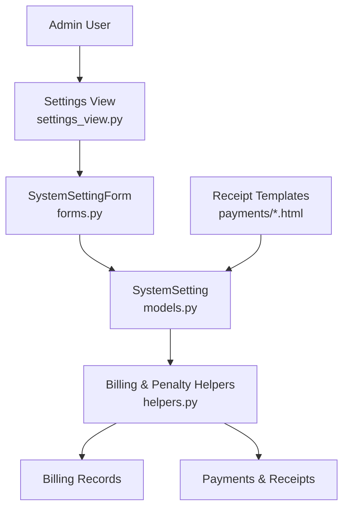
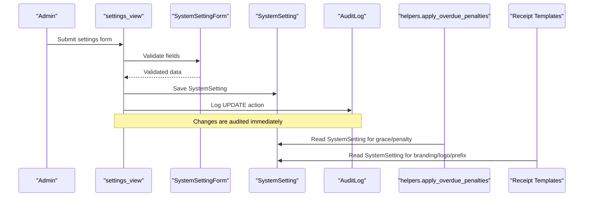
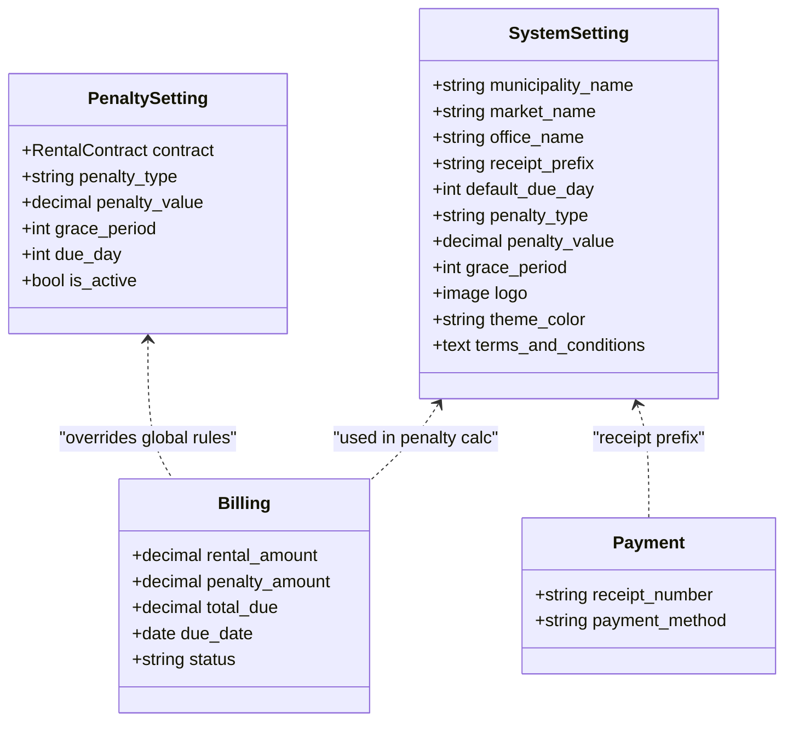

# System Configuration

<cite>
**Referenced Files in This Document**
- [core/models.py](file://core/models.py)
- [core/forms.py](file://core/forms.py)
- [core/views/settings_views.py](file://core/views/settings_views.py)
- [core/helpers.py](file://core/helpers.py)
- [core/management/commands/apply_penalties.py](file://core/management/commands/apply_penalties.py)
- [templates/settings/view.html](file://templates/settings/view.html)
- [templates/settings/form.html](file://templates/settings/form.html)
- [templates/payments/receipt.html](file://templates/payments/receipt.html)
- [templates/payments/_receipt_body.html](file://templates/payments/_receipt_body.html)
- [templates/payments/print_batch.html](file://templates/payments/print_batch.html)
- [PENALTY_GUIDE.md](file://PENALTY_GUIDE.md)
</cite>

## Table of Contents
1. [Introduction](#introduction)
2. [Project Structure](#project-structure)
3. [Core Components](#core-components)
4. [Architecture Overview](#architecture-overview)
5. [Detailed Component Analysis](#detailed-component-analysis)
6. [Dependency Analysis](#dependency-analysis)
7. [Performance Considerations](#performance-considerations)
8. [Troubleshooting Guide](#troubleshooting-guide)
9. [Conclusion](#conclusion)
10. [Appendices](#appendices)

## Introduction
This document explains the System Configuration module for the market rental system. It covers global settings, penalty configuration, market sections and stall types, payment method configuration, and system-wide preferences. It also documents how settings integrate across modules, including receipt formatting, theme customization, billing behavior, and audit logging. Examples are provided for safe modification, validation, and operational procedures such as running penalty sweeps and managing multi-environment deployments.

## Project Structure
The System Configuration feature is implemented through:
- A central settings model that stores municipality branding, receipt prefix, due day defaults, penalty rules, logo, theme color, and contract terms.
- Forms and views that allow administrators to update settings with validation and audit logging.
- Helper logic that reads settings during billing creation, penalty application, and receipt generation.
- Templates that render receipts and batch prints using the configured branding and logo.
- Management commands and helper functions that apply overdue penalties based on grace periods and penalty rules.

**Diagram sources**
- [core/views/settings_views.py:9-33](file://core/views/settings_views.py#L9-L33)
- [core/forms.py:540-560](file://core/forms.py#L540-L560)
- [core/models.py:42-68](file://core/models.py#L42-L68)
- [core/helpers.py:132-152](file://core/helpers.py#L132-L152)
- [templates/payments/receipt.html:29-44](file://templates/payments/receipt.html#L29-L44)

**Section sources**
- [core/models.py:42-68](file://core/models.py#L42-L68)
- [core/forms.py:540-560](file://core/forms.py#L540-L560)
- [core/views/settings_views.py:9-33](file://core/views/settings_views.py#L9-L33)
- [templates/payments/receipt.html:29-44](file://templates/payments/receipt.html#L29-L44)

## Core Components
- SystemSetting: Global configuration for municipality name, market name, office name, receipt prefix, default due day, penalty type/value, grace period, logo, theme color, and contract terms.
- MarketSection and StallType: Lookup tables for organizing stalls by section and type.
- Stall: Physical stall records linked to a section and optional stall type; includes monthly rate and status.
- Payment.PAYMENT_METHOD_CHOICES: Configurable payment methods (Cash, GCash, Bank Transfer, Check).
- PenaltySetting: Per-contract override for penalty type, value, grace period, due day, and activation state.

Key responsibilities:
- SystemSetting provides the single source of truth for branding, receipt numbering, and default penalty rules.
- MarketSection and StallType enable structured stall management.
- Payment methods are defined centrally and reused in forms and templates.
- PenaltySetting allows per-contract overrides while falling back to SystemSetting defaults.

**Section sources**
- [core/models.py:42-68](file://core/models.py#L42-L68)
- [core/models.py:71-90](file://core/models.py#L71-L90)
- [core/models.py:93-114](file://core/models.py#L93-L114)
- [core/models.py:221-227](file://core/models.py#L221-L227)
- [core/models.py:319-335](file://core/models.py#L319-L335)

## Architecture Overview
The configuration flow spans UI, form validation, persistence, and downstream consumers:

**Diagram sources**
- [core/views/settings_views.py:9-33](file://core/views/settings_views.py#L9-L33)
- [core/forms.py:540-560](file://core/forms.py#L540-L560)
- [core/models.py:42-68](file://core/models.py#L42-L68)
- [core/helpers.py:423-500](file://core/helpers.py#L423-L500)
- [templates/payments/receipt.html:29-44](file://templates/payments/receipt.html#L29-L44)

## Detailed Component Analysis

### Global Settings Management
Global settings include:
- Municipality information: municipality_name, market_name, office_name.
- Receipt formatting: receipt_prefix used to generate official receipt numbers.
- Theme customization: logo and theme_color.
- Contract terms: terms_and_conditions printed on contracts.
- Defaults: default_due_day, penalty_type, penalty_value, grace_period.

Validation and persistence:
- The SystemSettingForm exposes all relevant fields with appropriate widgets.
- The settings view validates the form, saves changes, and creates an AuditLog entry.
- The update endpoint ensures a SystemSetting row exists before saving.

Integration points:
- Receipt templates read municipality_name, market_name, office_name, and logo from SystemSetting.
- Receipt number generation uses receipt_prefix.
- Penalty computation falls back to SystemSetting when no per-contract rule exists.

Examples of modification:
- Update municipality and market branding via the Settings page.
- Change receipt prefix to align with local government numbering conventions.
- Upload a new logo and adjust theme_color for consistent visual identity.
- Edit terms_and_conditions to reflect updated house rules.

Restart requirements:
- No application restart is required; settings are read at runtime from the database.
- Ensure file storage for uploaded logos is available and accessible to the web server.

**Section sources**
- [core/models.py:42-68](file://core/models.py#L42-L68)
- [core/forms.py:540-560](file://core/forms.py#L540-L560)
- [core/views/settings_views.py:9-33](file://core/views/settings_views.py#L9-L33)
- [core/views/settings_views.py:36-55](file://core/views/settings_views.py#L36-L55)
- [templates/payments/receipt.html:29-44](file://templates/payments/receipt.html#L29-L44)
- [templates/payments/_receipt_body.html:1-28](file://templates/payments/_receipt_body.html#L1-L28)
- [templates/payments/print_batch.html:46-76](file://templates/payments/print_batch.html#L46-L76)
- [core/helpers.py:276-300](file://core/helpers.py#L276-L300)

### Penalty Configuration Options
Penalty configuration supports two modes:
- Fixed: a flat amount added once after the grace period.
- Percentage: a percentage of the monthly rent added once after the grace period.

Grace period:
- Grace period extends the due date; penalties only apply after today exceeds due_date + grace_period.

Per-contract overrides:
- PenaltySetting allows contract-specific rules (type, value, grace_period, due_day, is_active).
- If an active PenaltySetting exists, it overrides SystemSetting defaults.

Waiver procedures:
- There is no built-in waiver mechanism in the models or helpers.
- Waivers can be handled operationally by adjusting discounts or manually correcting billings; this is not automated by the configuration module.

Automation:
- Overdue penalties are applied by helpers.apply_overdue_penalties, which is exposed via the apply_penalties management command.
- The process is idempotent: penalties are applied only once per billing unless re-applied intentionally.

Examples:
- Set global penalty_type to percentage and penalty_value to 2 for a 2% late fee.
- Configure grace_period to 5 days so penalties start after the 5th day past due.
- Create a PenaltySetting for a specific contract to use a fixed penalty of ₱50.

**Section sources**
- [core/models.py:42-68](file://core/models.py#L42-L68)
- [core/models.py:319-335](file://core/models.py#L319-L335)
- [core/forms.py:563-574](file://core/forms.py#L563-L574)
- [core/helpers.py:132-152](file://core/helpers.py#L132-L152)
- [core/helpers.py:423-500](file://core/helpers.py#L423-L500)
- [core/management/commands/apply_penalties.py:1-14](file://core/management/commands/apply_penalties.py#L1-L14)
- [PENALTY_GUIDE.md:15-25](file://PENALTY_GUIDE.md#L15-L25)
- [PENALTY_GUIDE.md:29-40](file://PENALTY_GUIDE.md#L29-L40)
- [PENALTY_GUIDE.md:44-55](file://PENALTY_GUIDE.md#L44-L55)
- [PENALTY_GUIDE.md:181-198](file://PENALTY_GUIDE.md#L181-L198)

### Market Sections and Stall Types Management
Market sections and stall types are lookup entities:
- MarketSection groups stalls by area or category.
- StallType categorizes stalls by business type or physical characteristics.
- Stalls reference both a section and an optional stall type.

Operational notes:
- Creating stalls requires at least one MarketSection; otherwise, the form raises a validation error guiding the administrator to add sections first.
- StallType is optional but recommended for reporting and filtering.

Examples:
- Add a MarketSection named “Produce” with a description.
- Add a StallType named “Vegetables” and assign it to relevant stalls.
- Create stalls under the correct sections and optionally assign stall types.

**Section sources**
- [core/models.py:71-90](file://core/models.py#L71-L90)
- [core/models.py:93-114](file://core/models.py#L93-L114)
- [core/forms.py:201-258](file://core/forms.py#L201-L258)

### Payment Method Configuration
Payment methods are defined centrally:
- Cash, GCash, Bank Transfer, Check.

Usage:
- Forms and templates use these choices consistently.
- Payments record the selected method and link to the corresponding billing and tenant.

Examples:
- Select GCash when recording digital payments.
- Use Bank Transfer for corporate collections.
- Record Check payments with remarks indicating check details.

**Section sources**
- [core/models.py:221-227](file://core/models.py#L221-L227)
- [core/forms.py:465-496](file://core/forms.py#L465-L496)

### System-Wide Preferences
System-wide preferences include:
- Default due day for billing cycles.
- Global penalty type and value.
- Grace period for late fees.
- Branding elements (municipality, market, office, logo).
- Receipt prefix for official receipts.
- Theme color for UI consistency.
- Terms and conditions for contracts.

These preferences are consumed by:
- Billing creation and penalty calculation.
- Receipt generation and printing.
- Report headers and notices.

**Section sources**
- [core/models.py:42-68](file://core/models.py#L42-L68)
- [core/helpers.py:132-152](file://core/helpers.py#L132-L152)
- [core/helpers.py:276-300](file://core/helpers.py#L276-L300)
- [templates/payments/receipt.html:29-44](file://templates/payments/receipt.html#L29-L44)

## Dependency Analysis
Configuration dependencies across modules:

**Diagram sources**
- [core/models.py:42-68](file://core/models.py#L42-L68)
- [core/models.py:190-218](file://core/models.py#L190-L218)
- [core/models.py:221-258](file://core/models.py#L221-L258)
- [core/models.py:319-335](file://core/models.py#L319-L335)
- [core/helpers.py:132-152](file://core/helpers.py#L132-L152)
- [core/helpers.py:276-300](file://core/helpers.py#L276-L300)

**Section sources**
- [core/models.py:42-68](file://core/models.py#L42-L68)
- [core/models.py:190-218](file://core/models.py#L190-L218)
- [core/models.py:221-258](file://core/models.py#L221-L258)
- [core/models.py:319-335](file://core/models.py#L319-L335)
- [core/helpers.py:132-152](file://core/helpers.py#L132-L152)
- [core/helpers.py:276-300](file://core/helpers.py#L276-L300)

## Performance Considerations
- Settings are read from the database at runtime; avoid excessive repeated queries in hot paths by caching where appropriate.
- Penalty application scans unpaid billings; ensure indexes exist on billing status and dates for efficient sweeps.
- Receipt number generation queries existing receipts by prefix; keep prefixes stable and avoid frequent changes.
- Logo uploads require proper static/media storage configuration to prevent I/O bottlenecks.

[No sources needed since this section provides general guidance]

## Troubleshooting Guide
Common issues and resolutions:
- Settings not reflected on receipts:
  - Verify SystemSetting values and ensure the logo file is accessible.
  - Confirm templates are rendering settings correctly.
- Penalties not applied:
  - Check grace_period and due_date; penalties only apply after grace ends.
  - Run the apply_penalties command to trigger accrual.
  - Review PenaltySetting overrides for the affected contract.
- Duplicate stalls or missing sections:
  - Ensure MarketSection entries exist before creating stalls.
  - Use form validation messages to guide administrators.
- Audit logs missing:
  - Confirm admin_required decorator is active and user has permissions.
  - Verify AuditLog creation in settings views.

Operational steps:
- Run `python manage.py apply_penalties` to retroactively apply overdue penalties.
- Inspect AuditLog entries for recent setting updates and automatic penalty applications.

**Section sources**
- [core/views/settings_views.py:9-33](file://core/views/settings_views.py#L9-L33)
- [core/helpers.py:423-500](file://core/helpers.py#L423-L500)
- [core/management/commands/apply_penalties.py:1-14](file://core/management/commands/apply_penalties.py#L1-L14)
- [core/forms.py:201-258](file://core/forms.py#L201-L258)

## Conclusion
The System Configuration module centralizes market branding, receipt formatting, penalty rules, and theme customization. It integrates tightly with billing, payments, and reporting workflows. Administrators can safely modify settings through validated forms with full audit trails. Penalty automation respects grace periods and supports per-contract overrides. Proper configuration ensures consistent receipts, accurate billing, and compliant operations.

[No sources needed since this section summarizes without analyzing specific files]

## Appendices

### Configuration Backup and Restoration Procedures
- Database backup:
  - Back up the entire database to preserve SystemSetting, PenaltySetting, and related data.
  - For PostgreSQL/MySQL, use native dump tools; for SQLite, copy the database file.
- File storage backup:
  - Back up uploaded media (logos) stored under the configured upload path.
- Restoration:
  - Restore the database dump and media files to the target environment.
  - Verify SystemSetting values post-restoration and test receipt generation.

[No sources needed since this section provides general guidance]

### Multi-Environment Deployment Considerations
- Environment-specific settings:
  - Keep SystemSetting values per environment (development, staging, production).
  - Avoid hardcoding sensitive values in code; rely on database-driven configuration.
- Media handling:
  - Ensure each environment has proper static/media serving configured.
- Penalty automation:
  - Schedule or trigger apply_penalties appropriately per environment.
- Auditing:
  - Monitor AuditLog entries to track configuration changes across environments.

[No sources needed since this section provides general guidance]