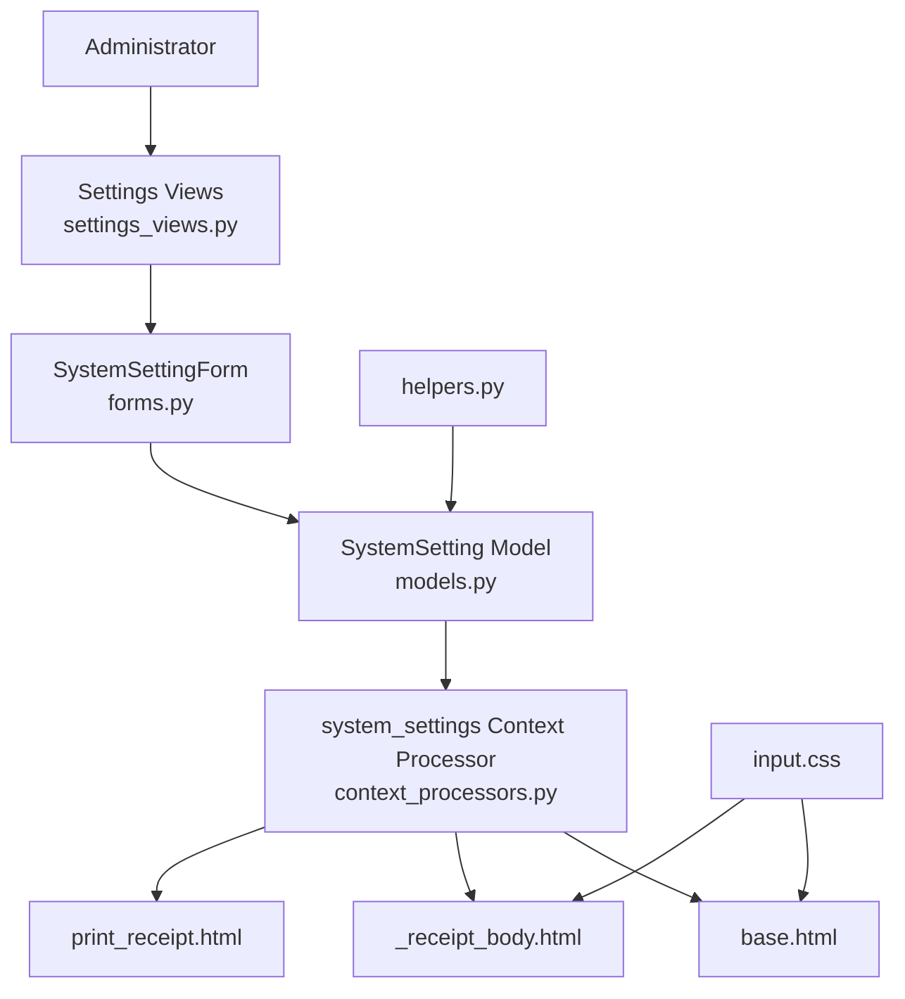
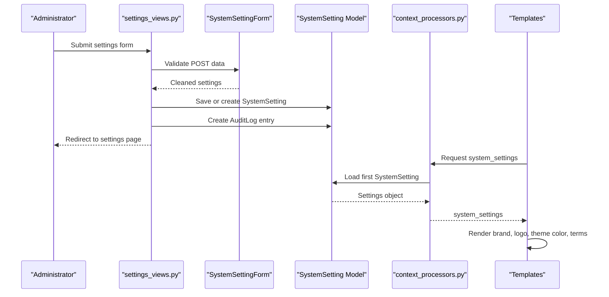
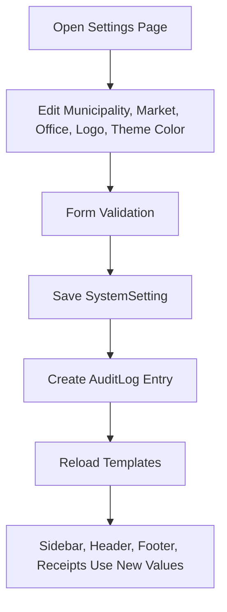
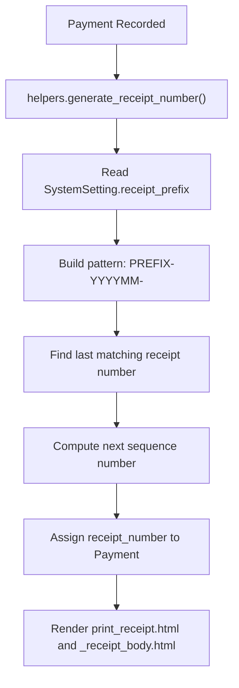
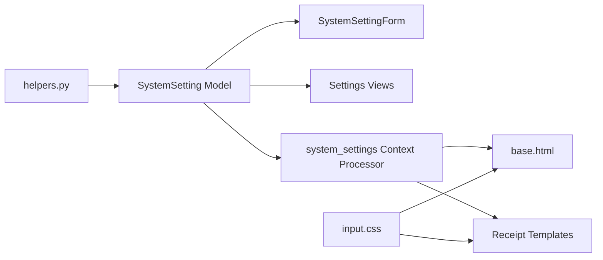

# System Preferences & Customization

<cite>
**Referenced Files in This Document**
- [core/models.py](file://core/models.py)
- [core/forms.py](file://core/forms.py)
- [core/views/settings_views.py](file://core/views/settings_views.py)
- [core/context_processors.py](file://core/context_processors.py)
- [templates/base.html](file://templates/base.html)
- [templates/settings/view.html](file://templates/settings/view.html)
- [templates/settings/form.html](file://templates/settings/form.html)
- [templates/payments/print_receipt.html](file://templates/payments/print_receipt.html)
- [templates/payments/_receipt_body.html](file://templates/payments/_receipt_body.html)
- [templates/reports/export_pdf.html](file://templates/reports/export_pdf.html)
- [templates/reports/export_excel.html](file://templates/reports/export_excel.html)
- [static/css/input.css](file://static/css/input.css)
- [market_rental/settings.py](file://market_rental/settings.py)
- [core/helpers.py](file://core/helpers.py)
- [PENALTY_GUIDE.md](file://PENALTY_GUIDE.md)
</cite>

## Table of Contents
1. [Introduction](#introduction)
2. [Project Structure](#project-structure)
3. [Core Components](#core-components)
4. [Architecture Overview](#architecture-overview)
5. [Detailed Component Analysis](#detailed-component-analysis)
6. [Dependency Analysis](#dependency-analysis)
7. [Performance Considerations](#performance-considerations)
8. [Troubleshooting Guide](#troubleshooting-guide)
9. [Conclusion](#conclusion)
10. [Appendices](#appendices)

## Introduction
This document explains how to configure system-wide preferences and customization options for the Market Rental and Collection Management System. It covers:

- Theme configuration, color schemes, and branding elements such as municipality name, market name, office name, logo, and theme color.
- Receipt formatting, number sequence generation, and print template customization.
- Report export behavior for PDF and Excel, including required server libraries.
- Email configuration guidance based on available Django settings.
- Examples for customizing the user interface, report layouts, and system behavior.
- Performance considerations and best practices for maintaining consistency across the application.

The system stores administrative preferences in a single `SystemSetting` record and exposes them globally through a context processor so templates can render branded receipts, reports, and navigation consistently.

## Project Structure
System preferences are defined by a database model, exposed through a form, updated via admin-only views, and consumed by templates and helpers. The design system CSS provides the visual language used by both the application UI and official documents.

**Diagram sources**
- [core/views/settings_views.py:9-33](file://core/views/settings_views.py#L9-L33)
- [core/forms.py:540-560](file://core/forms.py#L540-L560)
- [core/models.py:42-68](file://core/models.py#L42-L68)
- [core/context_processors.py:9-11](file://core/context_processors.py#L9-L11)
- [templates/base.html:31-42](file://templates/base.html#L31-L42)
- [templates/payments/_receipt_body.html:8-16](file://templates/payments/_receipt_body.html#L8-L16)
- [templates/payments/print_receipt.html:1-15](file://templates/payments/print_receipt.html#L1-L15)
- [core/helpers.py:276-300](file://core/helpers.py#L276-L300)
- [static/css/input.css:1-84](file://static/css/input.css#L1-L84)

**Section sources**
- [core/models.py:42-68](file://core/models.py#L42-L68)
- [core/forms.py:540-560](file://core/forms.py#L540-L560)
- [core/views/settings_views.py:9-33](file://core/views/settings_views.py#L9-L33)
- [core/context_processors.py:9-11](file://core/context_processors.py#L9-L11)
- [templates/base.html:31-42](file://templates/base.html#L31-L42)
- [templates/payments/_receipt_body.html:8-16](file://templates/payments/_receipt_body.html#L8-L16)
- [static/css/input.css:1-84](file://static/css/input.css#L1-L84)

## Core Components
The following components define and expose system preferences:

| Component | Responsibility | Key Fields / Behavior |
|---|---|---|
| `SystemSetting` model | Stores global branding, billing defaults, penalty defaults, receipt prefix, and terms. | `municipality_name`, `market_name`, `office_name`, `logo`, `theme_color`, `receipt_prefix`, `default_due_day`, `penalty_type`, `penalty_value`, `grace_period`, `terms_and_conditions`. |
| `SystemSettingForm` | Renders and validates the settings form with styled widgets. | Includes all `SystemSetting` fields relevant to administration. |
| Settings views | Provide read/write access to settings with audit logging. | `settings_view` and `settings_update` create or update the first `SystemSetting` row and log changes. |
| `system_settings` context processor | Makes `system_settings` available to every template. | Loads the first `SystemSetting` instance from the database. |
| Base template | Uses settings for brand text and sidebar identity. | Displays municipality name, market name, and footer attribution. |
| Receipt templates | Use settings for letterhead, logo, and official document styling. | `_receipt_body.html` and `print_receipt.html` render printed receipts. |
| Helper functions | Generate receipt numbers using the configured prefix. | `generate_receipt_number()` reads `receipt_prefix` and builds monthly sequences. |
| Design system CSS | Defines colors, typography, glass/neumorphic styles, and official document classes. | Emerald palette, gold accents, receipt/document classes, print rules. |

**Section sources**
- [core/models.py:42-68](file://core/models.py#L42-L68)
- [core/forms.py:540-560](file://core/forms.py#L540-L560)
- [core/views/settings_views.py:9-55](file://core/views/settings_views.py#L9-L55)
- [core/context_processors.py:9-11](file://core/context_processors.py#L9-L11)
- [templates/base.html:31-42](file://templates/base.html#L31-L42)
- [templates/payments/_receipt_body.html:8-16](file://templates/payments/_receipt_body.html#L8-L16)
- [core/helpers.py:276-300](file://core/helpers.py#L276-L300)
- [static/css/input.css:1-84](file://static/css/input.css#L1-L84)

## Architecture Overview
The preference flow is intentionally simple: administrators edit one settings record, and the application renders that data into UI, receipts, notices, and reports.

**Diagram sources**
- [core/views/settings_views.py:9-33](file://core/views/settings_views.py#L9-L33)
- [core/forms.py:540-560](file://core/forms.py#L540-L560)
- [core/models.py:42-68](file://core/models.py#L42-L68)
- [core/context_processors.py:9-11](file://core/context_processors.py#L9-L11)
- [templates/base.html:31-42](file://templates/base.html#L31-L42)

## Detailed Component Analysis

### Theme Configuration, Color Schemes, and Branding
The system supports branding through both stored settings and a centralized design system.

- **Branding fields**: Municipality name, market name, office name, logo, and theme color are stored in `SystemSetting`.
- **UI usage**: The base template displays the municipality and market names in the sidebar and header.
- **Design system**: Tailwind-based CSS defines an emerald primary palette, gold accent, typography, neumorphic surfaces, and official document classes.
- **Theme color field**: The settings form includes a color input for `theme_color`. Templates should consume this value where dynamic theming is implemented.

Customization examples:

- Change the displayed municipality and market names by updating the corresponding settings fields.
- Upload a new logo to replace the default municipal seal used in receipts and official documents.
- Adjust the theme color to match institutional branding; ensure contrast remains readable on light and dark surfaces.
- Extend the design system by adding new semantic colors or component variants in the CSS file.

**Diagram sources**
- [templates/settings/view.html:30-53](file://templates/settings/view.html#L30-L53)
- [templates/settings/view.html:86-113](file://templates/settings/view.html#L86-L113)
- [core/views/settings_views.py:9-33](file://core/views/settings_views.py#L9-L33)
- [core/models.py:42-68](file://core/models.py#L42-L68)
- [templates/base.html:31-42](file://templates/base.html#L31-L42)
- [static/css/input.css:1-84](file://static/css/input.css#L1-L84)

**Section sources**
- [core/models.py:42-68](file://core/models.py#L42-L68)
- [templates/settings/view.html:30-53](file://templates/settings/view.html#L30-L53)
- [templates/settings/view.html:86-113](file://templates/settings/view.html#L86-L113)
- [templates/base.html:31-42](file://templates/base.html#L31-L42)
- [static/css/input.css:1-84](file://static/css/input.css#L1-L84)

### Receipt Formatting, Number Sequence Generation, and Print Template Customization
Receipts use the settings for letterhead information and logo display. Receipt numbering follows a predictable monthly sequence based on the configured prefix.

Key behaviors:

- **Letterhead**: Receipt templates render the municipality name, market name, office name, and optional logo.
- **Receipt number format**: The helper generates a receipt number using the configured prefix, current year-month, and a zero-padded sequence derived from existing receipts.
- **Print layout**: The receipt body uses clean print-oriented styles, with emerald headings, gold rules, and signature lines.
- **Export options**: The receipt view offers printing and PDF export buttons.

Customization examples:

- Change the receipt prefix to align with local government numbering conventions.
- Update the logo to reflect the current municipal branding.
- Modify the receipt layout by editing the receipt body template while preserving print-friendly structure.
- Add additional fields to the receipt if business requirements require extra details.

**Diagram sources**
- [core/helpers.py:276-300](file://core/helpers.py#L276-L300)
- [templates/payments/print_receipt.html:1-15](file://templates/payments/print_receipt.html#L1-L15)
- [templates/payments/_receipt_body.html:8-16](file://templates/payments/_receipt_body.html#L8-L16)

**Section sources**
- [core/helpers.py:276-300](file://core/helpers.py#L276-L300)
- [templates/payments/print_receipt.html:1-15](file://templates/payments/print_receipt.html#L1-L15)
- [templates/payments/_receipt_body.html:8-16](file://templates/payments/_receipt_body.html#L8-L16)

### Number Sequence Generation Rules
Receipt numbering is designed to be stable and auditable:

- Prefix comes from `SystemSetting.receipt_prefix`; it is trimmed and normalized.
- The month portion is derived from today’s date.
- The suffix is computed from the highest existing receipt number for the same prefix and month.
- If no previous receipt exists, the sequence starts at one.
- Suffixes are zero-padded so lexicographic order matches numeric order.

Best practices:

- Keep the prefix short and meaningful.
- Avoid changing the prefix frequently, as it affects historical numbering interpretation.
- Do not manually alter receipt numbers; rely on the generator to maintain uniqueness.

**Section sources**
- [core/helpers.py:276-300](file://core/helpers.py#L276-L300)

### Print Template Customization
Official receipts and reports are rendered as HTML optimized for printing.

- Receipt templates include print-specific CSS and action buttons for printing and exporting.
- The receipt body template is reusable and included by both single-receipt and batch-print views.
- Reports provide a print button and a paper-ready layout.

Customization examples:

- Adjust margins, fonts, or spacing in the receipt print template.
- Add or remove sections in the receipt body template to match local compliance requirements.
- Customize report footers and watermarks in the report base template.

**Section sources**
- [templates/payments/print_receipt.html:1-15](file://templates/payments/print_receipt.html#L1-L15)
- [templates/payments/_receipt_body.html:1-175](file://templates/payments/_receipt_body.html#L1-L175)
- [templates/reports/report_base.html:181-207](file://templates/reports/report_base.html#L181-L207)

### Report Layouts and Export Formats
Reports support printing and optional programmatic exports.

- **PDF export**: Requires the WeasyPrint rendering engine. When unavailable, the system shows a dedicated error page instructing installation.
- **Excel export**: Requires the OpenPyXL library. When unavailable, the system shows a dedicated error page instructing installation.
- **Print export**: Always available through the browser’s print dialog.

Configuration notes:

- Install WeasyPrint to enable PDF exports.
- Install OpenPyXL to enable Excel exports.
- Use the Print button when external libraries are not installed.

**Section sources**
- [templates/reports/export_pdf.html:1-34](file://templates/reports/export_pdf.html#L1-L34)
- [templates/reports/export_excel.html:1-34](file://templates/reports/export_excel.html#L1-L34)
- [templates/reports/report_base.html:181-207](file://templates/reports/report_base.html#L181-L207)

### Email Configuration for Notifications
The provided code does not include a dedicated email settings form or notification service implementation. Email configuration should follow standard Django practices:

- Configure SMTP credentials and TLS/SSL settings in the project settings environment.
- Set the sender address and any required authentication parameters.
- Test email delivery through Django’s development tools before enabling production notifications.

Recommended settings to review:

- `EMAIL_HOST`, `EMAIL_PORT`, `EMAIL_USE_TLS`, `EMAIL_USE_SSL`, `EMAIL_HOST_USER`, `EMAIL_HOST_PASSWORD`, `DEFAULT_FROM_EMAIL`.

Because the repository does not expose email configuration through the settings UI, administrators should manage these values through environment variables or deployment configuration rather than the web form.

**Section sources**
- [market_rental/settings.py:15-26](file://market_rental/settings.py#L15-L26)
- [market_rental/settings.py:162-165](file://market_rental/settings.py#L162-L165)

### Billing Defaults, Penalty Rules, and Terms
Billing and penalty behavior is influenced by both global system settings and per-contract overrides.

- **Global defaults**: Municipality, market, office, receipt prefix, default due day, penalty type, penalty value, grace period, and terms are stored in `SystemSetting`.
- **Penalty calculation**: Overdue penalties consider contract-level penalty settings when active, otherwise falling back to system defaults.
- **Terms and conditions**: Stored in `SystemSetting` and intended to appear on rental contracts and related documents.

Administrators can:

- Set the default due day for billing cycles.
- Choose between fixed and percentage penalty types.
- Define a grace period before penalties apply.
- Update terms and conditions without changing code.

For detailed operational guidance, refer to the penalty documentation.

**Section sources**
- [core/models.py:42-68](file://core/models.py#L42-L68)
- [core/forms.py:540-560](file://core/forms.py#L540-L560)
- [core/helpers.py:423-474](file://core/helpers.py#L423-L474)
- [PENALTY_GUIDE.md:181-201](file://PENALTY_GUIDE.md#L181-L201)

## Dependency Analysis
System preferences affect multiple layers of the application.

**Diagram sources**
- [core/models.py:42-68](file://core/models.py#L42-L68)
- [core/forms.py:540-560](file://core/forms.py#L540-L560)
- [core/views/settings_views.py:9-33](file://core/views/settings_views.py#L9-L33)
- [core/context_processors.py:9-11](file://core/context_processors.py#L9-L11)
- [templates/base.html:31-42](file://templates/base.html#L31-L42)
- [templates/payments/_receipt_body.html:8-16](file://templates/payments/_receipt_body.html#L8-L16)
- [core/helpers.py:276-300](file://core/helpers.py#L276-L300)
- [static/css/input.css:1-84](file://static/css/input.css#L1-L84)

**Section sources**
- [core/models.py:42-68](file://core/models.py#L42-L68)
- [core/forms.py:540-560](file://core/forms.py#L540-L560)
- [core/views/settings_views.py:9-33](file://core/views/settings_views.py#L9-L33)
- [core/context_processors.py:9-11](file://core/context_processors.py#L9-L11)
- [core/helpers.py:276-300](file://core/helpers.py#L276-L300)
- [static/css/input.css:1-84](file://static/css/input.css#L1-L84)

## Performance Considerations
- **Database queries for settings**: The context loader retrieves the first `SystemSetting` on every request. For high-traffic deployments, consider caching the settings object at the application level if appropriate.
- **Logo storage**: Uploaded logos are stored on disk and served as media files. Ensure static/media serving is efficient in production.
- **Receipt number generation**: The generator queries existing receipts to compute the next sequence. Large receipt volumes may increase query cost; keep prefixes meaningful and avoid unnecessary manual edits.
- **PDF and Excel exports**: External libraries add processing overhead. Disable or restrict export endpoints if performance is critical.
- **Print-heavy workflows**: Printing receipts and reports relies on browser rendering. Batch operations should avoid excessive simultaneous print requests.

[No sources needed since this section provides general guidance]

## Troubleshooting Guide
Common issues and resolutions:

- **PDF export unavailable**: Install WeasyPrint as instructed by the error page.
- **Excel export unavailable**: Install OpenPyXL as instructed by the error page.
- **Settings not reflected in receipts or UI**: Verify that the settings were saved successfully and that the audit log recorded the change.
- **Receipt numbers not incrementing correctly**: Check the configured prefix and ensure no manual edits have broken the expected pattern.
- **Brand text missing**: Confirm that `SystemSetting` has been created and populated with municipality, market, and office names.

**Section sources**
- [templates/reports/export_pdf.html:1-34](file://templates/reports/export_pdf.html#L1-L34)
- [templates/reports/export_excel.html:1-34](file://templates/reports/export_excel.html#L1-L34)
- [core/views/settings_views.py:9-55](file://core/views/settings_views.py#L9-L55)
- [core/helpers.py:276-300](file://core/helpers.py#L276-L300)

## Conclusion
System preferences centralize branding, billing defaults, receipt numbering, and terms. Administrators configure these values once, and the application renders them consistently across the interface, receipts, notices, and reports. For reliable operation:

- Keep branding consistent across settings and templates.
- Use the settings form for all administrative changes.
- Maintain receipt numbering through the built-in generator.
- Install required libraries for PDF and Excel exports only when needed.
- Manage email configuration through environment settings rather than the web form.
- Review performance implications when scaling receipt generation, logo usage, and export features.

[No sources needed since this section summarizes without analyzing specific files]

## Appendices

### Settings Field Reference
| Field | Purpose | Where Used |
|---|---|---|
| `municipality_name` | Official municipality or city name | Sidebar, header, receipts, notices |
| `market_name` | Public market name | Sidebar, header, receipts |
| `office_name` | Administration office name | Receipts, notices |
| `logo` | Municipal or market logo | Receipts and official documents |
| `theme_color` | Primary theme color | UI theming and branding |
| `receipt_prefix` | Receipt number prefix | Receipt number generation |
| `default_due_day` | Default due day for billing | Billing defaults |
| `penalty_type` | Fixed or percentage penalty method | Penalty calculations |
| `penalty_value` | Numeric penalty amount or rate | Penalty calculations |
| `grace_period` | Days before penalties apply | Overdue penalty logic |
| `terms_and_conditions` | Contract terms printed on documents | Contracts and related outputs |

**Section sources**
- [core/models.py:42-68](file://core/models.py#L42-L68)
- [core/forms.py:540-560](file://core/forms.py#L540-L560)
- [templates/settings/view.html:30-53](file://templates/settings/view.html#L30-L53)
- [templates/settings/view.html:86-113](file://templates/settings/view.html#L86-L113)