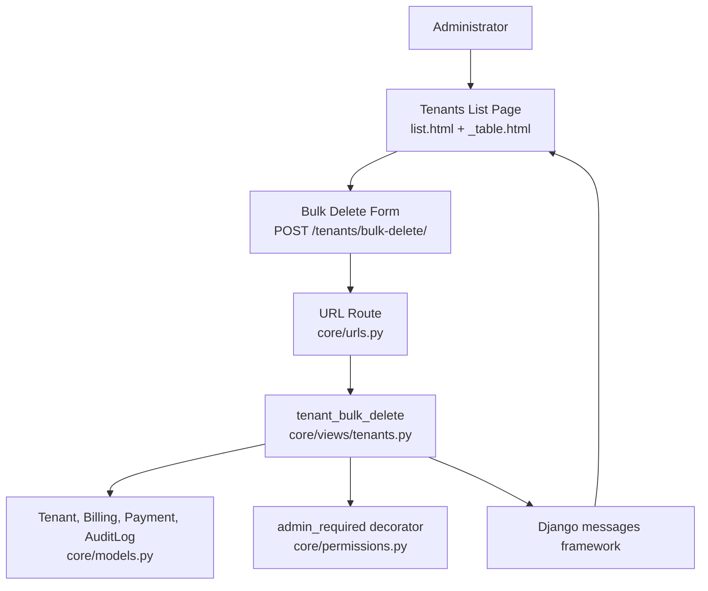
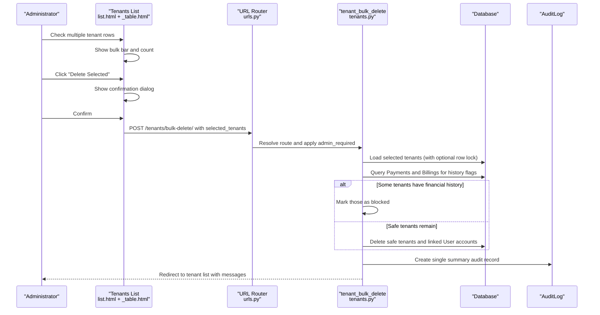
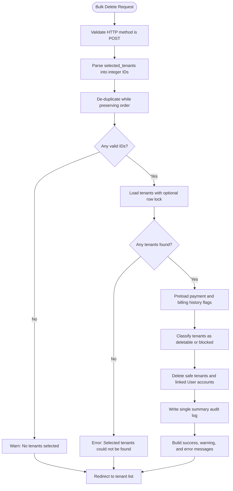
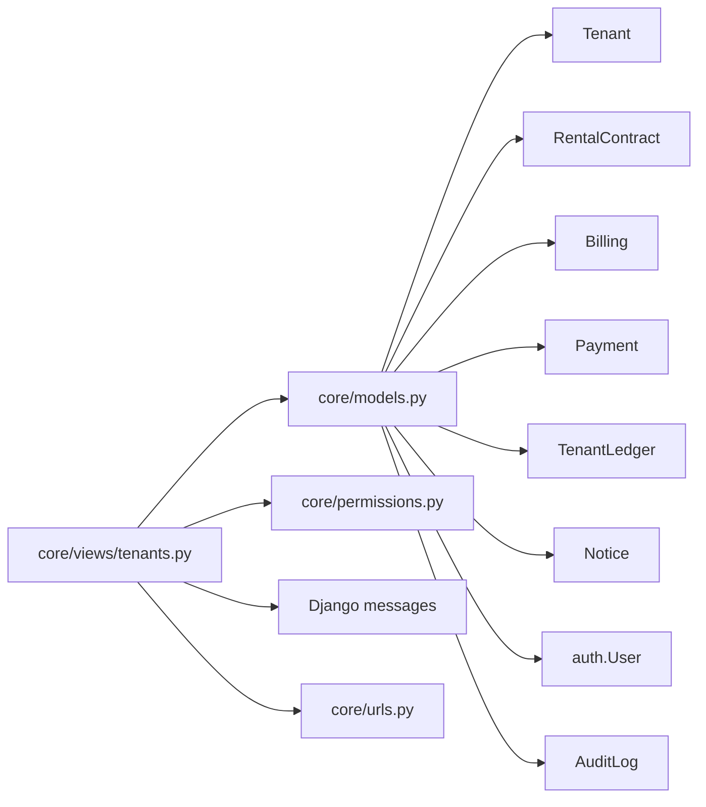

# Bulk Operations

<cite>
**Referenced Files in This Document**
- [tenants.py](file://core/views/tenants.py)
- [models.py](file://core/models.py)
- [urls.py](file://core/urls.py)
- [permissions.py](file://core/permissions.py)
- [_table.html](file://templates/tenants/_table.html)
- [list.html](file://templates/tenants/list.html)
- [test_bulk_delete_tenants.py](file://core/test_bulk_delete_tenants.py)
</cite>

## Table of Contents
1. [Introduction](#introduction)
2. [Project Structure](#project-structure)
3. [Core Components](#core-components)
4. [Architecture Overview](#architecture-overview)
5. [Detailed Component Analysis](#detailed-component-analysis)
6. [Dependency Analysis](#dependency-analysis)
7. [Performance Considerations](#performance-considerations)
8. [Troubleshooting Guide](#troubleshooting-guide)
9. [Security and Permissions](#security-and-permissions)
10. [Conclusion](#conclusion)

## Introduction
This document explains the bulk tenant operations in the Market Rental System, with a deep focus on the sophisticated bulk delete workflow. It covers how administrators select tenants, confirm deletions, and receive detailed feedback when some tenants are deleted, some are blocked due to financial history, or selected records are missing. It also documents transactional safety, database locking behavior across different backends, cascade deletion, audit trail generation, and the security boundaries that restrict bulk deletion to administrators.

## Project Structure
Bulk tenant deletion is implemented as a server-side Django view backed by domain models and protected by role-based decorators. The user interface exposes checkboxes for selection and a confirmation prompt before submitting the batch operation.

**Diagram sources**
- [list.html:1-64](file://templates/tenants/list.html#L1-L64)
- [_table.html:1-234](file://templates/tenants/_table.html#L1-L234)
- [urls.py:65-76](file://core/urls.py#L65-L76)
- [tenants.py:127-263](file://core/views/tenants.py#L127-L263)
- [models.py:117-316](file://core/models.py#L117-L316)
- [permissions.py:78-87](file://core/permissions.py#L78-L87)

**Section sources**
- [list.html:1-64](file://templates/tenants/list.html#L1-L64)
- [_table.html:1-234](file://templates/tenants/_table.html#L1-L234)
- [urls.py:65-76](file://core/urls.py#L65-L76)

## Core Components
The bulk delete feature spans four main layers:

- **Selection interface**: The tenant list page renders a table with per-row checkboxes and a floating bulk bar visible only to administrators. Selecting rows enables the “Delete Selected” button and shows a warning that permanent deletion removes contracts, billings, ledger entries, and portal logins, while tenants with recorded payments are skipped.
- **Confirmation workflow**: Before submission, the client asks for explicit confirmation because the action is destructive. A second submit after confirmation bypasses the client-side guard so the server can process the request.
- **Transactional backend**: The `tenant_bulk_delete` view runs inside an atomic transaction, validates input, loads tenants safely, checks financial history, deletes safe tenants, and writes one summary audit record.
- **Feedback layer**: Success, warning, and error messages reflect exactly what happened: which tenants were deleted, which were blocked due to payment history, and which selected IDs no longer exist.

**Section sources**
- [_table.html:3-26](file://templates/tenants/_table.html#L3-L26)
- [_table.html:133-232](file://templates/tenants/_table.html#L133-L232)
- [tenants.py:127-263](file://core/views/tenants.py#L127-L263)

## Architecture Overview
The end-to-end flow starts at the tenant list and ends with a redirect back to the same list, carrying user-facing messages and an audit log entry.

**Diagram sources**
- [_table.html:133-232](file://templates/tenants/_table.html#L133-L232)
- [urls.py:71-72](file://core/urls.py#L71-L72)
- [tenants.py:127-263](file://core/views/tenants.py#L127-L263)
- [models.py:304-316](file://core/models.py#L304-L316)

## Detailed Component Analysis

### Selection Interface and Confirmation Workflow
The tenant list includes a conditional bulk bar that appears only when the current user has administrative access. Each row checkbox posts its tenant ID into a hidden form. The script tracks how many rows are selected, toggles the bulk bar visibility, enables or disables the submit button, and supports selecting all rows on the current page.

When the administrator clicks “Delete Selected,” the script prevents the normal submit and opens a confirmation dialog. If confirmed, it marks the form as already confirmed and submits again so the server receives the actual payload.

Key behaviors:
- Only administrators see the bulk controls.
- The bulk bar warns that deletion is permanent and that tenants with recorded payments will be skipped.
- Duplicate selections are handled gracefully by the server.
- Missing or invalid IDs are ignored rather than failing the whole batch.

**Section sources**
- [_table.html:3-26](file://templates/tenants/_table.html#L3-L26)
- [_table.html:60-72](file://templates/tenants/_table.html#L60-L72)
- [_table.html:133-232](file://templates/tenants/_table.html#L133-L232)

### Transactional Safety and Database Locking
The bulk delete view is wrapped in `@transaction.atomic`, ensuring that either all permitted deletions succeed together or none do. Before loading tenants, the code determines whether the active database backend advertises support for row-level locking through `has_select_for_update`.

Behavior by backend:
- Backends that support `select_for_update`: the selected tenant rows are locked during the transaction to prevent concurrent modification.
- SQLite and other backends without this feature: the lock call is skipped; Django’s transaction semantics still serialize writes within the transaction.

If no matching tenants are found after loading, the operation returns early with an error message directing the user to refresh.

**Section sources**
- [tenants.py:127-190](file://core/views/tenants.py#L127-L190)

### Financial History Protection
Before deleting any tenant, the view preloads two sets of tenant IDs:
- Tenants with at least one `Payment` record.
- Tenants with at least one `Billing` where `amount_paid > 0`.

A tenant is blocked from hard deletion if either condition is true. This protects receipts, collection records, and partially paid billings from being silently removed. Blocked tenants remain in the system, and their financial data stays intact.

The view explicitly recommends using termination or voiding payments first for tenants with financial history.

**Section sources**
- [tenants.py:192-214](file://core/views/tenants.py#L192-L214)

### Cascade Deletion and Linked Accounts
For tenants without financial history, the view calls the tenant’s model delete method. Because related foreign keys use `on_delete=CASCADE`, contracts, billings, ledger entries, notices, and related records are removed automatically.

After deleting the tenant, the view removes the linked portal `User` account if one exists. This cascades to the associated `UserProfile`, preventing orphaned login records.

Important distinction:
- **Terminate** changes the tenant status and deactivates the portal user but keeps historical records.
- **Bulk delete** permanently removes the tenant and related records when safe.

**Section sources**
- [tenants.py:215-223](file://core/views/tenants.py#L215-L223)
- [models.py:157-277](file://core/models.py#L157-L277)

### Audit Trail Generation
Each successful bulk operation creates a single summary audit log entry under the `Tenant` module with action `DELETE`. The description lists how many tenants were deleted and how many were blocked, followed by their names and tenant IDs. The IP address of the requesting session is captured.

This design avoids flooding the audit log with one row per deleted tenant while preserving enough detail for investigation.

**Section sources**
- [tenants.py:225-238](file://core/views/tenants.py#L225-L238)
- [models.py:304-316](file://core/models.py#L304-L316)

### Feedback Messages and Outcomes
The view produces three primary outcome categories:

| Outcome | Message Type | Meaning |
|---|---|---|
| Successful deletions | Success | Lists the number and names of tenants permanently removed. |
| Blocked deletions | Warning | Lists tenants not deleted because they have payment history, and suggests termination or voiding payments. |
| Missing records | Warning | Reports selected IDs that no longer exist and were skipped. |
| No meaningful change | Error | Indicates that nothing was removed, used when all selected items were missing or otherwise unprocessed. |

These messages are displayed after redirecting back to the tenant list.

**Section sources**
- [tenants.py:240-263](file://core/views/tenants.py#L240-L263)

### Processing Logic Flowchart

**Diagram sources**
- [tenants.py:153-263](file://core/views/tenants.py#L153-L263)

## Dependency Analysis
The bulk delete feature depends on several modules and relationships:

**Diagram sources**
- [tenants.py:1-16](file://core/views/tenants.py#L1-L16)
- [models.py:117-316](file://core/models.py#L117-L316)
- [permissions.py:78-87](file://core/permissions.py#L78-L87)
- [urls.py:65-76](file://core/urls.py#L65-L76)

**Section sources**
- [tenants.py:1-16](file://core/views/tenants.py#L1-L16)
- [models.py:117-316](file://core/models.py#L117-L316)
- [permissions.py:78-87](file://core/permissions.py#L78-L87)
- [urls.py:65-76](file://core/urls.py#L65-L76)

## Performance Considerations
The implementation avoids N+1 queries by preloading financial history for all selected tenants in two aggregate-friendly queries:
- One query collects tenant IDs that have any payment.
- One query collects tenant IDs that have billings with positive amounts paid.

This reduces the bulk operation to a fixed number of database round-trips regardless of how many tenants are selected.

Additional performance notes:
- Row-level locking is only requested when supported by the database backend.
- The view uses the write database alias consistently for reads and writes during the transaction.
- Cascade deletion relies on database constraints rather than manual cleanup loops.

**Section sources**
- [tenants.py:178-202](file://core/views/tenants.py#L178-L202)

## Troubleshooting Guide

| Symptom | Likely Cause | Resolution |
|---|---|---|
| Bulk delete always fails with a database error on development | SQLite does not support `select_for_update`; older code may have called it unconditionally. | Ensure the view gates locking behind `has_select_for_update`. The current implementation skips the lock on unsupported backends. |
| Selected tenants remain after bulk delete | The operation may have been soft-terminated instead of hard-deleted, or the tenant had financial history. | Verify the endpoint performs hard deletion for clean tenants. For tenants with payments, use termination or void payments first. |
| Non-administrator sees dashboard instead of performing bulk delete | The `admin_required` decorator blocks non-admin roles. | Use an administrator account or adjust roles according to policy. |
| No tenants appear in the result set | Selected IDs were removed, invalid, or filtered out. | Refresh the tenant list and resubmit. The view reports missing IDs with a warning. |
| Audit log is empty after bulk delete | Either the operation did not run, or no deletable tenants were present. | Check messages and audit logs for warnings about blocked or missing tenants. |
| Portal login remains after bulk delete | The tenant may not have a linked `User`, or deletion was blocked by financial history. | Confirm the tenant had no payment history and that the linked user was present before deletion. |

**Section sources**
- [test_bulk_delete_tenants.py:1-11](file://core/test_bulk_delete_tenants.py#L1-L11)
- [test_bulk_delete_tenants.py:108-154](file://core/test_bulk_delete_tenants.py#L108-L154)
- [test_bulk_delete_tenants.py:171-213](file://core/test_bulk_delete_tenants.py#L171-L213)

## Security and Permissions
Bulk deletion is restricted to administrators:

- The view uses `@admin_required`, which allows only users whose profile role is `admin` or superusers.
- Other roles, including collectors, cashiers, supervisors, treasurers, and tenants, are redirected before the view body executes.
- The selection interface itself is conditionally rendered only when `is_admin(request.user)` is true.
- Termination (`tenant_delete`) is separate from bulk deletion and is marked as management-only, but bulk deletion is intentionally narrower and reserved for administrators.

Recommended operational safeguards:
- Limit bulk delete access to trusted administrators.
- Review audit logs regularly for bulk actions.
- Use termination for tenants with financial history unless there is a documented approval process to void or reconcile payments first.
- Avoid exposing bulk delete to automated scripts without additional authorization checks.

**Section sources**
- [tenants.py:107-129](file://core/views/tenants.py#L107-L129)
- [tenants.py:47-48](file://core/views/tenants.py#L47-L48)
- [permissions.py:7-21](file://core/permissions.py#L7-L21)
- [permissions.py:78-87](file://core/permissions.py#L78-L87)

## Conclusion
The bulk tenant delete operation is a carefully guarded administrative action. It combines a clear selection interface, explicit confirmation, transactional safety, conditional database locking, financial history protection, cascade deletion, and concise audit logging. Administrators can remove clean tenants in batches while the system preserves financial integrity by blocking deletion of tenants with recorded payments. When in doubt, termination is the safer alternative for tenants with financial history, and audit logs provide traceability for every bulk action.