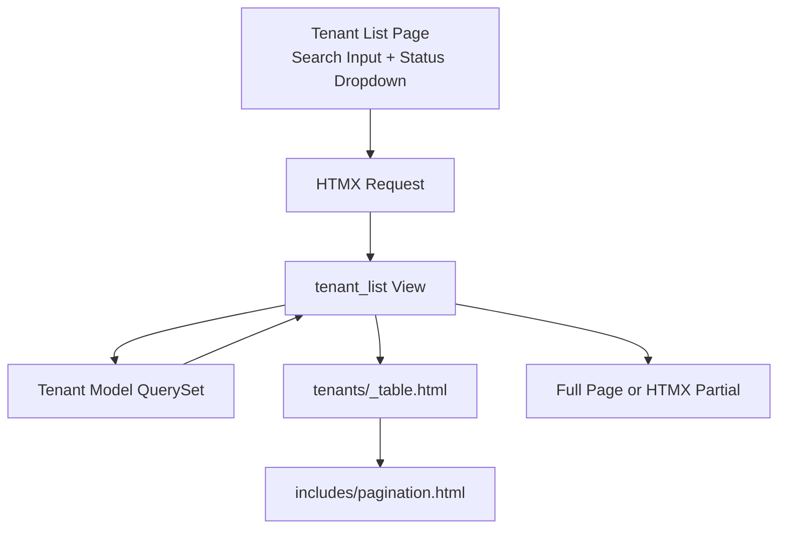
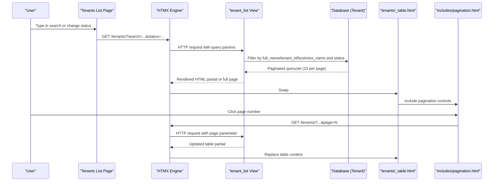
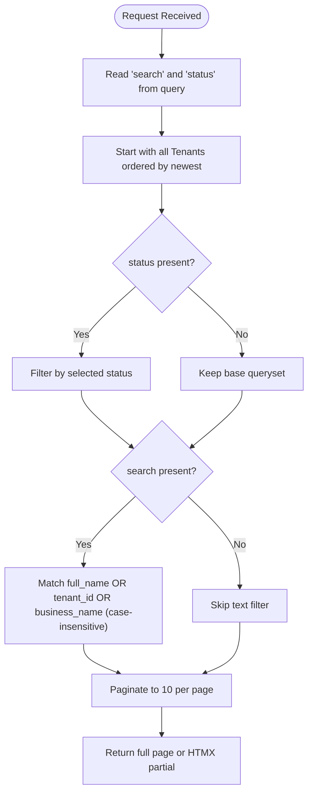
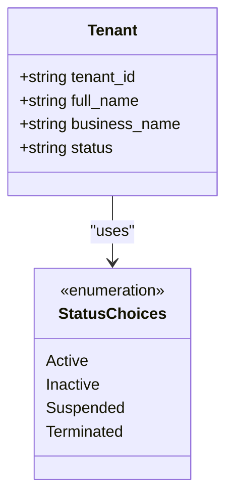
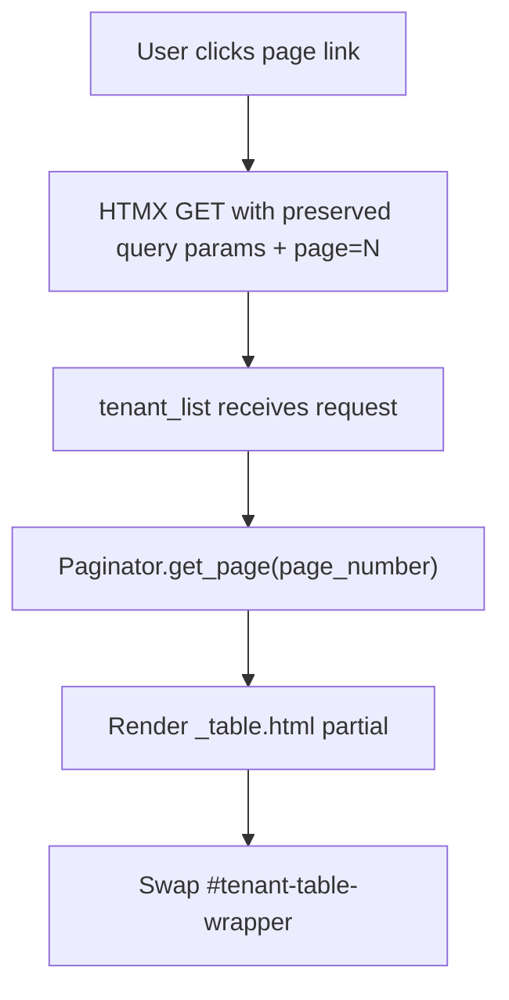
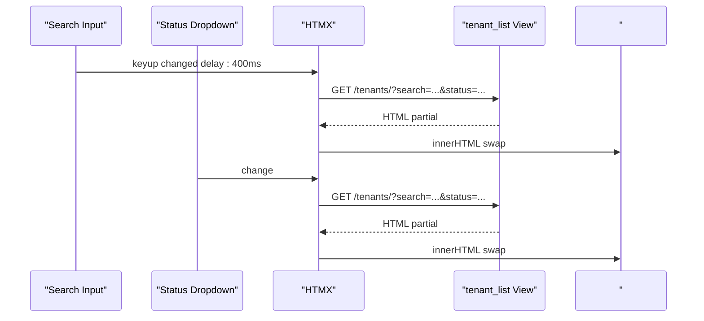
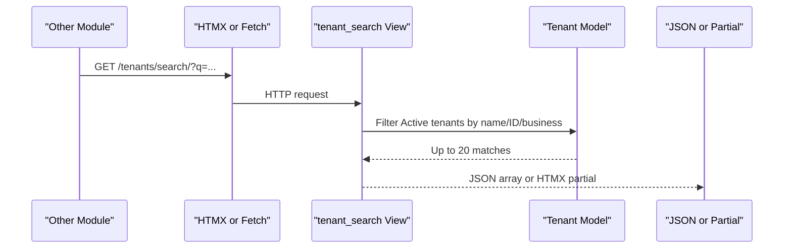
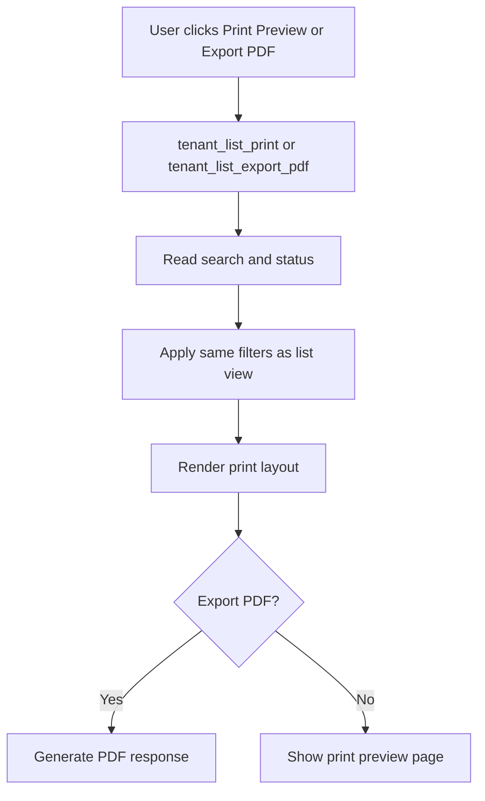
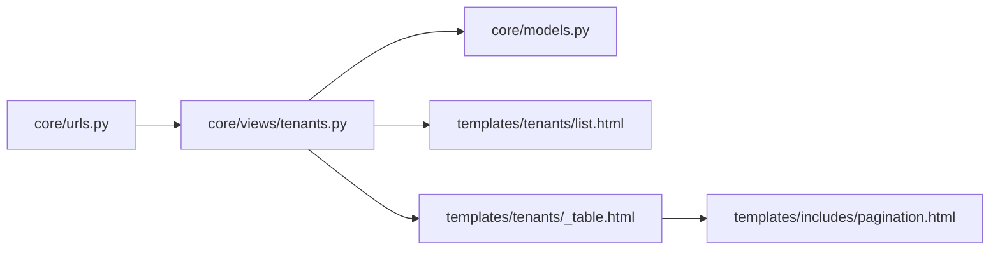

# Search & Filtering

<cite>
**Referenced Files in This Document**
- [core/views/tenants.py](file://core/views/tenants.py)
- [templates/tenants/list.html](file://templates/tenants/list.html)
- [templates/tenants/_table.html](file://templates/tenants/_table.html)
- [templates/includes/pagination.html](file://templates/includes/pagination.html)
- [core/models.py](file://core/models.py)
- [core/urls.py](file://core/urls.py)
</cite>

## Table of Contents
1. [Introduction](#introduction)
2. [Project Structure](#project-structure)
3. [Core Components](#core-components)
4. [Architecture Overview](#architecture-overview)
5. [Detailed Component Analysis](#detailed-component-analysis)
6. [Dependency Analysis](#dependency-analysis)
7. [Performance Considerations](#performance-considerations)
8. [Troubleshooting Guide](#troubleshooting-guide)
9. [Conclusion](#conclusion)

## Introduction
This document explains the tenant search and filtering capabilities in the Market Rental System. It covers:
- Multi-field search across full name, tenant ID, and business name with case-insensitive matching.
- Status filtering for Active, Inactive, Suspended, and Terminated tenants.
- Pagination with 10 records per page and HTMX-powered dynamic updates.
- Complex query combinations.
- Performance considerations for large datasets.
- Integration with print and PDF export functionality.
- Autocomplete search for quick tenant lookup used by other modules.

## Project Structure
The tenant search and filtering feature spans a small set of focused files:
- The view builds the filtered queryset, applies pagination, and serves both full-page and HTMX partial responses.
- The list template provides the search input and status dropdown, wired to HTMX for live updates.
- The table template renders the paginated results and includes the shared pagination component.
- The pagination component supports HTMX navigation while preserving existing filters.
- The Tenant model defines the searchable fields and status choices.
- URL routing connects the endpoints used by the UI and autocomplete.

**Diagram sources**
- [core/views/tenants.py:24-51](file://core/views/tenants.py#L24-L51)
- [templates/tenants/list.html:41-61](file://templates/tenants/list.html#L41-L61)
- [templates/tenants/_table.html:1-131](file://templates/tenants/_table.html#L1-L131)
- [templates/includes/pagination.html:1-47](file://templates/includes/pagination.html#L1-L47)

**Section sources**
- [core/views/tenants.py:24-51](file://core/views/tenants.py#L24-L51)
- [templates/tenants/list.html:41-61](file://templates/tenants/list.html#L41-L61)
- [templates/tenants/_table.html:1-131](file://templates/tenants/_table.html#L1-L131)
- [templates/includes/pagination.html:1-47](file://templates/includes/pagination.html#L1-L47)

## Core Components
- **tenant_list view**: Reads `search` and `status` query parameters, applies multi-field case-insensitive search and optional status filter, then paginates results into pages of 10. It returns either the full page or an HTMX partial targeting the table wrapper.
- **list template**: Provides the search input and status dropdown. Both controls use HTMX to update the table without a full page reload and push the current URL state.
- **_table template**: Renders the paginated tenant rows, status badges, actions, and includes the pagination component.
- **pagination template**: Generates first/previous/next/last and numbered page links. When a pagination target is provided, it uses HTMX to swap only the table content.
- **Tenant model**: Defines searchable text fields and the status choices used by the filter.
- **tenant_search view**: Autocomplete endpoint returning up to 20 active tenants matched by name, ID, or business name.

**Section sources**
- [core/views/tenants.py:24-51](file://core/views/tenants.py#L24-L51)
- [core/views/tenants.py:291-302](file://core/views/tenants.py#L291-L302)
- [templates/tenants/list.html:41-61](file://templates/tenants/list.html#L41-L61)
- [templates/tenants/_table.html:1-131](file://templates/tenants/_table.html#L1-L131)
- [templates/includes/pagination.html:1-47](file://templates/includes/pagination.html#L1-L47)
- [core/models.py:117-154](file://core/models.py#L117-L154)

## Architecture Overview
The tenant search flow combines server-side filtering with client-side interactivity:

**Diagram sources**
- [core/views/tenants.py:24-51](file://core/views/tenants.py#L24-L51)
- [templates/tenants/list.html:41-61](file://templates/tenants/list.html#L41-L61)
- [templates/tenants/_table.html:1-131](file://templates/tenants/_table.html#L1-L131)
- [templates/includes/pagination.html:1-47](file://templates/includes/pagination.html#L1-L47)

## Detailed Component Analysis

### Multi-Field Search
The search supports three fields:
- full_name
- tenant_id
- business_name

Matching is case-insensitive and uses OR logic across these fields. An empty search value means no text filter is applied.

**Diagram sources**
- [core/views/tenants.py:24-51](file://core/views/tenants.py#L24-L51)

**Section sources**
- [core/views/tenants.py:24-51](file://core/views/tenants.py#L24-L51)
- [core/models.py:117-154](file://core/models.py#L117-L154)

### Status Filtering
The status dropdown offers four options:
- Active
- Inactive
- Suspended
- Terminated

When a status is selected, the view filters the queryset by that exact status value. If no status is selected, all statuses are included.

**Diagram sources**
- [core/models.py:117-154](file://core/models.py#L117-L154)

**Section sources**
- [templates/tenants/list.html:48-54](file://templates/tenants/list.html#L48-L54)
- [core/views/tenants.py:24-51](file://core/views/tenants.py#L24-L51)
- [core/models.py:117-154](file://core/models.py#L117-L154)

### Pagination Implementation
- Page size: 10 records per page.
- Navigation: First, previous, next, last, and numbered pages.
- HTMX integration: Pagination links send HTMX requests when a pagination target is provided, swapping only the table wrapper instead of reloading the entire page.
- Filter preservation: Pagination links preserve existing search and status parameters.

**Diagram sources**
- [core/views/tenants.py:38-51](file://core/views/tenants.py#L38-L51)
- [templates/includes/pagination.html:1-47](file://templates/includes/pagination.html#L1-L47)

**Section sources**
- [core/views/tenants.py:38-51](file://core/views/tenants.py#L38-L51)
- [templates/includes/pagination.html:1-47](file://templates/includes/pagination.html#L1-L47)

### HTMX-Powered Dynamic Updates
- Search input triggers an HTMX request on keyup after a short delay, including the current status selection.
- Status dropdown triggers an HTMX request on change, including the current search term.
- Both controls push the current URL so browser history and sharing work correctly.
- The response targets the table wrapper, keeping the rest of the page intact.

**Diagram sources**
- [templates/tenants/list.html:44-54](file://templates/tenants/list.html#L44-L54)
- [core/views/tenants.py:24-51](file://core/views/tenants.py#L24-L51)

**Section sources**
- [templates/tenants/list.html:44-54](file://templates/tenants/list.html#L44-L54)
- [core/views/tenants.py:24-51](file://core/views/tenants.py#L24-L51)

### Autocomplete Search
The autocomplete endpoint returns up to 20 active tenants matched by full name, tenant ID, or business name. It can return either:
- JSON data for programmatic consumption.
- A rendered partial when requested via HTMX.

**Diagram sources**
- [core/views/tenants.py:291-302](file://core/views/tenants.py#L291-L302)
- [core/urls.py:76](file://core/urls.py#L76)

**Section sources**
- [core/views/tenants.py:291-302](file://core/views/tenants.py#L291-L302)
- [core/urls.py:76](file://core/urls.py#L76)

### Print and Export Integration
The print preview and PDF export endpoints reuse the same search and status filters as the list view:
- They read `search` and `status`.
- They apply the same multi-field case-insensitive search and status filter.
- They render a print-friendly layout or generate a PDF file.

**Diagram sources**
- [core/views/tenants.py:367-416](file://core/views/tenants.py#L367-L416)
- [templates/tenants/list.html:22-29](file://templates/tenants/list.html#L22-L29)

**Section sources**
- [core/views/tenants.py:367-416](file://core/views/tenants.py#L367-L416)
- [templates/tenants/list.html:22-29](file://templates/tenants/list.html#L22-L29)

## Dependency Analysis
The following diagram shows how the main components depend on each other:

**Diagram sources**
- [core/urls.py:65-78](file://core/urls.py#L65-L78)
- [core/views/tenants.py:24-51](file://core/views/tenants.py#L24-L51)
- [core/models.py:117-154](file://core/models.py#L117-L154)
- [templates/tenants/list.html:41-61](file://templates/tenants/list.html#L41-L61)
- [templates/tenants/_table.html:1-131](file://templates/tenants/_table.html#L1-L131)
- [templates/includes/pagination.html:1-47](file://templates/includes/pagination.html#L1-L47)

**Section sources**
- [core/urls.py:65-78](file://core/urls.py#L65-L78)
- [core/views/tenants.py:24-51](file://core/views/tenants.py#L24-L51)
- [core/models.py:117-154](file://core/models.py#L117-L154)
- [templates/tenants/list.html:41-61](file://templates/tenants/list.html#L41-L61)
- [templates/tenants/_table.html:1-131](file://templates/tenants/_table.html#L1-L131)
- [templates/includes/pagination.html:1-47](file://templates/includes/pagination.html#L1-L47)

## Performance Considerations
- Case-insensitive substring searches across multiple fields can be expensive on large tables because they often prevent index usage.
- Status filtering reduces result sets and improves performance when combined with text search.
- Pagination limits database rows returned to the application layer to 10 per page.
- Autocomplete limits results to 20 entries to reduce payload size and rendering cost.
- For very large datasets, consider:
  - Adding database indexes on frequently searched columns such as full_name, tenant_id, and business_name.
  - Using database-level full-text search if supported and appropriate.
  - Caching frequent search queries where acceptable.
  - Avoiding unnecessary joins in list views; the current list view loads basic tenant data efficiently.

[No sources needed since this section provides general guidance]

## Troubleshooting Guide
- No results appear:
  - Verify the search term is not too restrictive.
  - Confirm the selected status matches expected tenants.
  - Check that the search input and status dropdown are sending HTMX requests and updating the table wrapper.
- Pagination does not preserve filters:
  - Ensure the pagination component has a valid pagination target and that the list view passes the correct target.
  - Confirm the URL contains the expected query parameters.
- Autocomplete returns no results:
  - The autocomplete endpoint only returns Active tenants.
  - Ensure the query parameter is named `q`.
  - Check that the endpoint URL is `/tenants/search/`.

**Section sources**
- [core/views/tenants.py:24-51](file://core/views/tenants.py#L24-L51)
- [core/views/tenants.py:291-302](file://core/views/tenants.py#L291-L302)
- [templates/tenants/list.html:44-54](file://templates/tenants/list.html#L44-L54)
- [templates/includes/pagination.html:1-47](file://templates/includes/pagination.html#L1-L47)

## Conclusion
The tenant search and filtering system provides a practical, user-friendly interface for locating tenants quickly. It combines multi-field case-insensitive search with status filtering, delivers responsive updates through HTMX, and integrates cleanly with print and export workflows. The autocomplete endpoint enables fast tenant lookup across other modules. For large-scale deployments, indexing and caching strategies should be considered to maintain responsiveness.

[No sources needed since this section summarizes without analyzing specific files]