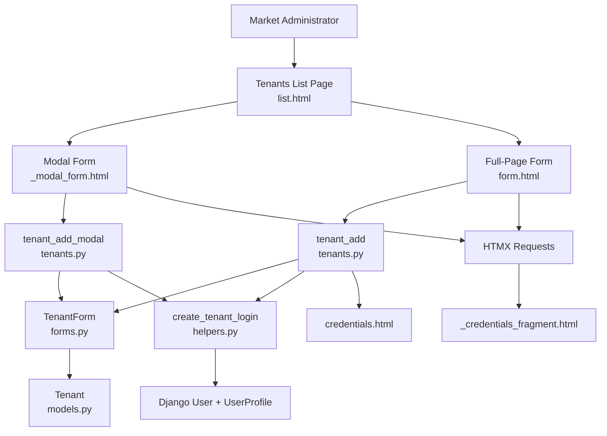
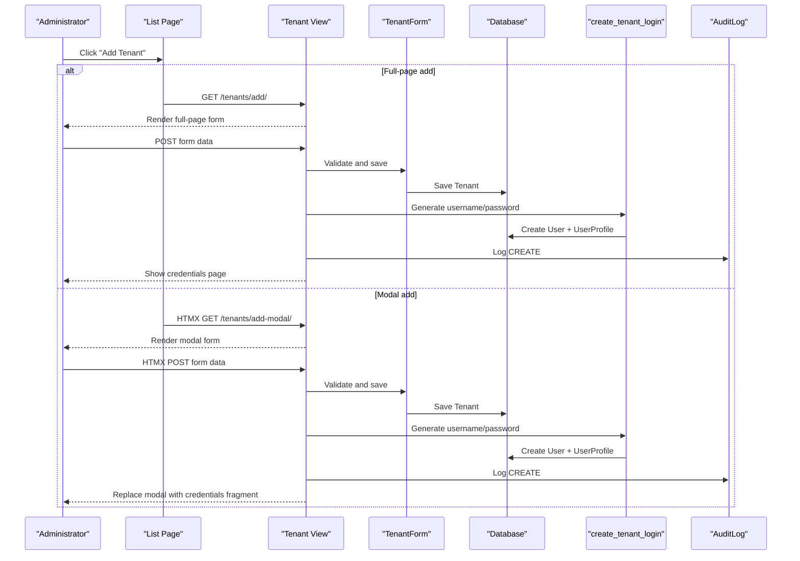
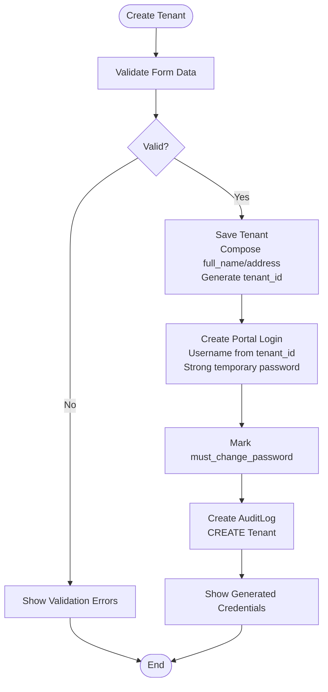
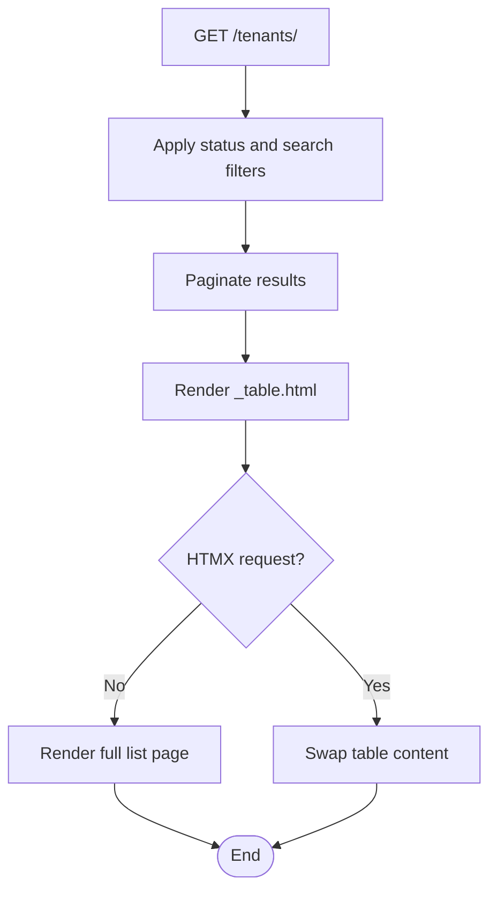
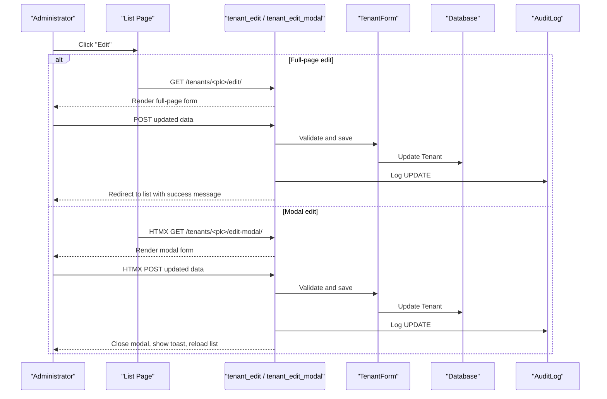
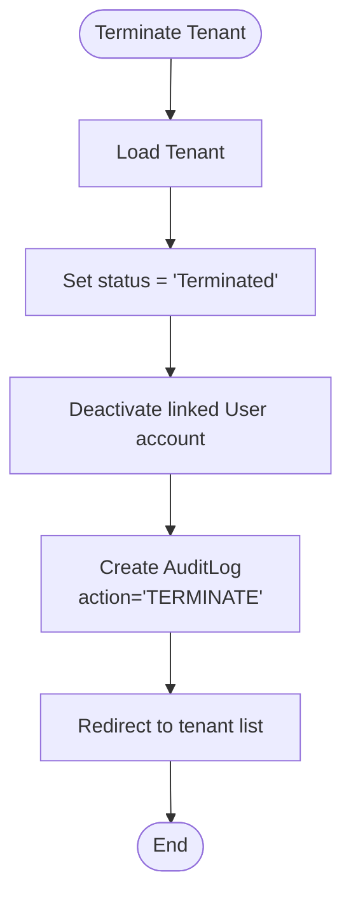
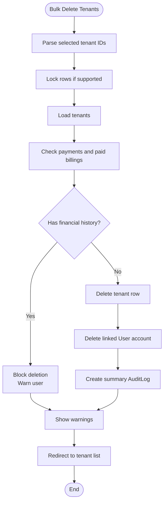
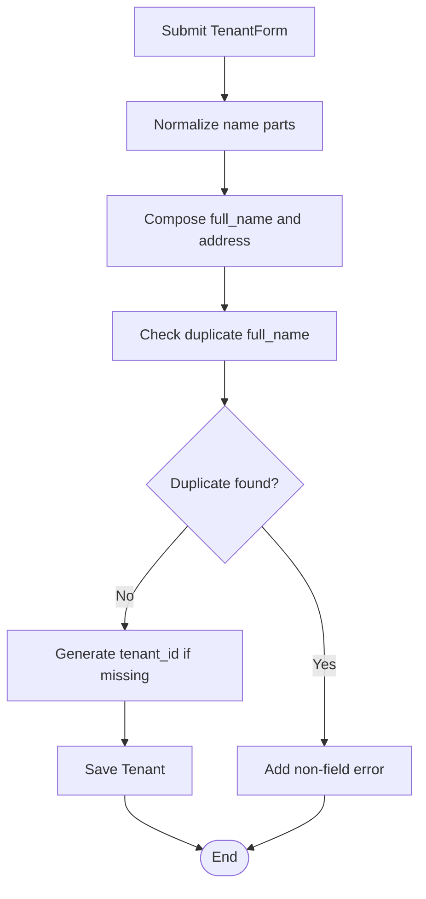
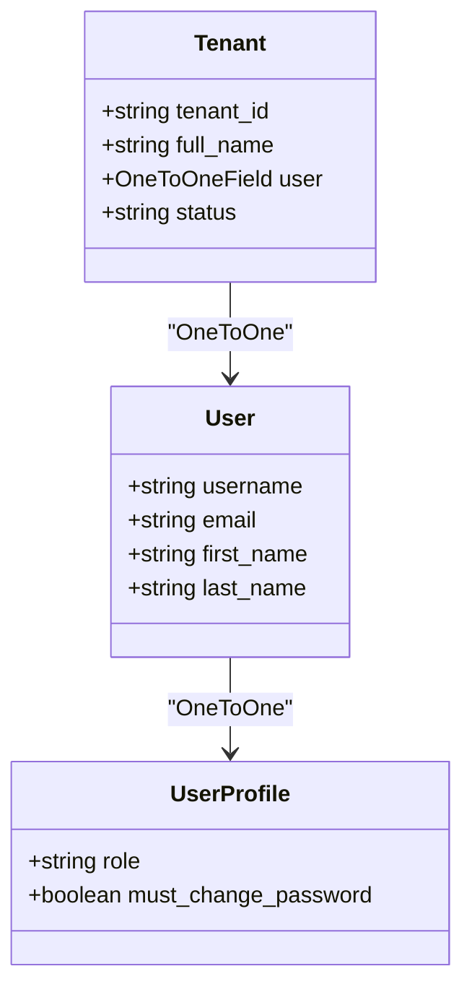
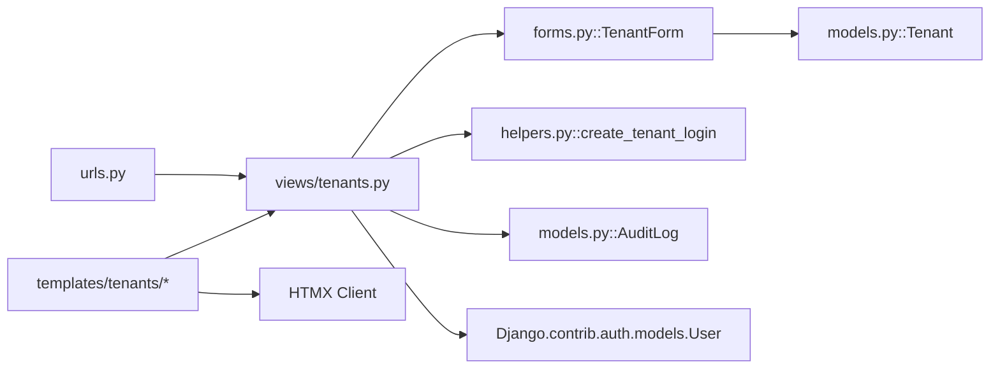

# Tenant CRUD Operations

<cite>
**Referenced Files in This Document**   
- [tenants.py](file://core/views/tenants.py)
- [models.py](file://core/models.py)
- [forms.py](file://core/forms.py)
- [helpers.py](file://core/helpers.py)
- [urls.py](file://core/urls.py)
- [_modal_form.html](file://templates/tenants/_modal_form.html)
- [form.html](file://templates/tenants/form.html)
- [_credentials_fragment.html](file://templates/tenants/_credentials_fragment.html)
- [credentials.html](file://templates/tenants/credentials.html)
- [_table.html](file://templates/tenants/_table.html)
- [list.html](file://templates/tenants/list.html)
</cite>

## Table of Contents
1. [Introduction](#introduction)
2. [Project Structure](#project-structure)
3. [Core Components](#core-components)
4. [Architecture Overview](#architecture-overview)
5. [Detailed Component Analysis](#detailed-component-analysis)
6. [Dependency Analysis](#dependency-analysis)
7. [Performance Considerations](#performance-considerations)
8. [Troubleshooting Guide](#troubleshooting-guide)
9. [Conclusion](#conclusion)

## Introduction
This document explains the complete tenant lifecycle in the market rental system: creating, reading, updating, terminating, and permanently deleting tenants. It covers form validation, ID image uploads, automatic portal account provisioning, HTMX-based modal interactions, soft deletion versus hard deletion, audit logging, and error/success messaging. The goal is to help administrators understand how tenant data flows from a form submission through database persistence and user-account creation, while keeping financial records safe and auditable.

## Project Structure
Tenant functionality is implemented across views, forms, models, helpers, URL routes, and templates:

- Views handle HTTP requests for listing, adding, editing, viewing, terminating, bulk deleting, searching, and printing/exporting tenants.
- Forms define fields, validation rules, composed name/address handling, duplicate prevention, and auto-generated tenant IDs.
- Models define the `Tenant` entity, its status choices, linked `User`, and related financial entities.
- Helpers generate secure credentials, tenant IDs, and PDF responses.
- Templates provide full-page forms, modal forms, credential fragments, list/table UI, and bulk-delete controls.
- URLs wire endpoints for both full-page and HTMX/modal workflows.

**Diagram sources**
- [list.html:21-37](file://templates/tenants/list.html#L21-L37)
- [_modal_form.html:12-39](file://templates/tenants/_modal_form.html#L12-L39)
- [form.html:21-21](file://templates/tenants/form.html#L21-L21)
- [tenants.py:54-81](file://core/views/tenants.py#L54-L81)
- [tenants.py:305-333](file://core/views/tenants.py#L305-L333)
- [forms.py:49-198](file://core/forms.py#L49-L198)
- [models.py:117-154](file://core/models.py#L117-L154)
- [helpers.py:70-122](file://core/helpers.py#L70-L122)

**Section sources**
- [tenants.py:23-51](file://core/views/tenants.py#L23-L51)
- [urls.py:65-78](file://core/urls.py#L65-L78)

## Core Components
The tenant CRUD workflow centers on these components:

| Component | Responsibility | Key Behavior |
|---|---|---|
| `TenantForm` | Validates and saves tenant data | Composes `full_name` and `address`, generates `tenant_id`, prevents duplicates, supports ID image upload |
| `Tenant` model | Stores tenant identity and status | Links to a Django `User`, tracks registration date, status, and optional ID image |
| `create_tenant_login` | Provisions portal login | Generates username from tenant ID, creates strong temporary password, forces first-login password change |
| Tenant views | Handle HTTP operations | Full-page add/edit, modal add/edit, terminate, bulk delete, list/search/print/export |
| Templates | Render UI and HTMX fragments | Full-page form, modal form, credentials fragment, list with filters and bulk actions |
| AuditLog | Records modifications | CREATE, UPDATE, TERMINATE, DELETE entries with actor, module, description, and IP address |

**Section sources**
- [forms.py:49-198](file://core/forms.py#L49-L198)
- [models.py:117-154](file://core/models.py#L117-L154)
- [helpers.py:70-122](file://core/helpers.py#L70-L122)
- [tenants.py:54-124](file://core/views/tenants.py#L54-L124)
- [tenants.py:305-363](file://core/views/tenants.py#L305-L363)

## Architecture Overview
The tenant lifecycle follows two main entry points:

1. **Full-page flow**: Navigate to the add page, submit the form, receive generated credentials on a dedicated page.
2. **Modal flow**: Open a modal from the tenant list, submit via HTMX, replace the modal body with a success fragment showing credentials.

Both flows validate input, persist the tenant, create a portal login, and log the action.

**Diagram sources**
- [list.html:30-37](file://templates/tenants/list.html#L30-L37)
- [tenants.py:54-81](file://core/views/tenants.py#L54-L81)
- [tenants.py:305-333](file://core/views/tenants.py#L305-L333)
- [forms.py:141-198](file://core/forms.py#L141-L198)
- [helpers.py:92-122](file://core/helpers.py#L92-L122)

## Detailed Component Analysis

### Tenant Creation (Add)
Creation supports both full-page and modal interfaces. On successful validation:

- A unique tenant ID is generated if missing.
- Name and address fields are composed into canonical fields.
- A Django `User` and `UserProfile` are created with role `tenant`.
- The profile is marked to require a password change on first login.
- An audit log entry records the creator, action, module, description, and IP address.
- Success feedback shows generated credentials either on a full page or inside a modal fragment.

**Diagram sources**
- [tenants.py:54-81](file://core/views/tenants.py#L54-L81)
- [tenants.py:305-333](file://core/views/tenants.py#L305-L333)
- [forms.py:141-198](file://core/forms.py#L141-L198)
- [helpers.py:70-122](file://core/helpers.py#L70-L122)

**Section sources**
- [tenants.py:54-81](file://core/views/tenants.py#L54-L81)
- [tenants.py:305-333](file://core/views/tenants.py#L305-L333)
- [forms.py:49-198](file://core/forms.py#L49-L198)
- [helpers.py:70-122](file://core/helpers.py#L70-L122)
- [_credentials_fragment.html:1-51](file://templates/tenants/_credentials_fragment.html#L1-L51)
- [credentials.html:1-83](file://templates/tenants/credentials.html#L1-L83)

### Tenant Reading (List, Search, View)
Reading includes:

- Paginated list with search by name, tenant ID, or business name.
- Status filter: Active, Inactive, Suspended, Terminated.
- HTMX-powered filtering that swaps the table without full page reloads.
- Tenant view with contract, billing, payment summaries and balance totals.
- Role-based isolation: tenants can only view their own profile.

**Diagram sources**
- [tenants.py:23-51](file://core/views/tenants.py#L23-L51)
- [list.html:41-61](file://templates/tenants/list.html#L41-L61)
- [_table.html:27-130](file://templates/tenants/_table.html#L27-L130)

**Section sources**
- [tenants.py:23-51](file://core/views/tenants.py#L23-L51)
- [tenants.py:266-287](file://core/views/tenants.py#L266-L287)
- [tenants.py:290-302](file://core/views/tenants.py#L290-L302)
- [list.html:41-61](file://templates/tenants/list.html#L41-L61)

### Tenant Update (Edit)
Editing supports both full-page and modal interfaces:

- Loads existing tenant data into the form.
- Validates updated fields, including duplicate checks excluding the current record.
- Saves changes and logs an UPDATE audit entry.
- Modal updates close the modal, show a toast, and refresh the list.
- Full-page updates redirect back to the tenant list with a success message.

**Diagram sources**
- [tenants.py:84-104](file://core/views/tenants.py#L84-L104)
- [tenants.py:336-363](file://core/views/tenants.py#L336-L363)
- [_modal_form.html:29-51](file://templates/tenants/_modal_form.html#L29-L51)
- [form.html:39-144](file://templates/tenants/form.html#L39-L144)

**Section sources**
- [tenants.py:84-104](file://core/views/tenants.py#L84-L104)
- [tenants.py:336-363](file://core/views/tenants.py#L336-L363)
- [forms.py:141-198](file://core/forms.py#L141-L198)

### Tenant Termination (Soft Deletion)
Termination is a soft deletion:

- Sets tenant status to `Terminated`.
- Deactivates the linked portal `User` account.
- Logs a `TERMINATE` audit entry.
- Returns to the tenant list with a success message.

Use termination when:

- You need to preserve historical contracts, billings, payments, notices, and ledger entries.
- You want to keep the tenant record for reporting and audit purposes.
- You may reactivate or reassign stalls later without losing history.

**Diagram sources**
- [tenants.py:107-124](file://core/views/tenants.py#L107-L124)
- [_table.html:102-109](file://templates/tenants/_table.html#L102-L109)

**Section sources**
- [tenants.py:107-124](file://core/views/tenants.py#L107-L124)
- [_table.html:102-109](file://templates/tenants/_table.html#L102-L109)

### Tenant Hard Deletion (Bulk Delete)
Hard deletion permanently removes tenant records and related data:

- Only available via bulk delete endpoint.
- Requires admin permissions.
- Uses transactional safety and optional row locking depending on database support.
- Preloads payment and billing history to protect financial records.
- Skips tenants with recorded payments or partially paid billings.
- Deletes the tenant row and linked portal login.
- Emits a single summary audit entry for the batch.
- Provides clear success, warning, and error messages.

Use hard deletion when:

- The tenant has no financial history.
- You have voided all relevant payments and billings.
- You need to remove orphaned or test records completely.
- Compliance or cleanup requires permanent removal.

**Diagram sources**
- [tenants.py:127-263](file://core/views/tenants.py#L127-L263)
- [_table.html:3-26](file://templates/tenants/_table.html#L3-L26)
- [_table.html:133-233](file://templates/tenants/_table.html#L133-L233)

**Section sources**
- [tenants.py:127-263](file://core/views/tenants.py#L127-L263)
- [_table.html:3-26](file://templates/tenants/_table.html#L3-L26)
- [_table.html:133-233](file://templates/tenants/_table.html#L133-L233)

### Form Validation Rules
`TenantForm` enforces several validation and composition rules:

| Rule | Description |
|---|---|
| Required fields | First name, last name, street, barangay, municipality, province are required by template labels and field definitions |
| Optional fields | Middle name, contact number, email, valid ID type/number/image, business name/type, emergency contact, notes are optional |
| Composed fields | `full_name` is composed from first/middle/last; `address` is composed from street/barangay/municipality/province |
| Duplicate prevention | Normalized case-insensitive comparison blocks duplicate names, excluding the current record during edits |
| Tenant ID generation | Auto-generates next sequential `TEN-###` ID if not present |
| Business type choices | Enforces predefined business types, allowing legacy values to be preserved |
| Default values | Defaults municipality and province for new tenants |

**Diagram sources**
- [forms.py:141-198](file://core/forms.py#L141-L198)

**Section sources**
- [forms.py:49-198](file://core/forms.py#L49-L198)

### File Upload Handling for ID Images
The tenant form includes an ID image field:

- Field: `valid_id_image`
- Widget: Clearable file input
- Storage path: `tenant_ids/`
- Supported formats: JPG/PNG per template hint
- Existing images are linkable during edit

Validation behavior:

- The field is optional.
- Django’s `ImageField` handles file validation and storage.
- Templates display current ID links when editing.

**Section sources**
- [forms.py:84-109](file://core/forms.py#L84-L109)
- [models.py:137-139](file://core/models.py#L137-L139)
- [_modal_form.html:117-122](file://templates/tenants/_modal_form.html#L117-L122)
- [form.html:104-109](file://templates/tenants/form.html#L104-L109)

### Automatic User Account Provisioning
When a tenant is created:

- Username is derived from the tenant ID, sanitized for Django username constraints.
- If conflicts exist, a numeric suffix is appended.
- A strong temporary password is generated using project validators.
- A Django `User` is created with email and name fields populated from tenant data.
- A `UserProfile` is created or updated with role `tenant`.
- The profile is marked to force password change on first login.
- The tenant’s `user` foreign key is set.

**Diagram sources**
- [models.py:117-154](file://core/models.py#L117-L154)
- [models.py:7-23](file://core/models.py#L7-L23)
- [helpers.py:92-122](file://core/helpers.py#L92-L122)

**Section sources**
- [helpers.py:18-40](file://core/helpers.py#L18-L40)
- [helpers.py:43-67](file://core/helpers.py#L43-L67)
- [helpers.py:70-122](file://core/helpers.py#L70-L122)
- [tenants.py:54-81](file://core/views/tenants.py#L54-L81)
- [tenants.py:305-333](file://core/views/tenants.py#L305-L333)

### HTMX Integration Patterns
HTMX is used for:

- Modal open/close interactions triggered by buttons.
- HTMX GET requests to load modal forms.
- HTMX POST requests to submit forms with multipart encoding.
- HTMX target replacement to swap modal content with credentials or error fragments.
- HTMX-powered list filtering and pagination.

Key patterns:

- `hx-get` loads modal forms.
- `hx-post` submits forms.
- `hx-target="#modal-content"` replaces modal body.
- `hx-encoding="multipart/form-data"` enables file uploads.
- `hx-push-url="true"` keeps browser history consistent for filters.

**Section sources**
- [_modal_form.html:12-39](file://templates/tenants/_modal_form.html#L12-L39)
- [list.html:44-57](file://templates/tenants/list.html#L44-L57)
- [_table.html:102-109](file://templates/tenants/_table.html#L102-L109)
- [_table.html:133-233](file://templates/tenants/_table.html#L133-L233)

### Audit Logging for Tenant Modifications
Every significant tenant modification is logged:

| Action | When Logged | Description Content |
|---|---|---|
| CREATE | After successful tenant creation | Includes tenant ID, full name, generated username |
| UPDATE | After successful tenant update | Includes tenant ID and full name |
| TERMINATE | After soft deletion | Includes tenant ID and full name |
| DELETE | After bulk hard deletion | Summarizes deleted and blocked tenants |

Each audit entry includes:

- Actor user
- Action type
- Module (`Tenant`)
- Human-readable description
- IP address

**Section sources**
- [tenants.py:63-69](file://core/views/tenants.py#L63-L69)
- [tenants.py:91-97](file://core/views/tenants.py#L91-L97)
- [tenants.py:116-122](file://core/views/tenants.py#L116-L122)
- [tenants.py:313-319](file://core/views/tenants.py#L313-L319)
- [tenants.py:343-349](file://core/views/tenants.py#L343-L349)
- [tenants.py:225-238](file://core/views/tenants.py#L225-L238)
- [models.py:304-316](file://core/models.py#L304-L316)

### Error Handling and Success Messaging
Error handling occurs at multiple layers:

- Form-level errors: Non-field errors and field-specific errors are rendered in both modal and full-page forms.
- View-level messages: Django messages framework provides success, warning, and error notifications.
- Bulk delete outcomes: Separate messages for deleted, blocked, and missing tenants.
- HTMX modal errors: Re-renders the modal form with validation errors.

Success messaging examples:

- Tenant updated successfully.
- Tenant terminated successfully.
- Bulk delete summary with counts and names.
- Credential sharing confirmation.

**Section sources**
- [_modal_form.html:14-23](file://templates/tenants/_modal_form.html#L14-L23)
- [_modal_form.html:41-50](file://templates/tenants/_modal_form.html#L41-L50)
- [form.html:23-32](file://templates/tenants/form.html#L23-L32)
- [tenants.py:77-78](file://core/views/tenants.py#L77-L78)
- [tenants.py:98-101](file://core/views/tenants.py#L98-L101)
- [tenants.py:123-124](file://core/views/tenants.py#L123-L124)
- [tenants.py:240-262](file://core/views/tenants.py#L240-L262)

## Dependency Analysis
The tenant CRUD system depends on several interconnected components:

**Diagram sources**
- [urls.py:65-78](file://core/urls.py#L65-L78)
- [tenants.py:1-16](file://core/views/tenants.py#L1-L16)
- [forms.py:11-15](file://core/forms.py#L11-L15)
- [models.py:117-154](file://core/models.py#L117-L154)
- [helpers.py:92-122](file://core/helpers.py#L92-L122)

**Section sources**
- [urls.py:65-78](file://core/urls.py#L65-L78)
- [tenants.py:1-16](file://core/views/tenants.py#L1-L16)

## Performance Considerations
- Pagination limits tenant list queries to 10 items per page.
- HTMX reduces full page reloads for filtering and modal interactions.
- Bulk delete preloads payment and billing history in fixed queries rather than N round-trips.
- Database row locking is conditionally applied based on backend support.
- PDF export uses a multi-fallback renderer to avoid blocking on missing libraries.

[No sources needed since this section provides general guidance]

## Troubleshooting Guide
Common issues and resolutions:

| Issue | Cause | Resolution |
|---|---|---|
| Duplicate tenant name error | `TenantForm.clean()` detects normalized duplicate names | Edit the existing tenant instead of creating a new one |
| Modal form does not submit files | Missing multipart encoding | Ensure `hx-encoding="multipart/form-data"` is present |
| Credentials not shown after modal creation | HTMX response not replacing modal content | Verify `is_htmx(request)` logic and `_credentials_fragment.html` rendering |
| Bulk delete fails silently | No tenants selected or invalid IDs | Check selection and confirm IDs are integers |
| Hard delete blocked | Tenant has payments or paid billings | Void payments or use termination instead |
| PDF export returns HTML fallback | Missing WeasyPrint or xhtml2pdf libraries | Install dependencies or use browser Print → Save as PDF |

**Section sources**
- [forms.py:156-198](file://core/forms.py#L156-L198)
- [_modal_form.html:12-39](file://templates/tenants/_modal_form.html#L12-L39)
- [tenants.py:305-333](file://core/views/tenants.py#L305-L333)
- [tenants.py:127-263](file://core/views/tenants.py#L127-L263)
- [helpers.py:522-594](file://core/helpers.py#L522-L594)

## Conclusion
Tenant CRUD operations in this system combine robust validation, secure credential provisioning, flexible UI patterns, and strong auditability. Administrators can choose between soft termination for preserving history and hard deletion for complete cleanup. HTMX enables smooth modal workflows without sacrificing clarity. The separation of concerns across views, forms, models, helpers, and templates ensures maintainability and predictable behavior across the tenant lifecycle.

[No sources needed since this section summarizes without analyzing specific files]