# Tenant Management Module

<cite>
**Referenced Files in This Document**
- [models.py](file://core/models.py)
- [tenants.py](file://core/views/tenants.py)
- [forms.py](file://core/forms.py)
- [helpers.py](file://core/helpers.py)
- [list.html](file://templates/tenants/list.html)
- [_table.html](file://templates/tenants/_table.html)
- [form.html](file://templates/tenants/form.html)
- [view.html](file://templates/tenants/view.html)
</cite>

## Table of Contents
1. [Introduction](#introduction)
2. [Project Structure](#project-structure)
3. [Core Components](#core-components)
4. [Architecture Overview](#architecture-overview)
5. [Detailed Component Analysis](#detailed-component-analysis)
6. [Dependency Analysis](#dependency-analysis)
7. [Performance Considerations](#performance-considerations)
8. [Troubleshooting Guide](#troubleshooting-guide)
9. [Conclusion](#conclusion)

## Introduction
The Tenant Management module is the central entry point for registering, maintaining, and retiring market tenants. It covers the complete tenant lifecycle: registration, profile editing, stall assignment through contracts, billing and payment linkage, status management, search and filtering, bulk operations, and print/export capabilities. Tenants are modeled as business entities with identity, contact, identification, and business details, and they interact with stalls, contracts, billings, payments, notices, and audit logs.

This document explains how the data model, forms, views, templates, and helper utilities work together to support:
- Tenant CRUD operations
- Search by name, ID, or business name
- Status-based filtering
- Bulk deletion with financial safeguards
- File upload for valid IDs
- Print preview and PDF export
- Integration with stall assignments and contract management
- Relationship between tenants and their assigned stalls

## Project Structure
The tenant feature spans models, forms, views, templates, and shared helpers:
- Data model: `Tenant`, `Stall`, `RentalContract`, `Billing`, `Payment`, `Notice`, `AuditLog`
- Forms: `TenantForm`, `BulkAssignStallsForm`, `RentalContractForm`
- Views: list, add, edit, delete, terminate, view, search, modal endpoints, print, and PDF export
- Templates: list page, table fragment, form, profile view, and print layouts
- Helpers: tenant ID generation, login provisioning, PDF rendering, billing automation

```mermaid
graph TB
subgraph "User Interface"
ListPage["Tenants List Page<br/>list.html"]
FormPage["Tenant Form Page<br/>form.html"]
ViewPage["Tenant Profile Page<br/>view.html"]
TableFragment["_table.html"]
end
subgraph "Views"
TenantList["tenant_list"]
TenantAdd["tenant_add"]
TenantEdit["tenant_edit"]
TenantDelete["tenant_delete"]
TenantBulkDelete["tenant_bulk_delete"]
TenantView["tenant_view"]
TenantSearch["tenant_search"]
TenantPrint["tenant_list_print / tenant_view_print"]
TenantPDF["tenant_list_export_pdf / tenant_view_export_pdf"]
end
subgraph "Forms"
TenantForm["TenantForm"]
ContractForm["RentalContractForm"]
BulkAssignForm["BulkAssignStallsForm"]
end
subgraph "Models"
TenantModel["Tenant"]
StallModel["Stall"]
ContractModel["RentalContract"]
BillingModel["Billing"]
PaymentModel["Payment"]
NoticeModel["Notice"]
AuditModel["AuditLog"]
end
subgraph "Helpers"
Helpers["helpers.py<br/>ID/login/PDF/billing"]
end
ListPage --> TenantList
FormPage --> TenantAdd
FormPage --> TenantEdit
ViewPage --> TenantView
TableFragment --> TenantList
TenantList --> TenantForm
TenantAdd --> TenantForm
TenantEdit --> TenantForm
TenantView --> ContractModel
TenantView --> BillingModel
TenantView --> PaymentModel
TenantSearch --> TenantModel
TenantBulkDelete --> TenantModel
TenantBulkDelete --> AuditModel
TenantDelete --> AuditModel
TenantPrint --> Helpers
TenantPDF --> Helpers
TenantAdd --> Helpers
TenantEdit --> Helpers
ContractForm --> StallModel
ContractForm --> TenantModel
BulkAssignForm --> StallModel
BulkAssignForm --> TenantModel
```

**Diagram sources**
- [tenants.py:24-468](file://core/views/tenants.py#L24-L468)
- [forms.py:49-198](file://core/forms.py#L49-L198)
- [forms.py:281-400](file://core/forms.py#L281-L400)
- [forms.py:652-725](file://core/forms.py#L652-L725)
- [models.py:93-187](file://core/models.py#L93-L187)
- [models.py:117-154](file://core/models.py#L117-L154)
- [helpers.py:70-122](file://core/helpers.py#L70-L122)
- [helpers.py:522-594](file://core/helpers.py#L522-L594)

**Section sources**
- [models.py:93-187](file://core/models.py#L93-L187)
- [tenants.py:24-468](file://core/views/tenants.py#L24-L468)
- [forms.py:49-198](file://core/forms.py#L49-L198)
- [helpers.py:70-122](file://core/helpers.py#L70-L122)

## Core Components
### Tenant Model
The `Tenant` model stores:
- Identity fields: `tenant_id`, `full_name`, `first_name`, `middle_name`, `last_name`
- Address components: `address`, `street`, `barangay`, `municipality`, `province`
- Contact information: `contact_number`, `email`
- Identification: `valid_id_type`, `valid_id_number`, `valid_id_image`
- Business details: `business_name`, `business_type`
- Emergency contact: `emergency_contact_name`, `emergency_contact_number`
- Lifecycle metadata: `status`, `date_registered`, `notes`, timestamps

Status choices include Active, Inactive, Suspended, and Terminated. The default is Active.

### Related Models
- `Stall`: represents a physical market stall with section, type, rate, and occupancy status.
- `RentalContract`: links a tenant to a stall with dates, rent, due day, deposit, and contract status.
- `Billing`: monthly billing per tenant/stall/contract with amounts, penalties, discounts, balance, and status.
- `Payment`: collection records linked to billings, stalls, and tenants.
- `Notice`: formal notices sent to tenants.
- `AuditLog`: tracks administrative actions such as create, update, terminate, and bulk delete.

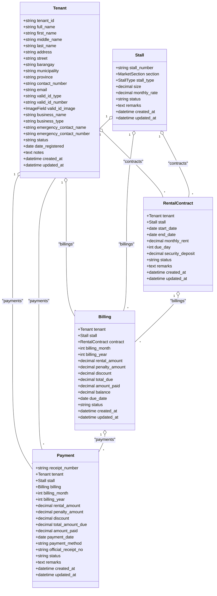

**Diagram sources**
- [models.py:93-187](file://core/models.py#L93-L187)
- [models.py:117-154](file://core/models.py#L117-L154)
- [models.py:190-258](file://core/models.py#L190-L258)

**Section sources**
- [models.py:93-187](file://core/models.py#L93-L187)
- [models.py:117-154](file://core/models.py#L117-L154)
- [models.py:190-258](file://core/models.py#L190-L258)

## Architecture Overview
The tenant workflow follows a layered Django architecture:
- Templates render UI and HTMX-driven interactions
- Views enforce permissions, validate forms, manage state changes, and log actions
- Forms encapsulate validation, normalization, and business rules
- Models define relationships and constraints
- Helpers provide reusable logic for ID generation, login creation, PDF rendering, and billing automation

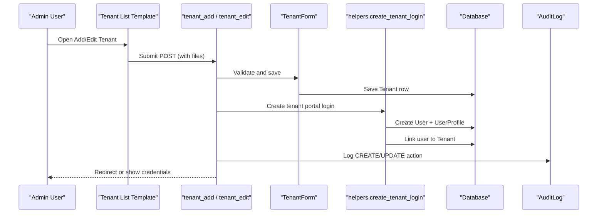

**Diagram sources**
- [tenants.py:54-81](file://core/views/tenants.py#L54-L81)
- [tenants.py:84-104](file://core/views/tenants.py#L84-L104)
- [forms.py:141-198](file://core/forms.py#L141-L198)
- [helpers.py:92-122](file://core/helpers.py#L92-L122)

## Detailed Component Analysis

### Tenant Lifecycle
#### Registration
- Admin opens the tenant form page or modal.
- `TenantForm` validates input, composes `full_name` and `address`, generates a unique `tenant_id`, and saves the tenant.
- On successful creation, a portal login is automatically generated via `create_tenant_login`, producing a secure username and temporary password.
- An audit log entry records the creation event.

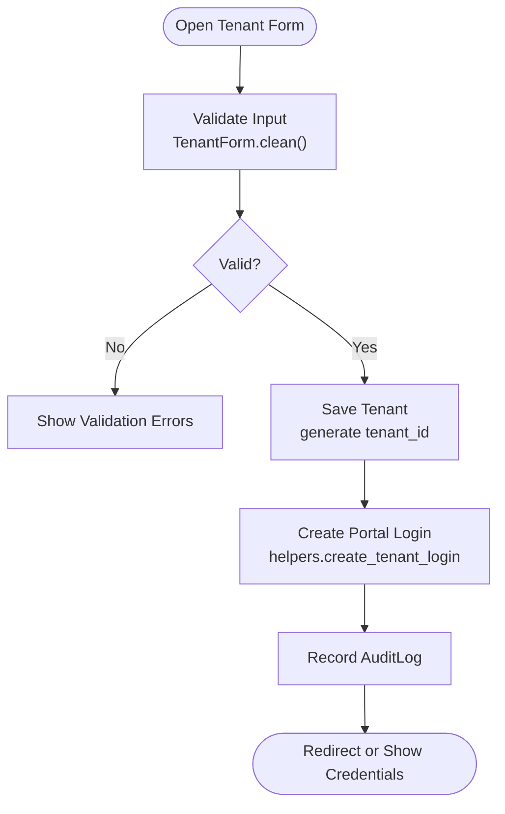

**Diagram sources**
- [forms.py:141-198](file://core/forms.py#L141-L198)
- [helpers.py:92-122](file://core/helpers.py#L92-L122)
- [tenants.py:54-81](file://core/views/tenants.py#L54-L81)

#### Profile Management
- Edit flows reuse `TenantForm` with an existing instance.
- The form pre-fills split address/name fields from legacy composed values.
- Changes are validated, saved, and logged.

#### Termination
- Termination sets tenant status to Terminated and deactivates the associated portal user account.
- A termination audit log is recorded.

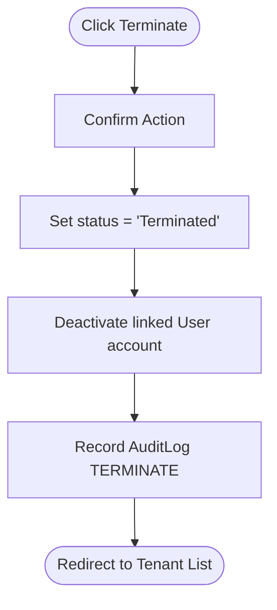

**Diagram sources**
- [tenants.py:107-124](file://core/views/tenants.py#L107-L124)

**Section sources**
- [tenants.py:54-124](file://core/views/tenants.py#L54-L124)
- [forms.py:141-198](file://core/forms.py#L141-L198)
- [helpers.py:92-122](file://core/helpers.py#L92-L122)

### CRUD Operations
- **Create**: `tenant_add` handles both full-page and modal submissions, creates the tenant, provisions login, and shows credentials.
- **Read**: `tenant_list` paginates all tenants; `tenant_view` displays profile, contracts, billings, payments, and outstanding balance.
- **Update**: `tenant_edit` updates profile fields and logs changes.
- **Delete/Terminate**: `tenant_delete` terminates a tenant without deleting financial history; `tenant_bulk_delete` permanently deletes selected tenants that have no payment history.

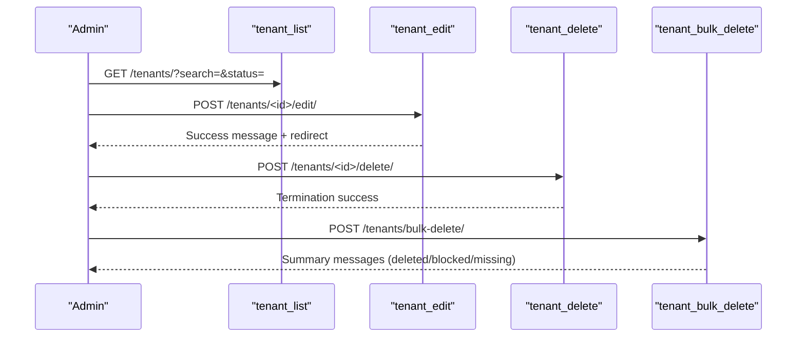

**Diagram sources**
- [tenants.py:24-51](file://core/views/tenants.py#L24-L51)
- [tenants.py:84-124](file://core/views/tenants.py#L84-L124)
- [tenants.py:127-263](file://core/views/tenants.py#L127-L263)

**Section sources**
- [tenants.py:24-51](file://core/views/tenants.py#L24-L51)
- [tenants.py:84-124](file://core/views/tenants.py#L84-L124)
- [tenants.py:127-263](file://core/views/tenants.py#L127-L263)

### Search and Filtering
- The list view supports:
  - Full-text search across `full_name`, `tenant_id`, and `business_name`
  - Status filter: Active, Inactive, Suspended, Terminated
- The search endpoint returns active tenants for autocomplete-style selection.

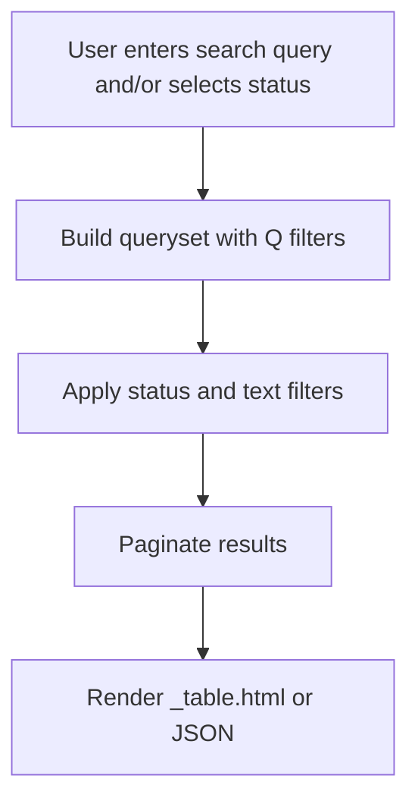

**Diagram sources**
- [tenants.py:24-51](file://core/views/tenants.py#L24-L51)
- [tenants.py:290-302](file://core/views/tenants.py#L290-L302)

**Section sources**
- [tenants.py:24-51](file://core/views/tenants.py#L24-L51)
- [tenants.py:290-302](file://core/views/tenants.py#L290-L302)

### Bulk Operations
- Bulk deletion allows selecting multiple tenants.
- Safety checks prevent deletion of tenants with:
  - Recorded payments
  - Billings with partial or full payments
- The operation uses database locking when supported and logs a summary audit entry.

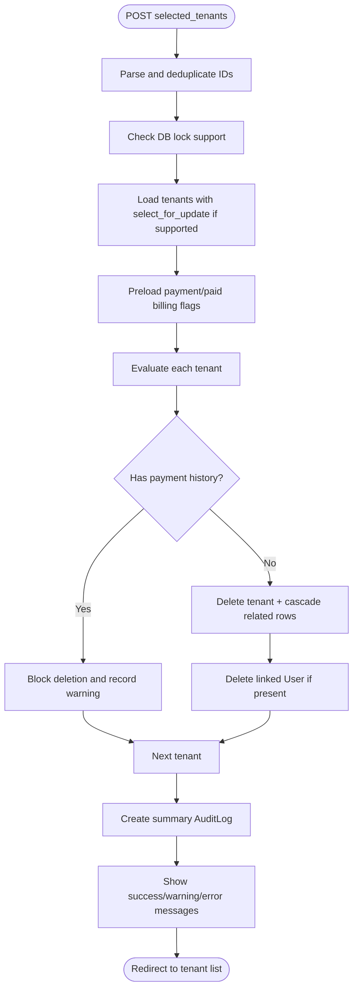

**Diagram sources**
- [tenants.py:127-263](file://core/views/tenants.py#L127-L263)

**Section sources**
- [tenants.py:127-263](file://core/views/tenants.py#L127-L263)

### Tenant Status Management
- Statuses: Active, Inactive, Suspended, Terminated
- Default is Active upon registration.
- Termination sets status to Terminated and deactivates the portal user.
- Status affects:
  - Visibility in lists and filters
  - Eligibility for new contract assignments (only Active tenants can be assigned)
  - Visual badges in templates

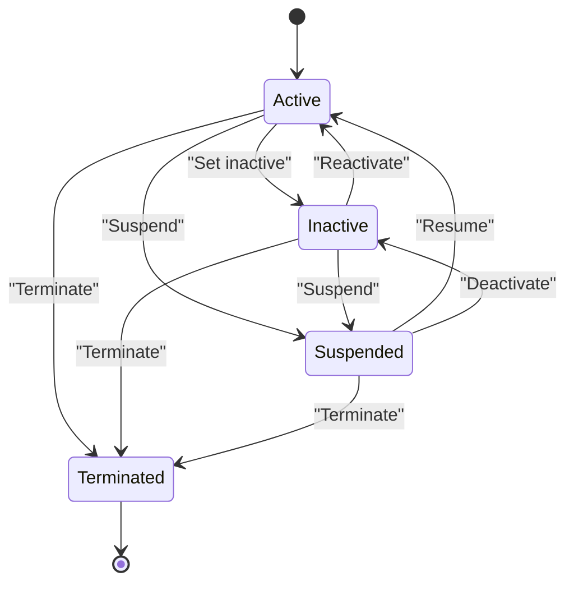

**Diagram sources**
- [models.py:117-154](file://core/models.py#L117-L154)
- [tenants.py:107-124](file://core/views/tenants.py#L107-L124)

**Section sources**
- [models.py:117-154](file://core/models.py#L117-L154)
- [tenants.py:107-124](file://core/views/tenants.py#L107-L124)

### Integration with Stall Assignments and Contract Management
- Tenants are assigned to stalls through `RentalContract`.
- `RentalContractForm` ensures:
  - Only Active tenants are selectable
  - Only Vacant stalls without an active contract are assignable
  - One active contract per stall is enforced
- `BulkAssignStallsForm` assigns one tenant to multiple vacant stalls in a single operation, creating one contract per stall.

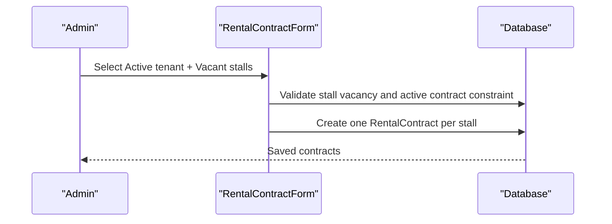

**Diagram sources**
- [forms.py:281-400](file://core/forms.py#L281-L400)
- [forms.py:652-725](file://core/forms.py#L652-L725)

**Section sources**
- [forms.py:281-400](file://core/forms.py#L281-L400)
- [forms.py:652-725](file://core/forms.py#L652-L725)

### Tenant Data Validation
Key validations in `TenantForm`:
- Duplicate prevention based on normalized full name
- Composition of `full_name` and `address` from split fields
- Legacy data migration for old composed fields into split fields
- Business type choices and ID type widget choices

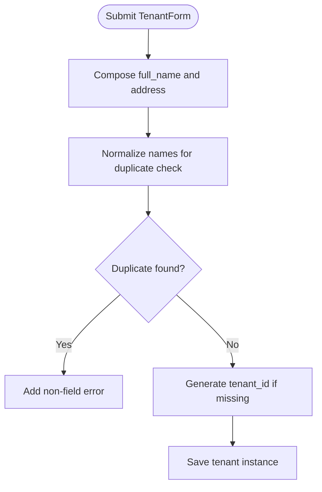

**Diagram sources**
- [forms.py:141-198](file://core/forms.py#L141-L198)

**Section sources**
- [forms.py:141-198](file://core/forms.py#L141-L198)

### File Upload Handling
- Valid ID images are uploaded via `valid_id_image` field.
- Uploaded files are stored under `tenant_ids/`.
- The form template provides hints and links to view existing uploads.

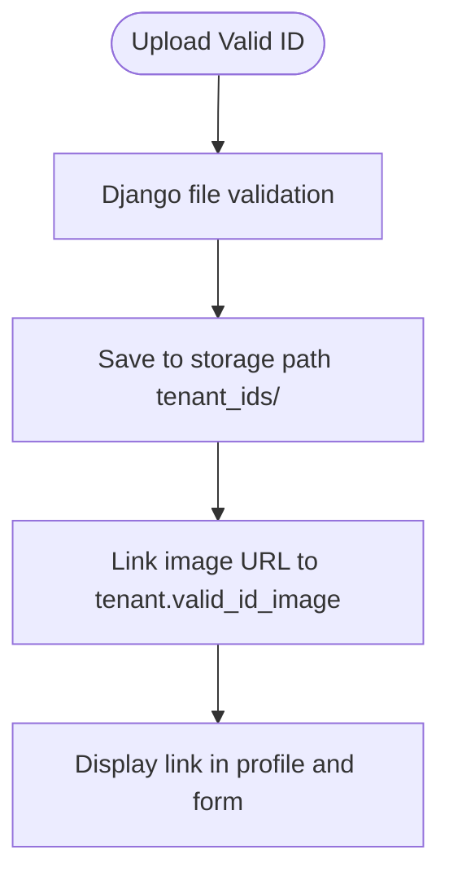

**Diagram sources**
- [models.py:137-139](file://core/models.py#L137-L139)
- [form.html:104-109](file://templates/tenants/form.html#L104-L109)

**Section sources**
- [models.py:137-139](file://core/models.py#L137-L139)
- [form.html:104-109](file://templates/tenants/form.html#L104-L109)

### Print and Export Functionality
- Tenant list print preview and PDF export respect current search and status filters.
- Individual tenant profile print preview and PDF export include contracts, billings, payments, and system settings.
- PDF generation tries WeasyPrint first, then xhtml2pdf fallback, then HTML preview with browser print instructions.

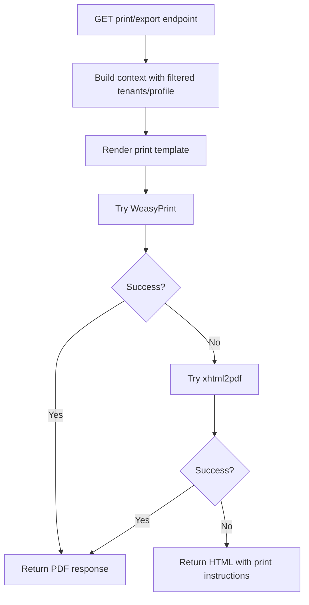

**Diagram sources**
- [tenants.py:366-467](file://core/views/tenants.py#L366-L467)
- [helpers.py:522-594](file://core/helpers.py#L522-L594)

**Section sources**
- [tenants.py:366-467](file://core/views/tenants.py#L366-L467)
- [helpers.py:522-594](file://core/helpers.py#L522-L594)

### Common Use Cases
- Search by name or ID:
  - Use the search input on the tenant list page; it queries `full_name`, `tenant_id`, and `business_name`.
- Filter by business type:
  - The current list view does not include a business type filter; use the general search or admin interface for advanced filtering.
- Generate tenant reports:
  - Use the print preview and PDF export endpoints to generate printable tenant lists and individual profiles.

**Section sources**
- [tenants.py:24-51](file://core/views/tenants.py#L24-L51)
- [tenants.py:366-467](file://core/views/tenants.py#L366-L467)

## Dependency Analysis
The tenant module depends on:
- Authentication and permissions decorators for access control
- Django ORM for querying and relationships
- HTMX for interactive list filtering and modal workflows
- PDF libraries for export functionality
- Audit logging for compliance and traceability

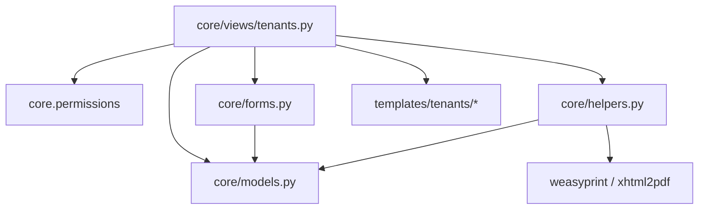

**Diagram sources**
- [tenants.py:1-16](file://core/views/tenants.py#L1-L16)
- [forms.py:11-15](file://core/forms.py#L11-L15)
- [helpers.py:522-594](file://core/helpers.py#L522-L594)

**Section sources**
- [tenants.py:1-16](file://core/views/tenants.py#L1-L16)
- [forms.py:11-15](file://core/forms.py#L11-L15)
- [helpers.py:522-594](file://core/helpers.py#L522-L594)

## Performance Considerations
- Pagination limits tenant list rendering to manageable page sizes.
- HTMX reduces full page reloads during search and filtering.
- Bulk deletion preloads payment and billing history to avoid N+1 queries.
- Database locking (`select_for_update`) is used conditionally based on backend support to prevent race conditions during bulk operations.
- PDF generation falls back gracefully to HTML print when system libraries are unavailable.

[No sources needed since this section provides general guidance]

## Troubleshooting Guide
- Duplicate tenant names:
  - The form normalizes and compares names to prevent duplicates; resolve by editing the existing record.
- Bulk delete blocked:
  - Tenants with recorded payments or partially paid billings cannot be hard-deleted; terminate them instead or void payments first.
- PDF export issues:
  - If WeasyPrint or xhtml2pdf fails, the system returns an HTML preview with instructions to use browser print-to-PDF.
- Missing sections or stall types:
  - Ensure market sections and stall types are configured before assigning stalls or creating contracts.

**Section sources**
- [forms.py:156-198](file://core/forms.py#L156-L198)
- [tenants.py:127-263](file://core/views/tenants.py#L127-L263)
- [helpers.py:522-594](file://core/helpers.py#L522-L594)

## Conclusion
The Tenant Management module provides a robust, auditable, and user-friendly system for managing market tenants. It integrates identity, contact, identification, and business data with stall assignments, contracts, billing, and payments. Status management controls visibility and eligibility, while search, filtering, bulk operations, and print/export features support daily operational needs. The design emphasizes data integrity, performance, and clear feedback for administrators.

[No sources needed since this section summarizes without analyzing specific files]