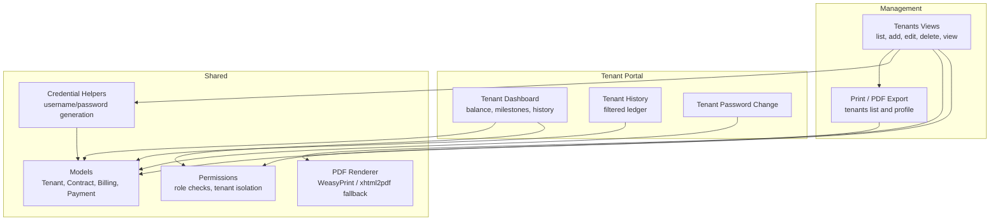
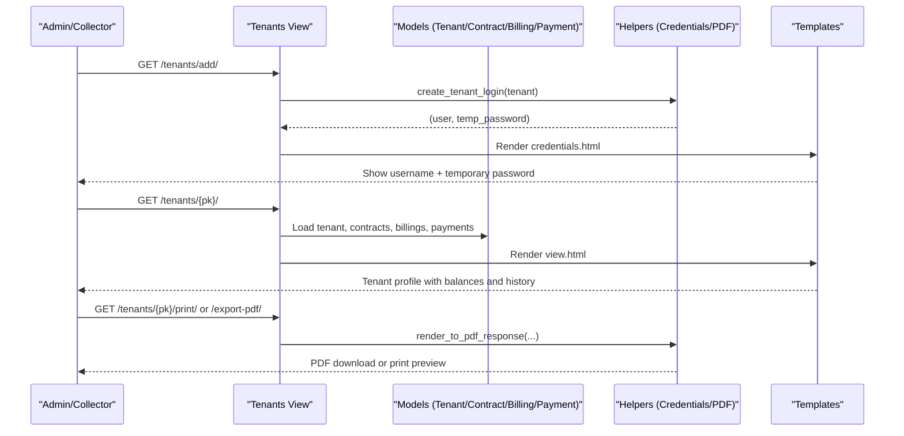
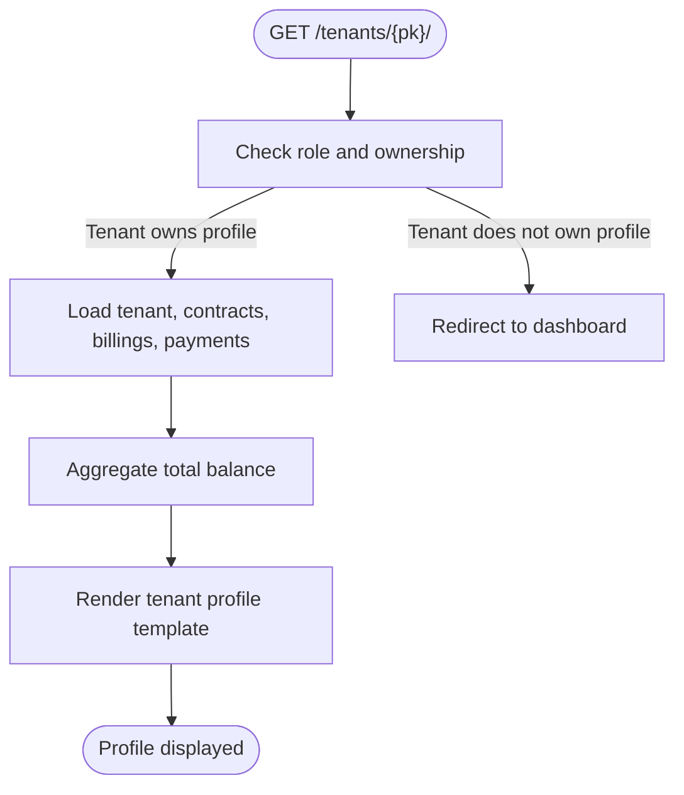
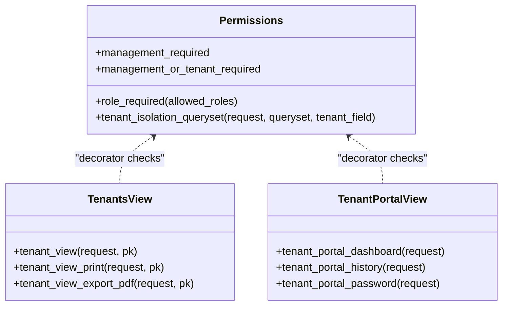
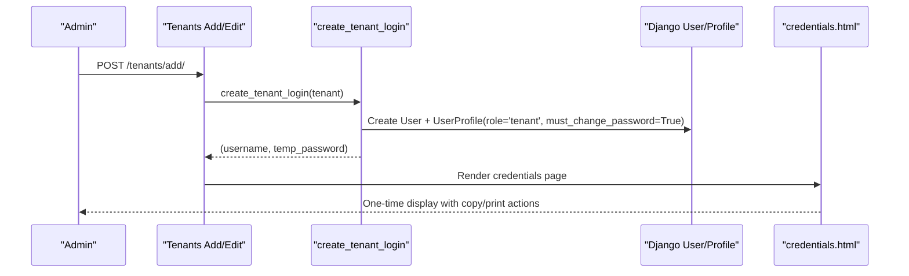
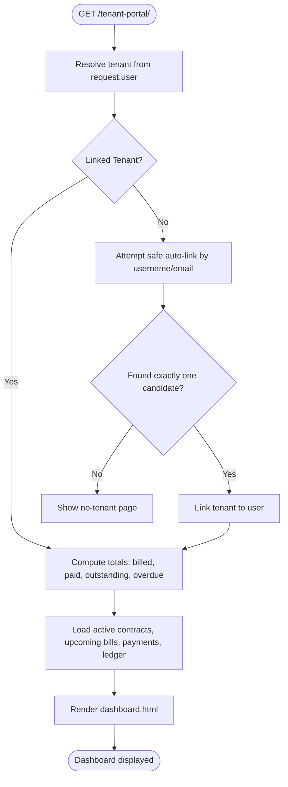
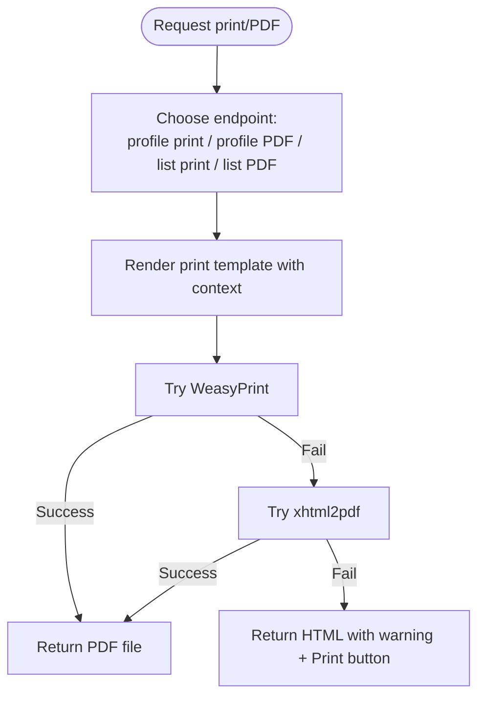
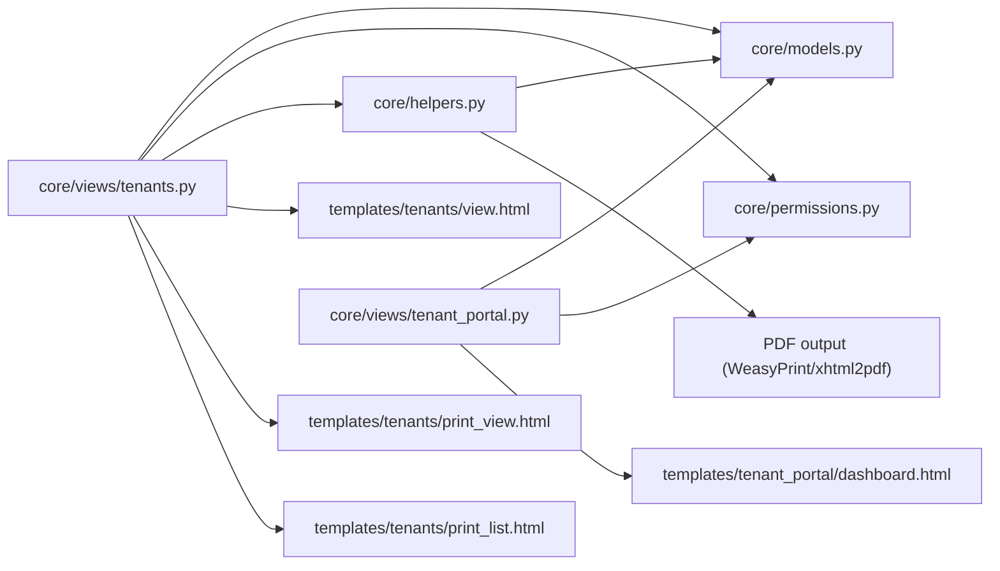

# Tenant Profile & View

<cite>
**Referenced Files in This Document**   
- [tenants.py](file://core/views/tenants.py)
- [tenant_portal.py](file://core/views/tenant_portal.py)
- [helpers.py](file://core/helpers.py)
- [models.py](file://core/models.py)
- [permissions.py](file://core/permissions.py)
- [view.html](file://templates/tenants/view.html)
- [credentials.html](file://templates/tenants/credentials.html)
- [_credentials_fragment.html](file://templates/tenants/_credentials_fragment.html)
- [print_view.html](file://templates/tenants/print_view.html)
- [print_list.html](file://templates/tenants/print_list.html)
- [dashboard.html](file://templates/tenant_portal/dashboard.html)
</cite>

## Table of Contents
1. [Introduction](#introduction)
2. [Project Structure](#project-structure)
3. [Core Components](#core-components)
4. [Architecture Overview](#architecture-overview)
5. [Detailed Component Analysis](#detailed-component-analysis)
6. [Dependency Analysis](#dependency-analysis)
7. [Performance Considerations](#performance-considerations)
8. [Troubleshooting Guide](#troubleshooting-guide)
9. [Conclusion](#conclusion)

## Introduction
This document explains the tenant profile view and related functionality in the market rental system. It covers:
- The tenant detail page showing complete profile information, contract history, billing records, and recent payments.
- The tenant isolation security model that prevents tenants from viewing other tenants’ data.
- The credentials management system for auto-generated login accounts, including username/password generation and secure sharing mechanisms.
- The integrated tenant portal dashboard showing total balance, active contracts, and financial summary.
- Print and PDF export functionality for tenant profiles and tenant lists.

The goal is to make these features understandable for both technical and non-technical users while providing precise code-level references.

## Project Structure
Tenant-related UI and logic are split between:
- Management views for administrators and collectors.
- Tenant portal views for self-service access by tenants.
- Shared helpers for credential generation, PDF rendering, and financial calculations.
- Templates for interactive web pages, print previews, and PDF exports.

**Diagram sources**
- [tenants.py:23-467](file://core/views/tenants.py#L23-L467)
- [tenant_portal.py:102-279](file://core/views/tenant_portal.py#L102-L279)
- [helpers.py:18-122](file://core/helpers.py#L18-L122)
- [helpers.py:522-594](file://core/helpers.py#L522-L594)
- [models.py:117-200](file://core/models.py#L117-L200)
- [permissions.py:61-97](file://core/permissions.py#L61-L97)

**Section sources**
- [tenants.py:23-467](file://core/views/tenants.py#L23-L467)
- [tenant_portal.py:102-279](file://core/views/tenant_portal.py#L102-L279)
- [helpers.py:18-122](file://core/helpers.py#L18-L122)
- [helpers.py:522-594](file://core/helpers.py#L522-L594)
- [models.py:117-200](file://core/models.py#L117-L200)
- [permissions.py:61-97](file://core/permissions.py#L61-L97)

## Core Components
- Tenant detail view: Displays personal/business info, assigned stalls, outstanding balance, billings, and recent payments. Enforces tenant isolation.
- Credentials management: Auto-generates a secure username and temporary password when creating a tenant; displays them once with copy-to-clipboard support.
- Tenant portal dashboard: Shows tenant’s total billed/paid, outstanding balance, upcoming dues, payment milestones, and recent ledger entries.
- Print and PDF export: Provides printable HTML and downloadable PDF for tenant profiles and tenant lists.

Key responsibilities:
- Data scoping: All queries are scoped to the current tenant when accessed by a tenant user.
- Security: Temporary passwords require change on first login; credentials are shown only once.
- Usability: HTMX-assisted modals, pagination, search, and filters for lists and history.

**Section sources**
- [tenants.py:266-287](file://core/views/tenants.py#L266-L287)
- [helpers.py:18-122](file://core/helpers.py#L18-L122)
- [tenant_portal.py:80-171](file://core/views/tenant_portal.py#L80-L171)
- [view.html:1-284](file://templates/tenants/view.html#L1-L284)
- [dashboard.html:1-302](file://templates/tenant_portal/dashboard.html#L1-L302)

## Architecture Overview
The tenant profile feature spans management and tenant-facing flows:

**Diagram sources**
- [tenants.py:54-81](file://core/views/tenants.py#L54-L81)
- [tenants.py:266-287](file://core/views/tenants.py#L266-L287)
- [tenants.py:419-467](file://core/views/tenants.py#L419-L467)
- [helpers.py:92-122](file://core/helpers.py#L92-L122)
- [helpers.py:522-594](file://core/helpers.py#L522-L594)

## Detailed Component Analysis

### Tenant Detail Page
The tenant detail page presents:
- Personal information: full name, address, registration date, valid ID type/number/image.
- Business and contact: business name/type, contact number, email.
- Emergency contact details.
- Outstanding balance card linked to unpaid billings.
- Assigned stalls table with stall number, section, monthly rent, and contract status.
- Recent payments table (last 10), linking to full payment list.
- Optional notes section.

Security:
- If the requester is a tenant, they can only view their own profile; otherwise, they are redirected to the dashboard.

Data flow:
- Loads tenant, contracts (with stall and section), billings, and recent payments.
- Computes total balance across all billings.

Actions:
- Edit via modal.
- Print preview and PDF export links.

**Diagram sources**
- [tenants.py:266-287](file://core/views/tenants.py#L266-L287)
- [view.html:1-284](file://templates/tenants/view.html#L1-L284)

**Section sources**
- [tenants.py:266-287](file://core/views/tenants.py#L266-L287)
- [view.html:1-284](file://templates/tenants/view.html#L1-L284)

### Tenant Isolation Security Model
The system enforces strict tenant isolation:
- Role-based decorators restrict access to management screens and tenant portal.
- For tenant-role users, explicit ownership checks ensure they cannot view other tenants’ data.
- The tenant portal requires a linked Tenant record; if missing, it attempts safe auto-linking based on username/email.

Key behaviors:
- `management_or_tenant_required` allows tenants to open certain management views but still scopes data to their own tenant.
- In the tenant detail view, if the logged-in tenant is not the owner, an error message is shown and the user is redirected.
- The tenant portal dashboard uses `tenant_required` and computes summaries strictly scoped to the tenant.

**Diagram sources**
- [permissions.py:61-97](file://core/permissions.py#L61-L97)
- [tenants.py:266-287](file://core/views/tenants.py#L266-L287)
- [tenant_portal.py:102-171](file://core/views/tenant_portal.py#L102-L171)

**Section sources**
- [permissions.py:61-97](file://core/permissions.py#L61-L97)
- [tenants.py:266-287](file://core/views/tenants.py#L266-L287)
- [tenant_portal.py:28-66](file://core/views/tenant_portal.py#L28-L66)
- [tenant_portal.py:102-171](file://core/views/tenant_portal.py#L102-L171)

### Credentials Management System
When a tenant is created:
- A secure username is derived from the tenant ID, ensuring uniqueness.
- A strong temporary password is generated using project validators.
- A Django User account is created and linked to the Tenant record.
- The UserProfile is set to role 'tenant' and marked to force password change on first login.
- The admin sees a one-time credentials page with copy-to-clipboard support.

Secure sharing:
- Temporary password is shown only once.
- Copy buttons allow copying username, password, or both.
- Printing is supported for physical handover.

**Diagram sources**
- [tenants.py:54-81](file://core/views/tenants.py#L54-L81)
- [helpers.py:18-122](file://core/helpers.py#L18-L122)
- [credentials.html:1-84](file://templates/tenants/credentials.html#L1-L84)
- [_credentials_fragment.html:1-51](file://templates/tenants/_credentials_fragment.html#L1-L51)

**Section sources**
- [tenants.py:54-81](file://core/views/tenants.py#L54-L81)
- [helpers.py:18-122](file://core/helpers.py#L18-L122)
- [credentials.html:1-84](file://templates/tenants/credentials.html#L1-L84)
- [_credentials_fragment.html:1-51](file://templates/tenants/_credentials_fragment.html#L1-L51)

### Integrated Tenant Portal Dashboard
The tenant portal provides a read-only, isolated dashboard:
- Account header with tenant identity, active stall, and business name.
- Balance summary hero card showing outstanding amount and overdue count.
- Metric tiles: total paid, total billed, next due date, stall number.
- Upcoming and pending due dates.
- Payment milestones: fully paid and partial payments.
- Recent transactions from the ledger with debit/credit/balance columns.

Data computation:
- Aggregates total billed, total paid, outstanding balance, overdue balance/count.
- Loads active contracts and recent ledger entries.

**Diagram sources**
- [tenant_portal.py:28-66](file://core/views/tenant_portal.py#L28-L66)
- [tenant_portal.py:80-171](file://core/views/tenant_portal.py#L80-L171)
- [dashboard.html:1-302](file://templates/tenant_portal/dashboard.html#L1-L302)

**Section sources**
- [tenant_portal.py:80-171](file://core/views/tenant_portal.py#L80-L171)
- [dashboard.html:1-302](file://templates/tenant_portal/dashboard.html#L1-L302)

### Print and PDF Export Functionality
For tenant profiles and lists:
- Print preview renders a clean, print-friendly HTML layout with headers, tables, and signature lines.
- PDF export uses a helper that tries WeasyPrint first, then falls back to xhtml2pdf, and finally returns an HTML preview with a browser Print button if neither library works.
- Filters (search/status) applied to the list are preserved in print/export URLs.

**Diagram sources**
- [tenants.py:366-416](file://core/views/tenants.py#L366-L416)
- [tenants.py:419-467](file://core/views/tenants.py#L419-L467)
- [helpers.py:522-594](file://core/helpers.py#L522-L594)
- [print_view.html:1-57](file://templates/tenants/print_view.html#L1-L57)
- [print_list.html:1-67](file://templates/tenants/print_list.html#L1-L67)

**Section sources**
- [tenants.py:366-416](file://core/views/tenants.py#L366-L416)
- [tenants.py:419-467](file://core/views/tenants.py#L419-L467)
- [helpers.py:522-594](file://core/helpers.py#L522-L594)
- [print_view.html:1-57](file://templates/tenants/print_view.html#L1-L57)
- [print_list.html:1-67](file://templates/tenants/print_list.html#L1-L67)

## Dependency Analysis
The following diagram maps key dependencies among views, helpers, models, permissions, and templates:

**Diagram sources**
- [tenants.py:1-16](file://core/views/tenants.py#L1-L16)
- [tenant_portal.py:1-17](file://core/views/tenant_portal.py#L1-L17)
- [helpers.py:1-15](file://core/helpers.py#L1-L15)
- [models.py:117-200](file://core/models.py#L117-L200)
- [permissions.py:61-97](file://core/permissions.py#L61-L97)

**Section sources**
- [tenants.py:1-16](file://core/views/tenants.py#L1-L16)
- [tenant_portal.py:1-17](file://core/views/tenant_portal.py#L1-L17)
- [helpers.py:1-15](file://core/helpers.py#L1-L15)
- [models.py:117-200](file://core/models.py#L117-L200)
- [permissions.py:61-97](file://core/permissions.py#L61-L97)

## Performance Considerations
- Use select_related for foreign keys (contracts with stall/section, billings/payments with stall/contract) to reduce N+1 queries.
- Aggregate balances at the database level instead of computing in Python.
- Limit recent payments to a fixed slice to avoid large result sets on profile pages.
- Prefer server-side filtering and pagination for lists and history.
- PDF generation may be CPU-intensive; consider caching or background jobs for large reports.

[No sources needed since this section provides general guidance]

## Troubleshooting Guide
Common issues and resolutions:
- Tenant cannot see another tenant’s profile:
  - Ensure the user is authenticated and has the correct role.
  - Verify the ownership check in the tenant view; tenants are redirected if accessing another tenant’s profile.
- Tenant portal shows “no tenant” page:
  - Confirm the Tenant record is linked to the user. If missing, the system attempts safe auto-linking by username/email; if ambiguous, manual correction is required.
- Temporary password not working:
  - Ensure the account was created through the tenant creation flow which forces password change on first login.
  - Verify the UserProfile flag requiring password change is cleared after successful change.
- PDF export fails:
  - Check environment libraries: WeasyPrint requires system libs; xhtml2pdf is a pure-Python fallback. If both fail, use the browser Print → Save as PDF option presented in the fallback HTML.

**Section sources**
- [tenants.py:266-287](file://core/views/tenants.py#L266-L287)
- [tenant_portal.py:28-66](file://core/views/tenant_portal.py#L28-L66)
- [helpers.py:522-594](file://core/helpers.py#L522-L594)

## Conclusion
The tenant profile and view system provides a comprehensive, secure, and user-friendly experience:
- Administrators can manage tenants, generate secure credentials, and export printable documents.
- Tenants have a restricted, isolated portal to monitor their balances, upcoming dues, and transaction history.
- Strong security controls prevent cross-tenant data exposure.
- Robust print and PDF export options accommodate both digital and physical workflows.

[No sources needed since this section summarizes without analyzing specific files]