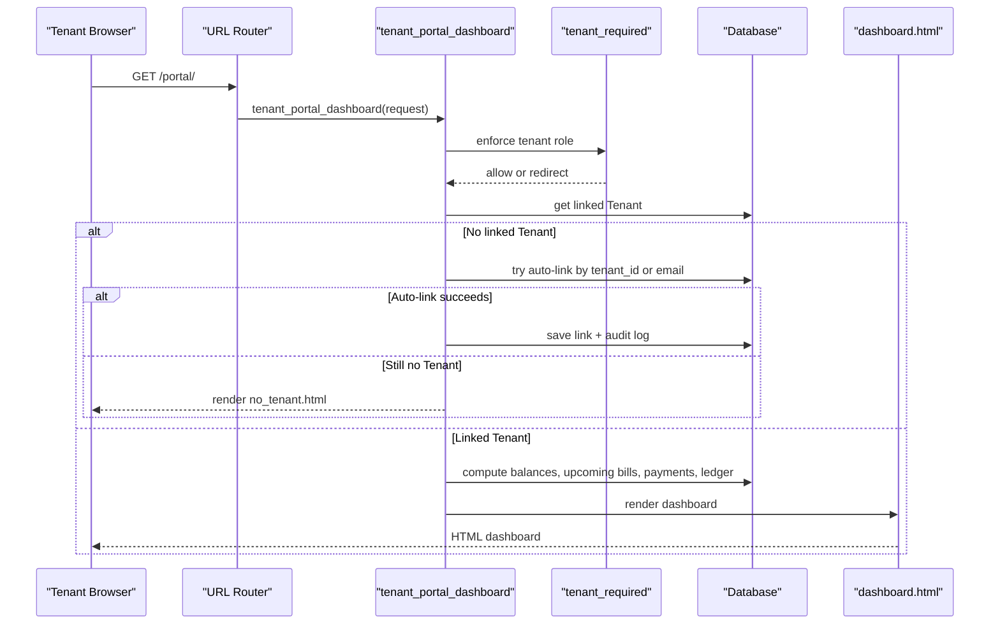
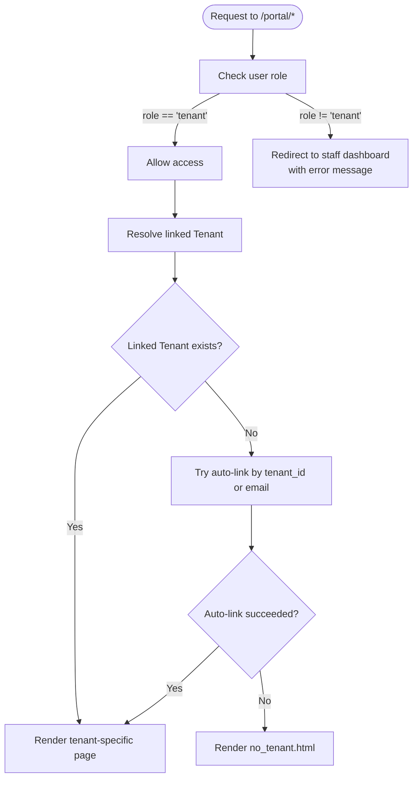
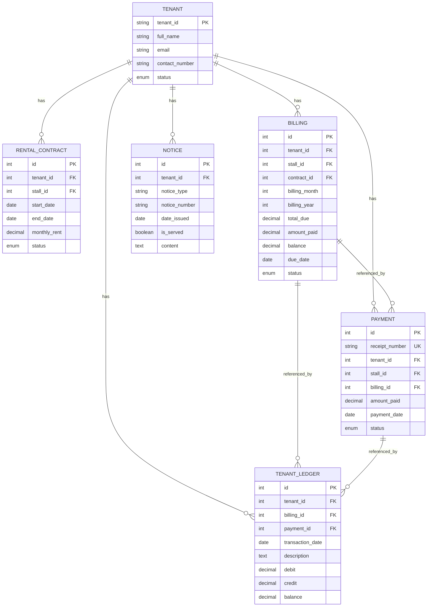
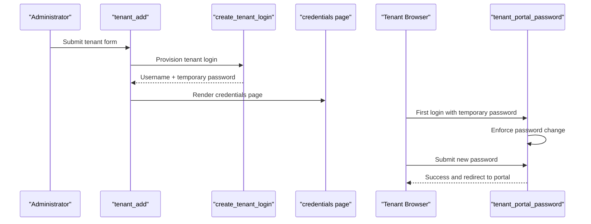
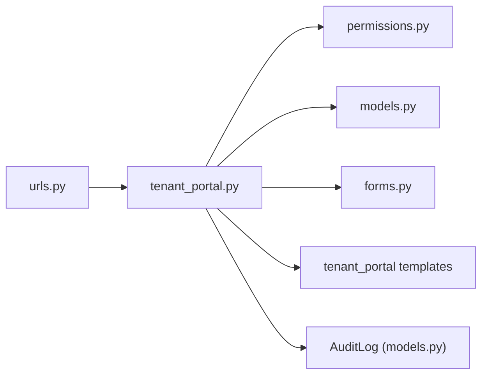

# Tenant Portal

<cite>
**Referenced Files in This Document**   
- [tenant_portal.py](file://core/views/tenant_portal.py)
- [models.py](file://core/models.py)
- [permissions.py](file://core/permissions.py)
- [forms.py](file://core/forms.py)
- [urls.py](file://core/urls.py)
- [dashboard.html](file://templates/tenant_portal/dashboard.html)
- [history.html](file://templates/tenant_portal/history.html)
- [_history_table.html](file://templates/tenant_portal/_history_table.html)
- [no_tenant.html](file://templates/tenant_portal/no_tenant.html)
- [password.html](file://templates/tenant_portal/password.html)
- [notices.py](file://core/views/notices.py)
- [tenants.py](file://core/views/tenants.py)
- [_credentials_fragment.html](file://templates/tenants/_credentials_fragment.html)
</cite>

## Table of Contents
1. [Introduction](#introduction)
2. [Project Structure](#project-structure)
3. [Core Components](#core-components)
4. [Architecture Overview](#architecture-overview)
5. [Detailed Component Analysis](#detailed-component-analysis)
6. [Dependency Analysis](#dependency-analysis)
7. [Performance Considerations](#performance-considerations)
8. [Troubleshooting Guide](#troubleshooting-guide)
9. [Conclusion](#conclusion)

## Introduction
The Tenant Portal is a self-service, read-only interface for stallholders to review their rental account without granting administrative control. It provides:
- A personal dashboard with account overview, outstanding balance, upcoming due dates, payment milestones, and recent ledger activity.
- A paginated transaction history page with filtering by type, year, month, status, and free-text search.
- A tenant-only password change flow that can be enforced when an administrator-provided temporary password is still active.
- Isolation so tenants see only their own data; staff roles are explicitly excluded from the portal.

Administrative users manage tenants, contracts, billings, payments, notices, reports, and system settings through the main staff dashboard. The tenant portal does not expose those management functions.

## Project Structure
The tenant portal is implemented as a small set of views, templates, and shared models:
- Views: `core/views/tenant_portal.py` defines the dashboard, history, and password endpoints.
- Templates: `templates/tenant_portal/*` render the user-facing pages.
- Models: `core/models.py` defines `Tenant`, `Billing`, `Payment`, `TenantLedger`, `Notice`, and related entities.
- Permissions: `core/permissions.py` enforces tenant-only access and role checks.
- Forms: `core/forms.py` provides the tenant password change form.
- URLs: `core/urls.py` maps `/portal/`, `/portal/history/`, and `/portal/password/`.

```mermaid
graph TB
subgraph "Tenant Portal"
TP_Dashboard["tenant_portal_dashboard"]
TP_History["tenant_portal_history"]
TP_Password["tenant_portal_password"]
end
subgraph "Templates"
T_Dashboard["dashboard.html"]
T_History["history.html"]
T_Table["_history_table.html"]
T_NoTenant["no_tenant.html"]
T_Password["password.html"]
end
subgraph "Models"
M_Tenant["Tenant"]
M_Billing["Billing"]
M_Payment["Payment"]
M_Ledger["TenantLedger"]
M_Contract["RentalContract"]
M_Notice["Notice"]
end
subgraph "Permissions & Forms"
P_TenantRequired["tenant_required decorator"]
F_Password["TenantPasswordChangeForm"]
end
TP_Dashboard --> T_Dashboard
TP_History --> T_History
TP_History --> T_Table
TP_Password --> T_Password
TP_Dashboard --> M_Tenant
TP_Dashboard --> M_Billing
TP_Dashboard --> M_Payment
TP_Dashboard --> M_Ledger
TP_Dashboard --> M_Contract
TP_History --> M_Ledger
TP_Password --> F_Password
TP_Dashboard --> P_TenantRequired
TP_History --> P_TenantRequired
TP_Password --> P_TenantRequired
```

**Diagram sources**
- [tenant_portal.py:102-171](file://core/views/tenant_portal.py#L102-L171)
- [tenant_portal.py:174-239](file://core/views/tenant_portal.py#L174-L239)
- [tenant_portal.py:242-279](file://core/views/tenant_portal.py#L242-L279)
- [dashboard.html:1-302](file://templates/tenant_portal/dashboard.html#L1-L302)
- [history.html:1-70](file://templates/tenant_portal/history.html#L1-L70)
- [_history_table.html:1-126](file://templates/tenant_portal/_history_table.html#L1-L126)
- [password.html:1-74](file://templates/tenant_portal/password.html#L1-L74)
- [models.py:117-301](file://core/models.py#L117-L301)
- [permissions.py:102-124](file://core/permissions.py#L102-L124)
- [forms.py:631-649](file://core/forms.py#L631-L649)

**Section sources**
- [tenant_portal.py:1-279](file://core/views/tenant_portal.py#L1-L279)
- [urls.py:56-63](file://core/urls.py#L56-L63)

## Core Components
### Tenant Dashboard
The dashboard is the tenant’s primary landing page after login. It shows:
- Account header with tenant name, tenant ID, active stall, business name, and monthly rent.
- Balance summary including outstanding balance, overdue count, total billed, total paid, and a progress indicator.
- Upcoming and pending due dates, with fallback to overdue items if nothing is scheduled ahead.
- Payment milestones separating fully paid and partial payments.
- Recent transactions pulled from the tenant ledger.

The view computes totals from billing and payment records scoped to the logged-in tenant and renders them into the dashboard template.

**Section sources**
- [tenant_portal.py:80-99](file://core/views/tenant_portal.py#L80-L99)
- [tenant_portal.py:102-171](file://core/views/tenant_portal.py#L102-L171)
- [dashboard.html:11-93](file://templates/tenant_portal/dashboard.html#L11-L93)
- [dashboard.html:95-155](file://templates/tenant_portal/dashboard.html#L95-L155)
- [dashboard.html:157-242](file://templates/tenant_portal/dashboard.html#L157-L242)
- [dashboard.html:244-302](file://templates/tenant_portal/dashboard.html#L244-L302)

### Transaction History
The history page displays a paginated ledger of all charges and payments for the tenant. It supports:
- Type filter: billing charges vs payments.
- Year and month filters.
- Status filter: Paid, Partial, Unpaid, Overdue.
- Free-text search across description, stall number, and receipt number.
- HTMX-powered live search and filter updates without full page reloads.
- Links to payment receipts and billing views where available.

The view builds a filtered queryset over `TenantLedger`, applies pagination, and returns either the full history page or just the table fragment depending on whether the request is HTMX.

**Section sources**
- [tenant_portal.py:174-239](file://core/views/tenant_portal.py#L174-L239)
- [history.html:11-67](file://templates/tenant_portal/history.html#L11-L67)
- [_history_table.html:5-43](file://templates/tenant_portal/_history_table.html#L5-L43)
- [_history_table.html:45-126](file://templates/tenant_portal/_history_table.html#L45-L126)

### Password Management
Tenants can change their password through a dedicated portal page. If the user profile has `must_change_password` set, the dashboard and history views redirect to this page before allowing portal use. On successful submission:
- Django’s built-in password validation is used via the tenant password change form.
- The session remains valid after the password update.
- The profile flag is cleared.
- An audit log entry records the password change.

**Section sources**
- [tenant_portal.py:74-78](file://core/views/tenant_portal.py#L74-L78)
- [tenant_portal.py:242-279](file://core/views/tenant_portal.py#L242-L279)
- [forms.py:631-649](file://core/forms.py#L631-L649)
- [password.html:9-17](file://templates/tenant_portal/password.html#L9-L17)
- [password.html:19-64](file://templates/tenant_portal/password.html#L19-L64)

### No-Tenant State
If a tenant-role login exists but no linked `Tenant` record is found, the portal renders a guidance page explaining how to fix the situation. It also documents the automatic linking behavior when the username matches a tenant ID or the email matches an unlinked tenant.

**Section sources**
- [tenant_portal.py:28-71](file://core/views/tenant_portal.py#L28-L71)
- [no_tenant.html:9-28](file://templates/tenant_portal/no_tenant.html#L9-L28)
- [no_tenant.html:30-67](file://templates/tenant_portal/no_tenant.html#L30-L67)
- [no_tenant.html:69-77](file://templates/tenant_portal/no_tenant.html#L69-L77)

## Architecture Overview
The tenant portal follows a clear separation between authentication, authorization, data scoping, and presentation:

**Diagram sources**
- [tenant_portal.py:102-171](file://core/views/tenant_portal.py#L102-L171)
- [permissions.py:102-118](file://core/permissions.py#L102-L118)
- [dashboard.html:1-302](file://templates/tenant_portal/dashboard.html#L1-L302)

## Detailed Component Analysis

### Tenant Authentication and Access Control
The portal is intentionally separate from staff access:
- Only users with the `tenant` role may access portal endpoints.
- Non-tenant accounts, including administrators, are redirected to the staff dashboard with an explanatory message.
- The decorator does not grant superusers special portal access because the portal is designed to show only the data tied to the logged-in tenant record.

This design ensures tenants cannot accidentally reach administrative screens and prevents cross-tenant data exposure at the route level.

**Diagram sources**
- [permissions.py:102-124](file://core/permissions.py#L102-L124)
- [tenant_portal.py:28-71](file://core/views/tenant_portal.py#L28-L71)
- [tenant_portal.py:102-171](file://core/views/tenant_portal.py#L102-L171)

**Section sources**
- [permissions.py:6-30](file://core/permissions.py#L6-L30)
- [permissions.py:102-124](file://core/permissions.py#L102-L124)
- [tenant_portal.py:102-112](file://core/views/tenant_portal.py#L102-L112)

### Tenant Data Model Relationships
The portal reads from several core models:

**Diagram sources**
- [models.py:117-301](file://core/models.py#L117-L301)

**Section sources**
- [models.py:117-301](file://core/models.py#L117-L301)

### Tenant Portal Navigation Examples
Below are practical navigation flows based on the implemented routes and templates.

#### Example: Viewing the Tenant Dashboard
1. Log in with a tenant-role account.
2. Navigate to `/portal/`.
3. Review:
   - Account header with tenant identity and active stall.
   - Outstanding balance and overdue count.
   - Upcoming due dates.
   - Fully paid and partial payment milestones.
   - Recent ledger entries.

Relevant paths:
- Route: `/portal/`
- View: `tenant_portal_dashboard`
- Template: `dashboard.html`

**Section sources**
- [urls.py:60-63](file://core/urls.py#L60-L63)
- [tenant_portal.py:102-171](file://core/views/tenant_portal.py#L102-L171)
- [dashboard.html:11-93](file://templates/tenant_portal/dashboard.html#L11-L93)

#### Example: Viewing Bill Details from History
1. From the dashboard, click “Transaction History.”
2. Use filters to narrow to billing charges or payments.
3. Click a billing reference to open the billing view.

Relevant paths:
- Route: `/portal/history/`
- View: `tenant_portal_history`
- Template: `history.html` and `_history_table.html`
- Billing view route: `/billing/<pk>/`

**Section sources**
- [tenant_portal.py:174-239](file://core/views/tenant_portal.py#L174-L239)
- [history.html:28-67](file://templates/tenant_portal/history.html#L28-L67)
- [_history_table.html:67-96](file://templates/tenant_portal/_history_table.html#L67-L96)
- [urls.py:122-135](file://core/urls.py#L122-L135)

#### Example: Printing or Viewing a Payment Receipt
1. Open the transaction history.
2. For a payment row, click “Receipt” or the receipt number.
3. The system opens the payment receipt view or print endpoint.

Relevant paths:
- Payment receipt route: `/payments/<pk>/receipt/`
- Payment print receipt route: `/payments/<pk>/print/`

**Section sources**
- [_history_table.html:86-93](file://templates/tenant_portal/_history_table.html#L86-L93)
- [urls.py:137-150](file://core/urls.py#L137-L150)

#### Example: Acknowledging Notices
Notices are managed by staff and viewed by tenants:
- Staff create, print, export, and mark notices as served.
- Tenants can list and print their own notices.
- There is no tenant-facing acknowledgment action in the current implementation; marking as served is an administrative operation.

Relevant paths:
- Notice list route: `/notices/`
- Notice add route: `/notices/add/`
- Notice print route: `/notices/<pk>/print/`
- Notice mark served route: `/notices/<pk>/mark-served/`

**Section sources**
- [notices.py:21-66](file://core/views/notices.py#L21-L66)
- [notices.py:69-88](file://core/views/notices.py#L69-L88)
- [notices.py:91-118](file://core/views/notices.py#L91-L118)
- [notices.py:121-205](file://core/views/notices.py#L121-L205)
- [urls.py:177-184](file://core/urls.py#L177-L184)

### Limited Functionality for Tenants Versus Administrative Users
| Area | Tenant Portal | Administrative User |
|---|---|---|
| Login | Tenant role only | Admin, collector, cashier, supervisor, treasurer |
| Dashboard | Personal balance, upcoming dues, milestones, recent ledger | Full market dashboard |
| Bills | Read-only via history and links to billing view | Create, generate, edit, collect, print, export |
| Payments | Read-only receipts and links | Record, void, batch receipt, export |
| Notices | View and print own notices | Create, print, export, mark served |
| Contracts | Read-only context on dashboard | Create, terminate, bulk assign |
| Settings | Not available | Configure market settings, penalties, terms |
| Reports | Not available | Daily, weekly, monthly, annual, occupancy, overdue |
| Ledger | Read-only recent entries | Full ledger list, print, export |

**Section sources**
- [permissions.py:6-30](file://core/permissions.py#L6-L30)
- [permissions.py:61-87](file://core/permissions.py#L61-L87)
- [urls.py:56-198](file://core/urls.py#L56-L198)

### Tenant Onboarding and Credential Management
Onboarding is performed by staff:
- Administrators create a tenant through the tenant creation flow.
- The system automatically provisions a portal login with a generated username and temporary password.
- The credentials page shows the username and temporary password once and instructs the administrator to share them securely.
- On first portal access, if the account still requires a password change, the tenant is forced to set a new password.

**Diagram sources**
- [tenants.py:54-81](file://core/views/tenants.py#L54-L81)
- [_credentials_fragment.html:1-36](file://templates/tenants/_credentials_fragment.html#L1-L36)
- [tenant_portal.py:74-78](file://core/views/tenant_portal.py#L74-L78)
- [tenant_portal.py:242-279](file://core/views/tenant_portal.py#L242-L279)

**Section sources**
- [tenants.py:54-81](file://core/views/tenants.py#L54-L81)
- [_credentials_fragment.html:1-36](file://templates/tenants/_credentials_fragment.html#L1-L36)
- [tenant_portal.py:74-78](file://core/views/tenant_portal.py#L74-L78)
- [tenant_portal.py:242-279](file://core/views/tenant_portal.py#L242-L279)

### Self-Service Account Maintenance Features
Currently, the tenant portal supports:
- Viewing personal account information and financial summaries.
- Filtering and searching transaction history.
- Changing their own password.
- Viewing and printing their own notices.

It does not currently support:
- Editing personal profile fields such as address or contact number.
- Managing contracts, stalls, or billing directly.
- Creating or acknowledging notices.
- Accessing reports, settings, or administrative tools.

These limitations are intentional to keep the portal read-only and secure.

**Section sources**
- [tenant_portal.py:102-279](file://core/views/tenant_portal.py#L102-L279)
- [notices.py:21-66](file://core/views/notices.py#L21-L66)
- [forms.py:631-649](file://core/forms.py#L631-L649)

## Dependency Analysis
The tenant portal depends on:
- Role-based decorators to restrict access.
- Tenant resolution helpers to map the authenticated user to a `Tenant` record.
- Financial models for computing balances and rendering history.
- Audit logging for security-sensitive actions like password changes and auto-linking.

**Diagram sources**
- [urls.py:54-63](file://core/urls.py#L54-L63)
- [tenant_portal.py:1-18](file://core/views/tenant_portal.py#L1-L18)
- [tenant_portal.py:102-279](file://core/views/tenant_portal.py#L102-L279)
- [permissions.py:102-124](file://core/permissions.py#L102-L124)
- [models.py:304-316](file://core/models.py#L304-L316)

**Section sources**
- [urls.py:54-63](file://core/urls.py#L54-L63)
- [tenant_portal.py:1-18](file://core/views/tenant_portal.py#L1-L18)
- [permissions.py:102-124](file://core/permissions.py#L102-L124)

## Performance Considerations
- The dashboard uses `select_related` to reduce database queries for active contracts, stalls, billings, payments, and ledger entries.
- History filtering applies query-level constraints before pagination, limiting the dataset returned to the browser.
- HTMX is used for live search and filter updates, reducing full-page reloads and improving responsiveness.
- Totals are computed using aggregated sums rather than loading every row into Python memory.

Recommendations:
- Keep `select_related` usage consistent across tenant-scoped queries.
- Monitor query performance as billing and payment volumes grow.
- Consider indexing frequently filtered columns such as `transaction_date`, `status`, and foreign keys if query latency increases.

[No sources needed since this section provides general guidance]

## Troubleshooting Guide
### Tenant Cannot See Any Data
Symptoms:
- The portal shows the “Account Not Linked” page.
- The tenant sees no dashboard metrics.

Likely causes:
- The tenant-role login was created outside the canonical tenant creation flow.
- The `Tenant.user` foreign key was never set.

Resolution steps:
- Verify the tenant record exists and is Active.
- Re-create or regenerate credentials through the tenant management flow.
- Confirm that the username matches the tenant ID or that the email matches an unlinked tenant; the portal will attempt automatic linking on first access.

**Section sources**
- [tenant_portal.py:28-71](file://core/views/tenant_portal.py#L28-L71)
- [no_tenant.html:30-67](file://templates/tenant_portal/no_tenant.html#L30-L67)

### Tenant Is Forced to Change Password
Symptoms:
- The tenant is redirected to the password change page immediately after login.
- A warning indicates a temporary password is in use.

Likely causes:
- The user profile has `must_change_password` set.
- The account was provisioned with a temporary password during tenant creation.

Resolution steps:
- Have the tenant submit a new password on the portal password page.
- After successful change, the flag is cleared and the tenant can access the dashboard normally.

**Section sources**
- [tenant_portal.py:74-78](file://core/views/tenant_portal.py#L74-L78)
- [tenant_portal.py:242-279](file://core/views/tenant_portal.py#L242-L279)
- [password.html:9-17](file://templates/tenant_portal/password.html#L9-L17)

### Non-Tenant User Accidentally Opens the Portal
Symptoms:
- A staff user receives an error message and is redirected to the dashboard.

Likely causes:
- The user is not assigned the `tenant` role.

Resolution steps:
- Use the staff dashboard for administrative tasks.
- Do not grant the `tenant` role to staff unless they are also acting as tenants.

**Section sources**
- [permissions.py:102-118](file://core/permissions.py#L102-L118)

### Notice Acknowledgment Confusion
Symptoms:
- A tenant expects to acknowledge or sign a notice in the portal.

Reality:
- Notices are created and marked as served by staff.
- Tenants can view and print their own notices but do not have an acknowledgment action in the current implementation.

Resolution steps:
- Staff should mark notices as served after delivery.
- Communicate to tenants that viewing or printing a notice is not the same as formal acknowledgment.

**Section sources**
- [notices.py:69-118](file://core/views/notices.py#L69-L118)
- [notices.py:121-205](file://core/views/notices.py#L121-L205)

## Conclusion
The Tenant Portal provides a focused, secure, and isolated experience for stallholders to monitor their rental obligations. It emphasizes transparency: tenants can see their balances, upcoming due dates, payment milestones, and complete transaction history without gaining administrative capabilities. Staff retain full control over tenant onboarding, credential provisioning, billing, payments, notices, and system configuration.

For best results:
- Always onboard tenants through the tenant creation flow to ensure proper login provisioning.
- Ensure tenants change their temporary passwords promptly.
- Use notices for official communication while keeping acknowledgment workflows under staff control.
- Treat the portal as read-only; any operational changes belong in the staff dashboard.

[No sources needed since this section summarizes without analyzing specific files]