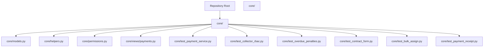
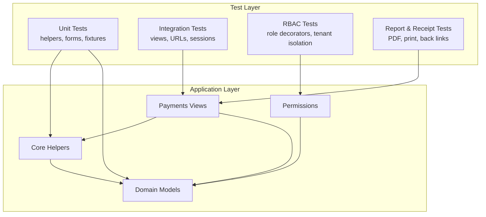
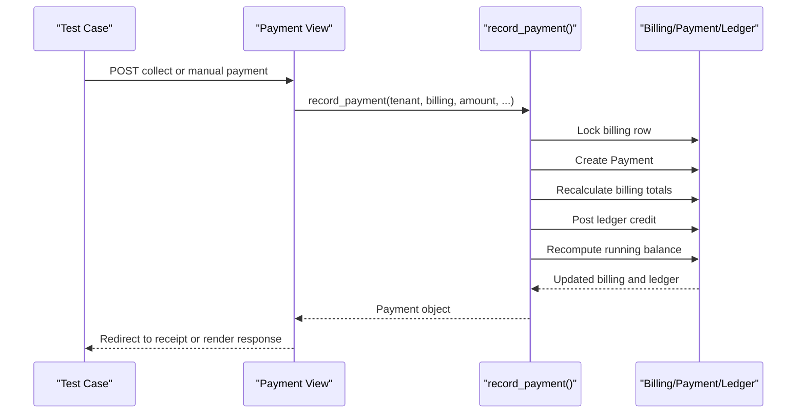
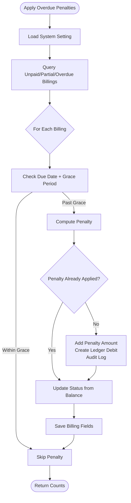
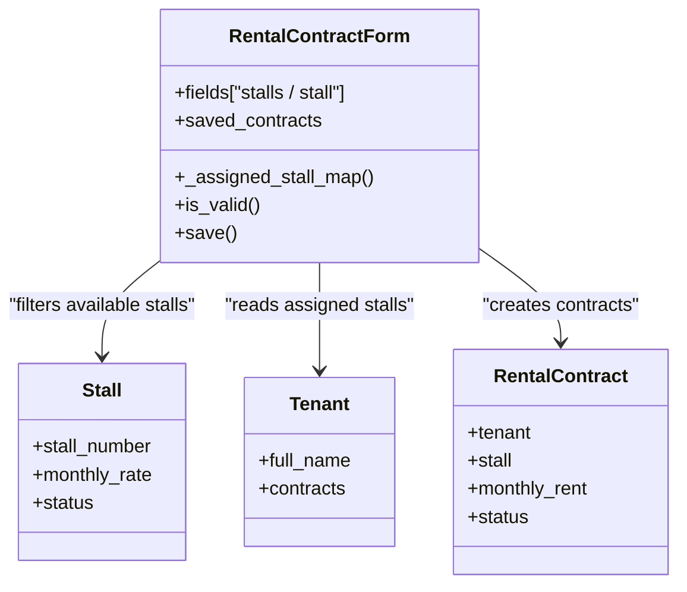
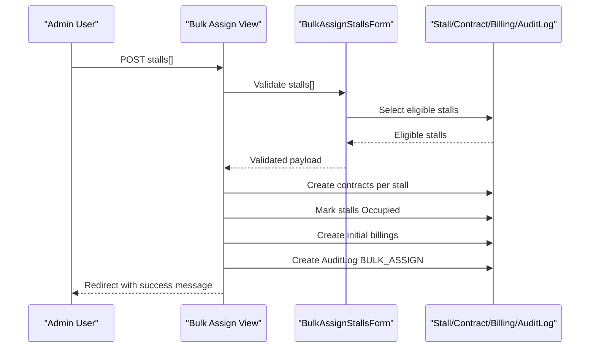
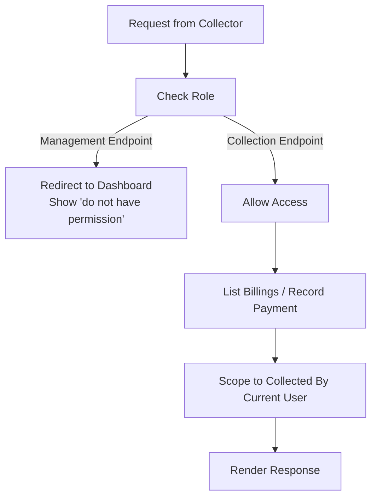
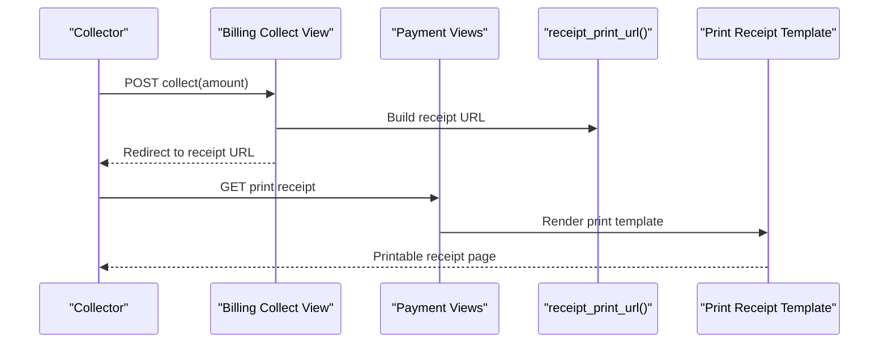
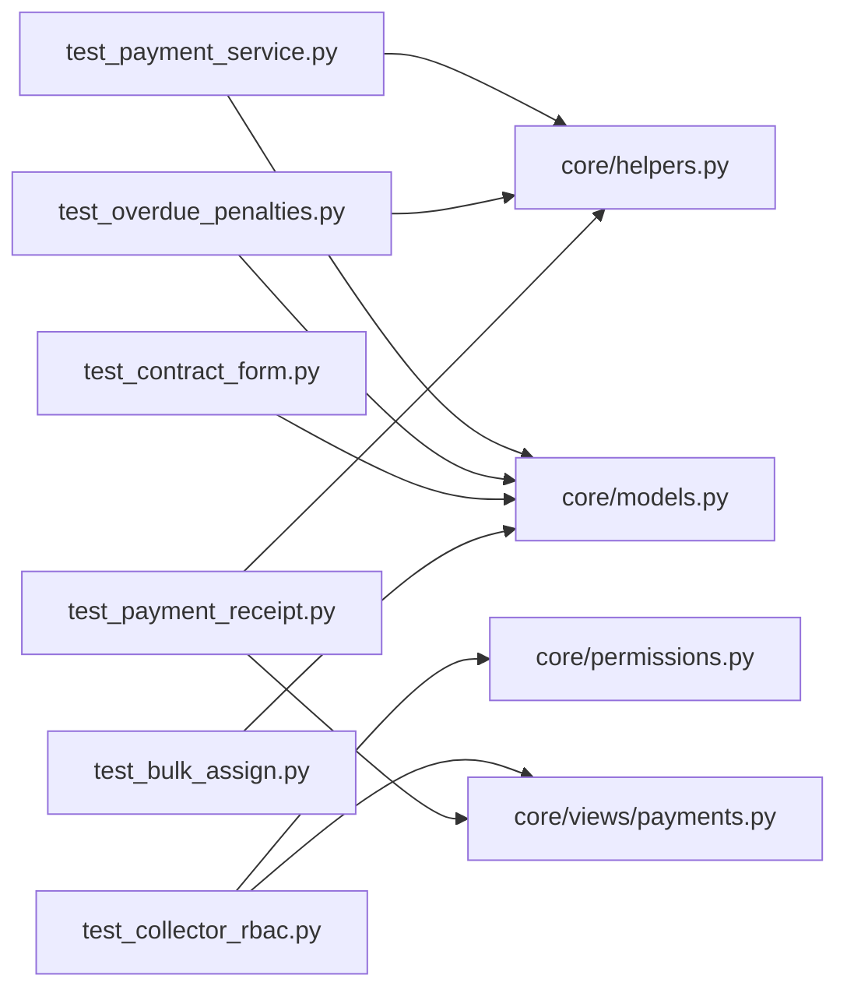

# Testing Strategy

<cite>
**Referenced Files in This Document**
- [README.MD](file://README.MD)
- [requirements.txt](file://requirements.txt)
- [market_rental/settings.py](file://market_rental/settings.py)
- [core/models.py](file://core/models.py)
- [core/helpers.py](file://core/helpers.py)
- [core/permissions.py](file://core/permissions.py)
- [core/views/payments.py](file://core/views/payments.py)
- [core/test_payment_service.py](file://core/test_payment_service.py)
- [core/test_collector_rbac.py](file://core/test_collector_rbac.py)
- [core/test_overdue_penalties.py](file://core/test_overdue_penalties.py)
- [core/test_contract_form.py](file://core/test_contract_form.py)
- [core/test_bulk_assign.py](file://core/test_bulk_assign.py)
- [core/test_payment_receipt.py](file://core/test_payment_receipt.py)
</cite>

## Table of Contents
1. [Introduction](#introduction)
2. [Project Structure](#project-structure)
3. [Core Components](#core-components)
4. [Architecture Overview](#architecture-overview)
5. [Detailed Component Analysis](#detailed-component-analysis)
6. [Dependency Analysis](#dependency-analysis)
7. [Performance Considerations](#performance-considerations)
8. [Troubleshooting Guide](#troubleshooting-guide)
9. [Conclusion](#conclusion)
10. [Appendices](#appendices)

## Introduction
This document defines the testing strategy for the Public Market Rental and Collection Management System. It explains how tests are organized, which patterns are used for unit, integration, and end-to-end scenarios, and how test data is managed. It also documents coverage targets for critical business rules such as stall assignment constraints, billing generation, payment settlement, overdue penalties, permission enforcement, and receipt printing. Finally, it outlines continuous integration expectations, automated testing pipelines, quality assurance practices, performance and load testing considerations, and regression testing strategies.

The system is a Django application with role-based access control, financial calculations using `Decimal`, printable receipts, and audit logging. Tests should therefore cover both functional correctness and financial consistency.

**Section sources**
- [README.MD:1-518](file://README.MD#L1-L518)

## Project Structure
Tests are primarily located under the `core` app as individual files named after the feature or scenario they validate. The repository also contains placeholder `tests.py` files in `accounts` and `core`, but meaningful coverage lives in dedicated test modules.

**Diagram sources**
- [core/models.py:1-336](file://core/models.py#L1-L336)
- [core/helpers.py:1-595](file://core/helpers.py#L1-L595)
- [core/permissions.py:1-125](file://core/permissions.py#L1-L125)
- [core/views/payments.py:1-653](file://core/views/payments.py#L1-L653)
- [core/test_payment_service.py:1-163](file://core/test_payment_service.py#L1-L163)
- [core/test_collector_rbac.py:1-176](file://core/test_collector_rbac.py#L1-L176)
- [core/test_overdue_penalties.py:1-96](file://core/test_overdue_penalties.py#L1-L96)
- [core/test_contract_form.py:1-287](file://core/test_contract_form.py#L1-L287)
- [core/test_bulk_assign.py:1-164](file://core/test_bulk_assign.py#L1-L164)
- [core/test_payment_receipt.py:1-130](file://core/test_payment_receipt.py#L1-L130)

**Section sources**
- [core/test_payment_service.py:1-163](file://core/test_payment_service.py#L1-L163)
- [core/test_collector_rbac.py:1-176](file://core/test_collector_rbac.py#L1-L176)
- [core/test_overdue_penalties.py:1-96](file://core/test_overdue_penalties.py#L1-L96)
- [core/test_contract_form.py:1-287](file://core/test_contract_form.py#L1-L287)
- [core/test_bulk_assign.py:1-164](file://core/test_bulk_assign.py#L1-L164)
- [core/test_payment_receipt.py:1-130](file://core/test_payment_receipt.py#L1-L130)

## Core Components
The testing strategy centers on five core areas:

- Business logic and financial services: tested through direct calls to helper functions and assertions over model state.
- Form validation and contract creation: tested by constructing forms with realistic payloads and asserting created contracts, billings, and audit logs.
- Role-based access control: tested by creating users with specific roles and verifying allowed and denied endpoints.
- Payment workflow and receipt printing: tested via HTTP requests simulating collectors and tenants, including HTMX flows.
- Overdue penalty accrual: tested by manipulating dates and settings and asserting idempotent penalty application.

Key implementation components under test include:

- Models: Tenant, Stall, RentalContract, Billing, Payment, TenantLedger, SystemSetting, UserProfile, AuditLog.
- Helpers: billing creation, payment recording, ledger recalculation, receipt numbering, overdue penalty application.
- Permissions: role decorators and tenant isolation helpers.
- Views: payment list, add, edit, void, print receipt, batch receipt, and PDF export.

**Section sources**
- [core/models.py:1-336](file://core/models.py#L1-L336)
- [core/helpers.py:155-520](file://core/helpers.py#L155-L520)
- [core/permissions.py:1-125](file://core/permissions.py#L1-L125)
- [core/views/payments.py:186-653](file://core/views/payments.py#L186-L653)

## Architecture Overview
The testing architecture mirrors the runtime architecture:

- Unit tests exercise helper functions and form logic directly.
- Integration tests simulate HTTP requests against views and assert redirects, rendered content, and database changes.
- Permission tests verify that roles gate access correctly.
- Financial tests ensure Decimal arithmetic, ledger balances, and billing statuses remain consistent.

**Diagram sources**
- [core/views/payments.py:1-653](file://core/views/payments.py#L1-L653)
- [core/helpers.py:1-595](file://core/helpers.py#L1-L595)
- [core/models.py:1-336](file://core/models.py#L1-L336)
- [core/permissions.py:1-125](file://core/permissions.py#L1-L125)

## Detailed Component Analysis

### Payment Service and Financial Consistency
The payment service is the single source of truth for recording payments, updating billing totals, posting ledger credits, and recomputing running balances. Tests assert:

- Full payment settles the billing and marks the payment Paid.
- Partial payments update status and balance incrementally.
- Overpayment is clamped to outstanding balance while preserving recorded amount paid.
- Receipt numbers are sequential within a period.
- Ledger credit reflects applied amount, not raw input.

**Diagram sources**
- [core/views/payments.py:250-294](file://core/views/payments.py#L250-L294)
- [core/helpers.py:351-420](file://core/helpers.py#L351-L420)

**Section sources**
- [core/test_payment_service.py:49-103](file://core/test_payment_service.py#L49-L103)
- [core/helpers.py:321-420](file://core/helpers.py#L321-L420)

### Overdue Penalties and Idempotency
Overdue penalty tests verify:

- Past-due bills are marked Overdue and penalized once.
- A second run applies no additional penalty (idempotent).
- Grace period prevents immediate penalty.
- Seeded Overdue bills still receive penalty if missing.
- Throttled daily trigger runs only once per day.

**Diagram sources**
- [core/helpers.py:423-500](file://core/helpers.py#L423-L500)
- [core/test_overdue_penalties.py:15-96](file://core/test_overdue_penalties.py#L15-L96)

**Section sources**
- [core/test_overdue_penalties.py:15-96](file://core/test_overdue_penalties.py#L15-L96)
- [core/helpers.py:423-520](file://core/helpers.py#L423-L520)

### Contract Forms and Stall Assignment Rules
Contract tests validate:

- Assigned stall map exposes active stalls and rates for auto-select.
- New contract form offers only assignable vacant stalls.
- Edit form keeps single-stall selection.
- Multi-stall contracts create one contract per stall at each stall’s rate.
- At least one stall is required; race conditions roll back safely.
- Database constraint backs up form-level validation.

**Diagram sources**
- [core/test_contract_form.py:15-287](file://core/test_contract_form.py#L15-L287)
- [core/models.py:157-187](file://core/models.py#L157-L187)

**Section sources**
- [core/test_contract_form.py:15-287](file://core/test_contract_form.py#L15-L287)
- [core/models.py:157-187](file://core/models.py#L157-L187)

### Bulk Assignment Workflow
Bulk assignment tests ensure:

- Only stalls eligible for an Active contract are offered.
- Multiple stalls validate together.
- Occupied or already-contracted stalls are rejected.
- Batch rollback occurs when a stall becomes unavailable between validation and save.
- Audit log records bulk assignment actions.

**Diagram sources**
- [core/test_bulk_assign.py:84-164](file://core/test_bulk_assign.py#L84-L164)
- [core/models.py:93-115](file://core/models.py#L93-L115)
- [core/models.py:157-187](file://core/models.py#L157-L187)

**Section sources**
- [core/test_bulk_assign.py:16-164](file://core/test_bulk_assign.py#L16-L164)

### Collector RBAC and Data Isolation
RBAC tests confirm:

- Collectors cannot access administrative screens; they are redirected to dashboard.
- Denial messages are shown.
- Collector collection workflows remain open.
- Collectors see only their own receipts.
- Navigation hides administrative destinations for collectors.

**Diagram sources**
- [core/test_collector_rbac.py:39-176](file://core/test_collector_rbac.py#L39-L176)
- [core/permissions.py:61-87](file://core/permissions.py#L61-L87)

**Section sources**
- [core/test_collector_rbac.py:39-176](file://core/test_collector_rbac.py#L39-L176)
- [core/permissions.py:1-125](file://core/permissions.py#L1-L125)

### Payment Receipt Flow and Printing
Receipt tests verify:

- Partial and full collections redirect to the printable receipt.
- HTMX collection navigates modal to receipt URL.
- Billing screen offers reprint link.
- Print dialog behavior depends on query parameter.
- Back link is whitelisted and safe.
- Tenants can view their own receipts without staff back links.
- Manual payment entry also ends on receipt.

**Diagram sources**
- [core/test_payment_receipt.py:15-130](file://core/test_payment_receipt.py#L15-L130)
- [core/views/payments.py:331-348](file://core/views/payments.py#L331-L348)
- [core/helpers.py:303-318](file://core/helpers.py#L303-L318)

**Section sources**
- [core/test_payment_receipt.py:15-130](file://core/test_payment_receipt.py#L15-L130)
- [core/views/payments.py:331-348](file://core/views/payments.py#L331-L348)

## Dependency Analysis
The test suite exercises dependencies across models, helpers, permissions, and views. Key relationships:

- `test_payment_service.py` depends on `core.helpers.record_payment`, `generate_receipt_number`, and domain models.
- `test_collector_rbac.py` depends on `core.permissions` decorators and `core.views.payments` endpoints.
- `test_overdue_penalties.py` depends on `core.helpers.apply_overdue_penalties`, `maybe_apply_overdue_penalties`, and `SystemSetting`.
- `test_contract_form.py` and `test_bulk_assign.py` depend on form classes and model constraints.
- `test_payment_receipt.py` depends on payment views and receipt URL helpers.

**Diagram sources**
- [core/test_payment_service.py:1-163](file://core/test_payment_service.py#L1-L163)
- [core/test_collector_rbac.py:1-176](file://core/test_collector_rbac.py#L1-L176)
- [core/test_overdue_penalties.py:1-96](file://core/test_overdue_penalties.py#L1-L96)
- [core/test_contract_form.py:1-287](file://core/test_contract_form.py#L1-L287)
- [core/test_bulk_assign.py:1-164](file://core/test_bulk_assign.py#L1-L164)
- [core/test_payment_receipt.py:1-130](file://core/test_payment_receipt.py#L1-L130)
- [core/helpers.py:1-595](file://core/helpers.py#L1-L595)
- [core/models.py:1-336](file://core/models.py#L1-L336)
- [core/permissions.py:1-125](file://core/permissions.py#L1-L125)
- [core/views/payments.py:1-653](file://core/views/payments.py#L1-L653)

**Section sources**
- [core/test_payment_service.py:1-163](file://core/test_payment_service.py#L1-L163)
- [core/test_collector_rbac.py:1-176](file://core/test_collector_rbac.py#L1-L176)
- [core/test_overdue_penalties.py:1-96](file://core/test_overdue_penalties.py#L1-L96)
- [core/test_contract_form.py:1-287](file://core/test_contract_form.py#L1-L287)
- [core/test_bulk_assign.py:1-164](file://core/test_bulk_assign.py#L1-L164)
- [core/test_payment_receipt.py:1-130](file://core/test_payment_receipt.py#L1-L130)

## Performance Considerations
Testing guidance for performance-sensitive areas:

- Use `setUpTestData` for fixtures shared across tests to reduce database setup overhead.
- Prefer atomic transactions around payment recording and billing updates to avoid long-running locks during tests.
- Avoid heavy PDF rendering in unit tests; isolate PDF fallback behavior in separate integration tests.
- Cache-dependent behavior (e.g., overdue penalty throttling) should be reset between tests to prevent cross-test interference.
- For large datasets, paginate queries in tests and assert pagination behavior rather than loading entire tables.

[No sources needed since this section provides general guidance]

## Troubleshooting Guide
Common testing issues and resolutions:

- **Permission errors in tests**: Ensure test users have correct profiles and roles before making requests.
- **Receipt number collisions**: The helper retries on integrity errors; tests should assert final receipt sequence rather than exact values.
- **Overdue penalty double-charging**: Verify idempotency by running penalty application twice and asserting counts.
- **HTMX responses**: Assert JavaScript navigation snippets when `HX-Request` is present.
- **PDF generation failures**: In environments without WeasyPrint libraries, expect HTML fallback; tests should focus on context and filename rather than binary output.

**Section sources**
- [core/helpers.py:522-595](file://core/helpers.py#L522-L595)
- [core/test_overdue_penalties.py:60-96](file://core/test_overdue_penalties.py#L60-L96)
- [core/test_payment_receipt.py:45-49](file://core/test_payment_receipt.py#L45-L49)

## Conclusion
The testing strategy emphasizes financial accuracy, role-based security, and robust user workflows. Unit tests validate helper functions and forms; integration tests simulate collector and tenant interactions; RBAC tests enforce strict access boundaries; and receipt/report tests ensure printable outputs behave correctly. Coverage should prioritize critical business rules: stall assignment constraints, billing generation, payment settlement, overdue penalties, and permission checks. Continuous integration should execute these tests automatically, enforce coverage thresholds, and fail builds on regressions.

[No sources needed since this section summarizes without analyzing specific files]

## Appendices

### Test Organization and Patterns
- **Unit tests**: Directly call helper functions and assert model state changes.
- **Integration tests**: Use Django test client to simulate HTTP requests and assert redirects, context, and rendered content.
- **RBAC tests**: Create users with roles and assert allowed/denied endpoints.
- **Fixtures**: Use `setUpTestData` for shared data; use instance-level `setUp` for mutable state.
- **Assertions**: Use equality checks for Decimal amounts, status codes, redirect locations, and existence of expected strings in rendered content.
- **Mocks**: Use `unittest.mock` for external dependencies like database locking or concurrent operations.

**Section sources**
- [core/test_contract_form.py:15-287](file://core/test_contract_form.py#L15-L287)
- [core/test_bulk_assign.py:1-164](file://core/test_bulk_assign.py#L1-L164)
- [core/test_payment_service.py:1-163](file://core/test_payment_service.py#L1-L163)

### Coverage Targets
- **Business rules**: One active contract per stall; multi-stall tenant support; billing uniqueness per month/year.
- **Financial calculations**: Decimal arithmetic; ledger running balance; receipt numbering; penalty computation.
- **Permission checks**: Collector isolation; tenant isolation; management-only endpoints.
- **Workflows**: Billing queue visibility; collection recording; receipt printing; batch receipt handling.

**Section sources**
- [core/models.py:157-187](file://core/models.py#L157-L187)
- [core/helpers.py:155-520](file://core/helpers.py#L155-L520)
- [core/permissions.py:1-125](file://core/permissions.py#L1-L125)

### Continuous Integration and Quality Assurance
Recommended CI pipeline steps:

- Install dependencies from `requirements.txt`.
- Run migrations against a test database.
- Execute all tests with verbose output.
- Enforce minimum coverage thresholds for critical modules (`core.helpers`, `core.views.payments`, `core.permissions`).
- Fail on linting or formatting violations if configured.
- Archive test reports and coverage summaries.

**Section sources**
- [requirements.txt:1-9](file://requirements.txt#L1-L9)
- [market_rental/settings.py:71-109](file://market_rental/settings.py#L71-L109)