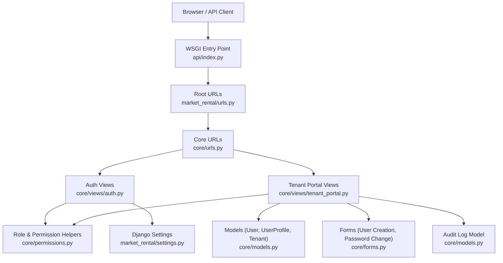
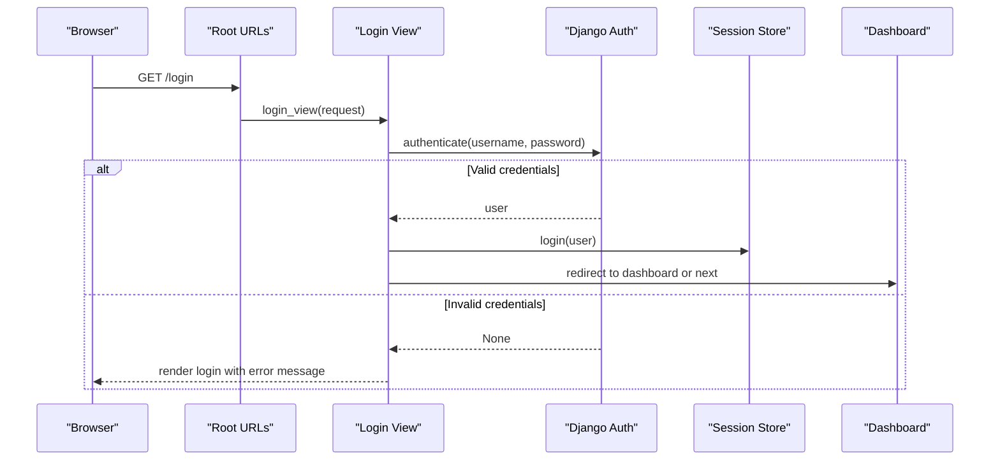
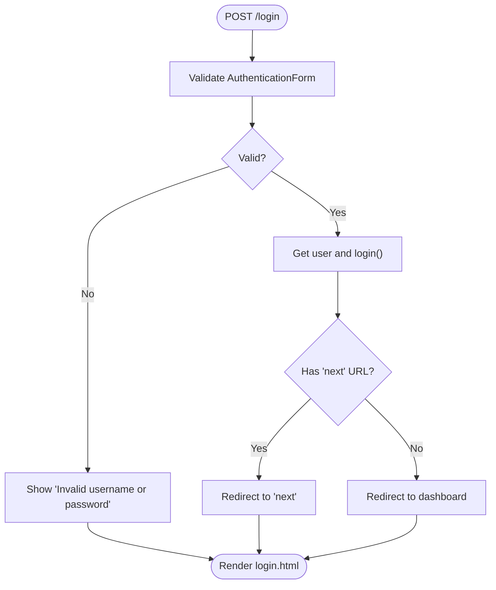
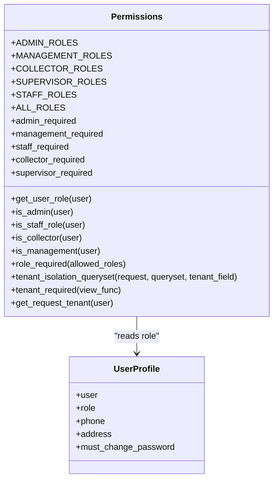
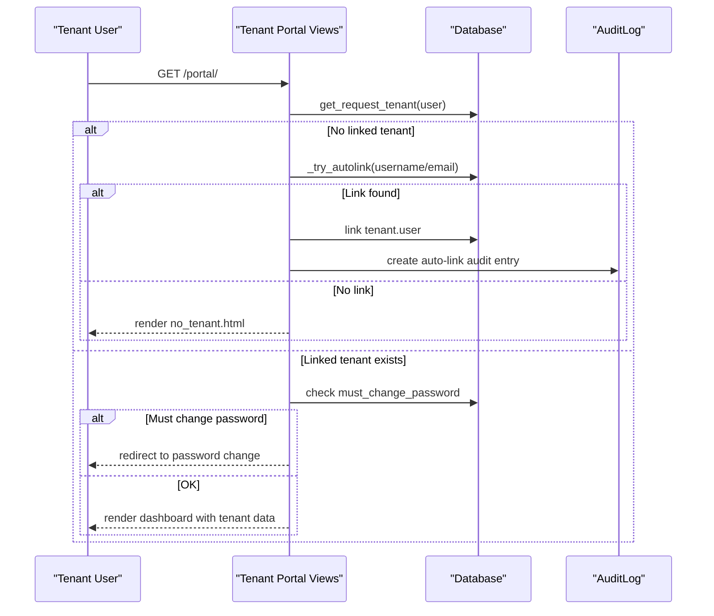
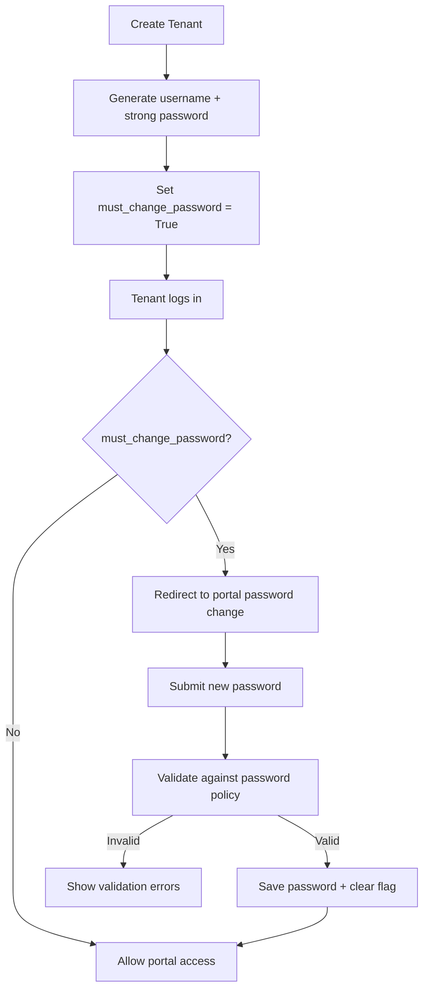
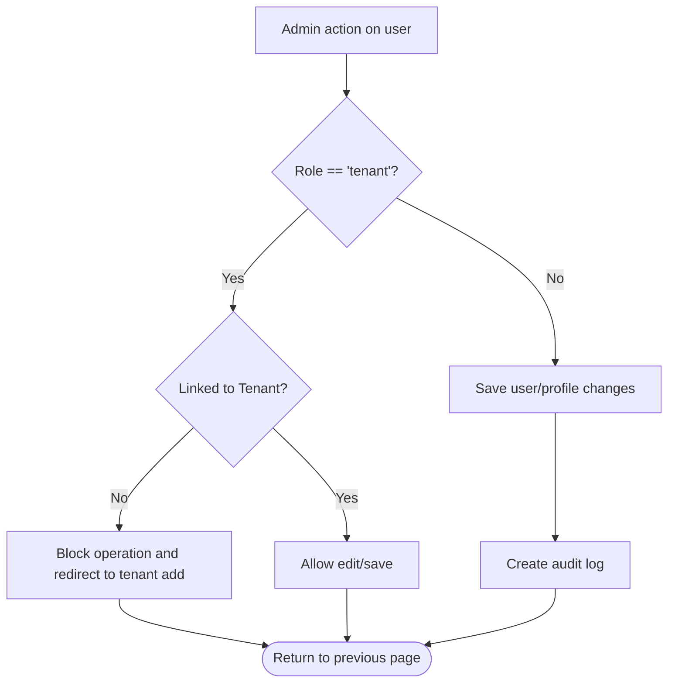
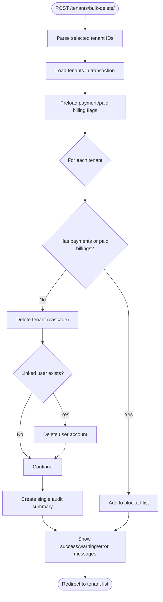
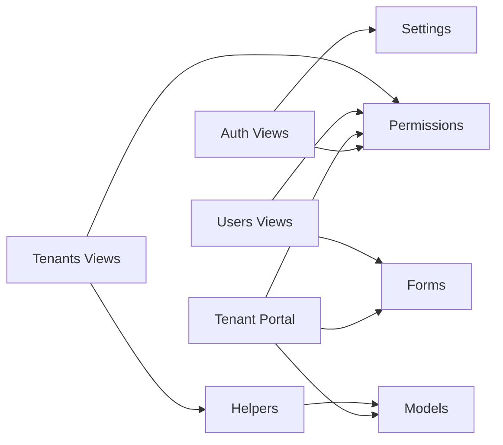

# Access & Authentication Issues

<cite>
**Referenced Files in This Document**
- [auth.py](file://core/views/auth.py)
- [settings.py](file://market_rental/settings.py)
- [urls.py](file://market_rental/urls.py)
- [urls.py](file://core/urls.py)
- [permissions.py](file://core/permissions.py)
- [models.py](file://core/models.py)
- [forms.py](file://core/forms.py)
- [tenant_portal.py](file://core/views/tenant_portal.py)
- [tenants.py](file://core/views/tenants.py)
- [users.py](file://core/views/users.py)
- [helpers.py](file://core/helpers.py)
- [context_processors.py](file://core/context_processors.py)
- [index.py](file://api/index.py)
</cite>

## Table of Contents
1. [Introduction](#introduction)
2. [Project Structure](#project-structure)
3. [Core Components](#core-components)
4. [Architecture Overview](#architecture-overview)
5. [Detailed Component Analysis](#detailed-component-analysis)
6. [Dependency Analysis](#dependency-analysis)
7. [Performance Considerations](#performance-considerations)
8. [Troubleshooting Guide](#troubleshooting-guide)
9. [Conclusion](#conclusion)
10. [Appendices](#appendices)

## Introduction
This document explains how access, authentication, and authorization work in the system and provides actionable guidance for resolving common problems: user login failures, password reset issues, role-based permission errors, tenant portal access problems, session-related failures, account recovery, bulk user operations, and security audit procedures. It is written for both administrators and support staff who need to diagnose and fix access issues without deep code knowledge.

## Project Structure
The authentication and authorization logic spans several layers:

- URL routing maps `/login`, `/logout`, and tenant portal routes to view functions.
- The login/logout views use Django’s built-in authentication flow.
- Role-based access control is enforced through decorators and helper functions.
- Tenant accounts are created with secure temporary credentials and a forced initial password change.
- Session configuration and security settings live in the project settings.
- Audit logs record important identity and access events.

**Diagram sources**
- [index.py:1-5](file://api/index.py#L1-L5)
- [urls.py:1-17](file://market_rental/urls.py#L1-L17)
- [urls.py:56-63](file://core/urls.py#L56-L63)
- [auth.py:9-35](file://core/views/auth.py#L9-L35)
- [tenant_portal.py:102-279](file://core/views/tenant_portal.py#L102-L279)
- [permissions.py:32-87](file://core/permissions.py#L32-L87)
- [settings.py:154-197](file://market_rental/settings.py#L154-L197)
- [models.py:7-24](file://core/models.py#L7-L24)
- [forms.py:577-649](file://core/forms.py#L577-L649)

**Section sources**
- [urls.py:1-17](file://market_rental/urls.py#L1-L17)
- [urls.py:56-63](file://core/urls.py#L56-L63)
- [auth.py:9-35](file://core/views/auth.py#L9-L35)
- [settings.py:154-197](file://market_rental/settings.py#L154-L197)

## Core Components
- Login and logout handling: validates credentials, sets session, redirects to dashboard or next URL.
- Role-based access control: central role definitions, decorator-based checks, tenant isolation helpers.
- Tenant portal: read-only self-service area with forced password change on first login.
- User management: admin-only creation/editing/deactivation; tenant logins must be created via the tenant workflow.
- Credential generation: secure random passwords and unique usernames for new tenants.
- Security configuration: password validators, session cookies, CSRF trusted origins, SSL redirect behavior.

**Section sources**
- [auth.py:9-35](file://core/views/auth.py#L9-L35)
- [permissions.py:6-87](file://core/permissions.py#L6-L87)
- [tenant_portal.py:28-78](file://core/views/tenant_portal.py#L28-L78)
- [users.py:47-95](file://core/views/users.py#L47-L95)
- [helpers.py:36-67](file://core/helpers.py#L36-L67)
- [settings.py:154-197](file://market_rental/settings.py#L154-L197)

## Architecture Overview
The system uses standard Django authentication with custom role enforcement. Tenants receive auto-generated credentials and must set their own password before using the portal. Staff roles are checked at each protected route.

**Diagram sources**
- [urls.py:1-17](file://market_rental/urls.py#L1-L17)
- [auth.py:9-29](file://core/views/auth.py#L9-L29)

## Detailed Component Analysis

### Login Flow and Failure Handling
The login view handles authenticated users, form validation, success redirection, and invalid credential messages.

Key behaviors:
- Redirects already authenticated users to the dashboard.
- Uses Django’s `AuthenticationForm` for validation.
- On success, logs the user in and shows a welcome message.
- Supports optional `next` parameter for post-login redirection.
- On failure, displays an error message and re-renders the login page.

Common causes of login failure:
- Incorrect username or password.
- Account not active (`is_active=False`).
- Missing or incorrect profile role when accessing restricted pages after login.
- CSRF or session cookie misconfiguration in production environments.

**Diagram sources**
- [auth.py:9-29](file://core/views/auth.py#L9-L29)

**Section sources**
- [auth.py:9-29](file://core/views/auth.py#L9-L29)
- [urls.py:1-17](file://market_rental/urls.py#L1-L17)

### Role-Based Access Control and Permission Errors
Roles are defined centrally and enforced through decorators. Superusers bypass profile checks.

Important role groups:
- Admin roles: only `admin`.
- Management roles: `admin`, `cashier`, `supervisor`, `treasurer`.
- Collector roles: `admin`, `collector`, `cashier`.
- Supervisor roles: `admin`, `supervisor`, `treasurer`.
- Staff roles: all non-tenant roles.
- All roles: includes `tenant`.

Permission decorators:
- `admin_required`: restricts to admin.
- `management_required`: restricts to management roles.
- `staff_required`: restricts to staff roles.
- `collector_required`: restricts to collector roles.
- `supervisor_required`: restricts to supervisor roles.
- `tenant_required`: restricts to tenant role and enforces tenant data isolation.

When a user lacks permission:
- A generic error message is shown.
- The request is redirected to the dashboard.

**Diagram sources**
- [permissions.py:6-125](file://core/permissions.py#L6-L125)
- [models.py:7-24](file://core/models.py#L7-L24)

**Section sources**
- [permissions.py:6-87](file://core/permissions.py#L6-L87)
- [models.py:7-24](file://core/models.py#L7-L24)

### Tenant Portal Access and Data Isolation
The tenant portal is strictly isolated: tenants can only see their own data. If a tenant-role user has no linked `Tenant` record, the portal attempts safe auto-linking by matching username or email to an unassigned tenant record. If linking fails, the portal renders a “no tenant” screen.

Key behaviors:
- Enforced by `@tenant_required`.
- Auto-linking tries one-shot reconciliation.
- Forced password change if `must_change_password=True`.
- Financial summaries and transaction history scoped to the tenant.

**Diagram sources**
- [tenant_portal.py:28-78](file://core/views/tenant_portal.py#L28-L78)
- [tenant_portal.py:102-171](file://core/views/tenant_portal.py#L102-L171)

**Section sources**
- [tenant_portal.py:28-78](file://core/views/tenant_portal.py#L28-L78)
- [tenant_portal.py:102-171](file://core/views/tenant_portal.py#L102-L171)
- [permissions.py:102-125](file://core/permissions.py#L102-L125)

### Password Reset and Initial Password Enforcement
Tenants created through the tenant workflow receive a secure temporary password and a username. They must change it before using the portal.

Key behaviors:
- Temporary password generated securely.
- Username uniqueness ensured.
- Tenant portal forces password change while `must_change_password=True`.
- Successful password change clears the flag and updates the session safely.

**Diagram sources**
- [tenants.py:54-81](file://core/views/tenants.py#L54-L81)
- [helpers.py:36-67](file://core/helpers.py#L36-L67)
- [tenant_portal.py:74-78](file://core/views/tenant_portal.py#L74-L78)
- [tenant_portal.py:242-279](file://core/views/tenant_portal.py#L242-L279)
- [forms.py:631-649](file://core/forms.py#L631-L649)

**Section sources**
- [tenants.py:54-81](file://core/views/tenants.py#L54-L81)
- [helpers.py:36-67](file://core/helpers.py#L36-L67)
- [tenant_portal.py:74-78](file://core/views/tenant_portal.py#L74-L78)
- [tenant_portal.py:242-279](file://core/views/tenant_portal.py#L242-L279)
- [forms.py:631-649](file://core/forms.py#L631-L649)

### User Account Recovery and Deactivation
Administrators can list, create, edit, and deactivate staff users. Tenant logins must be created via the tenant workflow; direct tenant-role creation is blocked to prevent orphaned accounts.

Key behaviors:
- `user_add` and `user_edit` reject setting role=`tenant` unless the account is already linked to a tenant.
- `user_deactivate` toggles `is_active` and records an audit log.
- Tenant termination deactivates the linked user account.

**Diagram sources**
- [users.py:47-95](file://core/views/users.py#L47-L95)
- [users.py:98-145](file://core/views/users.py#L98-L145)
- [users.py:148-164](file://core/views/users.py#L148-L164)
- [tenants.py:107-124](file://core/views/tenants.py#L107-L124)

**Section sources**
- [users.py:47-95](file://core/views/users.py#L47-L95)
- [users.py:98-145](file://core/views/users.py#L98-L145)
- [users.py:148-164](file://core/views/users.py#L148-L164)
- [tenants.py:107-124](file://core/views/tenants.py#L107-L124)

### Bulk User Operations and Tenant Deletion Safety
Bulk tenant deletion is protected and audited. It refuses to delete tenants with financial history and gracefully handles database locking differences across backends.

Key safeguards:
- Only admins can bulk-delete.
- Rows are selected within a transaction.
- Database lock availability is detected; SQLite does not support row-level locks but remains serialized inside transactions.
- Tenants with payments or partially paid billings are blocked from hard deletion.
- Audit log summarizes successes, blocks, and missing IDs.

**Diagram sources**
- [tenants.py:127-263](file://core/views/tenants.py#L127-L263)

**Section sources**
- [tenants.py:127-263](file://core/views/tenants.py#L127-L263)

### Security Audit Procedures
Important actions are recorded in the audit log model, including user creation/update, tenant lifecycle events, password changes, and bulk deletions.

Recommended audit review steps:
- Inspect recent audit entries for unexpected role changes or account activations.
- Correlate IP addresses with known administrative activity.
- Investigate auto-linked tenant accounts that were reconciled automatically.
- Review bulk deletion summaries to confirm which tenants were deleted or blocked.

**Section sources**
- [models.py:304-316](file://core/models.py#L304-L316)
- [tenant_portal.py:56-66](file://core/views/tenant_portal.py#L56-L66)
- [tenant_portal.py:262-268](file://core/views/tenant_portal.py#L262-L268)
- [tenants.py:63-76](file://core/views/tenants.py#L63-L76)
- [tenants.py:116-123](file://core/views/tenants.py#L116-L123)
- [tenants.py:225-238](file://core/views/tenants.py#L225-L238)
- [users.py:76-82](file://core/views/users.py#L76-L82)
- [users.py:125-131](file://core/views/users.py#L125-L131)
- [users.py:156-163](file://core/views/users.py#L156-L163)

## Dependency Analysis
The following diagram shows how authentication and authorization depend on models, forms, permissions, and settings.

**Diagram sources**
- [auth.py:9-35](file://core/views/auth.py#L9-L35)
- [tenant_portal.py:102-279](file://core/views/tenant_portal.py#L102-L279)
- [users.py:16-164](file://core/views/users.py#L16-L164)
- [tenants.py:23-468](file://core/views/tenants.py#L23-L468)
- [permissions.py:6-125](file://core/permissions.py#L6-L125)
- [forms.py:577-649](file://core/forms.py#L577-L649)
- [models.py:7-24](file://core/models.py#L7-L24)
- [helpers.py:36-67](file://core/helpers.py#L36-L67)

**Section sources**
- [auth.py:9-35](file://core/views/auth.py#L9-L35)
- [tenant_portal.py:102-279](file://core/views/tenant_portal.py#L102-L279)
- [users.py:16-164](file://core/views/users.py#L16-L164)
- [tenants.py:23-468](file://core/views/tenants.py#L23-L468)
- [permissions.py:6-125](file://core/permissions.py#L6-L125)
- [forms.py:577-649](file://core/forms.py#L577-L649)
- [models.py:7-24](file://core/models.py#L7-L24)
- [helpers.py:36-67](file://core/helpers.py#L36-L67)

## Performance Considerations
- Tenant portal queries use selective filtering and pagination to avoid loading large datasets.
- Bulk operations precompute history flags to reduce per-tenant database round-trips.
- Context processors expose lightweight role information for templates.
- Static asset versioning reduces cache-related UI issues during deployments.

[No sources needed since this section provides general guidance]

## Troubleshooting Guide

### User Login Failures
Symptoms:
- “Invalid username or password.”
- Redirect loops after login.
- Immediate logout after successful login.

Checks:
- Verify credentials and ensure the account is active.
- Confirm session middleware and session storage are configured correctly.
- In production, verify `SESSION_COOKIE_SECURE`, `CSRF_COOKIE_SECURE`, and `CSRF_TRUSTED_ORIGINS`.
- Ensure `LOGIN_URL`, `LOGIN_REDIRECT_URL`, and `LOGOUT_REDIRECT_URL` match deployed routes.

Relevant implementation points:
- Login view validation and messaging.
- Settings for session and CSRF security.

**Section sources**
- [auth.py:9-29](file://core/views/auth.py#L9-L29)
- [settings.py:154-197](file://market_rental/settings.py#L154-L197)

### Password Reset Issues
Symptoms:
- Tenant cannot access portal due to forced password change.
- New password rejected by validators.
- Session invalidated after password change.

Checks:
- Confirm the tenant is being redirected to the portal password change page.
- Ensure the new password satisfies Django’s password validators.
- After changing the password, verify the session remains valid.

Relevant implementation points:
- Forced password change flow.
- Tenant password change form.
- Session hash update after password change.

**Section sources**
- [tenant_portal.py:74-78](file://core/views/tenant_portal.py#L74-L78)
- [tenant_portal.py:242-279](file://core/views/tenant_portal.py#L242-L279)
- [forms.py:631-649](file://core/forms.py#L631-L649)

### Role-Based Permission Errors
Symptoms:
- “You do not have permission to access that page.”
- Redirected to dashboard despite being logged in.
- Tenant sees “This area is reserved for tenant accounts.”

Checks:
- Confirm the user’s role in `UserProfile`.
- Verify the correct decorator protects the target route.
- For tenant portal, ensure the user has role `tenant` and a linked `Tenant` record.

Relevant implementation points:
- Role decorators and fallback for superusers.
- Tenant isolation and portal restriction.

**Section sources**
- [permissions.py:32-87](file://core/permissions.py#L32-L87)
- [permissions.py:102-125](file://core/permissions.py#L102-L125)
- [tenant_portal.py:102-171](file://core/views/tenant_portal.py#L102-L171)

### Tenant Portal Access Issues
Symptoms:
- Tenant lands on “no linked record” screen.
- Tenant cannot see any data.
- Auto-linking did not occur.

Checks:
- Confirm the tenant’s `User` is linked to a `Tenant` record.
- If created via the users form instead of the tenant workflow, reconcile by creating the proper tenant record.
- Check for ambiguous matches (multiple candidates) that prevent auto-linking.

Relevant implementation points:
- Auto-linking logic and audit logging.
- Tenant portal dashboard rendering.

**Section sources**
- [tenant_portal.py:28-78](file://core/views/tenant_portal.py#L28-L78)
- [tenant_portal.py:102-171](file://core/views/tenant_portal.py#L102-L171)

### API Authentication Failures
Symptoms:
- Requests fail due to missing authentication or session context.
- Cross-origin requests are rejected.

Checks:
- Confirm the WSGI entry point is used for deployment.
- Verify CSRF trusted origins include the client domain.
- Ensure HTTPS and secure cookies are properly configured in production.

Relevant implementation points:
- WSGI entry point.
- CSRF trusted origins and SSL redirect settings.

**Section sources**
- [index.py:1-5](file://api/index.py#L1-L5)
- [settings.py:174-190](file://market_rental/settings.py#L174-L190)

### Cross-Role Permission Conflicts
Symptoms:
- Collector cannot access billing generation or reports.
- Tenant cannot access staff management pages.
- Supervisor/treasurer restrictions apply unexpectedly.

Checks:
- Identify the required role group for the target feature.
- Confirm the user’s role matches the requirement.
- Remember that collectors are intentionally excluded from management features.

Relevant implementation points:
- Role group definitions.
- Decorator usage across views.

**Section sources**
- [permissions.py:6-30](file://core/permissions.py#L6-L30)
- [permissions.py:61-87](file://core/permissions.py#L61-L87)

### Account Recovery Procedures
Steps:
- For inactive staff accounts, reactivate via user management.
- For tenants, ensure a linked tenant record exists; otherwise create it through the tenant workflow.
- Use audit logs to trace who changed account status or role.

Relevant implementation points:
- User deactivation toggle.
- Tenant termination deactivates linked user.
- Audit logging for user and tenant changes.

**Section sources**
- [users.py:148-164](file://core/views/users.py#L148-L164)
- [tenants.py:107-124](file://core/views/tenants.py#L107-L124)
- [models.py:304-316](file://core/models.py#L304-L316)

### Bulk User Operations Guidance
Guidance:
- Avoid creating tenant-role accounts directly via the users form; always use the tenant workflow.
- Use bulk tenant deletion only for tenants without financial history.
- Review audit summaries after bulk operations.

Relevant implementation points:
- Blocking tenant-role creation in users form.
- Bulk deletion safety checks and audit summary.

**Section sources**
- [users.py:47-95](file://core/views/users.py#L47-L95)
- [tenants.py:127-263](file://core/views/tenants.py#L127-L263)

## Conclusion
The system’s access and authentication model combines Django’s built-in authentication with explicit role-based decorators and tenant isolation. Most access issues stem from incorrect roles, missing tenant links, forced password changes, or production security settings. By following the troubleshooting steps and understanding the flows documented here, administrators and support staff can resolve login failures, permission errors, tenant portal access problems, and recover accounts safely while maintaining auditability.

[No sources needed since this section summarizes without analyzing specific files]

## Appendices

### Common Authentication Patterns and Fixes
- Standard login: validate credentials, set session, redirect.
- Forced initial password change: enforce until user sets a compliant password.
- Role-gated navigation: hide or block out-of-scope menus and routes.
- Tenant data isolation: scope all queries to the current tenant.
- Secure credential provisioning: generate strong passwords and unique usernames.

[No sources needed since this section provides general guidance]