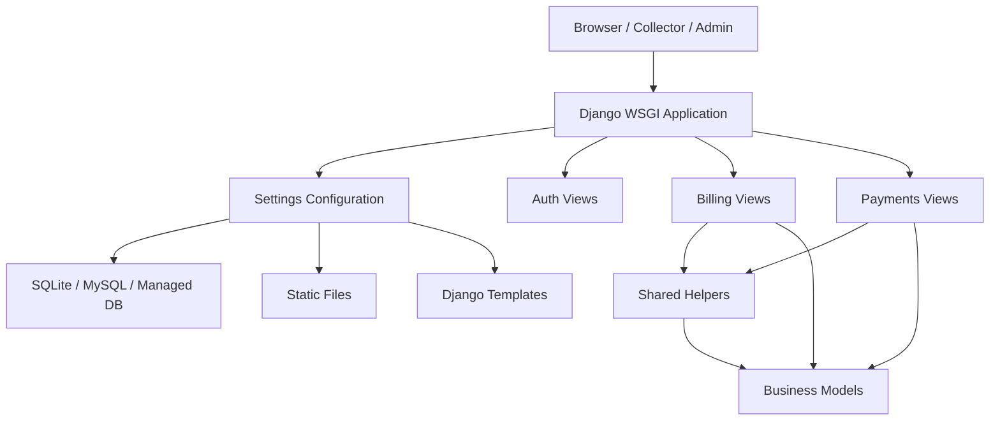
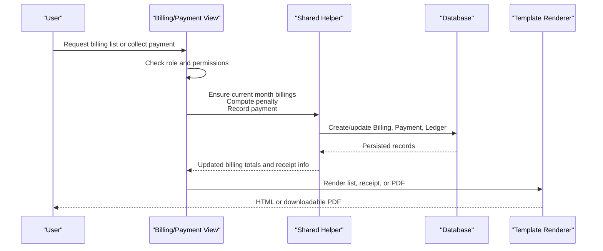
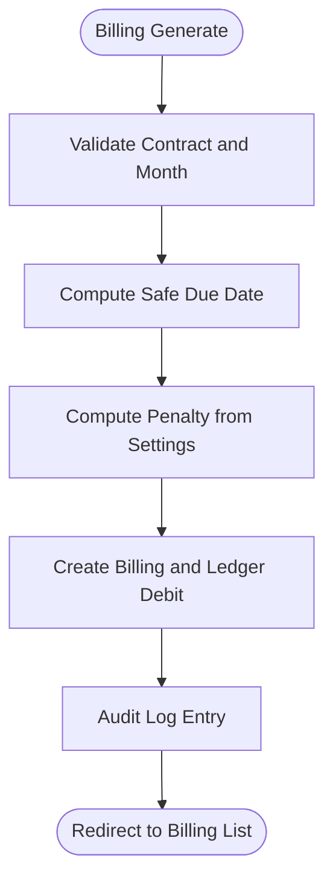
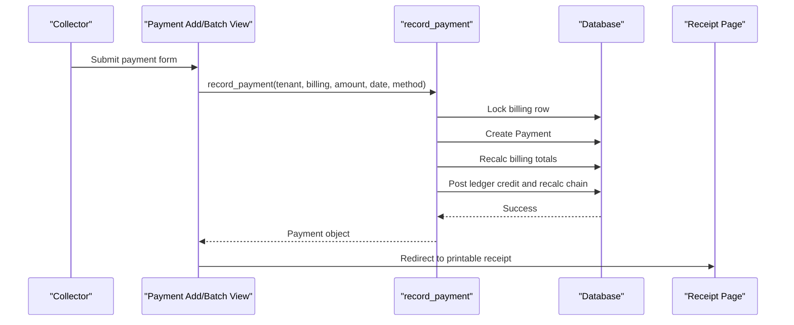
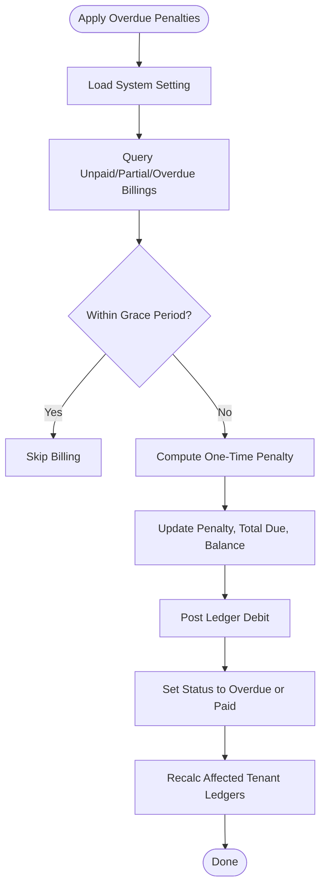
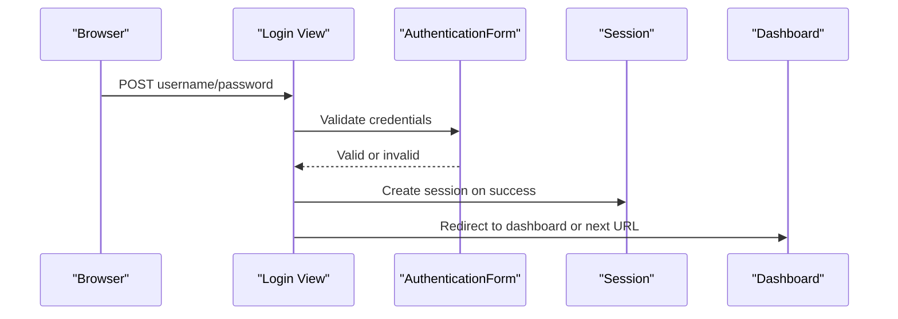
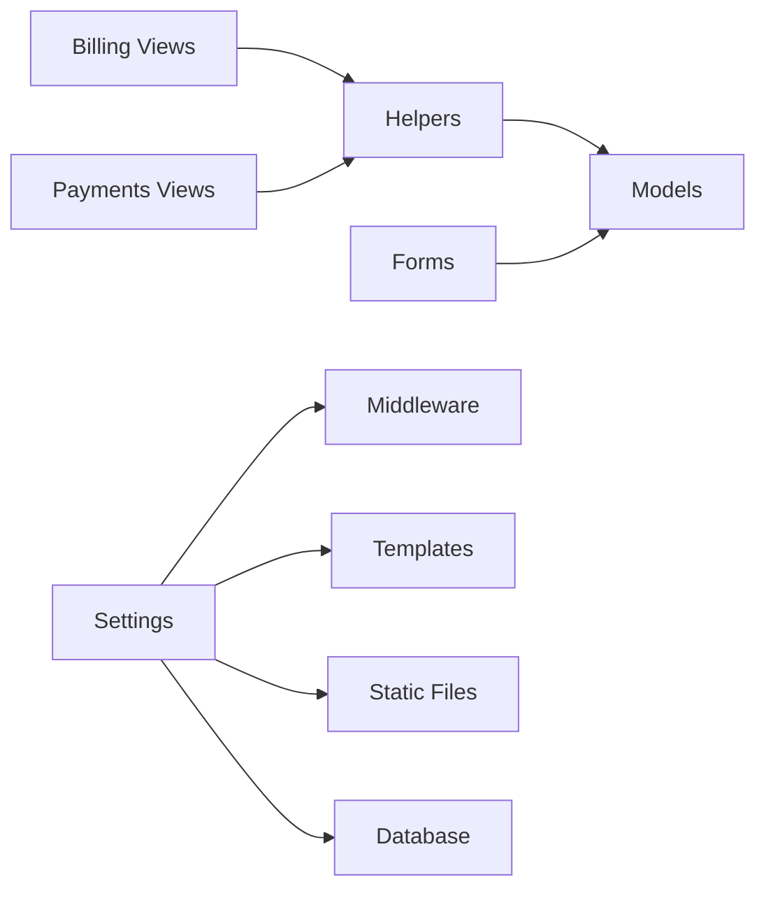

# Common Issues & Solutions

<cite>
**Referenced Files in This Document**
- [settings.py](file://market_rental/settings.py)
- [__init__.py](file://market_rental/__init__.py)
- [models.py](file://core/models.py)
- [helpers.py](file://core/helpers.py)
- [billing.py](file://core/views/billing.py)
- [payments.py](file://core/views/payments.py)
- [auth.py](file://core/views/auth.py)
- [permissions.py](file://core/permissions.py)
- [forms.py](file://core/forms.py)
- [context_processors.py](file://core/context_processors.py)
- [apply_penalties.py](file://core/management/commands/apply_penalties.py)
- [reset_market_data.py](file://core/management/commands/reset_market_data.py)
- [base.html](file://templates/base.html)
- [login.html](file://templates/registration/login.html)
- [manage.py](file://manage.py)
- [requirements.txt](file://requirements.txt)
</cite>

## Table of Contents
1. [Introduction](#introduction)
2. [Project Structure and Entry Points](#project-structure-and-entry-points)
3. [Core Components](#core-components)
4. [Architecture Overview](#architecture-overview)
5. [Detailed Component Analysis](#detailed-component-analysis)
6. [Dependency Analysis](#dependency-analysis)
7. [Performance Considerations](#performance-considerations)
8. [Troubleshooting Guide](#troubleshooting-guide)
9. [Recovery Procedures](#recovery-procedures)
10. [Conclusion](#conclusion)

## Introduction
This document is a practical troubleshooting guide for the Public Market Rental and Collection Management System. It focuses on resolving common operational failures, including billing generation problems, penalty calculation errors, payment processing issues, authentication failures, database connectivity problems, static file serving errors, template rendering issues, performance bottlenecks, memory leaks, slow queries, data corruption, failed migrations, and backup restoration.

The system uses Django for the backend, Django templates for rendering, SQLite for development, and MySQL or managed databases for production. Billing, payments, penalties, ledgers, audit logs, and receipts are central to daily operations.

## Project Structure and Entry Points
The application follows a standard Django layout:
- `market_rental/settings.py` configures environment variables, database connections, static files, middleware, templates, and security settings.
- `market_rental/__init__.py` registers PyMySQL as the MySQL driver when available.
- `core/models.py` defines business entities such as Tenant, Stall, RentalContract, Billing, Payment, TenantLedger, AuditLog, SystemSetting, and PenaltySetting.
- `core/helpers.py` contains shared financial logic, receipt numbering, PDF fallbacks, and overdue penalty automation.
- `core/views/billing.py` handles billing generation, collection, grouping, printing, and export.
- `core/views/payments.py` handles payment listing, recording, editing, voiding, receipts, and batch receipts.
- `core/views/auth.py` handles login and logout flows.
- `core/permissions.py` provides role-based access control decorators and helpers.
- `core/forms.py` defines forms with validation rules for tenants, stalls, contracts, billings, payments, notices, users, and collections.
- `core/context_processors.py` exposes system settings, user roles, and static asset versioning.
- `core/management/commands/apply_penalties.py` applies overdue status and penalties.
- `core/management/commands/reset_market_data.py` safely resets market data in non-production environments.
- `templates/base.html` and `templates/registration/login.html` provide the main layout and sign-in page.
- `manage.py` is the Django command-line entry point.
- `requirements.txt` lists core runtime dependencies.

**Diagram sources**
- [settings.py:40-69](file://market_rental/settings.py#L40-L69)
- [settings.py:109-152](file://market_rental/settings.py#L109-L152)
- [billing.py:16-22](file://core/views/billing.py#L16-L22)
- [payments.py:10-18](file://core/views/payments.py#L10-L18)
- [helpers.py:15-15](file://core/helpers.py#L15-L15)
- [models.py:42-336](file://core/models.py#L42-L336)

**Section sources**
- [settings.py:1-200](file://market_rental/settings.py#L1-L200)
- [__init__.py:1-8](file://market_rental/__init__.py#L1-L8)
- [models.py:1-336](file://core/models.py#L1-L336)
- [helpers.py:1-595](file://core/helpers.py#L1-L595)
- [billing.py:1-765](file://core/views/billing.py#L1-L765)
- [payments.py:1-653](file://core/views/payments.py#L1-L653)
- [auth.py:1-36](file://core/views/auth.py#L1-L36)
- [permissions.py:1-125](file://core/permissions.py#L1-L125)
- [forms.py:1-774](file://core/forms.py#L1-L774)
- [context_processors.py:1-45](file://core/context_processors.py#L1-L45)
- [apply_penalties.py:1-14](file://core/management/commands/apply_penalties.py#L1-L14)
- [reset_market_data.py:94-247](file://core/management/commands/reset_market_data.py#L94-L247)
- [base.html:1-312](file://templates/base.html#L1-L312)
- [login.html:1-121](file://templates/registration/login.html#L1-L121)
- [manage.py:1-23](file://manage.py#L1-L23)
- [requirements.txt:1-10](file://requirements.txt#L1-L10)

## Core Components
Key components that commonly cause operational issues:
- Billing generation and collection: creates monthly bills, computes penalties, records payments, updates balances, and prints receipts.
- Payment processing: validates amounts, prevents overpayment, recomputes billing totals, posts ledger entries, and supports batch receipts.
- Penalties and overdue status: grace-aware accrual, idempotent penalty application, and automatic ledger updates.
- Authentication and authorization: login flow, role checks, collector isolation, and tenant isolation.
- Database configuration: SQLite default, local MySQL bootstrap, and production database URL handling.
- Static assets and templates: Tailwind CSS, HTMX, Alpine.js, cache-busting, and PDF generation fallbacks.

**Section sources**
- [billing.py:29-51](file://core/views/billing.py#L29-L51)
- [billing.py:174-315](file://core/views/billing.py#L174-L315)
- [billing.py:415-489](file://core/views/billing.py#L415-L489)
- [payments.py:250-294](file://core/views/payments.py#L250-L294)
- [payments.py:419-518](file://core/views/payments.py#L419-L518)
- [helpers.py:132-152](file://core/helpers.py#L132-L152)
- [helpers.py:321-420](file://core/helpers.py#L321-L420)
- [helpers.py:423-520](file://core/helpers.py#L423-L520)
- [auth.py:9-35](file://core/views/auth.py#L9-L35)
- [permissions.py:32-87](file://core/permissions.py#L32-L87)
- [settings.py:73-152](file://market_rental/settings.py#L73-L152)
- [settings.py:166-193](file://market_rental/settings.py#L166-L193)

## Architecture Overview
The system’s request flow centers on authenticated views that enforce role-based permissions, call shared helpers for financial integrity, persist changes through models, and render templates or return printable responses.

**Diagram sources**
- [billing.py:62-70](file://core/views/billing.py#L62-L70)
- [billing.py:415-489](file://core/views/billing.py#L415-L489)
- [payments.py:250-294](file://core/views/payments.py#L250-L294)
- [helpers.py:351-420](file://core/helpers.py#L351-L420)
- [helpers.py:522-595](file://core/helpers.py#L522-L595)

## Detailed Component Analysis

### Billing Generation and Collection
Billing generation ensures active contracts have monthly bills, computes penalties based on contract or system settings, and records ledger debits. Collection validates amount, clamps overpayments, creates a Payment, recomputes billing totals, posts a ledger credit, and redirects to the official receipt.

**Diagram sources**
- [billing.py:174-246](file://core/views/billing.py#L174-L246)
- [billing.py:29-51](file://core/views/billing.py#L29-L51)
- [helpers.py:155-205](file://core/helpers.py#L155-L205)

**Section sources**
- [billing.py:174-315](file://core/views/billing.py#L174-L315)
- [billing.py:415-489](file://core/views/billing.py#L415-L489)
- [helpers.py:155-205](file://core/helpers.py#L155-L205)

### Payment Processing and Batch Receipts
Payment recording is centralized in a helper that locks the target billing row, generates a unique receipt number, creates the Payment, recomputes billing totals authoritatively, posts a ledger credit, and recalculates running balances. Batch collections share one official receipt across multiple months while keeping internal receipt numbers unique.

**Diagram sources**
- [payments.py:250-294](file://core/views/payments.py#L250-L294)
- [payments.py:419-518](file://core/views/payments.py#L419-L518)
- [helpers.py:351-420](file://core/helpers.py#L351-L420)

**Section sources**
- [payments.py:250-294](file://core/views/payments.py#L250-L294)
- [payments.py:419-518](file://core/views/payments.py#L419-L518)
- [helpers.py:321-420](file://core/helpers.py#L321-L420)

### Penalties and Overdue Status
Penalty computation respects contract-level or system-level settings and grace periods. The overdue penalty process is idempotent: it only applies a penalty once per billing and updates ledger entries and tenant balances consistently.

**Diagram sources**
- [helpers.py:423-520](file://core/helpers.py#L423-L520)
- [helpers.py:132-152](file://core/helpers.py#L132-L152)

**Section sources**
- [helpers.py:132-152](file://core/helpers.py#L132-L152)
- [helpers.py:423-520](file://core/helpers.py#L423-L520)
- [apply_penalties.py:1-14](file://core/management/commands/apply_penalties.py#L1-L14)

### Authentication and Authorization
Authentication uses Django’s built-in forms and messages. Authorization enforces roles: admin, collector, cashier, supervisor, treasurer, and tenant. Collectors can only see their own collections; tenants can only see their own records.

**Diagram sources**
- [auth.py:9-35](file://core/views/auth.py#L9-L35)
- [permissions.py:32-87](file://core/permissions.py#L32-L87)

**Section sources**
- [auth.py:9-35](file://core/views/auth.py#L9-L35)
- [permissions.py:32-87](file://core/permissions.py#L32-L87)
- [base.html:54-76](file://templates/base.html#L54-L76)
- [login.html:71-105](file://templates/registration/login.html#L71-L105)

## Dependency Analysis
The most important dependency relationships for troubleshooting are:
- Views depend on helpers for financial correctness and on models for persistence.
- Helpers depend on models and may import additional libraries for PDF generation.
- Settings control database backends, static file storage, middleware, and template context processors.
- Forms validate business rules before views execute.

**Diagram sources**
- [billing.py:16-22](file://core/views/billing.py#L16-L22)
- [payments.py:10-18](file://core/views/payments.py#L10-L18)
- [helpers.py:15-15](file://core/helpers.py#L15-L15)
- [forms.py:11-15](file://core/forms.py#L11-L15)
- [settings.py:40-69](file://market_rental/settings.py#L40-L69)
- [settings.py:166-193](file://market_rental/settings.py#L166-L193)

**Section sources**
- [billing.py:16-22](file://core/views/billing.py#L16-L22)
- [payments.py:10-18](file://core/views/payments.py#L10-L18)
- [helpers.py:15-15](file://core/helpers.py#L15-L15)
- [forms.py:11-15](file://core/forms.py#L11-L15)
- [settings.py:40-69](file://market_rental/settings.py#L40-L69)
- [settings.py:166-193](file://market_rental/settings.py#L166-L193)

## Performance Considerations
Common performance risks and mitigations:
- N+1 queries: Use `select_related` and `prefetch_related` in views and helpers.
- Heavy aggregation: Avoid computing large aggregates without filters; paginate results.
- Repeated settings lookups: Cache `SystemSetting.objects.first()` where appropriate.
- Long-running penalty runs: Run penalties via management command outside request cycles.
- PDF generation overhead: Prefer WeasyPrint in Linux; use browser print fallback on Windows.
- Static asset caching: Use `collectstatic` in production and cache-busting query strings in development.

[No sources needed since this section provides general guidance]

## Troubleshooting Guide

### Billing Generation Failures
Symptoms:
- No bill appears for an active contract.
- Duplicate billing warnings appear.
- Generated bill has zero penalty despite being overdue.

Resolution steps:
1. Confirm the contract is Active and within its start/end window.
2. Verify the billing month/year exists and is not already generated.
3. Check SystemSetting and PenaltySetting values for penalty type, value, and grace period.
4. Run the overdue penalty command to apply retroactive penalties.
5. Inspect audit logs for billing generation actions.

Diagnostic commands:
- `python manage.py shell -c "from core.models import RentalContract, Billing; print(RentalContract.objects.filter(status='Active').count())"`
- `python manage.py apply_penalties`

Error message interpretation:
- “Billing already exists” means a billing row for that tenant/stall/month/year is present.
- Zero penalty after due date usually indicates missing or inactive PenaltySetting and no SystemSetting override.

**Section sources**
- [billing.py:174-246](file://core/views/billing.py#L174-L246)
- [billing.py:249-315](file://core/views/billing.py#L249-L315)
- [helpers.py:155-205](file://core/helpers.py#L155-L205)
- [helpers.py:423-520](file://core/helpers.py#L423-L520)
- [apply_penalties.py:1-14](file://core/management/commands/apply_penalties.py#L1-L14)

### Penalty Calculation Errors
Symptoms:
- Penalty applied too early or not at all.
- Penalty amount does not match expected fixed or percentage rate.
- Grace period seems ignored.

Resolution steps:
1. Check whether the contract has an active PenaltySetting.
2. If none exists, verify SystemSetting penalty_type, penalty_value, and grace_period.
3. Confirm the due date is computed correctly using the safe due date function.
4. Run `apply_overdue_penalties` manually and review audit logs.

Diagnostic commands:
- `python manage.py shell -c "from core.helpers import compute_penalty_for_contract; print(compute_penalty_for_contract(contract, month, year, due_date))"`
- `python manage.py apply_penalties`

Error message interpretation:
- Missing SystemSetting returns zero penalty by design.
- Percentage penalty requires Decimal arithmetic; ensure values are numeric.

**Section sources**
- [billing.py:29-51](file://core/views/billing.py#L29-L51)
- [helpers.py:125-152](file://core/helpers.py#L125-L152)
- [helpers.py:423-520](file://core/helpers.py#L423-L520)

### Payment Processing Problems
Symptoms:
- Payment recorded but billing balance remains unchanged.
- Overpayment error occurs.
- Batch receipt shows only the last payment instead of all selected months.

Resolution steps:
1. Ensure the payment form passes a valid billing and amount not exceeding outstanding balance.
2. Confirm `record_payment` is called inside an atomic transaction.
3. For batch collections, verify the session key holds the created payment IDs.
4. Check `_payment_access_denied` if collectors cannot view receipts they did not record.

Diagnostic commands:
- `python manage.py shell -c "from core.models import Payment, Billing; print(Payment.objects.count(), Billing.objects.filter(balance=0).count())"`
- Inspect session keys during batch collection.

Error message interpretation:
- “Amount paid exceeds outstanding balance” means the form validation prevented overpayment.
- “You can only view receipts for payments you recorded” means collector isolation is working.

**Section sources**
- [payments.py:250-294](file://core/views/payments.py#L250-L294)
- [payments.py:351-396](file://core/views/payments.py#L351-L396)
- [payments.py:419-518](file://core/views/payments.py#L419-L518)
- [helpers.py:351-420](file://core/helpers.py#L351-L420)

### Authentication Issues
Symptoms:
- Login fails with invalid credentials.
- Users cannot access pages after login.
- Tenants see restricted menus.

Resolution steps:
1. Verify username and password exist and are not locked out by policy.
2. Check that UserProfile exists and has a valid role.
3. Confirm ALLOWED_HOSTS and CSRF trusted origins in production.
4. Ensure session cookies are secure behind HTTPS in production.

Diagnostic commands:
- `python manage.py shell -c "from django.contrib.auth.models import User; u=User.objects.get(username='TEN-001'); print(u.profile.role)"`
- Review server logs for CSRF and session errors.

Error message interpretation:
- “Invalid username or password” comes from Django’s AuthenticationForm.
- “You do not have permission” indicates role decorator blocked access.

**Section sources**
- [auth.py:9-35](file://core/views/auth.py#L9-L35)
- [permissions.py:32-87](file://core/permissions.py#L32-L87)
- [settings.py:15-26](file://market_rental/settings.py#L15-L26)
- [settings.py:182-190](file://market_rental/settings.py#L182-L190)
- [login.html:71-105](file://templates/registration/login.html#L71-L105)

### Database Connectivity Problems
Symptoms:
- Django cannot connect to SQLite or MySQL.
- Local XAMPP MySQL database is missing.
- Production DATABASE_URL fails.

Resolution steps:
1. For SQLite, confirm `db.sqlite3` exists and is writable.
2. For local MySQL, set `DB_ENGINE=mysql` and ensure host/port/user/password are correct.
3. For production, set `DATABASE_URL` and ensure SSL is enabled when required.
4. Verify PyMySQL is installed and registered.

Diagnostic commands:
- `python manage.py check --deploy`
- `python manage.py dbshell`
- `python manage.py migrate --check`

Error message interpretation:
- Connection refused or authentication failure points to wrong host/port/credentials.
- Missing database name in local MySQL is auto-created by settings; connection still fails until schema is migrated.

**Section sources**
- [settings.py:73-152](file://market_rental/settings.py#L73-L152)
- [__init__.py:1-8](file://market_rental/__init__.py#L1-L8)
- [manage.py:1-23](file://manage.py#L1-L23)

### Static File Serving Errors
Symptoms:
- CSS and JavaScript are missing or stale.
- Tailwind output file is not found.
- Production static files return 404.

Resolution steps:
1. In development, rebuild Tailwind CSS so `static/css/output.css` exists.
2. In production, run `collectstatic` to build hashed static files.
3. Verify WhiteNoise is configured and `STATIC_ROOT` is correct.
4. Check `STATIC_VERSION` context processor for cache-busting.

Diagnostic commands:
- `python manage.py collectstatic --noinput`
- Inspect `staticfiles` directory after collectstatic.

Error message interpretation:
- Missing `output.css` triggers empty STATIC_VERSION and may cause browsers to serve cached versions.
- 404 on `/static/...` in production usually means collectstatic was not run or WhiteNoise is misconfigured.

**Section sources**
- [settings.py:166-193](file://market_rental/settings.py#L166-L193)
- [context_processors.py:32-45](file://core/context_processors.py#L32-L45)
- [base.html:10-12](file://templates/base.html#L10-L12)

### Template Rendering Issues
Symptoms:
- System settings not displayed.
- Role-based navigation missing.
- Print templates fail to generate PDFs.

Resolution steps:
1. Ensure `system_settings` context processor is enabled.
2. Confirm templates are under `templates/` and APP_DIRS is True.
3. For PDFs, install WeasyPrint system libraries or use the HTML fallback.
4. Check xhtml2pdf fallback behavior when WeasyPrint is unavailable.

Diagnostic commands:
- `python manage.py shell -c "from core.models import SystemSetting; print(SystemSetting.objects.first())"`
- Open print templates in browser to inspect HTML preview.

Error message interpretation:
- Missing system settings often means no SystemSetting row exists.
- PDF fallback message indicates WeasyPrint library or GTK runtime is missing.

**Section sources**
- [settings.py:53-69](file://market_rental/settings.py#L53-L69)
- [context_processors.py:9-11](file://core/context_processors.py#L9-L11)
- [helpers.py:522-595](file://core/helpers.py#L522-L595)
- [base.html:34-42](file://templates/base.html#L34-L42)

### Performance Bottlenecks and Slow Queries
Symptoms:
- Billing list loads slowly.
- Reports time out.
- Batch collection feels sluggish.

Resolution steps:
1. Add indexes on frequently filtered columns such as billing_month, billing_year, tenant_id, stall_id, payment_date.
2. Use `select_related` and `prefetch_related` in views and helpers.
3. Paginate large tables and avoid loading entire datasets into memory.
4. Move heavy background work (penalties, reports) to scheduled tasks.

Diagnostic commands:
- Enable Django debug SQL logging temporarily.
- Profile views with Django Debug Toolbar in development.

Error message interpretation:
- Slow queries often show repeated SELECT statements for related objects.
- Memory spikes indicate loading too many rows without pagination.

**Section sources**
- [billing.py:72-108](file://core/views/billing.py#L72-L108)
- [payments.py:187-247](file://core/views/payments.py#L187-L247)
- [helpers.py:260-273](file://core/helpers.py#L260-L273)

### Memory Leaks and Large Data Handling
Symptoms:
- Process memory grows during long sessions.
- Batch receipt generation consumes excessive RAM.

Resolution steps:
1. Avoid storing large querysets in session variables; store primary keys only.
2. Stream large PDFs or use server-side generation with temporary files.
3. Clear session data after batch receipt rendering.
4. Monitor worker processes and restart periodically if necessary.

Diagnostic commands:
- Inspect session size and contents during batch collection.
- Use OS-level tools to monitor process memory usage.

**Section sources**
- [payments.py:20-37](file://core/views/payments.py#L20-L37)
- [payments.py:351-396](file://core/views/payments.py#L351-L396)

## Recovery Procedures

### Data Corruption Recovery
Symptoms:
- Billing totals do not match payments.
- Ledger balances are inconsistent.
- Payments marked Paid but billing remains Partial.

Resolution steps:
1. Recompute billing totals from valid payments using the authoritative helper.
2. Recalculate tenant ledger running balances chronologically.
3. Void incorrect payments and re-record corrected ones.
4. Audit all changes and preserve evidence.

Diagnostic commands:
- `python manage.py shell -c "from core.helpers import recalc_billing_from_payments, recalc_tenant_ledger; ..."`
- Review AuditLog entries for CREATE, UPDATE, VOID actions.

**Section sources**
- [helpers.py:321-420](file://core/helpers.py#L321-L420)
- [payments.py:460-518](file://core/views/payments.py#L460-L518)
- [payments.py:521-550](file://core/views/payments.py#L521-L550)

### Failed Migrations
Symptoms:
- Migration errors on startup.
- Schema mismatch between code and database.

Resolution steps:
1. Identify the failing migration.
2. Roll back to a known good state if possible.
3. Fix migration content or model definitions.
4. Apply migrations again and verify schema.

Diagnostic commands:
- `python manage.py showmigrations`
- `python manage.py migrate --plan`
- `python manage.py migrate <app> <migration>`

**Section sources**
- [manage.py:1-23](file://manage.py#L1-L23)

### Backup Restoration Processes
Symptoms:
- Need to restore from a previous snapshot.
- Database needs reset for testing.

Resolution steps:
1. Stop write operations to the database.
2. Restore the database dump to the target environment.
3. Verify migrations match the restored schema.
4. Re-run collectstatic and seed data if required.
5. Use the reset command only in non-production environments.

Diagnostic commands:
- `python manage.py reset_market_data --dry-run`
- `python manage.py reset_market_data --yes`

**Section sources**
- [reset_market_data.py:94-247](file://core/management/commands/reset_market_data.py#L94-L247)

## Conclusion
Most operational issues in the market rental system trace back to configuration, data consistency, or workflow assumptions. Billing and payment integrity depends on centralized helpers, role-based access control, and careful use of transactions. Penalties require correct settings and grace-period logic. Database connectivity and static file serving are environment-dependent and must be validated during deployment. When data becomes inconsistent, rely on the authoritative recomputation helpers and audit logs to recover safely. For recurring problems, automate diagnostics, schedule penalty runs, and monitor performance metrics.