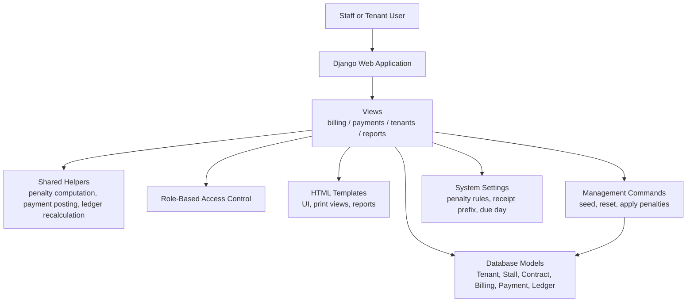
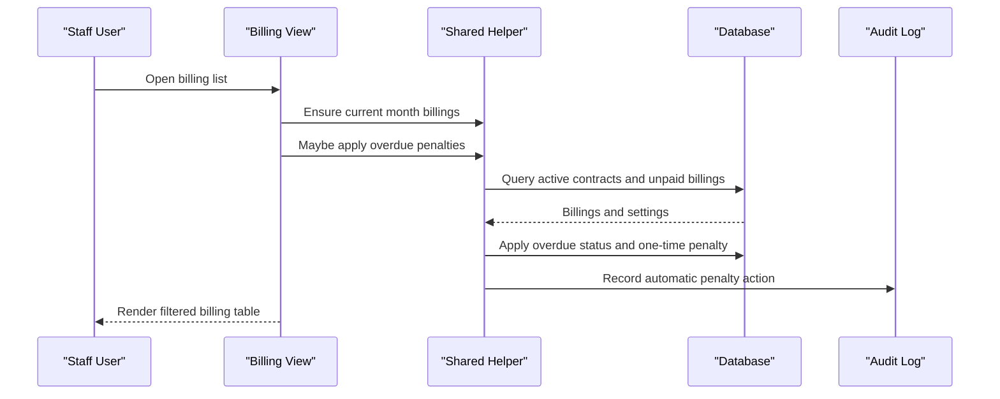
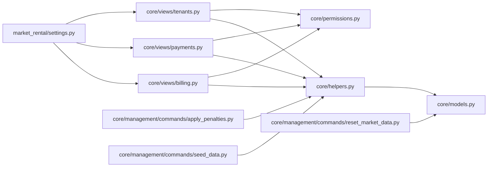

# Frequently Asked Questions

<cite>
**Referenced Files in This Document**
- [README.MD](file://README.MD)
- [PENALTY_GUIDE.md](file://PENALTY_GUIDE.md)
- [credentials.md](file://credentials.md)
- [core/models.py](file://core/models.py)
- [core/permissions.py](file://core/permissions.py)
- [core/helpers.py](file://core/helpers.py)
- [core/views/billing.py](file://core/views/billing.py)
- [core/views/payments.py](file://core/views/payments.py)
- [core/views/tenants.py](file://core/views/tenants.py)
- [core/management/commands/apply_penalties.py](file://core/management/commands/apply_penalties.py)
- [core/management/commands/seed_data.py](file://core/management/commands/seed_data.py)
- [core/management/commands/reset_market_data.py](file://core/management/commands/reset_market_data.py)
- [market_rental/settings.py](file://market_rental/settings.py)
- [vercel.json](file://vercel.json)
</cite>

## Table of Contents
1. [Introduction](#introduction)
2. [Project Structure](#project-structure)
3. [Core Components](#core-components)
4. [Architecture Overview](#architecture-overview)
5. [Detailed Component Analysis](#detailed-component-analysis)
6. [Dependency Analysis](#dependency-analysis)
7. [Performance Considerations](#performance-considerations)
8. [Troubleshooting Guide](#troubleshooting-guide)
9. [Conclusion](#conclusion)
10. [Appendices](#appendices)

## Introduction
This FAQ answers the most common operational, business-rule, integration, deployment, and maintenance questions for the Public Market Rental and Collection Management System. It is written for market administrators, collectors, supervisors, treasurers, tenants, and support staff who need to understand how billing, penalties, payments, permissions, data retention, and system upgrades behave.

The system manages stalls, tenants, rental contracts, monthly billings, payments, penalties, notices, reports, audit logs, and system settings. It supports role-based access control, printable receipts, PDF exports, and both single-month and batch collection workflows.

**Section sources**
- [README.MD:1-21](file://README.MD#L1-L21)
- [README.MD:23-59](file://README.MD#L23-L59)
- [README.MD:60-394](file://README.MD#L60-L394)

## Project Structure
At a high level, the application follows a Django layout:
- `core` contains models, views, helpers, permissions, forms, templates, and management commands.
- `accounts` provides account-related functionality.
- `templates` holds all UI templates, including billing, payments, tenants, reports, notices, and tenant portal pages.
- `market_rental` holds Django project configuration such as settings and URL routing.
- `static`, `docs`, and deployment files (`vercel.json`) support styling, documentation, and hosting.

**Diagram sources**
- [core/views/billing.py:16-22](file://core/views/billing.py#L16-L22)
- [core/views/payments.py:10-18](file://core/views/payments.py#L10-L18)
- [core/views/tenants.py:9-16](file://core/views/tenants.py#L9-L16)
- [core/helpers.py:15-15](file://core/helpers.py#L15-L15)
- [core/models.py:7-336](file://core/models.py#L7-L336)
- [core/permissions.py:6-21](file://core/permissions.py#L6-L21)
- [core/management/commands/seed_data.py:1-6](file://core/management/commands/seed_data.py#L1-L6)
- [core/management/commands/reset_market_data.py:1-29](file://core/management/commands/reset_market_data.py#L1-L29)
- [market_rental/settings.py:28-38](file://market_rental/settings.py#L28-L38)

**Section sources**
- [README.MD:478-518](file://README.MD#L478-L518)
- [market_rental/settings.py:28-38](file://market_rental/settings.py#L28-L38)
- [vercel.json:1-11](file://vercel.json#L1-L11)

## Core Components
- **Tenants**: Profiles of stallholders with contact, identification, business details, and status.
- **Stalls**: Physical spaces with section, type, size, rate, and occupancy status.
- **Rental Contracts**: Active assignments linking one tenant to one stall, with rent, due day, deposit, and term.
- **Billings**: Monthly charges per contract, including rental amount, penalty, discount, total due, paid amount, balance, due date, and status.
- **Payments**: Recorded collections with receipt number, method, collector, official receipt number, and status.
- **Tenant Ledger**: Chronological debit/credit entries tracking running balances.
- **Penalty Settings**: Global defaults via `SystemSetting` and optional per-contract overrides.
- **User Roles**: Admin, Collector, Cashier, Supervisor, Treasurer, Tenant, with strict permission boundaries.
- **Audit Logs**: Immutable-style records of important actions.
- **Notices**: Payment reminders, overdue notices, final demands, and vacancy notices.

**Section sources**
- [core/models.py:7-336](file://core/models.py#L7-L336)
- [README.MD:79-394](file://README.MD#L79-L394)

## Architecture Overview
The system uses a request-driven architecture where staff and tenant users interact through Django views. Business logic is centralized in shared helpers to keep billing, payments, penalties, and ledger calculations consistent across multiple entry points.

**Diagram sources**
- [core/views/billing.py:62-70](file://core/views/billing.py#L62-L70)
- [core/helpers.py:238-257](file://core/helpers.py#L238-L257)
- [core/helpers.py:503-520](file://core/helpers.py#L503-L520)
- [core/helpers.py:423-500](file://core/helpers.py#L423-L500)

**Section sources**
- [core/views/billing.py:62-70](file://core/views/billing.py#L62-L70)
- [core/helpers.py:238-257](file://core/helpers.py#L238-L257)
- [core/helpers.py:503-520](file://core/helpers.py#L503-L520)

## Detailed Component Analysis

### FAQ: How are late penalties calculated?
**Answer:** Penalties are not daily compounding charges. They are one-time charges applied after the due date plus the configured grace period. The system supports two modes:
- Percentage mode: penalty equals monthly rent multiplied by the configured percentage.
- Fixed mode: penalty equals a fixed peso amount.

A contract can override global penalty settings. If no settings exist, no penalty is charged.

**Key behavior:**
- Penalty applies only when today is later than `due_date + grace_period`.
- Penalty is idempotent: it is added only once per billing.
- New monthly bills are evaluated independently; past bills do not accumulate additional penalties.

**Section sources**
- [PENALTY_GUIDE.md:7-11](file://PENALTY_GUIDE.md#L7-L11)
- [PENALTY_GUIDE.md:15-26](file://PENALTY_GUIDE.md#L15-L26)
- [PENALTY_GUIDE.md:29-40](file://PENALTY_GUIDE.md#L29-L40)
- [PENALTY_GUIDE.md:44-63](file://PENALTY_GUIDE.md#L44-L63)
- [PENALTY_GUIDE.md:167-178](file://PENALTY_GUIDE.md#L167-L178)
- [core/helpers.py:132-152](file://core/helpers.py#L132-L152)
- [core/helpers.py:423-500](file://core/helpers.py#L423-L500)

### FAQ: Why does my bill show “Overdue” even if I paid partially?
**Answer:** A billing becomes Overdue when its balance remains positive after the due date plus grace period. Partial payments reduce the balance but do not automatically mark the bill Paid. The bill is marked Paid only when valid payments cover the full total due.

**Section sources**
- [core/helpers.py:321-348](file://core/helpers.py#L321-L348)
- [core/helpers.py:487-496](file://core/helpers.py#L487-L496)

### FAQ: Can penalties compound every day or every month?
**Answer:** No. The system explicitly avoids compounding. Once a penalty is applied to a billing, repeated runs will not add another charge to that same billing. Each new billing month is evaluated independently.

**Section sources**
- [PENALTY_GUIDE.md:129-140](file://PENALTY_GUIDE.md#L129-L140)
- [PENALTY_GUIDE.md:167-178](file://PENALTY_GUIDE.md#L167-L178)
- [core/helpers.py:423-430](file://core/helpers.py#L423-L430)

### FAQ: What happens if the due day falls on the last day of February or a short month?
**Answer:** The system safely computes due dates by using the last day of the month when the configured due day exceeds the month length. For example, a due day of 31 in February becomes the last day of February.

**Section sources**
- [core/views/billing.py:54-59](file://core/views/billing.py#L54-L59)
- [core/helpers.py:125-129](file://core/helpers.py#L125-L129)

### FAQ: Why is there only one penalty per billing instead of multiple charges?
**Answer:** The penalty sweep checks whether `penalty_amount` is still zero before applying a penalty. This guard ensures idempotency: repeated page loads or scheduled runs cannot double-charge the same billing.

**Section sources**
- [PENALTY_GUIDE.md:131-140](file://PENALTY_GUIDE.md#L131-L140)
- [core/helpers.py:457-479](file://core/helpers.py#L457-L479)

### FAQ: How do I record a payment?
**Answer:** Collectors use the billing collection workflow. The system creates a payment, updates the billing totals and status, posts a ledger credit, recomputes the running balance, and redirects to the printable receipt. Batch collection allows settling multiple months under one consolidated official receipt.

**Section sources**
- [core/views/billing.py:415-489](file://core/views/billing.py#L415-L489)
- [core/views/billing.py:511-634](file://core/views/billing.py#L511-L634)
- [core/views/payments.py:250-294](file://core/views/payments.py#L250-L294)
- [core/helpers.py:351-420](file://core/helpers.py#L351-L420)

### FAQ: What is the difference between receipt number and official receipt number?
**Answer:** Every payment has a unique internal receipt number. In batch collection, multiple payments share one official receipt number so the printed document shows a single consolidated receipt covering several months.

**Section sources**
- [core/views/billing.py:568-589](file://core/views/billing.py#L568-L589)
- [core/views/payments.py:20-37](file://core/views/payments.py#L20-L37)
- [core/views/payments.py:40-99](file://core/views/payments.py#L40-L99)
- [core/helpers.py:276-300](file://core/helpers.py#L276-L300)

### FAQ: Can I void a payment?
**Answer:** Yes. Voiding a payment removes its financial effect by recomputing the affected billing from remaining valid payments, deleting the associated ledger entries, and recalculating the tenant ledger chain. Payments are never permanently deleted; they are marked Void or Cancelled instead.

**Section sources**
- [README.MD:420-422](file://README.MD#L420-L422)
- [core/views/payments.py:521-550](file://core/views/payments.py#L521-L550)
- [core/helpers.py:321-348](file://core/helpers.py#L321-L348)

### FAQ: What roles can access which parts of the system?
**Answer:**
- Administrator: Full system access.
- Market Collector: Records payments, issues receipts, views assigned collections.
- Cashier: Similar to collector; also part of management roles.
- Market Supervisor / Treasurer: Views reports, monitors unpaid rentals, verifies payments, exports reports.
- Tenant: Views own stall information, payment history, balance, due dates, and notices.

Collector roles cannot generate billings, administer tenants/stalls/contracts, read the ledger/notices/reports, or change system settings.

**Section sources**
- [README.MD:23-59](file://README.MD#L23-L59)
- [core/permissions.py:6-21](file://core/permissions.py#L6-L21)
- [core/permissions.py:55-87](file://core/permissions.py#L55-L87)

### FAQ: Why can’t I see other tenants’ billings or receipts?
**Answer:** Tenants are isolated to their own records. Collectors are limited to receipts for payments they recorded unless they are superusers. Management roles can see broader data depending on the view.

**Section sources**
- [core/views/billing.py:76-78](file://core/views/billing.py#L76-L78)
- [core/views/payments.py:157-183](file://core/views/payments.py#L157-L183)
- [core/views/payments.py:351-396](file://core/views/payments.py#L351-L396)

### FAQ: How does the system prevent duplicate payments or duplicate billings?
**Answer:**
- Duplicate billing prevention: Creating a billing for the same tenant, stall, billing month, and billing year is blocked.
- Duplicate full payment prevention: The model enforces uniqueness for tenant, stall, billing month, and billing year on billings, and payment flows clamp amounts to outstanding balances while recomputing billing totals authoritatively.

**Section sources**
- [core/models.py:190-218](file://core/models.py#L190-L218)
- [core/views/billing.py:186-192](file://core/views/billing.py#L186-L192)
- [core/helpers.py:321-348](file://core/helpers.py#L321-L348)
- [core/helpers.py:351-420](file://core/helpers.py#L351-L420)

### FAQ: What is the recommended workflow for collecting overdue accounts?
**Answer:**
1. Open the billing list to ensure current-month billings exist and overdue penalties have been applied.
2. Use tenant-level grouped collection to review all outstanding months.
3. Select one or more months and submit a single batch collection.
4. Print or export the consolidated official receipt.
5. Review audit logs and tenant ledgers for accountability.

**Section sources**
- [core/views/billing.py:62-70](file://core/views/billing.py#L62-L70)
- [core/views/billing.py:511-634](file://core/views/billing.py#L511-L634)
- [core/views/payments.py:351-396](file://core/views/payments.py#L351-L396)

### FAQ: How are tenant logins created?
**Answer:** When an administrator creates a tenant, the system generates a secure username derived from the tenant ID and a strong temporary password. The tenant login is linked to the tenant profile and requires a password change on first login.

**Section sources**
- [core/views/tenants.py:54-81](file://core/views/tenants.py#L54-L81)
- [core/helpers.py:92-122](file://core/helpers.py#L92-L122)

### FAQ: What happens when I terminate or bulk-delete a tenant?
**Answer:**
- Termination marks the tenant as Terminated and deactivates the linked portal user.
- Bulk deletion hard-deletes selected tenants only if they have no financial history. If a tenant has recorded payments or partially paid billings, the deletion is blocked to protect ledger integrity.

**Section sources**
- [core/views/tenants.py:107-124](file://core/views/tenants.py#L107-L124)
- [core/views/tenants.py:127-263](file://core/views/tenants.py#L127-L263)

### FAQ: How do I run penalty sweeps manually?
**Answer:** You can run the management command to apply overdue status and retroactive penalties. In normal operation, the system also triggers a throttled sweep on billing and dashboard pages at most once per day per instance.

**Section sources**
- [PENALTY_GUIDE.md:192-198](file://PENALTY_GUIDE.md#L192-L198)
- [core/management/commands/apply_penalties.py:1-14](file://core/management/commands/apply_penalties.py#L1-L14)
- [core/helpers.py:503-520](file://core/helpers.py#L503-L520)

### FAQ: How do I reset development data safely?
**Answer:** Use the reset command with `--dry-run` first to preview what would be deleted. Confirm interactively or pass `--yes` for scripted use. By default, audit logs, system settings, and admin users are preserved. Optional flags allow deleting tenant users, audit logs, and system settings.

**Section sources**
- [core/management/commands/reset_market_data.py:1-29](file://core/management/commands/reset_market_data.py#L1-L29)
- [core/management/commands/reset_market_data.py:61-122](file://core/management/commands/reset_market_data.py#L61-L122)
- [core/management/commands/reset_market_data.py:126-159](file://core/management/commands/reset_market_data.py#L126-L159)

### FAQ: How do I seed sample data?
**Answer:** Run the seed command to create staff users, tenants, stalls, sections, contracts, billings, payments, notices, and audit logs. It uses helper functions to keep financial rows consistent.

**Section sources**
- [core/management/commands/seed_data.py:1-6](file://core/management/commands/seed_data.py#L1-L6)
- [core/management/commands/seed_data.py:193-229](file://core/management/commands/seed_data.py#L193-L229)

### FAQ: What are the default credentials for testing?
**Answer:** Default staff and tenant credentials are provided for development only. Change them before production. The collector account was corrected to `collector1`, and a cashier account can be created via shell or seed procedures.

**Section sources**
- [credentials.md:1-38](file://credentials.md#L1-L38)
- [credentials.md:39-65](file://credentials.md#L39-L65)

### FAQ: How does PDF generation work?
**Answer:** The system tries WeasyPrint first for best HTML/CSS fidelity. If WeasyPrint fails, it falls back to xhtml2pdf. If both fail, it returns an HTML preview with a Print button so users can save as PDF through the browser.

**Section sources**
- [core/helpers.py:522-594](file://core/helpers.py#L522-L594)

### FAQ: How is the system deployed on Vercel?
**Answer:** The build command builds CSS and collects static files. Requests are rewritten to the API index. Production security headers, session cookies, CSRF trusted origins, and allowed hosts are controlled by environment variables.

**Section sources**
- [vercel.json:1-11](file://vercel.json#L1-L11)
- [market_rental/settings.py:13-26](file://market_rental/settings.py#L13-L26)
- [market_rental/settings.py:171-190](file://market_rental/settings.py#L171-L190)

## Dependency Analysis
The following diagram shows key runtime dependencies between views, helpers, models, permissions, and management commands.

**Diagram sources**
- [core/views/billing.py:16-22](file://core/views/billing.py#L16-L22)
- [core/views/payments.py:10-18](file://core/views/payments.py#L10-L18)
- [core/views/tenants.py:9-16](file://core/views/tenants.py#L9-L16)
- [core/helpers.py:15-15](file://core/helpers.py#L15-L15)
- [core/models.py:7-336](file://core/models.py#L7-L336)
- [core/permissions.py:6-21](file://core/permissions.py#L6-L21)
- [core/management/commands/apply_penalties.py:1-14](file://core/management/commands/apply_penalties.py#L1-L14)
- [core/management/commands/seed_data.py:16-21](file://core/management/commands/seed_data.py#L16-L21)
- [core/management/commands/reset_market_data.py:36-40](file://core/management/commands/reset_market_data.py#L36-L40)
- [market_rental/settings.py:13-26](file://market_rental/settings.py#L13-L26)

**Section sources**
- [core/views/billing.py:16-22](file://core/views/billing.py#L16-L22)
- [core/views/payments.py:10-18](file://core/views/payments.py#L10-L18)
- [core/views/tenants.py:9-16](file://core/views/tenants.py#L9-L16)
- [core/helpers.py:15-15](file://core/helpers.py#L15-L15)
- [core/models.py:7-336](file://core/models.py#L7-L336)
- [core/permissions.py:6-21](file://core/permissions.py#L6-L21)

## Performance Considerations
- **Ledger recalculation**: Running balances are recomputed chronologically using Decimal arithmetic to avoid float drift. Large tenant histories may require noticeable time during edits, voids, or penalty applications.
- **Concurrency safeguards**: Payment recording locks the target billing row and retries receipt number generation on rare collisions. Batch collection uses transaction isolation and ordered settlement to prevent double settlements.
- **Penalty throttling**: Overdue penalty sweeps are cached per day per instance to avoid repeated heavy scans.
- **PDF generation**: WeasyPrint is preferred; fallbacks exist for environments without system libraries.

**Section sources**
- [core/helpers.py:260-273](file://core/helpers.py#L260-L273)
- [core/helpers.py:351-420](file://core/helpers.py#L351-L420)
- [core/helpers.py:503-520](file://core/helpers.py#L503-L520)
- [core/helpers.py:522-594](file://core/helpers.py#L522-L594)

## Troubleshooting Guide

### Common Misconceptions
| Misconception | Correct Behavior |
|---|---|
| Penalties compound daily | Penalties are one-time per billing and do not compound. |
| Partial payment makes a bill Paid | Partial payment reduces balance; status becomes Partial until fully settled. |
| Any user can edit any payment | Collector access is scoped to payments they recorded; tenants see only their own records. |
| Deleting a tenant always works | Deletion is blocked if the tenant has payment history. |
| Penalties always apply immediately | Penalties wait until after due date plus grace period. |

**Section sources**
- [PENALTY_GUIDE.md:7-11](file://PENALTY_GUIDE.md#L7-L11)
- [PENALTY_GUIDE.md:129-140](file://PENALTY_GUIDE.md#L129-L140)
- [core/views/payments.py:157-183](file://core/views/payments.py#L157-L183)
- [core/views/tenants.py:127-263](file://core/views/tenants.py#L127-L263)
- [core/helpers.py:423-500](file://core/helpers.py#L423-L500)

### Operational Constraints
- One stall can have only one active tenant at a time.
- Monthly billing is generated only for active rental contracts.
- Payment records should not be permanently deleted; use void/cancel status.
- All payment edits must be logged in the audit trail.
- Reports must be printable and exportable.

**Section sources**
- [README.MD:411-423](file://README.MD#L411-L423)

### Known Edge Cases and Workarounds
- **Due day beyond month length**: Use safe due date calculation; the system already handles this.
- **No system settings configured**: No penalty is charged until settings exist.
- **SQLite bulk delete locking**: Bulk tenant deletion gracefully skips `select_for_update` when unsupported and relies on SQLite’s serializable writes inside transactions.
- **PDF engine missing**: Use browser Print → Save as PDF when WeasyPrint and xhtml2pdf are unavailable.

**Section sources**
- [core/views/billing.py:54-59](file://core/views/billing.py#L54-L59)
- [core/helpers.py:125-129](file://core/helpers.py#L125-L129)
- [core/views/tenants.py:127-184](file://core/views/tenants.py#L127-L184)
- [core/helpers.py:522-594](file://core/helpers.py#L522-L594)

### Migration and Upgrade Guidance
- **Seed fresh data**: Use the seed command to rebuild demo data consistently.
- **Reset development database**: Use the reset command with dry-run confirmation before destructive operations.
- **Apply penalties retroactively**: Use the apply penalties command or rely on request-time throttled sweeps.
- **Environment configuration**: Set secrets, database URLs, allowed hosts, and debug flags through environment variables rather than code changes.

**Section sources**
- [core/management/commands/seed_data.py:193-229](file://core/management/commands/seed_data.py#L193-L229)
- [core/management/commands/reset_market_data.py:61-122](file://core/management/commands/reset_market_data.py#L61-L122)
- [core/management/commands/apply_penalties.py:1-14](file://core/management/commands/apply_penalties.py#L1-L14)
- [market_rental/settings.py:9-26](file://market_rental/settings.py#L9-L26)

## Conclusion
The market rental system prioritizes financial accuracy, auditability, and clear operational workflows. Penalties are simple, one-time charges applied after grace periods. Billing and payments are reconciled through shared helpers to maintain consistency. Role-based permissions isolate tenant data and restrict collector scope. Maintenance commands provide safe ways to seed, reset, and correct data. For production deployments, configure environment variables, verify PDF generation, and follow the recommended collection and reporting workflows.

[No sources needed since this section summarizes without analyzing specific files]

## Appendices

### Best Practices
- Always generate billings for active contracts before collection.
- Use batch collection for multiple overdue months to produce consolidated receipts.
- Avoid manual ledger edits; use void/update flows that recompute balances.
- Keep penalty settings and due days reviewed regularly.
- Preserve audit logs unless explicitly clearing them for development resets.

**Section sources**
- [core/views/billing.py:62-70](file://core/views/billing.py#L62-L70)
- [core/views/billing.py:511-634](file://core/views/billing.py#L511-L634)
- [core/views/payments.py:521-550](file://core/views/payments.py#L521-L550)
- [core/helpers.py:321-348](file://core/helpers.py#L321-L348)