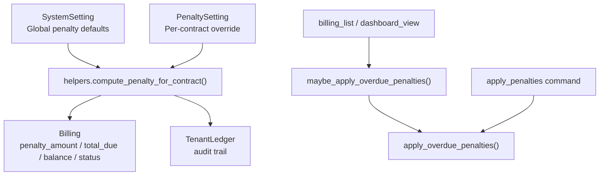
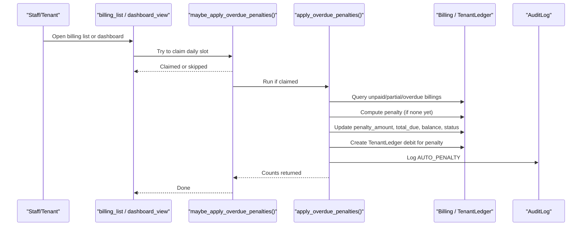
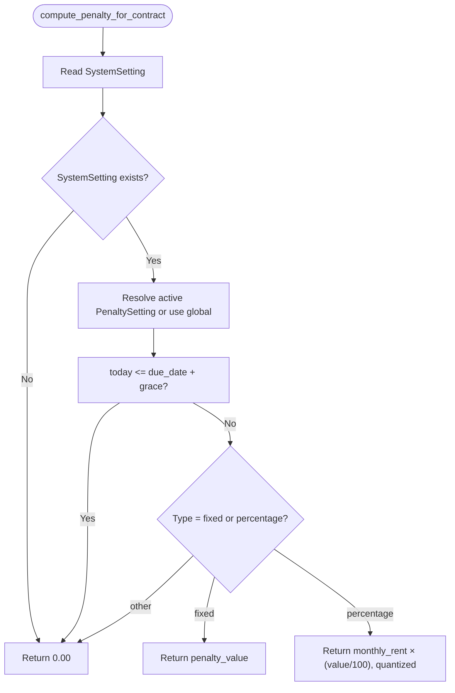
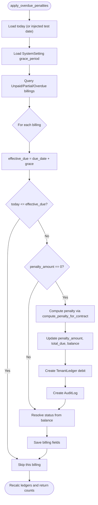
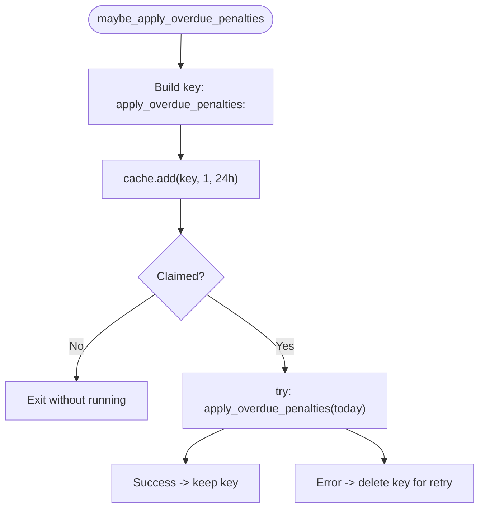
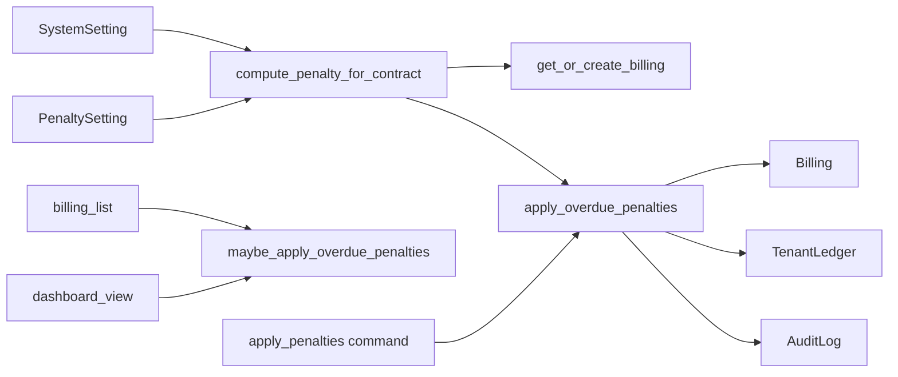
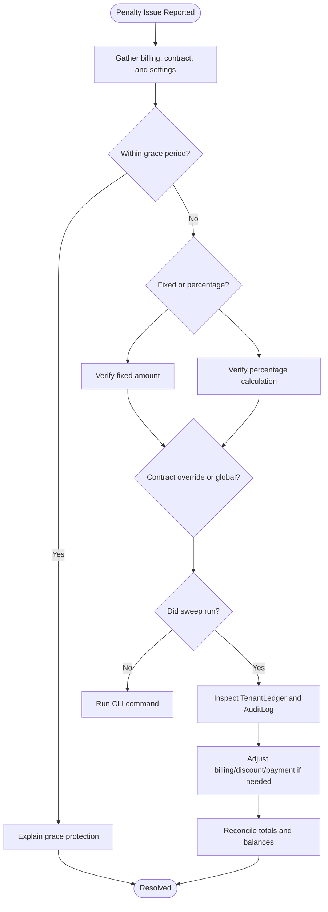

# Penalty Calculation Troubleshooting

<cite>
**Referenced Files in This Document**   
- [PENALTY_GUIDE.md](file://PENALTY_GUIDE.md)
- [core/models.py](file://core/models.py)
- [core/helpers.py](file://core/helpers.py)
- [core/views/billing.py](file://core/views/billing.py)
- [core/views/dashboard.py](file://core/views/dashboard.py)
- [core/management/commands/apply_penalties.py](file://core/management/commands/apply_penalties.py)
- [core/test_overdue_penalties.py](file://core/test_overdue_penalties.py)
- [templates/settings/form.html](file://templates/settings/form.html)
</cite>

## Table of Contents
1. [Introduction](#introduction)
2. [Project Structure](#project-structure)
3. [Core Components](#core-components)
4. [Architecture Overview](#architecture-overview)
5. [Detailed Component Analysis](#detailed-component-analysis)
6. [Dependency Analysis](#dependency-analysis)
7. [Performance Considerations](#performance-considerations)
8. [Troubleshooting Guide](#troubleshooting-guide)
9. [Conclusion](#conclusion)

## Introduction
This document focuses on troubleshooting penalty-related issues in the market rental system. It explains how penalties are computed, when they are applied, and what to check when a tenant’s bill looks incorrect. It also covers debugging tools, validation methods, manual procedures for waivers and adjustments, and edge cases such as contract renewals, partial payments, and date/timezone behavior.

The system applies **one-time late penalties**: no daily compounding, no monthly stacking. A penalty is added only after the due date plus the configured grace period, and only once per billing row.

## Project Structure
Penalty logic spans configuration models, helper functions, views, management commands, tests, and user-facing settings:

**Diagram sources**
- [core/models.py:42-68](file://core/models.py#L42-L68)
- [core/models.py:319-335](file://core/models.py#L319-L335)
- [core/models.py:190-218](file://core/models.py#L190-L218)
- [core/models.py:261-277](file://core/models.py#L261-L277)
- [core/helpers.py:132-152](file://core/helpers.py#L132-L152)
- [core/helpers.py:423-500](file://core/helpers.py#L423-L500)
- [core/helpers.py:503-519](file://core/helpers.py#L503-L519)
- [core/views/billing.py:62-70](file://core/views/billing.py#L62-L70)
- [core/views/dashboard.py:41-60](file://core/views/dashboard.py#L41-L60)
- [core/management/commands/apply_penalties.py:1-14](file://core/management/commands/apply_penalties.py#L1-L14)

**Section sources**
- [PENALTY_GUIDE.md:1-26](file://PENALTY_GUIDE.md#L1-L26)
- [core/models.py:42-68](file://core/models.py#L42-L68)
- [core/models.py:190-218](file://core/models.py#L190-L218)
- [core/models.py:319-335](file://core/models.py#L319-L335)
- [core/helpers.py:132-152](file://core/helpers.py#L132-L152)
- [core/helpers.py:423-500](file://core/helpers.py#L423-L500)
- [core/helpers.py:503-519](file://core/helpers.py#L503-L519)
- [core/views/billing.py:62-70](file://core/views/billing.py#L62-L70)
- [core/views/dashboard.py:41-60](file://core/views/dashboard.py#L41-L60)
- [core/management/commands/apply_penalties.py:1-14](file://core/management/commands/apply_penalties.py#L1-L14)

## Core Components
- **SystemSetting**: Global penalty type, value, and grace period.
- **PenaltySetting**: Per-contract override for penalty type, value, grace period, and due day.
- **Billing**: Stores `penalty_amount`, `total_due`, `balance`, `status`, and `due_date`.
- **TenantLedger**: Records penalty debits and payment credits with running balances.
- **compute_penalty_for_contract**: Central formula resolver.
- **apply_overdue_penalties**: Idempotent sweep that marks overdue bills and applies one-time penalties.
- **maybe_apply_overdue_penalties**: Request-time throttled trigger.
- **apply_penalties command**: Manual CLI entry point.

Key behaviors:
- If no `SystemSetting` exists, penalty is zero.
- Active `PenaltySetting` overrides global defaults.
- Grace period protects tenants from immediate penalties.
- Penalties are idempotent: repeated runs do not double-charge.
- Ledgers are recalculated after penalty application and payments.

**Section sources**
- [core/models.py:42-68](file://core/models.py#L42-L68)
- [core/models.py:190-218](file://core/models.py#L190-L218)
- [core/models.py:261-277](file://core/models.py#L261-L277)
- [core/models.py:319-335](file://core/models.py#L319-L335)
- [core/helpers.py:132-152](file://core/helpers.py#L132-L152)
- [core/helpers.py:423-500](file://core/helpers.py#L423-L500)
- [core/helpers.py:503-519](file://core/helpers.py#L503-L519)
- [core/management/commands/apply_penalties.py:1-14](file://core/management/commands/apply_penalties.py#L1-L14)

## Architecture Overview
The penalty engine is request-driven but throttled to run once per day per instance. Staff pages and dashboards trigger the throttle; the CLI bypasses throttling for back-fills or testing.

**Diagram sources**
- [core/views/billing.py:62-70](file://core/views/billing.py#L62-L70)
- [core/views/dashboard.py:41-60](file://core/views/dashboard.py#L41-L60)
- [core/helpers.py:503-519](file://core/helpers.py#L503-L519)
- [core/helpers.py:423-500](file://core/helpers.py#L423-L500)

## Detailed Component Analysis

### Penalty Computation Engine
The central computation function resolves settings and computes the penalty:

- Reads global `SystemSetting`.
- Checks active `PenaltySetting` on the contract.
- Uses `date.today()` and the effective due date plus grace period.
- Returns zero if within grace.
- For fixed type, returns the configured amount.
- For percentage type, calculates percentage of monthly rent and quantizes to two decimals.

**Diagram sources**
- [core/helpers.py:132-152](file://core/helpers.py#L132-L152)

**Section sources**
- [core/helpers.py:132-152](file://core/helpers.py#L132-L152)

### Overdue Sweep and Idempotency
The sweep iterates past-due billings, applies one-time penalties, updates statuses, and records ledger entries:

- Filters billings with status Unpaid, Partial, or Overdue.
- Computes effective due date using contract-specific or default grace period.
- Skips billings still within grace.
- Applies penalty only if `penalty_amount` is zero.
- Updates `total_due` and `balance`.
- Creates a `TenantLedger` debit for the penalty.
- Recalculates tenant ledger balances.
- Logs an audit entry.

**Diagram sources**
- [core/helpers.py:423-500](file://core/helpers.py#L423-L500)

**Section sources**
- [core/helpers.py:423-500](file://core/helpers.py#L423-L500)

### Throttled Trigger
The throttled trigger ensures the sweep runs at most once per day per cache instance:

- Uses a cache key based on today’s date.
- Claims the slot atomically.
- Runs the sweep inside a try/except block.
- Deletes the key on error so retries are possible.

**Diagram sources**
- [core/helpers.py:503-519](file://core/helpers.py#L503-L519)

**Section sources**
- [core/helpers.py:503-519](file://core/helpers.py#L503-L519)

### Billing Generation and View-Level Penalty Logic
Billing generation routes compute penalties when creating billings manually or in bulk. The view-level helper mirrors the core logic but uses Python floats rather than Decimal, which can introduce rounding differences during generation.

- `billing_generate` and `billing_generate_all` create billings and initial ledger rows.
- They call a local `compute_penalty` that duplicates core logic.
- `billing_list` triggers current-month billing creation and the throttled sweep.

**Section sources**
- [core/views/billing.py:29-51](file://core/views/billing.py#L29-L51)
- [core/views/billing.py:174-246](file://core/views/billing.py#L174-L246)
- [core/views/billing.py:249-315](file://core/views/billing.py#L249-L315)
- [core/views/billing.py:62-70](file://core/views/billing.py#L62-L70)

### Dashboard Integration
The dashboard calls the throttled sweep for collectors and other non-tenant roles to keep overdue status current.

**Section sources**
- [core/views/dashboard.py:41-60](file://core/views/dashboard.py#L41-L60)
- [core/views/dashboard.py:97-101](file://core/views/dashboard.py#L97-L101)

### Management Command
The CLI command provides an unthrottled entry point for applying overdue penalties, useful for testing or back-filling historical data.

**Section sources**
- [core/management/commands/apply_penalties.py:1-14](file://core/management/commands/apply_penalties.py#L1-L14)

### Tests
Tests validate overdue marking, one-time penalty application, grace period behavior, seeded overdue handling, and throttling.

**Section sources**
- [core/test_overdue_penalties.py:15-58](file://core/test_overdue_penalties.py#L15-L58)
- [core/test_overdue_penalties.py:60-95](file://core/test_overdue_penalties.py#L60-L95)

## Dependency Analysis
Penalty-related dependencies flow from configuration to computation, then to persistence and auditing:

**Diagram sources**
- [core/models.py:42-68](file://core/models.py#L42-L68)
- [core/models.py:319-335](file://core/models.py#L319-L335)
- [core/helpers.py:132-152](file://core/helpers.py#L132-L152)
- [core/helpers.py:155-205](file://core/helpers.py#L155-L205)
- [core/helpers.py:423-500](file://core/helpers.py#L423-L500)
- [core/views/billing.py:62-70](file://core/views/billing.py#L62-L70)
- [core/views/dashboard.py:41-60](file://core/views/dashboard.py#L41-L60)
- [core/management/commands/apply_penalties.py:1-14](file://core/management/commands/apply_penalties.py#L1-L14)

**Section sources**
- [core/models.py:42-68](file://core/models.py#L42-L68)
- [core/models.py:319-335](file://core/models.py#L319-L335)
- [core/helpers.py:132-152](file://core/helpers.py#L132-L152)
- [core/helpers.py:155-205](file://core/helpers.py#L155-L205)
- [core/helpers.py:423-500](file://core/helpers.py#L423-L500)
- [core/views/billing.py:62-70](file://core/views/billing.py#L62-L70)
- [core/views/dashboard.py:41-60](file://core/views/dashboard.py#L41-L60)
- [core/management/commands/apply_penalties.py:1-14](file://core/management/commands/apply_penalties.py#L1-L14)

## Performance Considerations
- The sweep queries billings with select_related to reduce N+1 lookups.
- The throttled trigger prevents repeated sweeps on busy pages.
- Ledger recalculation runs after penalty application and payments to maintain consistency.
- Avoid running the CLI command frequently in production; prefer the throttled trigger unless performing targeted back-fills.

[No sources needed since this section provides general guidance]

## Troubleshooting Guide

### Common Scenarios

#### Grace Period Miscalculations
Symptoms:
- Penalty appears too early.
- Penalty does not appear after the expected grace window.

Checks:
- Confirm the billing’s `due_date`.
- Confirm whether the contract has an active `PenaltySetting` overriding the global grace period.
- Verify the effective due date: `due_date + grace_period`.
- Ensure the sweep ran after the grace period ended.

Validation steps:
- Open the billing and inspect `due_date`, `penalty_amount`, and `status`.
- Run the CLI command to force a sweep and observe whether the penalty is applied.
- Compare the tenant’s actual payment date against `due_date + grace_period`.

Root causes:
- Global grace period changed after billing was created.
- Contract-specific penalty rule introduced a different grace period.
- Sweep did not run before checking the bill.

**Section sources**
- [core/helpers.py:132-152](file://core/helpers.py#L132-L152)
- [core/helpers.py:423-500](file://core/helpers.py#L423-L500)
- [core/test_overdue_penalties.py:69-74](file://core/test_overdue_penalties.py#L69-L74)

#### Percentage vs Fixed Penalty Errors
Symptoms:
- Penalty seems too high or too low compared to expectations.
- Different tenants with different rents have identical penalties when expecting proportional charges.

Checks:
- Determine whether the active rule is `percentage` or `fixed`.
- For percentage mode, verify the penalty value represents a percent (e.g., 2 means 2%).
- For fixed mode, confirm the configured peso amount.
- Check whether a contract-specific `PenaltySetting` overrides the global setting.

Validation steps:
- Inspect `SystemSetting.penalty_type` and `penalty_value`.
- Inspect the first active `PenaltySetting` for the contract.
- Re-run the sweep and compare the resulting `penalty_amount`.

Root causes:
- Admin set fixed penalty while expecting percentage.
- Contract override changed the rule unexpectedly.
- Misunderstanding between “percent” and “peso”.

**Section sources**
- [core/models.py:42-68](file://core/models.py#L42-L68)
- [core/models.py:319-335](file://core/models.py#L319-L335)
- [core/helpers.py:132-152](file://core/helpers.py#L132-L152)
- [PENALTY_GUIDE.md:44-56](file://PENALTY_GUIDE.md#L44-L56)

#### Overdue Account Handling
Symptoms:
- Bill remains `Unpaid` even though it should be `Overdue`.
- Penalty not applied despite being late.
- Balance does not reflect the penalty.

Checks:
- Confirm the billing is included in the sweep by checking its status (`Unpaid`, `Partial`, or `Overdue`).
- Confirm the effective due date has passed.
- Confirm the billing’s `penalty_amount` is zero before the sweep.
- Check whether the throttled trigger actually ran on the relevant day.

Validation steps:
- Use the CLI command to force a sweep and review output counts.
- Inspect `TenantLedger` for a penalty debit row.
- Inspect `AuditLog` for an `AUTO_PENALTY` entry.

Root causes:
- Grace period still active.
- No `SystemSetting` configured.
- Throttled trigger failed and key was deleted, preventing retries until next day.
- Billing was seeded directly as `Overdue` without a prior penalty.

**Section sources**
- [core/helpers.py:423-500](file://core/helpers.py#L423-L500)
- [core/helpers.py:503-519](file://core/helpers.py#L503-L519)
- [core/test_overdue_penalties.py:76-83](file://core/test_overdue_penalties.py#L76-L83)

### Debugging Tools for Financial Calculations

- **CLI Back-fill**: Run the penalty command to force evaluation across all eligible billings.
- **Test Suite**: Use the overdue penalty tests as a reference for expected behavior.
- **Ledger Inspection**: Check `TenantLedger` for penalty debits and payment credits.
- **Audit Trail**: Check `AuditLog` for automatic penalty actions.
- **Settings Review**: Confirm `SystemSetting` and contract `PenaltySetting` values.

Recommended procedure:
1. Identify the affected billing and contract.
2. Record the global and contract-specific penalty rules.
3. Record the billing’s `due_date`, `penalty_amount`, `total_due`, `balance`, and `status`.
4. Run the CLI command and capture the counts.
5. Refresh the billing and ledger rows.
6. Compare expected vs actual values.

**Section sources**
- [core/management/commands/apply_penalties.py:1-14](file://core/management/commands/apply_penalties.py#L1-L14)
- [core/test_overdue_penalties.py:15-95](file://core/test_overdue_penalties.py#L15-L95)
- [core/models.py:190-218](file://core/models.py#L190-L218)
- [core/models.py:261-277](file://core/models.py#L261-L277)

### Validation Methods for Penalty Accuracy

- **Idempotency**: Running the sweep multiple times must not increase `penalty_amount`.
- **Grace Window**: Bills within `due_date + grace_period` must remain penalty-free.
- **Percentage Rounding**: Percentage penalties should be quantized to two decimal places.
- **Ledger Consistency**: After penalties and payments, running balances must match debits minus credits.
- **Status Resolution**: `Paid` only when balance is zero; otherwise `Unpaid`, `Partial`, or `Overdue`.

Validation checklist:
- Confirm no duplicate penalty ledger rows for the same billing.
- Confirm `total_due = rental_amount + penalty_amount - discount`.
- Confirm `balance = total_due - amount_paid`.
- Confirm `status` matches settlement state.
- Confirm audit logs exist for automatic penalties.

**Section sources**
- [core/helpers.py:132-152](file://core/helpers.py#L132-L152)
- [core/helpers.py:423-500](file://core/helpers.py#L423-L500)
- [core/test_overdue_penalties.py:47-67](file://core/test_overdue_penalties.py#L47-L67)

### Procedures for Penalty Waivers and Manual Adjustments

There is no dedicated waiver model in the analyzed code. In practice, adjustments are handled through billing edits and payment flows:

- **Waiver via Discount**: Reduce `discount` on the billing to offset the penalty.
- **Manual Adjustment via Edit**: Edit the billing to adjust `penalty_amount`, `total_due`, and `balance`, then reconcile the ledger.
- **Payment Correction**: Use the payment recording path to post corrections and let `record_payment` recompute billing totals and ledger balances.

Important notes:
- Editing billings updates the corresponding ledger debit and recalculates the tenant ledger chain.
- Payment recording locks the billing row and recomputes totals authoritatively.
- Always record changes in remarks and rely on audit trails where applicable.

Recommended procedure:
1. Identify the billing and the reason for adjustment.
2. Decide whether to adjust discount, penalty, or both.
3. Edit the billing and verify `total_due` and `balance`.
4. If correcting payments, use the collection/payment flow to ensure authoritative recomputation.
5. Reconcile the tenant ledger and confirm running balances.
6. Document the change in remarks and audit context.

**Section sources**
- [core/views/billing.py:373-412](file://core/views/billing.py#L373-L412)
- [core/helpers.py:351-420](file://core/helpers.py#L351-L420)

### Historical Penalty Corrections

Use the CLI command for back-fills:

- Run the command to apply overdue status and penalties retroactively.
- Inspect newly created ledger debits and audit logs.
- If necessary, follow up with manual billing edits to correct anomalies.

Caution:
- The CLI command bypasses throttling and may affect many billings.
- Prefer targeted fixes when possible.

**Section sources**
- [core/management/commands/apply_penalties.py:1-14](file://core/management/commands/apply_penalties.py#L1-L14)
- [core/helpers.py:423-500](file://core/helpers.py#L423-L500)

### Edge Cases

#### Contract Renewals
- New contracts or renewed periods generate new billings per month/year.
- Each billing is evaluated independently for penalties.
- Active contract renewal may create future billings; penalties apply only when those specific billings become overdue.

Checks:
- Confirm the renewal created a new `RentalContract`.
- Confirm billings exist for the renewed months.
- Confirm the active `PenaltySetting` applies to the renewed contract.

**Section sources**
- [core/helpers.py:208-235](file://core/helpers.py#L208-L235)
- [core/helpers.py:238-257](file://core/helpers.py#L238-L257)

#### Partial Payments Affecting Penalties
- Partial payments update `amount_paid`, `balance`, and `status`.
- Penalties are already stamped on the billing; partial payments do not remove them unless you explicitly adjust the billing.
- The payment recording path recomputes billing totals and ledger balances.

Checks:
- Confirm the penalty was applied before the partial payment.
- Confirm the remaining balance reflects the penalty.
- Confirm ledger credits match payment amounts.

**Section sources**
- [core/helpers.py:321-348](file://core/helpers.py#L321-L348)
- [core/helpers.py:351-420](file://core/helpers.py#L351-L420)

#### System Date and Time Zone Issues
- Penalty computation uses `date.today()`, not timezone-aware datetime.
- Due dates are constructed with `safe_due_date`, which handles end-of-month edges.
- Display templates sometimes pass timezone-aware `now` for UI purposes, but penalty logic relies on naive dates.

Checks:
- Confirm the server’s system date is correct.
- Confirm the intended due day is valid for the billing month.
- Be aware that changing the server date can retroactively trigger penalties.

**Section sources**
- [core/helpers.py:125-129](file://core/helpers.py#L125-L129)
- [core/helpers.py:145-152](file://core/helpers.py#L145-L152)
- [core/views/billing.py:670-678](file://core/views/billing.py#L670-L678)

### Quick Diagnostic Flow

[No sources needed since this diagram shows conceptual workflow, not actual code structure]

## Conclusion
Penalty issues usually trace back to three areas: settings resolution, grace period timing, and sweep execution. Use the CLI command to force evaluation, inspect `TenantLedger` and `AuditLog` for evidence, and validate that the active rule is what business policy expects. For waivers and corrections, prefer documented billing edits and payment flows, then reconcile ledgers. Pay special attention to contract renewals, partial payments, and server date correctness, since these commonly cause apparent miscalculations.

[No sources needed since this section summarizes without analyzing specific files]