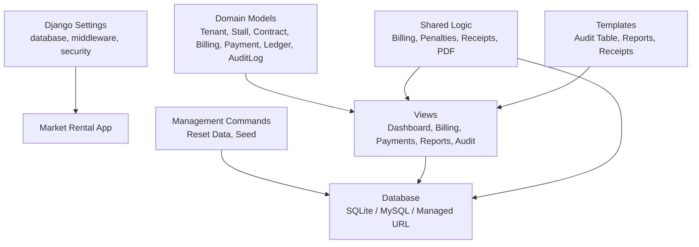
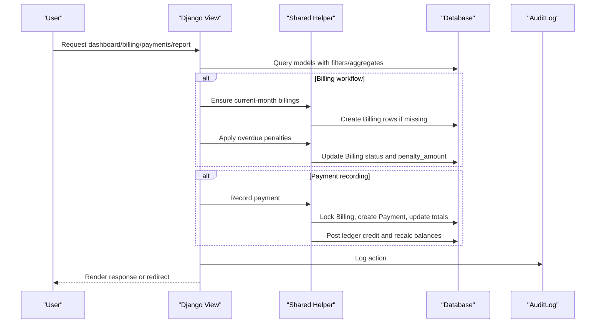
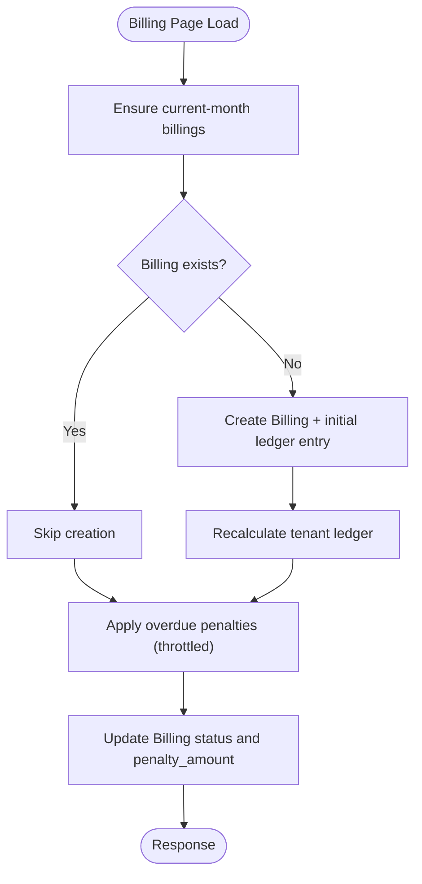
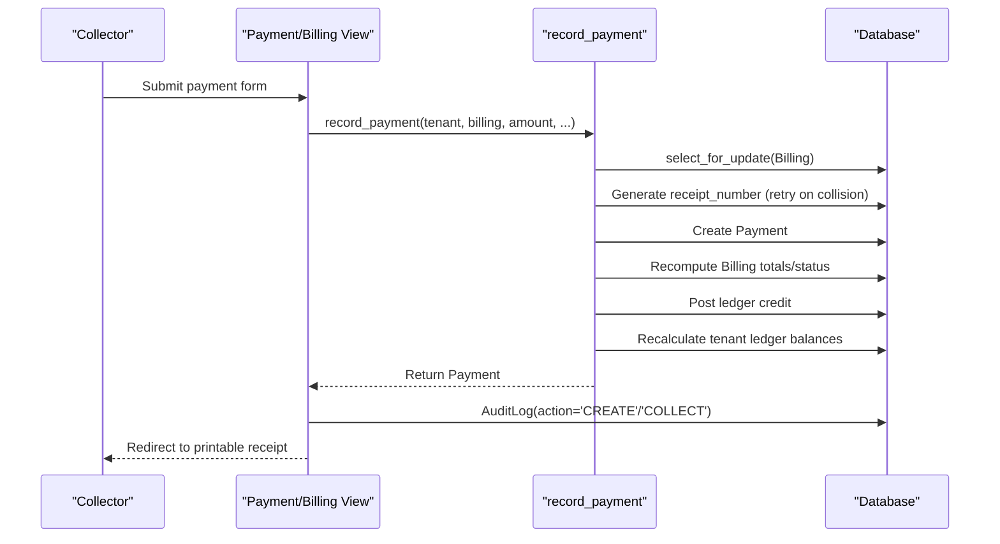
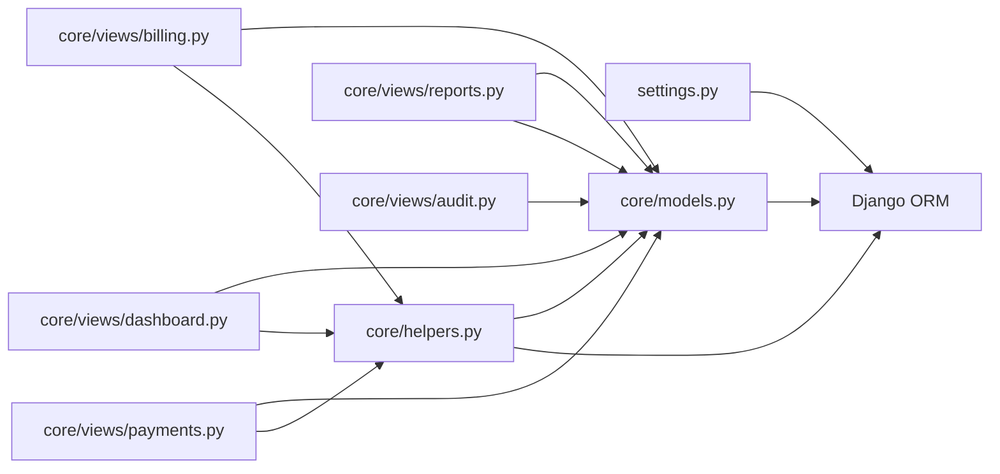

# Performance & Diagnostics

<cite>
**Referenced Files in This Document**
- [settings.py](file://market_rental/settings.py)
- [models.py](file://core/models.py)
- [helpers.py](file://core/helpers.py)
- [dashboard.py](file://core/views/dashboard.py)
- [billing.py](file://core/views/billing.py)
- [payments.py](file://core/views/payments.py)
- [reports.py](file://core/views/reports.py)
- [audit.py](file://core/views/audit.py)
- [_table.html](file://templates/audit/_table.html)
- [reset_market_data.py](file://core/management/commands/reset_market_data.py)
</cite>

## Table of Contents
1. [Introduction](#introduction)
2. [Project Structure](#project-structure)
3. [Core Components](#core-components)
4. [Architecture Overview](#architecture-overview)
5. [Detailed Component Analysis](#detailed-component-analysis)
6. [Dependency Analysis](#dependency-analysis)
7. [Performance Considerations](#performance-considerations)
8. [Troubleshooting Guide](#troubleshooting-guide)
9. [Conclusion](#conclusion)
10. [Appendices](#appendices)

## Introduction
This document provides a performance and diagnostics guide for the Public Market Rental and Collection Management System. It focuses on identifying slow queries, optimizing database access, improving billing and payment workflows, enabling monitoring through audit logs, and preparing the system for load testing and production tuning. The guidance is grounded in the actual Django application code: settings, models, helpers, views, templates, and management commands.

The system currently uses SQLite by default for development, with MySQL or a managed database URL supported in production. Billing, payments, penalties, reports, and audit trails are central to performance-sensitive operations.

## Project Structure
The repository follows a standard Django layout:
- `market_rental/settings.py` configures the runtime environment, database connection, middleware, static files, and security behavior.
- `core/models.py` defines the domain entities such as Tenant, Stall, RentalContract, Billing, Payment, TenantLedger, Notice, AuditLog, and SystemSetting.
- `core/helpers.py` contains shared financial logic, including idempotent billing creation, penalty accrual, receipt numbering, ledger recalculation, and PDF rendering fallbacks.
- `core/views/*` implements request handling for dashboard, billing, payments, reports, and audit log browsing.
- `templates/*` contains UI templates, including an audit log table view.
- `core/management/commands/*` includes operational utilities such as data reset and seed commands.

**Diagram sources**
- [settings.py:1-200](file://market_rental/settings.py#L1-L200)
- [models.py:1-336](file://core/models.py#L1-L336)
- [helpers.py:1-595](file://core/helpers.py#L1-L595)
- [dashboard.py:1-165](file://core/views/dashboard.py#L1-L165)
- [billing.py:1-765](file://core/views/billing.py#L1-L765)
- [payments.py:1-653](file://core/views/payments.py#L1-L653)
- [reports.py:1-775](file://core/views/reports.py#L1-L775)
- [audit.py:1-60](file://core/views/audit.py#L1-L60)

**Section sources**
- [settings.py:1-200](file://market_rental/settings.py#L1-L200)
- [models.py:1-336](file://core/models.py#L1-L336)

## Core Components
This section maps the performance-critical components and their responsibilities:

- Database configuration and connection pooling:
  - Production database URLs use connection health checks and max age.
  - Local MySQL bootstrap creates the database if missing.
  - SQLite is used when no external database URL is provided.

- Domain models:
  - Financial entities include Billing, Payment, TenantLedger, RentalContract, and PenaltySetting.
  - AuditLog records user actions for accountability and diagnostics.

- Shared helpers:
  - Idempotent billing generation per contract month.
  - Overdue penalty accrual with cache-based throttling.
  - Receipt number generation with retry on collision.
  - Authoritative billing recomputation from valid payments.
  - Tenant ledger balance recalculation.
  - PDF export with WeasyPrint and fallbacks.

- Views:
  - Dashboard aggregates market-wide and role-scoped metrics.
  - Billing list and collection workflows ensure current billings and apply overdue penalties.
  - Payments handle recording, editing, voiding, batch receipts, and exports.
  - Reports provide daily, weekly, monthly, annual, section, collector, paid/unpaid tenant, overdue, occupancy, vacant, and ledger views.
  - Audit log view supports filtering and pagination.

**Section sources**
- [settings.py:73-152](file://market_rental/settings.py#L73-L152)
- [models.py:42-336](file://core/models.py#L42-L336)
- [helpers.py:155-520](file://core/helpers.py#L155-L520)
- [dashboard.py:12-165](file://core/views/dashboard.py#L12-L165)
- [billing.py:62-765](file://core/views/billing.py#L62-L765)
- [payments.py:186-653](file://core/views/payments.py#L186-L653)
- [reports.py:40-775](file://core/views/reports.py#L40-L775)
- [audit.py:1-60](file://core/views/audit.py#L1-L60)

## Architecture Overview
The request flow typically involves:
1. A user accesses a page (dashboard, billing, payments, reports).
2. The view loads data using Django ORM with aggregation and filtering.
3. For billing-related pages, the system ensures current-month billings exist and may apply overdue penalties.
4. Payment recording updates Billing totals, posts a TenantLedger credit, and recomputes balances.
5. AuditLog entries record significant actions.
6. Reports render tables and optionally export PDF or Excel.

**Diagram sources**
- [dashboard.py:41-165](file://core/views/dashboard.py#L41-L165)
- [billing.py:62-765](file://core/views/billing.py#L62-L765)
- [payments.py:250-518](file://core/views/payments.py#L250-L518)
- [helpers.py:238-520](file://core/helpers.py#L238-L520)

## Detailed Component Analysis

### Database Configuration and Connection Health
- Production databases are configured via `DATABASE_URL`, with connection health checks enabled and SSL required outside debug mode.
- Local MySQL setup auto-creates the database if missing.
- SQLite remains the zero-config fallback.

Key implications for performance:
- Connection pooling and health checks reduce connection churn and detect stale connections.
- SSL enforcement improves security but adds TLS overhead; ensure network latency is optimized.
- SQLite is not suitable for high-concurrency production workloads.

**Section sources**
- [settings.py:73-152](file://market_rental/settings.py#L73-L152)

### Billing Generation and Overdue Penalties
- Billing generation is idempotent per contract and month, preventing duplicate bills.
- Current-month billings are ensured automatically for collectors and management roles.
- Overdue penalties are applied based on grace periods and penalty settings, with one-time accrual protection.
- Cache-based throttling ensures penalties run at most once per day per cache instance.

**Diagram sources**
- [helpers.py:155-257](file://core/helpers.py#L155-L257)
- [helpers.py:423-520](file://core/helpers.py#L423-L520)
- [billing.py:62-765](file://core/views/billing.py#L62-L765)

**Section sources**
- [helpers.py:155-257](file://core/helpers.py#L155-L257)
- [helpers.py:423-520](file://core/helpers.py#L423-L520)
- [billing.py:62-765](file://core/views/billing.py#L62-L765)

### Payment Recording and Concurrency Safety
- Payment recording is centralized in a helper that locks the target Billing row, creates a Payment, recomputes Billing totals, posts a ledger credit, and recalculates running balances.
- Receipt number generation retries on integrity errors to avoid collisions.
- Batch collections share a consolidated official receipt number while keeping internal receipt numbers unique.

**Diagram sources**
- [helpers.py:351-420](file://core/helpers.py#L351-L420)
- [payments.py:250-518](file://core/views/payments.py#L250-L518)
- [billing.py:415-634](file://core/views/billing.py#L415-L634)

**Section sources**
- [helpers.py:351-420](file://core/helpers.py#L351-L420)
- [payments.py:250-518](file://core/views/payments.py#L250-L518)
- [billing.py:415-634](file://core/views/billing.py#L415-L634)

### Reports and Exports
- Reports aggregate Payment and Billing data across date ranges, months, sections, and collectors.
- PDF export uses WeasyPrint with fallbacks to xhtml2pdf or HTML preview.
- Excel export uses openpyxl and formats headers and columns.

Performance considerations:
- Large date ranges can produce heavy queries; consider indexing and pagination.
- PDF generation is CPU-intensive; offload to background tasks in production.
- Excel export iterates over querysets; prefer streaming or chunked processing for very large datasets.

**Section sources**
- [reports.py:40-775](file://core/views/reports.py#L40-L775)
- [helpers.py:522-595](file://core/helpers.py#L522-L595)

### Audit Logging and Diagnostics
- AuditLog captures user actions, modules, descriptions, and IP addresses.
- The audit view supports filtering by user, action, module, date range, and free-text search.
- Pagination limits results to improve responsiveness.

Diagnostic usage:
- Use audit logs to trace payment edits, voids, billing generation, and penalty applications.
- Combine audit logs with database query analysis to correlate slow requests with specific actions.

**Section sources**
- [models.py:304-316](file://core/models.py#L304-L316)
- [audit.py:1-60](file://core/views/audit.py#L1-L60)
- [_table.html:32-64](file://templates/audit/_table.html#L32-L64)

## Dependency Analysis
The following diagram shows how core components depend on each other:

**Diagram sources**
- [settings.py:1-200](file://market_rental/settings.py#L1-L200)
- [models.py:1-336](file://core/models.py#L1-L336)
- [helpers.py:1-595](file://core/helpers.py#L1-L595)
- [dashboard.py:1-165](file://core/views/dashboard.py#L1-L165)
- [billing.py:1-765](file://core/views/billing.py#L1-L765)
- [payments.py:1-653](file://core/views/payments.py#L1-L653)
- [reports.py:1-775](file://core/views/reports.py#L1-L775)
- [audit.py:1-60](file://core/views/audit.py#L1-L60)

**Section sources**
- [settings.py:1-200](file://market_rental/settings.py#L1-L200)
- [models.py:1-336](file://core/models.py#L1-L336)
- [helpers.py:1-595](file://core/helpers.py#L1-L595)
- [dashboard.py:1-165](file://core/views/dashboard.py#L1-L165)
- [billing.py:1-765](file://core/views/billing.py#L1-L765)
- [payments.py:1-653](file://core/views/payments.py#L1-L653)
- [reports.py:1-775](file://core/views/reports.py#L1-L775)
- [audit.py:1-60](file://core/views/audit.py#L1-L60)

## Performance Considerations

### Slow Query Identification
- Enable Django’s query logging in development by setting `DEBUG=True`. This exposes SQL statements executed during request handling.
- Use database-specific tools:
  - SQLite: enable query tracing or profile via external tools.
  - MySQL/MariaDB: enable slow query log and analyze with `mysqldumpslow` or database dashboards.
  - PostgreSQL: enable `log_min_duration_statement` and review `pg_stat_statements`.
- Correlate slow requests with audit log actions to identify problematic endpoints (e.g., report exports, bulk billing generation).

**Section sources**
- [settings.py:19-26](file://market_rental/settings.py#L19-L26)
- [audit.py:1-60](file://core/views/audit.py#L1-L60)

### Database Optimization Techniques
- Index frequently filtered fields:
  - `Billing.billing_month`, `Billing.billing_year`, `Billing.status`
  - `Payment.payment_date`, `Payment.status`, `Payment.collected_by`
  - `RentalContract.status`, `RentalContract.start_date`, `RentalContract.end_date`
  - `Stall.section_id`, `Stall.status`
  - `Tenant.status`, `Tenant.tenant_id`
- Prefer `select_related` and `prefetch_related` where relationships are traversed in views and helpers.
- Avoid N+1 queries in loops; aggregate in the database using `Sum`, `Count`, and `annotate`.
- Use `select_for_update` around critical financial updates to prevent race conditions.

Evidence in code:
- Views consistently use `select_related` for related objects.
- Aggregations compute totals efficiently.
- Helpers lock Billing rows during payment recording.

**Section sources**
- [dashboard.py:12-165](file://core/views/dashboard.py#L12-L165)
- [billing.py:62-765](file://core/views/billing.py#L62-L765)
- [payments.py:186-653](file://core/views/payments.py#L186-L653)
- [helpers.py:351-420](file://core/helpers.py#L351-L420)

### Caching Strategies
- Overdue penalty application is throttled using Django’s cache backend (`cache.add`) to run once per day per cache instance.
- Consider caching:
  - System settings (`SystemSetting.objects.first()`)
  - Lookup tables (MarketSection, StallType)
  - Dashboard aggregates for short intervals
- Use cache keys scoped by tenant or role where appropriate to avoid cross-user contamination.

**Section sources**
- [helpers.py:503-520](file://core/helpers.py#L503-L520)

### Monitoring Approaches and Health Checks
- AuditLog provides an in-app audit trail for critical actions.
- Add explicit health check endpoints:
  - Database connectivity test
  - Cache availability test
  - PDF generator availability test
- Monitor request latency and error rates per endpoint using application metrics or APM tools.

**Section sources**
- [models.py:304-316](file://core/models.py#L304-L316)
- [helpers.py:522-595](file://core/helpers.py#L522-L595)

### System Resource Utilization Tracking
- Track CPU and memory usage during:
  - Report PDF generation
  - Bulk billing generation
  - Ledger recalculation
- Use process-level monitoring (systemd, Docker stats, cloud provider metrics) and application profiling.

[No sources needed since this section provides general guidance]

### Profiling Tools Usage
- Python profiling:
  - `cProfile` for function-level profiling
  - `django-silk` for request-level profiling and SQL inspection
- Database profiling:
  - Enable slow query logs
  - Analyze query plans with EXPLAIN
- Memory leak detection:
  - Use `objgraph` or `tracemalloc` to track object growth
  - Review long-lived querysets and cached objects

[No sources needed since this section provides general guidance]

### CPU Bottleneck Identification
- Identify hotspots in:
  - Report PDF generation (WeasyPrint/xhtml2pdf)
  - Ledger recalculation loops
  - Bulk billing generation
- Optimize by:
  - Offloading PDF generation to background workers
  - Chunking large ledger recalculations
  - Precomputing and caching aggregates

**Section sources**
- [helpers.py:522-595](file://core/helpers.py#L522-L595)
- [helpers.py:260-273](file://core/helpers.py#L260-L273)
- [billing.py:249-315](file://core/views/billing.py#L249-L315)

### Scaling Considerations
- Move from SQLite to MySQL or a managed database service.
- Scale horizontally with multiple WSGI workers behind a reverse proxy.
- Use read replicas for reporting-heavy endpoints.
- Implement background jobs for heavy tasks (PDF export, bulk billing, penalty accrual).

**Section sources**
- [settings.py:73-152](file://market_rental/settings.py#L73-L152)

### Load Testing Methodologies
- Use tools like Locust, k6, or Apache JMeter to simulate concurrent collectors and report users.
- Measure:
  - Response time per endpoint
  - Database query count and duration
  - Error rate under load
- Focus tests on:
  - Billing list and collection
  - Payment recording and batch receipts
  - Report exports

[No sources needed since this section provides general guidance]

### Production Performance Tuning
- Set `DEBUG=False` and configure `ALLOWED_HOSTS`.
- Enable HTTPS and secure cookies.
- Collect static files and serve via a CDN or optimized static server.
- Tune database connection pool size and timeouts.
- Monitor cache backend performance and eviction policies.

**Section sources**
- [settings.py:19-26](file://market_rental/settings.py#L19-L26)
- [settings.py:174-190](file://market_rental/settings.py#L174-L190)

## Troubleshooting Guide

### Diagnosing Slow Requests
- Enable query logging in development.
- Inspect audit logs for the affected user and action.
- Reproduce the request and capture the generated SQL.
- Analyze query execution plans and add indexes where necessary.

**Section sources**
- [settings.py:19-26](file://market_rental/settings.py#L19-L26)
- [audit.py:1-60](file://core/views/audit.py#L1-L60)

### Resolving Billing Inconsistencies
- Use authoritative recomputation:
  - Call `recalc_billing_from_payments` to reconcile Billing totals from valid Payments.
- Verify ledger consistency:
  - Call `recalc_tenant_ledger` to fix running balances.
- Check for duplicate or voided payments affecting totals.

**Section sources**
- [helpers.py:321-348](file://core/helpers.py#L321-L348)
- [helpers.py:260-273](file://core/helpers.py#L260-L273)
- [payments.py:460-518](file://core/views/payments.py#L460-L518)

### Handling Overdue Penalties
- Ensure grace period and penalty settings are correct.
- Confirm that `maybe_apply_overdue_penalties` ran successfully.
- Check AuditLog for `AUTO_PENALTY` entries.

**Section sources**
- [helpers.py:423-520](file://core/helpers.py#L423-L520)
- [models.py:319-336](file://core/models.py#L319-L336)

### Investigating PDF Export Failures
- Check WeasyPrint system dependencies.
- Review fallback messages in the HTML preview.
- Validate template rendering without PDF conversion.

**Section sources**
- [helpers.py:522-595](file://core/helpers.py#L522-L595)

### Resetting Development Data Safely
- Use the reset command with dry-run first.
- Confirm non-production guard and interactive confirmation.
- Understand which tables are deleted versus kept.

**Section sources**
- [reset_market_data.py:94-122](file://core/management/commands/reset_market_data.py#L94-L122)
- [reset_market_data.py:126-147](file://core/management/commands/reset_market_data.py#L126-L147)
- [reset_market_data.py:236-247](file://core/management/commands/reset_market_data.py#L236-L247)

## Conclusion
The system’s performance hinges on efficient database access, careful financial computation, and robust auditing. Key areas for optimization include indexing, query shaping, caching, and offloading heavy tasks. Monitoring through audit logs and database tools enables rapid diagnosis. For production, migrate away from SQLite, enforce security settings, and implement scalable infrastructure with background processing and comprehensive observability.

[No sources needed since this section summarizes without analyzing specific files]

## Appendices

### Diagnostic Commands and Procedures
- Enable query logging:
  - Set `DJANGO_DEBUG=true` in development.
- Database slow query analysis:
  - MySQL: enable slow query log and analyze with `mysqldumpslow`.
  - PostgreSQL: enable `log_min_duration_statement` and review `pg_stat_statements`.
- Application profiling:
  - Use `cProfile` or `django-silk`.
- Load testing:
  - Simulate concurrent requests with Locust or k6.
- Health checks:
  - Add endpoints for database, cache, and PDF generator status.

[No sources needed since this section provides general guidance]