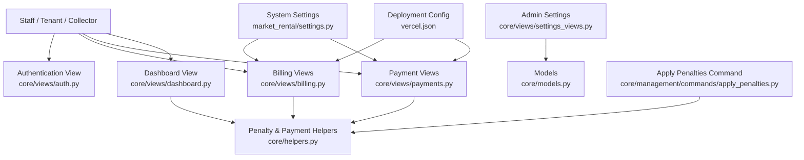
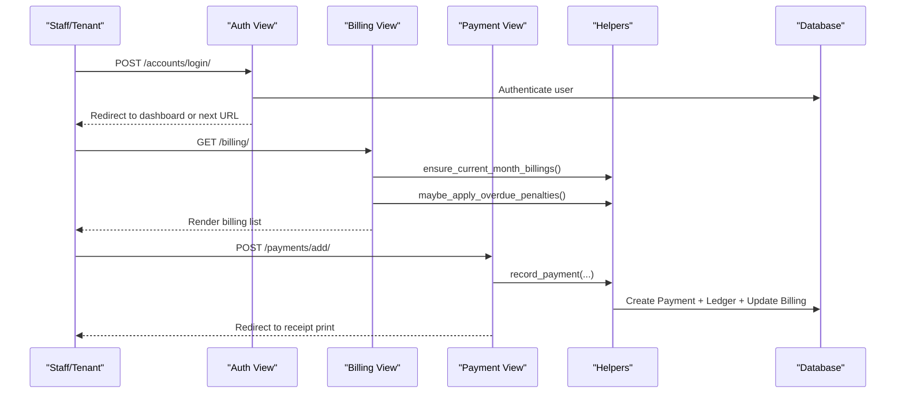
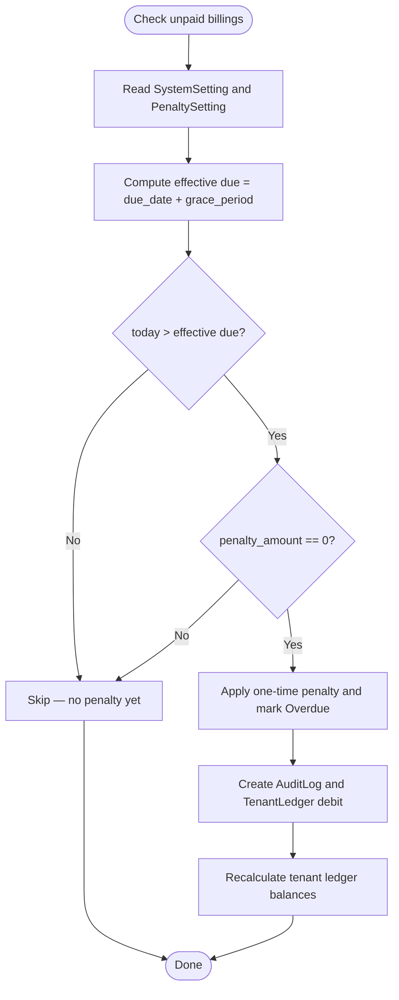
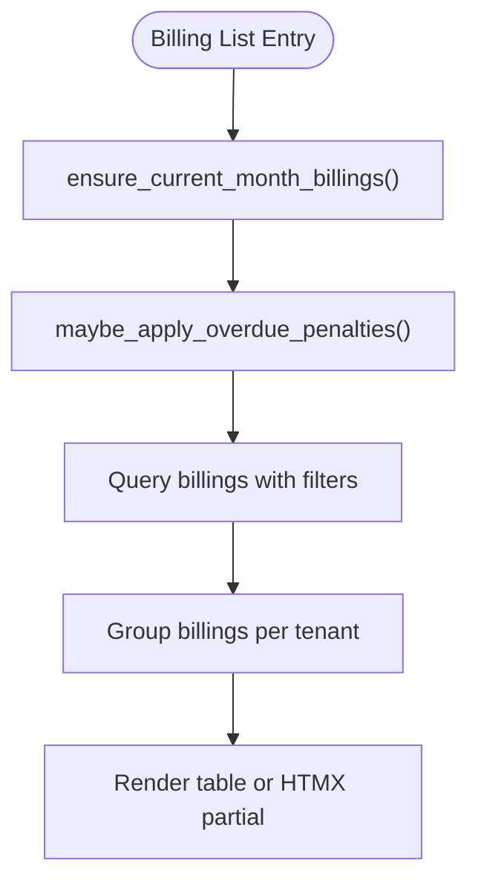
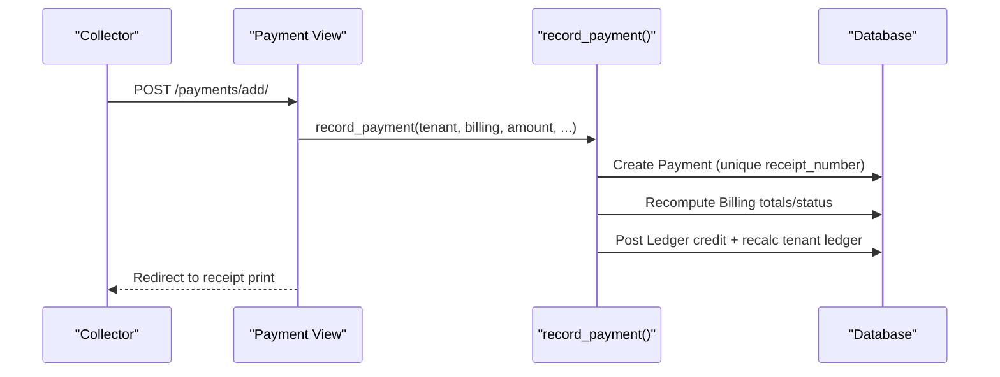
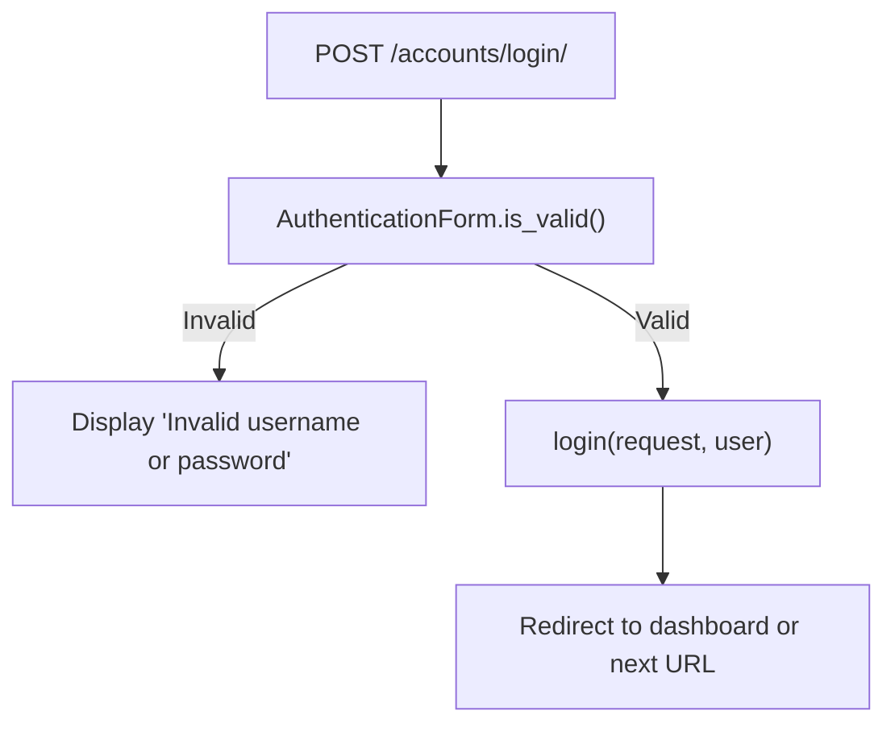
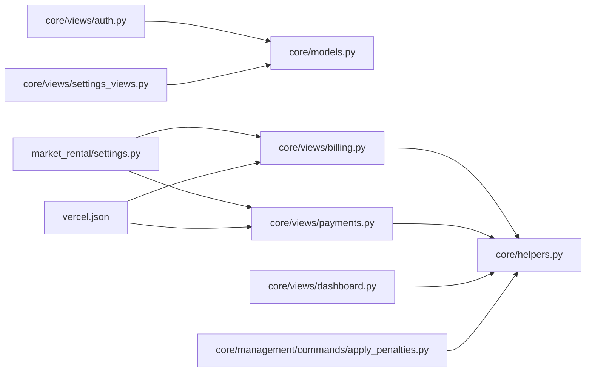

# Troubleshooting & FAQ

<cite>
**Referenced Files in This Document**
- [PENALTY_GUIDE.md](file://PENALTY_GUIDE.md)
- [README.MD](file://README.MD)
- [credentials.md](file://credentials.md)
- [core/helpers.py](file://core/helpers.py)
- [core/models.py](file://core/models.py)
- [core/views/auth.py](file://core/views/auth.py)
- [core/views/billing.py](file://core/views/billing.py)
- [core/views/payments.py](file://core/views/payments.py)
- [core/views/dashboard.py](file://core/views/dashboard.py)
- [core/views/settings_views.py](file://core/views/settings_views.py)
- [core/management/commands/apply_penalties.py](file://core/management/commands/apply_penalties.py)
- [market_rental/settings.py](file://market_rental/settings.py)
- [vercel.json](file://vercel.json)
</cite>

## Table of Contents
1. [Introduction](#introduction)
2. [Project Structure](#project-structure)
3. [Core Components](#core-components)
4. [Architecture Overview](#architecture-overview)
5. [Detailed Component Analysis](#detailed-component-analysis)
6. [Dependency Analysis](#dependency-analysis)
7. [Performance Considerations](#performance-considerations)
8. [Troubleshooting Guide](#troubleshooting-guide)
9. [Conclusion](#conclusion)
10. [Appendices](#appendices)

## Introduction
This document is the operational troubleshooting and FAQ guide for the Public Market Rental and Collection Management System. It focuses on resolving common issues with penalty calculations, billing generation, payment processing, authentication, database connectivity, static file serving, deployment, logging, diagnostics, and monitoring. It also includes a plain-English penalty guide, credential management procedures, account lockout handling, and frequently asked questions about system behavior and limitations.

The system is built with Django, uses SQLite for development and MySQL/PostgreSQL-ready configurations for production, and supports PDF generation through WeasyPrint with fallbacks. Billing, payments, penalties, and audit trails are designed to be idempotent and auditable.

## Project Structure
At a high level:
- Business logic lives under `core` (models, helpers, views, forms, management commands).
- Authentication and login flows are handled by `core.views.auth`.
- Billing and collection workflows live in `core.views.billing`.
- Payment recording, receipts, and batch operations live in `core.views.payments`.
- Dashboard triggers overdue checks and role-based summaries in `core.views.dashboard`.
- System settings and penalty configuration are managed via `core.views.settings_views` and `core.models.SystemSetting`.
- Penalties are computed and applied through `core.helpers`, with a CLI command wrapper in `core.management.commands.apply_penalties`.
- Deployment configuration is defined in `market_rental/settings.py` and `vercel.json`.

**Diagram sources**
- [core/views/auth.py:9-29](file://core/views/auth.py#L9-L29)
- [core/views/billing.py:62-70](file://core/views/billing.py#L62-L70)
- [core/views/payments.py:186-247](file://core/views/payments.py#L186-L247)
- [core/views/dashboard.py:41-60](file://core/views/dashboard.py#L41-L60)
- [core/views/settings_views.py:9-33](file://core/views/settings_views.py#L9-L33)
- [core/models.py:42-68](file://core/models.py#L42-L68)
- [core/helpers.py:132-152](file://core/helpers.py#L132-L152)
- [core/management/commands/apply_penalties.py:6-13](file://core/management/commands/apply_penalties.py#L6-L13)
- [market_rental/settings.py:166-189](file://market_rental/settings.py#L166-L189)
- [vercel.json:1-10](file://vercel.json#L1-L10)

**Section sources**
- [README.MD:1-22](file://README.MD#L1-L22)
- [market_rental/settings.py:166-189](file://market_rental/settings.py#L166-L189)
- [vercel.json:1-10](file://vercel.json#L1-L10)

## Core Components
Key components relevant to troubleshooting:
- Penalty calculation and application:
  - Formula resolver and sweep service: `core.helpers.compute_penalty_for_contract()` and `core.helpers.apply_overdue_penalties()`.
  - Throttled trigger: `core.helpers.maybe_apply_overdue_penalties()`.
  - Manual CLI: `python manage.py apply_penalties`.
- Billing generation:
  - Auto-generation for current month: `core.helpers.ensure_current_month_billings()`.
  - Idempotent billing creation: `core.helpers.get_or_create_billing()`.
- Payment processing:
  - Single source of truth: `core.helpers.record_payment()`.
  - Billing recomputation from payments: `core.helpers.recalc_billing_from_payments()`.
  - Receipt printing and batch receipt handling: `core.views.payments`.
- Authentication:
  - Login/logout views: `core.views.auth.login_view`, `core.views.auth.logout_view`.
  - Password validation and tenant password change form: `core.forms.TenantPasswordChangeForm`.
- System settings:
  - Global penalty type/value/grace period: `core.models.SystemSetting`.
  - Admin update view: `core.views.settings_views.settings_update`.
- Database and static files:
  - Database URL/engine selection: `market_rental.settings.DATABASES`.
  - Static files and WhiteNoise: `market_rental.settings.STATIC_URL`, `STORAGES`, `MIDDLEWARE`.

**Section sources**
- [core/helpers.py:132-152](file://core/helpers.py#L132-L152)
- [core/helpers.py:423-520](file://core/helpers.py#L423-L520)
- [core/helpers.py:351-420](file://core/helpers.py#L351-L420)
- [core/views/billing.py:62-70](file://core/views/billing.py#L62-L70)
- [core/views/payments.py:186-247](file://core/views/payments.py#L186-L247)
- [core/views/auth.py:9-29](file://core/views/auth.py#L9-L29)
- [core/forms.py:631-649](file://core/forms.py#L631-L649)
- [core/models.py:42-68](file://core/models.py#L42-L68)
- [core/views/settings_views.py:9-33](file://core/views/settings_views.py#L9-L33)
- [market_rental/settings.py:73-152](file://market_rental/settings.py#L73-L152)
- [market_rental/settings.py:166-189](file://market_rental/settings.py#L166-L189)

## Architecture Overview
The system follows a layered architecture:
- Presentation layer: Django templates and HTMX-driven UI.
- Controller layer: Django views handling requests, enforcing roles, and orchestrating business logic.
- Service layer: Helper functions encapsulating financial rules (penalties, payments, ledger recalculation).
- Data layer: Django models representing tenants, contracts, billings, payments, ledgers, and settings.

**Diagram sources**
- [core/views/auth.py:9-29](file://core/views/auth.py#L9-L29)
- [core/views/billing.py:62-70](file://core/views/billing.py#L62-L70)
- [core/views/payments.py:250-294](file://core/views/payments.py#L250-L294)
- [core/helpers.py:351-420](file://core/helpers.py#L351-L420)

## Detailed Component Analysis

### Penalty Calculation and Application
Common symptoms:
- No penalty appears after grace period.
- Penalty amount differs from expected.
- Penalty appears multiple times.
- Overdue status not updated.

Root causes and fixes:
- Missing or incorrect global settings: Ensure `SystemSetting.penalty_type`, `penalty_value`, and `grace_period` are configured.
- Contract override mismatch: Check active `PenaltySetting` per contract; first active rule wins.
- Grace period misconfiguration: Verify due date and grace period; penalty applies only after `due_date + grace_period`.
- Sweep not triggered: The throttled trigger runs once per day per instance; use manual command if needed.
- Idempotency guard: Penalties are applied only when `penalty_amount` is zero; repeated runs will not double-charge.

Operational steps:
- Review settings via admin settings page.
- Run `python manage.py apply_penalties` to backfill or test.
- Inspect `AuditLog` entries for `AUTO_PENALTY`.
- Validate ledger entries for penalty debits.

**Diagram sources**
- [core/helpers.py:423-500](file://core/helpers.py#L423-L500)
- [core/helpers.py:132-152](file://core/helpers.py#L132-L152)

**Section sources**
- [PENALTY_GUIDE.md:15-40](file://PENALTY_GUIDE.md#L15-L40)
- [PENALTY_GUIDE.md:44-63](file://PENALTY_GUIDE.md#L44-L63)
- [PENALTY_GUIDE.md:167-198](file://PENALTY_GUIDE.md#L167-L198)
- [core/helpers.py:132-152](file://core/helpers.py#L132-L152)
- [core/helpers.py:423-500](file://core/helpers.py#L423-L500)
- [core/management/commands/apply_penalties.py:6-13](file://core/management/commands/apply_penalties.py#L6-L13)

### Billing Generation Errors
Common symptoms:
- Current month bills missing.
- Duplicate billings for same tenant/stall/month.
- Incorrect total_due or balance.
- Billings not appearing for new contracts.

Root causes and fixes:
- Auto-generation skipped: Billing list ensures current month billings for staff roles; verify role permissions.
- Duplicate prevention: Unique constraint prevents duplicate billings; check existing rows before generating.
- Due date edge cases: Use last day of month if due_day exceeds month length.
- Initial billing backfill: Ensure initial billings created from contract start month up to current month.

Operational steps:
- Visit `/billing/` to trigger auto-generation and overdue checks.
- Use “Generate All” to create billings for all active contracts for a given month/year.
- Inspect `Billing` rows for correct `due_date`, `total_due`, and `balance`.

**Diagram sources**
- [core/views/billing.py:62-70](file://core/views/billing.py#L62-L70)
- [core/views/billing.py:174-246](file://core/views/billing.py#L174-L246)
- [core/helpers.py:238-257](file://core/helpers.py#L238-L257)

**Section sources**
- [core/views/billing.py:62-70](file://core/views/billing.py#L62-L70)
- [core/views/billing.py:174-246](file://core/views/billing.py#L174-L246)
- [core/helpers.py:155-205](file://core/helpers.py#L155-L205)
- [core/helpers.py:238-257](file://core/helpers.py#L238-L257)

### Payment Processing Failures
Common symptoms:
- Payment recorded but billing remains Unpaid.
- Partial payment not updating balance correctly.
- Receipt number collision or missing official receipt.
- Batch receipt not showing all months.

Root causes and fixes:
- Single source of truth: Always use `record_payment()`; it locks the billing row and recomputes totals authoritatively.
- Overpayment clamping: Amount applied to billing is clamped to outstanding balance; payment still records full received amount.
- Receipt number uniqueness: Retry loop handles rare collisions; verify generated receipt numbers.
- Batch receipts: Session stores payment PKs; ensure session persistence and that batch collection redirects to batch receipt page.

Operational steps:
- Use collector quick collect flow to avoid manual status overrides.
- For edits/voids, rely on `recalc_billing_from_payments()` and ledger updates.
- Check audit logs for CREATE/UPDATE/VOID actions.

**Diagram sources**
- [core/views/payments.py:250-294](file://core/views/payments.py#L250-L294)
- [core/helpers.py:351-420](file://core/helpers.py#L351-L420)

**Section sources**
- [core/views/payments.py:250-294](file://core/views/payments.py#L250-L294)
- [core/helpers.py:321-348](file://core/helpers.py#L321-L348)
- [core/helpers.py:351-420](file://core/helpers.py#L351-L420)

### Authentication Issues
Common symptoms:
- Invalid username or password.
- New collector cannot sign in.
- Tenant portal shows “No tenant record is linked”.
- Account inactive or locked out.

Root causes and fixes:
- Credentials mismatch: Verify usernames/passwords against seeded data or admin panel.
- Inactive accounts: Activate users via admin or shell.
- Tenant portal linking: First portal access attempts safe auto-linking by tenant_id or email; ambiguous matches are ignored.
- Password reset: Tenants can change passwords via self-service form; staff can reset via admin.

Operational steps:
- Log in as admin and review Users list.
- Use verification command to inspect active status and roles.
- For tenant portal linkage issues, run link_tenant_logins command or manually link tenant.user.

**Diagram sources**
- [core/views/auth.py:9-29](file://core/views/auth.py#L9-L29)

**Section sources**
- [credentials.md:1-38](file://credentials.md#L1-L38)
- [core/views/auth.py:9-29](file://core/views/auth.py#L9-L29)
- [core/views/tenant_portal.py:34-63](file://core/views/tenant_portal.py#L34-L63)
- [core/management/commands/link_tenant_logins.py:66-104](file://core/management/commands/link_tenant_logins.py#L66-L104)

### Database Connectivity Problems
Common symptoms:
- Connection refused or authentication failed.
- Database does not exist.
- Production SSL errors.
- Local MySQL not bootstrapped.

Root causes and fixes:
- DATABASE_URL precedence: If set, production connection takes precedence over DB_ENGINE.
- Local MySQL bootstrap: `_ensure_mysql_database()` attempts to create the database; failures are best-effort.
- SSL requirements: Production enforces SSL unless DEBUG; configure trusted origins and secure cookies.
- Hosts and CSRF: Ensure ALLOWED_HOSTS and CSRF_TRUSTED_ORIGINS include deployment domains.

Operational steps:
- Set DATABASE_URL for production or configure DB_ENGINE=mysql with .env variables.
- Verify pymysql availability and credentials.
- Collect static files and ensure Whitenoise middleware is present.

**Section sources**
- [market_rental/settings.py:73-152](file://market_rental/settings.py#L73-L152)
- [market_rental/settings.py:166-189](file://market_rental/settings.py#L166-L189)

### Static File Serving Issues
Common symptoms:
- CSS/JS not loading in production.
- Cached old assets after deploy.
- Mixed content warnings behind HTTPS.

Root causes and fixes:
- Manifested static files: Production uses CompressedManifestStaticFilesStorage; run collectstatic on deploy.
- Dev vs prod caching: Dev uses ?v={{ STATIC_VERSION }}; prod uses hashed filenames.
- Proxy headers: SECURE_PROXY_SSL_HEADER and SECURE_SSL_REDIRECT configured for reverse proxies.

Operational steps:
- Run `python manage.py collectstatic --noinput`.
- Verify Whitenoise middleware is enabled.
- Check browser console for mixed content or 404s on static URLs.

**Section sources**
- [market_rental/settings.py:166-189](file://market_rental/settings.py#L166-L189)

### Deployment Challenges
Common symptoms:
- Routes not reaching Django app.
- Build fails during static collection.
- Preview/production host mismatches.

Root causes and fixes:
- Vercel rewrites: All routes rewrite to `/api/index`.
- Build command: npm build CSS then collectstatic.
- Allowed hosts: Production extends allowed hosts with `.vercel.app`, localhost, and 127.0.0.1.

Operational steps:
- Confirm vercel.json rewrites and buildCommand.
- Ensure DJANGO_ALLOWED_HOSTS includes custom domains if used.
- Monitor deployment logs for collectstatic output.

**Section sources**
- [vercel.json:1-10](file://vercel.json#L1-L10)
- [market_rental/settings.py:21-26](file://market_rental/settings.py#L21-L26)

### Debugging Techniques and Log Analysis
Recommended techniques:
- Enable DEBUG locally to see stack traces and template context.
- Inspect AuditLog entries for key actions: GENERATE, COLLECT, AUTO_PENALTY, UPDATE, VOID.
- Use shell to query Billing/Payment/Ledger states and reconcile running balances.
- Validate penalty computation using helper functions directly.

Useful queries:
- Find overdue billings without penalties: filter where `status='Overdue'` and `penalty_amount=0`.
- Reconcile ledger balances: call `recalc_tenant_ledger(tenant)` and compare stored balances.
- Check receipt numbering: verify unique receipt_number and official_receipt_no consistency.

**Section sources**
- [core/models.py:304-316](file://core/models.py#L304-L316)
- [core/helpers.py:260-273](file://core/helpers.py#L260-L273)
- [core/helpers.py:351-420](file://core/helpers.py#L351-L420)

### Performance Troubleshooting
Observations:
- Overdue penalty sweep is throttled once per day per instance via cache key.
- Billing list groups billings per tenant to reduce visual clutter.
- Payment recording locks billing rows to prevent race conditions.

Recommendations:
- Avoid frequent manual runs of `apply_penalties`; rely on throttled trigger.
- Use pagination and filters on large tables.
- Monitor database connections and timeouts in production.

**Section sources**
- [core/helpers.py:503-520](file://core/helpers.py#L503-L520)
- [core/views/billing.py:119-171](file://core/views/billing.py#L119-L171)
- [core/helpers.py:351-420](file://core/helpers.py#L351-L420)

## Dependency Analysis
Key dependencies:
- Views depend on helpers for financial rules.
- Helpers depend on models for data persistence.
- Settings influence penalty computation and static file behavior.
- Deployment config influences routing and static asset handling.

**Diagram sources**
- [core/views/auth.py:9-29](file://core/views/auth.py#L9-L29)
- [core/views/billing.py:62-70](file://core/views/billing.py#L62-L70)
- [core/views/payments.py:186-247](file://core/views/payments.py#L186-L247)
- [core/views/dashboard.py:41-60](file://core/views/dashboard.py#L41-L60)
- [core/views/settings_views.py:9-33](file://core/views/settings_views.py#L9-L33)
- [core/management/commands/apply_penalties.py:6-13](file://core/management/commands/apply_penalties.py#L6-L13)
- [market_rental/settings.py:166-189](file://market_rental/settings.py#L166-L189)
- [vercel.json:1-10](file://vercel.json#L1-L10)

**Section sources**
- [core/views/billing.py:62-70](file://core/views/billing.py#L62-L70)
- [core/views/payments.py:186-247](file://core/views/payments.py#L186-L247)
- [core/helpers.py:132-152](file://core/helpers.py#L132-L152)
- [market_rental/settings.py:166-189](file://market_rental/settings.py#L166-L189)

## Performance Considerations
- Prefer throttled penalty accrual over manual sweeps.
- Use pagination and filters to limit dataset size.
- Avoid concurrent edits on the same billing; locking is enforced in payment recording.
- Monitor PDF generation performance; WeasyPrint may require system libraries.

[No sources needed since this section provides general guidance]

## Troubleshooting Guide

### Common Issues and Solutions

#### Penalty Calculation Problems
- Symptom: Penalty not applied after grace period.
  - Check SystemSetting and PenaltySetting values.
  - Run `python manage.py apply_penalties`.
  - Inspect AuditLog for AUTO_PENALTY entries.
- Symptom: Penalty amount incorrect.
  - Verify penalty type (fixed vs percentage) and value.
  - Confirm contract override exists and is active.
- Symptom: Multiple penalties charged.
  - Idempotency guard prevents double charges; investigate if penalty_amount was manually altered.

**Section sources**
- [PENALTY_GUIDE.md:15-40](file://PENALTY_GUIDE.md#L15-L40)
- [PENALTY_GUIDE.md:167-198](file://PENALTY_GUIDE.md#L167-L198)
- [core/helpers.py:423-500](file://core/helpers.py#L423-L500)

#### Billing Generation Errors
- Symptom: Current month bills missing.
  - Visit billing list to trigger auto-generation.
  - Ensure user role has permission to generate billings.
- Symptom: Duplicate billings.
  - Unique constraint prevents duplicates; check existing rows.
- Symptom: Incorrect total_due.
  - Validate due_date and penalty computation.

**Section sources**
- [core/views/billing.py:62-70](file://core/views/billing.py#L62-L70)
- [core/helpers.py:155-205](file://core/helpers.py#L155-L205)

#### Payment Processing Failures
- Symptom: Payment recorded but billing not settled.
  - Use record_payment(); it recomputes billing totals authoritatively.
- Symptom: Balance inconsistent.
  - Call recalc_tenant_ledger(tenant) to fix running balances.
- Symptom: Receipt number collision.
  - Retry loop handles collisions; verify generated receipt_number.

**Section sources**
- [core/helpers.py:321-348](file://core/helpers.py#L321-L348)
- [core/helpers.py:351-420](file://core/helpers.py#L351-L420)

#### Authentication Issues
- Symptom: Invalid credentials.
  - Verify usernames/passwords against credentials.md or admin panel.
- Symptom: New collector cannot sign in.
  - Activate user and ensure UserProfile.role is set.
- Symptom: Tenant portal not linked.
  - Auto-linking attempts match tenant_id or email; ambiguous matches are ignored.

**Section sources**
- [credentials.md:1-38](file://credentials.md#L1-L38)
- [core/views/auth.py:9-29](file://core/views/auth.py#L9-L29)
- [core/views/tenant_portal.py:34-63](file://core/views/tenant_portal.py#L34-L63)

#### Database Connectivity Problems
- Symptom: Connection refused.
  - Check DATABASE_URL or DB_ENGINE configuration.
- Symptom: Database does not exist.
  - Local MySQL bootstrap attempts creation; verify pymysql and credentials.
- Symptom: SSL errors in production.
  - Ensure ssl_require=True and proper certificates.

**Section sources**
- [market_rental/settings.py:73-152](file://market_rental/settings.py#L73-L152)

#### Static File Serving Issues
- Symptom: Assets not loading.
  - Run collectstatic and ensure Whitenoise middleware.
- Symptom: Cached old assets.
  - Prod uses hashed filenames; dev uses ?v={{ STATIC_VERSION }}.

**Section sources**
- [market_rental/settings.py:166-189](file://market_rental/settings.py#L166-L189)

#### Deployment Challenges
- Symptom: Routes not reaching app.
  - Verify vercel.json rewrites to /api/index.
- Symptom: Build fails.
  - Ensure npm build CSS and collectstatic run.

**Section sources**
- [vercel.json:1-10](file://vercel.json#L1-L10)

### Penalty Guide Summary
- One-time late penalty applied after due date + grace period.
- Fixed or percentage modes; contract overrides global defaults.
- Idempotent: penalty applied only once per billing.
- Configure via Settings; manual re-check via CLI.

**Section sources**
- [PENALTY_GUIDE.md:1-12](file://PENALTY_GUIDE.md#L1-L12)
- [PENALTY_GUIDE.md:15-40](file://PENALTY_GUIDE.md#L15-L40)
- [PENALTY_GUIDE.md:167-198](file://PENALTY_GUIDE.md#L167-L198)

### Credential Management and Password Reset
- Default credentials documented in credentials.md; change before production.
- Tenant password change via self-service form.
- Staff password reset via admin panel.

**Section sources**
- [credentials.md:1-38](file://credentials.md#L1-L38)
- [core/forms.py:631-649](file://core/forms.py#L631-L649)

### Account Lockout Scenarios
- Inactive users cannot log in; activate via admin or shell.
- Collector activation fixed in seed data; verify via verification command.

**Section sources**
- [credentials.md:31-38](file://credentials.md#L31-L38)

### System Diagnostics, Health Checks, and Monitoring
- Audit trail tracks key actions across modules.
- Dashboard triggers overdue checks and displays collection metrics.
- Use shell to query Billing/Payment/Ledger states and reconcile balances.

**Section sources**
- [core/models.py:304-316](file://core/models.py#L304-L316)
- [core/views/dashboard.py:41-60](file://core/views/dashboard.py#L41-L60)

## Conclusion
This guide consolidates troubleshooting strategies for penalties, billing, payments, authentication, database connectivity, static files, and deployment. By leveraging the system’s idempotent services, audit trails, and configuration points, most operational issues can be diagnosed and resolved efficiently. For recurring problems, validate settings, run manual sweeps where appropriate, and monitor audit logs and ledger balances to ensure data integrity.

[No sources needed since this section summarizes without analyzing specific files]

## Appendices

### Frequently Asked Questions

- Why is my bill marked Overdue but no penalty appears?
  - Check grace period and settings; run apply_penalties to backfill.
- Why does my penalty differ from another tenant’s?
  - Contract overrides may apply; verify PenaltySetting per contract.
- Can I waive a penalty?
  - Waivers are supported at the business rule level; adjust settings or consult admin processes.
- Why is my receipt number different from the official receipt number?
  - Internal receipt_number is unique per row; official_receipt_no may be shared in batch collections.
- How do I fix a stale ledger balance?
  - Call recalc_tenant_ledger(tenant) to recompute running balances.
- Why are static files not loading in production?
  - Run collectstatic and ensure Whitenoise middleware is enabled.
- How do I connect to MySQL locally?
  - Set DB_ENGINE=mysql and configure .env variables; local bootstrap attempts to create the database.

[No sources needed since this section provides general guidance]