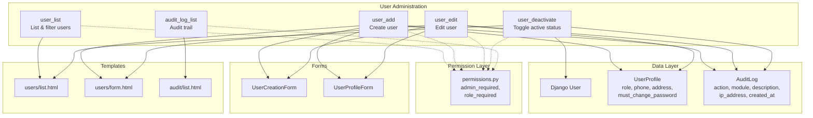
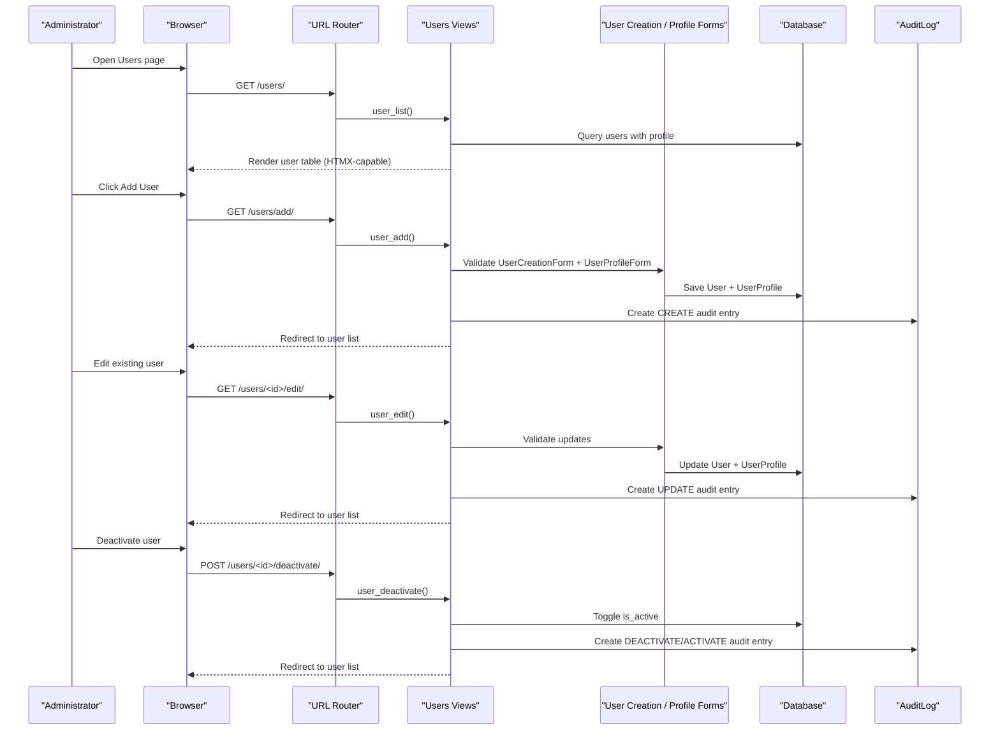
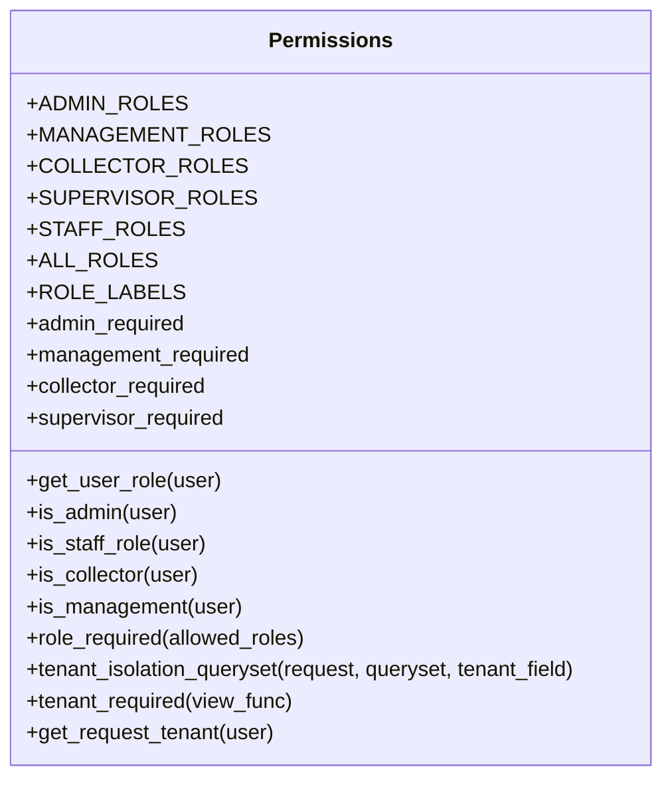
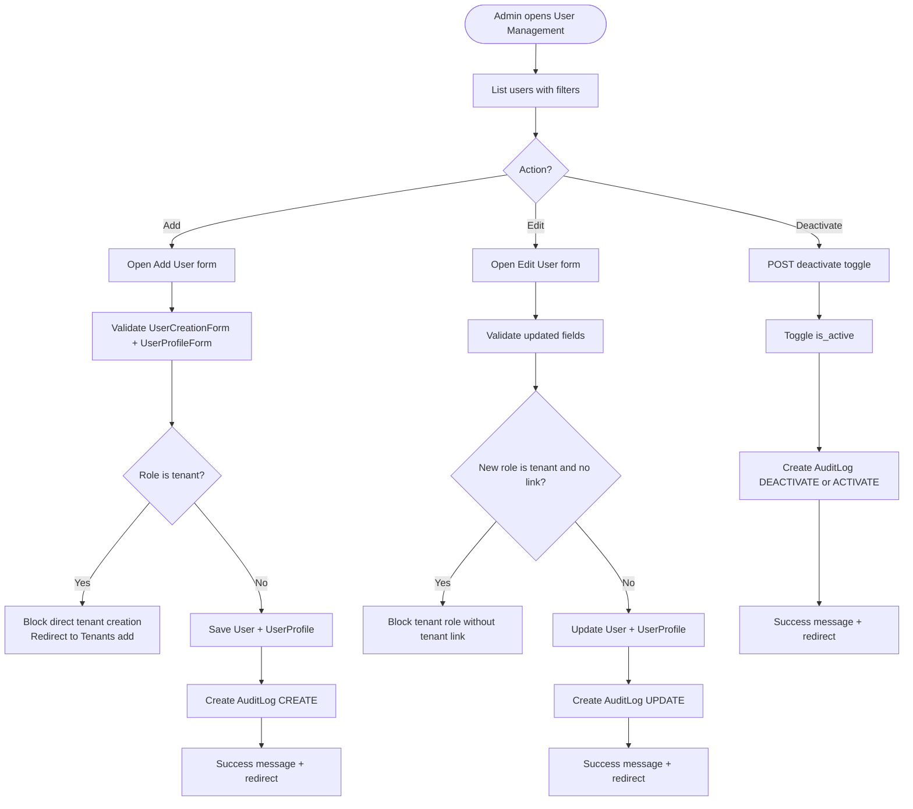
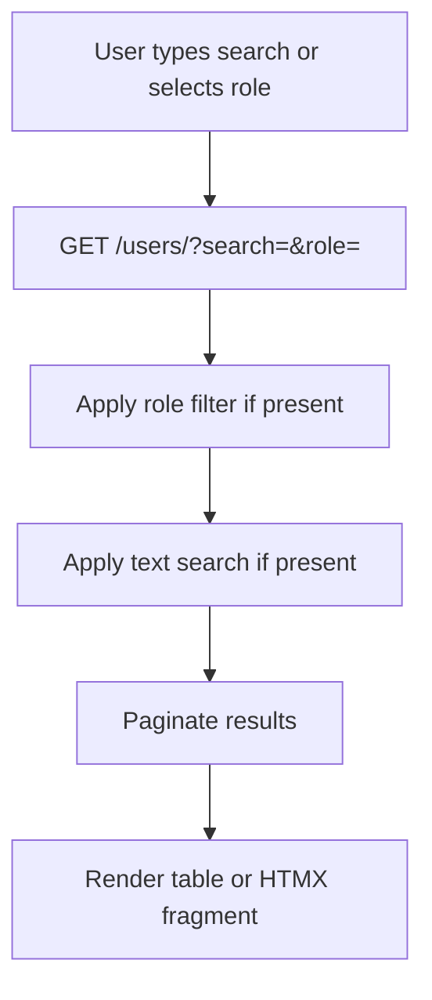
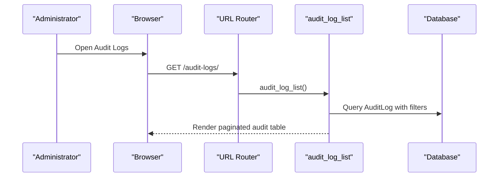
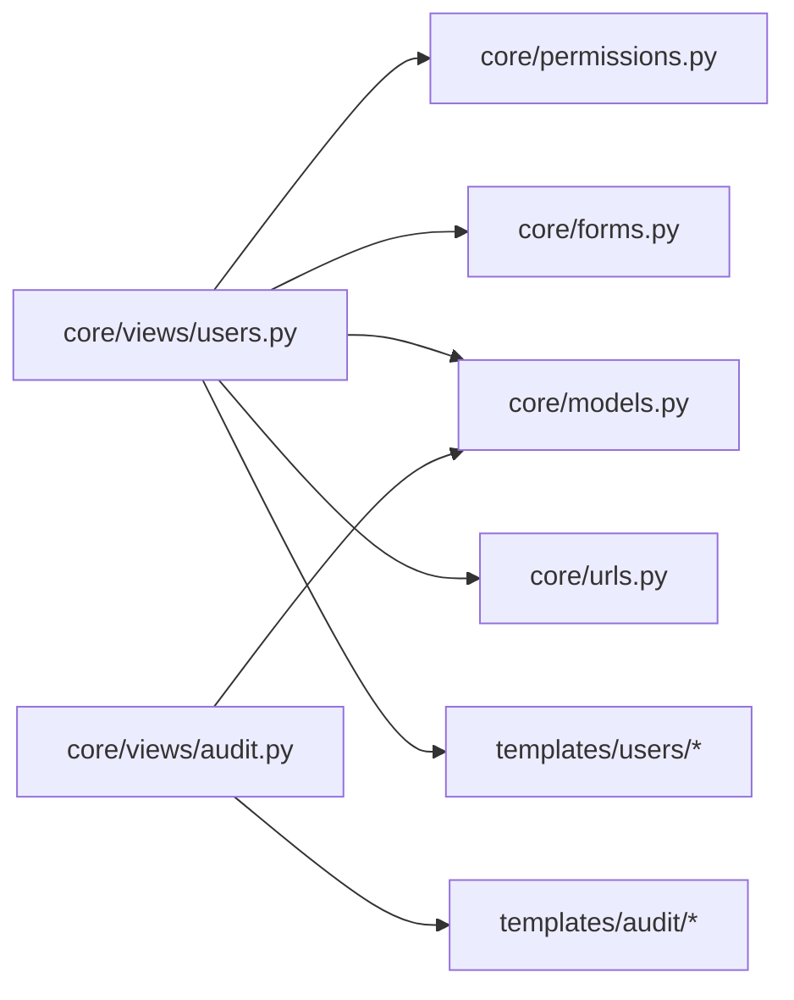

# User Administration

<cite>
**Referenced Files in This Document**
- [users.py](file://core/views/users.py)
- [models.py](file://core/models.py)
- [permissions.py](file://core/permissions.py)
- [forms.py](file://core/forms.py)
- [urls.py](file://core/urls.py)
- [list.html](file://templates/users/list.html)
- [form.html](file://templates/users/form.html)
- [audit.py](file://core/views/audit.py)
- [audit_list.html](file://templates/audit/list.html)
- [audit_table.html](file://templates/audit/_table.html)
</cite>

## Table of Contents
1. [Introduction](#introduction)
2. [Project Structure](#project-structure)
3. [Core Components](#core-components)
4. [Architecture Overview](#architecture-overview)
5. [Detailed Component Analysis](#detailed-component-analysis)
6. [Dependency Analysis](#dependency-analysis)
7. [Performance Considerations](#performance-considerations)
8. [Troubleshooting Guide](#troubleshooting-guide)
9. [Conclusion](#conclusion)

## Introduction
This document explains the User Administration module for the Market Rental System. It covers how system users are created, edited, deactivated, and assigned roles; how role-based permissions control access; how user activity is audited; and how administrators search, filter, and oversee accounts. It also clarifies tenant account creation boundaries, password handling, account lifecycle management, and compliance-oriented audit logging.

The module is built around:
- Django’s built-in `User` model extended by a custom `UserProfile`.
- A role-based permission layer that defines five staff roles plus tenants.
- Admin-only views for listing, creating, editing, and deactivating users.
- An audit trail that records administrative changes to user accounts.

## Project Structure
The User Administration feature spans views, models, forms, URLs, templates, and the shared permission layer.

**Diagram sources**
- [users.py:16-164](file://core/views/users.py#L16-L164)
- [models.py:7-20](file://core/models.py#L7-L20)
- [models.py:304-316](file://core/models.py#L304-L316)
- [permissions.py:61-87](file://core/permissions.py#L61-L87)
- [forms.py:29-46](file://core/forms.py#L29-L46)
- [forms.py:577-628](file://core/forms.py#L577-L628)
- [urls.py:190-198](file://core/urls.py#L190-L198)
- [list.html:1-47](file://templates/users/list.html#L1-L47)
- [form.html:1-110](file://templates/users/form.html#L1-L110)
- [audit.py:13-60](file://core/views/audit.py#L13-L60)
- [audit_list.html:1-42](file://templates/audit/list.html#L1-L42)

**Section sources**
- [users.py:16-164](file://core/views/users.py#L16-L164)
- [models.py:7-20](file://core/models.py#L7-L20)
- [models.py:304-316](file://core/models.py#L304-L316)
- [permissions.py:61-87](file://core/permissions.py#L61-L87)
- [forms.py:29-46](file://core/forms.py#L29-L46)
- [forms.py:577-628](file://core/forms.py#L577-L628)
- [urls.py:190-198](file://core/urls.py#L190-L198)
- [list.html:1-47](file://templates/users/list.html#L1-L47)
- [form.html:1-110](file://templates/users/form.html#L1-L110)
- [audit.py:13-60](file://core/views/audit.py#L13-L60)
- [audit_list.html:1-42](file://templates/audit/list.html#L1-L42)

## Core Components
- **User profile and roles**: The system extends Django’s `User` with a one-to-one `UserProfile` containing the role, contact details, and a flag requiring password change. Roles include admin, collector, cashier, supervisor, treasurer, and tenant.
- **Admin-only user management**: Listing, adding, editing, and deactivating users are protected by an admin-only decorator.
- **Role-based permissions**: Centralized helpers define role groups and decorators such as `admin_required`, `management_required`, `collector_required`, and `supervisor_required`.
- **Audit trail**: Administrative actions on users create audit log entries capturing action type, module, description, IP address, and timestamp.
- **Search and filtering**: The user list supports role filtering and full-text search across username, name fields, and email.
- **Tenant login boundary**: Tenant-role accounts must be created through the Tenants workflow so they are linked to a tenant record; direct user creation or editing blocks orphan tenant-role assignments.

**Section sources**
- [models.py:7-20](file://core/models.py#L7-L20)
- [permissions.py:6-30](file://core/permissions.py#L6-L30)
- [permissions.py:61-87](file://core/permissions.py#L61-L87)
- [users.py:16-164](file://core/views/users.py#L16-L164)
- [forms.py:29-46](file://core/forms.py#L29-L46)
- [forms.py:577-628](file://core/forms.py#L577-L628)

## Architecture Overview
The user administration flow uses standard Django request/response patterns with HTMX-assisted filtering and pagination.

**Diagram sources**
- [urls.py:190-198](file://core/urls.py#L190-L198)
- [users.py:16-164](file://core/views/users.py#L16-L164)
- [forms.py:29-46](file://core/forms.py#L29-L46)
- [forms.py:577-628](file://core/forms.py#L577-L628)
- [models.py:304-316](file://core/models.py#L304-L316)

## Detailed Component Analysis

### Role-Based Permission System
The permission system centralizes role definitions and access checks:
- Canonical role sets define who can manage records, collect payments, or act as supervisors.
- Decorators enforce access at the view level.
- Superusers bypass profile-based checks but still benefit from explicit guards where needed.

Key behaviors:
- `admin_required` restricts pages to administrators.
- `management_required` allows administrative operations excluding collectors.
- `collector_required` permits payment collection workflows.
- `supervisor_required` enables supervisory functions.
- `tenant_isolation_queryset` limits data exposure for tenant accounts.

**Diagram sources**
- [permissions.py:6-30](file://core/permissions.py#L6-L30)
- [permissions.py:32-87](file://core/permissions.py#L32-L87)
- [permissions.py:89-125](file://core/permissions.py#L89-L125)

**Section sources**
- [permissions.py:6-30](file://core/permissions.py#L6-L30)
- [permissions.py:32-87](file://core/permissions.py#L32-L87)
- [permissions.py:89-125](file://core/permissions.py#L89-L125)

### User Account Lifecycle Management
Lifecycle stages covered by the module:
- Creation: Admin creates a staff or tenant login via the dedicated form.
- Editing: Admin updates credentials, profile details, and role.
- Deactivation: Admin toggles `is_active`, preventing login while preserving history.
- Activation: Re-enabling restores access.

Important constraints:
- Tenant-role accounts cannot be created directly through the Users form; they must be created via the Tenants workflow to ensure linkage to a tenant record.
- Editing an unlinked account into the tenant role is blocked.

**Diagram sources**
- [users.py:16-164](file://core/views/users.py#L16-L164)
- [forms.py:577-628](file://core/forms.py#L577-L628)
- [models.py:304-316](file://core/models.py#L304-L316)

**Section sources**
- [users.py:16-164](file://core/views/users.py#L16-L164)
- [forms.py:577-628](file://core/forms.py#L577-L628)
- [models.py:304-316](file://core/models.py#L304-L316)

### User Search and Filtering
The user list provides:
- Role filter dropdown covering all six roles.
- Full-text search across username, first name, last name, and email.
- Pagination with ten users per page.
- HTMX-driven partial reloads for responsive filtering.

**Diagram sources**
- [users.py:16-44](file://core/views/users.py#L16-L44)
- [list.html:26-44](file://templates/users/list.html#L26-L44)

**Section sources**
- [users.py:16-44](file://core/views/users.py#L16-L44)
- [list.html:26-44](file://templates/users/list.html#L26-L44)

### Password Management
Password handling differs between creation and editing:
- Creation: Uses Django’s `UserCreationForm`, which hashes passwords securely.
- Editing: The template exposes an optional new password field; when provided, it updates the user’s password.
- Tenant self-service: A dedicated password change form exists for tenant portal use.
- Compliance flag: `UserProfile.must_change_password` supports policies requiring initial password resets.

Best practices:
- Use strong passwords and consider enforcing rotation policies via `must_change_password`.
- Avoid storing plaintext passwords; rely on Django’s hashing.
- For bulk password resets, prefer secure administrative procedures outside this module.

**Section sources**
- [forms.py:577-628](file://core/forms.py#L577-L628)
- [form.html:51-71](file://templates/users/form.html#L51-L71)
- [models.py:7-20](file://core/models.py#L7-L20)

### Bulk User Operations
There is no dedicated bulk user creation or bulk role assignment endpoint in the User Administration module. Bulk operations exist for other entities such as stalls and contracts. Administrators should:
- Create users individually through the Users interface.
- Use the Tenants workflow to create tenant-linked accounts in bulk where applicable.
- Apply roles during user creation or edit.

If bulk user provisioning is required, extend the current forms and views with batch validation, progress feedback, and comprehensive audit logging.

[No sources needed since this section provides general guidance based on existing code analysis]

### Security Policies and Compliance
- Access control: All user administration endpoints require administrator privileges.
- Auditability: Every create, update, and activation/deactivation action is recorded with actor, action, module, description, and IP address.
- Data isolation: Tenant accounts are isolated from other tenants’ data using helper utilities.
- Integrity guardrails: Direct tenant-role creation is blocked to prevent orphaned tenant logins.

Recommended policy enforcement:
- Require initial password reset for newly created staff accounts.
- Restrict role escalation to administrators only.
- Review audit logs regularly for unauthorized changes.
- Maintain least privilege by assigning minimal necessary roles.

**Section sources**
- [users.py:16-164](file://core/views/users.py#L16-L164)
- [permissions.py:61-87](file://core/permissions.py#L61-L87)
- [models.py:304-316](file://core/models.py#L304-L316)

### Activity Monitoring and Audit Trails
Administrators can review system-wide activity through the audit logs interface:
- Filters by user, action, module, date range, and free-text search.
- Displays actor, action type, module, description, IP address, and timestamp.
- Supports pagination and HTMX-driven filtering.

**Diagram sources**
- [urls.py:190-191](file://core/urls.py#L190-L191)
- [audit.py:13-60](file://core/views/audit.py#L13-L60)
- [audit_list.html:1-42](file://templates/audit/list.html#L1-L42)

**Section sources**
- [audit.py:13-60](file://core/views/audit.py#L13-L60)
- [audit_list.html:1-42](file://templates/audit/list.html#L1-L42)
- [audit_table.html:1-64](file://templates/audit/_table.html#L1-L64)

### Examples of Workflows

#### Example: Creating a Staff User
1. Navigate to Users → Add User.
2. Fill username, email, first name, last name, and password.
3. Select a staff role (e.g., Collector, Cashier, Supervisor, Treasurer).
4. Optionally set phone and address.
5. Submit to create the user and generate an audit log entry.

**Section sources**
- [users.py:47-95](file://core/views/users.py#L47-L95)
- [form.html:17-105](file://templates/users/form.html#L17-L105)
- [forms.py:577-628](file://core/forms.py#L577-L628)

#### Example: Editing a User’s Role and Credentials
1. Open the user’s edit page.
2. Update credentials and optionally set a new password.
3. Change the role if appropriate.
4. Submit to save changes and generate an audit log entry.

**Section sources**
- [users.py:98-145](file://core/views/users.py#L98-L145)
- [form.html:17-105](file://templates/users/form.html#L17-L105)

#### Example: Suspending an Account
1. Locate the user in the list.
2. Trigger deactivation for the user.
3. Confirm the audit log shows a DEACTIVATE action.
4. Reactivate later if access should be restored.

**Section sources**
- [users.py:148-164](file://core/views/users.py#L148-L164)
- [audit_table.html:28-43](file://templates/audit/_table.html#L28-L43)

#### Example: Reviewing User Changes in Audit Logs
1. Open Audit Logs.
2. Filter by module “User” and action “CREATE”, “UPDATE”, or “DEACTIVATE”.
3. Inspect descriptions and IP addresses for accountability.

**Section sources**
- [audit.py:13-60](file://core/views/audit.py#L13-L60)
- [audit_list.html:21-36](file://templates/audit/list.html#L21-L36)

## Dependency Analysis
The User Administration module depends on:
- Django’s authentication framework for user identity and password hashing.
- Custom models for roles and audit trails.
- Centralized permission helpers for consistent access control.
- Templates for rendering lists and forms.

**Diagram sources**
- [users.py:1-164](file://core/views/users.py#L1-L164)
- [permissions.py:1-125](file://core/permissions.py#L1-L125)
- [forms.py:29-46](file://core/forms.py#L29-L46)
- [forms.py:577-628](file://core/forms.py#L577-L628)
- [models.py:7-20](file://core/models.py#L7-L20)
- [models.py:304-316](file://core/models.py#L304-L316)
- [urls.py:190-198](file://core/urls.py#L190-L198)
- [list.html:1-47](file://templates/users/list.html#L1-L47)
- [form.html:1-110](file://templates/users/form.html#L1-L110)
- [audit.py:13-60](file://core/views/audit.py#L13-L60)
- [audit_list.html:1-42](file://templates/audit/list.html#L1-L42)

**Section sources**
- [users.py:1-164](file://core/views/users.py#L1-L164)
- [permissions.py:1-125](file://core/permissions.py#L1-L125)
- [forms.py:29-46](file://core/forms.py#L29-L46)
- [forms.py:577-628](file://core/forms.py#L577-L628)
- [models.py:7-20](file://core/models.py#L7-L20)
- [models.py:304-316](file://core/models.py#L304-L316)
- [urls.py:190-198](file://core/urls.py#L190-L198)
- [list.html:1-47](file://templates/users/list.html#L1-L47)
- [form.html:1-110](file://templates/users/form.html#L1-L110)
- [audit.py:13-60](file://core/views/audit.py#L13-L60)
- [audit_list.html:1-42](file://templates/audit/list.html#L1-L42)

## Performance Considerations
- User list queries use `select_related('profile')` to reduce N+1 queries when displaying profiles alongside users.
- Pagination limits displayed rows to improve responsiveness.
- HTMX partial reloads avoid full-page refreshes during filtering.
- Audit log queries order by newest first and paginate results.

Recommendations:
- Add database indexes on frequently filtered fields such as `UserProfile.role` and `AuditLog.created_at` if query performance becomes a concern.
- Consider caching role labels and role choices for UI rendering.
- Archive old audit logs periodically to maintain performance and storage efficiency.

[No sources needed since this section provides general guidance]

## Troubleshooting Guide
Common issues and resolutions:
- Cannot create tenant-role user from Users page:
  - Cause: Tenant logins must be linked to a tenant record.
  - Resolution: Create the tenant and its login through the Tenants workflow.
- Cannot assign tenant role to existing unlinked user:
  - Cause: The user has no linked tenant record.
  - Resolution: Link the user to a tenant or create the tenant login via the proper flow.
- Username uniqueness errors:
  - Cause: Duplicate usernames (case-insensitive).
  - Resolution: Choose a unique username; edits exclude the current instance from duplicate checks.
- Missing audit logs:
  - Cause: Actions not performed through audited views or missing audit middleware.
  - Resolution: Ensure changes go through admin views that write `AuditLog` entries.

Operational tips:
- Use the audit log filters to isolate user-related actions.
- Verify IP addresses in audit entries for security investigations.
- Monitor `must_change_password` for compliance with password policies.

**Section sources**
- [users.py:47-145](file://core/views/users.py#L47-L145)
- [forms.py:608-628](file://core/forms.py#L608-L628)
- [audit.py:13-60](file://core/views/audit.py#L13-L60)

## Conclusion
The User Administration module provides a secure, auditable, and role-aware foundation for managing system users. It enforces strict separation between staff and tenant account creation, centralizes role-based access control, and records administrative actions for compliance and oversight. Administrators can efficiently search, filter, and manage user accounts while maintaining clear audit trails. Future enhancements may include bulk user operations, advanced reporting, and expanded password policy controls.